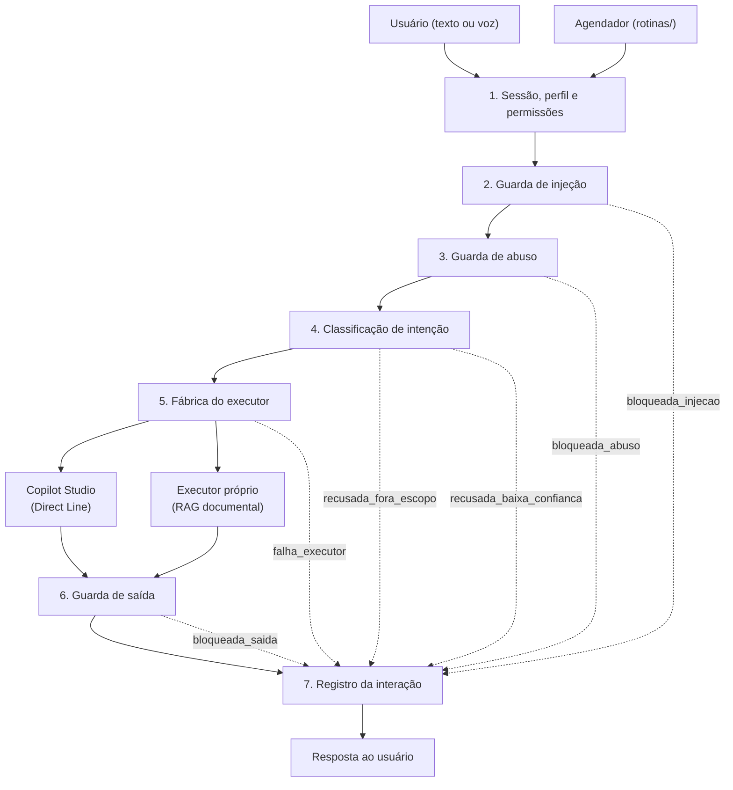
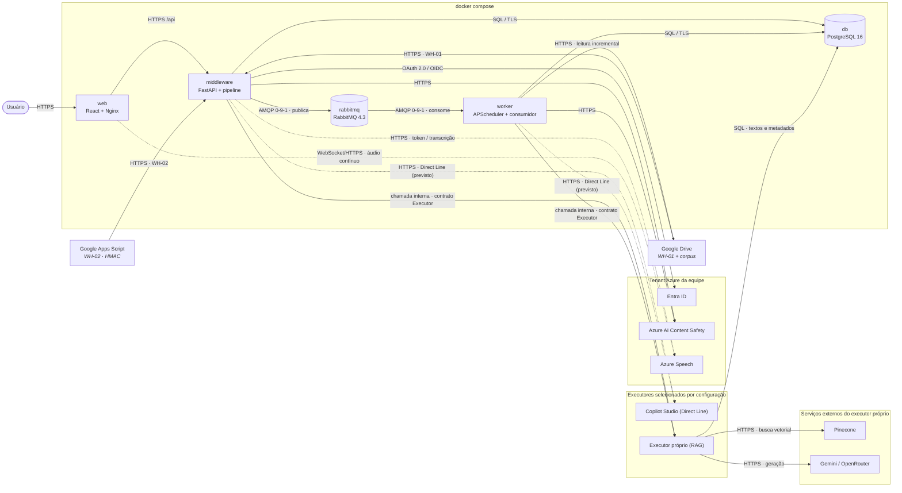
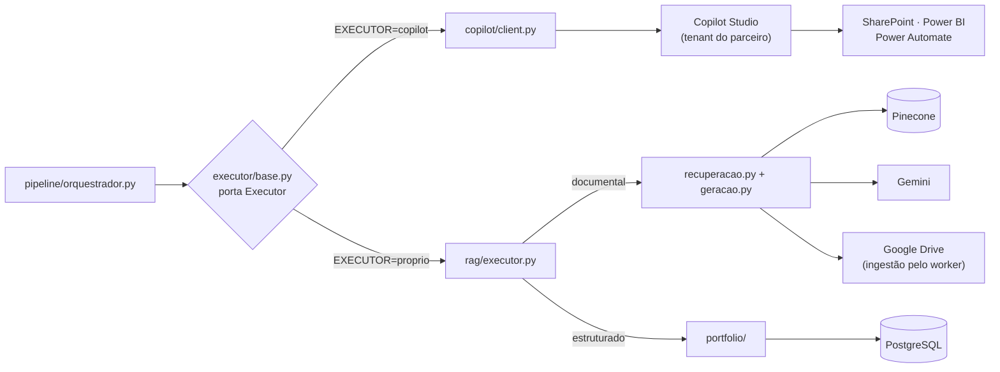

# Arquitetura da Solução — Agente de Portfólio do Metrô

Este documento descreve a arquitetura da solução e a estrutura de pastas que a
implementa. A solução posiciona um **middleware próprio** entre o usuário e o
executor configurado. A porta `Executor` permite selecionar o **Copilot Studio**
por Direct Line ou o **executor próprio**, que implementa recuperação de
documentos por RAG (*Retrieval-Augmented Generation*). A API também expõe o
portfólio estruturado no PostgreSQL por repositórios próprios; ele ainda não é
roteado pelo `ExecutorRag`. A prova de conceito executável usa o segundo
caminho; o primeiro depende de habilitação no tenant do parceiro.

O escopo foi revisado: o middleware deixa de ser uma camada de passagem
invisível e passa a ser o produto, com interface web própria, dados que são
consultados e não apenas escritos, e um processo que executa sem ninguém na
frente da tela.

## 1. Visão geral

O usuário nunca fala diretamente com o executor. Toda entrada — digitada,
ditada ou disparada por uma rotina agendada — passa pelo middleware, que cumpre
seis papéis:

1. **Proteger contra prompt injection** — barra tentativas de manipular o
   agente, combinando filtros por padrões conhecidos, um classificador por
   modelo e o envio da entrada do usuário sempre como dado rotulado, nunca
   concatenada a instruções.
2. **Proteger contra prompts maliciosos** — barra o uso indevido do agente
   corporativo por um usuário legítimo e autenticado, o que é um problema
   distinto de injeção e recebe tratamento distinto.
3. **Registrar intenções** — mapeia cada mensagem para o catálogo oficial de
   intenções e persiste a interação, qualquer que tenha sido o desfecho.
4. **Analisar os dados de intenções** — transforma esse registro em recortes
   que orientam a evolução do catálogo e a operação de segurança, disponíveis
   apenas a quem tem permissão para vê-los.
5. **Executar rotinas** — prompts pré-programados que disparam em datas
   planejadas, como um relatório para a diretoria todo dia 5.
6. **Receber integrações assíncronas** — valida os dois webhooks, garante os
   eventos no RabbitMQ e deixa o `worker` atualizar o portfólio ou o índice RAG
   fora do tempo da requisição HTTP.

Depois das guardas e da classificação, a fábrica em
`app/executor/fabrica.py` monta o adaptador selecionado por `EXECUTOR`. O
Copilot Studio recebe o prompt validado por Direct Line; o executor próprio
recupera trechos do corpus no Pinecone, mantém texto e metadados no PostgreSQL
e usa Gemini ou OpenRouter para compor a resposta. As consultas estruturadas do
portfólio são atendidas pelas rotas `portfolio/`. Ambos os executores obedecem
ao mesmo contrato e devolvem a resposta ao mesmo pipeline.

### 1.1 Trajeto de uma mensagem

A ordem das etapas é invariante de segurança e vive no orquestrador. Toda
saída, inclusive as bloqueadas, grava exatamente um registro — é esse registro
que sustenta o terceiro e o quarto papéis acima.



### 1.2 Componentes e serviços



O `worker` não chama a API por HTTP: ele importa o mesmo orquestrador em
processo. É o mesmo código, acionado por um gatilho diferente — ver
[seção 4](#4-rotinas-agendadas). Ele também consome
`prata.webhooks.incoming`; os webhooks só respondem `202` depois da confirmação
de publicação no RabbitMQ.

O diagrama é uma **visão lógica da solução em execução**, não a afirmação de
que todos os blocos estão hospedados na Azure. Localmente, os cinco serviços
do retângulo `docker compose` sobem juntos. Na nuvem, `web`, `middleware` e o
job de migração têm configuração de implantação; o `worker` é opcional e o
RabbitMQ ainda não foi provisionado. O detalhamento está na seção 6 de
[Projeto.md](Projeto.md).

### 1.3 Por que essa separação

| Ganho | Custo assumido |
|---|---|
| Controle e auditoria totais sobre o que entra e sai do executor | Latência extra (saltos de rede + inferência) |
| Catálogo de intenções como ativo próprio, independente do executor | Classificação de intenção duplicada com o *topic matching* do Copilot |
| Controle de acesso por perfil aplicado antes de qualquer ação | Dois ambientes para operar e versionar |
| Registro completo das interações, base para a análise de intenções | Banco próprio para manter, migrar e proteger |
| Interface própria: rotinas, histórico e dashboard que o Copilot não oferece | Experiência nativa do Copilot (ex.: canal Teams) deixa de ser aproveitada |

Sobre a duplicação de classificação: a decisão é que **o middleware é a fonte de
verdade** — ele classifica e envia a intenção já resolvida ao adaptador
selecionado. Quando o Copilot estiver ativo, seus tópicos funcionarão apenas
como mapeamento de ação (ver [copilot/topicos.md](../copilot/topicos.md)); no
executor próprio, o escopo do usuário filtra a recuperação documental. O
portfólio estruturado permanece acessível pelas rotas e repositórios próprios,
sem atribuir ao `ExecutorRag` um roteamento que ainda não existe.

## 2. As barreiras de segurança

*Prompt injection* e prompt malicioso são features separadas porque são ataques
diferentes, com alvos diferentes. Tratá-los no mesmo módulo produziria uma
política única para dois problemas que pedem respostas opostas.

| | Guarda de injeção | Guarda de abuso |
|---|---|---|
| **Alvo do ataque** | O sistema | A organização ou pessoas |
| **Exemplos** | Sequestrar o papel do assistente, extrair o prompt de sistema, fazer o agente ignorar regras, exfiltrar dado por caminho não autorizado | Pedir conteúdo abusivo, tentar engenharia social sobre um colega, usar o agente corporativo para fim alheio ao trabalho |
| **Resposta ao usuário** | Bloqueio seco, sem revelar o motivo | Recusa orientativa |
| **Tratamento interno** | Alerta de segurança | Registro nominal — o usuário é autenticado e conhecido |
| **Módulo** | `pipeline/guardas/injecao/` | `pipeline/guardas/abuso/` |

Há uma terceira classe que não deve ser confundida com nenhuma das duas:
`fora_de_escopo` é um pedido **legítimo** que o agente não atende ("qual a
previsão do tempo?"). Não é ataque nem abuso — é lacuna de produto, é uma
classe treinada do catálogo, e alimenta o backlog de novas intenções
(ver [seção 5](#5-registro-e-análise-de-intenções)).

### 2.1 A guarda de saída

Com o Copilot Studio lendo documentos do SharePoint, o ataque mais plausível
não chega pelo campo de texto: chega **dentro de um documento**. Alguém deposita
na biblioteca um arquivo com instruções embutidas, o Copilot o recupera para
compor a resposta, e a instrução volta ao usuário como se fosse conteúdo
legítimo. É a chamada injeção indireta.

Verificar apenas a entrada não cobre esse vetor, porque a entrada é inocente.
Por isso `pipeline/guardas/saida.py` avalia a resposta do Copilot antes de
entregá-la. É a única barreira posicionada para enxergar o problema.

## 3. Ordem das etapas

A ordem abaixo está codificada no orquestrador e não deve ser reordenada:

1. **sessão** — resolve identidade, perfil e permissões antes de qualquer
   processamento;
2. **guarda de injeção** — regras determinísticas primeiro, baratas e
   versionadas no repositório; depois o classificador por modelo. As duas
   camadas são complementares e nenhuma substitui a outra;
3. **guarda de abuso** — categorias de conteúdo mais as políticas de uso
   corporativo definidas pela equipe;
4. **classificação de intenção** — contra o catálogo, com limiar de confiança
   **por intenção**, porque errar uma transação custa mais que errar uma
   consulta;
5. **execução** — o prompt validado segue ao Copilot como dado rotulado, com a
   intenção em metadados;
6. **guarda de saída** — avalia a resposta antes da entrega;
7. **registro** — persiste a interação completa.

As duas guardas de entrada vêm antes da classificação porque uma mensagem
barrada não precisa ser classificada, e porque o classificador pode ser uma
chamada externa: barrar antes evita enviar conteúdo hostil a mais um serviço.

## 4. Rotinas agendadas

Uma rotina é um prompt gravado que executa sem ninguém na frente da tela. Isso
cria dois riscos que não existem no chat, e duas decisões de projeto existem
para fechá-los.

**A rotina não pode ser desvio das guardas.** Se o agendador chamasse o Copilot
diretamente, bastaria cadastrar uma rotina com um prompt de injeção para
contornar toda a proteção — e ela rodaria periodicamente, sem testemunha. Por
isso `rotinas/execucao.py` entra pelo **mesmo orquestrador**, apenas com
`canal=rotina`. O agendador é uma porta de entrada a mais, no mesmo corredor,
não um atalho ao lado dele.

**A rotina não pode ser escalada de privilégio.** Ela executa sob a identidade
e as permissões do dono, resolvidas **na execução** e não no cadastro. Se o dono
perder acesso a um projeto, a rotina perde junto no disparo seguinte.

Essa revalidação é concreta: `auth/entra.py::consultar_usuario` usa o fluxo
OAuth 2.0 *client credentials* e consulta no Microsoft Graph o usuário e seus
grupos transitivos. O registro de aplicação requer `User.Read.All` como
permissão **Application**, com consentimento administrativo. Os grupos são
novamente traduzidos por `auth/permissoes.py`, e os vínculos atuais da tabela
`usuario_projeto` recompõem o filtro de projetos usado pelo RAG. Nenhuma sessão
antiga nem permissão copiada no cadastro da rotina é reutilizada.

As falhas são separadas por permanência. Usuário inexistente/desativado ou
perda de `GERIR_ROTINAS` fecha a execução como `falha` e desativa a rotina;
repeti-la nunca devolveria o acesso. Timeout, 5xx ou falha de token do Graph
também fecha o disparo como `falha`, mas mantém a rotina ativa para uma nova
tentativa no próximo horário. Tokens e respostas pessoais do Graph não são
gravados no histórico.

A validação do prompt acontece em dois momentos. No cadastro, com o usuário
presente, ele passa pelas guardas e pelo classificador: se não resolver numa
intenção do catálogo, o cadastro é recusado ali, com explicação — falhar cedo,
enquanto há alguém para corrigir. Na execução, tudo é reavaliado, porque o
catálogo e as permissões podem ter mudado desde então.

O resultado é entregue no próprio app: cada disparo produz uma `ExecucaoRotina`
ligada à `Interacao` correspondente, e a tela de rotinas exibe o histórico com
status. Não depende de e-mail, Teams ou integração externa para funcionar.
O estado inicial `em_execucao` é confirmado antes da chamada externa; ao fim,
ele muda para `sucesso`, `bloqueada` ou `falha`. Assim, um processo interrompido
continua aparecendo como execução aberta em vez de desaparecer do histórico.

Dois detalhes operacionais que o agendador precisa tratar explicitamente:

- **fuso** — "todo dia 5 às 8h" significa 8h em `America/Sao_Paulo`. Um *cron*
  em UTC dispara na hora errada. O fuso é campo da rotina, não constante do
  sistema;
- **disparo perdido** — se o worker estiver fora do ar no horário, o padrão do
  APScheduler é descartar o disparo ou reexecutar em rajada ao voltar.
  `coalesce` e `misfire_grace_time` são o que impede o relatório de sair três
  vezes seguidas.

O PostgreSQL é a fonte de verdade tanto para as rotinas quanto para o
*jobstore*. Somente o `worker` instancia o APScheduler: a API cria, edita ou
desativa a linha de `rotina`, e o `worker` reconcilia as rotinas ativas com os
*jobs* persistidos a cada **30 segundos** (configurável por
`ROTINAS_RECONCILIACAO_SEGUNDOS`). Uma criação ou edição, portanto, entra na
agenda em até esse intervalo sem reiniciar o processo. A separação evita dois
schedulers compartilhando o mesmo *jobstore*, condição que poderia duplicar
disparos. O APScheduler 3 acessa o *jobstore* de forma síncrona com `psycopg`,
enquanto os repositórios da aplicação continuam assíncronos com `asyncpg`.

## 5. Registro e análise de intenções

Registro e análise são duas features, mas formam um circuito só: o que o
dashboard revela deve voltar como mudança no catálogo. Sem esse retorno, a
análise vira relatório e o catálogo envelhece.

| Recorte | Decisão que habilita |
|---|---|
| Volume por intenção, por período | Mostra o que o agente realmente faz — e quais das 28 classes nunca são acionadas |
| Distribuição de desfechos | Saúde geral: quanto é atendido, quanto é bloqueado, quanto falha |
| Série de bloqueios por guarda | Indicador de segurança; um pico em injeção é incidente, não estatística |
| Agrupamento de `fora_de_escopo` | **Backlog de novas intenções** — o que os usuários pedem e o agente não faz |
| Agrupamento de `baixa_confianca` | Onde o classificador precisa de mais exemplos de treino |
| Confiança média por intenção | Aponta classes confundidas entre si; casa com a matriz de confusão exigida pelo RNF03 |
| Recorte por perfil e por canal | Como cada perfil usa o agente de forma diferente, e quanto vem por voz |
| Latência p50 / p95 | O custo do pedágio, mensurável; sustenta o argumento de desempenho |

Para o volume esperado de um MVP, agregação em SQL sobre a tabela de interações
é suficiente, com índices em `(criada_em)`, `(intencao_id, criada_em)` e
`(desfecho, criada_em)`. Vista materializada apenas se o dashboard começar a
pesar — não antecipar.

## 6. Perfis e permissões

Duas dimensões independentes, resolvidas em `auth/permissoes.py` a partir de
*claims* de grupo do Entra ID. Nenhuma lista de usuários vive no código.

| Dimensão | Valores | Governa |
|---|---|---|
| Perfil | `DIRETORIA`, `LIDER_PROJETO`, `MEMBRO_EQUIPE` | Escopo de dados e profundidade da resposta |
| Permissão | `VER_INTENCOES`, `GERIR_ROTINAS` | Acesso ao dashboard e à gestão de rotinas |

A separação é deliberada: um líder de projeto pode ou não ver o dashboard de
intenções, e isso não muda como o agente responde às perguntas dele sobre o
portfólio. Amarrar as duas coisas num único enum obrigaria a criar perfis
artificiais para cada combinação.

Regra que vale sem exceção: **o frontend esconde rotas por conveniência; quem
barra é o backend.** Uma rota escondida no React é decoração de interface, não
controle de acesso.

## 7. Tecnologias

A tabela resume as escolhas da versão final. A matriz completa, com a versão,
a justificativa e a situação de cada tecnologia, inclusive das previstas e não
usadas, está em 5.1.5 de [Projeto.md](Projeto.md).

| Camada | Escolha | Por quê |
|---|---|---|
| Interface | React 19 + TypeScript 5.9 + Vite 5.4 (SPA estática) | Nenhum runtime JS em produção; o Python segue sendo o único servidor de aplicação da equipe |
| Estilo e componentes | Tailwind CSS 4 + shadcn/ui sobre os primitivos acessíveis do Radix | Responsivo por breakpoint, exigência de mobile e desktop; tema claro e escuro por tokens |
| Roteamento | React Router 6 | Rotas aninhadas deixam a tela de entrada fora da moldura da aplicação |
| Estado de servidor | TanStack Query 5 | Cache e revalidação do histórico e das execuções de rotina |
| Gráficos | Recharts 3 | Dashboard de intenções |
| API | FastAPI (Python 3.12) + Pydantic v2 | Base já existente do middleware |
| Autenticação | Entra ID, Authorization Code + PKCE no FastAPI, com httpx e PyJWT | Token fora do navegador sem o custo de um segundo runtime; o MSAL foi descartado por ser síncrono e não conferir a assinatura do `id_token` |
| Persistência | SQLAlchemy 2 (async) + asyncpg + Alembic | O esquema passa a mudar em várias frentes; versionar é o que permite reverter |
| Banco | PostgreSQL 16, gerenciado na Azure pelo Flexible Server | Registro de interações, agregações do dashboard, dados estruturados do portfólio e texto do corpus |
| Agendador | APScheduler 3, jobstore SQLAlchemy | Agenda persistida no banco que já existe; sem Redis nem broker para a agenda |
| Mensageria | RabbitMQ 4.3 + aio-pika 9 | Fila durável dos eventos dos webhooks, com novas tentativas e fila de falhas; existe apenas no Compose (9.1.2.6 de [Projeto.md](Projeto.md)) |
| Webhooks | Rotas FastAPI + emissor em Google Apps Script | Notificações do Google Drive (WH-01) e eventos do portfólio assinados com HMAC (WH-02), descritos em 9.1.2.7 de [Projeto.md](Projeto.md) |
| Guardas (modelo) | Azure AI Content Safety | Prompt Shields cobre injeção direta e indireta; as categorias de conteúdo cobrem abuso. Uma API para as duas features, provisionada no tenant da equipe (risco R12) |
| Classificação de intenção | Ensemble: TF-IDF (palavra + caractere) e embeddings `multilingual-e5-large`, ambos com regressão logística | Devolve probabilidade *calibrada*, requisito do limiar por intenção já previsto no catálogo. Escolhido por medição, não por preferência — ver 5.4.11 de [Projeto.md](Projeto.md) |
| Voz | Azure Speech: token efêmero emitido pelo backend para o microfone e transcrição dos arquivos de áudio no backend | Transcrição parcial em tempo real e chave nunca exposta; o serviço fica no tenant da equipe e é reprovisionável no do parceiro por configuração (seção 12.2) |
| Executor | Executor próprio (Google Drive, Pinecone e Gemini) atrás da porta `Executor`; Copilot Studio via Direct Line previsto | O Direct Line depende de habilitação no tenant do parceiro, ainda pendente (seção 12.2); a porta mantém os dois caminhos, trocados pela variável `EXECUTOR` (seção 13) |
| Nuvem | Azure Container Apps, Container Registry, Key Vault e Log Analytics | Contêineres e um PostgreSQL padrão preservam a portabilidade; a escala a zero cabe no teto de R$ 300 por ano (11.2.6 de [Projeto.md](Projeto.md)) |
| Integração contínua | GitLab CI com OIDC | Verificação de cada merge request e implantação sem segredo guardado no GitLab |
| Testes | pytest, pytest-asyncio, pytest-cov, Locust, pytest-recording, Vitest, Testing Library e MSW | Espelham a separação backend/frontend |

Duas escolhas merecem justificativa mais longa, porque a alternativa óbvia foi
descartada.

**FastAPI como BFF, em vez de um runtime Node.** O argumento clássico para
adotar Next.js é que numa SPA o token OAuth fica no navegador. Mas o fluxo
Authorization Code pode ser executado pelo próprio FastAPI, que grava a sessão
num cookie `httpOnly` + `SameSite=Strict`; o React nunca vê um `access_token`.
Obtém-se a mesma propriedade de segurança sem adicionar um segundo servidor de
aplicação — e com o efeito colateral de manter `api/deps.py` como ponto único
de resolução de identidade e permissão.

**Azure Speech, em vez da Web Speech API do navegador.** A API nativa seria
gratuita e sem infraestrutura, mas envia o áudio a servidores de terceiros fora
do tenant do parceiro. O microfone seria o primeiro furo no argumento de
confidencialidade da solução (ver [seção 11](#11-consequências-em-aberto)).

## 8. Estrutura de pastas

```text
g02/
├── src/
│   ├── middleware/                   # Backend (Python + FastAPI)
│   │   ├── app/
│   │   │   ├── main.py               # Entrypoint da API
│   │   │   ├── worker.py             # Entrypoint do agendador
│   │   │   ├── config.py             # Configurações via variáveis de ambiente
│   │   │   ├── api/                  # Porta de entrada HTTP
│   │   │   │   ├── deps.py           # Sessão, perfil e permissões
│   │   │   │   └── routes/           # auth, chat, conversas, intencoes, rotinas, voz, health
│   │   │   ├── auth/                 # Fluxo OAuth do Entra ID e sessão
│   │   │   │   ├── entra.py          # Authorization Code + PKCE
│   │   │   │   ├── sessao.py         # Cookie httpOnly, SameSite=Strict
│   │   │   │   └── permissoes.py     # Claims de grupo -> Perfil + Permissao
│   │   │   ├── pipeline/             # Coração da solução
│   │   │   │   ├── orquestrador.py   # Encadeia as etapas e decide o destino
│   │   │   │   ├── desfechos.py      # Vocabulário fechado das decisões
│   │   │   │   ├── respostas.py      # Textos das recusas
│   │   │   │   ├── guardas/
│   │   │   │   │   ├── injecao/      # Ataque AO agente: regras + classificador
│   │   │   │   │   ├── abuso/        # Uso indevido DO agente: políticas + classificador
│   │   │   │   │   └── saida.py      # Injeção indireta vinda da resposta
│   │   │   │   └── intencao/         # Catálogo e classificador de intenções
│   │   │   ├── rotinas/              # Prompts agendados
│   │   │   │   ├── agendador.py      # APScheduler com jobstore no banco
│   │   │   │   ├── execucao.py       # Executa a rotina PELO orquestrador
│   │   │   │   └── validacao.py      # Valida o prompt no momento do cadastro
│   │   │   ├── analytics/            # Análise dos dados de intenções
│   │   │   │   ├── consultas.py      # Agregações SQL
│   │   │   │   └── metricas.py       # Séries e recortes do dashboard
│   │   │   ├── voz/                  # Emissão do token efêmero do Azure Speech
│   │   │   ├── copilot/              # Cliente Direct Line (único ponto que conhece o Copilot)
│   │   │   ├── persistence/          # Modelos, sessão do banco e repositórios
│   │   │   └── schemas/              # Contratos Pydantic de request/response
│   │   ├── migrations/               # Migrações Alembic
│   │   ├── tests/
│   │   │   ├── unit/                 # Uma suíte por guarda, catálogo e agendador
│   │   │   └── integration/          # Fluxo completo com os serviços externos dublados
│   │   ├── pyproject.toml
│   │   ├── Dockerfile
│   │   └── .env.example
│   │
│   └── web/                          # Frontend (React + TypeScript + Vite)
│       ├── src/
│       │   ├── rotas.tsx
│       │   ├── paginas/              # Chat, Historico, Intencoes, Rotinas
│       │   ├── componentes/          # chat/, graficos/, ui/
│       │   ├── hooks/                # useConversa (SSE), useMicrofone (Speech SDK)
│       │   ├── servicos/             # Cliente HTTP tipado da API
│       │   └── tipos/
│       ├── vite.config.ts
│       ├── package.json
│       ├── Dockerfile
│       └── nginx.conf                # Estáticos + proxy /api -> middleware
│
├── copilot/                          # Lado Copilot Studio (configuração versionada)
│   ├── solucao/                      # Sem exports: proibidos pelo parceiro (R23)
│   ├── topicos.md                    # Contrato intenção -> tópico/ação
│   └── conectores.md                 # Conectores habilitados e permissões (governança)
│
├── infra/
│   └── docker-compose.yml            # web + middleware + worker + db
│
└── docs/                             # Documentação do projeto (este arquivo incluído)
```

`src/middleware/` mantém o nome: ele continua literalmente mediando entre a
interface e o Copilot. O que mudou é que deixou de ser a única frente de
código.

### 8.1 `src/middleware/` — o backend

Cada pasta responde a uma pergunta distinta:

- **`api/`** — *quem pode falar comigo?* As rotas conectam HTTP ao pipeline sem
  conter lógica de PLN. `deps.py` resolve sessão, perfil e permissões **antes**
  de qualquer processamento.
- **`auth/`** — *como sei quem é essa pessoa?* Concentra o fluxo OAuth contra o
  Entra ID, a sessão em cookie e a tradução de *claims* de grupo em perfil e
  permissões. Fica separado de `api/` porque é lógica de identidade, não de
  transporte.
- **`pipeline/`** — *essa mensagem é segura e o que ela quer?* As três etapas de
  entrada (`guardas/injecao/`, `guardas/abuso/`, `intencao/`) mais a guarda de
  saída são módulos independentes, encadeados pelo `orquestrador.py` em ordem
  fixa. A separação permite testar cada etapa isolada e trocar implementações
  sem tocar no resto.
- **`rotinas/`** — *o que roda sozinho?* Agendamento, validação e execução dos
  prompts pré-programados. Note que `execucao.py` depende de `pipeline/`, e
  nunca de `copilot/` diretamente: essa direção de dependência é o que garante
  que uma rotina não contorne as guardas.
- **`analytics/`** — *o que os registros dizem?* Só leitura, só agregação.
  Separado de `persistence/` porque as perguntas do dashboard mudam com muito
  mais frequência que o esquema.
- **`voz/`** — *como transcrevo áudio?* Emite o token de curta duração que o
  navegador usa para falar com o Azure Speech e transcreve os arquivos
  enviados pela Fast Transcription, depois de o `ffprobe` confirmar a trilha
  de áudio e a duração. A chave do recurso não sai daqui.
- **`copilot/`** — *como executo a ação?* O `client.py` é o único ponto do
  middleware que conhece o Copilot (via API Direct Line). Trocar o executor no
  futuro significa substituir apenas este módulo.
- **`persistence/`** — *o que registro disso?* Guarda cada interação com o
  prompt, a resposta, a intenção classificada, o perfil, o canal e o desfecho.
  É a mesma tabela que serve ao histórico do usuário e ao dashboard.
- **`schemas/`** — *qual o contrato da API?* Modelos Pydantic validam entrada e
  saída automaticamente e documentam a interface para o frontend.
- **`tests/`** — espelha o backend: `unit/` testa cada etapa isolada;
  `integration/` exercita o fluxo completo com Copilot e Content Safety
  dublados, sem depender do ambiente Microsoft.

### 8.2 `src/web/` — a interface

Quatro telas, correspondentes às capacidades acordadas: **Chat** (conversa e
microfone), **Histórico** (lista e retomada de conversas), **Intenções**
(dashboard, rota protegida por `VER_INTENCOES`) e **Rotinas** (cadastro, agenda
e execuções, protegida por `GERIR_ROTINAS`).

O build gera arquivos estáticos servidos por Nginx, que também faz proxy de
`/api` para o middleware. Como o navegador e a API ficam na mesma origem, o
cookie de sessão viaja sem CORS e sem exceção de `SameSite`.

### 8.3 `copilot/` — configuração versionada do executor

O Copilot Studio é configurado por interface no tenant do parceiro e não gera
código-fonte; o que se versiona são os artefatos de rastreabilidade:

- **`solucao/`** — deliberadamente vazia. O parceiro proíbe versionar o export
  da *solution*, porque ele carrega links do SharePoint e conexões do ambiente
  restrito (`R23` em [GestaoProjeto.md](GestaoProjeto.md)). O README da pasta
  registra a proibição, e o `.gitignore` barra o que for colocado ali; backup e
  migração ficam no ambiente do parceiro;
- **`topicos.md`** — o contrato entre os dois mundos: qual intenção do catálogo
  dispara qual tópico/ação. Deve evoluir junto com
  `src/middleware/app/pipeline/intencao/catalogo.py`;
- **`conectores.md`** — registro de governança dos conectores e permissões,
  seguindo menor privilégio. É também parte da defesa em profundidade: mesmo
  que uma injeção alcance o Copilot, o raio de dano fica limitado às ações ali
  autorizadas.

A pasta fica fora de `src/` por ser configuração de um sistema externo, não
código da equipe.

### 8.4 `infra/` — ambiente de desenvolvimento

O `docker-compose.yml` sobe os cinco serviços (`web`, `middleware`, `worker`,
`db` e `rabbitmq`) com um comando, permitindo que qualquer integrante rode a
solução localmente apenas com Docker instalado. O `worker` é contêiner separado
da `api` por duas razões: mantém a API sem estado e evita disparo duplicado de
rotinas quando ela reinicia ou escala. A implantação na Azure está na seção 6
de [Projeto.md](Projeto.md).

## 9. Modelo de dados

O esquema versionado tem **oito tabelas**. O capítulo 4 de
[Projeto.md](Projeto.md) detalha o núcleo inicial e delimita as adições de autenticação e RAG:

| Entidade | Papel |
|---|---|
| `usuario` | Identidade projetada do Entra ID: `id` do provedor, `nome`, `email`, `perfil` e `visto_em` |
| `conversa` | Sessão de diálogo: título, vínculo com o Direct Line e arquivamento |
| `interacao` | Uma mensagem processada: prompt, resposta, canal, intenção, confiança, desfecho e latência |
| `rotina` | Prompt agendado, com recorrência, fuso e o usuário sob cuja identidade executa |
| `execucao_rotina` | Um disparo e seu resultado, com início e fim gravados separadamente |
| `sessao_usuario` | Sessão de login, perfil e permissões observados no login, com expiração |
| `rag.arquivo` | Proveniência e controle dos arquivos ingeridos para recuperação documental |
| `rag.trecho` | Trechos dos arquivos ingeridos e vínculo com sua origem |

A modelagem entregue na Sprint 2 tinha três entidades e antecipava, por escrito,
os desdobramentos que faltavam: a conversa como entidade própria, o histórico de
execuções de rotina e o vocabulário fechado de desfechos. Os três estão
construídos, cada um ligado a um requisito já registrado (RF11, RF12), e
chegaram por migração versionada — o esquema evolui por Alembic, e o `versions/`
é a fonte de verdade sobre o que existe no banco.

O campo `canal` parece pequeno e não é: é ele que permite ao dashboard separar
voz de texto de rotina, e é ele que torna cada disparo agendado rastreável até
a mensagem que gerou. Sem ele, uma execução de rotina fica indistinguível de
alguém digitando.

Uma linha de `interacao` é gravada em **todos** os desfechos, inclusive nos
bloqueios. As tentativas de ataque são justamente o dado mais valioso do
recorte de segurança do dashboard.

As permissões não são persistidas: resolvem-se dos *claims* de grupo a cada
requisição. Projetá-las no banco criaria uma segunda fonte de verdade capaz de
conceder um acesso que o Entra já revogou.

## 10. Decisões de segurança embutidas na estrutura

1. **Ordem fixa do pipeline** (sessão → injeção → abuso → intenção → execução →
   saída → registro): invariante documentada no `orquestrador.py`.
2. **Duas guardas distintas para dois ataques distintos**: injeção e abuso têm
   módulos, políticas e desfechos próprios, porque a resposta correta a cada um
   é diferente.
3. **Guarda na volta, não só na ida**: a resposta do Copilot é verificada antes
   da entrega, cobrindo injeção indireta vinda de documentos do SharePoint.
4. **Entrada como dado, nunca como instrução**: o cliente Direct Line envia a
   mensagem do usuário rotulada, com a intenção já resolvida em metadados.
5. **O agendador não é atalho**: rotinas entram pelo mesmo orquestrador, sob a
   identidade do dono, com permissões resolvidas na execução.
6. **Token OAuth fora do navegador**: o fluxo acontece no backend e a sessão
   vive em cookie `httpOnly`; `api/deps.py` é o ponto único de controle de
   acesso.
7. **Autorização no servidor**: o frontend esconde rotas por conveniência, mas
   todo endpoint verifica perfil e permissão por conta própria.
8. **Menor privilégio nos conectores**: limita o impacto de qualquer ataque que
   ultrapasse as barreiras do middleware.
9. **Segredos fora do código**: toda configuração sensível vem de variáveis de
   ambiente (`.env` não versionado; `.env.example` documenta as chaves).
10. **Recusas que não ensinam**: nenhuma mensagem de erro revela qual barreira
    barrou nem repete a instrução recebida.

## 11. Consequências em aberto

A revisão de escopo removeu a camada de mascaramento reversível de PII e a
cifra dos valores em repouso. As consequências que isso abriu foram todas
encaminhadas, e ficam registradas aqui com seu desfecho — o histórico importa
tanto quanto o estado atual, porque é ele que mostra o que a remoção custou.

- **RNF01 sem implementação correspondente.** ✅ **Resolvido.** O requisito era
  atendido exatamente pelo mascaramento e ficou sem componente responsável. Foi
  reescrito como propriedade das **rotas**, e não dos dados: a seção 3.3.1.1 de
  [Projeto.md](Projeto.md) enumera os sete serviços que participam do caminho de
  uma mensagem, com o tenant de cada um, e a verificação passou a ser por
  inspeção de configuração em vez de amostragem. A reescrita tornou visível o
  que a formulação anterior escondia: Content Safety e Speech ficaram no tenant
  da equipe, e não no do parceiro — exposição declarada e registrada como risco
  R12.
- **Prompt em claro no banco.** ✅ **Resolvido.** Retenção declarada com expurgo
  automático e cifra em repouso deixaram de ser recomendação em prosa e viraram
  requisito próprio, o **RNF07**, com métrica e critério de aceitação. O risco
  correspondente é o R13, e o acesso de leitura continua restrito pela permissão
  de visualização, verificada no servidor.
- **Rastreabilidade da mudança de responsabilidade.** ✅ **Resolvido.** **RF04 a
  RF08** passaram a ser executados pelo Copilot Studio, cabendo à equipe as
  guardas, o registro, a análise e as rotinas. A matriz de correlação de 3.4 do
  [Projeto.md](Projeto.md) foi refeita para esse recorte, com nota de revisão
  explícita.
- **`Desfecho.preserva_prompt`.** ✅ **Removida.** A propriedade existia para não
  gravar o prompt de tentativas de injeção, porque a mensagem era barrada antes
  do mascaramento e não havia versão segura dela. Sem a camada de PII a
  justificativa caiu, e a propriedade passou a atrapalhar a análise de
  segurança. Resta apenas a nota histórica em `pipeline/desfechos.py`.

Permanece em aberto **um** ponto, e ele não decorre da remoção do mascaramento:
o reprovisionamento de Content Safety e Speech no tenant do parceiro, que é
pré-condição para qualquer uso com dado real. Enquanto não ocorrer, o MVP opera
sob a condição declarada de processar exclusivamente dados sintéticos.

## 12. Estado atual e próximos passos

O **orquestrador está implementado e coberto por testes**, na forma anterior do
pipeline. Os testes usam dublês para todas as etapas e verificam, além de um
caso por desfecho, invariantes de ordem e de registro. Ele é o ponto de partida
da adaptação: ganha as etapas de abuso e de saída, e perde a de mascaramento.

O **catálogo de intenções** está completo, com 26 intenções mais as classes
negativas `fora_de_escopo` e `tentativa_injecao`, derivado da seção 5.4.4 de
[Projeto.md](Projeto.md) e de
[testes-catalogo-intencoes.csv](../src/middleware/dados/testes-catalogo-intencoes.csv).

O **classificador de intenção está implementado, treinado e medido**. A bancada
de avaliação (F21) roda com `python -m app.pipeline.intencao.avaliacao` sobre
431 casos de teste que nunca participaram do ajuste, e o RNF03 é atendido:
acurácia de 0,856 e macro-F1 de 0,851. A comparação entre estratégias exigida
pela F22 sai com `--f22`. Os resultados e o que eles revelam sobre o catálogo
estão em 5.4.11 de [Projeto.md](Projeto.md).

O **limiar de confiança deixou de ser um ponto em aberto**: é derivado por
validação cruzada sobre o conjunto de treino, um por intenção, com alvo que
depende da categoria — transação mira precisão, classe negativa mira recall. O
valor calibrado tem precedência sobre o `LIMIAR_CONFIANCA_PROVISORIO` do
catálogo, que só volta a valer se o modelo for treinado sem calibração.

`tentativa_injecao` é a única classe do catálogo cujo desfecho não é uma
recusa: o orquestrador a converte em `BLOQUEADA_INJECAO_MODELO`, com alerta de
segurança. É rede de segurança atrás da guarda de injeção, não substituta dela
— o que chega ao classificador já passou pelas regras e pelo Content Safety.

O restante da estrutura contém **esqueletos documentados**: interfaces,
contratos e regras de decisão estão definidos, com implementações marcadas por
`NotImplementedError` e `TODO`.

### 12.1 Ordem de construção

A sequência abaixo é de dependência, não de importância. Cada onda termina com
algo demonstrável ponta a ponta.

| Onda | Escopo | Estado ao fim |
|---|---|---|
| 1. Fundação | Persistência e Auth BFF implementados; integração `/chat` ponta a ponta ainda parcial. As duas heads do Alembic foram conciliadas por linearização das revisões, e a criação limpa do banco roda com `upgrade head`. | Validar migrações, login no ambiente configurado e fluxo completo; mocks não comprovam homologação externa |
| 2. Guardas | Regras determinísticas, Content Safety nas duas guardas de entrada, guarda de saída, desfechos novos, testes adversariais | Proteção contra injeção e contra prompts maliciosos, mensurável |
| 3. Intenções | ~~Classificador, bancada de avaliação, limiar por intenção~~ **concluídos**; falta o registro completo da interação | RNF03 com número: acurácia 0,856, macro-F1 0,851 |
| 4. Análise | Endpoints de agregação, dashboard responsivo, `VER_INTENCOES` aplicada nos dois lados | Análise dos dados de intenções disponível |
| 5. Rotinas | Validação, APScheduler persistente e execução pelo pipeline implementados; CRUD HTTP, worker e aba de resultados seguem na sequência das issues | Parcial: núcleo de domínio executável, exposição ao usuário pendente |

A **voz** não entra nessa cadeia: não depende de nenhuma onda e nenhuma depende
dela. Encaixa onde houver folga, com preferência pela onda 1, já que a
transcrição alimenta o mesmo `/chat`.

### 12.2 Dependências externas em caminho crítico

Quatro serviços externos estão no caminho crítico, e o pedido deveria anteceder
o código. Dois seguem pendentes no tenant do parceiro; dois já operam, mas no
tenant da equipe:

| Recurso | Necessário para | Onde está |
|---|---|---|
| Entra ID + Microsoft Graph | Autenticação, perfis e permissões atuais das rotinas | Cliente implementado e registrado no tenant da equipe para o executor próprio (seção 13); uso real no parceiro requer registro com `User.Read.All` (Application) e consentimento administrativo no tenant |
| Copilot Studio com Direct Line habilitado | Execução das ações (onda 1 em diante) | **Pendente** — tenant do parceiro |
| Azure AI Content Safety | Guardas de injeção, abuso e saída (onda 2) | Em operação — tenant da equipe |
| Azure Speech | Entrada por voz | Em operação — tenant da equipe |

Os dois últimos não bloqueiam nenhuma onda. O que eles introduzem é a exposição
de perímetro registrada como risco R12: prompt e áudio deixam o ambiente
homologado por desenho. Ficam isolados atrás de `pipeline/guardas/` e `voz/`,
de modo que reprovisioná-los no tenant do parceiro seja mudança de configuração
e não de código — pré-condição para qualquer uso com dado real. O perímetro
completo está em 3.3.1.1 de [Projeto.md](Projeto.md).

## 13. Caminho alternativo: executor próprio

Duas das quatro dependências externas da seção 12.2 — a configuração do registro
de aplicação no Entra ID/Graph e o Copilot Studio com Direct Line — dependem de
concessões no tenant. Os clientes estão implementados, mas essa configuração é
pré-requisito para demonstrar o caminho oficial contra os serviços reais. Como a
data de entrega é fixa e o provisionamento não é controlado pela equipe, existe
um **segundo executor**, construído sobre serviços que a equipe provisiona
sozinha.

Ele não substitui esta arquitetura. A coexistência atrás de uma porta comum e a
seleção por configuração estão **implementadas**: `executor/base.py` define a
porta, `executor/fabrica.py` escolhe entre os dois executores pelo valor de
`EXECUTOR` e `rag/executor.py` atende o `/chat` quando esse valor é `proprio`.
O diagrama da seção 13.1 representa a integração vigente nessa configuração;
com o valor padrão `copilot`, o executor é o cliente do Direct Line, que segue
sendo um esqueleto. O plano de construção, com as decisões e suas alternativas descartadas, está em
[plano-executor-proprio.md](plano-executor-proprio.md).

### 13.1 A porta e os dois adaptadores

O executor deixa de ser um tipo concreto e passa a ser uma interface. A troca é
barata porque a estrutura já a previa: `copilot/client.py` sempre foi o único
módulo que conhece o Copilot, e o acoplamento real são três pontos — a fábrica
em `api/deps.py`, o parâmetro do construtor do orquestrador e a única chamada no
passo 5 do trajeto descrito em 1.1.



O que **não** muda: a ordem invariante do pipeline, as duas guardas de entrada,
a guarda de saída, o catálogo de intenções e seus limiares calibrados, o
registro da interação, o dashboard, as rotinas, o modelo de dados e a interface.
O executor é o passo 5 de sete, e trocá-lo não autoriza mexer nos outros seis.

Duas mudanças de contrato acompanham a porta. O identificador de sessão externa
passa a ser opcional, porque o executor próprio não tem sessão do outro lado — o
estado do diálogo multiturno é lido da tabela `Interacao`, que já grava todos os
turnos. E a resposta ganha um campo de **fontes**: citação verificável do trecho
usado, que o Copilot como caixa-preta não devolvia.

Sob este caminho, a linha "Entra ID — registro de aplicação" da tabela de 12.2
deixa de estar pendente: a aplicação é registrada no tenant onde a equipe já
opera Content Safety e Speech, e `auth/` continua idêntico — mudam apenas os
identificadores de grupo no `.env`, que `config.py` já trata como configuração
justamente para este caso.

### 13.2 O que muda nas barreiras

A seção 2.1 justifica a guarda de saída pelo ataque que chega dentro de um
documento. Com o repositório documental sob controle da equipe, esse vetor deixa
de ser argumento e passa a ser **encenável**: um documento sintético com
instrução embutida, depositado na pasta de teste, recuperado e barrado antes da
entrega. É o teste adversarial da onda 2, com evidência.

Aparece também um vetor que o caminho oficial não tem — o **envenenamento do
índice** — e, pela mesma razão, a possibilidade de uma barreira que o caminho
oficial não pode ter. No oficial quem indexa é o Copilot, e não há onde
inspecionar; aqui a ingestão passa o texto extraído pelas regras de injeção e
pelo Content Safety **antes** de o trecho existir no índice. Rejeição é sempre
registrada, e a triagem não substitui a guarda de saída: são barreiras em
profundidade, uma vendo o documento e a outra vendo a resposta.

A terceira mudança é de controle de acesso. Os metadados de projeto e perfil vão
no índice, e o filtro de permissão é aplicado **na busca**, não depois de
recuperar. Filtrar depois é falha de segurança e não ineficiência: os trechos
recuperados já conteriam o que o usuário não pode ver, e `api/deps.py` não
enxerga o interior do executor. Vale aqui a mesma regra da seção 6 — quem barra
é o servidor, e agora também o índice.

Por fim, a decisão 4 da seção 10 ganha um segundo alcance: os trechos
recuperados entram no prompt do modelo delimitados e rotulados como conteúdo não
confiável, jamais concatenados às instruções. A diferença é que no caminho
oficial o rótulo viajava em metadados de uma *activity* do Direct Line, e aqui a
fronteira é montada por código próprio — ganha-se controle e ganha-se a
obrigação de testá-la.

O controle sobre a geração traz uma barreira que o Copilot como caixa-preta não
oferecia: **a resposta sem fundamento não é entregue**. O modelo só pode
responder com o que está nos trechos recuperados, citando cada um; resposta sem
citação válida é descartada, e o modelo nem é chamado quando nada visível ao
perfil é recuperado. Nos três casos de abstenção o usuário recebe a mesma
mensagem, para que a recusa não revele se a informação não existe ou apenas não
é visível a ele. O comportamento completo está na seção 3.10 de
[plano-executor-proprio.md](plano-executor-proprio.md).

### 13.3 Tecnologias do caminho alternativo

| Camada | Escolha | Por quê |
|---|---|---|
| Repositório documental | Google Drive, pasta controlada por conta de serviço | Provisionamento imediato pela equipe; a ingestão é um job no `worker` que já existe, sem serviço novo no compose |
| Embeddings | `intfloat/multilingual-e5-large`, local | Já carregado pelo ramo de embeddings do classificador, com os prefixos de assimetria da família e5 já tratados. Custo zero e, sobretudo, o corpus não sai da máquina para ser indexado |
| Banco vetorial | Pinecone, atrás de uma porta `RepositorioVetorial` | O adaptador pgvector sobre o PostgreSQL existente fica como reserva: esgotar a camada gratuita ou desistir de enviar vetores para fora vira mudança de `.env`, não refatoração |
| Geração | Gemini, atrás de uma porta `ModeloLinguagem`, pelo SDK do Google ou pelo OpenRouter | Provisionamento imediato e camada gratuita suficiente para dado sintético; o OpenRouter serve o mesmo modelo cobrando por uso, sem depender da cota gratuita. Azure OpenAI no tenant da equipe manteria o perímetro intacto e foi preterido pelo prazo de liberação; se chegar, a troca é um adaptador em `rag/linguagem/` e uma linha no `.env` |
| Base estruturada | PostgreSQL, *schema* `portfolio`, por migração Alembic | Dá destino às 10 intenções de transação e às agregações que caberiam ao Power BI, sem banco novo |

### 13.4 Perímetro e limites

O caminho acrescenta dois destinos de dado ao perímetro declarado em 3.3.1.1 de
[Projeto.md](Projeto.md): a pergunta e os trechos recuperados vão ao provedor de
geração; vetores e metadados de identificação vão ao provedor do índice. Duas
mitigações são de desenho e não de discurso — os embeddings são calculados
localmente, e o **texto dos trechos não é gravado no metadado do índice**, que
guarda apenas vetor, identificador e os campos usados no filtro, com o texto
vivendo no PostgreSQL. Vetor não é texto, mas também não é anonimização: a
condição declarada continua sendo dado exclusivamente sintético, como já vale
para Content Safety e Speech. Ambas as exposições entram na matriz de risco, nos
dois lugares onde ela vive.

O que este caminho **não** resolve, e por isso não encerra nada: não valida a
integração Direct Line, que segue com `NotImplementedError`; não exercita a
governança de conectores de [conectores.md](../copilot/conectores.md), que só
existe do lado do parceiro; não mede desempenho sobre uma biblioteca
corporativa real; e não dispensa o reprovisionamento no tenant do parceiro para
qualquer uso com dado que não seja sintético.
