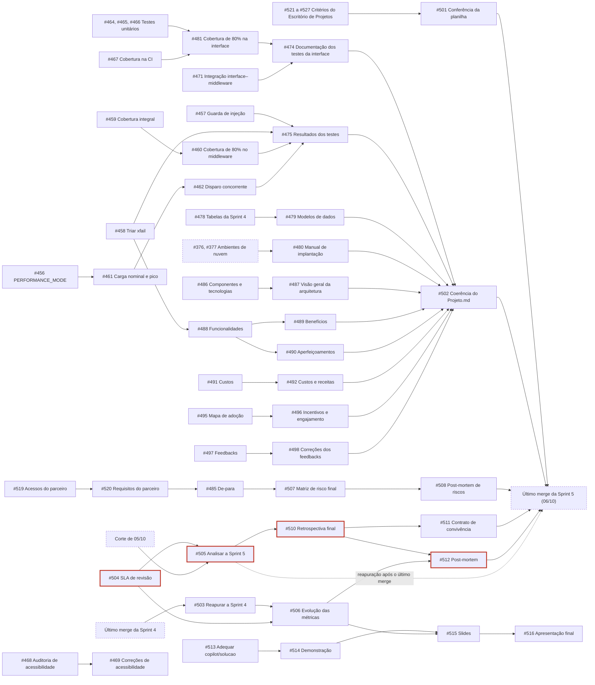
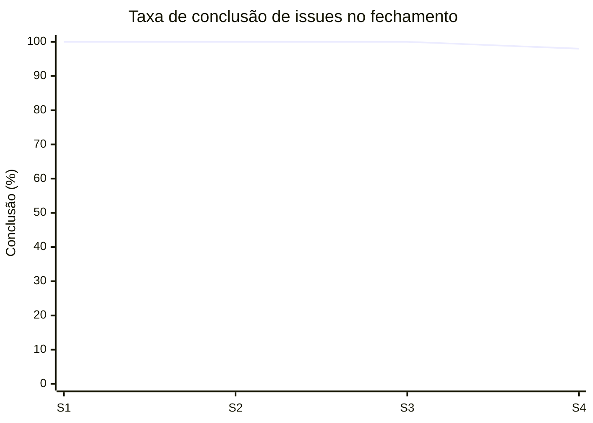
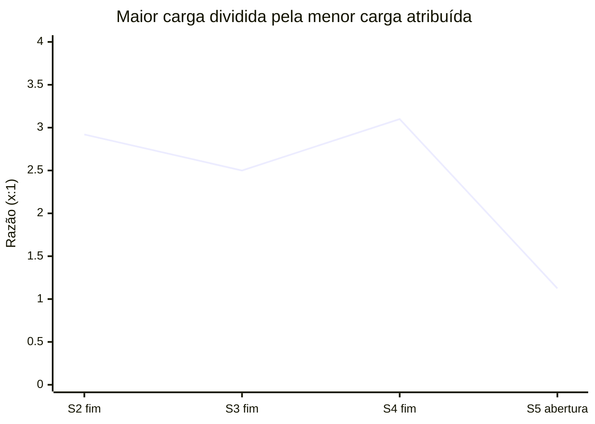
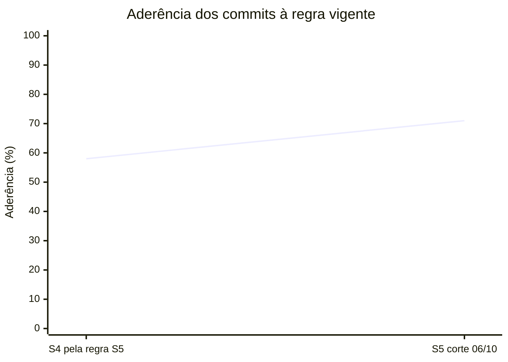

<p align="center">
  
</p>

<table align="center" width="100%" style="table-layout: fixed;">
  <tr>
    <td align="center">
      <a href="https://www.linkedin.com/in/alexsander-dsbarbosa/">
        
      </a>
    </td>
    <td align="center">
      <a href="https://github.com/CaduQuaglia">
        
      </a>
    </td>
    <td align="center">
      <a href="https://www.linkedin.com/in/celsojwnior/">
        
      </a>
    </td>
    <td align="center">
      <a href="https://www.linkedin.com/in/eduardo-casarini/">
        
      </a>
    </td>
    <td align="center">
      <a href="https://www.linkedin.com/in/marianalacerdareis/">
        
      </a>
    </td>
    <td align="center">
      <a href="https://www.linkedin.com/in/mirela-bianchi-608601254/">
        
      </a>
    </td>
  </tr>
</table>

<br>

<p align="center">
  
</p>

<table align="center" width="100%" style="table-layout: fixed;">
  <tr>
    <td align="center">
      <a href="https://www.linkedin.com/in/vanunes/">
        
      </a>
    </td>
    <td align="center">
      <a href="https://www.linkedin.com/in/reginaldo-arakaki-9574222b/">
        
      </a>
    </td>
    <td align="center">
      <a href="https://www.linkedin.com/in/bryan-kano/">
        
      </a>
    </td>
    <td align="center">
      <a href="https://www.linkedin.com/in/fernando-pizzo-208b526a/">
        
      </a>
    </td>
    <td align="center">
      <a href="https://www.linkedin.com/in/lisane-valdo/">
        
      </a>
    </td>
    <td align="center">
      <a href="https://www.linkedin.com/in/bruno-grandchamp-rodilha/">
        
      </a>
    </td>
    <td align="center">
      <a href="https://www.linkedin.com/in/filipe-gon%C3%A7alves-08a55015b/">
        
      </a>
    </td>
  </tr>
</table>

<br>

<p align="center">
  
</p>

# Gestão do Projeto

## Sumário

- [1. Introdução](#1-introdução)
- [2. Organização do projeto](#2-organização-do-projeto)
  - [2.1 Contrato de convivência](#21-contrato-de-convivência)
  - [2.2 Comunicação e rituais](#22-comunicação-e-rituais)
  - [2.3 Resolução de impasses e conflitos](#23-resolução-de-impasses-e-conflitos)
  - [2.4 SLA de entregas](#24-sla-de-entregas)
  - [2.5 Gestão de issues e estimativas](#25-gestão-de-issues-e-estimativas)
  - [2.6 Fluxo e rastreabilidade](#26-fluxo-e-rastreabilidade)
  - [2.7 Política de commits e uso do GitLab](#27-política-de-commits-e-uso-do-gitlab)
  - [2.8 Fechamento da sprint](#28-fechamento-da-sprint)
  - [2.9 Revisão do contrato de convivência](#29-revisão-do-contrato-de-convivência)
- [3. Avaliação das sprints](#3-avaliação-das-sprints)
  - [3.1 Quadro evolutivo de pontos fortes e fracos](#31-quadro-evolutivo-de-pontos-fortes-e-fracos)
  - [3.2 Sprint 1](#32-sprint-1)
    - [3.2.1 Planejamento e matriz de responsabilidades](#321-planejamento-e-matriz-de-responsabilidades)
    - [3.2.2 Retrospectiva da Sprint 1](#322-retrospectiva-da-sprint-1)
    - [3.2.3 Indicadores quantitativos](#323-indicadores-quantitativos)
    - [3.2.4 Análise dos pontos identificados](#324-análise-dos-pontos-identificados)
    - [3.2.5 Melhorias para a Sprint 2](#325-melhorias-para-a-sprint-2)
  - [3.3 Sprint 2](#33-sprint-2)
    - [3.3.1 Planejamento da Sprint 2](#331-planejamento-da-sprint-2)
    - [3.3.2 Alinhamento aos critérios do Escritório de Projetos](#332-alinhamento-aos-critérios-do-escritório-de-projetos)
    - [3.3.3 Matriz de papéis e responsabilidades da Sprint 2](#333-matriz-de-papéis-e-responsabilidades-da-sprint-2)
    - [3.3.4 Fechamento e análise da Sprint 2](#334-fechamento-e-análise-da-sprint-2)
  - [3.4 Sprint 3](#34-sprint-3)
    - [3.4.1 Planejamento e matriz de responsabilidades](#341-planejamento-e-matriz-de-responsabilidades)
      - [Matriz de papéis e responsabilidades da Sprint 3](#matriz-de-papéis-e-responsabilidades-da-sprint-3)
      - [Rotação de papéis em relação à Sprint 2](#rotação-de-papéis-em-relação-à-sprint-2)
    - [3.4.2 Retrospectiva da Sprint 3](#342-retrospectiva-da-sprint-3)
    - [3.4.3 Indicadores quantitativos da Sprint 3](#343-indicadores-quantitativos-da-sprint-3)
    - [3.4.4 Análise dos pontos identificados na Sprint 3](#344-análise-dos-pontos-identificados-na-sprint-3)
    - [3.4.5 Melhorias para a Sprint 4](#345-melhorias-para-a-sprint-4)
  - [3.5 Sprint 4](#35-sprint-4)
    - [3.5.1 Planejamento e matriz de responsabilidades](#351-planejamento-e-matriz-de-responsabilidades)
      - [Matriz de papéis e responsabilidades da Sprint 4](#matriz-de-papéis-e-responsabilidades-da-sprint-4)
      - [Rotação de papéis em relação às Sprints 2 e 3](#rotação-de-papéis-em-relação-às-sprints-2-e-3)
      - [Distribuição de carga](#distribuição-de-carga)
    - [3.5.2 Retrospectiva da Sprint 4](#352-retrospectiva-da-sprint-4)
    - [3.5.3 Indicadores quantitativos da Sprint 4](#353-indicadores-quantitativos-da-sprint-4)
    - [3.5.4 Reconciliação com o fechamento da Sprint 3](#354-reconciliação-com-o-fechamento-da-sprint-3)
    - [3.5.5 Análise dos pontos identificados na Sprint 4](#355-análise-dos-pontos-identificados-na-sprint-4)
    - [3.5.6 Melhorias para a Sprint 5](#356-melhorias-para-a-sprint-5)
  - [3.6 Sprint 5](#36-sprint-5)
    - [3.6.1 Planejamento da Sprint 5](#361-planejamento-da-sprint-5)
    - [3.6.2 Matriz de papéis e responsabilidades da Sprint 5](#362-matriz-de-papéis-e-responsabilidades-da-sprint-5)
    - [3.6.3 Retrospectiva da Sprint 5](#363-retrospectiva-da-sprint-5)
- [4. Gestão de riscos e oportunidades](#4-gestão-de-riscos-e-oportunidades)
  - [4.1 Metodologia de avaliação](#41-metodologia-de-avaliação)
  - [4.2 Matriz de risco consolidada — status final do projeto](#42-matriz-de-risco-consolidada--status-final-do-projeto)
    - [4.2.1 Itens acrescentados na Sprint 4](#421-itens-acrescentados-na-sprint-4)
  - [4.3 Histórico de acompanhamento](#43-histórico-de-acompanhamento)
  - [4.4 Riscos materializados e efetividade das respostas](#44-riscos-materializados-e-efetividade-das-respostas)
  - [4.5 Plano de resposta — ameaças](#45-plano-de-resposta--ameaças)
  - [4.6 Estratégia de aproveitamento — oportunidades](#46-estratégia-de-aproveitamento--oportunidades)
  - [4.7 Matriz probabilidade × impacto — Sprint 4](#47-matriz-probabilidade--impacto--sprint-4)
  - [4.8 Análise dos três itens mais críticos](#48-análise-dos-três-itens-mais-críticos)
- [5. Melhorias de processo](#5-melhorias-de-processo)
  - [5.1 Ações de melhoria](#51-ações-de-melhoria)
  - [5.2 Indicadores de processo](#52-indicadores-de-processo)
- [6. Análise post-mortem](#6-análise-post-mortem)
  - [6.1 Sucessos do projeto](#61-sucessos-do-projeto)
  - [6.2 Oportunidades de melhoria](#62-oportunidades-de-melhoria)
  - [6.3 Lições aprendidas](#63-lições-aprendidas)
- [7. Análise de viabilidade financeira](#7-análise-de-viabilidade-financeira)
  - [7.1 Escopo orçado e premissas](#71-escopo-orçado-e-premissas)
  - [7.2 Horas estimadas por função e por integrante](#72-horas-estimadas-por-função-e-por-integrante)
  - [7.3 Custo de pessoal](#73-custo-de-pessoal)
  - [7.4 Insumos, licenças e plataformas da construção](#74-insumos-licenças-e-plataformas-da-construção)
  - [7.5 Custo de operação da solução em produção](#75-custo-de-operação-da-solução-em-produção)
  - [7.6 Despesas operacionais](#76-despesas-operacionais)
  - [7.7 Carga tributária](#77-carga-tributária)
  - [7.8 Margem de lucro](#78-margem-de-lucro)
  - [7.9 Preço final do projeto](#79-preço-final-do-projeto)
  - [7.10 Fluxo de caixa do fornecedor](#710-fluxo-de-caixa-do-fornecedor)
  - [7.11 Custo total de propriedade e sustentação opcional](#711-custo-total-de-propriedade-e-sustentação-opcional)
  - [7.12 Viabilidade para o Metrô](#712-viabilidade-para-o-metrô)
  - [7.13 Sensibilidade e riscos financeiros](#713-sensibilidade-e-riscos-financeiros)
  - [7.14 Resumo e conformidade](#714-resumo-e-conformidade)
  - [7.15 Referências](#715-referências)

## 1. Introdução

Este documento registra o contrato de convivência, o acordo de nível de serviço (SLA) interno e os rituais adotados pelo grupo durante o desenvolvimento do projeto. Seu objetivo é tornar explícitas as regras de colaboração, comunicação, resolução de impasses e acompanhamento do trabalho.

## 2. Organização do projeto

### 2.1 Contrato de convivência

#### 2.1.1 Regra de ouro

A regra de ouro do grupo é comunicar dúvidas, dificuldades e erros sem receio de exposição ou responsabilização individual. O primeiro movimento da equipe deve ser compreender o problema e oferecer apoio; críticas devem se concentrar no artefato, na decisão ou no processo, nunca na pessoa. Essa regra sustenta a segurança psicológica necessária para que impedimentos sejam comunicados antes de se transformarem em atrasos.

O board e o repositório constituem as fontes oficiais de acompanhamento do projeto. Uma atividade somente é considerada concluída quando seu card está atualizado e, quando aplicável, existe um commit ou merge request rastreável. Decisões tomadas em conversas ou reuniões devem ser registradas nos canais do projeto.

#### 2.1.2 Responsabilidade e colaboração

- Cada integrante deve manter seus cards atualizados e comunicar impedimentos assim que forem identificados.
- Alterações devem respeitar o escopo do card e ser submetidas à revisão por pares.
- A comunicação deve ser respeitosa, objetiva e direcionada à resolução do problema.
- Integrantes devem colaborar na revisão de merge requests e no esclarecimento de dúvidas que bloqueiem o trabalho da equipe.
- Revisões de merge requests devem ser realizadas em até 24 horas úteis, conforme SLA estabelecido.
- Quando possível, as revisões devem ser distribuídas entre os integrantes para evitar concentração em uma única pessoa.
- Quem revisa também integra: nenhum integrante executa mais de 40% dos merges do ciclo, conforme a revisão registrada na seção 2.9.3.
- O SLA de 24 horas úteis é aferido no fechamento de cada sprint pela mediana do tempo entre a abertura do merge request e a primeira revisão.
- O repositório não deve ser mantido dentro de pasta sincronizada com serviço de nuvem, conforme a revisão registrada na seção 2.9.2. Quem não puder mover o repositório deve pausar a sincronização enquanto trabalha com Git.

### 2.2 Comunicação e rituais

#### 2.2.1 Comunicação oficial

A equipe utiliza o **WhatsApp para comunicações informais**, como avisos rápidos, dúvidas pontuais e alinhamentos cotidianos. O **Slack é o canal formal de comunicação**, utilizado para registrar informações, decisões e comunicados relacionados ao projeto. Decisões que afetem escopo, prazos ou responsabilidades também devem ser refletidas no board ou no repositório para preservar a rastreabilidade.

#### 2.2.2 Dailies

As dailies acontecem **presencialmente, às 14h, em todos os dias nos quais a equipe possui instrução**, com duração máxima de **15 minutos**. Quando a equipe não estiver reunida presencialmente, o acompanhamento poderá ocorrer de forma assíncrona no Slack. Cada integrante apresenta de forma objetiva as atividades concluídas, as próximas atividades e os impedimentos identificados. Quando um integrante não puder participar, sua atualização deve ser enviada pelo canal formal antes do encontro.

**Condução.** A daily é conduzida pelo Scrum Master da sprint, a quem cabe abrir o encontro no horário, manter a ordem de fala, encerrá-lo dentro dos 15 minutos e realizar as três verificações descritas adiante. Quando o Scrum Master não puder conduzir, a condução passa a outro integrante indicado na véspera, de modo que o ritual não dependa da presença de uma única pessoa.

**Roteiro.** Cada integrante responde a três perguntas, nesta ordem: o que concluiu desde a daily anterior, o que pretende concluir até a próxima e o que o impede de avançar. A resposta deve referenciar o card correspondente, e não apenas descrever a atividade, para que o acompanhamento seja verificável no quadro por quem não participou do encontro.

Durante a daily, as tarefas práticas são organizadas para um horizonte máximo de dois a três dias. A distribuição considera as dependências entre as atividades, de modo que a entrega de uma pessoa não bloqueie desnecessariamente o avanço das demais. No fechamento diário, o grupo verifica se as tarefas previstas foram concluídas. Quando uma atividade não é finalizada no mesmo dia, ela continua no dia seguinte, e a equipe avalia se a pessoa responsável necessita de apoio, redistribuição ou esclarecimento para prosseguir.

O Kanban do GitLab apoia esse acompanhamento ao tornar visíveis o estado das tarefas, os responsáveis, as dependências e os impedimentos. Os cards devem refletir a situação discutida nas dailies, permitindo que o grupo acompanhe o progresso entre os encontros e identifique antecipadamente riscos de bloqueio ou atraso.

**Acompanhamento de carga e dependências (revisão da Sprint 2).** Para tornar verificável a regra registrada na seção [2.9.1](#291-revisão-sprint-2), a daily passa a incluir três verificações objetivas, conduzidas pelo Scrum Master da sprint:

1. **Carga.** Comparação da quantidade e do *size* das issues em `Doing` por integrante. Diferença superior a 2:1 entre a maior e a menor carga atribuída deve ser discutida na própria daily e resolvida por redistribuição ou por registro da justificativa no card. A mesma comparação é feita na abertura da sprint, sobre as horas atribuídas no planejamento, para que o desequilíbrio seja corrigido antes de o ciclo começar (seção 2.9.3).
2. **Dependências.** Verificação das issues que bloqueiam outras atividades. Toda issue impeditiva deve receber a label `BLOCKED`, indicar o que a bloqueia e ter um próximo passo definido com responsável.
3. **Fila de revisão.** Verificação das issues em `Waiting Review` e `Review`. Itens que ultrapassem o SLA de 24 horas úteis devem receber um revisor nomeado ainda na daily, priorizando os merge requests que bloqueiam outras entregas.

O resultado dessas três verificações orienta a redistribuição de tarefas do dia e é a base do acompanhamento consolidado na retrospectiva.

**Assuntos que extrapolam a daily.** Discussão técnica, decisão de escopo ou alinhamento que exija mais do que um enunciado não é resolvido no encontro. O assunto é anotado, e a própria daily define quem participa e quando ocorre a conversa à parte. A regra protege os 15 minutos previstos: a daily é um ponto de sincronização, e não o espaço em que o grupo trabalha.

**Registro.** A daily não produz ata. O que precisa sobreviver ao encontro é registrado onde a equipe já consulta: impedimento vira comentário no card, acompanhado da label `BLOCKED`; redistribuição vira troca de responsável no quadro; e revisor definido vira atribuição no merge request. Uma daily que não produz nenhum desses registros não deixou rastro verificável, e o acompanhamento do dia seguinte parte da memória de quem esteve presente.

#### 2.2.3 Revisões de merge request

Ao abrir um merge request, a pessoa autora deve solicitar a revisão do grupo. A pessoa revisora deve verificar o atendimento ao card e registrar ajustes necessários antes da aprovação. As políticas técnicas de branch, commit e merge request estão documentadas em [GestaoConfiguracao.md](GestaoConfiguracao.md).

O SLA interno estabelece que todo merge request deve receber uma primeira revisão em até **24 horas úteis** após a solicitação. Quando esse prazo não puder ser cumprido, o impedimento deve ser comunicado no Slack e registrado no card. MRs que bloqueiem outras entregas têm prioridade de revisão e devem ser sinalizados na daily.

### 2.3 Resolução de impasses e conflitos

1. Divergências devem ser discutidas inicialmente entre as pessoas envolvidas, com base nos requisitos e artefatos do projeto.
2. Se não houver consenso, o tema deve ser apresentado ao grupo em uma daily ou reunião específica.
3. Persistindo o impasse, o Scrum Master da sprint organiza a decisão necessária para evitar bloqueio do trabalho.
4. Questões que não possam ser resolvidas internamente devem ser encaminhadas à professora orientadora.

Conflitos interpessoais devem ser tratados de forma reservada e respeitosa, com mediação de outro integrante quando necessário. Em casos de atraso recorrente ou falta de engajamento, aplica-se a seguinte progressão: primeiro, feedback direto e oferta de apoio na daily; segundo, alinhamento formal com o Scrum Master e registro do plano de recuperação; terceiro, registro na retrospectiva; e, caso o problema persista, encaminhamento à professora orientadora e ao CDL.

### 2.4 SLA de entregas

- Cards, merge requests e artefatos de documentação devem ser disponibilizados para revisão interna até **quinta-feira às 23h59**, independentemente do prazo formal da sprint.
- A pessoa responsável deve comunicar antecipadamente quando identificar risco de não cumprimento do prazo.
- Na daily de quarta-feira, cada card em `Backlog` ou `Doing` recebe a data prevista de conclusão dentro da própria sprint; o que não couber até quinta é replanejado nesse momento, e não no fim da semana.
- O planejamento deve caber na capacidade declarada da sprint. Excesso pontual de até 10% é aceito quando registrado na milestone com o motivo, e trabalho no fim de semana só acontece por acordo registrado. O limite existe para absorver imprevistos, e não para ser planejado (seção 2.9.3).
- Cards não concluídos devem permanecer atualizados no board, com o impedimento e o próximo passo registrados.
- A conclusão de uma entrega depende do atendimento ao DoD do card e da aprovação do merge request, quando aplicável.

### 2.5 Gestão de issues e estimativas

#### 2.5.1 Estrutura das issues

Toda atividade relevante deve possuir uma issue no GitLab. O título deve começar com um verbo no infinitivo, representar uma entrega específica e evitar descrições genéricas. Exemplos: `Modelar fluxo AS-IS da gestão de portfólio`, `Identificar requisitos não funcionais` e `Elaborar matriz de risco`.

Cada issue deve conter:

- descrição do que deve ser realizado e de seu contexto;
- DoR (*Definition of Ready*), indicando os pré-requisitos para início;
- DoD (*Definition of Done*), com condições objetivas de conclusão;
- milestone correspondente à sprint;
- label de natureza da atividade;
- estimativa de tamanho;
- pessoa responsável, quando a divisão do trabalho estiver definida.

As atividades devem ser granulares e produzir entregas verificáveis. Cards amplos, como “Fazer documentação da Sprint”, devem ser divididos em tarefas menores que permitam acompanhar o progresso e distribuir o trabalho entre os integrantes.

Defeito identificado em teste manual ou durante revisão abre issue própria antes da correção, com a label `BUG` acompanhando a label de entrega correspondente. Corrigir um defeito dentro de uma issue de outro escopo rompe a ligação entre o problema e a sua solução, e foi a situação que originou esta regra na revisão registrada na seção 2.9.2.

#### 2.5.2 T-shirt sizing

As estimativas representam referências de esforço relativo, não compromissos de duração exata.

| Size | Referência |
|---|---|
| `SIZE_PP` | até 15 minutos |
| `SIZE_P` | até 30 minutos |
| `SIZE_M` | de 30 a 60 minutos |
| `SIZE_G` | de 60 a 120 minutos |

Quando uma atividade exceder a referência de `SIZE_G`, a equipe deve avaliar sua divisão em issues menores e verificáveis.

#### 2.5.3 Labels padronizadas

A partir da Sprint 4, o board adota a taxonomia oficial definida pelo Escritório de Projetos. Cada issue recebe uma label de cada categoria obrigatória, e as labels devem ser escritas exatamente como listadas, uma vez que espaço e hífen são significativos para a avaliação.

**Entrega.** Obrigatória, uma por issue. Indica a natureza do que é produzido.

| Label | Uso |
|---|---|
| `BUSINESS` | Entendimento de negócio, viabilidade financeira, orçamento e proposta de valor |
| `DESIGN` | UML, BPMN, C4, jornadas, protótipos e demais modelagens visuais |
| `ARCHITECTURE` | Decisões e documentação técnica da solução, contratos de API e modelagem de dados |
| `CODE` | Implementação e configuração técnica |
| `TEST` | Planejamento, implementação e execução de testes |
| `DEPLOY` | Ambientes, automação, integração contínua e implantação |
| `PROCESS` | Gestão de projeto, de equipe e de configuração |
| `CHORE` | Tarefas de apoio ao repositório, dependências e organização de arquivos |

**Forma.** Aplicada quando a entrega é documentação em markdown. Nunca utilizada isoladamente, sempre acompanhando uma label de entrega.

| Label | Uso |
|---|---|
| `DOCS` | Documentação produzida em markdown |

**Natureza.** Aplicada quando a entrega corrige um defeito. Nunca utilizada isoladamente.

| Label | Uso |
|---|---|
| `BUG` | Correção de defeito identificado |

**Esforço.** Obrigatória, uma por issue, conforme as referências da seção 2.5.2: `SIZE_PP`, `SIZE_P`, `SIZE_M` e `SIZE_G`.

**Prioridade.** Obrigatória, uma por issue: `P_ALTA`, `P_MEDIA` e `P_BAIXA`.

**Fora do GitLab.** Aplicada quando a evidência da atividade não é um commit.

| Label | Uso |
|---|---|
| `MEET` | Reuniões e alinhamentos |
| `OFFSITE` | Atividades realizadas fora do repositório, como sessões com usuários externos |

**Situação.** Posição da atividade no quadro, acrescida da marcação de impedimento.

| Label | Uso |
|---|---|
| `open` | Candidata ainda não comprometida para a sprint |
| `backlog` | Comprometida para a sprint corrente |
| `doing` | Em execução |
| `waiting review` | Aguardando revisor |
| `review` | Em revisão |
| `closed` | Integrada, com DoD atendido |
| `BLOCK` | Atividade impedida de avançar |

Toda issue da sprint corrente deve possuir a milestone no formato `Sprint 0X`. Sem ela, o cartão não é contabilizado.

**Conferência da Sprint 4 (24/09/2026).** As labels acima foram conferidas contra o projeto no GitLab e contra as 99 issues da milestone `Sprint 04` (58 abertas):

| Categoria | Situação no projeto | Uso na milestone `Sprint 04` |
|---|---|---|
| Entrega | Existem `CODE`, `DESIGN`, `TEST` e `DEPLOY`. **Não existem** `BUSINESS`, `ARCHITECTURE`, `PROCESS` e `CHORE` | `CODE` 39, `TEST` 23, `DEPLOY` 12; nenhuma com `DESIGN` |
| Forma | `DOCS` existe | 25 issues; em 23 delas `DOCS` aparece sem label de entrega, porque as de gestão e arquitetura não existem no projeto |
| Natureza | `BUG` existe | 3 issues |
| Esforço | `SIZE_PP`, `SIZE_P`, `SIZE_M` e `SIZE_G` existem | Todas as 99 issues têm uma |
| Prioridade | `P_ALTA`, `P_MEDIA` e `P_BAIXA` existem | Todas as 99 issues têm uma |
| Fora do GitLab | `MEET` e `OFFSITE` existem | `OFFSITE` em 6 issues |
| Situação | As colunas do quadro são as labels `Backlog`, `Doing`, `Waiting Review` e `Review`, com inicial maiúscula. `open` e `closed` são os estados da issue no GitLab, e não labels. A label de impedimento existente é `BLOCKED`, da nomenclatura anterior; `BLOCK` não existe | Todas as issues abertas estão em uma coluna |

Enquanto as labels ausentes não forem criadas no projeto, vale a prática registrada na tabela: documentação de gestão, processo e arquitetura recebe `DOCS` com a prioridade e o esforço, e impedimento é marcado com `BLOCKED`. Atividade cuja evidência não é commit nem markdown, como reunião, slides ou apresentação, recebe só `MEET` ou `OFFSITE`, com a prioridade e o esforço, enquanto `PROCESS` e `BUSINESS` não existirem; é o caso de #510, #515 e #516 na Sprint 5. Criar as quatro labels de entrega e `BLOCK` alinha o quadro à taxonomia oficial e é decisão da equipe.

**Correspondência com a nomenclatura anterior**

Os cards criados até a Sprint 3 permanecem com as labels originais. O histórico não é reescrito, pela mesma razão que preservou o nome das branches anteriores à troca de prefixo descrita em [GestaoConfiguracao.md](GestaoConfiguracao.md). A tabela abaixo registra a correspondência para leitura do quadro anterior.

| Label anterior | Equivalente oficial |
|---|---|
| `REQUIREMENTS` | `ARCHITECTURE` com `DOCS` |
| `DOCUMENTATION` | `DOCS`, acompanhada da label de entrega correspondente |
| `RESEARCH` | `BUSINESS` ou `ARCHITECTURE`, conforme o objeto da pesquisa |
| `FRONTEND` | `CODE` |
| `BACKEND` | `CODE` |
| `DEVOPS` | `DEPLOY` |
| `CODE_REVIEW` | Sem equivalente. A revisão passou a ser etapa do fluxo, marcada por `review`, e não atividade com label própria |
| `BLOCKED` | `BLOCK` |
| `DOR_INCOMPLETE` e `DOD_INCOMPLETE` | Sem equivalente. A incompletude passa a ser tratada como impedimento, com `BLOCKED` |

> **Revisão da Sprint 3.** A tabela desta seção foi substituída pela taxonomia oficial do Escritório de Projetos. A revisão da Sprint 2 havia ajustado o documento à nomenclatura do quadro, trocando `DOCS` por `DOCUMENTATION`, o que eliminou a divergência entre documento e prática mas preservou a divergência entre a prática e a regra pela qual o grupo é avaliado. A adequação vale para os cards criados a partir da Sprint 4.

### 2.6 Fluxo e rastreabilidade

O fluxo esperado é:

```text
Issue → Branch → Desenvolvimento/Documentação → Commit → Push → MR → Review → Merge → Fechamento da Issue
```

- Uma issue somente deve ser iniciada quando seu DoR estiver atendido.
- Uma issue somente deve ser encerrada quando todos os critérios de seu DoD estiverem atendidos.
- Quando uma dependência impedir o avanço, a issue deve receber a label `BLOCKED` e registrar o impedimento.
- Branches, commits e merge requests devem ser relacionados à issue correspondente.
- A abertura do merge request não caracteriza a conclusão da atividade; revisão, atendimento aos comentários e merge fazem parte da entrega.
- A pessoa revisora deve verificar o DoD, os arquivos alterados, a coerência com outros artefatos, os conflitos e os testes aplicáveis.

Ao final, o GitLab deve permitir identificar o que precisava ser feito, quem realizou a atividade, quando ela foi executada, qual merge request entregou o resultado, se houve revisão e se o DoD foi cumprido.

As dependências entre artefatos devem ser respeitadas. Um exemplo de sequência é: stakeholders → personas → jornadas → User Stories → diagramas. A ordem específica de cada sprint deve seguir o planejamento aprovado pela equipe.

### 2.7 Política de commits e uso do GitLab

**Commits.** Os commits devem seguir o padrão *Conventional Commits*, no formato `<tipo>(<escopo opcional>): <verbo no infinitivo> <complemento> (#<card>)` ou `<tipo>(<escopo opcional>): <verbo no infinitivo> <complemento> #<card>`. As duas formas da referência, com e sem parênteses, são aceitas a partir da Sprint 5; o que é obrigatório é a referência ao card, separada da descrição por um espaço. A aferição da Sprint 4, na seção [3.5.3](#353-indicadores-quantitativos-da-sprint-4), seguiu a regra então vigente, que exigia parênteses, e não é recalculada. Cada commit deve representar uma unidade lógica de alteração, iniciar por verbo no infinitivo em letra minúscula, descrever objetivamente o que mudou e referenciar a issue correspondente. Mensagens vagas e commits que misturem atividades sem relação devem ser evitados. O envio direto de alterações para `main` ou `develop` não faz parte do fluxo do grupo: toda alteração chega à `develop` por merge request. Os tipos aceitos, os exemplos válidos e inválidos, o padrão de título e descrição de merge request e as demais regras técnicas estão detalhados no [GestaoConfiguracao.md](GestaoConfiguracao.md).

Exemplos do ciclo da Sprint 4, retirados do histórico da `develop`:

| Commit | Data | Mensagem | Situação |
|---|---|---|---|
| `9fdc817` | 22/09 | `feat: implementar produtor AMQP com confirmacao de publicacao #393` | Válida, referência sem parênteses |
| `3843f32` | 23/09 | `test: corrigir fixture dos testes de auditoria (#442)` | Válida, referência entre parênteses |
| `b462191` | 24/09 | `feat: guardar os segredos no key vault e proteger o banco (#378, #379)` | Válida, mais de um card |
| `159aa1e` | 23/09 | `feat: adiciona evidencias executaveis (#446)` | Inválida: verbo na terceira pessoa (`adicionar`) |
| `6eae97c` | 23/09 | `docs: registra resultado da implementação dos testes do RNF01(#441)` | Inválida: terceira pessoa e referência colada à descrição, sem espaço |
| `400b986` | 23/09 | `feat: atualiza secao de testes de integracao (#446)` | Inválida: terceira pessoa e tipo errado; alteração de documentação usa `docs` |

**Integração contínua e merge request.** A pipeline do `.gitlab-ci.yml`, integrada à `develop` pelo !171, roda em cada merge request e em cada push na `develop` e na `main`. Ela executa o lint (`ruff` no middleware, `eslint` e checagem de tipos na interface) e os testes (`pytest` com PostgreSQL e RabbitMQ, e `vitest`), e na `develop` e na `main` também constrói as imagens e implanta. Merge request com pipeline falhando não é integrado; a aprovação de outro integrante continua obrigatória, e quem o abre registra em *Como testar* como verificar a mudança.

**Movimentação do quadro.** O quadro é a fonte oficial do estado das atividades. Movimentar o card é responsabilidade da pessoa designada nele, e não do revisor ou do Scrum Master. A correspondência entre coluna e etapa do fluxo é a seguinte.

| Coluna | Quando o card entra |
|---|---|
| Issue aberta, sem coluna | Card criado, ainda não comprometido para a sprint |
| `Backlog` | Card comprometido para a sprint corrente, com milestone, labels e estimativa |
| `Doing` | Trabalho iniciado, com o DoR atendido |
| `Waiting Review` | Merge request aberto, ainda sem revisor designado |
| `Review` | Revisor designado e revisão em andamento |
| Issue fechada | Merge realizado e DoD integralmente atendido |

Regras de uso:

- O card muda de coluna no momento em que o fato ocorre, e não no fechamento do dia. Quadro atualizado em lote deixa de informar durante a daily e inviabiliza as três verificações da seção [2.2.2](#222-dailies).
- Card impedido permanece na coluna em que está, recebe a label `BLOCKED` e registra em comentário o que o bloqueia e qual é o próximo passo.
- Card nunca volta de coluna. Um card movido para frente antes da hora fica onde está, com comentário explicando, porque o histórico do card registra cada movimento e um retorno aparece como regressão do trabalho (seção 2.9.3).
- Cada integrante deve manter no máximo duas atividades em `doing` simultaneamente. Acima disso, a verificação de carga perde precisão e o trabalho em curso deixa de refletir o que está efetivamente sendo feito.
- O fechamento da issue é feito pela pessoa responsável logo após o merge na `develop`, depois de conferir o DoD. `Closes #<issue>` na descrição do merge request registra o vínculo, mas o GitLab só fecha a issue automaticamente no merge para a branch padrão, que é a `main`: em 24/09/2026, #389 (!160), #391 (!156), #395 (!159) e #399 (!158) continuaram abertas depois de integradas na `develop`. Issue encerrada sem merge request associado deve registrar em comentário a razão do encerramento.
- Atividade sem evidência no repositório, como reunião ou sessão com usuário externo, recebe a label `MEET` ou `OFFSITE` e é encerrada com registro em comentário descrevendo o resultado.

> **Revisão da Sprint 4 (24/09/2026).** As políticas das seções 2.2 a 2.7 foram revisadas contra a prática do ciclo. Regras alteradas:
>
> | Regra | Antes | Agora | Motivo |
> |---|---|---|---|
> | Referência ao card no commit e no título de MR | Só `(#N)` | `(#N)` ou `#N`, a partir da Sprint 5 | 34 dos 58 commits integrados da Sprint 4 usaram `#N`; as duas formas geram o mesmo vínculo no GitLab |
> | Label de impedimento | `BLOCK` | `BLOCKED` | `BLOCK` não existe no projeto; `BLOCKED` é a label disponível no quadro |
> | Colunas do quadro | Nomes em minúsculas | `Backlog`, `Doing`, `Waiting Review` e `Review` | Nomes reais das labels do quadro |
> | Fechamento da issue | Automático por `Closes #N` | Manual, logo após o merge na `develop`, com o DoD conferido | O GitLab só fecha automaticamente no merge para a `main` |
> | Integração contínua | Não registrada | Pipeline em cada merge request; merge request com pipeline falhando não é integrado | A pipeline entrou na `develop` pelo !171, no fim do ciclo (revisão da seção 2.9.3) |
>
> Regras revisadas e mantidas: a daily presencial de 15 minutos conduzida pelo Scrum Master, com as três verificações de carga, dependências e fila de revisão, porque são elas que alimentam o acompanhamento da retrospectiva, onde o funcionamento no ciclo é avaliado; o SLA de 24 horas úteis para a primeira revisão, porque 23 dos 24 merge requests do período tiveram revisor nomeado; a estrutura das issues com DoR, DoD, milestone, prioridade e tamanho, porque todas as 99 issues da milestone `Sprint 04` têm prioridade e tamanho; e o fluxo da seção 2.6, que continua sendo o praticado. A coerência com o contrato de convivência foi conferida na revisão da Sprint 4, na seção 2.9.3.

### 2.8 Fechamento da sprint

Ao final de cada sprint, a equipe deve:

- revisar as entregas realizadas;
- consolidar o `Projeto.md` e os documentos de gestão;
- verificar a coerência entre NEG, REQ e PROJ;
- conferir o atendimento ao DoD das issues;
- conferir que nenhuma issue do ciclo foi fechada sem responsável atribuído;
- verificar merge requests pendentes;
- extrair as métricas do ciclo declarando corte, fonte, commit-base e regra de atribuição, conforme a nota metodológica da seção [3.3.4](#334-fechamento-e-análise-da-sprint-2);
- registrar a retrospectiva;
- identificar e documentar pendências;
- planejar e criar as issues da sprint seguinte, incluindo estimativas, labels, milestone e dependências;
- revisar e atualizar o contrato de convivência, quando necessário;
- avaliar a efetividade das políticas de trabalho e realizar ajustes conforme as necessidades identificadas.

### 2.9 Revisão do contrato de convivência

O contrato de convivência firmado na Sprint 1 deve ser revisado ao final de cada sprint. Havendo necessidade de ajuste, as regras devem ser alteradas com o devido registro da mudança, mantendo:

- a data da revisão;
- a justificativa para a alteração;
- a nova regra aprovada pelo grupo;
- o impacto esperado na dinâmica da equipe.

As revisões são registradas nesta seção para garantir transparência e rastreabilidade das decisões de processo ao longo do projeto.

#### 2.9.1 Revisão Sprint 2

**Data:** 2026-08-26

**Justificativa:** Identificou-se a necessidade de reforçar políticas sobre revisão de merge requests e distribuição de carga de trabalho, baseado em evidências de revisões concentradas e atualizações mantidas até o fechamento da sprint.

**Alterações aprovadas:**
- Inclusão de diretrizes explícitas sobre distribuição de revisões de merge requests entre os integrantes.
- Reforço do SLA de 24 horas para revisão de MRs com priorização de MRs que bloqueiem outras entregas.
- Adição de critérios para acompanhamento de carga e dependências nas dailies.

**Impacto esperado:** Melhor distribuição do trabalho de revisão, redução de concentração de revisões em uma única pessoa e identificação antecipada de bloqueios.

#### 2.9.2 Revisão Sprint 3

**Data:** 2026-09-11

**Regras revisadas e mantidas**

A revisão percorreu o contrato inteiro, e não apenas os pontos que mudaram. As regras abaixo foram examinadas e mantidas, com a razão registrada.

| Regra | Seção | Razão da manutenção |
|---|---|---|
| Regra de ouro | 2.1.1 | Não houve conflito ou episódio de exposição individual na sprint que justificasse revisão. A regra continua descrevendo a prática do grupo |
| Board e repositório como fontes oficiais | 2.1.1 | A rastreabilidade entre card, commit e merge request se manteve ao longo da sprint |
| Comunicação oficial em dois canais | 2.2.1 | A separação entre WhatsApp informal e Slack formal funcionou sem ambiguidade registrada |
| Dailies presenciais às 14h, com 15 minutos | 2.2.2 | Formato e duração se mostraram adequados ao ritmo da sprint |
| Três verificações da daily | 2.2.2 | Mantidas com avaliação positiva. Criadas na revisão anterior para responder ao apontamento sobre concentração de revisões, elas fizeram diferença na condução da Sprint 3: a verificação de carga tornou visível o desequilíbrio no mesmo dia em que ele surgia, a de dependências antecipou bloqueios que antes só apareciam quando já travavam alguém, e a de fila de revisão reduziu o tempo de espera dos merge requests. A equipe avalia que a regra saiu do papel e passou a orientar a redistribuição diária |
| SLA de 24 horas úteis para revisão de merge request | 2.2.3 | Mantido. Foi cumprido na maioria das solicitações da sprint, e os descumprimentos foram pontuais. O prazo permanece adequado; o que exige atenção é a regularidade, tratada como ação de melhoria |
| Resolução de impasses e conflitos | 2.3 | A progressão prevista não precisou ser acionada nesta sprint |
| SLA de entrega até quinta às 23h59 | 2.4 | Mantido, e não cumprido. As entregas da Sprint 3 se estenderam até a tarde de sexta-feira. A regra é preservada porque cumpre função de organização, antecipando o planejamento da semana e concentrando o esforço antes do prazo formal. A distância entre a meta e o resultado é tratada como ação de melhoria, e não como flexibilização do prazo |

**Justificativa das alterações**

As alterações desta revisão respondem a situações concretas ocorridas durante a Sprint 3, e não a aprimoramentos genéricos de processo. Uma nasceu de perda efetiva de tempo de trabalho, uma responde a prejuízo de rastreabilidade, duas corrigem divergência entre o que o grupo pratica e o que estava registrado, uma detalha um ritual cuja regra existia apenas em linhas gerais, e a última resolve um caso que a regra anterior não previa.

**Alterações aprovadas**

- **Ambiente de trabalho local.** Fica estabelecido que o repositório não deve ser mantido dentro de pasta sincronizada com serviço de nuvem. A sincronização automática interfere no funcionamento do Git, e a Sprint 3 registrou quatro ocorrências: um arquivo de trava do índice que impediu qualquer operação, um arquivo de configuração que o sistema não conseguiu ler, um arquivo de controle de merge vazio que fez o Git reportar um merge inexistente, e arquivos removidos pela troca de branch sendo restaurados pela sincronização sobre a `develop`. Quem não puder mover o repositório deve pausar a sincronização durante o trabalho com Git.

- **Defeito identificado fora de card.** Todo defeito encontrado em teste manual ou durante revisão passa a abrir issue própria antes da correção. Na Sprint 3, um defeito de interface encontrado em teste manual foi corrigido dentro de uma issue de outro escopo, o que prejudicou a rastreabilidade entre o problema e a sua solução.

- **Taxonomia de labels.** As labels do board passam a seguir a lista oficial do Escritório de Projetos a partir da Sprint 4, com uma label de entrega entre `BUSINESS`, `DESIGN`, `ARCHITECTURE`, `CODE`, `TEST`, `DEPLOY`, `PROCESS` e `CHORE`, acrescida de `DOCS` como forma, nunca utilizada isoladamente. Os cards criados até a Sprint 3 permanecem com as labels originais, pela mesma razão que preservou o nome das branches anteriores à troca de prefixo. A seção 2.5.3 registra a correspondência entre as duas nomenclaturas.

- **Convenção de merge request.** O título do merge request passa a seguir o mesmo formato da mensagem de commit, e a descrição passa a conter as seções O que foi feito, Por que foi feito, DOR, DOD e Como testar. Até a Sprint 2, o `GestaoConfiguracao.md` previa o formato `TIPO | descrição` e um checklist genérico de conferência, que o grupo deixou de utilizar ao longo da Sprint 3 sem atualizar o documento. As seções de DOR e DOD substituem o checklist porque exigem a evidência de atendimento de cada critério, e não apenas a marcação de uma caixa.

- **Condução e registro da daily.** A daily passa a ter condução nomeada, exercida pelo Scrum Master da sprint, com substituto indicado na véspera quando ele não puder conduzir. Fica estabelecido que assunto cuja discussão exceda o enunciado sai do encontro para conversa à parte, com participantes e horário definidos na própria daily, e que o resultado do encontro é registrado no quadro, e não em ata. A Sprint 3 mostrou que as três verificações criadas na revisão anterior funcionam, mas que dependem de o encontro terminar no tempo previsto e de o que foi decidido ficar onde a equipe consulta.

- **Branch derivada de outra branch.** A regra de que toda branch nasce da `develop` passa a admitir exceção quando o trabalho documenta ou corrige código ainda não integrado. Nesse caso, a branch pode derivar daquela que contém o código, e o merge request deve declarar a branch-base e o motivo. A exceção surgiu na documentação da interface, que descrevia código presente apenas na branch de origem.

**Fechamento de ação da sprint anterior**

A ação AM13, que previa repriorizar o quadro no penúltimo dia da sprint, dependia de uma distinção de prioridade que o board não oferecia. As labels `P_ALTA`, `P_MEDIA` e `P_BAIXA` passaram a ser aplicadas aos cards durante a Sprint 3, o que torna a ação executável e encerra o apontamento recebido na avaliação anterior.

**Impacto esperado**

Espera-se redução do tempo perdido com incidentes de ambiente local, que na Sprint 3 consumiram horas de trabalho sem produzir entrega. A abertura de issue para defeito encontrado deve tornar visível no board um tipo de trabalho que antes ficava embutido em outras entregas. A adequação da taxonomia de labels alinha o board aos critérios pelos quais o grupo é avaliado. A condução nomeada e o registro no quadro devem sustentar as três verificações da daily sem alongar o encontro. A convenção unificada de merge request elimina a divergência entre documento e prática e permite ler o título do card, o commit e o merge request como uma sequência única. A exceção da branch-base elimina a escolha entre cumprir a regra e documentar código existente, situação que a regra anterior não previa.

#### 2.9.3 Revisão Sprint 4

**Data:** 2026-09-25

A revisão foi discutida com os seis integrantes e percorreu o contrato inteiro, a partir dos fatos registrados na seção [3.5](#35-sprint-4).

**Regras revisadas e mantidas**

| Regra | Seção | Razão da manutenção |
|---|---|---|
| Regra de ouro | 2.1.1 | Nenhum conflito ou episódio de exposição individual no ciclo. A regra continua descrevendo a prática do grupo |
| Board e repositório como fontes oficiais | 2.1.1 | 97 de 97 issues da milestone com responsável, *size* e prioridade, sem regularização em bloco, e 23 dos 24 merge requests do período com revisor nomeado desde a abertura (seção 3.5.5) |
| Repositório fora de pasta sincronizada com nuvem | 2.1.2 | `AM19` efetiva: nenhum incidente de ambiente local com o Git no ciclo, contra quatro na Sprint 3 |
| Comunicação oficial em dois canais | 2.2.1 | A separação entre WhatsApp informal e Slack formal funcionou sem ambiguidade |
| Dailies presenciais às 14h, com 15 minutos, conduzidas pelo Scrum Master | 2.2.2 | Formato mantido. A condução nomeada, criada na revisão anterior, foi exercida no ciclo |
| Resolução de impasses e conflitos | 2.3 | A progressão não precisou ser acionada |
| SLA de entrega até quinta às 23h59 | 2.4 | Mantido, e **não cumprido pela segunda sprint seguida**. A entrega final do projeto se estendeu até o último momento do prazo formal. O grupo atribui o resultado ao planejamento acima da capacidade e à demora para engrenar no início do ciclo. O prazo é preservado pela mesma razão da revisão anterior, organizar a semana e antecipar o esforço, e passa a contar com o *checkpoint* da daily de quarta de `AM25` |
| Estrutura das issues, *T-shirt sizing* e labels | 2.5 | Mantidas com a conferência da Sprint 4 registrada na seção 2.5.3 (#401), que adotou a prática real do quadro enquanto as labels oficiais ausentes não são criadas |
| Fluxo e rastreabilidade | 2.6 | O fluxo issue, branch, commit, merge request e merge continua sendo o praticado |
| Fechamento da sprint | 2.8 | Mantido; a reapuração das métricas depois do último merge já é exigida por `AM24` |

**Regras alteradas no ciclo e já registradas**

As alterações abaixo foram feitas durante a Sprint 4 e estão descritas nas seções indicadas. Entram nesta revisão para que o contrato registre o motivo em um só lugar.

| Regra | Seção | Alteração | Motivo |
|---|---|---|---|
| Referência ao card no commit e no título de merge request | 2.7 | `(#N)` ou `#N`, a partir da Sprint 5 | 34 dos 58 commits integrados da Sprint 4 usaram `#N`, e as duas formas geram o mesmo vínculo no GitLab |
| Fechamento da issue | 2.7 | Manual, logo após o merge na `develop`, com o DoD conferido | O GitLab só fecha a issue no merge para a `main`, que é a branch padrão |
| Label de impedimento e colunas do quadro | 2.5.3 e 2.7 | `BLOCKED` e os nomes reais das colunas | `BLOCK` e as colunas em minúsculas não existem no projeto |
| Integração da `develop` na `main` | `GestaoConfiguracao.md` 2.2 | Merge request da `develop` ao fim de cada sprint; release opcional | O histórico mostra a `develop` integrada diretamente desde a Sprint 3 (!88 e !110) |

**Justificativa das alterações**

As alterações desta revisão respondem ao que a Sprint 4 mostrou de forma repetida: o ciclo atribuiu 135,50 h contra 96,00 h declaradas (141%), com quatro de seis integrantes acima de 16 h e commits no sábado e no domingo, 19 e 20/09; a razão de carga ficou em 3,10:1 no fechamento, pelo segundo ciclo acima do teto de 2:1; 49 dos 66 merges (74%) foram executados por duas pessoas; e o SLA de revisão não é medido desde a Sprint 2 (seções 3.5.3 e 3.5.5). No mesmo ciclo, a pipeline de integração contínua entrou na `develop` pelo !171, o que tornou desatualizado o registro que descrevia a ausência de pipeline.

**Alterações aprovadas**

- **Operação acima da capacidade declarada.** Fica aceito excesso pontual de até 10% sobre a capacidade declarada, registrado na milestone com o motivo, e trabalho no fim de semana só por acordo registrado. A regra foi escolhida porque a Sprint 4 foi excepcionalmente pesada, com a entrega final do projeto concentrada no ciclo. O objetivo do grupo continua sendo não operar acima da capacidade: o planejamento deve caber nas horas declaradas, e o limite de 10% existe para absorver imprevistos, e não para ser planejado. A regra está na seção 2.4.
- **Verificação de carga no planejamento.** A verificação de carga, antes feita só na daily, passa a acontecer também na abertura da sprint, antes de o ciclo começar, conforme `AM21`. A regra está na seção 2.2.2.
- **Integração distribuída.** Quem revisa também integra, e nenhum integrante executa mais de 40% dos merges do ciclo, conforme `AM22`. A regra está na seção 2.1.2.
- **SLA de revisão medido.** O prazo de 24 horas úteis é mantido e passa a ser aferido no fechamento pela mediana do tempo até a primeira revisão, conforme `AM23`. A regra está na seção 2.1.2.
- **Integração contínua no fluxo de merge.** Merge request com pipeline falhando não é integrado, e o registro da ausência de pipeline é substituído pela descrição do que a pipeline verifica. A regra está na seção 2.7.
- **Conferência da política de commits.** `AM26` confere as mensagens pelas regras vigentes da seção 3 do `GestaoConfiguracao.md`, que a partir da Sprint 5 aceitam `(#N)` e `#N`.
- **Movimentação do quadro.** Card nunca volta de coluna; um card movido para frente por engano fica onde está, com comentário explicando. A regra está na seção 2.7.

**Impacto esperado**

Com a carga verificada antes do ciclo e o excesso limitado e declarado, o planejamento deixa de contar com fim de semana e a conclusão deixa de se acumular no último dia. A integração distribuída reduz o gargalo de merge nos dias de maior volume, e a medição do SLA tira a revisão do campo da impressão. A pipeline e a conferência das mensagens na revisão dão ao fluxo de merge um critério verificável, em vez de depender da atenção de cada revisor. A regra do quadro mantém o histórico dos cards coerente com o andamento real do trabalho.

#### 2.9.4 Avaliação final do contrato de convivência

**Data:** 2026-10-06

Esta avaliação fecha o ciclo das revisões das seções 2.9.1 a 2.9.3 com o balanço do módulo inteiro. Ela se apoia nos registros do repositório — as revisões do contrato nas Sprints 2 a 4, as retrospectivas e métricas das sprints e o `GestaoConfiguracao.md` — e foi feita sem a retrospectiva final (#510) e sem revisão da Sprint 5, que não consta da seção 2.9. A revisão da Sprint 2 (2.9.1) registra só as alterações, e não as regras mantidas. O contrato não numera os acordos; eles são agrupados pela seção em que estão. Na Sprint 5, a distribuição de integração usa os **49 commits de merge no histórico de primeira linha (`--first-parent`) da `develop`, entre `e28883a` (exclusivo) e `a58e251` (inclusivo)**; a aderência considera os **104 commits sem merge entre `d5cd75e` (exclusivo) e `11f269a` (inclusivo)**, isto é, depois da integração do planejamento. Ambos os cortes são de 06/10/2026. A seção [4.9](#49-post-mortem-de-riscos) usa um corte anterior, a `develop` em `0268ceb`, com 44 merges, e por isso apresenta 13 de 44 (29,5%) em vez de 13 de 49 (26,5%).

Cada acordo recebe uma classificação: **mantido**, quando as revisões o examinaram e não o alteraram; **ajustado**, quando uma revisão o alterou ou o incluiu; e **abandonado**, quando o grupo deixou de praticá-lo. A coluna "Leitura" diz se o acordo funcionou e com que grau de evidência: o que o repositório mede e o que só os registros qualitativos das revisões sustentam.

| Acordo | Seção | Classificação | Evidência | Leitura |
|---|---|---|---|---|
| Regra de ouro: comunicar dúvidas e erros sem exposição individual | 2.1.1 | Mantido | Examinada e mantida nas revisões das Sprints 3 e 4, sem conflito nem episódio de exposição individual registrado (2.9.2 e 2.9.3) | Funcionou, no que os registros permitem ver; a evidência é a ausência de episódios, e não uma medição |
| Board e repositório como fontes oficiais de acompanhamento | 2.1.1 | Mantido | Na Sprint 4, 97 de 97 issues da milestone com responsável, *size* e prioridade e 23 dos 24 merge requests do período com revisor nomeado desde a abertura (2.9.3) | Funcionou como base da rastreabilidade entre card, commit e merge request |
| Responsabilidade e colaboração: cards atualizados, escopo do card, comunicação respeitosa e apoio nas revisões | 2.1.2 | Mantido | Nenhuma revisão alterou esses itens. Na Sprint 3, um defeito de interface foi corrigido dentro de uma issue de outro escopo, e a revisão acrescentou a regra de abrir issue própria para todo defeito (2.9.2) | Sem medição do cumprimento; a exceção da Sprint 3 gerou a regra complementar |
| Revisão de merge request em até 24 horas úteis, aferida pela mediana até a primeira revisão | 2.1.2 e 2.2.3 | Ajustado | Reforçado na Sprint 2 (2.9.1); medição pela mediana acrescentada na Sprint 4 (2.9.3). Na Sprint 3 foi cumprido na maioria das solicitações, sem número (2.9.2), e a seção 2.9.3 registra que o SLA não é medido desde a Sprint 2 (seções 3.5.3 e 3.5.5) | Não comprovado: o prazo foi reforçado duas vezes e nunca medido em número; a medição planejada para a Sprint 5 (#504) não constava como concluída na apuração |
| Distribuição das revisões e teto de 40% dos merges por integrante | 2.1.2 | Ajustado | Diretrizes de distribuição na Sprint 2 (2.9.1) e teto de 40% na Sprint 4 (`AM22`, 2.9.3). Na Sprint 4, 14 dos 17 merges (82%) em duas pessoas no corte e 41% como maior participação individual na reapuração do fechamento, um ponto acima do teto. Na Sprint 5, 26,5% como maior participação (13 de 49 merges de 28/09 a 06/10, contados pelo autor do merge commit), dentro do teto, com três integrantes em 75,5% dos merges | Funcionou em parte: o teto individual foi atendido na Sprint 5 depois de ficar acima na Sprint 4, mas a integração segue concentrada em três pessoas |
| Repositório fora de pasta sincronizada com nuvem, ou sincronização pausada durante o trabalho com Git | 2.1.2 | Ajustado | Incluído na Sprint 3, depois de quatro ocorrências de incidente de ambiente com o Git (2.9.2); nenhuma ocorrência na Sprint 4 (`AM19`, 2.9.3 e seção 5.1); Sprint 5 sem registro | Funcionou: foi a regra de efeito mais direto registrado, de quatro ocorrências para nenhuma |
| Dailies presenciais às 14h, com condução nomeada, roteiro, três verificações (carga, dependências e fila de revisão) e registro no quadro | 2.2.2 | Ajustado | Três verificações criadas na revisão da Sprint 2; condução nomeada e registro no quadro na Sprint 3; verificação de carga levada também ao planejamento na Sprint 4 (`AM21`) (2.9.1 a 2.9.3). A revisão da Sprint 3 registra que as verificações fizeram diferença na condução da sprint | Funcionou, segundo a avaliação registrada pelo grupo; não há medição do efeito |
| Comunicação oficial em dois canais: WhatsApp para o informal e Slack para o formal | 2.2.1 | Mantido | Mantida nas Sprints 3 e 4, sem ambiguidade registrada (2.9.2 e 2.9.3) | Funcionou, sem medição |
| Resolução de impasses e conflitos | 2.3 | Mantido | Não foi acionada nas Sprints 3 e 4 (2.9.2 e 2.9.3) | Não posta à prova |
| Entrega até quinta-feira às 23h59, com checkpoint na daily de quarta | 2.4 | Ajustado | Mantida e não cumprida nas Sprints 3 e 4: as entregas da Sprint 3 se estenderam até a tarde de sexta-feira, e a da Sprint 4 até o último momento do prazo formal (2.9.2, 2.9.3 e seção 3.4.4). Na Sprint 4 foi acrescentado o *checkpoint* de quarta (`AM25`) | Não cumprida como prazo; funcionou como disciplina de organização, segundo o relato do responsável por esta avaliação (abaixo), sem medição no repositório |
| Planejar dentro da capacidade declarada, com excesso de até 10% registrado na milestone e trabalho no fim de semana só por acordo | 2.4 | Ajustado | Incluído na Sprint 4, quando o ciclo atribuiu 135,50 h contra 96,00 h declaradas (141%) e houve commits no sábado e no domingo (2.9.3); a Sprint 5 foi planejada em 90,25 h para 96,00 h (seção 3.6.1) | Funcionou no planejamento da Sprint 5; a carga realizada da sprint não foi medida na apuração |
| Razão de carga de até 2:1 entre a maior e a menor carga atribuída em horas | 2.2.2 | Ajustado | Razão de 2,92:1 na Sprint 2 (entre os integrantes com responsabilidade atribuída), 2,50:1 na Sprint 3 e 2,25:1 no corte da Sprint 4 e 3,10:1 na reapuração do fechamento (31,00 h contra 10,00 h, seção 3.5.3), com a `AM17` avaliada como ineficaz, com melhora no corte sobre os 2,50:1 do fechamento da Sprint 3 (seção 5.1); 1,125:1 na abertura da Sprint 5 (15,75 h contra 14,00 h, seção 3.6.1), depois de a verificação ser levada ao planejamento (`AM21`) | Ineficaz como verificação diária; efetiva como verificação de planejamento, com a razão de fechamento da Sprint 5 pendente |
| Fluxo issue, branch, commit e merge request; padrão de commit; convenção de título e descrição do merge request; pipeline verde para integrar | 2.6 e 2.7 | Ajustado | Convenção do merge request unificada com a do commit na Sprint 3 (2.9.2); `(#N)` e `#N` aceitos, fechamento manual da issue e pipeline verde para integrar na Sprint 4 (2.9.3). Na Sprint 5, 74 de 104 commits sem contar os merges (71%) seguem a regra de tipo, verbo no infinitivo e referência ao card (heurística: verbo terminado em -ar, -er, -ir ou -or), e 30 não seguem, dos quais 4 no formato antigo | Funcionou em parte: o fluxo e a rastreabilidade se mantiveram, e as mensagens seguem sem conformidade total |
| Formato antigo de título (tipo em maiúsculas e barra vertical antes da descrição) e checklist genérico de conferência do merge request | `GestaoConfiguracao.md` | Abandonado | Deixados de lado ao longo da Sprint 3 e substituídos pelo formato do commit e pelas seções DOR e DOD, o que a revisão da Sprint 3 registrou sem que o documento tivesse sido atualizado (2.9.2); 4 dos 104 commits da Sprint 5 ainda usam o formato antigo | Abandonado na regra, com resíduo na prática |
| Estrutura das issues, *T-shirt sizing*, labels e fechamento da sprint | 2.5 e 2.8 | Ajustado | Taxonomia oficial de labels incluída na Sprint 3 (2.9.2); estrutura das issues, *T-shirt sizing* e fechamento da sprint mantidos na Sprint 4, com a conferência das labels na seção 2.5.3 (2.9.3) | Funcionou; o cumprimento foi conferido só na Sprint 4, com 97 de 97 issues com responsável, *size* e prioridade |
| Toda branch nasce da `develop`, com exceção para documentar ou corrigir código ainda não integrado | `GestaoConfiguracao.md` | Ajustado | Exceção incluída na Sprint 3, com a branch-base e o motivo declarados no merge request (2.9.2) | Sem medição do uso |

**Relato do responsável, fora do repositório.** Segundo o responsável por esta avaliação, o acordo de entregar até quinta-feira, um dia antes da review, não foi cumprido exatamente, mas a tentativa já levou a equipe a chegar ao dia da entrega mais organizada e próxima de concluir, com tempo para revisar. É um relato, e não uma medição: o repositório registra a regra como não cumprida nas Sprints 3 e 4 e não mede o efeito de organização.

**Acordos a manter em um próximo projeto.**

1. A regra de ouro e a crítica dirigida ao artefato, à decisão e ao processo, e não à pessoa (2.1.1): sustenta a comunicação antecipada de impedimentos e não teve episódio de exposição registrado nas revisões.
2. Board e repositório como fontes oficiais, com revisor nomeado desde a abertura do merge request (2.1.1 e 2.9.3): são a base da rastreabilidade entre card, commit e merge request.
3. A verificação de carga na abertura da sprint, com razão de até 2:1 (2.2.2): só funcionou depois de ser levada ao planejamento; a Sprint 5 abriu em 1,125:1, contra 2,25:1 a 3,10:1 nas sprints em que a verificação era só diária.
4. O teto de 40% dos merges por integrante (2.1.2): a Sprint 5 ficou em 26,5% como maior participação, contra 41% no fechamento da Sprint 4.
5. Repositório fora de pasta sincronizada com nuvem (2.1.2): quatro incidentes na Sprint 3 e nenhum na Sprint 4.
6. As dailies com as três verificações, a condução nomeada e o registro no quadro (2.2.2): a revisão da Sprint 3 registrou que as verificações passaram a orientar a redistribuição diária.
7. A entrega até quinta-feira como meta de organização, com o checkpoint de quarta (2.4): não foi cumprida como prazo, mas o relato do responsável aponta ganho de organização; leitura desta revisão: manter como meta e medir o cumprimento.
8. A capacidade declarada, com excesso limitado e registrado (2.4): a Sprint 4, a 141%, mostrou o custo de ficar sem o limite, e a Sprint 5 foi planejada dentro dela.

**Acordos a ajustar antes de levá-los a um próximo projeto.**

1. A medição do SLA de revisão desde a primeira sprint, com extração fixa da mediana até a primeira revisão: a regra existe desde a Sprint 1 e nunca foi medida em número, e sem medição o prazo não é verificável.
2. A verificação do padrão de commit na pipeline, e não só na revisão manual (leitura desta revisão): 30 dos 104 commits da Sprint 5 fogem da regra, e o formato antigo ainda aparece em 4.

**Pendências desta avaliação.** A retrospectiva final (#510) e a medição do SLA de revisão (#504) não constavam como concluídas na apuração; se a retrospectiva ocorrer antes do fechamento, o que o grupo disser entra aqui, em parágrafo próprio.

## 3. Avaliação das sprints

Esta seção será atualizada ao encerramento de cada sprint, registrando evidências, pontos fortes, pontos fracos e ações de melhoria. Os espaços das sprints futuras são mantidos como estrutura de acompanhamento e não representam avaliações antecipadas.

### 3.1 Quadro evolutivo de pontos fortes e fracos

O quadro evolutivo será consolidado progressivamente para evidenciar temas recorrentes e acompanhar a efetividade das ações de melhoria entre as sprints.

| Sprint | Pontos fortes | Pontos de atenção | Ações para o ciclo seguinte |
|---|---|---|---|
| Sprint 1 | Entrega integral do escopo no fechamento; rastreabilidade por issues, commits e MRs; equilíbrio global entre criação e revisão de MRs | Distribuição desigual entre frentes; revisões concentradas; atualizações mantidas até a noite de encerramento | Definir corte único das métricas; distribuir revisões desde o início; acompanhar carga e dependências nas dailies |
| Sprint 2 | Conclusão integral da milestone (81/81 issues) mesmo com redefinição de escopo; granularidade do planejamento em tasks pequenas e verificáveis; participação dos seis integrantes no fluxo de integração; identidades de autoria reconciliadas pelo `.mailmap`; comunicação consistente nas dailies | Desorganização na primeira semana por mudança de escopo; fechamento concentrado no encerramento (51% nos dois últimos dias); 24,7% do escopo fechado sem responsável atribuído; desequilíbrio de carga (2,83:1 em issues e 2,92:1 em horas) e integração concentrada; ausência de Tech Lead designado | Nomear revisor na abertura do MR e medir o SLA; redistribuição obrigatória acima de 2:1; designar Tech Lead; issue de propagação a cada mudança de escopo; responsável obrigatório antes de `Doing`; checkpoint de repriorização no penúltimo dia útil |
| Sprint 3 | Organização proativa com adiantamento de trabalho de sprints futuras; divisão clara de tarefas desde o início; integração ágil entre componentes (voz, NLP, mensageria) | Perda de dia de desenvolvimento por feriado; queda de produtividade por integrantes resfriados | Criar plano B para casos de ausência e redução de capacidade; considerar feriados no cálculo de capacity |
| Sprint 4 | Onda 1 fora do esqueleto (`NotImplementedError` de 45 para 2); revisor nomeado em 68 de 68 merge requests; board íntegro sem regularização (97 de 97 cards com responsável, *size* e prioridade no corte de 22/09); métricas da Sprint 3 refeitas no fechamento | Operação a 141% da capacidade declarada, pela antecipação do escopo da Sprint 5; razão de carga de 3,10:1; conclusão atrasada em relação ao tempo decorrido; 74% dos merges em duas pessoas | Planejar dentro da capacidade; redistribuir carga no planejamento; teto de 40% dos merges por pessoa; medir o SLA de revisão; refazer as métricas depois do último merge; checkpoint de quarta com data prevista por card |

### 3.2 Sprint 1

#### 3.2.1 Planejamento e matriz de responsabilidades

A matriz foi construída em alto nível por artefato e entregável, conforme orientação do Escritório de Projetos. A alocação prática de tarefas segue um horizonte de dois a três dias e é revisada nas dailies. A indicação de uma pessoa responsável principal não implica execução isolada: os artefatos permanecem sujeitos à colaboração e à revisão do grupo.

##### Integrantes e papéis

| Integrante | Papel principal | Frente de atuação | Principais entregas sob responsabilidade |
|---|---|---|---|
| **Mirela Bianchi** | Tech Lead e apresentação | NEG — Fluxo de negócio; REQ — Business Drivers, RNFs e stack | BPMN AS-IS e TO-BE, Business Drivers, Requisitos Não Funcionais, stack tecnológico e slides da Sprint 1 |
| **Mariana Reis** | Scrum Master e REQ | NEG — Personas e jornadas; REQ — RFs, User Stories e diagrama de classes | Personas, jornadas do usuário, Requisitos Funcionais, User Stories, diagrama de classes e README |
| **Celso Rocha** | Gestão de Configuração e REQ | NEG — Contexto e objetivos; REQ — Diagrama UML; PROJ — GitFlow, commits e contrato | Contexto da indústria, objetivos do produto, diagrama UML de componentes, GitFlow, padrão de commits e contrato de convivência |
| **Carlos Eduardo Serrano** | Arquiteto e riscos | NEG — Matriz de risco; REQ — Visão técnica e integrações | Identificação e avaliação de riscos, matriz de risco completa, visão preliminar da arquitetura e mapeamento de integrações Microsoft |
| **Alexsander Barbosa** | Negócio e BPMN | NEG — Problema, visão do produto e fluxo de negócio | Descrição do problema, visão do produto, cadeia de valor e processos em BPMN |
| **Eduardo Casarini** | Features, Canvas e modelagem | NEG — Brainstorming, priorização e Canvas MVP; REQ — Diagramas de sequência | Brainstorming de features, priorização, Canvas do MVP e diagramas de sequência |

##### Distribuição por artefato

**NEG — Entendimento do Negócio**

| Seção | Responsável principal |
|---|---|
| Problema | Alexsander Barbosa |
| Contexto da indústria | Celso Rocha |
| Visão do produto | Alexsander Barbosa |
| Objetivos do produto | Celso Rocha |
| Personas | Mariana Reis |
| Jornada do usuário | Mariana Reis |
| Fluxo de negócio — AS-IS (BPMN) | Mirela Bianchi |
| Fluxo de negócio — TO-BE (BPMN) | Mirela Bianchi |
| Cadeia de valor e processos | Alexsander Barbosa |
| Brainstorming de features | Eduardo Casarini |
| Priorização de features | Eduardo Casarini |
| Canvas do MVP | Eduardo Casarini |
| Matriz de risco | Carlos Eduardo Serrano |
| Visual de probabilidade e impacto | Carlos Eduardo Serrano |
| Descrição curta e escopo macro | Mariana Reis |

**REQ — Especificação de Requisitos**

| Seção | Responsável principal |
|---|---|
| Business Drivers | Mirela Bianchi |
| Fluxos de negócio com PLN | Alexsander Barbosa |
| Requisitos Funcionais | Mariana Reis |
| User Stories | Mariana Reis |
| Diagrama de classes | Mariana Reis |
| Diagramas de sequência | Eduardo Casarini |
| Requisitos Não Funcionais | Mirela Bianchi |
| Visão da solução técnica (blocos) | Carlos Eduardo Serrano |
| Integrações com o ecossistema Microsoft | Carlos Eduardo Serrano |
| Diagrama UML de componentes | Celso Rocha |
| Stack tecnológico | Mirela Bianchi |

**PROJ — Gestão do Projeto**

| Documento | Seção | Responsável principal |
|---|---|---|
| `docs/GestaoProjeto.md` | Matriz de papéis e responsabilidades | Mariana Reis |
| `docs/GestaoProjeto.md` | Contrato de convivência, SLA e rituais | Celso Rocha |
| `docs/GestaoProjeto.md` | Análise da Sprint 1 | Mariana Reis |
| `docs/GestaoProjeto.md` | Planejamento da Sprint 2 | Mariana Reis |
| `docs/GestaoConfiguracao.md` | GitFlow e política de branches | Celso Rocha |
| `docs/GestaoConfiguracao.md` | Padrão de commits | Celso Rocha |
| Apresentação da Sprint 1 | Slides | Mirela Bianchi |
| `README.md` | Visão geral do projeto | Mariana Reis |

A distribuição foi verificada considerando a quantidade e a complexidade dos artefatos, bem como a atuação de cada integrante em frentes complementares de negócio, requisitos, modelagem, arquitetura e gestão. As responsabilidades principais estão distribuídas entre os seis integrantes, enquanto as revisões coletivas e os ajustes definidos nas dailies reduzem o risco de centralização das entregas.

##### Acordos de processo

- **Horizonte de alocação:** tarefas práticas definidas com antecedência de dois a três dias e revisadas nas dailies.
- **Comunicação de bloqueios:** dificuldades devem ser reportadas antecipadamente na daily, sem aguardar o prazo da entrega.
- **Desvios do plano:** alterações relevantes devem ser documentadas no `GestaoProjeto.md` como memória do projeto.
- **Kanban:** o board deve ser atualizado no início e no fim de cada dia de trabalho.
- **Prazo interno:** as entregas devem ser disponibilizadas até quinta-feira, com a sexta-feira reservada apenas para revisões finais.

#### 3.2.2 Retrospectiva da Sprint 1

A Sprint 1 teve como foco compreender o problema do parceiro, estruturar os artefatos de negócio e requisitos e estabelecer os acordos de gestão e configuração do grupo. Ao final do ciclo, foram consolidados o contexto e a visão do produto, personas, jornadas, fluxos de negócio, matriz de riscos, requisitos funcionais e não funcionais, User Stories e modelos UML iniciais. Em paralelo, a equipe definiu GitFlow, padrão de commits, contrato de convivência, políticas operacionais e matriz de papéis. A análise das entregas considera a [matriz de papéis e responsabilidades da Sprint 1](#321-planejamento-e-matriz-de-responsabilidades), utilizada como referência para comparar as frentes planejadas com o que foi concluído.

O fechamento geral confirmado pela equipe registrou 65 commits integrados à `develop`, 48 issues concluídas, 55 horas entregues e 33 Merge Requests criados e revisados. Os dados consideram as atividades concluídas até a noite de encerramento da sprint, ainda que algumas atualizações no GitLab tenham ocorrido depois das primeiras extrações utilizadas durante a análise. Esse resultado indica que o escopo previsto foi concluído e que a revisão acompanhou o volume de produção.

A retrospectiva também mostrou que quantidade de commits ou issues não mede, isoladamente, qualidade ou esforço. Os artefatos possuem granularidades distintas, e uma entrega documental extensa pode gerar menos commits do que uma sequência de pequenos ajustes. Por isso, os números foram utilizados como evidências de rastreabilidade e distribuição, acompanhados de uma leitura qualitativa do processo.

#### 3.2.3 Indicadores quantitativos

> **Nota metodológica:** as métricas automatizadas foram coletadas por meio de um script de consulta ao GitLab às **13h do dia 14/08/2026**. Como a equipe continuou concluindo, revisando e atualizando atividades após esse horário, podem existir pequenas diferenças entre o recorte individual produzido pelo script e os totais consolidados no fechamento da Sprint 1. O horário de corte foi preservado para garantir transparência e permitir a reprodução da análise.

**Resumo geral consolidado no fechamento**

| Métrica | Resultado |
|---|---:|
| Commits integrados à `develop` | 65 |
| Issues concluídas | 48/48 |
| Taxa de conclusão das issues | **100%** |
| Horas entregues | 55 h |
| MRs criados | 33 |
| MRs revisados | 33 |

**Distribuição por integrante**

| Integrante | Commits integrados | Participação nos commits atribuíveis | Issues fechadas | Conclusão | Horas fechadas | MRs criados | MRs revisados |
|---|---:|---:|---:|---:|---:|---:|---:|
| Mirela Bianchi | 22 | 34,4% | 10/10 | 100% | 12,5 h | 7 | 10 |
| Mariana Reis | 14 | 21,9% | 12/12 | 100% | 10,0 h | 9 | 7 |
| Carlos Eduardo Serrano | 9 | 14,1% | 7/7 | 100% | 8,5 h | 4 | 6 |
| Eduardo Casarini | 8 | 12,5% | 6/6 | 100% | 9,0 h | 3 | 1 |
| Celso Rocha | 6 | 9,4% | 7/7 | 100% | 7,0 h | 4 | 4 |
| Alexsander Barbosa | 5 | 7,8% | 6/6 | 100% | 7,0 h | 4 | 3 |
| **Total individualizado** | **64** | **100%** | **48/48** | **100%** | **54,0 h** | **31** | **31** |

Dos 65 commits integrados à `develop`, 64 foram associados aos seis integrantes por nome e e-mail de autoria. Um commit adicional foi registrado tecnicamente como `Administrator` e, por isso, foi mantido no total geral sem ser atribuído individualmente. Para horas e MRs, foram preservados tanto o total geral confirmado no fechamento quanto os valores do recorte individual fornecido pela equipe; a diferença entre eles deverá ser considerada na definição do próximo procedimento de extração. A razão entre o maior e o menor volume autoral foi de 4,4:1. Nas issues atribuídas, a razão entre a maior e a menor carga foi de 2:1.

O recorte individual registrou equilíbrio numérico entre produção e revisão, com 31 MRs criados e 31 revisados, enquanto o fechamento geral chegou a 33 em ambas as métricas. Entretanto, a distribuição das revisões variou entre as pessoas, indicando que o equilíbrio global não significa, necessariamente, uma distribuição uniforme da atividade de revisão.

**Relação entre planejamento e entregas**

| Frente prevista na matriz | Entregas concluídas na Sprint 1 | Resultado observado |
|---|---|---|
| NEG — Entendimento do Negócio | Problema, contexto, visão e objetivos do produto, personas, jornadas, fluxos AS-IS e TO-BE, cadeia de valor, ideação, priorização, Canvas e matriz de riscos | Frente concluída conforme a distribuição prevista na matriz de responsabilidades |
| REQ — Especificação de Requisitos | Business Drivers, RFs, RNFs, User Stories, modelos de classes, componentes e sequência, visão técnica, integrações e stack | Artefatos necessários para orientar o detalhamento técnico da Sprint 2 consolidados |
| PROJ — Gestão do Projeto | Contrato de convivência, SLA, rituais, matriz de papéis, políticas de processo, GitFlow, commits e README | Estrutura de colaboração e rastreabilidade estabelecida para os ciclos seguintes |

A comparação com a seção 3.2.1 indica que todas as frentes e todos os seis integrantes previstos na matriz participaram do conjunto final de entregas. A matriz descreve a responsabilidade principal, mas a conclusão dos artefatos também envolveu colaboração e revisão cruzada.

#### 3.2.4 Análise dos pontos identificados

**Pontos fortes**

| Ponto forte | Evidência observada na Sprint 1 | Impacto no processo |
|---|---|---|
| Conclusão do escopo planejado | 48 issues concluídas no fechamento, correspondendo a 100% do conjunto consolidado | Permitiu encerrar a sprint com os artefatos de negócio, requisitos e gestão disponíveis para orientar a etapa técnica seguinte |
| Rastreabilidade das entregas | 65 commits integrados à `develop`, issues associadas às entregas e MRs utilizados no fluxo de revisão | Tornou possível relacionar planejamento, autoria, revisão e integração no repositório |
| Equilíbrio global entre produção e revisão | O fechamento consolidado registrou a mesma quantidade de MRs criados e revisados | Evitou que a produção avançasse sem uma atividade correspondente de revisão |
| Definição precoce dos acordos de trabalho | GitFlow, commits, dailies, SLA, Kanban e matriz de responsabilidades foram documentados na primeira sprint | Criou uma referência comum para execução e acompanhamento das sprints seguintes |
| Cobertura das frentes da Sprint 1 | Todos os seis integrantes participaram de entregas em NEG, REQ ou PROJ | Reduziu a dependência de uma única pessoa para a construção do conjunto de artefatos |

Os resultados mostram que a equipe conseguiu transformar uma sprint predominantemente documental em entregas verificáveis no GitLab. O uso combinado de issues, branches, commits e MRs permitiu acompanhar não apenas o resultado final, mas também o caminho percorrido até a integração.

**Pontos de atenção**

| Ponto de atenção | Evidência observada na Sprint 1 | Consequência para o processo |
|---|---|---|
| Distribuição desigual do volume de commits | Razão de 4,4:1 entre o maior e o menor volume autoral | Pode indicar diferença de granularidade ou concentração de alterações e deve ser acompanhada junto à complexidade das tarefas |
| Revisões concentradas | O número individual de revisões variou de 1 a 10 no recorte rastreável | A equipe pode criar dependência dos revisores mais ativos e ampliar o tempo de espera nos próximos ciclos |
| Atualizações concentradas no encerramento | Algumas atividades continuaram sendo concluídas e atualizadas no GitLab até a noite de fechamento | Extrações realizadas antes do encerramento apresentaram números provisórios e dificultaram uma leitura estável das métricas |
| Diferença entre totais gerais e individualizados | O fechamento geral registrou 33 MRs e 55 h, enquanto o recorte individualizado somou 31 MRs e 54 h | Registros sem atribuição individual estável precisam ser identificados para evitar interpretações aparentemente contraditórias |
| Métricas de volume não representam esforço isoladamente | Artefatos e tarefas apresentaram tamanhos e granularidades diferentes | Comparações apenas por commits ou issues podem produzir interpretações injustas sobre contribuição |

Os pontos de atenção foram tratados como características do processo, e não como avaliação individual. A retrospectiva não utiliza nomes para associar menor participação a desempenho insuficiente, pois volume, complexidade, dependências e função exercida precisam ser analisados em conjunto.

#### 3.2.5 Melhorias para a Sprint 2

| Problema endereçado | Ação de melhoria | Responsável | Prazo de aplicação | Critério de sucesso |
|---|---|---|---|---|
| Divergência entre recortes de métricas | Definir data, horário, branch-base e regra de atribuição antes de gerar o relatório da sprint | Scrum Master | Início e fechamento da Sprint 2 | Um único relatório reproduzível, com totais gerais e individuais reconciliados |
| Revisões concentradas | Distribuir MRs entre revisores ao longo da sprint e acompanhar o SLA nas dailies | Equipe | Ao longo da Sprint 2 | Todo MR com reviewer definido e nenhuma revisão excedendo o SLA acordado sem impedimento registrado |
| Distribuição desigual do trabalho | Revisar carga, complexidade e dependências durante as dailies, redistribuindo tarefas quando necessário | Scrum Master e Tech Lead | Ao longo da Sprint 2 | Diferença máxima de 2:1 na carga atribuída, considerando horas e complexidade |
| Fechamento concentrado no fim do ciclo | Adotar checkpoints intermediários para validar DoD, pendências e itens em revisão | Equipe | Metade e penúltimo dia da Sprint 2 | Nenhuma issue permanece sem atualização de status nos checkpoints |
| Leitura isolada de métricas de volume | Analisar commits e issues em conjunto com horas, tamanho, artefato e papel exercido | Scrum Master | Retrospectiva da Sprint 2 | Retrospectiva apresenta indicadores quantitativos acompanhados de contexto qualitativo |

Para a Sprint 2, a equipe deverá manter as práticas que funcionaram no primeiro ciclo, especialmente a rastreabilidade entre issue, branch, commit, MR e revisão. As melhorias propostas concentram-se em tornar a coleta mais consistente, distribuir revisões e usar os indicadores como apoio à gestão, sem convertê-los em um ranking individual de produtividade.

### 3.3 Sprint 2

#### 3.3.1 Planejamento da Sprint 2

O planejamento operacional da Sprint 2 está registrado no [Kanban do GitLab](https://git.inteli.edu.br/graduacao/2026-2a/t17/g02/-/boards) e na milestone correspondente. Foram criadas **27 issues**, de `#71` a `#97`, cada uma com objetivo, contexto, dependências, tipo, estimativa, DoR e DoD. O planejamento organiza o trabalho em três frentes complementares:

| Frente | Escopo planejado | Resultado esperado |
|---|---|---|
| Design compreensivo e projeto visual | Entendimento do usuário, jornadas, experiência, acessibilidade, wireframes e protótipo | Proposta visual fundamentada nas necessidades dos usuários |
| Estratégia técnica da solução | APIs de voz, pipeline de PLN, stack, dados, UML, deploy e estratégia das Sprints 3 a 5 | Decisões técnicas documentadas, demonstráveis e reproduzíveis |
| Gestão evolutiva | Retrospectiva, riscos, papéis, convivência, backlog, processo e GitFlow | Aprendizados incorporados e Sprint 3 preparada com antecedência |

**Capacidade planejada**

| Size | Quantidade | Referência de duração |
|---|---:|---|
| `SIZE_PP` | 0 | até 15 minutos |
| `SIZE_P` | 8 | até 30 minutos |
| `SIZE_M` | 17 | de 30 a 60 minutos |
| `SIZE_G` | 2 | de 60 a 120 minutos |
| **Total** | **27** | — |

> **Nota de reconciliação.** Este é o plano **de abertura** do ciclo, mantido como registro do que foi previsto. Ele não descreve o escopo executado: a redefinição de arquitetura da primeira semana substituiu integralmente esse conjunto por um planejamento mais granular, e a milestone `Sprint 02` fechou com **81 issues**, das quais nenhuma pertence à faixa `#71`–`#97`. A diferença entre o previsto e o realizado é analisada na seção [3.3.4](#334-fechamento-e-análise-da-sprint-2), e a exigência de registrar a propagação de cada mudança de escopo passou a ser a ação `AM09`.

A prioridade foi definida pela redução de incerteza e pelo efeito de desbloqueio. Primeiro são executadas as atividades que fundamentam decisões posteriores; em seguida, são produzidos os artefatos técnicos e visuais; por fim, são consolidados governança e planejamento do próximo ciclo. As duas tasks `SIZE_G`, relacionadas à proposta de UX e ao deploy, devem receber acompanhamento mais frequente nas dailies por concentrarem maior abrangência e incerteza.

O sequenciamento principal é:

```text
Usuário e necessidades
        ↓
Jornada, UX e interfaces
        ↓
Arquitetura, APIs, dados e implantação
        ↓
Estratégia de evolução e retrospectiva da Sprint 2
        ↓
Planejamento operacional da Sprint 3
```

As dependências registradas nas issues devem orientar a entrada em `Doing`. Entre os caminhos relevantes estão `T001 → T002 → T003 → T004 → T005` para o entendimento e a experiência do usuário; `T010 → T011 → T015` para PLN e implantação; `T014 → T016 → T017 → T023 → T024` para arquitetura e planejamento evolutivo; e `T026 → T027` para atualização e exemplificação do GitFlow. Atividades sem dependência explícita podem avançar em paralelo quando seu DoR estiver atendido.

A distribuição inicial divide as 27 tasks em seis blocos, com quatro ou cinco atividades por integrante. Essa divisão é uma referência de responsabilidade, não uma barreira à colaboração. Revisões cruzadas permanecem obrigatórias quando previstas no DoD, especialmente em jornadas, diagramas e reprodução do guia de deploy.

#### 3.3.2 Alinhamento aos critérios do Escritório de Projetos

| Critério | Evidência no projeto |
|---|---|
| Análise crítica da Sprint 2 | Seção [3.3.4](#334-fechamento-e-análise-da-sprint-2), com os indicadores de fechamento, pontos fortes, pontos de atenção, efetividade das ações anteriores e ações verificáveis para a Sprint 3 |
| Revisão e acompanhamento dos riscos | Seção 4, com a matriz de risco completa, histórico por sprint, itens materializados, efetividade das respostas, matriz probabilidade × impacto e análise dos três itens mais críticos |
| Papéis e responsabilidades | Seção 3.3.3, com todos os integrantes, frentes, entregas e rotação evidenciada em relação à Sprint 1 |
| Contrato, SLA e rituais | Seções 2.1 a 2.4 e registro da revisão na seção 2.9.1, incluindo segurança psicológica, comunicação, dailies, conflitos e revisão em até 24 horas úteis |
| Planejamento da Sprint 2 | Seção 3.3.1 e Kanban, com issues estimadas, priorizadas, sequenciadas e detalhadas com DoR e DoD |
| Planejamento da Sprint 3 | Kanban do GitLab, com as tasks estimadas pela métrica t-shirt, priorizadas e detalhadas com tipo, DoR e DoD |
| Gestão do processo | Seções 2.2 a 2.8 e seção 5, cobrindo dailies com verificação de carga, dependências e fila de revisão, issues, Kanban, rastreabilidade, commits, fechamento e indicadores |
| Gestão de configuração | `GestaoConfiguracao.md`, com GitFlow, nomenclatura de branches, identidade de autoria, commits, MRs e exemplos práticos do projeto |

#### 3.3.3 Matriz de papéis e responsabilidades da Sprint 2

A matriz da Sprint 2 registra o papel principal assumido por cada integrante, a frente sob sua responsabilidade e as entregas correspondentes. Os dados foram extraídos das issues da milestone `Sprint 02` no Kanban do GitLab, considerando a pessoa designada como responsável em cada card.

##### Integrantes, papéis e entregas

| Integrante | Papel principal na Sprint 2 | Frente de atuação | Principais entregas sob responsabilidade |
|---|---|---|---|
| **Carlos Eduardo Serrano Quaglia** | Scrum Master e responsável pela camada de PLN | TEC — Orquestração e aprendizado de máquina; PROJ — Gestão evolutiva | Orquestrador da pipeline de PLN, geração da base sintética de prompts, seleção e justificativa do algoritmo, experimento com *embeddings*, treinamento e avaliação do classificador, estrutura de pastas da camada de PLN, condução da retrospectiva e artefato de gestão do projeto |
| **Eduardo Casarini** | Responsável pelo canal de voz | TEC — Serviços de fala e contratos de API | Levantamento comparativo e seleção dos serviços de *Speech to Text* e *Text to Speech*, provisionamento do Azure AI Speech, topologia do canal de voz, contrato OpenAPI da API de voz, glossário de domínio, corpus de áudio de referência e camada de provedor de fala |
| **Mirela Bianchi** | Responsável por prototipação e modelagem UML | DES — Prototipação exploratória; TEC — Modelagem estática e dinâmica | Formulação das alternativas divergentes, justificativa dos formatos de prototipação, construção do Protótipo A, diagramas UML de classes, de componentes e de sequência dos casos críticos, modelo do artefato de UX e estratégia de entrega das Sprints 3 a 5 |
| **Mariana Reis** | Responsável por projeto visual e implantação | DES — Interface e protótipo; TEC — Ambiente de nuvem | Mockups da página principal e da página de rotinas, definição da questão de projeto e construção do Protótipo B, roteiro e materiais do protótipo, preparação do ambiente de nuvem e das credenciais de deploy, deploy do algoritmo de PLN em nuvem e apresentação da Sprint Review |
| **Alexsander Barbosa** | Responsável por pilha tecnológica e dados | TEC — Tecnologias e modelagem de dados | Definição e atualização da pilha de tecnologias, análise de confiabilidade e escalabilidade, modelagem conceitual, modelagem lógica e modelagem física dos dados |
| **Celso Rocha** | Responsável pelo pré-processamento textual e pelo catálogo de intenções | TEC — Pipeline de PLN; DOC — Consistência documental | Definição do catálogo de intenções do agente, implementação do pipeline de pré-processamento textual, implementação da vetorização com TF-IDF, identificação de pontos desatualizados e atualização da documentação |

O papel de **Tech Lead não foi atribuído na Sprint 2**. As decisões técnicas foram tomadas de forma distribuída entre os responsáveis por cada frente e validadas coletivamente nas dailies. O registro é mantido de forma explícita porque a ausência do papel tem efeito sobre a análise da sprint: parte do retrabalho descrito na seção [3.3.4](#334-fechamento-e-análise-da-sprint-2) decorreu da falta de uma instância única de arbitragem técnica durante a redefinição da arquitetura.

##### Evidência da rotação de papéis

A rotação é obrigatória e deve ser verificável entre sprints. A tabela abaixo compara o papel exercido por cada integrante na Sprint 1 com o da Sprint 2.

| Integrante | Papel na Sprint 1 | Papel na Sprint 2 | Rotação |
|---|---|---|---|
| Carlos Eduardo Serrano Quaglia | Arquiteto e riscos | Scrum Master e camada de PLN | Assumiu a condução do processo e a implementação de PLN |
| Eduardo Casarini | Features, Canvas e diagramas de sequência | Canal de voz e contratos de API | Migrou da ideação para especificação e integração técnica |
| Mirela Bianchi | Tech Lead e apresentação | Prototipação exploratória e modelagem UML | Deixou a liderança técnica e assumiu prototipação e modelagem |
| Mariana Reis | Scrum Master e requisitos | Projeto visual e implantação em nuvem | Deixou a condução do processo e assumiu design e deploy |
| Alexsander Barbosa | Negócio e BPMN | Pilha de tecnologias e modelagem de dados | Migrou de negócio para decisões técnicas e de dados |
| Celso Rocha | Gestão de Configuração e commits | Pré-processamento textual e catálogo de intenções | Migrou de configuração para implementação de PLN |

Todos os seis integrantes exerceram na Sprint 2 responsabilidades distintas das da Sprint 1, e nenhuma frente permaneceu com a mesma pessoa nos dois ciclos. A rotação também produziu o efeito pretendido de desenvolvimento multidisciplinar: integrantes que atuaram apenas em artefatos de negócio e documentação na Sprint 1 assumiram tarefas de implementação, modelagem de dados e integração técnica na Sprint 2.

#### 3.3.4 Fechamento e análise da Sprint 2

> **Nota metodológica.** Os dados desta seção correspondem ao **fechamento da Sprint 2**, cobrindo o período de **17/08/2026 a 28/08/2026**, e substituem o recorte parcial de 26/08 usado na redação anterior. São duas fontes, declaradas em separado porque medem coisas diferentes:
>
> 1. **Export de *work items* do GitLab de 28/08/2026**, restrito às milestones `Sprint 01` e `Sprint 02`. Dele vêm issues, responsáveis, *sizes* e datas de fechamento. A conversão de esforço é a mesma dos ciclos anteriores — `SIZE_PP` = 0,25 h, `SIZE_P` = 0,5 h, `SIZE_M` = 1 h e `SIZE_G` = 2 h —, e issues sem *size* não somam horas.
> 2. **Histórico da branch `develop`**, até o commit `74c48d0`, de **28/08/2026, 19:08 UTC**. Dele vêm commits, merges e merge requests integrados. A autoria é reconciliada pelo arquivo `.mailmap` do repositório, conforme a ação `AM10`.
>
> **Limites declarados.** A contagem de MRs *criados* e *revisados* pela interface do GitLab não foi reextraída no corte de fechamento; em seu lugar é usado o número de merge requests **efetivamente integrados na `develop`**, verificável no próprio repositório. O tempo até a primeira revisão permanece **sem instrumentação**: o SLA de 24 horas úteis da seção [2.4](#24-sla-de-entregas) não pôde ser verificado neste ciclo e segue como pendência da ação `AM06`.

##### Situação do board no fechamento

| Situação | Issues | Observação |
|---|---:|---|
| Concluídas | 81 | Todo o escopo remanescente na milestone foi fechado |
| `Waiting Review` e `Review` | 0 | Fila zerada; ver a ressalva no perfil de fechamento |
| `Doing` | 0 | — |
| `Backlog` | 0 | O backlog candidato da Sprint 3 deixou de compor a milestone do ciclo, conforme `AM11` |
| **Total na milestone `Sprint 02`** | **81** | **100% de conclusão** |

A milestone tinha **85 issues** no corte de 26/08 e fechou com **81**. A diferença resulta de seis itens que saíram da milestone e dois que entraram. A saída não está justificada em card: a correspondência abaixo foi levantada na revisão de fechamento, verificando o conteúdo efetivamente entregue nos documentos — exatamente o tipo de rastro que a ação `AM09` passa a exigir.

| Issue que deixou a milestone | Destino do conteúdo |
|---|---|
| `#147` [TEC-19] Modelagem lógica e física dos dados | Substituída pelas issues `#175` e `#176`, ambas concluídas |
| `#150` [TEC-22] Guia reprodutível de deploy com capturas de tela | Não realizada. Acompanha a redefinição da `#149`, que passou de "Deploy do algoritmo de NLP em nuvem comercial" para "Documentar futuro deploy", com o *size* reduzido de `G` para `M` |
| `#154` [TEC-26] Revisão de coerência com a especificação técnica da Sprint 1 | Coberta pelas issues `#179` e `#180`, de identificação e atualização dos pontos desatualizados da documentação |
| `#156` [TEC-28] Consolidação da seção de Estratégia Técnica no `Projeto.md` | Conteúdo entregue na seção 5 do [Projeto.md](Projeto.md), sem issue própria |
| `#158` [GP-02] Definição das ações de melhoria verificáveis para a Sprint 3 | Conteúdo entregue nesta seção, na tabela `AM06` a `AM13`, sob a issue `#157` |
| `#161` [GP-05] Inclusão dos novos riscos e oportunidades surgidos na Sprint 2 | Conteúdo entregue na seção [4.2](#42-matriz-de-risco-consolidada--status-final-do-projeto), com os itens `R11` a `R17` e `O04` |

As duas entradas foram a `#190`, que duplica a preparação da Sprint Review já registrada na `#109`, e a `#271`, de harmonização dos artefatos UML com a arquitetura consolidada — esta última criada durante o próprio ciclo, como consequência da redefinição de escopo.

##### Composição do escopo entregue

| *Size* | Issues | Horas convertidas |
|---|---:|---:|
| `SIZE_P` | 15 | 7,5 h |
| `SIZE_M` | 47 | 47,0 h |
| `SIZE_G` | 18 | 36,0 h |
| Sem *size* | 1 | — |
| **Total** | **81** | **90,5 h** |

| Tipo predominante | Issues |
|---|---:|
| Documentação (`DOCUMENTATION`, `DOCS`) | 41 |
| Design (`DESIGN`) | 17 |
| Desenvolvimento (`CODE`, `BACKEND`, `DEVOPS`) | 12 |
| Requisitos (`REQUIREMENTS`) | 6 |
| Reuniões (`MEET`) | 3 |
| Pesquisa e testes (`RESEARCH`, `TEST`) | 2 |

A predominância de itens documentais é coerente com os três artefatos da sprint, mas convém registrar que ela também reflete a decisão de especificar antes de implementar: o canal de voz, o deploy e a modelagem de dados foram entregues como contrato, esquema e esqueleto de código — o endpoint de token do Speech, por exemplo, está declarado em `app/api/routes/voz.py` e ainda levanta `NotImplementedError` —, e não como funcionalidade em execução. A consequência para a Sprint 3 é que boa parte do que consta como concluído aqui volta como implementação, e isso precisa estar refletido na capacidade planejada do próximo ciclo.

##### Indicadores consolidados no fechamento

| Métrica | Resultado |
|---|---:|
| Issues concluídas na milestone `Sprint 02` | 81/81 |
| Taxa de conclusão | **100%** |
| Horas convertidas (total) | 90,5 h |
| Horas convertidas com responsável atribuído | 73,5 h |
| Issues fechadas sem responsável | 20 (24,7%) |
| Commits na `develop` no período | 129 |
| Commits autorais (sem merges) | 91 |
| Merge requests integrados na `develop` | 35 |
| Itens em fila de revisão no fechamento | 0 |

##### Distribuição por integrante

| Integrante | Issues fechadas | Horas convertidas | Commits autorais | MRs produzidos | Merges executados |
|---|---:|---:|---:|---:|---:|
| Carlos Eduardo Serrano | 17 | 19,0 h | 12 | 6 | 12 |
| Eduardo Casarini | 13 | 16,5 h | 19 | 7 | 3 |
| Mirela Bianchi | 9 | 13,5 h | 28 | 8 | 6 |
| Mariana Reis | 8 | 10,0 h | 20 | 7 | 7 |
| Alexsander Barbosa | 8 | 6,5 h | 6 | 4 | 1 |
| Celso Rocha | 6 | 8,0 h | 6 | 3 | 6 |
| *Sem responsável atribuído* | 20 | 17,0 h | — | — | — |
| **Total** | **81** | **90,5 h** | **91** | **35** | **35** |

As colunas medem coisas distintas e não devem ser somadas entre si. *Commits autorais* é a produção registrada na `develop`; *MRs produzidos* atribui cada merge request ao autor predominante da branch de origem; *merges executados* indica quem concluiu a integração, isto é, quem aprovou e mesclou o trabalho. Três merges de sincronização da `develop` para branches de trabalho foram excluídos da contagem de MRs, por não representarem entrega.

O fechamento confirma o desequilíbrio levantado no recorte parcial, ainda que em grau menor. Entre os integrantes com responsabilidade atribuída, a razão entre a maior e a menor carga foi de **2,83:1** em issues e de **2,92:1** em horas, ambas acima do limite de 2:1 fixado em `AM03`. Em commits autorais a razão foi de **4,67:1**. Houve, porém, melhora verificável em relação ao corte de 26/08: naquele momento dois integrantes não registravam nenhum commit nem nenhuma revisão, e no fechamento **todos os seis registram commits, MRs produzidos e merges executados**. A integração permanece concentrada — um integrante executou 12 dos 35 merges, ou 34% —, o que mantém o ponto de atenção sobre revisão.

##### Perfil de fechamento

| Data | Issues fechadas | Das quais, sem responsável | Acumulado |
|---|---:|---:|---:|
| 17 a 20/08 | 5 | 0 | 5 |
| 24/08 | 3 | 2 | 8 |
| 25/08 | 7 | 0 | 15 |
| 26/08 | 25 | 18 | 40 |
| 27/08 | 9 | 0 | 49 |
| 28/08 | 32 | 0 | 81 |

O perfil mostra dois movimentos que a taxa de 100% esconde. O primeiro é a **concentração no encerramento**: 41 issues, ou 51% do escopo, foram fechadas nos dois últimos dias, sendo 32 no último. O segundo é a **regularização em bloco de 26/08**: 18 issues sem responsável foram fechadas em um intervalo de três minutos, entre 20h15 e 20h18 UTC. São issues de trabalho coletivo ou administrativo — cerimônias da sprint, sessões de teste dos protótipos, planejamento da Sprint 3, revisão do contrato de convivência e atualização do GitFlow —, cujo conteúdo foi de fato entregue e permanece verificável nos documentos. O que não ocorreu foi o uso dessas issues como instrumento de acompanhamento durante o ciclo: elas foram acertadas no fim, e não movidas conforme o trabalho avançava.

É por isso que a fila de revisão zerada no fechamento não deve ser lida como resolução do acúmulo apontado em 26/08. A fila foi absorvida pelo fechamento concentrado, e não por um fluxo contínuo de revisão ao longo da sprint.

##### Reconciliação com a Sprint 1

O mesmo export registra **51 issues fechadas** na milestone `Sprint 01`, contra as **48** consolidadas na seção [3.2.3](#323-indicadores-quantitativos). A divergência se explica pelo corte: doze issues da Sprint 1 foram fechadas depois das 13h de 14/08, horário da extração usada naquela seção, e uma delas — a `#37`, da própria retrospectiva — só foi fechada em 17/08, já dentro da Sprint 2. Os números da seção 3.2.3 são preservados como registro do que foi observado naquele corte. Para comparação entre ciclos vale a régua declarada nesta seção, e é essa a razão de a ação `AM01` fixar corte, fonte e regra de atribuição antes da extração.

##### Pontos fortes

| Ponto forte | Evidência observada | Impacto no processo |
|---|---|---|
| Conclusão integral do escopo da milestone | 81 de 81 issues fechadas, com as três frentes planejadas — design compreensivo, estratégia técnica e gestão evolutiva — entregues e registradas | Manteve o compromisso de escopo mesmo após a redefinição de arquitetura ocorrida na primeira semana |
| Granularidade do planejamento | Escopo decomposto em 81 issues com *size*, DoR e DoD por card, sendo 62 de tamanho `P` ou `M` | Tornou o progresso visível entre as dailies e permitiu redistribuir trabalho sem renegociar o artefato inteiro |
| Participação de todos os integrantes no fluxo de integração | No fechamento, os seis registram commits autorais, MRs produzidos e merges executados, contra dois integrantes sem registro algum no corte parcial | Reduz a dependência de poucos revisores e distribui o conhecimento sobre o que entra na `develop` |
| Reconciliação das identidades de autoria | O `.mailmap` normalizou quatro variações de identidade e nenhum commit do período ficou atribuído à conta técnica `Administrator` | Tornou a atribuição individual das métricas confiável já neste fechamento, antecipando a ação `AM10` |
| Comunicação da equipe nas dailies | Uso consistente do ritual diário para alinhamento, levantamento de impedimentos e organização das tarefas do dia | Reduziu o tempo entre o surgimento de um bloqueio e sua discussão pelo grupo |

##### Pontos de atenção

| Ponto de atenção | Evidência observada | Consequência para o processo |
|---|---|---|
| Desorganização na primeira semana | Mudança significativa de escopo no início do ciclo, com retrabalho para reorganizar o `Projeto.md` e bloqueio das tarefas de desenvolvimento enquanto a nova arquitetura era definida | Consumiu capacidade em reorganização e adiou o início efetivo das tarefas técnicas dependentes |
| Fechamento concentrado no encerramento | 41 issues (51%) fechadas nos dois últimos dias, sendo 32 no dia 28/08 | O board não representou o estado real da execução durante o ciclo, e a revisão perdeu função de controle de qualidade ao se acumular no fim |
| Escopo fechado sem responsável | 20 issues (24,7%) e 17,0 h fechadas sem responsável atribuído, 18 delas em um intervalo de três minutos em 26/08 | Impede a atribuição individual exigida por `AM01` e `AM07` e retira do board a capacidade de sinalizar sobrecarga durante a sprint |
| Desequilíbrio de carga e de contribuição registrada | Razão de 2,83:1 em issues e de 2,92:1 em horas entre a maior e a menor carga atribuída, acima do limite de 2:1 de `AM03`; 4,67:1 em commits autorais | Indica concentração de execução e risco de dependência de poucas pessoas nas entregas críticas |
| Concentração da integração | Um integrante executou 12 dos 35 merges do ciclo, ou 34% | Reproduz, no fluxo de integração, o padrão de revisões concentradas já observado na Sprint 1 |
| Ausência de Tech Lead designado | O papel não foi atribuído na Sprint 2 | Deixou a arbitragem técnica difusa justamente no ciclo em que a arquitetura foi redefinida |

Os pontos de atenção são características do processo e não avaliação individual. Volume, complexidade, dependências, papel exercido e natureza do artefato precisam ser lidos em conjunto: frentes com forte componente de especificação e pesquisa produzem menos commits do que frentes de implementação, sem que isso signifique menor contribuição.

##### Efetividade das ações da Sprint 1

| ID | Ação definida para a Sprint 2 | Situação no fechamento | Avaliação |
|---|---|---|---|
| AM01 | Definir data, horário, branch-base e regra de atribuição antes da extração | Este relatório declara período, corte, fontes, commit-base e regra de conversão, e explica a divergência com o corte da Sprint 1 | **Efetiva, com ressalva** — a reconciliação entre totais gerais e individuais permanece incompleta enquanto 24,7% das issues fecharem sem responsável |
| AM02 | Distribuir revisões de MRs e acompanhar o SLA de 24 horas úteis | Todos os seis integrantes executaram merges, contra dois sem registro no corte parcial, mas a integração seguiu concentrada em 34% num único integrante e o SLA não pôde ser medido | **Parcialmente efetiva** |
| AM03 | Revisar carga, complexidade e dependências nas dailies | O acompanhamento ocorreu e a amplitude diminuiu em relação ao corte parcial, mas o critério objetivo de 2:1 não foi atingido em nenhuma das medidas | **Ineficaz** |
| AM04 | Realizar checkpoints de DoD, pendências e itens em revisão | Os checkpoints foram realizados, porém não evitaram o fechamento de 51% do escopo nos dois últimos dias nem a regularização em bloco de 26/08 | **Parcialmente efetiva** |
| AM05 | Interpretar volume junto a horas, *size*, artefato e papel | Aplicado nesta seção, com as métricas apresentadas por natureza distinta e acompanhadas de leitura qualitativa | **Efetiva** |
| AM10 | Padronizar a identidade Git e manter o `.mailmap` | Antecipada para a Sprint 2: quatro variações reconciliadas e nenhum commit atribuído à conta `Administrator` no período | **Efetiva** |

##### Ações de melhoria para a Sprint 3

| ID | Problema endereçado | Ação de melhoria | Responsável | Prazo | Critério de sucesso (verificável) |
|---|---|---|---|---|---|
| AM06 | Acúmulo de itens em revisão e SLA não medido | Nomear revisor no momento da abertura do MR, verificar a fila de `Waiting Review` em toda daily e registrar no card a data de abertura e a de primeira revisão, conforme a seção [2.2.2](#222-dailies) | Scrum Master da Sprint 3 | Diária, ao longo da Sprint 3 | Nenhum MR permanece mais de 24 horas úteis sem revisor nomeado; máximo de 5 itens em `Waiting Review` ao final de qualquer dia; SLA verificável no relatório de fechamento |
| AM07 | Desequilíbrio de carga e de contribuição | Aplicar a verificação de carga da daily com redistribuição obrigatória quando a razão exceder 2:1, registrando no card a justificativa quando a diferença for mantida | Scrum Master da Sprint 3 | Diária, ao longo da Sprint 3 | Razão máxima de 2:1 nas horas atribuídas no fechamento, ou justificativa registrada em card para cada exceção |
| AM08 | Ausência de arbitragem técnica na redefinição da arquitetura | Designar Tech Lead da sprint na abertura do ciclo, com responsabilidade explícita por decisões técnicas e por validar mudanças de arquitetura antes de sua propagação nos artefatos | Equipe | Primeiro dia da Sprint 3 | Papel registrado na matriz de papéis da Sprint 3 e decisões técnicas relevantes registradas em issue ou no `Projeto.md` |
| AM09 | Retrabalho documental após mudança de escopo e issues que deixam a milestone sem justificativa | Ao alterar escopo ou arquitetura, abrir issue específica de propagação identificando todos os artefatos afetados; toda issue removida da milestone registra em comentário o destino do seu conteúdo | Tech Lead da Sprint 3 | A cada mudança de escopo | Toda mudança de arquitetura possui issue de propagação com a lista de artefatos e seu status; nenhuma issue sai da milestone sem destino registrado |
| AM10 | Atribuição individual das métricas comprometida | Padronizar a identidade Git de cada integrante e manter o arquivo `.mailmap` do repositório, conforme a seção 3.1 do `GestaoConfiguracao.md` | Responsável pela gestão de configuração | Início da Sprint 3 | Relatório de contribuições sem identidades duplicadas e sem commits atribuídos a `Administrator` |
| AM11 | Escopo pendente sem visibilidade | Manter na milestone da sprint apenas o escopo do ciclo corrente, movendo o backlog candidato para a milestone seguinte assim que for detalhado | Scrum Master da Sprint 3 | Ao longo da Sprint 3 | Milestone da sprint contém apenas issues do ciclo; nenhuma issue em `Backlog` na milestone corrente no fechamento |
| AM12 | Escopo fechado sem responsável | Exigir responsável atribuído antes de a issue entrar em `Doing`, inclusive nas issues de trabalho coletivo, nas quais o responsável responde pela condução e não pela execução isolada | Scrum Master da Sprint 3 | Ao longo da Sprint 3 | Nenhuma issue fechada sem responsável no relatório de fechamento da Sprint 3 |
| AM13 | Fechamento concentrado no encerramento | Estabelecer checkpoint no penúltimo dia útil da sprint, com revisão card a card das issues ainda abertas e repriorização explícita do que não couber no ciclo | Scrum Master da Sprint 3 | Penúltimo dia útil da Sprint 3 | No máximo 25% das issues do ciclo fechadas no último dia; itens não concluídos repriorizados em card antes do encerramento |

### 3.4 Sprint 3

#### 3.4.1 Planejamento e matriz de responsabilidades

O planejamento operacional da Sprint 3 está registrado no [Kanban do GitLab](https://git.inteli.edu.br/graduacao/2026-2a/t17/g02/-/boards), com as tasks estimadas pela métrica t-shirt, priorizadas, sequenciadas e detalhadas com descrição, tipo, DoR e DoD. A estratégia de entrega que orienta o ciclo está em [Projeto.md](Projeto.md) (seção 9.1): **Onda 1 — Fundação** e início da **Onda 2 — Guardas** na Sprint 3.

| Frente planejada (9.1) | Escopo de referência | Observação a partir do repositório neste ciclo |
|---|---|---|
| Onda 1 — Fundação | Auth BFF (Entra ID), persistência SQLAlchemy/Alembic, `/chat` com executor dublado, esqueleto React | Rotas e módulos de `auth/`, `persistence/` e `chat` existem, porém vários pontos ainda levantam `NotImplementedError` com marcação explícita de onda 1 |
| Onda 2 — Guardas | Injeção, abuso, saída e Content Safety | Esqueletos em `pipeline/guardas/` permanecem; a guarda de saída ainda aponta implementação pendente na onda 2 |
| Voz (9.1.3) | Token, upload, transcrição e reentrada no `/chat` | Frente com maior volume de commits e MRs do ciclo (`#192`–`#197`, `#203`–`#206`) |
| Mensageria (9.1.2.6, S5) | Contrato AMQP/RabbitMQ | Adiantada neste ciclo: desenho e contrato de eventos integrados via `#198` |
| Qualidade e PLN | Testes de RF/RNF, vetorização, escolha do classificador | Documentação de testes `#246`–`#253`, usabilidade `#257`, NLP `#201`–`#202` e vetorização `#284` |

A decisão explícita da equipe foi **adiantar parte do trabalho das sprints seguintes** — em especial a mensageria (S5) e a integração de voz com o pipeline de PLN — para abrir margem de inovação e reduzir risco de integração tardia, mantendo divisões de tarefa claras desde a abertura do ciclo.

##### Pontos e responsáveis da Sprint 3

A tabela abaixo organiza os pontos previstos para a Sprint 3 e indica o espaço para registrar a pessoa responsável por cada entrega. A responsabilidade principal não impede colaboração, revisão ou execução conjunta pelos demais integrantes.

| Ponto ou entrega | Sprint | Escopo principal | Responsável |
|---|:---:|---|---|
| API para receber áudios (S3) | S3 | Implementar upload de áudio pelo usuário, aceitar os formatos especificados, tratar erros e documentar endpoints, parâmetros, formatos, exemplos de requisições, headers, payloads, códigos de resposta e estrutura das respostas | Mirela Bianchi |
| Implementação do algoritmo de NLP (S3, iniciar) | S3 | Integrar Speech-to-Text ao algoritmo de NLP, à API de entrada e ao banco de dados; documentar escolha do algoritmo, bibliotecas, frameworks, integração, exemplos de entrada e saída e testes de sucesso e falha | Mariana Reis |
| Webhooks | S4 | Configurar e implementar dois webhooks, com rotas backend, métodos HTTP, payloads, processamento, armazenamento e resposta adequada ao provedor | Alexsander Barbosa |
| Sistema de troca de mensagens | S5 | Implementar mensageria assíncrona, com tecnologia escolhida, produtores, consumidores, integração com webhooks, configuração de filas, tópicos ou canais e testes | Mirela Bianchi |
| Frontend básico | S3 | Criar interface para entrada de texto ou áudio, envio e exibição de resultados, integração com as APIs, validações, feedback ao usuário e documentação de uso e testes | Eduardo Casarini |
| Desenvolvimento completo do frontend | S5 | Evoluir a interface com framework ou biblioteca escolhida, design responsivo, acessibilidade, testes unitários por componente e automação de testes; documentar fluxos, construção e cobertura |Início na sprint 4|
| Integração frontend-backend | S5 | Integrar todas as funcionalidades às APIs, com testes de integração e tratamento de erros e falhas de comunicação | Mariana Reis |
| Implementação e integração com o banco de dados | S4 | Criar e popular o banco, atualizar modelos e estrutura de dados, garantir leitura e escrita seguras, otimizar consultas e documentar tabelas, índices, tipos e scripts | Carlos Eduardo Serrano Quaglia e Celso Rocha |
| Deploy da solução | S4 | Configurar ambientes de desenvolvimento e produção, implementar e documentar deploy em nuvem, monitoramento, manutenção, scripts de implantação e manual de uso da PoC | Mariana Reis |
| Testes de funcionalidade | — | Testar os requisitos funcionais em cenários positivos e negativos, explicando o propósito, a execução, os resultados esperados e a abrangência | Celso Rocha |
| Testes de requisitos não funcionais | — | Testar os RNFs, incluindo obrigatoriamente desempenho, com cenários positivos e negativos, instruções detalhadas, propósito e justificativa de abrangência | Celso Rocha |
| Testes de integração | — | Validar a comunicação entre componentes internos e serviços externos, incluindo cenários positivos e negativos, tratamento de erros, ferramentas, execução e uso obrigatório do módulo VHS para cache temporário de respostas externas | Carlos Eduardo Serrano Quaglia |
| Testes de usabilidade | — | Elaborar roteiro com pelo menos cinco usuários externos à turma, perfis diversos, cenários de uso e aplicação do SUS ou outro método aprovado | Alexsander Barbosa |
| Análise da Sprint 3 | S3 | Registrar pontos fortes e fracos, fatores de impacto, ações objetivas e verificáveis para a Sprint 4, revisão dos riscos, histórico de acompanhamento e alinhamento aos critérios do Escritório de Projetos | Mirela Bianchi |
| Matriz de papéis e responsabilidades da Sprint 3 | S3 | Registrar integrante, papel principal, artefato ou task, responsabilidades, entregas, rotação de papéis e distribuição equilibrada | Mirela Bianchi |
| Contrato de convivência, SLA e rituais | S3 | Revisar o contrato vigente e registrar eventuais alterações nas regras de convivência, SLA e rituais | Eduardo Casarini |
| Planejamento da Sprint 4 no Kanban | S4 | Registrar tasks estimadas por t-shirt sizing, priorização, sequenciamento, descrição, tipo, DoR e DoD | Eduardo Casarini |
| Gestão do processo de desenvolvimento | S3 | Atualizar políticas de dailies, uso do GitLab, commits e demais processos de trabalho, mantendo coerência com o contrato de convivência | Eduardo Casarini |
| Gestão de configuração | S3 | Atualizar o GitFlow, branches `main`, `develop`, `feature`, `release` e `hotfix`, procedimentos de criação, merge e exclusão e convenções de nomenclatura | Eduardo Casarini |
| Criação dos slides da Sprint Review | S3 | Consolidar os resultados, entregas, indicadores, demonstrações e próximos passos da sprint em apresentação | Alexsander Barbosa e Mariana Reis |
| Apresentação da Sprint Review | S3 | Organizar e realizar a apresentação da sprint, distribuindo a fala e demonstrando os principais resultados da entrega | Alexsander Barbosa |

##### Matriz de papéis e responsabilidades da Sprint 3

| Integrante | Papel principal na Sprint 3 | Artefato ou task sob responsabilidade | Principais responsabilidades e entregas |
|---|---|---|---|
| Alexsander Barbosa | Qualidade, usabilidade e apresentação | Testes de usabilidade, webhooks e Sprint Review | Elaborar o roteiro de usabilidade com usuários externos, apoiar a especificação dos webhooks, criar os slides e participar da apresentação da Sprint Review |
| Carlos Eduardo Serrano Quaglia | Dados, integração e infraestrutura técnica | Testes de integração, VHS, banco de dados e vetorização | Elaborar testes entre componentes e serviços externos, implementar ou documentar o cache VHS, atualizar modelos e estrutura de dados e conduzir a camada de vetorização |
| Celso Rocha | Qualidade e testes de requisitos | Testes funcionais e testes de requisitos não funcionais | Documentar cenários positivos e negativos dos RFs, testar RNFs e desempenho e registrar a abrangência dos testes |
| Eduardo Casarini | Frontend e gestão do processo | Frontend básico, GitLab, dailies, commits e GitFlow | Estruturar a interface inicial, registrar navegação e componentes, atualizar políticas de dailies e commits e revisar o fluxo de branches |
| Mariana Reis | NLP e integração do canal de voz | Escolha do algoritmo, Speech-to-Text, integração com NLP e banco | Comparar e justificar algoritmos, documentar bibliotecas e frameworks, integrar transcrição ao NLP e preparar a persistência dos resultados |
| Mirela Bianchi | API de áudio, mensageria e gestão dos processos do grupo (Scrum Master) | Upload, validação, processamento de áudio, documentação e contrato de mensagens | Implementar a API de upload, validação de formatos, tratamento de erros, testes e documentação da API e iniciar o contrato da mensageria |

As responsabilidades principais foram distribuídas entre os seis integrantes e organizadas por frentes complementares. A execução permanece colaborativa: cada responsável deve receber revisão de outro integrante e as entregas podem conter commits de mais de uma pessoa. A tabela de indicadores deve ser usada para rastreabilidade, e não como ranking de produtividade.

##### Rotação de papéis em relação à Sprint 2

| Integrante | Papel principal na Sprint 2 | Papel principal na Sprint 3 | Evidência da rotação |
|---|---|---|---|
| Alexsander Barbosa | Pilha de tecnologias e modelagem de dados | Qualidade, usabilidade e apresentação | Migrou de decisões técnicas e dados para testes com usuários e comunicação da entrega |
| Carlos Eduardo Serrano Quaglia | Scrum Master e camada de PLN | Dados, integração e infraestrutura técnica | Migrou da condução do processo e PLN para integração, banco, VHS e vetorização |
| Celso Rocha | Pré-processamento textual e catálogo de intenções | Qualidade e testes de requisitos | Migrou da implementação de PLN para validação funcional e não funcional |
| Eduardo Casarini | Canal de voz e contratos de API | Frontend e gestão do processo | Migrou da especificação do canal de voz para interface e políticas de desenvolvimento |
| Mariana Reis | Projeto visual e implantação em nuvem | NLP e integração do canal de voz | Migrou de design e deploy para classificação, Speech-to-Text e integração do pipeline |
| Mirela Bianchi | Prototipação exploratória e modelagem UML | API de áudio e mensageria | Migrou de prototipação e modelagem para implementação de serviços e contrato de eventos |

Todos os integrantes assumiram uma frente diferente daquela registrada na Sprint 2. A rotação favorece a formação multidisciplinar, enquanto a divisão por frentes e a revisão cruzada reduzem a centralização de conhecimento.

##### Alinhamento aos critérios do Escritório de Projetos

| Critério | Evidência no projeto |
|---|---|
| Análise crítica da Sprint 3 | Seções [3.4.2](#342-retrospectiva-da-sprint-3) a [3.4.5](#345-melhorias-para-a-sprint-4), com indicadores verificáveis no repositório, pontos fortes, pontos de atenção, leitura dos riscos e ações para a Sprint 4 |
| Revisão e acompanhamento dos riscos | Seção 4, com matriz consolidada na revisão da Sprint 3, histórico desde a Sprint 1, itens materializados, efetividade das respostas, matriz probabilidade × impacto e análise dos três itens mais críticos |
| Papéis e responsabilidades | Matriz da Sprint 3, rotação explícita em relação à Sprint 2 e divisão observável por frentes no relatório de contribuições (voz, PLN, testes de RF/RNF, mensageria, frontend e usabilidade) |
| Contrato, SLA e rituais | Seções 2.1 a 2.4 e revisão 2.9.1; a ação `AM14` reforça plano B para ausência e redução de capacity |
| Planejamento da Sprint 3 | Kanban do GitLab e estratégia 9.1 do `Projeto.md` (ondas, voz e mensageria) |
| Planejamento da Sprint 4 | Continuação da Onda 2 e Onda 3 (intenções) conforme 9.1.2; backlog operacional no Kanban |
| Gestão do processo | Seções 2.2 a 2.8 e seção 5, incluindo acompanhamento das ações `AM06` a `AM13` e novas ações `AM14` e `AM15` |
| Gestão de configuração | `GestaoConfiguracao.md`, com GitFlow, commits e identidade de autoria (`AM10`) |

#### 3.4.2 Retrospectiva da Sprint 3

A Sprint 3 teve como foco iniciar a implementação da Onda 1 — Fundação, avançar nas guardas da Onda 2 e 3, e integrar as frentes de voz, PLN, mensageria, testes e usabilidade. A equipe também adiantou parte do trabalho previsto para ciclos seguintes, especialmente o contrato de mensageria e a vetorização, mantendo as tarefas organizadas por frentes e rastreáveis no repositório.

O ciclo foi afetado pela redução de um dia útil devido ao feriado de 07/09 e por relatos de indisposição de integrantes. Esses fatores devem ser considerados no planejamento de capacidade, sem substituir a análise dos artefatos, das issues e das integrações efetivamente entregues.

#### 3.4.3 Indicadores quantitativos da Sprint 3

> **Nota metodológica.** Os dados desta atualização correspondem ao relatório de contribuições com corte em **09/09/2026 às 14:20:53 (UTC-03:00)**, no período de **31/08/2026 a 09/09/2026**. A leitura separa autoria Git, integração na `develop`, commits mantidos somente em branches, commits contidos em MRs, merges, issues e revisões. A autoria e os MRs são evidências de rastreabilidade; não medem isoladamente qualidade ou esforço. Para conversão de esforço, `SIZE_PP` = 0,25 h, `SIZE_P` = 0,5 h, `SIZE_M` = 1 h e `SIZE_G` = 2 h; issues sem *size* não somam horas.

> **Leitura para a entrega da S3.** Os totais desta subseção são um corte parcial, não o fechamento da sprint. Na base `28333ff`, persistência e Auth BFF já possuem implementação; permanecem a validação do ambiente e a integração ponta a ponta. Os números históricos não foram substituídos por estimativas de fechamento.

##### Indicadores verificáveis no repositório

| Métrica | Resultado |
|---|---:|
| Commits autorais únicos | 50 |
| Commits autorais integrados na `develop` | 35 |
| Commits autorais somente em branches | 15 |
| Commits autorais contidos em MRs integrados | 7 |
| Merge requests criados | 20 |
| Merge requests revisados | 16 |
| MRs integrados na `develop` | 16 (`!75` a `!93` no intervalo observado) |
| Merges realizados na `develop` | 15 |
| Issues criadas | 55 |
| Issues atribuídas | 55 |
| Horas atribuídas | 47,50 h |
| Issues fechadas | 23 |
| Horas fechadas | 19,50 h |
| Issues sem *size* | 0 |
| Dias com commit no período | 31/08, 01–04/09, 08–09/09 |
| Dias úteis sem commit no recorte | **07/09/2026** (feriado nacional) — nenhum commit com essa data; intervalo sem commits também em 05–06/09 (fim de semana) |

##### Distribuição por integrante

| Integrante | Commits autorais únicos | Integrados na `develop` | Somente em branches | Issues atribuídas | Horas atribuídas | Issues fechadas | Horas fechadas | MRs criados | MRs revisados |
|---|---:|---:|---:|---:|---:|---:|---:|---:|---:|
| Alexsander Barbosa | 1 | 1 | 0 | 4 | 6,00 h | 1 | 1,00 h | 1 | 0 |
| Carlos Eduardo Serrano Quaglia | 9 | 4 | 5 | 10 | 10,00 h | 4 | 3,50 h | 8 | 1 |
| Celso Rocha | 7 | 7 | 0 | 8 | 3,75 h | 7 | 1,75 h | 1 | 3 |
| Eduardo Casarini | 8 | 0 | 8 | 14 | 7,00 h | 0 | 0,00 h | 0 | 0 |
| Mariana Reis | 12 | 10 | 2 | 8 | 8,50 h | 3 | 3,50 h | 6 | 7 |
| Mirela Bianchi | 13 | 13 | 0 | 11 | 12,25 h | 8 | 9,75 h | 4 | 5 |
| **Total** | **50** | **35** | **15** | **55** | **47,50 h** | **23** | **19,50 h** | **20** | **16** |

Os dados mostram que os 50 commits autorais únicos se distribuem entre a `develop` e branches de trabalho. A `develop` recebeu 35 commits autorais, enquanto 15 permaneceram somente em branches no corte; por isso, autoria, integração e entrega por MR devem ser lidas separadamente. A maior concentração autoral foi de **13 commits**, e a menor foi de **1**, entre os integrantes com registro. Os 15 merges foram executados por quatro integrantes: Mariana Reis (6), Mirela Bianchi (6), Celso Rocha (2) e Carlos Eduardo Serrano Quaglia (1).

##### Distribuição do escopo por frente

| Frente | Evidências rastreadas | Resultado no corte |
|---|---|---|
| API e pipeline de áudio/voz | Issues `#192`–`#197`, `#203`–`#206`; MRs `!80`, `!82`, `!83`, `!87`, `!89`, `!92` | Upload, validação de formatos, tratamento de erros, transcrição e integração áudio→NLP avançados; testes e documentação incorporados |
| NLP e vetorização | Issues `#201`, `#202`, `#284`; MR `!85` | Algoritmos comparados, classificador documentado e camada de vetorização integrada |
| Mensageria | Issue `#198`; MR `!90` | Contrato inicial e desenho de eventos adiantados para a frente S5 |
| Testes funcionais e RNF | Issues `#246`–`#253`; MR `!84` | RF01–RF12, RNF01–RNF07, desempenho e abrangência documentados |
| Testes de integração e VHS | Issues `#254`–`#256`; MR `!91` em aberto no corte | Módulo de cache VHS e documentação preparados; integração externa ainda requer validação de fechamento |
| Frontend e processo | Issues `#211`, `#219`, `#220`, `#233`–`#242`, `#280`–`#282` | Estrutura inicial, navegação, política de processo, acessibilidade e testes planejados em branches |
| Usabilidade | Issue `#257`; MR `!79` | Roteiro de teste preparado e entregue |

##### Principais entregas rastreadas por issue

| Frente | Issues (referência em commit) | Evidência no repositório |
|---|---|---|
| API e pipeline de áudio/voz | `#192`–`#197`, `#203`–`#206` | Upload, validação, transcrição, Azure Speech, testes e integração voz→NLP |
| Mensageria (adiantamento S5) | `#198` | Desenho inicial e contrato de eventos |
| Testes de RF e RNF | `#246`–`#253` | Cenários funcionais RF01–RF12, RNF01–RNF07 e plano de integração |
| PLN / vetorização | `#201`, `#202`, `#284` | Comparação e formalização do classificador; camada de vetorização |
| Usabilidade | `#257` | Planejamento de testes de usabilidade |
| Higiene do repositório | `#275`, `#276` | Nomenclatura `docs/` e `.gitignore` |

#### 3.4.4 Análise dos pontos identificados na Sprint 3

##### Pontos fortes

| Ponto forte | Evidência observada | Impacto no processo |
|---|---|---|
| Organização proativa com adiantamento de escopo futuro | Contrato e desenho da mensageria (`#198`), prevista na seção 9.1.2.6 para a Sprint 5; vetorização (`#284`) e documentação do classificador (`#201`–`#202`) antecipam a Onda 3 | Abre margem de inovação e reduz risco de integração tardia entre voz, NLP e mensageria |
| Divisão de tarefas clara desde o início | Frentes distintas e rastreáveis nos commits (voz, testes RF/RNF, PLN, mensageria, usabilidade) com issues associadas | Reduz ambiguidade de escopo individual e facilita paralelismo |
| Integração contínua entre componentes | 16 MRs integrados; branches de upload, Speech-to-Text, integração áudio–NLP e mensageria mescladas na `develop` | Mantém a `develop` como linha demonstrável ao longo do ciclo, e não só no encerramento |
| Qualidade embutida em paralelo à implementação | Testes unitários/de integração de áudio (`#197`) e suíte documental de RF/RNF (`#246`–`#252`) no mesmo ciclo da feature | Atende o princípio de qualidade embutida da seção 9.1.1 sem postergar a especificação de aceite |
| Amplitude de rastreabilidade | 55 issues atribuídas, 50 commits autorais únicos, 20 MRs criados e 16 MRs revisados no relatório parcial | Permite relacionar planejamento, autoria, revisão e estado das entregas por integrante e por frente |
| Cobertura multidisciplinar | O relatório registra frentes de áudio, NLP, mensageria, testes, frontend, processo e usabilidade | Favorece a rotação de papéis e reduz a dependência de uma única especialidade |

##### Pontos de atenção

| Ponto de atenção | Evidência observada | Consequência para o processo |
|---|---|---|
| Perda de dia útil por feriado | 07/09/2026 sem commits; capacity do ciclo reduzida em um dia de desenvolvimento | Compressão do restante da sprint; reforça a necessidade de incluir feriados no cálculo de capacity (`AM15`) |
| Entregas mantidas em branches | 15 dos 50 commits autorais únicos não estavam integrados na `develop` no corte; o MR `!91` permanecia aberto | Parte do trabalho concluído em branch ainda não compunha a linha demonstrável do produto e exigia fechamento ou replanejamento |
| Integração externa ainda incompleta | Os testes de integração e o módulo VHS estavam preparados, mas o MR `!91` permanecia aberto no corte | A comunicação com serviços externos e a validação do cache precisam de evidência de execução e fechamento na Sprint 4 |
| Capacidade planejada sem fechamento homogêneo | 55 issues foram atribuídas, mas apenas 23 estavam fechadas no corte | O acompanhamento deve distinguir trabalho iniciado, entregue em branch e integrado na `develop` |
| Prazo interno de entrega não cumprido | O SLA da seção 2.4 estabelece quinta-feira às 23h59 para disponibilização à revisão interna; as entregas do ciclo se estenderam até a tarde de sexta-feira | A revisão interna perde a margem que o prazo pretendia criar, e a verificação de coerência entre artefatos passa a competir com o fechamento |
| Incidentes de ambiente local com o Git | Quatro ocorrências em máquina de integrante cujo repositório reside em pasta sincronizada com nuvem: trava do índice, arquivo de configuração ilegível, arquivo de controle de merge vazio e arquivos restaurados pela sincronização sobre a `develop` | Horas de trabalho consumidas sem produzir entrega, e risco de arquivo ressuscitado entrar em commit sem percepção. Originou regra de ambiente na revisão do contrato (seção 2.9.2) |

##### Riscos do planejamento e acompanhamento no módulo

A leitura abaixo cruza a matriz da seção 4 com o que o ciclo tornou observável:

| Item | Situação na Sprint 3 | Leitura |
|---|---|---|
| R01 / R06 | Sem evidência de validação com o parceiro no repositório | Permanecem críticos; a mitigação por dados sintéticos e premissas documentadas segue válida |
| R02 / O04 | Contingência de desacoplamento continua em uso; mensageria e interface própria avançam a autonomia do MVP | R02 permanece materializado; O04 ganha tração com o adiantamento da mensageria |
| R03 / R14 / R17 | Pipeline de voz implementado e testado; token streaming ainda pendente; consumo F0 sob monitoramento | Mitigações de voz em execução; acurácia no jargão do Metrô ainda não mensurada |
| R05 | Feriado e mal-estar reduziram capacity; adiantamento de S4/S5 criou colchão | Pressão de cronograma parcialmente absorvida, mas Onda 1 incompleta reacende o risco para a Sprint 4 |
| R07 / **R18** | Redução de capacidade por doença/feriado | R18 materializado neste ciclo; plano B passa a ser ação explícita (`AM14`) |
| R08 | Sem nova ruptura de escopo rastreável nos commits do período | Residual em monitoramento após a materialização da Sprint 2 |

##### Efetividade das ações da Sprint 2

| ID | Situação observável neste corte | Avaliação |
|---|---|---|
| AM06 | 16 MRs integrados por quatro autores; SLA de primeira revisão permanece sem instrumentação no repositório | **Parcialmente verificável** — integração distribuída entre mais de um revisor, mas o SLA ainda não é mensurável |
| AM07 | Razão 13:1 em commits autorais entre os integrantes com registro | **Ineficaz no indicador de volume** — a distribuição permaneceu ampla |
| AM08 | Papel de Tech Lead não documentado nesta seção (board não reextraído) | **Sem evidência no corte** |
| AM09 | Não há registro, neste arquivo, de issue de propagação por mudança de arquitetura no ciclo | **Sem evidência no corte** |
| AM10 | Autores do período reconciliados em cinco identidades institucionais; nenhum commit `Administrator` | **Efetiva** |
| AM11–AM12 | Dependem do estado da milestone no GitLab, não reextraído | **Sem evidência no corte** |
| AM13 | As labels `P_ALTA`, `P_MEDIA` e `P_BAIXA` passaram a existir e a ser aplicadas aos cards durante a Sprint 3, removendo o impedimento apontado na avaliação anterior, segundo o qual o quadro não distinguia o que era mais importante | **Impedimento removido.** A execução da repriorização no penúltimo dia da sprint não é verificável neste corte, e permanece sob acompanhamento |

#### 3.4.5 Melhorias para a Sprint 4

| ID | Problema endereçado | Ação de melhoria | Responsável | Prazo | Critério de sucesso (verificável) |
|---|---|---|---|---|---|
| AM14 | Ausência, mal-estar ou feriado sem cobertura | Definir **plano B** na abertura de cada frente crítica (substituto nomeado ou pareamento) e acioná-lo na daily no mesmo dia do impedimento | Scrum Master da Sprint 4 | Abertura da Sprint 4 e dailies | Toda frente crítica com substituto registrado no card; nenhum dia útil sem responsável ativo em issue `Doing` de caminho crítico |
| AM15 | Feriados fora do cálculo de capacity | Incluir feriados e recessos no planejamento da sprint (capacity em dias úteis) e refletir a redução nas estimativas da milestone | Scrum Master da Sprint 4 | Planejamento da Sprint 4 | Capacity da milestone declara dias úteis efetivos; feriados listados na issue de planejamento |
| AM16 | Integração da Onda 1 ainda parcial | Priorizar, na primeira metade da Sprint 4, a validação das migrações, do Auth BFF e do `/chat` ponta a ponta antes de novas antecipações de S5; persistência e sessão/auth já possuem implementação | Tech Lead da Sprint 4 | Primeira semana da Sprint 4 | Issues remanescentes fechadas com evidência de execução ou explicitamente repriorizadas com destino na milestone |
| AM17 | Desequilíbrio de carga e cobertura de ausências | Manter a verificação diária de carga (`AM07`) combinada ao plano B (`AM14`), registrando no card a redistribuição quando a razão exceder 2:1 ou houver ausência | Scrum Master da Sprint 4 | Diária | Razão máxima de 2:1 nas horas atribuídas no fechamento, ou justificativa + plano B registrados em card |
| AM18 | Prazo interno de quinta-feira não cumprido, com entregas se estendendo até sexta à tarde | Manter a meta da seção 2.4 e torná-la alcançável: a daily de quarta-feira passa a projetar o que restará para quinta, e o que estiver fora de alcance deve ser redistribuído ou declarado como não entregável ainda na quarta, e não na sexta | Scrum Master da Sprint 4 | Daily de quarta-feira de cada semana | Projeção registrada na daily de quarta; nenhum item declarado não entregável depois de quinta às 23h59 |
| AM19 | Incidentes de ambiente local com o Git consumindo horas sem produzir entrega | Aplicar a regra de ambiente estabelecida na seção 2.9.2: repositório fora de pasta sincronizada com nuvem, ou sincronização pausada durante o trabalho com Git. Verificar a adequação de cada máquina na abertura da Sprint 4 | Cada integrante, verificado pelo Scrum Master | Abertura da Sprint 4 | Nenhuma ocorrência de incidente de sincronização registrada na sprint; confirmação de cada integrante na issue de abertura |

### 3.5 Sprint 4

#### 3.5.1 Planejamento e matriz de responsabilidades

O planejamento operacional da Sprint 4 está no [Kanban do GitLab](https://git.inteli.edu.br/graduacao/2026-2a/t17/g02/-/boards), milestone `Sprint 04`: 97 cards, todos com responsável, *size* e prioridade desde a abertura. A matriz abaixo foi derivada desse board — o papel principal de cada integrante é a frente que concentra os seus cards, e não uma atribuição declarada à parte —, o que permite conferir cada linha contra o próprio Kanban.

##### Matriz de papéis e responsabilidades da Sprint 4

| Integrante | Papel principal na Sprint 4 | Artefatos e tasks sob responsabilidade | Principais responsabilidades e entregas |
|---|---|---|---|
| Alexsander Barbosa | Viabilidade financeira e comunicação da entrega | #356–#360 (custos de pessoal e de tecnologia, orçamento, viabilidade financeira, horas por papel); #361–#363 (README, tags SemVer, correção documental); #364 (slides da Sprint Review); #431 | Levantar os custos da solução e compor o orçamento e a análise de viabilidade; manter o README e as tags de versão coerentes com o estado do projeto; preparar a apresentação da Sprint Review |
| Carlos Eduardo Serrano Quaglia | Implantação em nuvem e integração contínua | #375–#385 (Container Registry, Container Apps de desenvolvimento e produção, PostgreSQL gerenciado, Key Vault, migrações, pipelines de CI e CD, monitoramento, capítulo 11 do `Projeto.md`); #350–#353 (executor próprio, guardas com Content Safety, heads do Alembic, validação ponta a ponta); #374, #437, #432 | Colocar a solução em ambientes de nuvem reproduzíveis, com segredos fora do código e implantação automatizada; ligar o executor próprio e as guardas ao `/chat`; integrar o cliente Direct Line |
| Celso Rocha | Painel de análise de intenções e gestão evolutiva | #365–#369 (consultas agregadas, métricas de latência, oito rotas, componentes de gráfico e página de Intenções); #370–#373 (análise da Sprint 4, matriz de risco, matriz de papéis, planejamento da Sprint 5); #433 | Implementar o painel do RF10 de ponta a ponta, do SQL à interface, incluindo a medição de latência por etapa do pipeline; conduzir a análise do ciclo e o planejamento do seguinte |
| Eduardo Casarini | Integrações assíncronas e canal de voz real | #386–#395 (contratos e implementação dos webhooks, RabbitMQ, produtor e consumidor AMQP, documentação da mensageria); #396–#400 (token efêmero do Speech, transcrição real, troca dos dublês pelas rotas reais, tratamento de falhas na interface); #401–#403 (dailies, contrato de convivência, GitFlow); #434 | Conectar os eventos externos ao middleware por webhook e fila; substituir a voz simulada pela real; ligar a interface às rotas do backend; atualizar as políticas de processo |
| Mariana Reis | Rotinas agendadas e testes funcionais e de requisitos não funcionais | #404–#410 e #438 (validação, agendador, execução, rotas, worker e página de Rotinas); #411–#412 (calibração do Content Safety e documentação das guardas); #413–#416, #440, #443, #445 (testes de webhooks, testes funcionais, carga, cobertura, RNF04 e RNF06); #435 | Entregar o RF11 de ponta a ponta; conduzir a verificação funcional e a de desempenho, com as evidências registradas |
| Mirela Bianchi | Dados, histórico de conversas e testes de integração e desempenho | #296–#298, #303, #417–#420 (população, scripts, índices e documentação do banco); #421–#425 (rotas de conversas, página de Histórico, contexto multi-turno); #426–#430, #441, #442, #446 (desempenho, fitas VHS, Direct Line com VHS, roteiro no Maze, consolidação dos testes, RNF01, RNF02 e RNF07, fluxos ponta a ponta); #436 | Consolidar a camada de dados e o RF12; conduzir os testes de integração, desempenho e usabilidade, e consolidar a cobertura |

**Condução do ciclo.** Eduardo Casarini foi o Scrum Master da Sprint 4, e Carlos Eduardo Serrano Quaglia, o Tech Lead. É a primeira sprint do módulo com Tech Lead designado desde a Sprint 1, o que atende, com um ciclo de atraso, a `AM08`. Os dois papéis também rodaram: o Scrum Master foi Carlos Eduardo na Sprint 2 e Mirela Bianchi na Sprint 3.

Cada integrante conduziu uma sessão de usabilidade com participante externo (#431–#436), e por isso esses cards não entram na definição do papel principal: são trabalho coletivo distribuído por igual.

##### Rotação de papéis em relação às Sprints 2 e 3

| Integrante | Papel principal na Sprint 2 | Papel principal na Sprint 3 | Papel principal na Sprint 4 | Evidência da rotação |
|---|---|---|---|---|
| Alexsander Barbosa | Pilha de tecnologias e modelagem de dados | Qualidade, usabilidade e apresentação | Viabilidade financeira e comunicação da entrega | Migrou de testes com usuários para análise econômica. A preparação da Sprint Review (#364) se repete como tarefa secundária |
| Carlos Eduardo Serrano Quaglia | Scrum Master e camada de PLN | Dados, integração e infraestrutura técnica | Implantação em nuvem e integração contínua | Migrou de dados e testes de integração para implantação, pipelines e ambientes gerenciados |
| Celso Rocha | Pré-processamento textual e catálogo de intenções | Qualidade e testes de requisitos | Painel de análise de intenções e gestão evolutiva | Migrou da verificação de requisitos para implementação de ponta a ponta e condução da análise do ciclo |
| Eduardo Casarini | Canal de voz e contratos de API | Frontend e gestão do processo | Integrações assíncronas e canal de voz real | Papel principal novo: webhooks e mensageria. Duas repetições secundárias: as políticas de processo (#401–#403) seguem com ele desde a Sprint 3, e o canal de voz, especificado por ele na Sprint 2, volta como implementação (#396–#397) |
| Mariana Reis | Projeto visual e implantação em nuvem | PLN e integração do canal de voz | Rotinas agendadas e testes funcionais e de requisitos não funcionais | Migrou de PLN e voz para agendamento e verificação de requisitos |
| Mirela Bianchi | Prototipação exploratória e modelagem UML | API de áudio, mensageria e Scrum Master | Dados, histórico de conversas e testes de integração e desempenho | Migrou de serviços de áudio e condução do processo para dados e testes |

Os seis integrantes assumiram na Sprint 4 um papel principal diferente dos dois anteriores, e nenhuma frente principal permaneceu com a mesma pessoa em ciclos consecutivos. As duas repetições estão em tarefas secundárias e estão registradas acima em vez de omitidas. A rotação também ampliou o repertório: cinco integrantes implementaram backend e interface no ciclo, e a frente de implantação em nuvem, que na Sprint 2 era especificação, virou execução com um responsável diferente.

##### Distribuição de carga

| Integrante | Cards | Horas atribuídas | Participação | Em relação à capacidade de 16 h |
|---|---:|---:|---:|---:|
| Mirela Bianchi | 22 | 29,75 h | 22,0% | 186% |
| Mariana Reis | 18 | 27,00 h | 19,9% | 169% |
| Carlos Eduardo Serrano Quaglia | 18 | 25,00 h | 18,5% | 156% |
| Eduardo Casarini | 19 | 24,50 h | 18,1% | 153% |
| Celso Rocha | 10 | 16,00 h | 11,8% | 100% |
| Alexsander Barbosa | 10 | 13,25 h | 9,8% | 83% |
| **Total** | **97** | **135,50 h** | **100%** | **141%** |

A régua de comparação é o fechamento da Sprint 3, com **2,50:1** em horas atribuídas, e não os 13:1 que a seção 3.4.3 registrou, que mediam commits num corte parcial (ver [3.5.4](#354-reconciliação-com-o-fechamento-da-sprint-3)). A matriz acima registra o plano no corte de 22/09, com razão de 2,25:1 (29,75 h contra 13,25 h). No fechamento, depois da redistribuição de issues ao longo do ciclo, a razão é de **3,10:1** (31,00 h contra 10,00 h; seção [3.5.3](#353-indicadores-quantitativos-da-sprint-4)), acima do teto de 2:1 que a `AM17` fixou para esta sprint e **pior** que os 2,50:1 da Sprint 3. O desequilíbrio desta sprint tem uma causa identificável: a antecipação do escopo da Sprint 5 caiu principalmente sobre as frentes de implementação e de testes, e as frentes de viabilidade e de análise ficaram perto da capacidade declarada. A resposta está em `AM21`, que leva a redistribuição para o planejamento.

A contribuição medida no repositório — commits integrados e em branch, merge requests e merges — está na seção [3.5.3](#353-indicadores-quantitativos-da-sprint-4), ao lado desta tabela. Ler as duas juntas evita a impressão que um corte isolado produz: no corte de 22/09, por exemplo, um integrante com 34 commits no ciclo aparece com zero na `develop`, porque o trabalho está em merge request aguardando revisão. A matriz responde por quem responde pelo quê; a produção, pela seção de indicadores; nenhuma das duas é ranking.

##### Alinhamento aos critérios do Escritório de Projetos

| Critério | Evidência no projeto |
|---|---|
| Análise crítica da Sprint 4 | Seções [3.5.2](#352-retrospectiva-da-sprint-4) a [3.5.6](#356-melhorias-para-a-sprint-5): indicadores com corte, fonte e commit-base declarados, operação acima da capacidade registrada, reconciliação com o fechamento da Sprint 3 e ações `AM20` a `AM26` |
| Revisão e acompanhamento dos riscos | Seção 4: status revisado, reversão de `R02` e `R06` com data e evidência, itens novos da compressão de escopo (`R21`, `R22`) e da restrição do parceiro (`R23`), matriz probabilidade × impacto e três itens mais críticos |
| Papéis e responsabilidades | Esta seção: matriz derivada do board, rotação em relação às Sprints 2 e 3 e carga com razão calculada |
| Contrato, SLA e rituais | Seção 2.9 |
| Planejamento da Sprint 5 | Seção [3.6](#36-sprint-5): tasks estimadas, priorizadas, sequenciadas e detalhadas, com destino explícito para o que não fechar na Sprint 4 |
| Gestão do processo e de configuração | Seções 2.2 a 2.8 e 5, e `GestaoConfiguracao.md` |

#### 3.5.2 Retrospectiva da Sprint 4

A Sprint 4 foi o ciclo em que a solução deixou de ser contrato e esqueleto e passou a código integrado e testado: autenticação pelo Entra ID, persistência, executor próprio com recuperação aumentada por geração, webhooks, rotinas agendadas e painel de intenções chegaram à `develop` ou a merge requests em revisão. O ciclo teve uma condição que o distingue dos anteriores: o escopo previsto para a Sprint 5 foi antecipado para a Sprint 4, e a equipe operou acima da capacidade declarada de dezesseis horas por integrante. A seção [3.5.3](#353-indicadores-quantitativos-da-sprint-4) quantifica essa diferença, e ela é a chave de leitura dos demais indicadores: volume alto de trabalho iniciado, conclusão que se acumula para o fim da semana e carga desigual entre as frentes.

Os números do fechamento, reapurados depois do último merge do período, estão em [Reapuração no fechamento da Sprint 4](#reapuração-no-fechamento-da-sprint-4), na seção 3.5.3. A retrospectiva também corrige o método da anterior. Os indicadores da Sprint 3 haviam sido tirados de um corte parcial, e uma conclusão foi sustentada sobre ele. A seção [3.5.4](#354-reconciliação-com-o-fechamento-da-sprint-3) refaz aquela conta depois do último merge do ciclo, com o board extraído pela API do GitLab, e reavalia as ações que tinham ficado sem evidência.

#### 3.5.3 Indicadores quantitativos da Sprint 4

> **Nota metodológica.** Corte de **22/09/2026 às 19h24 (UTC−03:00)**, a três dias úteis do encerramento. As fontes são as mesmas dos ciclos anteriores, agora extraídas diretamente da API do GitLab em vez do export manual:
>
> 1. **Board**, milestone `Sprint 04`: issues, responsáveis, *sizes*, prioridades, colunas e datas de fechamento. A conversão de esforço é a de sempre — `SIZE_PP` = 0,25 h, `SIZE_P` = 0,5 h, `SIZE_M` = 1 h e `SIZE_G` = 2 h.
> 2. **Branch `develop`**, de 7255196 (último merge da Sprint 3, 11/09 às 22h12) até 61a67b8 (22/09 às 16h37), com autoria reconciliada pelo `.mailmap`, conforme `AM10`.
>
> **Corte e reapuração.** O corte é intermediário e declarado como tal. Carga atribuída, capacidade e composição do escopo não dependem do fechamento: são o plano da sprint, e valem como estão. Taxa de conclusão, perfil de fechamento e a efetividade de `AM18` dependem, e são refeitas depois do último merge do ciclo, com a mesma extração — é a ação `AM24`.

##### Situação do board no corte

| Situação | Issues | Horas convertidas |
|---|---:|---:|
| Concluídas | 28 | 38,25 h |
| `Waiting Review` | 7 | — |
| `Doing` | 2 | — |
| `Backlog` | 60 | — |
| **Total na milestone `Sprint 04`** | **97** | **135,50 h** |

Nenhuma das 97 issues está sem responsável, sem *size* ou sem prioridade. É a primeira milestone do projeto com os três campos preenchidos em todos os cards desde a abertura, e não por regularização no fechamento.

##### Capacidade declarada e carga atribuída

| Medida | Valor |
|---|---:|
| Capacidade declarada | 6 integrantes × 16 h = **96,00 h** |
| Carga atribuída na milestone | **135,50 h** |
| Carga atribuída sobre a capacidade | **141%** |
| Integrantes com carga acima de 16 h | 4 de 6 |

A diferença de 39,5 h não é erro de estimativa. É a antecipação do escopo da Sprint 5 convertida em horas: as mesmas 97 issues, com os mesmos critérios de *size*, somam 41% a mais do que a capacidade que a equipe declarou ter. O registro explícito importa porque, sem ele, o burndown desta sprint contradiria o texto — mostraria uma equipe que planejou mal, e não uma equipe que absorveu um ciclo e meio de escopo.

##### Composição do escopo

| *Size* | Issues | Horas convertidas |
|---|---:|---:|
| `SIZE_G` | 42 | 84,00 h |
| `SIZE_M` | 49 | 49,00 h |
| `SIZE_P` | 4 | 2,00 h |
| `SIZE_PP` | 2 | 0,50 h |
| **Total** | **97** | **135,50 h** |

| Label de entrega | Issues | | Prioridade | Issues |
|---|---:|---|---|---:|
| `CODE` | 37 (38%) | | `P_ALTA` | 69 (71%) |
| `TEST` | 23 (24%) | | `P_MEDIA` | 25 (26%) |
| `DEPLOY` | 12 (12%) | | `P_BAIXA` | 3 (3%) |
| Sem label de entrega | 25 (26%) | | | |
| **Total** | **97** | | **Total** | **97** |

A contagem por entrega soma as 97 issues porque a seção 2.5.3 admite uma única label de entrega por issue. As labels de forma, natureza e atividade fora do GitLab acompanham a de entrega e são contadas à parte, sem somar ao total: `DOCS` em 25 issues, `OFFSITE` em 6 e `BUG` em 3. Somá-las às de entrega, como numa lista única de tipos, dá 106 rótulos para 97 issues.

As 25 issues sem label de entrega descumprem a seção 2.5.3: 23 levam só `DOCS`, que é label de forma e nunca vem isolada, e 2 não levam label de tipo nenhuma. São cards de documentação, de viabilidade financeira e de processo, que pela taxonomia recebem `ARCHITECTURE`, `BUSINESS` ou `PROCESS`. A correção é feita no próprio board, antes do fechamento, para que a composição do escopo no fechamento já saia sem essa lacuna.

Pela primeira vez no módulo o código supera a documentação na composição do escopo, o que é coerente com a Onda 1 saindo do papel. A concentração em `P_ALTA` — sete em cada dez cards — é o outro sinal da compressão: com dois ciclos de escopo em um, quase tudo passou a ser prioritário, e a priorização perdeu parte da sua função de ordenar.

##### Indicadores verificáveis no repositório

| Métrica | Resultado |
|---|---:|
| Commits autorais integrados na `develop` | 58 |
| Commits autorais em todas as branches, incluindo MRs em revisão | 123 |
| Merges na `develop` | 17 |
| Merge requests para a `develop` abertos no período | 24 — 17 integrados, 6 em revisão, 1 fechado sem merge |
| Merge requests com revisor nomeado | 23 de 24 |
| Ocorrências de `NotImplementedError` em `src/middleware/app` | **45 → 23** |
| Dias com commit no período | 7 — incluindo sábado e domingo, 19 e 20/09; nenhum em 14/09 e 18/09 |
| Commits integrados aderentes à política de commits | **0 de 58 (0%)** |

A aderência à política de commits confere, em cada um dos 58 commits autorais integrados, as quatro regras verificáveis da seção 3 do `GestaoConfiguracao.md`: tipo do Conventional Commits no início, verbo no infinitivo, referência ao card entre parênteses no fim e título de até 72 caracteres. Nenhum commit integrado até o corte atende às quatro ao mesmo tempo. As falhas se sobrepõem, e por isso não se somam:

| Regra descumprida | Commits |
|---|---:|
| Verbo fora do infinitivo, como `implementa` e `adiciona` | 44 |
| Card referenciado sem parênteses, como #408 no fim do título | 34 |
| Tipo fora do padrão, como `FIX \|` e `FEAT \|`, ou comando colado no lugar da mensagem | 5 |
| Título acima de 72 caracteres | 2 |

Todos os 58 commits referenciam um card, então a rastreabilidade entre commit e issue se mantém. O que falha é o formato, e de modo sistemático, com um padrão próprio em cada integrante. É o sinal de que a regra existe no documento mas não é conferida em nenhum ponto do fluxo. A resposta está na `AM26`.

##### Distribuição por integrante

| Integrante | Issues | Horas atribuídas | Concluídas | Horas concluídas | Commits na `develop` | Commits em todas as branches | MRs abertos | Revisões nomeadas | Merges executados |
|---|---:|---:|---:|---:|---:|---:|---:|---:|---:|
| Mirela Bianchi | 22 | 29,75 h | 13 | 15,75 h | 20 | 26 | 4 | 10 | 8 |
| Mariana Reis | 18 | 27,00 h | 7 | 11,00 h | 24 | 34 | 9 | 8 | 6 |
| Carlos Eduardo Serrano Quaglia | 18 | 25,00 h | 4 | 5,50 h | 4 | 14 | 5 | 3 | 0 |
| Eduardo Casarini | 19 | 24,50 h | 1 | 1,00 h | 10 | 15 | 3 | 1 | 2 |
| Celso Rocha | 10 | 16,00 h | 3 | 5,00 h | 0 | 34 | 3 | 1 | 1 |
| Alexsander Barbosa | 10 | 13,25 h | 0 | 0,00 h | 0 | 0 | 0 | 0 | 0 |
| **Total** | **97** | **135,50 h** | **28** | **38,25 h** | **58** | **123** | **24** | **23** | **17** |

As colunas medem coisas distintas e não se somam entre si. A leitura que a Sprint 3 ensinou está na diferença entre as duas colunas de commits: *commits na `develop`* é o trabalho já integrado; *commits em todas as branches* inclui o que está em merge request aguardando revisão. No corte, 34 commits de Celso Rocha estão nas MRs !127 e !128, do painel de intenções, e por isso ele aparece com zero na `develop`. Ler só a primeira coluna repetiria o erro apontado na avaliação anterior, em que um integrante com o segundo maior volume do ciclo aparecia sem nenhum commit integrado. Alexsander Barbosa responde por cards `OFFSITE` — sessões de usabilidade e a apresentação da Sprint Review —, trabalho que acontece fora do repositório e não deixa commit.

A razão entre a maior e a menor carga atribuída é de **2,25:1** (29,75 h contra 13,25 h). A integração segue concentrada: 14 dos 17 merges, ou 82%, foram executados por duas integrantes.

##### Reapuração no fechamento da Sprint 4

> **Nota metodológica.** Fechamento oficial da sprint em **25/09/2026, às 23h59min59s (UTC−03:00)**, o fim do último dia do ciclo. Commit de fechamento na `develop`: `e28883a`, merge do !178 às 23h49, o último do dia; nenhum merge entrou depois dele. A primeira reapuração, feita às 23h26 sobre o commit `1858598` (merge do !148 às 23h12), deixou de fora os merges do !176 (23h47) e do !178 (23h49) e foi refeita sobre o fim do dia. É a reapuração exigida por `AM24` (#503), com as mesmas regras do corte de 22/09 e três fontes:
>
> 1. **Board**, milestone `Sprint 04`, pela API do GitLab: issue concluída é a fechada até o corte, atribuída ao primeiro responsável, com a mesma conversão de *size*.
> 2. **Repositório**: commits autorais (sem os de merge) com data de autoria entre 14/09 às 00h00 e o corte, identidade reconciliada pelo `.mailmap` (`AM10`). *Na `develop`* conta o que está integrado; *em todas as branches* conta hashes únicos nas branches publicadas no GitLab, incluindo o que ainda não entrou.
> 3. **Merge requests** para a `develop` criados no período, pela API: *revisão nomeada* é o revisor atribuído, e *merge executado* é quem integrou.
>
> O período começa em 14/09, e não no último merge da Sprint 3, como no corte de 22/09; por isso os totais do repositório não são a soma do corte anterior com o que veio depois. O relatório de contribuições, gerado às 23h26, foi conferido contra essas fontes naquele horário. Ele coincide nos merge requests criados e nos commits de três integrantes, mas não substitui as fontes: deixa de fora 32 commits já integrados na `develop`, de três integrantes, com a mesma identidade dos que ele conta; marca como fora da `develop` o commit do !148, integrado às 23h12; lista 39 das 96 issues da milestone; e registra 34 dos 64 merges executados até aquele horário. Os commits em todas as branches do fechamento somam os das branches publicadas às 23h26 e os autorais entre 23h26 e 23h59 nessas branches.

**Distribuição por integrante no fechamento**

| Integrante | Issues | Horas atribuídas | Concluídas | Horas concluídas | Commits na `develop` | Commits em todas as branches | MRs abertos | Revisões nomeadas | Merges executados |
|---|---:|---:|---:|---:|---:|---:|---:|---:|---:|
| Mirela Bianchi | 23 | 30,00 h | 23 | 30,00 h | 39 | 45 | 12 | 21 | 21 |
| Mariana Reis | 20 | 31,00 h | 20 | 31,00 h | 55 | 55 | 18 | 28 | 28 |
| Carlos Eduardo Serrano Quaglia | 18 | 25,00 h | 18 | 25,00 h | 18 | 31 | 10 | 8 | 6 |
| Eduardo Casarini | 18 | 23,50 h | 16 | 21,50 h | 65 | 71 | 20 | 6 | 6 |
| Celso Rocha | 10 | 16,00 h | 10 | 16,00 h | 61 | 65 | 6 | 4 | 4 |
| Alexsander Barbosa | 7 | 10,00 h | 7 | 10,00 h | 8 | 8 | 2 | 1 | 1 |
| **Total** | **96** | **135,50 h** | **94** | **133,50 h** | **246** | **275** | **68** | **68** | **66** |

As horas atribuídas por integrante mudaram em relação a 22/09 porque issues foram redistribuídas ao longo do ciclo; o total de 135,50 h se manteve. A milestone passou de 97 para 96 issues.

**Do corte de 22/09 ao fechamento**

| Indicador | Corte de 22/09 | Fechamento de 25/09 |
|---|---:|---:|
| Issues concluídas | 28 de 97 (29%) | **94 de 96 (98%)** |
| Horas concluídas | 38,25 h de 135,50 h (28%) | **133,50 h de 135,50 h (99%)** |
| Commits autorais na `develop` / em todas as branches | 58 / 123 (47% integrados) | **246 / 275 (89% integrados)** |
| Merge requests para a `develop` | 24 — 17 integrados, 6 em revisão, 1 fechado | **68: 66 integrados, 1 aberto no corte (!179, integrado em 28/09) e 1 fechado sem merge** |
| Merge requests com revisor nomeado | 23 de 24 | **68 de 68** |
| Merges executados por duas pessoas | 14 de 17 (82%) | **49 de 66 (74%)** |
| Maior participação individual nos merges | — | **42%** (28 de 66) |
| Razão entre a maior e a menor carga atribuída | 2,25:1 | **3,10:1** (31,00 h contra 10,00 h) |
| Commits na `develop` aderentes à política de commits vigente na Sprint 4 | 0 de 58 (0%) | **72 de 246 (29%)** |
| Mesmos commits pela regra da Sprint 5, que aceita `(#N)` e `#N` | — | **143 de 246 (58%)** |

A aderência aplica as quatro regras da seção 3 do `GestaoConfiguracao.md`: tipo do Conventional Commits no início, verbo no infinitivo (conferido pela terminação em *-ar*, *-er*, *-ir* ou *-or*), referência ao card no fim, separada por espaço, e título de até 72 caracteres. As falhas se sobrepõem:

| Regra descumprida, nos 246 commits | Commits |
|---|---:|
| Card sem parênteses (regra da Sprint 4) | 137 |
| Verbo fora do infinitivo | 84 |
| Card ausente no fim ou colado à descrição, sem espaço (regra da Sprint 5) | 24 |
| Título acima de 72 caracteres | 23 |
| Tipo fora do padrão | 5 |

**Resíduo e reserva da Sprint 5.** Ficaram abertas duas issues, com 2,00 h: #401, com o merge request integrado (!167) e a issue por fechar à mão, como define a seção 2.7, e #402, cujo merge request (!176) foi integrado às 23h47 e cuja issue ficou por fechar. O resíduo ocupa 16% da reserva de 12,50 h que a seção [3.6](#36-sprint-5) separou para ele. A regra de corte da `AM20` não é acionada, e o restante da folga, 10,50 h, fica disponível para as tasks da Sprint 5.

**Leitura dos números**

- **A conclusão se concentrou nos últimos três dias.** Entre 22/09 e o fechamento, 66 issues e 95,25 h foram concluídas, 70% do que a sprint concluiu, em um quarto do tempo, e 113 dos 246 commits integrados foram escritos nesse intervalo. O resultado final é alto (98%), mas repete o padrão que `AM13` e `AM25` tentam corrigir, e confirma o ponto de atenção sobre a operação acima da capacidade.
- **A integração alcançou o trabalho.** A parte dos commits já na `develop` subiu de 47% para 89%, e nenhum merge request do período ficou sem revisor. Os 29 commits fora da `develop` são versões anteriores de trabalho que entrou reescrito por outro merge request, a automação experimental do quadro e trabalho de interface ainda não integrado (#397 e #448).
- **A integração segue concentrada, mas diminuiu.** Duas pessoas executaram 74% dos merges, contra 82% no corte, e a maior participação individual ficou em 42%, dois pontos acima do teto de 40% que `AM22` fixa para a Sprint 5. Na prática, quem revisa é quem integra: as colunas de revisões nomeadas e merges executados são quase iguais.
- **A razão de carga piorou com a redistribuição.** Passou de 2,25:1 para 3,10:1 porque issues mudaram de responsável ao longo do ciclo, e não porque o total mudou. Reforça `AM21`, que leva a verificação de carga para o planejamento.
- **A política de commits avançou, mas pela forma nova.** Com a regra da Sprint 4, a aderência foi de 0% a 29%; com a regra da Sprint 5, que aceita a referência sem parênteses, chega a 58%. O que falta é principalmente o verbo no infinitivo (84 commits), que é o alvo da conferência na revisão de `AM26`.

Os números descrevem o processo, e não o desempenho individual: horas vêm do *size* estimado de cada card, e commits variam de tamanho e natureza entre integrantes e tipos de entrega.

#### 3.5.4 Reconciliação com o fechamento da Sprint 3

A seção [3.4.3](#343-indicadores-quantitativos-da-sprint-3) foi escrita sobre o corte de 09/09, às 14h20, e declarou que era parcial. Mesmo assim, uma conclusão foi tirada dele: `AM07` foi dada como ineficaz pela razão de 13:1 em commits autorais. A tabela abaixo refaz a conta no fechamento real do ciclo — o merge 7255196, de 11/09 às 22h12 — e completa, com o board extraído pela API, os indicadores que tinham ficado sem evidência.

| Métrica | Corte de 09/09 (seção 3.4.3) | Fechamento em 7255196 |
|---|---|---|
| Issues concluídas na milestone `Sprint 03` | 23 fechadas de 55 atribuídas | **51 de 51** |
| Commits autorais integrados na `develop` | 35 | **98** |
| Distribuição dos commits na `develop` | 13, 10, 7, 4, 1 e 0 | **24, 23, 19, 18, 12 e 2** |
| Razão de carga em horas atribuídas | não medida | **2,50:1** (12,5 h contra 5,0 h) |
| Issues concluídas sem responsável | não reextraído | **0** |
| Issues em `Backlog` no fechamento | não reextraído | **0** |
| Concluídas no último dia do ciclo | não reextraído | **23 de 51 (45%)**, em 11/09 |

O corte e o fechamento contam histórias diferentes. No corte, Eduardo Casarini aparecia sem nenhum commit na `develop`; no fechamento, tem 23, o segundo maior volume do ciclo. O trabalho existia e estava em branch — exatamente o efeito que a coluna *commits em todas as branches* da seção 3.5.3 passa a tornar visível. Os números da seção 3.4.3 são preservados como registro do que foi observado naquele corte; para comparar ciclos, vale a régua do fechamento.

Com os dados completos, as ações da Sprint 2 que estavam sem evidência recebem avaliação:

| ID | Critério | Resultado no fechamento da Sprint 3 | Avaliação |
|---|---|---|---|
| AM07 | Razão máxima de 2:1 nas horas atribuídas | 2,50:1 | **Ineficaz**, pela régua que a própria ação define — e não pelos 13:1 em commits do corte, que mediam outra coisa |
| AM08 | Tech Lead registrado na matriz da Sprint 3 | A matriz da seção 3.4.1 não nomeia Tech Lead | **Não executada** na Sprint 3; atendida na Sprint 4, com Carlos Eduardo Serrano Quaglia como Tech Lead |
| AM09 | Issue de propagação a cada mudança de escopo ou arquitetura | Nenhuma issue de propagação na milestone | **Não executada** |
| AM11 | Nenhuma issue em `Backlog` na milestone no fechamento | 0 | **Efetiva** |
| AM12 | Nenhuma issue concluída sem responsável | 0 de 51 | **Efetiva** — contra 24,7% na Sprint 2 |
| AM13 | No máximo 25% das issues concluídas no último dia | 45% em 11/09 | **Ineficaz** |

#### 3.5.5 Análise dos pontos identificados na Sprint 4

##### Pontos fortes

| Ponto forte | Evidência observada | Impacto no processo |
|---|---|---|
| A Onda 1 saiu do esqueleto | `NotImplementedError` em `src/middleware/app` caiu de 45 no início do ciclo para 23 no corte de 22/09 e para 2 no commit de fechamento `e28883a`: um `raise` no cliente Direct Line do Copilot (`copilot/client.py`) e um tratamento em `except` no `worker.py` | Os critérios de aceite que a `AM16` pedia para priorizar viraram código, e as funcionalidades deixam de ser demonstráveis só como contrato |
| Revisor nomeado desde a abertura do MR | Os 68 merge requests do período, de 14/09 ao fechamento, têm revisor nomeado | A fila de revisão tem dono desde o primeiro minuto, que é a condição para medir o SLA de `AM06` |
| Board íntegro sem regularização | As 96 issues da milestone no fechamento têm responsável (soma da distribuição por integrante, seção 3.5.3); no corte de 22/09, as 97 issues tinham responsável, *size* e prioridade desde a abertura | Os indicadores individuais desta seção são confiáveis sem ajuste, e a regularização em bloco da Sprint 2 não se repetiu |
| Integração alcançou o trabalho até o fechamento | No fechamento, 246 dos 275 commits autorais (89%) estão na `develop`, contra 47% no corte de 22/09; 66 dos 68 merge requests foram integrados, 1 segue aberto (!179) e 1 foi fechado sem merge | A `develop` passou a refletir quase todo o trabalho do ciclo no fechamento. A conclusão das issues, porém, se concentrou nos últimos três dias, o que a seção 3.5.3 trata como ponto de atenção |
| Métrica refeita depois do último merge | Seção [3.5.4](#354-reconciliação-com-o-fechamento-da-sprint-3), com a Sprint 3 reapurada no fechamento e cinco ações reavaliadas com evidência, e reapuração da Sprint 4 na seção [3.5.3](#353-indicadores-quantitativos-da-sprint-4) sobre o commit de fechamento `e28883a` (`AM24`) | Fecha a lacuna apontada na avaliação anterior e deixa a comparação entre ciclos sobre a mesma régua |

##### Pontos de atenção

| Ponto de atenção | Evidência observada | Consequência para o processo |
|---|---|---|
| Operação acima da capacidade declarada | 135,50 h atribuídas contra 96,00 h declaradas (141%); quatro de seis integrantes acima de 16 h; commits no sábado e no domingo, 19 e 20/09 | O ciclo depende de esforço acima do contratado, o que não se sustenta como padrão e empurra a conclusão para o fim da semana |
| Razão de carga acima do limite | 3,10:1 em horas atribuídas no fechamento (31,00 h contra 10,00 h), acima do teto de 2:1 de `AM17`, sem justificativa registrada em card | A razão piorou em relação aos 2,25:1 do corte de 22/09 e aos 2,50:1 do fechamento da Sprint 3, porque issues mudaram de responsável ao longo do ciclo; o critério da ação não foi cumprido |
| Conclusão atrasada em relação ao tempo decorrido | A três dias úteis do fim, 28 de 97 issues (29%) e 38,25 de 135,50 h (28%) estavam concluídas; no fechamento, 94 de 96 (98%) e 133,50 h, com 66 issues e 95,25 h concluídas nos últimos três dias (70% do total) | Repete o padrão que levou 45% das issues da Sprint 3 ao último dia (`AM13`): o resultado final é alto, mas a conclusão se acumulou no encerramento |
| Integração concentrada | 49 dos 66 merges (74%) executados por duas integrantes; a maior participação individual é de 42% (28 de 66) | Quem integra concentra o conhecimento do que entra na `develop` e vira gargalo nos dias de maior volume |
| Política de commits sem conferência | 72 dos 246 commits integrados (29%) atendem às quatro regras verificáveis da seção 3 do `GestaoConfiguracao.md` vigentes na Sprint 4, e 143 (58%) atendem pela regra da Sprint 5; 84 com verbo fora do infinitivo e 137 com o card sem parênteses | A rastreabilidade se mantém, mas o histórico deixa de seguir um padrão único e a regra perde força a cada ciclo em que não é cobrada |
| Trabalho pronto aguardando integração | No fechamento, 1 merge request aberto (!179) e 29 dos 275 commits autorais (11%) fora da `develop` | Até a revisão, esse trabalho não é demonstrável na linha principal e não aparece nas métricas integradas; a maior parte do resíduo são versões anteriores de trabalho que entrou reescrito por outro merge request |

Os pontos de atenção descrevem o processo, e não o desempenho individual. A compressão de escopo explica boa parte deles: com um ciclo e meio de trabalho em uma semana, é esperado que a conclusão se acumule e que a revisão vire gargalo. O que o registro permite é separar o que decorre da compressão do que decorre do processo — e é esse o critério das ações da seção [3.5.6](#356-melhorias-para-a-sprint-5).

##### Efetividade das ações da Sprint 3

| ID | Ação | Situação no fechamento | Avaliação |
|---|---|---|---|
| AM14 | Plano B para ausência, mal-estar ou feriado | Nenhuma frente crítica teve substituto ou pareamento combinado. Não houve ausência no ciclo que exigisse cobertura | **Não executada** — e sem efeito observável, porque não foi posta à prova. Permanece em vigor na Sprint 5 |
| AM15 | Feriados e recessos no cálculo de capacity | Capacidade declarada de 16 h por integrante; o período de 14/09 a 25/09 não tem feriado. A declaração não está registrada na milestone, cuja descrição segue vazia | **Parcialmente efetiva** — a capacity foi declarada e usada, mas não no lugar que a ação definia |
| AM16 | Priorizar os critérios de aceite remanescentes da Onda 1 | `NotImplementedError` caiu de 45 para 2 no commit de fechamento `e28883a`: um `raise` no cliente Direct Line, com a integração pendente, e um `except` no worker | **Efetiva**, com a integração Direct Line pendente |
| AM17 | Razão máxima de 2:1, ou justificativa e plano B em card | 3,10:1 no fechamento (31,00 h contra 10,00 h), sem justificativa registrada | **Ineficaz**, e pior que os 2,50:1 do fechamento da Sprint 3 |
| AM18 | Projeção na daily de quarta; nada declarado não entregável depois de quinta às 23h59 | O prazo de quinta, 24/09, às 23h59 não foi cumprido: 46 das 94 issues concluídas (49%), somando 65,75 h, foram fechadas depois dele, até a noite de sexta. A daily de explicação e as revisões ocorreram na quinta, e não na quarta, e o desenvolvimento seguiu depois delas | **Ineficaz** |
| AM19 | Repositório fora de pasta sincronizada com nuvem | Nenhum incidente de ambiente local com o Git no ciclo, contra quatro na Sprint 3 | **Efetiva** |

#### 3.5.6 Melhorias para a Sprint 5

| ID | Problema endereçado | Ação de melhoria | Responsável | Prazo | Critério de sucesso (verificável) |
|---|---|---|---|---|---|
| AM20 | Sprint planejada acima da capacidade | Planejar a Sprint 5 dentro de 16 h por integrante. O que exceder entra como decisão explícita no card de planejamento, com a indicação do item de menor prioridade que sai caso o excedente não caiba | Scrum Master da Sprint 5 | Planejamento da Sprint 5 | Carga atribuída na milestone de até 96 h, ou excedente justificado item a item no card de planejamento |
| AM21 | Razão de carga acima de 2:1 por dois ciclos seguidos | Levar a verificação de carga da daily para o planejamento: redistribuir antes de o ciclo começar, e não durante | Scrum Master da Sprint 5 | Planejamento da Sprint 5 | Razão de até 2:1 nas horas atribuídas na abertura e no fechamento |
| AM22 | Integração concentrada em duas pessoas | Quem revisa não é sempre quem mescla: nenhum integrante executa mais de 40% dos merges do ciclo | Tech Lead da Sprint 5 | Ao longo da Sprint 5 | Maior participação individual nos merges de até 40% no fechamento |
| AM23 | SLA de primeira revisão sem medição desde a Sprint 2 | Medir, pela API do GitLab, o tempo entre a abertura de cada MR e o primeiro comentário ou aprovação do revisor, e publicar a mediana no fechamento | Responsável pela gestão de configuração | Fechamento da Sprint 5 | Mediana e maior espera publicadas no relatório; nenhum MR acima de 24 h úteis sem justificativa |
| AM24 | Conclusões tiradas de corte parcial | Refazer as métricas da retrospectiva depois do último merge do ciclo, com a mesma extração, e declarar o commit de fechamento na nota metodológica | Responsável pela retrospectiva da sprint | Fechamento de cada sprint | Nota metodológica cita o commit do último merge; nenhuma avaliação de ação sustentada só em corte intermediário |
| AM25 | Conclusão acumulada no fim da semana, pelo segundo ciclo | Retomar `AM13` com checkpoint na daily de quarta: cada card em `Backlog` recebe data de conclusão prevista dentro da própria sprint | Scrum Master da Sprint 5 | Daily de quarta da Sprint 5 | No máximo 25% das issues concluídas no último dia do ciclo |
| AM26 | Nenhum commit integrado aderente à política de commits | Conferir as mensagens de commit na revisão de cada merge request, com as quatro regras da seção 3 do `GestaoConfiguracao.md`, e pedir a correção antes do merge quando alguma falhar | Revisor de cada merge request | Ao longo da Sprint 5 | Pelo menos 90% dos commits autorais integrados na Sprint 5 aderentes às quatro regras, medidos com a mesma extração |

`AM14`, não executada na Sprint 4, permanece em vigor na Sprint 5 com o mesmo critério. A última sprint do módulo não tem ciclo seguinte para absorver uma ausência sem cobertura.

### 3.6 Sprint 5

#### 3.6.1 Planejamento da Sprint 5

O planejamento preliminar da Sprint 5, registrado em 22/09 com 17 tasks e 20,75 h, partia do que restava do escopo antecipado para a Sprint 4. Ele foi refeito a partir dos três artefatos da sprint — desenvolvimento e documentação técnica do projeto, documentação técnica final e gestão de projetos evolutiva com a apresentação final —, confrontando cada item pedido com o que o repositório já entrega, e fechado na Sprint Planning de 28/09. A planning acrescentou as tasks de exploração do ambiente de teste do parceiro, liberado em 04/09, e as de alinhamento com os critérios de validação do Escritório de Projetos, atribuiu os responsáveis e moveu as tasks para `Backlog` na ordem do cronograma. O que já estava atendido não gerou task nova: a API de áudios, os dois webhooks, a mensageria e a consolidação do teste de usabilidade, com as correções que ele apontou.

As tasks estão registradas como issues na milestone `Sprint 05` do [Kanban do GitLab](https://git.inteli.edu.br/graduacao/2026-2a/t17/g02/-/boards). O objetivo, o contexto, o DoR e o DoD de cada uma estão na própria issue, na estrutura da seção 2.5.1, e o contexto de cada issue começa pelo item do artefato que ela atende.

##### Calendário

| Data | Situação |
|---|---|
| 28/09 (segunda) | Sprint Planning |
| 29/09, 30/09 e 01/10 | Desenvolvimento |
| 02/10 (sexta) | Prova do módulo: dia leve, com tasks que não exigem dedicação contínua |
| 03/10 (sábado) | Dia extra de trabalho |
| 04/10 (domingo) | Eleições: sem trabalho |
| 05/10 (segunda) | Desenvolvimento e corte das métricas no fim do dia |
| 06/10 (terça) | Retrospectiva final e último merge da sprint |
| 07/10 (quarta) | Apresentação final |

##### Capacidade

| Medida | Valor |
|---|---:|
| Capacidade declarada | 6 integrantes × 16 h = **96,00 h** |
| Tasks planejadas | **90,25 h** (70 tasks) |
| Folga em relação à capacidade | **5,75 h** |

| Responsável | Tasks | Horas |
|---|---:|---:|
| Celso | 13 | 15,75 |
| Mirela | 13 | 15,50 |
| Mariana | 12 | 15,00 |
| Carlos Eduardo | 13 | 15,00 |
| Alexsander | 9 | 15,00 |
| Eduardo | 10 | 14,00 |

A Sprint 5 é planejada dentro da capacidade, como pede a `AM20`, e a carga fica entre 14,00 h e 15,75 h por integrante, abaixo das 16 h declaradas. A folga é pequena porque os artefatos pedem itens que o planejamento preliminar não cobria, como a documentação técnica final, o plano de adoção, a análise dos ODS e os notebooks de teste, e porque a planning acrescentou o ambiente do parceiro e o Escritório de Projetos.

##### Resíduo da Sprint 4

Os dois cards que a Sprint 4 deixou abertos no fechamento foram concluídos até 28/09: nesse dia a milestone `Sprint 04` não tinha nenhuma issue aberta, e a folga não precisa ser reservada para ela. A reapuração de #503 confirma o número sobre o commit de fechamento. Se a folga não bastar durante a sprint, a regra da `AM20` se aplica: saem primeiro as tasks `P_MEDIA`, de baixo para cima nas tabelas abaixo, e a task que dependia de uma task cortada segue sem aquele insumo, com o corte registrado em comentário nas duas issues.

##### Lista de tasks, estimativa e prioridade

As tasks estão agrupadas por frente, e cada frente responde a um dos artefatos da sprint:

| Frente | Artefato de origem | Tasks | Horas |
|---|---|---:|---:|
| Desenvolvimento, testes e documentação técnica | Desenvolvimento e documentação técnica do projeto | 27 | 33,50 |
| Usabilidade e ambiente do parceiro | Desenvolvimento e documentação técnica do projeto; Gestão de projetos evolutiva e apresentação final | 4 | 5,00 |
| Documentação técnica final e Escritório de Projetos | Documentação técnica final | 24 | 30,25 |
| Gestão do projeto | Gestão de projetos evolutiva e apresentação final | 11 | 16,00 |
| Apresentação final | Gestão de projetos evolutiva e apresentação final | 4 | 5,50 |
| **Total** | | **70** | **90,25** |

**Desenvolvimento, testes e documentação técnica**

| Issue | Task | Responsável | Labels | *Size* | Horas | Prioridade | Depende de |
|---|---|---|---|---|---:|---|---|
| #456 | Corrigir o `PERFORMANCE_MODE` para substituir apenas o executor | Mariana | `BUG` `CODE` | M | 1,00 | `P_ALTA` | — |
| #457 | Corrigir a guarda de injeção para falhar de modo seguro | Mariana | `BUG` `CODE` | M | 1,00 | `P_ALTA` | — |
| #458 | Triar os casos xfail da suíte funcional | Mariana | `TEST` | M | 1,00 | `P_ALTA` | — |
| #459 | Medir a cobertura integral do middleware com a suíte de integração | Mariana | `TEST` | M | 1,00 | `P_ALTA` | — |
| #460 | Ampliar a cobertura de testes do middleware até a meta de 80% | Mariana | `TEST` | G | 2,00 | `P_ALTA` | #459 |
| #461 | Reexecutar os testes de carga nominal e de pico com a API ativa | Mariana | `TEST` | G | 2,00 | `P_ALTA` | #456 |
| #462 | Executar o teste de disparo concorrente de rotinas com tráfego de chat | Mariana | `TEST` | M | 1,00 | `P_ALTA` | #461 |
| #463 | Medir a disponibilidade do agente no ambiente implantado | Mariana | `TEST` | M | 1,00 | `P_MEDIA` | #377, #384 |
| #464 | Implementar os testes unitários dos componentes do chat | Mirela | `TEST` | G | 2,00 | `P_ALTA` | — |
| #465 | Implementar os testes unitários dos componentes da moldura e da base visual | Mirela | `TEST` | G | 2,00 | `P_MEDIA` | — |
| #466 | Implementar os testes unitários dos componentes da página de Rotinas | Mirela | `TEST` | M | 1,00 | `P_MEDIA` | — |
| #467 | Medir a cobertura dos testes da interface na integração contínua | Mirela | `TEST` | M | 1,00 | `P_ALTA` | — |
| #468 | Auditar a acessibilidade da interface com ferramenta automatizada | Mirela | `TEST` | M | 1,00 | `P_ALTA` | — |
| #469 | Corrigir as falhas de acessibilidade apontadas na auditoria | Mirela | `BUG` `CODE` | G | 2,00 | `P_ALTA` | #468 |
| #470 | Validar o layout responsivo das telas nas larguras de referência | Mirela | `TEST` | M | 1,00 | `P_ALTA` | — |
| #471 | Ampliar os testes de integração entre a interface e o middleware | Carlos Eduardo | `TEST` | G | 2,00 | `P_ALTA` | — |
| #472 | Documentar a navegabilidade entre as telas da interface | Mirela | `DESIGN` `DOCS` | M | 1,00 | `P_ALTA` | — |
| #473 | Atualizar a estratégia de construção do código-fonte da interface | Mirela | `DOCS` | P | 0,50 | `P_MEDIA` | — |
| #474 | Atualizar a documentação dos testes da interface com casos, resultados e cobertura | Mirela | `DOCS` `TEST` | M | 1,00 | `P_ALTA` | #464, #465, #466, #467, #471, #481 |
| #475 | Registrar no `Projeto.md` os resultados dos testes complementares do middleware | Mariana | `DOCS` `TEST` | M | 1,00 | `P_ALTA` | #457, #458, #459, #460, #461, #462 |
| #476 | Atualizar a discussão da escolha do algoritmo de NLP | Carlos Eduardo | `DOCS` | M | 1,00 | `P_ALTA` | — |
| #477 | Documentar exemplos de entrada e saída do NLP com casos de sucesso e de falha | Carlos Eduardo | `DOCS` | M | 1,00 | `P_ALTA` | — |
| #478 | Documentar no `banco-de-dados.md` as tabelas criadas na Sprint 4 | Carlos Eduardo | `DOCS` | M | 1,00 | `P_MEDIA` | — |
| #479 | Atualizar os modelos conceitual, lógico e físico com o schema atual | Carlos Eduardo | `DOCS` | M | 1,00 | `P_MEDIA` | #478 |
| #480 | Escrever o manual de implantação e uso da prova de conceito | Carlos Eduardo | `DEPLOY` `DOCS` | G | 2,00 | `P_ALTA` | #376, #377 |
| #481 | Ampliar a cobertura de testes da interface até a meta de 80% | Mirela | `TEST` | M | 1,00 | `P_ALTA` | #464, #465, #466, #467 |
| #482 | Documentar as rotas do middleware com exemplos de requisição e resposta | Carlos Eduardo | `DOCS` | M | 1,00 | `P_ALTA` | — |

**Usabilidade e ambiente do parceiro**

| Issue | Task | Responsável | Labels | *Size* | Horas | Prioridade | Depende de |
|---|---|---|---|---|---:|---|---|
| #484 | Reaplicar o roteiro de usabilidade nas telas corrigidas | Celso | `OFFSITE` `TEST` | M | 1,00 | `P_MEDIA` | — |
| #485 | Documentar o de-para entre os dados do parceiro e a base sintética | Alexsander | `DOCS` `TEST` | G | 2,00 | `P_ALTA` | #520 |
| #519 | Explorar os acessos ao ambiente de teste do parceiro | Alexsander | `DEPLOY` `OFFSITE` | M | 1,00 | `P_ALTA` | — |
| #520 | Revisar os requisitos do projeto com os dados do ambiente do parceiro | Alexsander | `DOCS` | M | 1,00 | `P_ALTA` | #519 |

**Documentação técnica final e Escritório de Projetos**

| Issue | Task | Responsável | Labels | *Size* | Horas | Prioridade | Depende de |
|---|---|---|---|---|---:|---|---|
| #486 | Atualizar os componentes e as tecnologias da solução com a justificativa das escolhas | Celso | `DOCS` | M | 1,00 | `P_ALTA` | — |
| #487 | Revisar a visão geral da arquitetura com os componentes implementados | Mariana | `DOCS` | G | 2,00 | `P_ALTA` | #486 |
| #488 | Descrever as funcionalidades implementadas na prova de conceito | Mariana | `DOCS` | M | 1,00 | `P_ALTA` | #458 |
| #489 | Atualizar os benefícios entregues pelo projeto | Celso | `DOCS` | M | 1,00 | `P_MEDIA` | #488 |
| #490 | Descrever os aperfeiçoamentos futuros da solução | Celso | `DOCS` | M | 1,00 | `P_MEDIA` | #488 |
| #491 | Detalhar os custos de pessoal e de tecnologia da prova de conceito e da solução final | Celso | `DOCS` | G | 2,00 | `P_ALTA` | — |
| #492 | Projetar os custos e as receitas da solução para o parceiro | Celso | `DOCS` | M | 1,00 | `P_ALTA` | #491 |
| #493 | Atualizar o Canvas de proposta de valor da Sprint 1 | Celso | `DOCS` | M | 1,00 | `P_ALTA` | — |
| #494 | Analisar os ODS atendidos e ameaçados pelo projeto | Celso | `DOCS` | G | 2,00 | `P_ALTA` | — |
| #495 | Mapear o público-alvo, as barreiras e o onboarding da adoção do agente | Celso | `DOCS` | G | 2,00 | `P_ALTA` | — |
| #496 | Estruturar os mecanismos de incentivo e engajamento dos usuários | Celso | `DOCS` | G | 2,00 | `P_ALTA` | #495 |
| #497 | Consolidar os feedbacks das Sprints 1 a 4 no documento de revisão | Alexsander | `DOCS` | G | 2,00 | `P_ALTA` | — |
| #498 | Aplicar as correções pendentes apontadas nos feedbacks | Alexsander | `BUG` `DOCS` | G | 2,00 | `P_ALTA` | #497 |
| #499 | Criar o notebook de avaliação do classificador de intenções | Carlos Eduardo | `CODE` | M | 1,00 | `P_ALTA` | — |
| #500 | Criar o notebook de teste da vetorização e da recuperação do RAG | Carlos Eduardo | `CODE` | M | 1,00 | `P_MEDIA` | — |
| #501 | Conferir o repositório contra os critérios do Escritório de Projetos | Eduardo | `DOCS` | M | 1,00 | `P_ALTA` | #521, #522, #523, #524, #525, #526, #527 |
| #502 | Revisar a coerência do `Projeto.md` com a implementação final | Alexsander | `DOCS` | G | 2,00 | `P_ALTA` | #474, #475, #476, #477, #479, #480, #482, #487, #489, #490, #492, #493, #494, #496, #498 |
| #521 | Adequar o `README` aos critérios do Escritório de Projetos | Celso | `DOCS` | M | 1,00 | `P_ALTA` | — |
| #522 | Alinhar o histórico de lançamentos do `README` às tags do repositório | Eduardo | `DEPLOY` | P | 0,50 | `P_ALTA` | — |
| #523 | Escrever o `Index.md` indexando todos os documentos da pasta docs | Carlos Eduardo | `DOCS` | P | 0,50 | `P_ALTA` | — |
| #524 | Preencher o `GuiaPadroesDesenvolvimento.md` com os padrões adotados no projeto | Mirela | `DOCS` | M | 1,00 | `P_ALTA` | — |
| #525 | Acrescentar sumário navegável aos documentos da pasta docs | Mariana | `DOCS` | M | 1,00 | `P_ALTA` | — |
| #526 | Liberar o acesso ao vídeo do Protótipo B citado no `Projeto.md` | Celso | `DOCS` | PP | 0,25 | `P_ALTA` | — |
| #527 | Criar o `README` da pasta `src` com instalação, execução e guia rápido de uso | Mirela | `DOCS` | M | 1,00 | `P_ALTA` | — |

**Gestão do projeto**

| Issue | Task | Responsável | Labels | *Size* | Horas | Prioridade | Depende de |
|---|---|---|---|---|---:|---|---|
| #503 | Reapurar os indicadores da Sprint 4 depois do último merge | Eduardo | `DOCS` | P | 0,50 | `P_ALTA` | Último merge da Sprint 4 |
| #504 | Medir o SLA de primeira revisão dos merge requests | Eduardo | `DOCS` | M | 1,00 | `P_MEDIA` | — |
| #505 | Analisar a Sprint 5 com pontos fortes, fracos e ações de melhoria | Eduardo | `DOCS` | G | 2,00 | `P_ALTA` | #504, corte de 05/10 |
| #506 | Analisar a evolução das métricas das cinco sprints | Eduardo | `DOCS` | G | 2,00 | `P_ALTA` | #503, #504 |
| #507 | Consolidar a matriz de risco do projeto com o status final de cada item | Alexsander | `DOCS` | G | 2,00 | `P_ALTA` | #485 |
| #508 | Escrever o post-mortem de riscos do projeto | Alexsander | `DOCS` | G | 2,00 | `P_ALTA` | #507 |
| #509 | Consolidar a matriz de papéis das cinco sprints | Eduardo | `DOCS` | G | 2,00 | `P_ALTA` | — |
| #510 | Conduzir a retrospectiva final do módulo com a equipe | Eduardo | `MEET` | M | 1,00 | `P_ALTA` | #505 |
| #511 | Avaliar o contrato de convivência no fechamento do módulo | Alexsander | `DOCS` | M | 1,00 | `P_ALTA` | #510 |
| #512 | Escrever a análise post-mortem do projeto | Eduardo | `DOCS` | G | 2,00 | `P_ALTA` | #506, #510 |
| #528 | Atualizar o planejamento da Sprint 5 com o cronograma aprovado na planning | Celso | `DOCS` | P | 0,50 | `P_ALTA` | — |

**Apresentação final**

| Issue | Task | Responsável | Labels | *Size* | Horas | Prioridade | Depende de |
|---|---|---|---|---|---:|---|---|
| #513 | Adequar o `copilot/solucao/` à restrição de não exportar agentes | Carlos Eduardo | `DOCS` | P | 0,50 | `P_ALTA` | — |
| #514 | Preparar a demonstração final no ambiente do parceiro | Carlos Eduardo | `DEPLOY` `OFFSITE` | G | 2,00 | `P_ALTA` | #513 |
| #515 | Criar os slides da apresentação final | Eduardo | `OFFSITE` | G | 2,00 | `P_ALTA` | #506, #514 |
| #516 | Conduzir a apresentação final para os stakeholders e o parceiro | Carlos Eduardo | `OFFSITE` | M | 1,00 | `P_ALTA` | #515 |

As labels seguem a seção 2.5.3. Como `BUSINESS`, `ARCHITECTURE`, `PROCESS` e `CHORE` ainda não existem no projeto, as tasks de negócio, arquitetura, gestão e manutenção do repositório levam `DOCS` com o esforço e a prioridade; as que não produzem markdown levam só `MEET` ou `OFFSITE`. São 59 tasks `P_ALTA` (78,75 h) e 11 `P_MEDIA` (11,50 h).

##### Cronograma

| Data | Tasks |
|---|---|
| Segunda, 28/09 | #528 |
| Terça, 29/09 | #456, #457, #458, #459, #464, #467, #468, #476, #478, #482, #486, #493, #495, #497, #526, #503, #504, #519, #513 |
| Quarta, 30/09 | #460, #461, #465, #469, #471, #477, #479, #491, #494, #498, #506, #509, #507, #520 |
| Quinta, 01/10 | #462, #466, #470, #472, #473, #524, #480, #487, #488, #499, #492, #496, #514, #485 |
| Sexta, 02/10 | #463, #484, #521, #527 |
| Sábado, 03/10 | #481, #474, #475, #489, #490, #500, #508, #515, #522, #523, #525, #501 |
| Segunda, 05/10 | #502, #505, #506, #507 |
| Terça, 06/10 | #510, #511, #512, #515 |
| Quarta, 07/10 | #516 |

Algumas tasks aparecem em dois dias porque têm duas etapas: #506 analisa a série das Sprints 1 a 4 em 30/09 e acrescenta a Sprint 5 no corte de 05/10; #507 consolida a matriz em 30/09 e confere o status final no corte, depois do de-para de #485; #515 tem a primeira versão dos slides em 03/10 e o ensaio em 06/10.

##### Sequenciamento

**Figura — Dependências entre as tasks da Sprint 5**



*Legenda:* cada nó é uma task da Sprint 5, identificada pelo número da issue; os nós tracejados são marcos ou cards de fora dela, dos quais uma task depende. Seta contínua indica que a task de destino só começa com a de origem concluída. A seta pontilhada indica a reapuração de #505 sobre o último merge da sprint. As bordas em destaque marcam o caminho crítico. Para não sobrecarregar a figura, ficam de fora as tasks sem cadeia, as dependências de #502 em #476, #477, #482, #493 e #494 e as dependências externas que não abrem cadeia (#377 e #384).

Em horas, a cadeia mais longa soma 7,00 h: a dos testes de carga (#456 → #461 → #462 → #475 → #502). Ela não depende do calendário e termina até o sábado, 03/10. O caminho crítico é a cadeia de fechamento — #504 → #505 → #510 → #512, 6,00 h em série —, porque é a única presa ao calendário: #505 depende do corte de 05/10, e #510 e #512 acontecem em 06/10, véspera da apresentação. Qualquer atraso nela atrasa o fechamento do módulo. Todas as tasks de documentação do `Projeto.md` precisam estar integradas até 03/10, porque a revisão de coerência (#502) acontece em 05/10.

#### 3.6.2 Matriz de papéis e responsabilidades da Sprint 5

Esta matriz fecha a rotação iniciada na Sprint 1. O papel principal foi derivado da frente que concentrou as issues atribuídas no planejamento da seção 3.6.1 e conferido contra as entregas integradas à `develop` até 07/10/2026. Os números dos cards identificam responsabilidade e rastreabilidade, não autoria exclusiva: revisão cruzada, correções em merge requests e pareamento continuaram sendo trabalho coletivo.

O planejamento de abertura mantém a #509 atribuída a Eduardo Casarini, como estava em 28/09. No fechamento, a execução da consolidação foi transferida para Mariana Reis. A diferença é preservada porque a seção 3.6.1 registra o plano, enquanto esta seção registra a responsabilidade efetivamente exercida.

##### Integrantes, papéis e entregas

| Integrante | Papel principal na Sprint 5 | Tasks sob responsabilidade | Principais responsabilidades e entregas | Situação no corte de 07/10 |
|---|---|---|---|---|
| Alexsander Barbosa | Governança de riscos, validação com o parceiro e coerência documental | #485, #497, #498, #502, #507, #508, #511, #519, #520 e correções derivadas, como #531 | Confrontar requisitos e dados do ambiente do parceiro; consolidar feedbacks e coerência do `Projeto.md`; fechar a matriz e o post-mortem de riscos; avaliar o contrato de convivência | Entregas documentais integradas; o acesso ao ambiente do parceiro é evidência externa ao Git |
| Carlos Eduardo Serrano Quaglia | Consolidação técnica, dados, NLP e implantação | #471, #476–#480, #482, #499, #500, #513, #514 e #516, além das correções técnicas #529, #530, #536 e #538 | Atualizar NLP, modelos de dados, OpenAPI e manuais; produzir notebooks reproduzíveis do classificador e do RAG; estabilizar desempenho, interface e integração; preparar o ambiente e a demonstração final | Documentação, notebooks e correções integrados; #514 ainda constava em `Backlog` no corte de 06/10, e #516 corresponde à apresentação de 07/10 |
| Celso Rocha | Documentação técnica final, adoção e viabilidade | #484, #486, #489–#496, #521, #526 e #528 | Consolidar tecnologias, benefícios, aperfeiçoamentos, custos, Canvas, ODS e plano de adoção; alinhar o README aos critérios da entrega; manter o planejamento da Sprint 5 rastreável | Entregas documentais integradas; #484 e #526 dependem também de evidência de execução ou acesso externo |
| Eduardo Casarini | Gestão do fechamento, métricas e apresentação final | #501, #503–#506, #510, #512, #515 e #522 | Reapurar indicadores, analisar a evolução das cinco sprints, conduzir retrospectiva e post-mortem, conferir critérios do Escritório de Projetos e organizar a comunicação da entrega final | #503 integrado; #505, #510 e #512 ainda não estavam consolidados no documento neste corte, e #515 é artefato externo ao repositório |
| Mariana Reis | Qualidade do middleware, arquitetura e rastreabilidade de requisitos | #456–#463, #475, #487, #488, #509 e #525, além da consolidação de requisitos #535 | Corrigir falhas de segurança e desempenho; medir cobertura, carga, concorrência e disponibilidade; documentar resultados, arquitetura e funcionalidades; consolidar os papéis do módulo e o balanço dos requisitos do parceiro | Testes e documentação integrados; #509 é concluída por esta seção |
| Mirela Bianchi | Qualidade da interface, acessibilidade e padrões de desenvolvimento | #464–#470, #472–#474, #481, #524 e #527, além das correções #532 e #533 | Ampliar testes e cobertura da interface; auditar e corrigir acessibilidade e responsividade; documentar navegação, estratégia de código, padrões e instalação; apoiar a estabilização final de áudio e integração contínua | Testes, correções e documentação integrados à `develop` |

Os papéis de condução formal do ciclo permaneceram separados das frentes técnicas: o planejamento e a retrospectiva registram quem conduziu as cerimônias, enquanto esta matriz usa a frente com maior concentração de entregas para permitir comparação homogênea com as quatro sprints anteriores.

##### Consolidação dos papéis nas cinco sprints

| Integrante | Sprint 1 | Sprint 2 | Sprint 3 | Sprint 4 | Sprint 5 |
|---|---|---|---|---|---|
| Alexsander Barbosa | Negócio e BPMN | Pilha tecnológica e dados | Qualidade, usabilidade e apresentação | Viabilidade financeira e comunicação | Riscos, parceiro e coerência documental |
| Carlos Eduardo Serrano Quaglia | Arquitetura e riscos | Scrum Master e PLN | Dados, integração e infraestrutura | Implantação em nuvem e integração contínua | Consolidação técnica, NLP, dados e implantação |
| Celso Rocha | Gestão de configuração e requisitos | Pré-processamento e catálogo de intenções | Qualidade e testes de requisitos | Painel de intenções e gestão evolutiva | Documentação final, adoção e viabilidade |
| Eduardo Casarini | Features, Canvas e modelagem | Canal de voz e contratos de API | Frontend e gestão do processo | Integrações assíncronas e voz real | Gestão do fechamento, métricas e apresentação |
| Mariana Reis | Scrum Master e requisitos | Projeto visual e implantação | NLP e integração do canal de voz | Rotinas e testes funcionais e não funcionais | Qualidade do middleware, arquitetura e requisitos |
| Mirela Bianchi | Tech Lead e apresentação | Prototipação e UML | API de áudio, mensageria e Scrum Master | Dados, histórico e testes de integração | Qualidade da interface, acessibilidade e padrões |

##### Rotação efetiva e competências desenvolvidas

A rotação foi efetiva porque nenhum integrante manteve a mesma frente principal em duas sprints consecutivas. As continuidades que existem representam evolução de profundidade, e não repetição do mesmo trabalho: voz passou de contrato na Sprint 2 para integração real na Sprint 4; nuvem passou de preparação na Sprint 2 para implantação e operação na Sprint 4; testes passaram de planejamento na Sprint 3 para execução sistêmica nas Sprints 4 e 5. Assim, o histórico mostra deslocamento entre negócio, design, desenvolvimento, dados, infraestrutura, qualidade e gestão, sem apagar a especialização adquirida.

| Integrante | Competências desenvolvidas ao longo do módulo | Evidência rastreável |
|---|---|---|
| Alexsander Barbosa | Modelagem de negócio; decisões de dados; usabilidade; análise financeira; gestão de riscos e validação com o parceiro | Matrizes das seções 3.2.1 a 3.5.1; #485, #497, #498, #502, #507, #508, #519, #520 e #531 |
| Carlos Eduardo Serrano Quaglia | Arquitetura; PLN e avaliação de modelos; persistência e integração; Azure e CI/CD; documentação técnica reproduzível | Matrizes das seções 3.2.1 a 3.5.1; #476–#480, #482, #499, #500, #513, #529, #530 e #536 |
| Celso Rocha | Gestão de configuração; pré-processamento e intenções; testes de requisitos; analytics; custos, benefícios e adoção | Matrizes das seções 3.2.1 a 3.5.1; #486, #489–#496, #521, #526 e #528 |
| Eduardo Casarini | Ideação e modelagem; serviços de voz; frontend; webhooks e mensageria; métricas e gestão de encerramento | Matrizes das seções 3.2.1 a 3.5.1; #501, #503–#506, #510, #512, #515 e #522 |
| Mariana Reis | Requisitos e facilitação; UX e nuvem; classificação de intenções e voz; agendamento e testes sistêmicos; desempenho, arquitetura e rastreabilidade | Matrizes das seções 3.2.1 a 3.5.1; #456–#463, #475, #487, #488, #525, #535 e esta consolidação (#509) |
| Mirela Bianchi | Liderança técnica; prototipação e UML; APIs e mensageria; dados e integração; testes de interface, acessibilidade e documentação de padrões | Matrizes das seções 3.2.1 a 3.5.1; #464–#470, #472–#474, #481, #524, #527, #532 e #533 |

O quadro evidencia tanto a **amplitude** — todos passaram por mais de uma natureza de trabalho — quanto a **progressão**: as primeiras sprints concentraram entendimento, requisitos e projeto; as intermediárias converteram essas decisões em código e integrações; a última exigiu medição, estabilização, rastreabilidade e transferência do conhecimento produzido.

#### 3.6.3 Retrospectiva da Sprint 5

O registro da Sprint 5 combina os dados apurados até **06/10/2026** com estimativas de fechamento explicitamente identificadas na seção [5.2](#52-indicadores-de-processo). A retrospectiva final abaixo é uma síntese documental orientativa e não atribui à equipe falas ou consenso que não estejam registrados. A medição do SLA (#504) também é apresentada como estimativa, não como resultado de extração da API.

Como a retrospectiva coletiva #510 não está registrada, esta redação atende à análise documental da #512, mas não substitui a validação da equipe prevista na dependência entre os dois cards. Essa parte do fechamento permanece pendente até que o resultado da retrospectiva seja incorporado.

## 4. Gestão de riscos e oportunidades

Os dois documentos tratam do mesmo conjunto de riscos, em instantes distintos. A **seção 2.6 de [Projeto.md](Projeto.md)** preserva a identificação feita na Sprint 1 — metodologia, itens originais, planos de resposta e análise dos mais críticos daquele momento — como registro histórico, sem atualização a cada ciclo. **Esta seção** é a matriz vigente: os itens acrescentados depois, as notas reavaliadas sprint a sprint com a justificativa de cada movimento, os itens materializados e a efetividade das respostas efetivamente acionadas.

A divisão preserva as duas coisas que uma matriz de risco precisa mostrar: o que se sabia no começo e como a exposição evoluiu. Os identificadores são compartilhados, de modo que `R01` lá e `R01` aqui são o mesmo item, em dois instantes. Para saber onde o projeto está hoje, vale a seção 4.2.

### 4.1 Metodologia de avaliação

**Escala de probabilidade (P)**

| Nota | Classificação | Critério |
|:---:|---|---|
| 1 | Muito baixa | Ocorrência remota no horizonte do projeto (< 10%) |
| 2 | Baixa | Pouco provável (10–30%) |
| 3 | Média | Pode ocorrer (30–50%) |
| 4 | Alta | Provável (50–70%) |
| 5 | Muito alta | Ocorrência quase certa (> 70%) |

**Escala de impacto (I)**

| Nota | Classificação | Critério (efeito sobre o projeto) |
|:---:|---|---|
| 1 | Muito baixo | Efeito marginal, absorvido na rotina da sprint |
| 2 | Baixo | Pequenos ajustes de tarefas, sem afetar marcos |
| 3 | Moderado | Compromete parte de uma sprint; exige replanejamento pontual |
| 4 | Alto | Compromete entregáveis-chave do MVP ou um marco de sprint |
| 5 | Muito alto | Inviabiliza o MVP ou viola restrição de compliance/confidencialidade do TAPI |

**Severidade e faixas de criticidade**

**Severidade = Probabilidade × Impacto** (resultado de 1 a 25).

| Faixa | Criticidade | Diretriz de tratamento |
|:---:|---|---|
| 1–4 | 🟢 Baixa | Aceitar e observar; revisão a cada sprint review |
| 5–9 | 🟡 Moderada | Monitorar; mitigação acionada conforme gatilhos definidos |
| 10–16 | 🟠 Alta | Dono ativo, mitigação em execução e reavaliação semanal |
| 17–25 | 🔴 Crítica | Ação imediata, escalada à orientadora e ao parceiro |

Para **oportunidades** aplica-se a mesma regra: a severidade expressa a **prioridade de captura**.

**Status possíveis**

| Status | Definição |
|---|---|
| Aberto | Item identificado; resposta planejada, mas ainda não iniciada |
| Em Monitoramento | Resposta em execução e acompanhamento ativo do item |
| Mitigado | Ações preventivas concluídas; exposição residual aceita |
| Materializado | O evento ocorreu; plano de contingência acionado |
| Encerrado | Item deixou de ser relevante ou teve seu ciclo concluído |

**Status final no encerramento**

No encerramento do módulo, o status `Em Monitoramento` deixa de existir, porque o monitoramento termina com o projeto. Cada item recebe um de quatro status finais, pelo primeiro critério que se aplicar, nesta ordem:

| Ordem | Status final | Critério |
|:-:|---|---|
| 1 | Materializado | O evento ocorreu em algum momento do projeto, ainda que tenha sido revertido depois. A trajetória registra a reversão, e a seção 4.4, a efetividade da resposta |
| 2 | Mitigado | O evento não ocorreu e a ação preventiva está concluída, com evidência verificável no repositório |
| 3 | Encerrado | O horizonte do item era o módulo e ele terminou sem ocorrência. Para oportunidades, indica o ciclo concluído, com o qualificador *capturada*, *parcial* ou *não capturada* |
| 4 | Aberto | A exposição continua depois do módulo, na sustentação. A justificativa indica a quem o item é transferido no handover |

### 4.2 Matriz de risco consolidada — status final do projeto

A tabela reúne todos os itens registrados desde o artefato de entendimento de negócio, inclusive os encerrados, com a trajetória da severidade e do status em cada sprint e o status final pelo critério da seção 4.1. As notas por sprint e a justificativa de cada movimento estão na seção 4.3. A apuração tem como base a `develop` em `db03882`, de 30/09; os itens que dependiam do corte de 05/10 foram conferidos em 06/10 sobre a `develop` em `0268ceb`.

*Legenda da trajetória:* severidade e status em S1 → S2 → S3 → S4 → S5; A = Aberto, EM = Em Monitoramento, Mit = Mitigado, Mat = Materializado, Enc = Encerrado; — = item ainda não registrado.

| ID | Tipo | Categoria | Descrição (causa → efeito) | Entrada | Trajetória | Status final | Justificativa do status final | Responsável |
|---|---|---|---|:-:|---|---|---|---|
| R01 | Ameaça | Dados (parceiro) | Dados sintéticos pouco representativos do portfólio real → métricas do pipeline de PLN enganosas e baixa aderência no uso real | S1 | 16 EM → 20 EM → 20 EM → 16 EM → 20 A | Aberto | Comparação da base sintética com os dados de exemplo do parceiro concluída no #485 (`Projeto.md`, 5.5.11): a base não tem subportfólio nem o status, a criticidade e a escala de avanço do ambiente. O evento não ocorreu, porque as métricas de 5.4.11 e 9.4.6 valem só sobre a base sintética e não houve uso real, e a ação preventiva ficou incompleta, sem a ampliação da base. A probabilidade volta a 5. Transferido ao Metrô no handover: recalibrar a base e o corpus e reexecutar as bancadas antes de usar dados reais | Resp. dados |
| R02 | Ameaça | Fornecedor / Tecnologia | Restrições do ecossistema Microsoft e ausência de acesso ao ambiente do parceiro → executor das ações indisponível e RF04 a RF08 sem demonstração | S1 | 12 A → 20 Mat → 20 Mat → 8 EM → 8 EM | Materializado | Acesso indisponível da Sprint 2 até 04/09; a contingência de desacoplamento sustentou três ciclos e foi encerrada com a liberação (seção 4.4). O residual — licenças, Direct Line e conectores — não foi exercitado: o cliente Direct Line (#374) não tinha commit nem branch em 30/09 | Resp. integração Microsoft |
| R03 | Ameaça | Técnico (voz) | Reconhecimento de fala com baixa acurácia para o jargão do Metrô → intenções mal classificadas no canal de áudio | S1 | 9 A → 9 EM → 9 EM → 9 EM → 9 EM | Aberto | A acurácia no jargão nunca foi medida: o `Projeto.md` define o indicador e a meta, sem campanha registrada. A transcrição real (#397) está só na branch `feat/microfone-real`, fora da `develop`. Transferido ao handover como limitação declarada do canal de voz | Resp. PLN |
| R04 | Ameaça | Técnico (arquitetura) | Classificador de intenções não atinge acurácia aceitável → perda de confiança na demonstração e invalidação da métrica exigida | S1 | 8 A → 4 Mit → 4 Mit → 4 Mit → 4 Mit | Mitigado | Métricas acima do limiar de aceite desde a Sprint 2 (`Projeto.md`, 5.4.11), reproduzidas em 05/10/2026 pelo notebook de avaliação: 66 de 66 números (`Projeto.md`, 5.4.11.1). A validade depende de `R01`, que segue Aberto: as métricas valem sobre a base sintética | Resp. PLN |
| R05 | Ameaça | Cronograma | Janela curta somada à curva de aprendizado em PLN → atraso em marcos de sprint e MVP incompleto | S1 | 9 EM → 12 EM → 12 EM → 12 EM → 15 Mat | Materializado | O horizonte era o módulo. A regra da `AM20` foi acionada: em 06/10, último dia da sprint, tasks `P_ALTA` seguiam em `Backlog` no board, entre elas a demonstração final no ambiente do parceiro (#514), e o corte fica registrado em comentário nas issues, como a seção 3.6.1 prevê. A Sprint 5 foi planejada com 90,25 h para 96,00 h de capacidade (seção 3.6.1), e cards novos entraram depois da planning, como o #531, que não estava entre as 70 tasks | Scrum Master |
| R06 | Ameaça | Stakeholders | Baixa disponibilidade do PMO/TI do Metrô para validações e insumos → decisões travadas, esperas e retrabalho | S1 | 8 EM → 16 EM → 20 Mat → 12 EM → 12 EM | Materializado | Parceiro sem retorno nas Sprints 2 e 3; a escalada via orientadora foi efetiva, com a liberação de 04/09 (seção 4.4). O residual — validar as premissas documentadas no ambiente liberado — foi cumprido quanto à estrutura dos dados no #485 (`Projeto.md`, 5.5.11) e segue com #514 quanto à demonstração | Product Owner |
| R07 | Ameaça | Equipe | Desnivelamento técnico e concentração de trabalho entre integrantes → gargalos em componentes críticos do pipeline | S1 | 9 A → 12 EM → 12 EM → 12 EM → 15 Mat | Materializado | A concentração ocorreu da Sprint 2 à 4, acima do limite de 2:1 da resposta prevista (seção 4.5): 2,50:1 e 3,10:1 em horas atribuídas, e 74% dos merges em duas pessoas na Sprint 4. Pelo critério da seção 4.1, o item é Materializado quando o evento ocorreu em algum momento do projeto, ainda que revertido depois, e o critério desta linha na abertura (Mitigado se a Sprint 5 ficasse em até 2:1 e 40%) cede à regra geral, como no `R01`. A Sprint 5 reverteu o quadro: 1,125:1 em horas atribuídas na abertura (15,75 h contra 14,00 h, seção 3.6.1) e 29,5% como maior participação nos merges (13 de 44, de 28/09 a 06/10, contados pelo autor do merge commit na `develop` em `0268ceb`), dentro dos limites de `AM21` e `AM22`. A razão de horas no fechamento depende da apuração da #506 e da #509, pendente em 06/10 | Scrum Master |
| R08 | Ameaça | Comunicação | Desalinhamento de expectativas entre equipe, orientadora e parceiro sobre o alcance do MVP → mudanças tardias de escopo e retrabalho | S1 | 9 A → 15 Mat → 9 EM → 9 EM → 9 EM | Materializado | Ruptura de expectativa de escopo na Sprint 2, com reunião de realinhamento e registro formal do escopo (seção 4.5). Sem nova ruptura rastreável da Sprint 3 à 5 | Product Owner |
| R09 | Ameaça | Escopo / Compliance | Processamento acidental de dado sensível em serviço não homologado → violação das restrições de confidencialidade | S1 | 10 A → 10 EM → 10 EM → 10 EM → 10 Mit | Mitigado | Nenhum incidente em cinco sprints; uso exclusivo de dado sintético, reforçado pela restrição do parceiro de 04/09. Conferido em 06/10: o de-para (#485) registra só a estrutura das listas do ambiente do parceiro (nomes, tipos e contagens, sem valores de registro; `Projeto.md`, 5.5.10.1), e a demonstração (#514) não foi executada. Essa estrutura foi processada por assistente de IA no levantamento, e a confirmação do Product Owner de que a 5.5.10.1 cobre o caso está pendente: se ele discordar, o evento passa a ter ocorrido e o status passa a Materializado, com impacto 5 | Product Owner |
| R10 | Ameaça | Custo / Orçamento | Consumo de créditos de nuvem e serviços de IA excede o disponibilizado → interrupção do ambiente e do desenvolvimento | S1 | 4 A → 9 EM → 9 EM → 9 EM → 9 Enc | Encerrado | Item ligado aos créditos do ambiente acadêmico; sem estouro de crédito nem interrupção do ambiente registrados até 06/10. Os 429 do Content Safety na carga de 29 e 30/09 (`Projeto.md`, 10.2.2.2) não distinguem limite de taxa de cota esgotada, e a evidência não informa o nível do recurso; sem evidência de esgotamento de crédito, não se trata como materialização. O custo de operação em produção é tratado na seção 7 | Product Owner |
| R11 | Ameaça | Infraestrutura / Acesso | Ausência de credenciais corporativas para o ambiente de nuvem → infraestrutura vinculada à conta de um integrante | S2 | — → 15 Mat → 15 Mat → 15 Mat → 15 Mat | Materializado | Provisionamento fora de credencial institucional desde a Sprint 2 e sem migração até o encerramento do módulo; a contingência de documentação reproduzível foi efetiva quanto à continuidade. Transferido: recriar o ambiente sob credencial do Metrô no handover | Resp. infraestrutura |
| R12 | Ameaça | Escopo / Compliance | Content Safety e Speech no tenant da equipe, e não no do parceiro → prompt e áudio fora do perímetro homologado por desenho | S2 | — → 12 EM → 12 EM → 12 EM → 12 EM | Aberto | Os dois serviços seguem no tenant da equipe; a exposição é estrutural e só termina com o reprovisionamento no tenant homologado. Condição de uso declarada no RNF01; transferido à TI do Metrô | Product Owner |
| R13 | Ameaça | Segurança (dados) | Remoção do mascaramento de PII → a tabela de interações retém o prompt em claro | S2 | — → 12 A → 12 A → 12 A → 12 A | Aberto | Mitigação parcial: o expurgo por prazo de retenção está implementado e testado (#442, !144, 24/09), mas nenhuma rotina o aciona, e os testes são pulados sem PostgreSQL migrado; não há cifra em repouso no código, só TLS no tráfego. Transferido: agendar o expurgo e habilitar a cifra no PostgreSQL gerenciado | Resp. infraestrutura |
| R14 | Ameaça | Desempenho / Voz | Latência acumulada no Direct Line e nos serviços de IA na interação por voz → degradação da experiência | S2 | — → 9 EM → 9 EM → 9 EM → 9 EM | Aberto | Latência instrumentada por etapa (MR !127), mas sem campanha de P95 em voz; há apenas o orçamento estimado. A transcrição real está fora da `develop`. Transferido ao handover | Resp. PLN |
| R15 | Ameaça | Arquitetura / Integração | Substituição da plataforma de portfólio durante a sustentação → quebra de conectores e ações pré-configuradas | S2 | — → 8 A → 8 A → 8 A → 8 A | Aberto | Risco da fase de sustentação, sem sinal de troca: o ambiente liberado é SharePoint. O isolamento do cliente em `copilot/` limita o retrabalho. Transferido ao parceiro | Resp. integração Microsoft |
| R16 | Ameaça | Escalabilidade / Banco | Crescimento acelerado da tabela `interacao` → degradação das agregações do painel | S2 | — → 9 EM → 9 EM → 6 EM → 6 Mit | Mitigado | Índices (#417) e agregações limitadas por janela integrados na Sprint 4. Os testes de carga com a API ativa (#461) entraram na `develop` em 30/09 (`11b182c`), mas mediram latência e esgotamento do pool de conexões do banco a 30 usuários (`Projeto.md`, 10.2.2.2), e não as agregações do painel nem o crescimento da tabela `interacao`: essa carga não foi medida | Resp. infraestrutura |
| R17 | Ameaça | Custo / Voz | Consumo do canal de voz excede o nível F0 do Azure Speech → interrupção da transcrição em demonstração ou medição | S2 | — → 4 A → 6 EM → 6 EM → 6 Enc | Encerrado | A transcrição real (#397) não entrou na `develop`: nenhum commit da `origin/develop` a cita, e a branch `feat/microfone-real` existe só no remoto em 06/10. Não há consumo contínuo nem interrupção registrada | Resp. infraestrutura |
| R18 | Ameaça | Equipe / Capacity | Feriados, mal-estar ou ausência sem plano B de cobertura → perda de dias úteis e concentração de carga | S3 | — → — → 12 Mat → 12 EM → 12 EM | Materializado | Feriado de 07/09 e indisposição sem plano B na Sprint 3. O plano B formal (`AM14`) nunca foi combinado, e a resposta preventiva não foi testada. A Sprint 5 incluiu a prova de 02/10 e as eleições de 04/10 no calendário de capacidade | Scrum Master |
| R19 | Ameaça | Escopo / Compliance | Executor próprio envia a pergunta e os trechos recuperados ao Gemini, fora dos dois tenants → conteúdo consultado exposto a terceiro não homologado | S4 | — → — → — → 12 EM → 12 EM | Aberto | A geração não migrou para serviço homologado; seguem a restrição a dado sintético e a porta `rag/linguagem/`, que torna a troca uma questão de adaptador. Transferido: condição para qualquer uso com dado real | Product Owner |
| R20 | Ameaça | Escopo / Compliance | Índice vetorial no Pinecone, em `us-east-1` → vetores e campos de filtro em provedor externo fora do Brasil | S4 | — → — → — → 8 EM → 8 EM | Aberto | O Pinecone é o backend vetorial padrão (`VETORIAL_BACKEND`, `config.py` e `.env.example`); o pgvector permanece como reserva. Transferido: ativar o pgvector antes de uso com dado real | Resp. infraestrutura |
| R21 | Ameaça | Cronograma / Capacidade | Antecipação do escopo da Sprint 5 para a Sprint 4 → carga acima da capacidade e conclusão acumulada no fim do ciclo | S4 | — → — → — → 20 Mat → 20 Mat | Materializado | 141% da capacidade na Sprint 4. O fechamento oficial de 25/09 deixou dois cards abertos, concluídos até 28/09; a Sprint 5 foi planejada dentro da capacidade (`AM20`) | Scrum Master |
| R22 | Ameaça | Qualidade | Volume de merge requests sob prazo comprimido → revisão superficial, defeito integrado na `develop` e retrabalho | S4 | — → — → — → 12 EM → 15 Mat | Materializado | Os desvios de `performance_mode` nas guardas de abuso, injeção e saída e no classificador entraram em `d4a82b1` (22/09, #426) e foram integrados pela !136 no fechamento da Sprint 4. A correção veio na Sprint 5 pelo card `P_ALTA` #456 (!182, 28/09), como previa a contingência. O defeito de #457 não entra aqui, porque existe desde 24/08 (!43), antes do risco | Tech Lead |
| R23 | Ameaça | Escopo / Compliance | Procedimento de `copilot/solucao/README.md` manda versionar o export da *solution*, contra a restrição do parceiro de 04/09 → links e conexões do ambiente restrito no repositório | S4 | — → — → — → 15 A → 5 Mit | Mitigado | README reescrito para proibir o export (#513, !202, 30/09); o `.gitignore` ignora a pasta, exceto o README. Conferido em 06/10: só o `README.md` está versionado em `copilot/solucao/`, nenhum `.zip` foi adicionado em nenhuma ref, e a demonstração (#514) não foi executada | Resp. integração Microsoft |
| O01 | Oportunidade | Stakeholders / Negócio | MVP com valor demonstrado → internalização e evolução da solução pelo parceiro | S1 | 12 A → 12 EM → 12 EM → 12 EM → 12 EM | Aberto | A captura depende da decisão do parceiro após a apresentação de 07/10, fora do corte. O manual de implantação (#480) e a demonstração (#514) são a preparação | Product Owner |
| O02 | Oportunidade | Técnica / Reuso | Reuso dos artefatos do Módulo 8/2025 → decisões de engenharia aceleradas e maior maturidade | S1 | 12 EM → 12 EM → 12 EM → 12 EM → 12 Enc | Encerrado (captura não comprovada) | O ciclo terminou com o módulo, mas nenhuma seção registra o que foi reaproveitado, adaptado ou descartado do Módulo 8, embora a estratégia da seção 4.6 peça esse registro. Sem esse registro, a captura não pode ser afirmada | Resp. PLN |
| O03 | Oportunidade | Equipe / Capacitação | Domínio de tecnologias de alta demanda → equipe mais qualificada e portfólio fortalecido | S1 | 8 A → 10 EM → 10 EM → 10 EM → 10 EM | Encerrado (capturada) | Rotação de papéis registrada nas matrizes das Sprints 2 a 4 (seções 3.3.3, 3.4.1 e 3.5.1), com frentes novas a cada ciclo: voz, nuvem, mensageria e carga. A consolidação das cinco sprints está em #509 | Scrum Master |
| O04 | Oportunidade | Técnica / Arquitetura | Desacoplamento forçado pela indisponibilidade do ambiente do parceiro → MVP demonstrável de forma autônoma | S2 | — → 12 EM → 15 EM → 12 EM → 12 EM | Encerrado (capturada) | O MVP é demonstrável pela interface web e pelo middleware sem o ecossistema do parceiro; com a liberação de 04/09, o desacoplamento passou de condição a opção | Resp. integração Microsoft |
| O05 | Oportunidade | Cronograma / Inovação | Adiantamento de entregas previstas para as Sprints 4 e 5 → margem de inovação e menor risco de integração tardia | S3 | — → — → 12 EM → 12 Enc → — | Encerrado (capturada) | Encerrada na Sprint 4; o custo do adiantamento está registrado em `R21` | Tech Lead |
| O06 | Oportunidade | Stakeholders / Técnica | Ambiente do parceiro disponível desde 04/09 → demonstração de RF04 a RF08 no ambiente real e validação da base sintética | S4 | — → — → — → 16 A → 16 Enc | Encerrado (parcial) | Das três partes da estratégia da seção 4.6, o de-para (#485, `Projeto.md` 5.5.11) foi cumprido; a integração do cliente Direct Line e a demonstração final no ambiente do parceiro não: o cliente é um esqueleto atrás da porta `Executor` e nenhum commit cita o #374; a #514 e o card de conexão pelo Direct Line seguiam em `Backlog` em 06/10, e o `Projeto.md` (5.5.10.6) registra que habilitar o canal é decisão do parceiro e entra no handover. Qualificador usado: capturada se as três partes se cumprem, parcial se ao menos o de-para se cumpre, não capturada se nenhuma. O que ocorrer depois de 06/10 fica fora do corte | Resp. integração Microsoft |

#### 4.2.1 Itens acrescentados na Sprint 4

`R19` e `R20` decorrem do executor próprio ([plano-executor-proprio.md](plano-executor-proprio.md), seção 4.5): com o índice vetorial provisionado e a geração integrada à recuperação, as duas exposições de perímetro deixaram de ser hipótese de desenho e passaram a existir no código. Os dois têm probabilidade 4 porque a exposição é estrutural — acontece em toda consulta sob o executor próprio, e não por acidente. O impacto fica abaixo do de `R09` pela mesma razão que contém `R12`: o conteúdo é exclusivamente sintético. O de `R20` é menor que o de `R19` porque o texto dos trechos não vai para o índice, só vetor, identificador e os campos usados no filtro.

`R21` registra o efeito da antecipação do escopo da Sprint 5. Entra com probabilidade 5 e já materializado porque não é hipótese: a carga atribuída na milestone é de 135,50 h contra 96,00 h de capacidade declarada, 141%, conforme a seção [3.5.3](#353-indicadores-quantitativos-da-sprint-4). O impacto é 4 porque compromete o marco da sprint: os cards precisam ser concluídos dentro da própria Sprint 4, que não transfere escopo para a seguinte.

`R22` é a face de qualidade da mesma compressão. Com seis merge requests em revisão no corte de 22/09 e, no fechamento, 74% dos merges executados por duas integrantes, a pressão de prazo recai sobre poucos revisores, e o risco é a revisão virar carimbo. Probabilidade 4, pelo volume em fila; impacto 3, porque um defeito integrado é corrigível dentro do módulo.

`R23` nasce da liberação do ambiente do parceiro. Na mensagem de 04/09, o parceiro determinou que os agentes criados **não sejam exportados nem publicados em repositórios**, porque os arquivos exportados contêm links para o SharePoint e conexões com outros serviços do ambiente restrito. O `copilot/solucao/README.md` do repositório prevê o oposto: versionar ali o `.zip` exportado da *solution*. A pasta está vazia — nenhum export foi versionado, e nenhuma branch contém link do ambiente —, por isso o item entra como **Aberto**, e não materializado. A probabilidade é 3 porque o procedimento está escrito e a integração com o Copilot Studio está na fila. O impacto é 5 porque a materialização viola uma restrição de confidencialidade expressa pelo parceiro, o mesmo nível de `R09`.

> **Registro de atualização.** Na **Sprint 5**, ainda antes do primeiro export, a #513 (integrada pela !202 em 30/09) inverteu o procedimento: o `copilot/solucao/README.md` passou a proibir o versionamento da *solution* e a apontar `copilot/topicos.md` e `copilot/conectores.md` como único registro da configuração do agente, e o `.gitignore` passou a ignorar tudo na pasta além do README. A probabilidade cai de 3 para 1, e o item passa a **Mitigado**. O impacto fica em 5, porque a restrição continua valendo e o dano de uma materialização seria o mesmo. A exposição residual aceita é um export adicionado à força (`git add -f`) ou fora da pasta, e a revisão de merge request cobre esse caso. As notas da abertura acima foram preservadas; a severidade das tabelas desta seção já reflete a reavaliação.

`O06` é o lado positivo da mesma liberação: pela primeira vez no módulo, RF04 a RF08 podem ser demonstrados no ambiente real, e a base sintética pode ser comparada aos dados de exemplo do parceiro. Entra como **Aberto** porque ainda não foi capturada — o cliente Direct Line (#374) segue em `Backlog`.

**Movimentos relevantes na Sprint 4:** `R02` desce de 20 para 8 e deixa o status Materializado — o acesso ao ambiente do parceiro foi liberado em 04/09; a exposição residual é a das restrições de licença e conectores, ainda não exercitadas. `R06` desce de 20 para 12 e também deixa o status Materializado: o parceiro respondeu, pela via de escalada prevista na contingência. `R01` desce de 20 para 16 porque o SharePoint de teste traz dados de exemplo produzidos pelo parceiro, mais próximos da estrutura real do que a base só da equipe. `R16` desce de 9 para 6 com os índices da tabela `interacao` integrados (#417) e as agregações do painel limitadas por janela. `O04` desce de 15 para 12: o desacoplamento deixou de ser forçado e passou a ser opção. `O05` é encerrada — o adiantamento se realizou e virou a antecipação de escopo registrada em `R21`.

> **Registro de correção.** A liberação do ambiente ocorreu em **04/09/2026**, durante a Sprint 3. A revisão daquela sprint, escrita depois dessa data, manteve `R02` e `R06` como materializados. As notas da Sprint 3 são preservadas como estavam, porque foram as registradas naquele momento; a reversão entra nesta revisão, com a data real do evento e a evidência abaixo.

**Evidência da reversão de `R02` e `R06`:** mensagem da orientadora Vanessa Nunes no canal da turma no Slack, em 04/09/2026, repassando o comunicado do parceiro com o link do SharePoint de teste com dados de exemplo, o acesso ao Copilot Studio e a distribuição das credenciais aos alunos responsáveis. Os endereços e as credenciais não são reproduzidos neste documento, pela restrição de confidencialidade que acompanha a mesma mensagem (ver `R23`).

### 4.3 Histórico de acompanhamento

O histórico registra, por item, a evolução desde a identificação, de modo que seja possível verificar o que mudou em cada ciclo e por quê. As justificativas da Sprint 3 são reproduzidas com a redação do fechamento daquele ciclo, sem alteração, ao lado das da Sprint 4. Onde a Sprint 4 corrigiu uma leitura da Sprint 3, a correção está na coluna da Sprint 4. As justificativas da Sprint 5 têm como base a `develop` em `db03882`, de 30/09, e são conferidas no corte de 05/10.

| Item | Sprint 1 | Sprint 2 | Sprint 3 | Sprint 4 | Justificativa da reavaliação (S3) | Justificativa da reavaliação (S4) | Sprint 5 | Justificativa da reavaliação (S5) |
|---|---|---|---|---|---|---|---|---|
| R01 | 16 — Em Monitoramento | 20 — Em Monitoramento | 20 — Em Monitoramento | **16 — Em Monitoramento** | Sem evidência de validação com o parceiro no ciclo; notas preservadas | Dados de exemplo do parceiro disponíveis no SharePoint de teste desde 04/09; probabilidade cai de 5 para 4. A validação da base contra eles ainda não foi feita | 20 — Aberto | De-para concluído (#485, `Projeto.md` 5.5.11) confirma a causa: probabilidade sobe de 4 para 5. O evento não ocorreu, e a exposição é transferida ao handover |
| R02 | 12 — Aberto | 20 — **Materializado** | 20 — **Materializado** | **8 — Em Monitoramento** | Acesso ao ambiente do parceiro permanece indisponível; contingência de desacoplamento segue em uso (voz e mensageria na stack própria) | Acesso liberado em 04/09. A causa do item deixou de existir; restam as restrições de licença, Direct Line e conectores, ainda não exercitadas (#374 em `Backlog`). Probabilidade cai de 5 para 2 | 8 — Em Monitoramento | Cliente Direct Line (#374) sem commit nem branch; residual não exercitado, notas mantidas |
| R03 | 9 — Aberto | 9 — Em Monitoramento | 9 — Em Monitoramento | **9 — Em Monitoramento** | Pipeline de upload/transcrição implementado e testado (#192–#206); acurácia no jargão do Metrô ainda sem medição formal — notas mantidas | A transcrição real (#397) segue em `Backlog`; sem campanha de medição, notas mantidas | 9 — Em Monitoramento | Transcrição real (#397) só na branch `feat/microfone-real`; acurácia não medida, notas mantidas |
| R04 | 8 — Aberto | 4 — **Mitigado** | 4 — **Mitigado** | **4 — Mitigado** | Sem nova bancada que altere as métricas de 5.4.11; status preservado, com a ressalva de dependência do R01 | Sem nova bancada; status preservado | 4 — Mitigado | Notebook de avaliação (#499) reproduziu 66 de 66 números em 05/10; validade restrita à base sintética (`R01`) |
| R05 | 9 — Em Monitoramento | 12 — Em Monitoramento | 12 — Em Monitoramento | **12 — Em Monitoramento** | Feriado e mal-estar reduziram capacity (R18), mas o adiantamento de S4/S5 (O05) evitou nova elevação de notas; Onda 1 ainda incompleta no código | A Onda 1 saiu do esqueleto (`NotImplementedError` de 45 para 23 no corte de 22/09 e para 2 no fechamento de 25/09); o efeito da compressão de escopo é registrado à parte em `R21`, para não pesar duas vezes | **15 — Materializado** | A regra da `AM20` foi acionada no último dia: tasks `P_ALTA` seguiam em `Backlog` em 06/10, inclusive a demonstração (#514). Probabilidade sobe de 4 para 5 porque o evento ocorreu |
| R06 | 8 — Em Monitoramento | 16 — Em Monitoramento | 20 — **Materializado** | **12 — Em Monitoramento** | Segundo ciclo consecutivo sem retorno do parceiro para premissas em aberto; probabilidade sobe de 4 para 5 | O parceiro respondeu em 04/09 pela via de escalada. Probabilidade cai de 5 para 3, e não mais: a validação das premissas documentadas ainda depende de nova interação | 12 — Em Monitoramento | Premissas de estrutura validadas no #485 (`Projeto.md` 5.5.11); a validação na demonstração depende de #514 |
| R07 | 9 — Aberto | 12 — Em Monitoramento | 12 — Em Monitoramento | **12 — Em Monitoramento** | Razão 13:1 em commits autorais entre os integrantes com registro; concentração persiste sem mudança de nota | A razão de 13:1 da Sprint 3 media commits num corte parcial; reapurada em horas atribuídas no fechamento, foi de 2,50:1 (seção 3.5.4). Na Sprint 4, 3,10:1 em horas atribuídas no fechamento e 74% dos merges em duas pessoas; a concentração persiste | **15 — Materializado** | Concentração ocorrida nas Sprints 2 a 4 e revertida na 5 (1,125:1 em horas na abertura; 29,5% de maior participação nos merges em `0268ceb`). Probabilidade sobe de 4 para 5 porque o evento ocorreu; razão de horas no fechamento pendente de #506 e #509 |
| R08 | 9 — Aberto | 15 — **Materializado** | 9 — Em Monitoramento | **9 — Em Monitoramento** | Sem nova ruptura de escopo rastreável nos commits do período; probabilidade cai de 5 para 3 e o status deixa Materializado | A antecipação do escopo da Sprint 5 foi decisão de calendário comunicada, e não ruptura de expectativa; nota mantida | 9 — Em Monitoramento | Sem nova ruptura de escopo rastreável |
| R09 | 10 — Aberto | 10 — Em Monitoramento | 10 — Em Monitoramento | **10 — Em Monitoramento** | Nenhum incidente; uso de dados sintéticos mantido | Nenhum incidente; a restrição de 04/09 reforça o controle e originou `R23` | 10 — Mitigado | De-para (#485) registra só a estrutura do ambiente, sem valores de registro; #514 não executada; confirmação do Product Owner sobre a 5.5.10.1 pendente |
| R10 | 4 — Aberto | 9 — Em Monitoramento | 9 — Em Monitoramento | **9 — Em Monitoramento** | Sem evidência nova de estouro; permanece acoplado a R11 e R17 | Sem evidência de estouro; nota mantida | 9 — Encerrado | Sem estouro de crédito registrado; os 429 do Content Safety na carga de 29 e 30/09 não distinguem limite de taxa de cota esgotada |
| R11 | — | 15 — **Materializado** | 15 — **Materializado** | **15 — Materializado** | Credenciais institucionais não restabelecidas no repositório/documentação do ciclo | As credenciais recebidas em 04/09 são do ambiente do parceiro, e não da nuvem da equipe; o item não muda | 15 — Materializado | A infraestrutura não migrou para credencial institucional; notas mantidas |
| R12 | — | 12 — Em Monitoramento | 12 — Em Monitoramento | **12 — Em Monitoramento** | Speech em uso no tenant da equipe (#203–#206) confirma a exposição estrutural já descrita | Content Safety e Speech seguem no tenant da equipe; nota mantida | 12 — Em Monitoramento | Serviços seguem no tenant da equipe; notas mantidas |
| R13 | — | 12 — Aberto | 12 — Aberto | **12 — Aberto** | RNF07 (retenção/cifra) permanece sem implementação verificável neste corte | O painel de intenções passou a exibir os prompts a quem tem `ver_intencoes`, com a permissão verificada no servidor; a retenção de RNF07 segue sem teste (#442 em `Backlog`) | 12 — Aberto | Expurgo por retenção implementado e testado (#442, !144, 24/09, após o corte da Sprint 4), sem rotina que o acione; sem cifra em repouso. A exposição do prompt em claro persiste, e as notas se mantêm |
| R14 | — | 9 — Em Monitoramento | 9 — Em Monitoramento | **9 — Em Monitoramento** | Canal de voz integrado ao NLP (#206); latência ainda sem campanha de medição P95 registrada | A latência passou a ser medida por etapa do pipeline e exposta no painel (MR !127); a mitigação de medição está implementada, falta a campanha em voz | 9 — Em Monitoramento | Sem campanha de P95 em voz; notas mantidas |
| R15 | — | 8 — Aberto | 8 — Aberto | **8 — Aberto** | Sem evidência de mudança de plataforma no parceiro | O ambiente liberado é SharePoint; sem sinal de troca de plataforma | 8 — Aberto | Sem sinal de troca de plataforma |
| R16 | — | 9 — Em Monitoramento | 9 — Em Monitoramento | **6 — Em Monitoramento** | Persistência da Onda 1 ainda incompleta; risco permanece prospectivo | Índices da tabela `interacao` integrados (#417) e agregações do painel limitadas por janela; probabilidade cai de 3 para 2 | 6 — Mitigado | Testes de carga integrados em 30/09 (`11b182c`) sem exercitar as agregações do painel |
| R17 | — | 4 — Aberto | 6 — Em Monitoramento | **6 — Em Monitoramento** | Consumo real de Azure Speech iniciado no ciclo; probabilidade sobe de 2 para 3 | A transcrição real (#397) ainda não entrou; consumo sem mudança | 6 — Encerrado | Conferido em 06/10: #397 fora da `develop`; consumo sem mudança |
| R18 | — | — | 12 — **Materializado** | **12 — Em Monitoramento** | **Item novo.** Feriado de 07/09 sem desenvolvimento e redução de capacidade por indisposição, sem plano B prévio | Sem feriado nem ausência que exigisse cobertura no período; o plano B formal de `AM14` não foi combinado, e o item segue em monitoramento, e não mitigado | 12 — Em Monitoramento | Prova de 02/10 e eleições de 04/10 incluídas no calendário de capacidade; `AM14` segue sem acordo formal |
| R19 | — | — | — | **12 — Em Monitoramento** | — | Item novo, registrado na abertura da sprint | 12 — Em Monitoramento | Geração sem migração para serviço homologado |
| R20 | — | — | — | **8 — Em Monitoramento** | — | Item novo, registrado na abertura da sprint | 8 — Em Monitoramento | Pinecone permanece o backend padrão |
| **R21** | — | — | — | **20 — Materializado** | — | **Item novo.** Antecipação do escopo da Sprint 5; 141% da capacidade declarada | 20 — Materializado | Fechamento oficial de 25/09 com dois cards abertos, concluídos até 28/09; Sprint 5 dentro da capacidade (`AM20`) |
| **R22** | — | — | — | **12 — Em Monitoramento** | — | **Item novo.** Seis MRs em revisão no corte de 22/09; 74% dos merges em duas pessoas no fechamento | **15 — Materializado** | Defeito de `performance_mode` integrado na Sprint 4 (`d4a82b1`, !136) e corrigido por #456 (!182, 28/09). Probabilidade sobe de 4 para 5 porque o evento ocorreu |
| **R23** | — | — | — | **15 — Aberto** | — | **Item novo.** Procedimento de versionar o export do Copilot Studio contraria a restrição do parceiro de 04/09 | **5 — Mitigado** | README reescrito (#513, !202, 30/09) e nenhum export no histórico; probabilidade cai de 3 para 1 |
| O01 | 12 — Aberto | 12 — Em Monitoramento | 12 — Em Monitoramento | **12 — Em Monitoramento** | Sem evidência para reavaliar | Sem evidência para reavaliar; `O06` torna a captura mais viável | 12 — Em Monitoramento | Captura depende da apresentação de 07/10 |
| O02 | 12 — Em Monitoramento | 12 — Em Monitoramento | 12 — Em Monitoramento | **12 — Em Monitoramento** | Reuso permanece relevante | Reuso permanece relevante | 12 — Encerrado | Ciclo concluído com o módulo; sem registro do reuso do Módulo 8 no repositório, a captura não é comprovada |
| O03 | 8 — Aberto | 10 — Em Monitoramento | 10 — Em Monitoramento | **10 — Em Monitoramento** | Frentes técnicas distintas no ciclo (voz, RF/RNF, PLN, mensageria) mantêm a captura | Novas frentes no ciclo: implantação em nuvem, webhooks e mensageria, testes de carga | 10 — Em Monitoramento | Rotação de papéis mantida no planejamento da Sprint 5 |
| O04 | — | 12 — Em Monitoramento | 15 — Em Monitoramento | **12 — Em Monitoramento** | Mensageria (#198) e pipeline de voz autônomo reforçam o MVP desacoplado; prioridade de captura sobe | Com o ambiente liberado, o desacoplamento deixa de ser forçado; o valor da demonstração autônoma permanece | 12 — Em Monitoramento | Desacoplamento mantido como alternativa |
| O05 | — | — | 12 — Em Monitoramento | **12 — Encerrado** | **Item novo.** Adiantamento deliberado de mensageria (S5), vetorização e integração voz–NLP | Capturada: vetorização, RAG e voz–NLP integrados. O adiantamento virou a antecipação de escopo de `R21`; o produtor da mensageria (#393) segue em `Backlog` | — | Encerrada na Sprint 4 |
| **O06** | — | — | — | **16 — Aberto** | — | **Item novo.** Ambiente do parceiro disponível para demonstração de RF04 a RF08 | 16 — Encerrado (parcial) | Parcial: de-para (#485) cumprido; Direct Line e demonstração (#514) não executados em 06/10 |

> **Registro de correção.** A mitigação de `R23` (#513, integrada pela !202 em 30/09) havia sido gravada nos registros da Sprint 4 — colunas das seções 4.2 e 4.3, tabela de ações da seção 4.4, matriz da seção 4.7 e análise da seção 4.8 —, embora a Sprint 4 tenha se encerrado em 28/09. Esses registros foram restaurados como estavam no fechamento, e o movimento passou para a Sprint 5, que é quando ocorreu.

### 4.4 Riscos materializados e efetividade das respostas

> **Nota de fechamento (Sprint 5).** As duas tabelas desta seção registram o estado da Sprint 4 e foram preservadas como estavam. Onde divergem da matriz da seção [4.2](#42-matriz-de-risco-consolidada--status-final-do-projeto), vale a 4.2: o `R18` registra o feriado de 07/09, o fechamento oficial de 25/09 deixou dois cards da Sprint 4 abertos, concluídos até 28/09 (`R21`), e a ação do `R23` foi executada na Sprint 5. O `R08`, materializado na Sprint 2, não consta da primeira tabela; sua resposta está na seção 4.5. A avaliação final das respostas está na seção [4.9.2](#492-mitigações-e-contingências-avaliadas-pelo-resultado).

| Item | O que ocorreu | Contingência acionada | Efetividade observada | Encaminhamento |
|---|---|---|---|---|
| **R02** — Restrições do ecossistema Microsoft | Acesso indisponível da Sprint 2 até 04/09, quando o parceiro liberou o SharePoint de teste e o Copilot Studio | Demonstração pela stack própria com executor dublado, depois pelo executor próprio; guia de implantação do Copilot | **Efetiva e encerrada.** Sustentou três ciclos de desenvolvimento sem o ambiente do parceiro; com a liberação, deixa de ser necessária como condição | Integrar o cliente Direct Line (#374) e capturar `O06`; manter o executor próprio como caminho alternativo |
| **R06** — Disponibilidade do parceiro | Premissas sem retorno ao longo das Sprints 2 e 3 | Escalada via orientadora; premissas documentadas e decisões reversíveis | **Efetiva.** A liberação de 04/09 chegou pela via de escalada prevista, a mensagem da orientadora repassando o comunicado do parceiro | Validar as premissas documentadas no ambiente liberado; manter a lista única de dúvidas |
| **R11** — Credenciais de nuvem | Infraestrutura ainda vinculada a conta pessoal | Provisionamento pessoal com documentação reproduzível | **Efetiva quanto à continuidade; exposição residual mantida** | Retomar a solicitação institucional; o provisionamento no Azure (#375–#384) é a oportunidade de fazê-lo sob credencial do projeto |
| **R18** — Perda de capacity sem plano B | Nenhum feriado no período e nenhuma ausência registrada que exigisse cobertura | Plano B formal previsto em `AM14` | **Não testada** — não houve ausência que exigisse cobertura, e o plano B formal não chegou a ser combinado (`AM14`) | Manter `AM14` na Sprint 5, última do módulo, sem folga para absorver ausência |
| **R21** — Compressão de escopo | Escopo da Sprint 5 antecipado para a Sprint 4; 141% da capacidade declarada | Priorização por label, com `P_ALTA` em 71% dos cards; redistribuição ao longo da semana | **Parcialmente efetiva.** O código da Onda 1 avançou, mas a conclusão estava em 29% a três dias úteis do fim | Concluir os cards na própria Sprint 4, priorizando `P_ALTA`; `AM20` e `AM25` no ciclo seguinte |
| **R22** — Revisão sob prazo comprimido | Os desvios de `performance_mode` nas guardas de abuso, injeção e saída e no classificador entraram em `d4a82b1` (22/09, #426) e foram integrados pela !136 no fechamento da Sprint 4 | Defeito convertido em card `P_ALTA` na Sprint 5 (#456) | **Efetiva na correção**, integrada pela !182 em 28/09, primeiro dia da sprint; **ineficaz na prevenção**, porque o defeito passou pela revisão da !136 | Medir o SLA de revisão (#504) e manter o teto de merges por integrante (`AM22`) |

As ações de mitigação em curso são classificadas como `Não iniciada`, `Em execução`, `Efetiva`, `Ineficaz` ou `Encerrada`:

| Ação acompanhada | Evidência na Sprint 4 | Estado | Próxima verificação |
|---|---|---|---|
| Uso exclusivo de dados sintéticos ou anonimizados | Nenhum incidente; os dados do parceiro também são de exemplo | Efetiva | Manter na demonstração no ambiente do parceiro |
| Contingência de desacoplamento (`R02` / `O04`) | Sustentou o desenvolvimento até a liberação de 04/09 | **Encerrada** como condição; mantida como alternativa | Não se aplica |
| Acompanhamento do cronograma | 141% da capacidade; 29% de conclusão no corte de 22/09 | Em execução | Reapuração no fechamento (`AM24`) |
| Validação com o parceiro | Ambiente e dados de exemplo liberados em 04/09 | **Efetiva** quanto ao acesso; validação das premissas pendente | Sprint 5, no ambiente liberado |
| Plano B para ausências (`R18`) | Não foi combinado; não houve ausência que exigisse cobertura | Não iniciada | `AM14` na Sprint 5 |
| Monitoramento do consumo Speech (`R17`) | Transcrição real ainda não integrada | Em execução | Ao integrar #397 |
| Verificação de carga (`AM07` / `AM17`) | 3,10:1 em horas atribuídas no fechamento | Ineficaz, com piora sobre 2,50:1 | `AM21`, no planejamento |
| Medição de latência (`R14`) | Latência por etapa gravada e exposta no painel (MR !127) | **Efetiva** como instrumentação | Campanha em voz na Sprint 5 |
| Índices e agregação por janela (`R16`) | Índices integrados (#417); consultas do painel limitadas por janela | **Efetiva** | Volume de demonstração |
| Proibição de exportar agentes para o repositório (`R23`) | Pasta `copilot/solucao/` vazia; procedimento ainda contradiz a restrição | Não iniciada | Card de adequação na Sprint 5 |

### 4.5 Plano de resposta — ameaças

| ID | Mitigação (preventiva) | Contingência (se materializar) |
|---|---|---|
| R01 | Ampliar a base sintética com vocabulário, estrutura e ruído típicos dos documentos do PMO; incluir casos de falha; comparar a base com os dados de exemplo do SharePoint de teste do parceiro | Recalibração emergencial do dataset com o feedback disponível, reexecução da avaliação de desempenho e registro explícito dos desvios e das limitações de validação |
| R02 | Manter a arquitetura desacoplada e a API própria como caminho alternativo; exercitar cedo o Direct Line e os conectores no ambiente liberado | **Acionada da Sprint 2 a 04/09 e encerrada.** Demonstração sustentada pela interface web própria e pelo middleware, com o executor dublado e depois o executor próprio |
| R03 | Tratar voz como incremento, com fallback em texto; consolidar glossário de domínio e corpus de áudio de referência; testar com diferentes falantes e ambientes | Priorizar o canal de texto no MVP, documentar as limitações medidas do áudio e propor plano de evolução |
| R04 | Definir métrica e limiar de aceite; ampliar a base com ruído e erros de digitação; analisar a matriz de confusão por intenção | Implementar fallback explícito para intenção não reconhecida |
| R05 | Estudo dirigido em paralelo às entregas; margem de segurança nas sprints finais; acompanhamento de dependências na daily | Renegociar o escopo com a orientadora e o parceiro, preservando o essencial e cortando itens `could` e `should` |
| R06 | Lista única de dúvidas priorizadas por sprint; registro de decisões compartilhado; premissas assumidas e documentadas quando não houver retorno | **Acionada e efetiva.** Escalada via professora orientadora; premissas documentadas revalidadas no encontro seguinte |
| R07 | Verificação de carga, dependências e fila de revisão em toda daily, com redistribuição obrigatória acima de 2:1; pair programming e documentação contínua | Redistribuir tarefas, acionar monitoria e professores e simplificar componentes não essenciais ao MVP |
| R08 | Usar o TAPI como contrato de escopo; registrar decisões em canal formal; abrir issue de propagação a cada mudança de escopo ou arquitetura | **Acionada.** Reunião de realinhamento com registro formal do escopo acordado e do impacto da mudança |
| R09 | Uso exclusivo de dados sintéticos ou anonimizados; revisão por pares antes do uso de qualquer serviço externo; proteções no catálogo de intenções | Comunicação imediata à orientadora e ao parceiro; remoção dos dados expostos; registro do incidente e reforço dos controles |
| R10 | Acompanhar o consumo a cada sprint review; concentrar testes pesados em execução local; dimensionar recursos para o mínimo necessário | Suspender recursos não essenciais e sustentar a demonstração do MVP em ambiente local, registrando a limitação nos entregáveis |
| R11 | Manter a infraestrutura descrita de forma reproduzível; documentar todos os recursos e suas dependências; retomar a solicitação de credenciais institucionais | Recriar o ambiente sob credencial institucional ou de outro integrante a partir da documentação, sem depender do acesso original |
| R12 | Declarar a alocação de tenant no RNF01 do `Projeto.md` em vez de omiti-la; restringir o MVP a dados sintéticos, de modo que o conteúdo que sai do perímetro não seja informação real; isolar Content Safety e Speech atrás de módulos próprios (`pipeline/guardas/` e `voz/`), para que a troca de tenant seja mudança de configuração e não de código | Solicitar à TI do Metrô o provisionamento dos dois recursos no tenant homologado; enquanto não ocorrer, registrar a exposição como condição declarada de uso e não promover a solução a dado real |
| R13 | Política de retenção declarada, com expurgo automático ao término do prazo; cifra em repouso no PostgreSQL; leitura restrita pela permissão `VER_INTENCOES`, verificada no servidor; segredos fora do código | Rotacionar credenciais, expurgar o histórico afetado, comunicar o incidente ao parceiro e reavaliar o prazo de retenção |
| **R14** | Adoção de transcrição streaming no client via token efêmero; inferência local sub-100ms do classificador de intenções; medição constante da latência P95 em `interacao.latencia_ms`. | Otimizar chamadas ao Direct Line, reduzir o tamanho de contexto enviado e prover feedback sonoro imediato na interface. |
| **R15** | Manter isolamento estrito da comunicação em `copilot/client.py`; versionar contrato intenção-ação em `copilot/topicos.md`; garantir que o orquestrador do middleware opere desacoplado do executor. | Reimplementar apenas o cliente `copilot/client.py` para a nova API REST/Dataverse do novo ERP/Dynamics, preservando intacto todo o pipeline de PLN, guardas e interface. |
| **R16** | Criação de índices parciais e compostos no PostgreSQL; consultas agregadas somente-leitura em `analytics/`; implementação da rotina periódica de expurgo no agendador conforme RNF07. | Implementação de views materializadas com atualização assíncrona para o dashboard de telemetria. |
| **R17** | Configurar alerta de orçamento antes do limite, conforme 6.5.5 do `Projeto.md`; concentrar a campanha de medição do corpus em uma janela única, em vez de diluí-la ao longo do mês; manter a síntese de voz (F80) fora do MVP, que é o lado da franquia com maior consumo por uso. | Suspender o canal de voz até a virada do ciclo de cobrança e sustentar a demonstração pelo canal de texto, registrando a limitação; ou migrar para o nível S0, cujo custo por hora de áudio está dimensionado em 5.7.2.7. |
| **R18** | Na abertura da sprint, nomear substituto ou pareamento para cada frente crítica; incluir feriados no cálculo de capacity; verificar cobertura na daily | **Acionada parcialmente na Sprint 3** (redistribuição reativa). Formalizar na Sprint 4 via `AM14`/`AM15`: redistribuir issues do integrante indisponível no mesmo dia; reduzir escopo não crítico; registrar o plano B no card |
| **R19** | Somente dado sintético no corpus e nas perguntas de teste; embeddings calculados localmente, de modo que o corpus não sai para ser indexado e só os trechos recuperados chegam ao modelo, e só no momento da consulta; no máximo `RAG_TOP_K` trechos por consulta, e nenhuma chamada ao modelo quando nada visível ao perfil é recuperado; modelo atrás da porta `rag/linguagem/`, para que a troca por um serviço homologado seja adaptador e configuração, não reescrita | Voltar ao caminho oficial ou suspender o executor próprio até a geração migrar para serviço homologado; havendo indício de dado real enviado ao provedor, tratar como incidente de `R09` |
| **R20** | Texto dos trechos fora do metadado do índice (só vetor, identificador e campos de filtro); namespaces separados por ambiente; somente dado sintético; banco vetorial atrás da porta `rag/vetorial/`, com o adaptador pgvector como reserva | Acionar o pgvector sobre o PostgreSQL da equipe — o que exige trocar a imagem do banco por uma com a extensão `vector` — e apagar os namespaces do Pinecone |
| **R21** | Planejar dentro da capacidade declarada, com excedente justificado item a item (`AM20`); checkpoint de quarta com data prevista por card (`AM25`) | **Acionada.** Priorizar a conclusão dos cards `P_ALTA` na própria Sprint 4, com redistribuição entre integrantes, sem transferir cards para a Sprint 5 |
| **R22** | Teto de 40% dos merges por integrante (`AM22`); revisor nomeado na abertura; SLA de revisão medido (`AM23`) | Congelar novas integrações na véspera da entrega e revisar em par os merge requests pendentes; defeito encontrado vira card com prioridade alta na Sprint 5 |
| **R23** | **Executada na Sprint 5 (#513, !202, 30/09).** `copilot/solucao/README.md` reescrito para proibir o versionamento de exports; configuração do agente guardada só como descrição (`copilot/topicos.md`, `copilot/conectores.md`), sem links nem conexões do ambiente; `.gitignore` ignora tudo em `copilot/solucao/` além do README; revisão de MR recusa qualquer arquivo de *solution*, inclusive adicionado à força | Remover o arquivo, reescrever o histórico da branch afetada antes do merge, comunicar à orientadora e ao parceiro e pedir a rotação dos links e credenciais expostos |

### 4.6 Estratégia de aproveitamento — oportunidades

| ID | Estratégia de aproveitamento |
|---|---|
| O01 | Caprichar nos entregáveis de implantação e manutenção; preparar demonstração executiva orientada a valor; construir seguindo padrões que facilitem o handover à equipe interna |
| O02 | Converter os artefatos herdados em implementações verificáveis; registrar o que foi reaproveitado, adaptado ou descartado |
| O03 | Manter a rotação de papéis entre sprints, com sessões de compartilhamento por trilha e registro dos aprendizados como guias reutilizáveis |
| O04 | Consolidar a interface web própria e o middleware como o produto estável do MVP; documentar o guia de implantação de modo que a solução possa ser executada tanto de forma autônoma quanto integrada ao ecossistema do parceiro |
| O05 | **Encerrada.** O adiantamento foi capturado e seu custo está registrado em `R21` |
| **O06** | Integrar o cliente Direct Line (#374) e exercitar RF04 a RF08 no ambiente liberado; comparar a base sintética aos dados de exemplo do SharePoint de teste; conduzir a demonstração final no ambiente do parceiro, sem exportar agentes nem versionar dados do ambiente (`R23`) |

### 4.7 Matriz probabilidade × impacto — Sprint 4

| P \ I | 1 | 2 | 3 | 4 | 5 |
|:---:|:---:|:---:|:---:|:---:|:---:|
| **5** | | O03 | R11 | **R21** | |
| **4** | | R20 | R05, R07, R12, R18, R19, R22, O02, O04 | R01, **O06** | |
| **3** | | R17 | R03, R08, R10, R14 | R06, R13, O01 | **R23** |
| **2** | | | R16 | R02, R15 | R09 |
| **1** | | | | R04 | |

`O05`, encerrada, deixa a matriz.

Em relação à Sprint 3, a faixa crítica troca de composição. Saem `R01`, `R02` e `R06`, que caem com a liberação do ambiente do parceiro, e entra `R21`, na célula (P5, I4), pela compressão de escopo. `R02` desce da linha P5 para (P2, I4), e `R06` para (P3, I4). `R23` inaugura a célula (P3, I5), ao lado de `R09` na coluna de impacto máximo. `O06` entra em (P4, I4), junto a `R01`: a mesma liberação que reduz o risco dos dados é a oportunidade de validá-los.

A figura da matriz produzida no artefato de entendimento de negócio permanece como registro da avaliação inicial:


*Figura — Matriz probabilidade × impacto da Sprint 1, mantida como referência histórica.*

### 4.8 Análise dos três itens mais críticos

**1º — R21 · Compressão de escopo (Sev. 20, 🔴 crítica, materializado).** É o único item na faixa crítica. A antecipação do escopo da Sprint 5 levou a carga atribuída a 141% da capacidade declarada, e o efeito é visível no ritmo: a três dias úteis do fim, 29% das issues estavam concluídas. O risco está no fechamento: a Sprint 5 fica reservada às correções de usabilidade e ao encerramento do módulo, então os cards da Sprint 4 precisam fechar dentro da própria sprint. A resposta combina a priorização dos cards `P_ALTA` até o encerramento, a redistribuição entre integrantes e, para o ciclo seguinte, o planejamento dentro da capacidade (`AM20`) com checkpoint na daily de quarta (`AM25`).

**2º — R01 · Representatividade dos dados sintéticos (Sev. 16, 🟠 alta).** Sai da faixa crítica pela primeira vez desde a Sprint 2, mas continua o item de maior severidade entre os que não se materializaram. O SharePoint de teste traz dados de exemplo produzidos pelo parceiro, e é por isso que a probabilidade cai. A queda, porém, é de potencial, e não de fato: enquanto a base sintética não for comparada a esses dados, as métricas de 5.4.11 continuam sem prova de aderência ao portfólio real. A captura de `O06` é a mitigação de `R01`.

**3º — R23 · Export do Copilot Studio no repositório (Sev. 15, 🟠 alta, aberto).** Empata em severidade com `R11` e fica à frente pelo impacto: 5 contra 3. `R11` compromete a continuidade da infraestrutura; `R23`, se materializar, viola uma restrição de confidencialidade expressa pelo parceiro, e o dano não se desfaz removendo o arquivo — o link e as conexões já estariam no histórico. É também o item de mitigação mais barata da matriz: basta reescrever um README antes do primeiro export, e o momento de fazer isso é antes de o cliente Direct Line (#374) sair do `Backlog`.

> **Nota de processo (fora do pódio de severidade).** `R02` e `R06`, que ocupavam o pódio desde a Sprint 2, deixam a faixa crítica juntos, e pela mesma razão. A resposta que os tirou de lá — escalar via orientadora e seguir com premissas documentadas — foi a contingência prevista desde a Sprint 1. O aprendizado registrável é que a contingência funcionou, mas a revisão da Sprint 3 não percebeu a mudança: a correção acima existe para isso.

### 4.9 Post-mortem de riscos

Esta seção avalia a gestão de riscos do módulo depois do último merge da Sprint 5: o que se materializou, quanto custou, se as respostas funcionaram, o que se aproveitou e o que ocorreu sem estar na matriz. O post-mortem do projeto como um todo está na seção [6](#6-análise-post-mortem) e não é repetido aqui. A apuração tem como base a `develop` em `0268ceb`, de 06/10/2026, e a matriz da seção [4.2](#42-matriz-de-risco-consolidada--status-final-do-projeto).

A matriz não guarda um impacto realizado separado do estimado: quando um item se materializa, ela em regra eleva a probabilidade e preserva o impacto. A comparação abaixo é, por isso, qualitativa: confronta a nota de entrada (`Projeto.md`, seção 2.6.2, e seção 4.2.1 desta) com o efeito que o repositório registra.

#### 4.9.1 Impacto real e estimado dos riscos materializados

| Risco | Entrada | Estimado (P × I = sev.) | Efeito observado | Leitura |
|---|---|---|---|---|
| `R02` | S1 | 3 × 4 = 12 | Acesso ao ambiente do parceiro indisponível da Sprint 2 até 04/09; RF04 a RF08 sem demonstração no ambiente real; desenvolvimento sustentado por executor dublado e, depois, pelo executor próprio (seção 4.4) | O impacto 4 é coerente com o efeito: o entregável foi preservado pela contingência. A demonstração no ambiente do parceiro não tem execução registrada na apuração (#514 em `Backlog` em 06/10) |
| `R05` | S1 | 3 × 3 = 9 | Sprint 5 planejada em 90,25 h para 96,00 h de capacidade, com 59 das 70 tasks `P_ALTA` (seção 3.6.1); cards novos entraram depois da planning, como o #531, e tasks `P_ALTA` seguiam em `Backlog` em 06/10, entre elas a demonstração no ambiente do parceiro (#514). A pressão já aparecia na Sprint 3, com a Onda 1 incompleta no código (seção 4.3) | O efeito alcança um entregável da última sprint, a demonstração no ambiente do parceiro (`O06` parcial), o que sugere impacto acima do 3 estimado. É leitura desta revisão, e não registro da matriz |
| `R06` | S1 | 2 × 4 = 8 | Premissas sem retorno do parceiro nas Sprints 2 e 3; liberação em 04/09 pela escalada via orientadora; a estrutura dos dados foi confrontada no #485 (`Projeto.md`, 5.5.11) e a validação na demonstração segue pendente | O impacto 4 é coerente com o efeito. A probabilidade de entrada (2, "pouco provável") foi a nota que a realidade contrariou |
| `R07` | S1 | 3 × 3 = 9 | Razão em horas atribuídas de 2,92:1 na Sprint 2, entre os integrantes com responsabilidade atribuída (seção 3.3.4), 2,50:1 na Sprint 3 e 3,10:1 na Sprint 4 (seção 4.3) e 74% dos merges em duas pessoas na Sprint 4; a Sprint 5 reverteu o quadro, com 1,125:1 na abertura e 29,5% como maior participação nos merges | O efeito mais próximo registrado é o do `R22`, a revisão sob prazo comprimido; a ligação entre a concentração e o defeito é inferência desta revisão, porque o repositório não mede gargalo em componente crítico |
| `R08` | S1 | 3 × 3 = 9 | Ruptura de expectativa de escopo na Sprint 2, com reunião de realinhamento e registro formal do escopo (seção 4.5); sem nova ruptura rastreável da Sprint 3 à 5 (seção 4.3) | O repositório não quantifica o retrabalho da Sprint 2; a resposta registrada é compatível com o impacto 3 |
| `R11` | S2 | severidade 15 (P e I de entrada não encontrados) | Infraestrutura mantida em conta pessoal de um integrante da Sprint 2 ao encerramento, sem migração para credencial institucional; nenhuma interrupção registrada; a documentação reproduzível sustentou a continuidade (seções 4.2 e 4.4) | O dano realizado foi de exposição, e não de interrupção. A exposição segue aberta e é transferida ao Metrô no handover (seção 4.2) |
| `R18` | S3 | severidade 12 (P e I de entrada não encontrados) | Feriado de 07/09 sem commits e indisposição na Sprint 3; capacity reduzida em um dia de desenvolvimento e restante da sprint comprimido (seção 3.4.4); plano B (`AM14`) nunca combinado | O efeito registrado foi a perda de um dia útil. Não houve ausência depois, então a resposta não foi posta à prova e sua eficácia não pôde ser medida (seção 4.4) |
| `R21` | S4 | 5 × 4 = 20 | 141% da capacidade (135,50 h contra 96,00 h); 29% das issues concluídas a três dias úteis do fim; cards remanescentes da Sprint 4 concluídos até 28/09 | O marco da sprint foi cumprido, com a conclusão concentrada no fim do ciclo. No mesmo período o repositório registra razão de 3,10:1 em horas e 74% dos merges em duas pessoas, sem separar quanto disso decorre da compressão |
| `R22` | S4 | 4 × 3 = 12 | Defeito de `performance_mode` integrado em `d4a82b1` (22/09, #426) pela !136 e corrigido pela #456 (!182) em 28/09 | Dentro do impacto 3 (um defeito integrado é corrigível dentro do módulo): a correção foi efetiva, e a revisão da !136 não barrou o defeito (seção 4.4) |

#### 4.9.2 Mitigações e contingências avaliadas pelo resultado

A tabela avalia cada resposta pelo resultado, com a escala que a seção [4.4](#44-riscos-materializados-e-efetividade-das-respostas) já usa: efetiva, parcialmente efetiva, ineficaz e não testada. Para o fechamento, ela substitui a 4.4, que registra o estado da Sprint 4.

| Risco | Resposta prevista (seção 4.5) | O que aconteceu | Avaliação |
|---|---|---|---|
| `R02` | Arquitetura desacoplada e API própria como caminho alternativo; exercitar cedo o Direct Line e os conectores no ambiente liberado | A contingência sustentou o desenvolvimento da Sprint 2 até 04/09 (seção 4.4). A parte preventiva não se cumpriu: nenhum commit cita o #374 na `develop` em 06/10, e o `Projeto.md` (5.5.10.6) registra que habilitar o canal Direct Line é decisão do parceiro e entra no handover | Efetiva como contingência; não cumprida como prevenção |
| `R05` | Estudo dirigido em paralelo às entregas; margem de segurança nas sprints finais; acompanhamento de dependências na daily | A margem foi a folga de 5,75 h, cerca de 6% da capacidade, sobre 70 tasks (seção 3.6.1). Tasks `P_ALTA` seguiam em `Backlog` em 06/10, e a regra de corte da `AM20` foi acionada | Ineficaz como prevenção: a margem não absorveu os cards novos |
| `R06` | Lista única de dúvidas priorizadas por sprint; premissas assumidas e documentadas quando não há retorno | A escalada pela orientadora produziu o comunicado do parceiro de 04/09 e liberou o ambiente (seção 4.4). A validação das premissas ficou parcial: a estrutura dos dados foi confrontada no #485 (`Projeto.md`, 5.5.11), e a validação na demonstração depende do #514, em `Backlog` em 06/10 | Efetiva para o desbloqueio; parcial para a validação |
| `R07` | Verificação de carga em toda daily, com redistribuição obrigatória acima de 2:1; pair programming e documentação contínua (seção 4.5) | A razão ficou acima de 2:1 nas Sprints 2 a 4, e a seção 4.4 avalia a verificação de carga como ineficaz. Com a `AM21`, que levou a verificação para o planejamento, e a `AM22`, a Sprint 5 abriu em 1,125:1 e teve 29,5% como maior participação nos merges | Ineficaz até a Sprint 4; efetiva na Sprint 5, no planejamento e no teto de merges, com a razão de horas no fechamento pendente |
| `R08` | TAPI como contrato de escopo; decisões em canal formal; issue de propagação a cada mudança de escopo | Reunião de realinhamento na Sprint 2, com registro formal do escopo (seção 4.5). Nenhuma nova ruptura de escopo rastreável da Sprint 3 à 5 (seção 4.3) | Efetiva, com evidência indireta: a prova é a ausência de nova ruptura, e não uma medição |
| `R11` | Infraestrutura descrita de forma reproduzível; retomar a solicitação de credenciais institucionais | A documentação reproduzível sustentou a continuidade, sem interrupção registrada. As credenciais institucionais não foram obtidas até o encerramento do módulo (seções 4.2 e 4.4) | Efetiva quanto à continuidade; exposição residual mantida |
| `R18` | Substituto ou pareamento nomeado por frente crítica; feriados no cálculo de capacity; cobertura verificada na daily | Redistribuição reativa na Sprint 3, acionada parcialmente (seção 4.5). O plano B formal (`AM14`) nunca foi combinado e não houve ausência posterior que o pusesse à prova (seções 3.5.5 e 5.1) | Parcialmente efetiva (reativa); a resposta formal não foi testada |
| `R21` | Planejar dentro da capacidade com excedente justificado (`AM20`); checkpoint de quarta (`AM25`); priorização por label | Os cards remanescentes da Sprint 4 foram concluídos até 28/09, e a Sprint 5 foi planejada em 90,25 h para 96,00 h de capacidade (seção 3.6.1). O custo foi a conclusão concentrada no fim do ciclo: 29% das issues concluídas a três dias úteis do fim (seção 4.4) | Efetiva no fechamento da Sprint 4, ao custo de compressão no fim do ciclo |
| `R22` | Teto de 40% dos merges por integrante (`AM22`); revisor nomeado na abertura; defeito encontrado vira card com prioridade alta | O defeito de `performance_mode` virou o card `P_ALTA` #456 e foi corrigido na !182 em 28/09. Na Sprint 5, nenhum integrante executou mais de 29,5% dos merges (13 de 44, de 28/09 a 06/10, contados pelo autor do merge commit na `develop` em `0268ceb`) | Efetiva na correção e no teto de merges; a revisão da !136 não barrou o defeito (seção 4.4) |

**Leitura.** Nos nove casos a resposta foi acionada. A contingência produziu efeito em sete deles, ainda que parcial no `R18`; no `R05` a resposta prevista não impediu o evento e, no `R07`, só reverteu o quadro na Sprint 5, depois de três sprints de concentração. As ações preventivas falharam ou não foram testadas em seis casos: o Direct Line do `R02`, a margem de segurança do `R05`, a verificação de carga do `R07`, as credenciais do `R11`, o plano B do `R18` e a revisão do `R22`. O padrão é que o grupo respondeu bem depois do evento e preveniu mal antes dele; a conclusão da seção 4.9.5 retoma o ponto.

#### 4.9.3 Oportunidades aproveitadas

A tabela traz o status final de cada oportunidade da matriz (seção [4.2](#42-matriz-de-risco-consolidada--status-final-do-projeto)). O qualificador do `O02`, captura não comprovada, não está entre os três que a seção 4.1 prevê; é mantido como registrado.

| Oportunidade | Status final | Evidência | Leitura |
|---|---|---|---|
| `O01` | Aberto | A captura depende da decisão do parceiro após a apresentação de 07/10, fora do corte; o manual de implantação (#480) e a demonstração (#514) são a preparação (seção 4.2) | Não aproveitada até 06/10: o que a equipe controlava era a preparação, e a demonstração no ambiente do parceiro não foi executada |
| `O02` | Encerrado (captura não comprovada) | Nenhuma seção registra o que foi reaproveitado, adaptado ou descartado do Módulo 8, embora a estratégia da seção 4.6 peça esse registro (seção 4.2) | O repositório não permite afirmar nem negar o aproveitamento; faltou o registro que a própria estratégia pedia |
| `O03` | Encerrado (capturada) | Rotação de papéis registrada nas matrizes das Sprints 2 a 4 (seções 3.3.3, 3.4.1 e 3.5.1), com frentes novas a cada ciclo: voz, nuvem, mensageria e carga (seção 4.2) | Aproveitada, com evidência nos registros de cada sprint |
| `O04` | Encerrado (capturada) | O MVP é demonstrável pela interface web e pelo middleware sem o ecossistema do parceiro; com a liberação de 04/09, o desacoplamento passou de condição a opção (seção 4.2) | Aproveitada: o desacoplamento que o `R02` impôs virou um produto autônomo e um caminho alternativo |
| `O05` | Encerrado (capturada) | Vetorização, RAG e integração voz–NLP integrados na Sprint 4; o custo do adiantamento está registrado em `R21` (seções 4.2 e 4.3) | Aproveitada, com custo: a oportunidade e o `R21` são a mesma decisão vista de dois lados |
| `O06` | Encerrado (parcial) | De-para (#485) cumprido; integração do Direct Line e demonstração no ambiente do parceiro não executadas em 06/10 (seção 4.2) | Aproveitada em parte: a base sintética foi confrontada com a estrutura dos dados do parceiro, e a demonstração no ambiente real não ocorreu |

**Leitura.** Das seis oportunidades, três foram capturadas (`O03`, `O04` e `O05`), uma em parte (`O06`), uma sem comprovação (`O02`) e uma segue aberta (`O01`). As três capturadas dependiam do que a equipe controlava: a rotação de papéis, a arquitetura desacoplada e o adiantamento de escopo. As duas que dependiam do parceiro (`O01` e `O06`) são as que ficaram incompletas, o que repete o padrão de `R02` e `R06`: a dependência externa foi o ponto fraco do módulo, nas ameaças e nas oportunidades. A rotação do `O03` também conviveu com a concentração do `R07`: variar as frentes não impediu a assimetria de carga e de merges, leitura desta revisão.

#### 4.9.4 Eventos não previstos

A coluna "Entrada" da matriz mostra quando cada item foi registrado. Dos 23 riscos, 10 entraram na Sprint 1 (`R01` a `R10`) e 13 depois: sete na Sprint 2 (`R11` a `R17`), um na Sprint 3 (`R18`) e cinco na Sprint 4 (`R19` a `R23`). Dos nove riscos materializados, cinco estavam na lista inicial (`R02`, `R05`, `R06`, `R07` e `R08`) e quatro foram registrados depois: `R11`, `R18` e `R21` já entraram como materializados, e o `R22` entrou em monitoramento na Sprint 4 e foi registrado como materializado na revisão da Sprint 5. Contando o `R22` como previsto antes de ocorrer, seis de nove (67%) foram identificados antes do evento; contando só a lista da Sprint 1, cinco de nove (56%).

Dois eventos que afetaram o projeto não têm item na matriz:

| Evento | Evidência | Por que não estava previsto (leitura desta revisão) | Tratamento |
|---|---|---|---|
| Incidentes de ambiente local com o Git (Sprint 3) | Quatro ocorrências em máquina de integrante com o repositório em pasta sincronizada com nuvem: trava do índice, arquivo de configuração ilegível, arquivo de controle de merge vazio e arquivos restaurados pela sincronização sobre a `develop`; horas consumidas sem entrega (seção 3.4.4) | Dependia da configuração da máquina de cada integrante, que a matriz, voltada a riscos de projeto e de produto, não cobria | Tratado só como ação de melhoria: a `AM19` foi efetiva, sem ocorrência na Sprint 4 (seção 5.1) |
| Saturação sob concorrência (Sprint 5) | Nos testes de carga com a API ativa, o baseline de um usuário passou e as rodadas de cinco, dez e trinta usuários reprovaram nos limites de latência; no pico, 18 falhas HTTP 500 por esgotamento do pool de conexões do banco, e respostas 429 do Content Safety na rodada nominal (`Projeto.md`, 10.2.2.2); no `TNF-DES-05`, 26,19% das mensagens legítimas foram recusadas, valor que o texto trata como teto e não como medida (`Projeto.md`, 10.2.2.3) | A matriz tratava desempenho só na voz (`R14`) e no crescimento da tabela `interacao` (`R16`); nenhum item cobria a concorrência no chat com serviços externos e o pool do banco | Registrado no `Projeto.md` como ação `AF14` (13.3), e não na matriz; segue sem item de risco |

**Leitura.** Nenhum dos dois nasceu da dependência do parceiro: vieram do ambiente de trabalho e do desempenho da própria solução, que a matriz da Sprint 1 não olhava. Junto com `R11`, `R18`, `R21` e `R22`, que entraram depois, eles mostram o mesmo ponto cego: ambiente, capacidade, planejamento e desempenho da própria equipe.

#### 4.9.5 Conclusão e riscos para um próximo projeto

**Qualidade da identificação inicial.** A lista da Sprint 1 acertou cinco dos nove riscos materializados: a dependência do parceiro (`R02`, `R06`, `R08`), o calendário (`R05`) e a concentração de trabalho (`R07`), e as respostas previstas para os três primeiros funcionaram como contingência (seção 4.9.2). Não previu capacidade e ausência (`R18`), credenciais institucionais (`R11`) nem as consequências das próprias decisões de planejamento (`R21` e `R22`); três desses quatro entraram na matriz já materializados, e dois eventos nunca entraram (seção 4.9.4). A matriz foi revisada a cada sprint e absorveu os itens novos, mas na maior parte dos casos tardios registrou o evento junto com a ocorrência, e não antes.

**Posição ao fim do módulo.** Dos 23 riscos, 9 se materializaram, 4 ficaram mitigados, 2 foram encerrados sem ocorrência e 8 seguem abertos, transferidos ao handover (seção 4.2). Três apurações ficam pendentes em 06/10: a confirmação do Product Owner sobre o `R09`, a razão de horas de fechamento do `R07` (#506 e #509) e o registro do corte de tasks `P_ALTA` que sustenta o `R05`.

**Riscos para levar a um próximo projeto.**

1. Acesso ao ambiente do parceiro como marco da Sprint 1, com data e responsável, e o canal de integração (aqui, o Direct Line) confirmado como decisão do parceiro antes de virar dependência de entrega (`R02`, `R06`, `O06`).
2. Credenciais institucionais de nuvem solicitadas na abertura, e não depois de a infraestrutura nascer em conta pessoal (`R11`).
3. Plano B de ausência combinado antes do primeiro feriado, com substituto por frente crítica, em vez de reativo (`R18`, `AM14`).
4. Toda antecipação de escopo registrada com o custo em horas antes da decisão, e não depois da compressão (`R21`, `O05`).
5. Carga e merges por integrante medidos a cada sprint, com o teto de 40% da `AM22` desde o início (`R07`, `R22`).
6. Testes de carga com concorrência e serviços externos feitos cedo, com os limites de cota conhecidos (saturação, `AF14`).
7. Todo incidente que gere uma ação de melhoria ou de correção (como a `AM19` e a `AF14`) entra também na matriz, para que o status final o conte.
8. A exposição de dados a provedores externos (`R09`, `R12`, `R19`, `R20`, `R23`) tratada como restrição de desenho desde o começo: nenhum desses itens se materializou até 06/10 (o `R09` depende da confirmação do Product Owner), e são as restrições que o handover precisa preservar.

O post-mortem do projeto como um todo, com sucessos, oportunidades de melhoria e lições aprendidas, está na seção [6](#6-análise-post-mortem).

## 5. Melhorias de processo

### 5.1 Ações de melhoria

As ações originadas nas retrospectivas são consolidadas abaixo para manter o vínculo entre problema, resposta, responsável e resultado observado. Uma ação só é marcada como concluída quando seu indicador possui evidência no GitLab ou na documentação.

**Ações da Sprint 1 para a Sprint 2**

| ID | Ação | Responsável | Indicador de sucesso | Status |
|---|---|---|---|---|
| AM01 | Definir data, horário, branch-base e regra de atribuição antes da extração das métricas | Scrum Master | Relatório reproduzível e totais reconciliados | **Efetiva, com ressalva** — corte, fontes e commit-base declarados no fechamento; a reconciliação individual segue incompleta por causa das issues sem responsável |
| AM02 | Distribuir revisões de MRs ao longo da sprint e acompanhar o SLA de 24 horas úteis | Equipe | Todo MR com reviewer e impedimentos de SLA registrados | **Parcialmente efetiva** — os seis integrantes executaram merges, mas 34% da integração ficou com um único integrante e o SLA não foi medido |
| AM03 | Revisar carga, complexidade e dependências nas dailies | Scrum Master e Tech Lead | Diferença máxima de 2:1 na carga | **Ineficaz** — amplitude reduzida em relação ao corte parcial, mas 2,83:1 em issues e 2,92:1 em horas no fechamento |
| AM04 | Realizar checkpoints de DoD, pendências e itens em revisão | Equipe | Nenhuma issue sem atualização nos checkpoints | **Parcialmente efetiva** — checkpoints realizados, porém 51% do escopo foi fechado nos dois últimos dias |
| AM05 | Interpretar volume junto a horas, *size*, artefato e papel | Scrum Master | Retrospectiva com análise quantitativa e qualitativa | **Efetiva** — aplicado na seção [3.3.4](#334-fechamento-e-análise-da-sprint-2), com as métricas separadas por natureza |

**Ações da Sprint 2 para a Sprint 3**

| ID | Ação | Responsável | Indicador de sucesso | Status |
|---|---|---|---|---|
| AM06 | Nomear revisor na abertura do MR, verificar a fila em toda daily e registrar as datas de abertura e de primeira revisão | Scrum Master da Sprint 3 | Nenhum MR sem revisor por mais de 24 h úteis; máximo de 5 itens em `Waiting Review` ao fim do dia; SLA verificável no fechamento | **Parcialmente verificável** — 16 MRs integrados por quatro autores; SLA ainda sem instrumentação |
| AM07 | Redistribuição obrigatória quando a razão de carga exceder 2:1 | Scrum Master da Sprint 3 | Razão máxima de 2:1 nas horas atribuídas, ou justificativa registrada em card | **Ineficaz** — 2,50:1 em horas atribuídas no fechamento da Sprint 3 (seção [3.5.4](#354-reconciliação-com-o-fechamento-da-sprint-3)); os 13:1 do corte de 09/09 mediam commits |
| AM08 | Designar Tech Lead na abertura do ciclo | Equipe | Papel registrado na matriz de papéis da Sprint 3 | **Não executada** na Sprint 3 — a matriz não nomeia Tech Lead; atendida na Sprint 4, com Carlos Eduardo Serrano Quaglia |
| AM09 | Abrir issue de propagação a cada mudança de escopo ou arquitetura e registrar o destino de toda issue removida da milestone | Tech Lead da Sprint 3 | Toda mudança com issue listando artefatos afetados e status; nenhuma issue sai da milestone sem destino registrado | **Não executada** — nenhuma issue de propagação na milestone da Sprint 3 |
| AM10 | Padronizar identidade Git e manter o `.mailmap` | Responsável pela gestão de configuração | Relatório sem identidades duplicadas nem commits de `Administrator` | **Efetiva** — cinco identidades institucionais no período; nenhum `Administrator` |
| AM11 | Manter na milestone apenas o escopo do ciclo corrente | Scrum Master da Sprint 3 | Nenhuma issue em `Backlog` na milestone corrente no fechamento | **Efetiva** — nenhuma issue em `Backlog` na milestone no fechamento |
| AM12 | Exigir responsável atribuído antes de a issue entrar em `Doing`, inclusive nas de trabalho coletivo | Scrum Master da Sprint 3 | Nenhuma issue fechada sem responsável no relatório de fechamento | **Efetiva** — 0 de 51 issues concluídas sem responsável, contra 24,7% na Sprint 2 |
| AM13 | Checkpoint de repriorização no penúltimo dia útil da sprint | Scrum Master da Sprint 3 | No máximo 25% das issues do ciclo fechadas no último dia | **Ineficaz** — 45% das issues concluídas em 11/09, último dia do ciclo |

**Ações da Sprint 3 para a Sprint 4**

| ID | Ação | Responsável | Indicador de sucesso | Status |
|---|---|---|---|---|
| AM14 | Plano B para ausência, mal-estar ou feriado (substituto/pareamento por frente crítica) | Scrum Master da Sprint 4 | Toda frente crítica com substituto no card; nenhum dia útil sem responsável ativo em issue `Doing` de caminho crítico | **Não executada** — nenhum substituto ou pareamento combinado; mantida para a Sprint 5 |
| AM15 | Incluir feriados/recessos no cálculo de capacity da milestone | Scrum Master da Sprint 4 | Capacity declara dias úteis efetivos; feriados listados na issue de planejamento | **Parcialmente efetiva** — capacity de 16 h por integrante declarada e usada; período sem feriado; a declaração não está na milestone |
| AM16 | Priorizar critérios de aceite remanescentes da Onda 1 antes de novas antecipações de S5 | Tech Lead da Sprint 4 | Issues da Onda 1 em `NotImplementedError` fechadas ou repriorizadas com destino na milestone | **Efetiva**, com a integração Direct Line pendente — `NotImplementedError` caiu de 45 para 2 no commit de fechamento `e28883a`: um `raise` no cliente Direct Line e um `except` no worker |
| AM17 | Combinar verificação de carga (`AM07`) com plano B (`AM14`) | Scrum Master da Sprint 4 | Razão máxima de 2:1 nas horas atribuídas, ou justificativa + plano B em card | **Ineficaz**, com piora: 3,10:1 no fechamento, sem justificativa em card, contra 2,50:1 na Sprint 3 |
| AM18 | Projetar na daily de quarta o que resta para quinta e declarar ainda na quarta o que não for entregável | Scrum Master da Sprint 4 | Projeção registrada na daily de quarta; nenhum item declarado não entregável depois de quinta às 23h59 | **Ineficaz**: 46 das 94 issues concluídas (49%) foram fechadas depois do prazo de quinta, 24/09, às 23h59; a daily de explicação e as revisões ocorreram na quinta, e não na quarta |
| AM19 | Repositório fora de pasta sincronizada com nuvem, ou sincronização pausada durante o trabalho com Git | Cada integrante | Nenhum incidente de sincronização registrado na sprint | **Efetiva** — nenhum incidente, contra quatro na Sprint 3 |

**Ações da Sprint 4 para a Sprint 5**

| ID | Ação | Responsável | Indicador de sucesso | Status |
|---|---|---|---|---|
| AM20 | Planejar a Sprint 5 dentro de 16 h por integrante, com excedente justificado item a item | Scrum Master da Sprint 5 | Carga atribuída de até 96 h, ou excedente justificado no card de planejamento | **Atendida no planejamento** — 90,25 h de 96,00 h, com folga de 5,75 h; maior carga individual de 15,75 h (seção 3.6.1) |
| AM21 | Redistribuir carga no planejamento, e não durante a sprint | Scrum Master da Sprint 5 | Razão de até 2:1 nas horas atribuídas na abertura e no fechamento | 1,125:1 na abertura |
| AM22 | Limitar a 40% a participação de cada integrante nos merges do ciclo | Tech Lead da Sprint 5 | Maior participação individual nos merges de até 40% | **Efetiva no corte** — maior participação de 26,5% (13 de 49 merges, conforme 2.9.4) |
| AM23 | Medir pela API o tempo até a primeira revisão de cada merge request | Responsável pela gestão de configuração | Mediana e maior espera publicadas no fechamento |  |
| AM24 | Refazer as métricas da retrospectiva depois do último merge | Responsável pela retrospectiva | Nota metodológica com o commit do último merge |  |
| AM25 | Checkpoint na daily de quarta, com data prevista para cada card em `Backlog` | Scrum Master da Sprint 5 | No máximo 25% das issues concluídas no último dia |  |
| AM26 | Conferir a mensagem de cada commit na revisão do merge request | Revisor de cada merge request | Pelo menos 90% dos commits integrados aderentes à política | **Ineficaz no corte** — 30 de 104 mensagens avaliadas não aderiam à regra e 4 ainda usavam o formato antigo (2.9.4) |

### 5.2 Indicadores de processo

Os dados da Sprint 5 nesta tabela são os apurados até **06/10/2026**. Valores de planejamento e abertura estão identificados como tais; os campos de fechamento sem resultado aferido ficam em branco. Percentuais arredondados podem não somar exatamente por causa do arredondamento.

| Indicador | Sprint 1 (fechamento) | Sprint 2 (fechamento, 28/08) | Sprint 3 (fechamento, 11/09, 7255196) | Sprint 4 (fechamento, 25/09, e28883a) | Sprint 5 (corte de 06/10) | Uso no acompanhamento |
|---|---:|---:|---:|---:|---:|---|
| Issues concluídas | 48/48 — 100% | 81/81 — 100% | 51/51 — 100% | 94/96 — 98%; 28/97 — 29% no corte de 22/09 |  | Verificar previsibilidade; separar issues atribuídas, fechadas e ainda em andamento |
| Horas convertidas | 55 h concluídas | 90,5 h concluídas, 73,5 h com responsável | 55,5 h concluídas | 135,5 h atribuídas; 133,5 h concluídas |  | Comparar carga planejada e concluída |
| Capacidade declarada | não medida | não medida | não medida | 96 h; carga atribuída a 141% | 96 h; 90,25 h planejadas (94%) | Verificar se o plano cabe na equipe (`AM20`) |
| Commits na `develop` | 65 integrados | 129, sendo 91 autorais | 98 autorais integrados | 246 autorais integrados; 275 em todas as branches | 104 mensagens avaliadas para aderência | Evidenciar integração e rastreabilidade |
| Merge requests / merges | 33 criados / 33 revisados | 35 integrados na `develop` | 33 integrados na `develop` | 66 integrados de 68 abertos; 68 com revisor nomeado | 49 merges no período até 06/10; maior participação individual de 26,5% (13/49) | Acompanhar equilíbrio entre produção e integração |
| Itens em fila de revisão | não medido | 11 no corte de 26/08; 0 no fechamento | 0 no fechamento | 1 MR aberto no fechamento (!179); 7 em `Waiting Review` no corte de 22/09 |  | Detectar acúmulo (`AM06`) |
| SLA de primeira revisão | não medido; regra de até 24 h úteis | não instrumentado | não instrumentado | não instrumentado |  | Identificar espera no fluxo de integração (`AM23`) |
| Distribuição de carga | razão de 2:1 nas issues | 2,83:1 em issues; 2,92:1 em horas | 2,50:1 em horas | 3,10:1 em horas no fechamento | 1,125:1 na abertura | Apoiar redistribuição (`AM17` / `AM21`) |
| Aderência à política de commits | não medida | não medida | não medida | 72/246 (29%) pela regra da Sprint 4; 143/246 (58%) pela regra da Sprint 5 | 74/104 (71%) aderentes; 30 fora da regra, 4 no formato antigo | Verificar se a regra da seção 2.7 é cumprida (`AM26`) |
| Escopo fechado sem responsável | não medido | 20 issues — 24,7% | 0 | 0 |  | Confiabilidade da atribuição (`AM12`) |
| Concentração do fechamento | não medida | 51% nos dois últimos dias | 45% no último dia | 66/94 issues — 70% concluídas após o corte de 22/09 |  | Fluxo contínuo vs. encerramento (`AM13` / `AM25`) |
| Dias úteis sem commit | não medido | não medido | 07/09 (feriado) | 14/09 e 18/09; commits no fim de semana de 19 e 20/09 |  | Capacity e plano B (`AM14` / `AM15` / R18) |
| Atualização do Kanban | início e fim de cada dia | mantida, com regularização em bloco em 26/08 | todas as issues com responsável no fechamento | 96/96 com responsável no fechamento; 97/97 com responsável, *size* e prioridade no corte |  | Verificar se o board representa a execução |

A coluna da Sprint 3 passa a trazer os valores do fechamento, reapurados na seção [3.5.4](#354-reconciliação-com-o-fechamento-da-sprint-3); os do corte de 09/09 ficam registrados na seção 3.4.3. A da Sprint 4 traz os valores do fechamento de 25/09, reapurados sobre o commit `e28883a` (seção [3.5.3](#353-indicadores-quantitativos-da-sprint-4)), conforme `AM24`; os do corte de 22/09 ficam registrados na própria 3.5.3.

Os dados são extraídos com data, horário, branch-base e regra de atribuição registrados. A análise não converte contagens em ranking individual: qualidade, complexidade, dependências, papel exercido e revisão cruzada permanecem parte da interpretação.

#### Tendências e gráficos

Os gráficos usam valores de fechamento comparáveis quando disponíveis. A Sprint 5 aparece nos gráficos de commits e integração, cujos resultados foram apurados no corte de 06/10; métricas sem resultado aferido permanecem em branco na tabela.

**Conclusão de issues.** A taxa se manteve em 100% nas Sprints 1 a 3 e caiu para 98% na Sprint 4 (94 de 96). O valor da Sprint 5 permanece sem preenchimento.



**Razão entre as cargas atribuídas.** A razão em horas fechou em 2,92:1 na Sprint 2, caiu para 2,50:1 na Sprint 3 e subiu para 3,10:1 na Sprint 4. A Sprint 5 abriu em 1,125:1 após a verificação ser levada ao planejamento; o fechamento não tem valor aferido.



**Aderência à política de commits.** Pela regra da Sprint 5, a aderência recalculada sobre a Sprint 4 foi de 58% (143/246); no corte da Sprint 5 foi de 71% (74/104). É uma melhora de 13 pontos percentuais, mas abaixo da meta de 90% da `AM26`, e quatro mensagens ainda usavam o formato antigo. A comparação considera a regra vigente, que aceita a referência ao card sem parênteses.



#### Conclusões

**Eficiência.** A produção em horas variou entre os ciclos: 55 h na Sprint 1, 90,5 h na Sprint 2, 55,5 h na Sprint 3 e 133,5 h concluídas na Sprint 4. O pico da Sprint 4 não representa, por si só, ganho de eficiência: o plano atribuiu 135,5 h contra 96 h de capacidade (141%), e 70% das issues concluídas foram fechadas depois do corte de 22/09. Na Sprint 5, o plano ficou dentro da capacidade (90,25 h de 96 h) e a carga abriu em razão de 1,125:1; horas realizadas e razão de carga no fechamento permanecem sem valor nesta análise.

A distribuição de integração melhorou no corte: a maior participação individual nos merges caiu de 41% no fechamento da Sprint 4 para 26,5% na Sprint 5, abaixo do limite de 40%. A aderência às mensagens de commit também subiu de 58% para 71% sob a regra atualizada, embora não tenha atingido a meta de 90%. O SLA de primeira revisão não tem resultado quantitativo registrado.

**Eficácia.** As Sprints 1, 2 e 3 fecharam 100% das issues de suas milestones; a Sprint 4 fechou 94 de 96 (98%). A solução evoluiu de artefatos de negócio e especificação para implementação integrada: na Sprint 4, as ocorrências de `NotImplementedError` no middleware caíram de 45 para 2, com autenticação, persistência e funcionalidades de execução integradas ou em revisão (3.5.2–3.5.5). Na Sprint 5, foram apurados 49 merges e 74 de 104 commits aderentes à política vigente. A taxa de conclusão da Sprint 5 não está incluída nesta análise.

**Indicadores sem série completa.** O SLA de primeira revisão não tem resultado quantitativo registrado nas Sprints 1 a 5; a capacidade declarada só aparece a partir da Sprint 4; e a carga em horas não está medida para a Sprint 1. Para a Sprint 5, os valores finais de conclusão, horas realizadas, fila, atribuição, concentração de fechamento, dias sem commit e atualização do Kanban não estão preenchidos.

**Leitura dos demais indicadores ao longo das cinco sprints.**

- **Capacidade e horas:** capacidade não declarada nas Sprints 1 a 3; na Sprint 4, 135,5 h atribuídas para 96 h (141%); na Sprint 5, 90,25 h planejadas para 96 h.
- **Integração:** contagens não são totalmente homogêneas — S1 registra MRs criados/revisados (33/33), S2–S4 MRs integrados (35, 33 e 66), e S5 49 merges apurados. O pico foi S4 e a contagem recua na S5. O teto individual também melhora: 41% em S4 e 26,5% em S5.
- **Fila de revisão:** S2 passou de 11 itens no corte parcial a zero no fechamento; S3 fechou sem fila; S4 tinha um MR aberto no fechamento e sete cards em `Waiting Review` no corte intermediário.
- **SLA de revisão:** sem medição quantitativa registrada; portanto, não há tendência histórica verificável.
- **Distribuição de carga:** razão de issues de 2:1 na S1; razão de horas de 2,92:1 na S2, 2,50:1 na S3 e 3,10:1 na S4; S5 abriu com razão de 1,125:1.
- **Aderência a commits:** sem medição nas Sprints 1 a 3; S4 marca 58% quando recalculada pela regra vigente; S5 apura 71%, melhora de 13 pontos percentuais, mas abaixo da meta de 90%.
- **Escopo sem responsável:** sem série na S1, 24,7% na S2 e zero na S3 e S4.
- **Concentração de conclusão:** sem série na S1; 51% das issues da S2 nos dois últimos dias; 45% da S3 no último dia; 70% das issues fechadas da S4 após o corte de 22/09.
- **Dias sem commit e Kanban:** S1 e S2 sem série de dias sem commit; S3 teve o feriado de 07/09 sem commit; S4 teve dois dias úteis sem commit (14 e 18/09). O Kanban evoluiu de regularização em bloco na S2 para issues atribuídas no fechamento da S3 e campos completos na S4.

## 6. Análise post-mortem

Esta síntese reúne as evidências documentadas nas retrospectivas e nos fechamentos das cinco sprints. Para a Sprint 5, considera os resultados apurados até 06/10/2026. Os pontos abaixo são uma leitura dos registros e não atribuem falas ou consenso à equipe que não estejam documentados.

### 6.1 Sucessos do projeto

- **Base de trabalho rastreável desde o início.** Na Sprint 1, a equipe fechou as 48 issues (100%), integrou 65 commits e registrou 33 MRs criados e revisados. As frentes de negócio, requisitos e gestão foram entregues com rastreabilidade entre issues, commits e revisão ([3.2.2–3.2.4](#322-retrospectiva-da-sprint-1)).
- **Issues planejadas das três primeiras sprints encerradas integralmente.** A Sprint 2 encerrou 81/81 issues (100%) apesar da redefinição de escopo, e todos os seis integrantes participaram do fluxo de integração; a Sprint 3 encerrou 51/51 issues sem cards concluídos sem responsável. O indicador mede o fechamento do Kanban, não a completude técnica de todas as integrações previstas ([3.3.4](#334-fechamento-e-análise-da-sprint-2), [3.5.4](#354-reconciliação-com-o-fechamento-da-sprint-3)).
- **Implementação técnica avançou do contrato ao sistema integrado.** Na Sprint 3, voz, PLN, testes e mensageria foram trabalhados em frentes paralelas, com 16 MRs integrados no corte; na Sprint 4, as ocorrências de `NotImplementedError` no middleware reduziram de 45 para 2 no fechamento, e autenticação, persistência e rotinas chegaram à integração ([3.4.3–3.4.4](#343-indicadores-quantitativos-da-sprint-3), [3.5.2–3.5.5](#352-retrospectiva-da-sprint-4)).
- **Melhora demonstrável em controles de integração na Sprint 5.** No corte de 06/10, a maior participação individual foi 26,5% dos merges (13/49), abaixo do teto de 40%; 74 de 104 mensagens (71%) seguiram a regra vigente, acima dos 58% recalculados para a Sprint 4 sob a mesma regra ([2.9.4](#294-avaliação-final-do-contrato-de-convivência), [5.2](#52-indicadores-de-processo)).
- **Planejamento da Sprint 5 dentro da capacidade declarada.** Foram planejadas 90,25 h para uma capacidade de 96 h, com distribuição de carga de 1,125:1 na abertura, em contraste com as 135,50 h atribuídas contra 96 h na Sprint 4 ([3.6.1](#361-planejamento-da-sprint-5), [3.5.3](#353-indicadores-quantitativos-da-sprint-4), [2.9.4](#294-avaliação-final-do-contrato-de-convivência)).

### 6.2 Oportunidades de melhoria

- **Planejar dentro da capacidade e proteger o fluxo durante a sprint.** A Sprint 4 operou a 141% da capacidade declarada, com razão de carga de 3,10:1; 70% das issues concluídas ficaram para depois do corte de 22/09. Na Sprint 5, o planejamento registrou 90,25 h para 96 h de capacidade e razão de carga de 1,125:1 na abertura. **Sugestão para projetos futuros:** validar capacidade e razão de carga antes da abertura, limitar escopo ao que cabe, acompanhar previsão de conclusão em checkpoints intermediários e registrar qualquer exceção com o que será retirado do plano (evidências: S4 [3.5.3–3.5.5](#353-indicadores-quantitativos-da-sprint-4); S5 [3.6.1](#361-planejamento-da-sprint-5)).
- **Evitar concentração do trabalho no encerramento.** Na Sprint 2, 51% das issues foram concluídas nos dois últimos dias; na Sprint 3, 45% no último dia; na Sprint 4, 70% das issues fechadas foram concluídas depois do corte de 22/09. **Sugestão para projetos futuros:** usar o checkpoint de meio/fim de ciclo para renegociar escopo e concluir integração e revisão em incrementos, medindo a fração fechada no último dia (evidências: S2 [3.3.4](#334-fechamento-e-análise-da-sprint-2), S3 [3.5.4](#354-reconciliação-com-o-fechamento-da-sprint-3), S4 [3.5.3](#353-indicadores-quantitativos-da-sprint-4)).
- **Instrumentar o SLA e padronizar o fechamento das métricas.** O SLA de 24 horas úteis foi definido, mas não foi medido numericamente em nenhuma das cinco sprints; na Sprint 5, a task #504 ainda não constava como concluída em 06/10. **Sugestão para projetos futuros:** automatizar a extração de abertura e primeira revisão via API, publicar mediana e maior espera no fechamento e fixar data, horário, branch-base e critério para cada métrica (evidências: S1 [2.4](#24-sla-de-entregas), S2 [3.3.4](#334-fechamento-e-análise-da-sprint-2), S5 [2.9.4](#294-avaliação-final-do-contrato-de-convivência) e [5.2](#52-indicadores-de-processo)).
- **Fazer cumprir as convenções de commit de forma verificável.** A aderência na Sprint 5 foi de 71% no corte, abaixo da meta de 90% da `AM26`, e quatro mensagens ainda usavam o formato antigo. **Sugestão para projetos futuros:** validar tipo, verbo e referência no hook/pipeline de integração, mantendo a revisão humana como segunda barreira, e reapurar a taxa no fechamento (evidências: S4 [3.5.3–3.5.5](#353-indicadores-quantitativos-da-sprint-4); S5 [2.9.4](#294-avaliação-final-do-contrato-de-convivência)).
- **Planejar dependências externas e contingências mais cedo.** A indisponibilidade inicial do ambiente do parceiro levou ao desacoplamento e à entrega de uma solução demonstrável de forma autônoma, mas a validação de integração real permaneceu parcial; na Sprint 3 também houve perda de um dia útil por feriado e relatos de indisposição. **Sugestão para projetos futuros:** confirmar acessos, permissões e dados com o parceiro no início, estabelecer critérios de aceite para integrações externas e atribuir substituto/pareamento às frentes críticas (evidências: S3 [3.4.2](#342-retrospectiva-da-sprint-3); S5 [4.2](#42-matriz-de-risco-consolidada--status-final-do-projeto)).

### 6.3 Lições aprendidas

- **Técnica — integrar e testar em incrementos reduz risco de entrega concentrada.** Na Sprint 3, as frentes de voz, PLN e mensageria avançaram em paralelo, com testes e MRs durante o ciclo; na Sprint 4, a redução de 45 para 2 ocorrências de `NotImplementedError` evidencia a passagem gradual de contrato para código. Para projetos futuros, manter a integração contínua e os testes próximos da implementação, incluindo cenários de dependência externa e carga (evidências: S3 [3.4.3–3.4.4](#343-indicadores-quantitativos-da-sprint-3); S4 [3.5.2–3.5.5](#352-retrospectiva-da-sprint-4)).
- **Organizacional — controles funcionam melhor quando entram no planejamento, não só na daily.** A razão de carga chegou a 3,10:1 na Sprint 4 quando a verificação era insuficiente para corrigir desequilíbrios; ao ser levada para a abertura da Sprint 5, o plano começou em 1,125:1. Para projetos futuros, revisar capacidade, dependências e responsáveis antes de comprometer o escopo e voltar a medir no fechamento (evidências: S4 [3.5.3–3.5.5](#353-indicadores-quantitativos-da-sprint-4); S5 [3.6.1](#361-planejamento-da-sprint-5) e [2.9.4](#294-avaliação-final-do-contrato-de-convivência)).
- **Organizacional — métrica só é útil se o método e o corte forem reproduzíveis.** A análise da Sprint 1 identificou diferenças entre extrações; na Sprint 3, o corte parcial levou a uma conclusão que precisou ser refeita no fechamento. Para projetos futuros, registrar fonte, instante de corte, branch-base, definições e exclusões junto a cada indicador e refazer a leitura depois do último merge (evidências: S1 [3.2.3](#323-indicadores-quantitativos); S3 [3.5.4](#354-reconciliação-com-o-fechamento-da-sprint-3); S4 `AM24` em [5.1](#51-ações-de-melhoria)).
- **Comportamental — transparência de bloqueios e apoio entre frentes preservam continuidade.** A Sprint 3 registrou colaboração entre frentes, ao mesmo tempo que apontou feriado e indisposição como restrições reais de capacidade. Para projetos futuros, comunicar impedimentos cedo, negociar escopo sem atribuir culpa individual e combinar pareamento/substituição para atividades críticas (evidências: S3 [3.4.2–3.4.4](#342-retrospectiva-da-sprint-3)).
- **Técnica e organizacional — autonomia não substitui validação com o ambiente real.** O desacoplamento permitiu avançar enquanto o acesso ao parceiro estava indisponível, mas a oportunidade de demonstrar a integração real foi capturada apenas parcialmente. Para projetos futuros, manter uma trilha autônoma de desenvolvimento e, em paralelo, reservar cedo uma validação ponta a ponta com o parceiro, incluindo responsáveis e acessos (evidências: S2 [3.3.4](#334-fechamento-e-análise-da-sprint-2); S5 [4.2](#42-matriz-de-risco-consolidada--status-final-do-projeto)).

## 7. Análise de viabilidade financeira

Esta seção responde à pergunta do artefato: quanto o grupo cobraria para entregar o Prata Agent se a solução fosse vendida ao Metrô de São Paulo como contrato real. O orçamento parte do escopo efetivamente construído, converte as horas registradas no Kanban em custo por função, acrescenta insumos, despesas operacionais, imposto e margem, e chega a um preço final verificável. Em seguida, mostra o que o Metrô paga para operar a solução no primeiro ano e em que condições o investimento se paga.

Três convenções valem para toda a seção:

* **Data-base:** 25/09/2026. Preços públicos, câmbio e dados do board foram consultados nessa data; as fontes estão na seção [7.15](#715-referências). As exceções são as horas da Sprint 4, do fechamento da milestone extraído em 30/09/2026, e as da Sprint 5, que vêm do planejamento da seção 3.6.1, fechado na Sprint Planning de 28/09/2026.
* **Arredondamento:** cada valor é calculado com a precisão da fonte e arredondado a duas casas decimais só no resultado. Quando uma distribuição por mês ou por parcela gera diferença de R$ 0,01, ela é absorvida na última linha e sinalizada.
* **Separação de pagadores:** o preço do contrato (seções 7.1 a 7.9) é faturado pelo fornecedor. A infraestrutura de produção (seção 7.5) fica no tenant do Metrô e é paga por ele diretamente à Microsoft, sem margem nem imposto do fornecedor.

### 7.1 Escopo orçado e premissas

#### 7.1.1 Descrição do projeto

O Prata Agent é um agente de IA para a gestão do portfólio de projetos do Metrô. O usuário conversa por texto ou voz em uma interface web própria; um middleware em Python autentica o usuário no Microsoft Entra ID, aplica as guardas de entrada, classifica a intenção com um classificador próprio de PLN, repassa ao Copilot Studio do Metrô, pelo canal Direct Line, apenas as solicitações dentro do catálogo, avalia a resposta antes de entregá-la e registra cada interação. A solução inclui rotinas agendadas, histórico de conversas e um painel de análise de intenções para administradores.

#### 7.1.2 Escopo incluído no preço

| Bloco | O que é entregue | Requisitos |
|---|---|---|
| Descoberta e especificação | Entendimento do negócio, requisitos, arquitetura, modelagem e prototipação (Sprints 1 e 2) | Base de todos os RFs |
| Acesso e interação | Autenticação corporativa, perfis, chat por texto e voz com transcrição | RF01, RF02 |
| Núcleo de PLN e segurança | Classificador de intenções, catálogo de intenções, guardas de entrada e de saída | RF03, RF09 |
| Execução no ecossistema Microsoft | Integração Direct Line com o Copilot Studio para consulta, atualização e alertas do portfólio, concluída no pacote de transição (seção 7.2.6) | RF04, RF05, RF06 |
| Transição para produção | Reprovisionamento dos serviços de IA no tenant do Metrô, uso de dado real e homologação ponta a ponta, no pacote de transição (seção 7.2.6) | RF04 a RF06, RF09 |
| Recursos próprios da aplicação | Registro e painel de intenções, rotinas agendadas, histórico e retomada de conversas | RF10, RF11, RF12 |
| Integrações assíncronas e dados | Webhooks, mensageria RabbitMQ, banco PostgreSQL com migrações | Suporte a RF06, RF10 e RF11 |
| Qualidade e implantação | Testes funcionais, de integração, de desempenho e de usabilidade, pipeline de CI, ambientes em Azure Container Apps e manual de instalação | RNF01 a RNF07 |
| Transferência | Treinamento da equipe do Metrô e operação assistida no primeiro mês | Autonomia prevista no TAPI |

**Fora do escopo:** os requisitos desejáveis RF07 (análise comparativa do portfólio) e RF08 (relatórios gerenciais), classificados como desejáveis na seção 2.7.5 do [Projeto.md](Projeto.md); expansão para outros processos do Metrô; sustentação contínua por equipe externa, oferecida à parte como Nível 3 opcional (seção [7.11](#711-custo-total-de-propriedade-e-sustentação-opcional)); e o executor próprio com Gemini e Pinecone, que existe no código como alternativa técnica, mas não compõe o cenário comercial porque envia conteúdo a provedores fora do perímetro homologado (riscos `R19` e `R20` da seção 4.2).

#### 7.1.3 Premissas

| Premissa | Valor adotado | Justificativa |
|---|---|---|
| Calendário do contrato | Construção de 05/08 a 07/10/2026 (cinco sprints); implantação, treinamento e operação assistida até 31/10/2026 | Cronograma do TAPI, seção 2.8.9 do `Projeto.md` |
| Equipe | Seis profissionais contratados como pessoa jurídica | Modelo usual de consultoria de software de pequeno porte |
| Custo-hora | R$ 81,25/h, único para todas as funções | Seção 7.3 |
| Base de horas | Horas estimadas dos cards, convertidas pela régua de *size* da seção 2.5.2 | Mesma régua dos indicadores da seção 5.2 |
| Executor em produção | Copilot Studio no tenant do Metrô | Preferência do parceiro registrada no TAPI |
| Infraestrutura de produção | Tenant do Metrô, região `brazilsouth` | Seção 6.5 do `Projeto.md` e `infra/azure/provisionar.sh` |
| Regime tributário do fornecedor | Simples Nacional, Anexo V, primeira faixa | Seção 7.7 |
| Câmbio para serviços cotados em dólar | PTAX de venda de 25/09/2026, R$ 5,1991, acrescida de IOF de 3,5% | Serviços de software pagos com cartão internacional |

### 7.2 Horas estimadas por função e por integrante

#### 7.2.1 Origem das horas

As horas são as estimadas nos cards do Kanban, convertidas pela régua da seção 2.5.2 (`SIZE_PP` = 0,25 h, `SIZE_P` = 0,5 h, `SIZE_M` = 1 h, `SIZE_G` = 2 h). Elas medem o esforço planejado por card, e não o ponto eletrônico de cada pessoa. A fonte de cada sprint é esta:

| Sprint | Horas | Fonte |
|---|---:|---|
| Sprint 1 | 55,00 h | Fechamento registrado na seção 3.2.3: 54,00 h individualizadas e 1,00 h sem responsável |
| Sprint 2 | 90,50 h | Fechamento registrado na seção 3.3.4: 73,50 h com responsável e 17,00 h de cards coletivos sem responsável |
| Sprint 3 | 55,50 h | Milestone `Sprint 03` extraída pela API do GitLab em 25/09/2026; o total e a razão de 2,50:1 conferem com a seção 3.5.4 |
| Sprint 4 | 135,50 h | Fechamento real da milestone `Sprint 04`, extraída pela API do GitLab em 30/09/2026: 96 cards, todos concluídos |
| Sprint 5 | 90,25 h | As 70 tasks do planejamento da seção 3.6.1, fechado na Sprint Planning de 28/09/2026 |
| **Prova de conceito** | **426,75 h** | Esforço total das cinco sprints |
| (−) Horas acadêmicas | −26,50 h | Entregas que existem por causa do módulo ou da própria proposta, e que o cliente não paga (seção 7.2.5) |
| **Construção faturável** | **400,25 h** | |
| Pacote de transição da prova de conceito para produção | 22,00 h | Trabalho conhecido que a prova de conceito não concluiu (seção 7.2.6) |
| Treinamento e operação assistida | 16,00 h | Premissa de orçamento: 8 h de treinamento e 8 h de operação assistida |
| **Total orçado** | **438,25 h** | |

Duas diferenças em relação a outras seções ficam registradas para que os números possam ser conferidos. Na Sprint 4, a extração de 25/09 somava 143,75 h, com 36,75 h em cards abertos; até 28/09, parte desses cards foi concluída e cards que somavam 8,25 h foram excluídos do board, sem entrega. O orçamento usa o fechamento, 135,50 h, que é também o valor do corte de 22/09 registrado na seção 5.2. Nas Sprints 1 e 2, o board hoje soma 60,75 h e 93,50 h porque recebeu cards depois do fechamento; o orçamento mantém os valores de fechamento das seções 3.2.3 e 3.3.4, que são os usados em toda a análise das sprints.

#### 7.2.2 Regra de atribuição de função

Cada integrante assume uma função por sprint, derivada do papel principal na matriz de papéis daquela sprint (seções 3.2.1, 3.3.3, 3.4.1 e 3.5.1). Quando o papel junta a condução do processo, como Scrum Master, a uma frente técnica ou de negócio, prevalece a frente que concentra as entregas listadas na própria matriz, o mesmo critério que a seção 3.5.1 usa para definir o papel principal: é o caso de Mariana Reis na Sprint 1, de Carlos Eduardo na Sprint 2 e de Mirela Bianchi na Sprint 3. Na Sprint 4, os papéis de Mariana Reis e de Mirela Bianchi declaram duas frentes técnicas, e as horas foram separadas pelo label de entrega dos cards, com os cards `TEST` em Qualidade e os demais na primeira frente do papel. As horas de cards coletivos sem responsável, como cerimônias, planejamento e revisão do contrato, vão para Gestão de projeto e processos. Na Sprint 5, cuja matriz de papéis só é consolidada no fechamento da sprint, cada task foi associada à função pela natureza da entrega; os responsáveis e as horas de cada task vêm da seção 3.6.1.

As seis funções usadas no orçamento são:

| Código | Função | Papéis do módulo que a compõem |
|---|---|---|
| F1 | Gestão de projeto e processos | Scrum Master, gestão de configuração, gestão evolutiva |
| F2 | Negócio, requisitos e viabilidade | Negócio e BPMN, requisitos, features e Canvas, viabilidade financeira, apresentação |
| F3 | Arquitetura, dados e nuvem | Arquitetura e riscos, pilha de tecnologias e dados, implantação em nuvem e integração contínua |
| F4 | Desenvolvimento de software e PLN | Camada de PLN, canal de voz, integrações assíncronas, rotinas, painel e APIs |
| F5 | UX/UI e frontend | Prototipação, projeto visual e interface web |
| F6 | Qualidade e testes | Testes funcionais, de requisitos não funcionais, de integração, de desempenho e de usabilidade |

#### 7.2.3 Horas por integrante

| Integrante | Sprint 1 | Sprint 2 | Sprint 3 | Sprint 4 | Sprint 5 | Total |
|---|---:|---:|---:|---:|---:|---:|
| Mirela Bianchi | 12,50 h (F2) | 13,50 h (F5) | 11,75 h (F4) | 30,00 h (15,00 F3 + 15,00 F6) | 15,50 h | 83,25 h |
| Eduardo Casarini | 9,00 h (F2) | 16,50 h (F4) | 12,50 h (F5) | 23,50 h (F4) | 14,00 h | 75,50 h |
| Carlos Eduardo Serrano Quaglia | 8,50 h (F3) | 19,00 h (F4) | 8,50 h (F3) | 25,00 h (F3) | 15,00 h | 76,00 h |
| Mariana Reis | 10,00 h (F2) | 10,00 h (F5) | 10,50 h (F4) | 31,00 h (15,00 F4 + 16,00 F6) | 15,00 h | 76,50 h |
| Celso Rocha | 7,00 h (F1) | 8,00 h (F4) | 7,25 h (F6) | 16,00 h (F4) | 15,75 h | 54,00 h |
| Alexsander Barbosa | 7,00 h (F2) | 6,50 h (F3) | 5,00 h (F6) | 10,00 h (F2) | 15,00 h | 43,50 h |
| Cards coletivos sem responsável | 1,00 h (F1) | 17,00 h (F1) | 0,00 h | 0,00 h | 0,00 h | 18,00 h |
| **Total** | **55,00 h** | **90,50 h** | **55,50 h** | **135,50 h** | **90,25 h** | **426,75 h** |

A tabela registra o esforço da prova de conceito. As horas acadêmicas saem da base faturável por função, e não por integrante (seção 7.2.5). Na Sprint 5, as horas de cada integrante são as da seção 3.6.1, e a função fica na seção 7.2.4, porque é atribuída task a task. A tabela mostra a rotação que a seção 3 documenta. Há duas permanências na mesma função em sprints consecutivas, ambas com papéis diferentes dentro dela: Carlos Eduardo fica em F3 nas Sprints 3 e 4, passando de dados e testes de integração para implantação em nuvem, e Mariana tem parte das horas em F4 nas duas sprints, passando de PLN e voz para rotinas agendadas. Até a Sprint 4, a diferença de carga entre o maior e o menor total era de 2,38:1; com a Sprint 5, planejada com carga entre 14,00 h e 15,75 h por integrante, a diferença cai para 1,91:1.

#### 7.2.4 Horas por função e por sprint

| Função | Sprint 1 | Sprint 2 | Sprint 3 | Sprint 4 | Sprint 5 | Total |
|---|---:|---:|---:|---:|---:|---:|
| F1 Gestão de projeto e processos | 8,00 | 17,00 | 0,00 | 0,00 | 26,25 | 51,25 |
| F2 Negócio, requisitos e viabilidade | 38,50 | 0,00 | 0,00 | 10,00 | 17,00 | 65,50 |
| F3 Arquitetura, dados e nuvem | 8,50 | 6,50 | 8,50 | 40,00 | 12,50 | 76,00 |
| F4 Desenvolvimento de software e PLN | 0,00 | 43,50 | 22,25 | 54,50 | 9,00 | 129,25 |
| F5 UX/UI e frontend | 0,00 | 23,50 | 12,50 | 0,00 | 3,50 | 39,50 |
| F6 Qualidade e testes | 0,00 | 0,00 | 12,25 | 31,00 | 22,00 | 65,25 |
| **Total** | **55,00** | **90,50** | **55,50** | **135,50** | **90,25** | **426,75** |

Valores em horas. Na Sprint 5, F1 reúne a gestão do fechamento e da conformidade: reapuração e análise das sprints, evolução das métricas, matrizes de risco e de papéis, retrospectiva, post-mortems, contrato de convivência, consolidação e aplicação dos feedbacks, revisão de coerência do `Projeto.md`, planejamento da sprint e os critérios do Escritório de Projetos no repositório; F2, a documentação técnica final de negócio (funcionalidades, benefícios, aperfeiçoamentos, custos, análise financeira, canvas, ODS e plano de adoção), a revisão dos requisitos com os dados do parceiro e a apresentação final; F3, a visão geral da arquitetura, a pilha de tecnologias, os modelos de dados, o manual de implantação, o de-para com os dados do parceiro, os acessos ao ambiente do parceiro e a demonstração final; F4, as correções no middleware, a documentação do algoritmo de NLP e das rotas, os notebooks de teste e os guias de padrões e de instalação do código; F5, a correção de acessibilidade e a documentação da navegação e da construção da interface; e F6, os testes de cobertura, de carga, de disponibilidade, de integração, unitários, de acessibilidade e de layout e a reaplicação do teste de usabilidade.

A distribuição acompanha a evolução do projeto: F2 concentra a Sprint 1, de negócio e requisitos; F4 e F5 dominam as Sprints 2 e 3, de especificação e construção; F3 e F6 crescem na Sprint 4, de implantação e testes; e F1 volta a pesar na Sprint 5, de fechamento, ao lado de F6, com os testes complementares, e de F2, com a documentação técnica final.

#### 7.2.5 Horas acadêmicas, fora da base faturável

As 426,75 h medem o esforço da prova de conceito, e parte dele existe por causa do módulo ou da própria proposta comercial, e não por causa do produto. Um cliente não pagaria por essas entregas, e elas saem da base faturável. O critério é a natureza da entrega: fica fora o que só existe para a avaliação acadêmica ou para vender o contrato, e fica dentro tudo o que o Metrô receberia num contrato real, inclusive a gestão do projeto, com cerimônias, revisões das sprints, riscos, retrospectivas e post-mortems. Os cards foram identificados pelo título no board de cada milestone, somados pela régua da seção 2.5.2 e associados à função pela regra da seção 7.2.2.

| Categoria | Por que não é faturável | Sprint 1 | Sprint 2 | Sprint 3 | Sprint 4 | Sprint 5 | Total |
|---|---|---:|---:|---:|---:|---:|---:|
| Contrato de convivência e seus rituais | Acordo interno do grupo exigido pelo módulo; numa empresa, é política interna, e não entrega ao cliente | 1,00 | 0,50 | 0,50 | 1,00 | 1,00 | 4,00 |
| Matriz de papéis | Registra a rotação de funções, que é exigência pedagógica do módulo | 0,50 | 0,50 | 0,00 | 1,00 | 2,00 | 4,00 |
| Orçamento, viabilidade e análise financeira da proposta | São pré-venda do fornecedor e já estão orçados como despesa de elaboração da proposta (seção 7.6); contá-los também em horas os cobraria duas vezes | 0,00 | 0,00 | 0,00 | 9,00 | 3,00 | 12,00 |
| Objetivos de Desenvolvimento Sustentável | Análise pedida pelo artefato acadêmico | 0,00 | 0,00 | 0,00 | 0,00 | 2,00 | 2,00 |
| Revisão dos feedbacks das avaliações | Responde às avaliações do módulo; as correções que alteram entregáveis continuam faturáveis | 0,00 | 0,00 | 0,00 | 0,00 | 2,00 | 2,00 |
| Critérios do Escritório de Projetos | Conformidade do repositório com a planilha de validação do módulo | 0,00 | 0,00 | 0,00 | 0,00 | 2,00 | 2,00 |
| Avaliação de aprendizagem individual | Atividade de avaliação do módulo | 0,00 | 0,50 | 0,00 | 0,00 | 0,00 | 0,50 |
| **Total** | | **1,50** | **1,50** | **0,50** | **11,00** | **12,00** | **26,50** |

Valores em horas. Por função, as 26,50 h se distribuem em 9,00 h de F1, 14,50 h de F2, 2,50 h de F4 e 0,50 h de F5. A exclusão também resolve a contagem duplicada da proposta comercial: a seção 7.6 já orçava 8 h de pré-venda para elaborá-la, e os cards de orçamento da Sprint 4 somavam as mesmas 8 h, mais 1 h de correção, dentro das horas de construção.

#### 7.2.6 Pacote de transição da prova de conceito para produção

A prova de conceito não concluiu quatro frentes que o contrato promete: o executor pelo Copilot Studio, via Direct Line (seção 5.1.3 do [Projeto.md](Projeto.md)); os tópicos do agente para RF04 a RF06; o reprovisionamento dos serviços de IA no tenant do Metrô (`R12`); e o uso de dado real (`R01`). Esse trabalho é conhecido e, por isso, não é risco: ele entra nas horas, estimado pela mesma régua de tamanho, por analogia com cards de natureza parecida já executados. A reserva de contingência (seção 7.9.3) fica para o que não se conhece. O pacote é executado em outubro, na implantação, antes do treinamento e da operação assistida.

| Entrega | Tamanho | Horas | Função | Card análogo já executado |
|---|---|---:|---|---|
| Cliente Direct Line do executor: conversa, token, envio e leitura das atividades e tempo esgotado | G | 2,00 | F4 | Executor próprio ligado ao `/chat`, Sprint 4 (G) |
| Testes de integração do cliente, com fita VHS e contra o ambiente do parceiro | M | 1,00 | F4 | Teste do Direct Line com fita VHS, Sprint 4 (M) |
| Tópicos do Copilot Studio para consulta ao portfólio (RF04) | G | 2,00 | F4 | Rotas do painel de intenções, Sprint 4 (G) |
| Tópicos de atualização do portfólio (RF05) | G | 2,00 | F4 | Execução de rotina agendada, Sprint 4 (G) |
| Tópicos de alertas (RF06) | G | 2,00 | F4 | Avisos dos eventos do portfólio, Sprint 4 (G) |
| Ações e conectores do agente para o SharePoint e o Power BI | G | 2,00 | F4 | Webhook de eventos do portfólio, Sprint 4 (G) |
| Bancada do classificador com frases reais e recalibração dos limiares | G + M | 3,00 | F4 | Treinamento e avaliação do classificador, Sprint 2 (G) |
| Reprovisionamento do Content Safety e do Speech no nível S0, no tenant do Metrô, e troca da configuração (`R12`) | M | 1,00 | F3 | Provisionamento do Azure AI Speech, Sprint 2 (M) |
| Validação das guardas com os recursos reprovisionados | M | 1,00 | F3 | Calibração do limiar do Content Safety, Sprint 4 (M) |
| De-para dos dados reais do SharePoint e do Power BI com o modelo da solução (`R01`) | G | 2,00 | F3 | Criação da base sintética do parceiro, Sprint 3 (G) |
| Carga e conferência dos dados reais com o PMO | G | 2,00 | F3 | População do banco com dados sintéticos, Sprint 4 (M), ampliada |
| Homologação ponta a ponta no tenant do Metrô | G | 2,00 | F6 | Testes de integração e fluxos ponta a ponta, Sprint 4 (G) |
| **Total** | | **22,00** | | |

A estimativa herda o limite da régua discutido na seção 7.13.1: ela mede o tamanho das tarefas, e não a dedicação total. Se a transição exigir mais que as 22,00 h, a diferença é desvio de escopo e consome a reserva, com aprovação formal.

### 7.3 Custo de pessoal

#### 7.3.1 Custo-hora

O custo-hora parte do salário mensal de referência de R$ 13.000,00 para Desenvolvedor Pleno contratado como PJ em São Paulo, consultado no Glassdoor, dividido por 160 horas mensais:

**Custo-hora = R$ 13.000,00 / 160 h = R$ 81,25/h**

Uma taxa única para as seis funções é coerente com a forma como a equipe trabalhou: a rotação obrigatória fez cada integrante atuar em três ou quatro funções ao longo do módulo, e o nível de senioridade é o mesmo em todas. Diferenciar a taxa por função exigiria atribuir senioridades que a equipe não tem. Como o valor é contratação PJ, ele já inclui os encargos do próprio prestador; não há encargos trabalhistas adicionais sobre o fornecedor.

#### 7.3.2 Custo por função

As horas faturáveis de cada função são as da prova de conceito (seção 7.2.4), menos as acadêmicas (seção 7.2.5), mais as do pacote de transição (seção 7.2.6):

| Função | Prova de conceito | (−) Acadêmicas | (+) Transição | Horas faturáveis | Custo |
|---|---:|---:|---:|---:|---:|
| F1 Gestão de projeto e processos | 51,25 h | 9,00 h | 0,00 h | 42,25 h | R$ 3.432,81 |
| F2 Negócio, requisitos e viabilidade | 65,50 h | 14,50 h | 0,00 h | 51,00 h | R$ 4.143,75 |
| F3 Arquitetura, dados e nuvem | 76,00 h | 0,00 h | 6,00 h | 82,00 h | R$ 6.662,50 |
| F4 Desenvolvimento de software e PLN | 129,25 h | 2,50 h | 14,00 h | 140,75 h | R$ 11.435,94 |
| F5 UX/UI e frontend | 39,50 h | 0,50 h | 0,00 h | 39,00 h | R$ 3.168,75 |
| F6 Qualidade e testes | 65,25 h | 0,00 h | 2,00 h | 67,25 h | R$ 5.464,06 |
| **Construção faturável e transição** | **426,75 h** | **26,50 h** | **22,00 h** | **422,25 h** | **R$ 34.307,81** |
| Treinamento da equipe do Metrô | | | | 8,00 h | R$ 650,00 |
| Operação assistida e repasse de conhecimento | | | | 8,00 h | R$ 650,00 |
| **Total de pessoal** | | | | **438,25 h** | **R$ 35.607,81** |

Todas as horas usam o custo-hora de R$ 81,25.

**Custo de pessoal = 438,25 h × R$ 81,25 = R$ 35.607,81**

### 7.4 Insumos, licenças e plataformas da construção

Entram aqui as ferramentas e os recursos de nuvem usados diretamente para construir e validar a solução. Durante o módulo, parte deles foi obtida sem custo, em planos acadêmicos, contas gratuitas ou no ambiente do Inteli. Num contrato real essa gratuidade não existe, e o orçamento precifica o equivalente comercial. Os itens que continuam sem custo mesmo num contrato real aparecem na tabela com valor zero e a razão, para mostrar que foram considerados.

| Insumo | Uso no projeto | Premissa de quantidade | Cálculo | Custo |
|---|---|---|---|---:|
| GitLab Premium | Repositório, Kanban, merge requests e CI | 6 usuários por 3 meses; o plano gratuito do GitLab.com limita grupos privados a 5 usuários | 6 × US$ 29 × 3 = US$ 522,00 × 5,1991 × 1,035 | R$ 2.808,92 |
| Figma Professional | Protótipos, mockups e correções de interface | 2 assentos completos por 3 meses | 2 × US$ 16 × 3 = US$ 96,00 × 5,1991 × 1,035 | R$ 516,58 |
| Maze Starter | Sessões de usabilidade com gravação | 1 mês, período das sessões da Sprint 4 | US$ 99,00 × 5,1991 × 1,035 | R$ 532,73 |
| Azure, ambiente de desenvolvimento e homologação | PostgreSQL, registro de imagens e cofre de segredos | 2 meses, setembro e outubro | 2 × R$ 194,64 (ver abaixo) | R$ 389,28 |
| Azure Container Apps de desenvolvimento e homologação | `web`, `middleware` e job de migração dos estágios `dev` e `prd` | 2 meses, setembro e outubro, com escala a zero fora do uso | 2 × R$ 22,44, gasto real de setembro, já descontada a franquia mensal gratuita (ver abaixo) | R$ 44,88 |
| Content Safety e Speech de desenvolvimento | Guardas e transcrição nos testes | Nível gratuito F0, usado no módulo | Franquia do fornecedor | R$ 0,00 |
| Copilot Studio de teste | Demonstração de RF04 a RF06 | Ambiente de teste cedido pelo Metrô | Sem cobrança ao fornecedor | R$ 0,00 |
| Linguagens, bibliotecas, Docker e IDE | Desenvolvimento e testes | Software livre ou gratuito | Sem licença paga | R$ 0,00 |
| **Total de insumos** | | | | **R$ 4.292,39** |

O ambiente de desenvolvimento repete o dimensionamento do `infra/azure/provisionar.sh`, com preços da tabela oficial da Microsoft em reais para `brazilsouth`:

| Recurso | Preço unitário | Cálculo mensal | Custo mensal |
|---|---:|---|---:|
| PostgreSQL Flexible Server B1ms, computação | R$ 0,181/h | 730 h × R$ 0,181 | R$ 132,13 |
| PostgreSQL, armazenamento de 32 GB | R$ 1,1297/GB-mês | 32 × R$ 1,1297 | R$ 36,15 |
| Container Registry Basic | R$ 0,8613/dia | 365 × R$ 0,8613 / 12 | R$ 26,20 |
| Key Vault Standard, 10.000 operações | R$ 0,1551 por 10.000 operações | 1 × R$ 0,1551 | R$ 0,16 |
| **Total mensal** | | | **R$ 194,64** |

O registro de imagens do módulo usa o plano Standard porque é o que a cota gratuita de 12 meses da assinatura cobre (seção 11.2.6 do `Projeto.md`); fora dela, o orçamento adota o Basic, o mesmo da produção (seção 7.5.4).

O Container Apps fica fora dessa tabela porque é cobrado pelo tempo de uso, e não pela capacidade reservada, e por isso é precificado pelo gasto real. O Azure Cost Management registra R$ 22,44 em setembro para os apps e o job de migração do grupo `rg-prata-agent`, quase todo do `middleware` de desenvolvimento, que reserva 2 vCPU e 4 GiB para carregar o modelo de *embeddings* sempre que acorda. A escala a zero não bastou para manter o uso dentro da franquia mensal gratuita; como essa franquia vale para qualquer assinatura, e não só para a do módulo, o gasto real já é o equivalente comercial. Outubro, mês da transição, repete o valor de setembro. O detalhamento por recurso está na seção 2.10.2 do `Projeto.md`.

**Custo total da construção (C) = pessoal + insumos = R$ 35.607,81 + R$ 4.292,39 = R$ 39.900,20**

Os três serviços cotados em dólar são convertidos pela PTAX de venda de 25/09/2026, R$ 5,1991, com IOF de 3,5% sobre compras internacionais com cartão. O GitLab Premium é vendido em assinatura anual; o orçamento aloca ao contrato apenas os três meses de uso, e os outros nove ficam com a empresa para os contratos seguintes.

### 7.5 Custo de operação da solução em produção

Esta seção dimensiona o que o Metrô paga por mês para manter a solução no ar, no seu próprio tenant. O valor não entra no preço do contrato, mas é decisivo para a viabilidade (seção 7.12) e responde à promessa da seção 2.8.9 do `Projeto.md`, que separa o custo de construção, fixo, do custo de operação, majoritariamente variável.

#### 7.5.1 Volume de uso

Todo o custo variável e todo o benefício da seção 7.12 derivam do mesmo volume, para que custo e retorno não sejam calculados sobre bases diferentes.

| Variável | Valor | Origem |
|---|---:|---|
| Frentes do portfólio com responsável | 86 | Anexo 2 do TAPI: 31 programas e projetos, dos quais 7 programas agrupam 55 projetos; 24 + 55 + 7 = 86 |
| Integrantes do PMO corporativo (GPM) usuários do agente | 4 | Premissa a validar com o parceiro |
| **Usuários ativos** | **90** | 86 + 4 |
| Interações por usuário por dia útil | 6 | Premissa: consultas de status, riscos, marcos e pendências |
| Dias úteis por mês | 21 | Calendário médio |
| **Interações de usuários por mês** | **11.340** | 90 × 6 × 21 |
| Rotinas agendadas por mês | 390 | Uma rotina semanal por usuário: 90 × 52 / 12 |
| **Interações totais por mês** | **11.730** | 11.340 + 390 |
| Parcela encaminhada ao Copilot Studio | 90% | As demais são recusadas pelo middleware antes da execução, fora do catálogo ou barradas pelas guardas |
| Interações por voz | 20% das interações de usuários | O canal de voz é diferencial desejável no TAPI, não canal principal |
| Duração média de um enunciado por voz | 12 s | Seção 5.7.2.7 do `Projeto.md` |

#### 7.5.2 Microsoft Copilot Studio

Cada solicitação encaminhada ao Copilot Studio aciona uma ação do agente sobre o SharePoint ou o Power BI e produz uma resposta generativa. Pela tabela de cobrança da Microsoft, uma ação do agente consome 5 créditos e uma resposta generativa, 2.

**Créditos por mês = 11.730 × 90% × (5 + 2) = 73.899 créditos**

| Modalidade | Preço | Cálculo | Custo mensal |
|---|---:|---|---:|
| Pacotes de 25.000 créditos | R$ 1.145,10 por pacote por mês | 3 pacotes × R$ 1.145,10 | **R$ 3.435,30** |
| Pacotes e excedente conforme o uso | R$ 1.145,10 por pacote e R$ 0,0517 por crédito excedente | 2 × R$ 1.145,10 + 23.899 × R$ 0,0517 | R$ 3.525,78 |
| Pagamento conforme o uso | R$ 0,0517 por crédito | 73.899 × R$ 0,0517 | R$ 3.820,58 |

A Microsoft permite combinar as duas formas de compra: os pacotes formam a capacidade contratada, e o consumo que passa dela é cobrado pelo medidor de pagamento conforme o uso. Em regime, 3 pacotes são a combinação mais barata, mesmo com 1.101 créditos ociosos: R$ 90,48 por mês abaixo de 2 pacotes com o excedente conforme o uso e R$ 385,28 abaixo do pagamento só conforme o uso. Abaixo do regime, a combinação mais barata muda, e a rampa de adoção (seção 7.5.6) a aplica mês a mês.

#### 7.5.3 Azure Container Apps

O dimensionamento é o do `infra/azure/provisionar.sh`: `middleware` e `worker` com 2 vCPU e 4 GiB cada, porque o classificador carrega o modelo de *embeddings* em memória, e `web` com 0,25 vCPU e 0,5 GiB. Em produção os três ficam com uma réplica mínima: o `worker` porque precisa estar de pé para disparar as rotinas (seção 6.5.5 do `Projeto.md`), a API porque o classificador leva minutos para aquecer, o que torna inaceitável a partida a frio no expediente, e a web para não somar outra partida a frio ao primeiro acesso do dia.

A Microsoft cobra à taxa ativa o tempo em que a réplica processa requisições e à taxa ociosa o restante. O orçamento considera a API e a web ativas no expediente, 21 dias × 11 h = 231 h por mês, e o `worker` ativo 21 h por mês, uma hora por dia útil.

| Medida mensal | Cálculo | Quantidade |
|---|---|---:|
| vCPU-segundos ativos | (2 + 0,25) × 831.600 s + 2 × 75.600 s | 2.022.300 |
| vCPU-segundos ociosos | (2 + 0,25) × 1.796.400 s + 2 × 2.552.400 s | 9.146.700 |
| GiB-segundos | (4 + 0,5 + 4) × 2.628.000 s | 22.338.000 |

Descontada a franquia mensal gratuita de 180.000 vCPU-segundos e 360.000 GiB-segundos:

**Custo = (1.842.300 × US$ 0,000024 + 9.146.700 × US$ 0,000003 + 21.978.000 × US$ 0,000003) × 5,1701 = US$ 137,59 × 5,1701 = R$ 711,35 por mês**

A taxa de R$ 5,1701 por dólar é a que a própria Microsoft aplica na sua tabela em reais, conferida nos preços do PostgreSQL, do Speech e do Content Safety; o Container Apps é cotado por segundo e só tem precisão suficiente na tabela em dólar. As requisições ficam abaixo da franquia de 2 milhões por mês.

#### 7.5.4 Demais serviços

| Serviço | Premissa | Cálculo | Custo mensal |
|---|---|---|---:|
| PostgreSQL Flexible Server B1ms | Uma instância contínua, 32 GB, backup de 7 dias dentro da franquia igual ao armazenamento provisionado | R$ 132,13 + R$ 36,15 | R$ 168,28 |
| Azure AI Content Safety | 3 avaliações por interação: duas de entrada e uma de saída | 35.190 registros / 1.000 × R$ 1,9388 | R$ 68,23 |
| Azure AI Speech | 11.340 × 20% × 12 s = 7,56 h de áudio | 7,56 h × R$ 5,1701 | R$ 39,09 |
| Container Registry Basic | Imagens da `web` e do `middleware` | 365 × R$ 0,8613 / 12 | R$ 26,20 |
| Key Vault Standard | 10.000 operações | 1 × R$ 0,1551 | R$ 0,16 |
| Log Analytics | Até 5 GB de ingestão e 30 dias de retenção | Franquia gratuita | R$ 0,00 |
| Entra ID, Cost Management, certificado TLS e domínio | Já contratados pelo Metrô ou gratuitos na plataforma | Sem custo incremental | R$ 0,00 |

Content Safety e Speech são cotados no nível pago S0: o nível gratuito F0, usado no desenvolvimento, admite um único recurso por assinatura e tem limites incompatíveis com a produção. Eles precisam ser reprovisionados no tenant do Metrô antes de qualquer uso com dado real, como exige o risco `R12`.

#### 7.5.5 Consolidação

| Componente | Custo mensal | Custo anual |
|---|---:|---:|
| Microsoft Copilot Studio | R$ 3.435,30 | R$ 41.223,60 |
| Azure Container Apps | R$ 711,35 | R$ 8.536,20 |
| Azure Database for PostgreSQL | R$ 168,28 | R$ 2.019,36 |
| Azure AI Content Safety | R$ 68,23 | R$ 818,76 |
| Azure AI Speech | R$ 39,09 | R$ 469,08 |
| Azure Container Registry | R$ 26,20 | R$ 314,40 |
| Azure Key Vault | R$ 0,16 | R$ 1,92 |
| Log Analytics | R$ 0,00 | R$ 0,00 |
| **Operação em produção** | **R$ 4.448,61** | **R$ 53.383,32** |

O Copilot Studio responde por 77% do custo de operação e é o único item que cresce em degraus de R$ 1.145,10 a cada 25.000 créditos. O classificador de intenções, a operação mais frequente, roda no próprio middleware e não tem custo por requisição, como antecipava a seção 2.8.9 do `Projeto.md`. Depois da implantação, o Azure Cost Management deve comparar o consumo real com esta estimativa, mês a mês.

#### 7.5.6 Rampa de adoção

Os valores de 7.5.1 a 7.5.5 são os de regime, com os 90 usuários ativos. A solução não chega a esse volume no primeiro dia: o plano de adoção (capítulo 12 do [Projeto.md](Projeto.md)) a introduz por um piloto de quatro semanas em um dos seis subportfólios, seguido da expansão aos demais nos meses 2 e 3, um subportfólio por vez. A operação e o benefício da seção 7.12 seguem a mesma rampa, expressa como a fração do uso de regime em cada mês:

| Mês de operação | Fase do plano de adoção | Uso de regime | Usuários ativos equivalentes | Créditos do Copilot Studio | Combinação de créditos mais barata | Operação no mês |
|---|---|---:|---:|---:|---|---:|
| 1 | Piloto | 20% | 18 | 14.780 | Pagamento conforme o uso | R$ 1.691,58 |
| 2 | Expansão | 50% | 45 | 36.950 | 1 pacote e 11.950 créditos conforme o uso | R$ 2.722,53 |
| 3 | Expansão | 80% | 72 | 59.119 | 2 pacotes e 9.119 créditos conforme o uso | R$ 3.753,50 |
| 4 em diante | Sustentação | 100% | 90 | 73.899 | 3 pacotes de 25.000 créditos | R$ 4.448,61 |

O piloto corresponde a um sexto das 86 frentes mais os 4 integrantes do PMO, cerca de 18 usuários. Nos meses da expansão, o uso médio fica atrás do número de habilitados, porque cada subportfólio entra ao longo do mês e leva algumas semanas para formar o hábito; por isso a rampa só chega a 100% no quarto mês. Em cada mês vale a combinação de créditos mais barata da seção 7.5.2. No piloto, um pacote deixaria 10.220 créditos ociosos e custaria R$ 1.145,10, contra R$ 764,12 do pagamento conforme o uso. Na expansão, compensa contratar os pacotes que o consumo esgota e pagar o excedente conforme o uso: R$ 147,40 a menos que o pagamento só conforme o uso no segundo mês e R$ 294,80 a menos no terceiro. Contêineres, banco, registro e cofre são fixos e não acompanham a rampa. Com ela, a operação do primeiro ano soma **R$ 48.205,10**, e não R$ 53.383,32; a partir do segundo ano, vale o valor de regime. A conta supõe que o número de pacotes possa mudar de um mês para o outro; se o licenciamento do Metrô exigir quantidade fixa, os meses da expansão ficam no pagamento conforme o uso, o que soma R$ 442,20 ao primeiro ano.

### 7.6 Despesas operacionais

As despesas mantêm a empresa funcionando durante o contrato, sem estar ligadas a uma entrega específica. O período considerado são os três meses de competência do contrato, agosto, setembro e outubro de 2026. Todos os valores são estimativas, com a fonte indicada.

| Categoria do artefato | Item | Premissa | Cálculo | Valor |
|---|---|---|---|---:|
| Infraestrutura: ferramentas administrativas | Contabilidade: escrituração, apuração do DAS, emissão de NFS-e e certificado digital | Plano Padrão da Contabilizei para prestador de serviços no Simples | 3 × R$ 195,00 | R$ 585,00 |
| Infraestrutura: ferramentas administrativas | E-mail corporativo, agenda e documentos | Google Workspace Business Starter, preço padrão | 6 × R$ 40,90 × 3 | R$ 736,20 |
| Infraestrutura: domínio | Domínio `.com.br` da empresa | Registro anual no Registro.br | 1 × R$ 40,00 | R$ 40,00 |
| Marketing e divulgação | Elaboração da proposta técnica e comercial e da apresentação ao Metrô | 8 h de pré-venda; os cards de orçamento e de viabilidade saem das horas faturáveis para não serem contados duas vezes (seção 7.2.5) | 8 h × R$ 81,25 | R$ 650,00 |
| Logística | Deslocamentos para reuniões presenciais no Metrô | 6 encontros (abertura, quatro revisões e entrega final), 6 pessoas, ida e volta de metrô | 6 × 6 × 2 × R$ 5,40 | R$ 388,80 |
| Atendimento | Canal de atendimento ao cliente | Coberto pelo e-mail corporativo e pelas 8 h de operação assistida já orçadas | Sem custo adicional | R$ 0,00 |
| Infraestrutura: espaço físico | Escritório ou coworking | Equipe em regime remoto, com encontros nas dependências do cliente | Sem aluguel | R$ 0,00 |
| **Total de despesas (D)** | | | | **R$ 2.400,00** |

Os servidores de desenvolvimento, também citados no item de infraestrutura do artefato, já estão em insumos (seção 7.4), porque existem só para construir esta solução; contá-los de novo aqui duplicaria o custo. Os servidores de produção não são despesa do fornecedor: ficam no tenant do Metrô (seção 7.5).

### 7.7 Carga tributária

O fornecedor é simulado como microempresa optante pelo **Simples Nacional, Anexo V**, que abrange serviços de tecnologia da informação e desenvolvimento de software (Lei Complementar nº 123/2006, com a redação da Lei Complementar nº 155/2016). Na primeira faixa, para receita bruta dos últimos 12 meses de até R$ 180.000,00, a alíquota nominal é de 15,5% e não há parcela a deduzir; a alíquota efetiva é, portanto, a mesma: **a = 15,5%**. O valor do contrato cabe nessa faixa.

O método é o de alíquota única sobre a receita bruta, recolhida em um único documento, o DAS, que já inclui IRPJ, CSLL, PIS, Cofins, CPP e ISS. Como o imposto incide sobre o próprio preço, ele é calculado por dentro: sai do preço faturado, e não é somado sobre ele.

O enquadramento no Anexo V, e não no Anexo III, decorre do Fator R. Atividades de TI vão para o Anexo III, com alíquota inicial de 6%, quando a folha de salários dos últimos 12 meses atinge 28% da receita. Com a equipe contratada como PJ, a folha da empresa se resume ao pró-labore dos sócios, e o Fator R fica abaixo de 28%. A seção 7.13 mostra o efeito no preço se a empresa atingisse o Fator R. A reforma tributária do consumo (Lei Complementar nº 214/2025) não altera o cálculo deste contrato, cuja receita é recebida em 2026, mas deve ser revista na proposta de renovação.

### 7.8 Margem de lucro

#### 7.8.1 Estratégia

A margem desejada é de **m = 15%**, aplicada, como pede o artefato, sobre a soma de custos, despesas e impostos. Três fatores sustentam o valor:

* **Cliente e forma de contratação.** O Metrô é sociedade de economia mista e contrata sob a Lei nº 13.303/2016. Mesmo em contratação direta, o preço precisa ser justificável diante de cotações de mercado, o que desfavorece margens altas.
* **Contrato de entrada.** É o primeiro contrato com o cliente e a primeira solução de IA do fornecedor em transporte público. O retorno esperado não está só neste contrato, mas no caso de referência e na sustentação opcional (seção 7.11), que usa a mesma margem.
* **Risco tratado fora da margem.** A incerteza de escopo é tratada pela reserva de contingência da seção 7.9.3, apresentada à parte. Assim, a margem remunera o negócio e não precisa ser inflada para absorver risco.

A seção 7.13 mostra o preço com margens de 10%, 20% e 25%.

#### 7.8.2 Fórmula

Com o imposto por dentro e a margem sobre custos, despesas e impostos, o preço P satisfaz duas condições ao mesmo tempo:

* **P = (C + D + I) × (1 + m)**, a margem sobre a soma dos três componentes;
* **I = a × P**, o imposto como fração do preço faturado.

Substituindo a segunda na primeira e isolando P:

**P = (C + D) × (1 + m) / [1 − a × (1 + m)]**

Onde C é o custo total da construção, D são as despesas operacionais, m é a margem e a é a alíquota do Simples Nacional.

### 7.9 Preço final do projeto

#### 7.9.1 Cálculo

| Etapa | Cálculo | Valor |
|---|---|---:|
| Custo total da construção (C) | Pessoal R$ 35.607,81 + insumos R$ 4.292,39 | R$ 39.900,20 |
| Despesas operacionais (D) | Seção 7.6 | R$ 2.400,00 |
| Base (C + D) | R$ 39.900,20 + R$ 2.400,00 | R$ 42.300,20 |
| Fator de preço | 1,15 / (1 − 0,155 × 1,15) = 1,15 / 0,82175 | 1,399452 |
| **Preço final (P)** | R$ 42.300,20 × 1,15 / 0,82175 | **R$ 59.197,12** |
| Imposto (I) | 15,5% × R$ 59.197,12 | R$ 9.175,55 |
| Lucro (L) | P − C − D − I | R$ 7.721,37 |
| Prova da margem | 15% × (C + D + I) = 15% × R$ 51.475,75 | R$ 7.721,36 |

A prova confirma que o lucro é 15% da soma de custos, despesas e impostos, como pede o artefato. A diferença de R$ 0,01 entre o lucro e a prova vem do arredondamento do preço a centavos.

#### 7.9.2 Composição do preço

| Componente | Valor | Participação no preço |
|---|---:|---:|
| Pessoal: 438,25 h de construção faturável, transição, treinamento e repasse | R$ 35.607,81 | 60,15% |
| Insumos, licenças e plataformas da construção | R$ 4.292,39 | 7,25% |
| Despesas operacionais | R$ 2.400,00 | 4,05% |
| Imposto, Simples Nacional Anexo V | R$ 9.175,55 | 15,50% |
| Lucro | R$ 7.721,37 | 13,04% |
| **Preço final ao Metrô** | **R$ 59.197,12** | **100,00%** |

A margem de 15% sobre custos, despesas e impostos equivale a 13,04% do preço (0,15 / 1,15). O preço corresponde a R$ 135,08 por hora orçada, 1,66 vez o custo-hora de R$ 81,25. As participações estão arredondadas a duas casas e, por isso, somam 99,99%.

A demonstração de resultado do contrato, por competência, fecha no mesmo lucro:

| Demonstração do resultado | Valor |
|---|---:|
| Receita bruta de serviços | R$ 59.197,12 |
| (−) Simples Nacional | R$ 9.175,55 |
| **Receita líquida** | **R$ 50.021,57** |
| (−) Custo dos serviços: pessoal e insumos | R$ 39.900,20 |
| **Lucro bruto** | **R$ 10.121,37** |
| (−) Despesas operacionais | R$ 2.400,00 |
| **Lucro do contrato** | **R$ 7.721,37** |

#### 7.9.3 Reserva de contingência opcional

A seção 3.5.3 registra que a Sprint 4 operou com carga de 141% da capacidade (`R21`) e que parte da Sprint 5 depende do tamanho das correções de usabilidade. A reserva cobre só esse tipo de desvio, que não se conhece de antemão: o trabalho conhecido de levar a prova de conceito à produção está nas horas, no pacote de transição da seção 7.2.6. Para cobrir o desvio sem mexer na margem, oferece-se ao Metrô uma reserva de 10% do custo de pessoal, contratada à parte e consumida só com aprovação formal de mudança de escopo:

| Item | Cálculo | Valor |
|---|---|---:|
| Reserva de contingência | 10% × R$ 35.607,81 | R$ 3.560,78 |
| Preço com reserva | (R$ 42.300,20 + R$ 3.560,78) × 1,399452 | R$ 64.180,26 |
| Acréscimo ao preço | R$ 64.180,26 − R$ 59.197,12 | R$ 4.983,14 |

A reserva não é lucro: se não for usada, não é faturada.

#### 7.9.4 Condições comerciais propostas

| Condição | Proposta |
|---|---|
| Preço fixo | R$ 59.197,12, com NFS-e por marco |
| Marcos de faturamento | 20% no aceite de cada uma das Sprints 1 a 4 e 20% no aceite final, que reúne a Sprint 5, o pacote de transição, o treinamento e a operação assistida |
| Prazo de pagamento | 30 dias após o aceite de cada marco |
| Validade da proposta | 30 dias, pelo risco de câmbio sobre as licenças cotadas em dólar |
| Não incluído | Infraestrutura de produção (seção 7.5), paga pelo Metrô à Microsoft, e sustentação Nível 3 (seção 7.11) |

O faturamento por sprint é a condição que remove o estrangulamento do fluxo de caixa: com os três marcos de 30%, 30% e 40% que a proposta considerava antes, o fornecedor financiaria o cliente por três meses e precisaria de R$ 16.104,86 de capital de giro no fim de setembro (seção 7.10). Ele também acompanha o ritmo do trabalho, porque o Metrô aceita e paga cada incremento entregue, em vez de acumular o risco de aceite em dois marcos grandes.

### 7.10 Fluxo de caixa do fornecedor

O fluxo de caixa mostra quando o dinheiro entra e sai, o que o preço não mostra. As premissas são as dos marcos da seção 7.9.4:

* **Entradas:** 20% em 13/09 e 20% em 27/09, 30 dias após os aceites das Sprints 1 (14/08) e 2 (28/08); 20% em 11/10 e 20% em 25/10, após os aceites das Sprints 3 (11/09) e 4 (25/09); 20% em 30/11, após o aceite final (31/10). As quatro primeiras parcelas são de R$ 11.839,42, e a última, de R$ 11.839,44, absorve os R$ 0,02 do arredondamento.
* **Pessoal:** pago no mês em que as horas faturáveis são executadas. Agosto recebe as Sprints 1 e 2 sem as horas acadêmicas (142,50 h); setembro, a Sprint 3, a Sprint 4 e as tasks da Sprint 5 marcadas até 30/09 no cronograma da seção 3.6.1, também sem as horas acadêmicas (55,00 h + 124,50 h + 35,75 h = 215,25 h); outubro, as demais tasks da Sprint 5, o pacote de transição e o treinamento (42,50 h + 22,00 h + 16,00 h = 80,50 h). As tasks com duas etapas contam metade das horas em cada data. O centavo de arredondamento da distribuição foi absorvido em outubro.
* **Insumos:** GitLab e Figma em três parcelas mensais, Maze em setembro, Azure de desenvolvimento em setembro e outubro.
* **Despesas:** contabilidade, Workspace e deslocamentos todos os meses; domínio e proposta comercial em agosto.
* **DAS:** o fornecedor opta pelo regime de caixa do Simples, e o imposto de cada recebimento vence no dia 20 do mês seguinte.

| Mês | Saldo inicial | Entradas | Saídas: custos | Saídas: despesas | Saídas: DAS | Saldo final | Situação |
|---|---:|---:|---:|---:|---:|---:|---|
| Agosto | R$ 0,00 | R$ 0,00 | R$ 12.686,63 | R$ 1.260,00 | R$ 0,00 | **−R$ 13.946,63** | Estrangulamento: construção sem recebimento |
| Setembro | −R$ 13.946,63 | R$ 23.678,84 | R$ 19.347,37 | R$ 570,00 | R$ 0,00 | **−R$ 10.185,16** | Os aceites das Sprints 1 e 2 cobrem o mês de maior custo |
| Outubro | −R$ 10.185,16 | R$ 23.678,84 | R$ 7.866,20 | R$ 570,00 | R$ 3.670,22 | **R$ 1.387,26** | Saldo positivo com os aceites das Sprints 3 e 4 |
| Novembro | R$ 1.387,26 | R$ 11.839,44 | R$ 0,00 | R$ 0,00 | R$ 3.670,22 | **R$ 9.556,48** | Recebimento do aceite final |
| Dezembro | R$ 9.556,48 | R$ 0,00 | R$ 0,00 | R$ 0,00 | R$ 1.835,11 | **R$ 7.721,37** | DAS do aceite final quitado |
| **Total** | | **R$ 59.197,12** | **R$ 39.900,20** | **R$ 2.400,00** | **R$ 9.175,55** | **R$ 7.721,37** | |

Composição das saídas de custo: agosto, pessoal R$ 11.578,13, GitLab R$ 936,31 e Figma R$ 172,19; setembro, pessoal R$ 17.489,06, GitLab R$ 936,31, Figma R$ 172,19, Maze R$ 532,73 e Azure R$ 217,08; outubro, pessoal R$ 6.540,62, GitLab R$ 936,30, Figma R$ 172,20 e Azure R$ 217,08. Os R$ 217,08 mensais do Azure somam R$ 194,64 de banco, registro e cofre e R$ 22,44 de Container Apps (seção 7.4).

O saldo final de R$ 7.721,37 é o lucro da seção 7.9, o que confirma que o fluxo contém todas as entradas e saídas do orçamento: o regime de caixa muda o momento de cada valor, não o resultado. Com o faturamento por sprint, o saldo só é negativo em agosto e setembro, e o **ponto de estrangulamento** é o fim de agosto, com necessidade de capital de giro de **R$ 13.946,63**: são as duas primeiras sprints, executadas antes do primeiro recebimento. Setembro, o mês de maior custo, já recebe os aceites das Sprints 1 e 2 e reduz a necessidade, e o caixa volta ao positivo em outubro.

Com os três marcos de 30%, 30% e 40%, o saldo seria de −R$ 13.946,63 em agosto, −R$ 16.104,86 em setembro e −R$ 9.534,59 em outubro, e só voltaria ao positivo em novembro: três meses negativos e um pico maior, no mês de maior custo. Uma medida adicional continua disponível, sem entrar no fluxo: pagar os prestadores PJ no quinto dia útil do mês seguinte, prática comum de mercado, leva cada saída de pessoal para depois do recebimento do mês e reduz ainda mais o capital de giro necessário.

### 7.11 Custo total de propriedade e sustentação opcional

O custo total de propriedade soma o que o Metrô paga ao fornecedor e o que paga à Microsoft para manter a solução no ar.

| Componente | Primeiro ano | Três anos |
|---|---:|---:|
| Contrato de construção e implantação | R$ 59.197,12 | R$ 59.197,12 |
| Operação em produção, com a rampa de adoção (seções 7.5 e 7.5.6) | R$ 48.205,10 | R$ 154.971,74 |
| **Custo total de propriedade** | **R$ 107.402,22** | **R$ 214.168,86** |
| Sustentação Nível 3 opcional | R$ 20.466,99 | R$ 61.400,97 |
| **Custo total com sustentação** | **R$ 127.869,21** | **R$ 275.569,83** |

A projeção de três anos aplica a rampa de adoção nos três primeiros meses e mantém volume e preços constantes a partir do quarto. A operação responde por 45% do custo do primeiro ano e por 72% do custo em três anos: a decisão de adotar a solução é, sobretudo, a decisão de pagar a operação. O tempo que a equipe do Metrô dedica à curadoria, ao suporte e ao treinamento não é pago a terceiros e fica fora desta tabela; ele entra na viabilidade da seção 7.12.

**Sustentação Nível 3.** O TAPI prevê que a solução seja operada, mantida e evoluída pela equipe do Metrô, e por isso a sustentação não integra o preço. Se o Metrô quiser respaldo técnico após a operação assistida, oferece-se uma franquia de 15 h mensais, 180 h por ano, para correções e ajustes que a equipe interna não resolva. A franquia usa o mesmo custo-hora, a mesma alíquota e a mesma margem, sem despesa incremental, porque a estrutura administrativa da empresa já está coberta:

**Preço N3 = 180 h × R$ 81,25 × 1,15 / [1 − 0,155 × 1,15] = R$ 14.625,00 × 1,399452 = R$ 20.466,99 por ano, ou R$ 1.705,58 por mês**

### 7.12 Viabilidade para o Metrô

#### 7.12.1 Benefício considerado

O benefício monetizado é o tempo que os usuários deixam de gastar procurando e consolidando informação do portfólio no SharePoint e no Power BI. Ele é calculado sobre as mesmas 11.340 interações de usuários por mês da seção 7.5.1, com a mesma rampa de adoção da seção 7.5.6; as 390 rotinas agendadas não entram no benefício, embora entrem no custo, o que torna a conta conservadora.

O valor da hora é o salário de referência de R$ 8.000,00 mensais para profissional de PMO em São Paulo, consultado no Glassdoor, dividido por 160 horas: **R$ 50,00/h**. O cálculo não acrescenta encargos, que numa empresa de economia mista elevariam o custo real da hora; também aqui a escolha é conservadora.

Do lado do custo, além do contrato e da operação, entra o pessoal do próprio Metrô: a curadoria do catálogo e do corpus, o suporte de primeira linha, o treinamento dos 90 usuários e a rede de multiplicadores do plano de adoção. As premissas estão na seção 2.11.1 do [Projeto.md](Projeto.md), valoradas pela mesma hora de R$ 50,00: 310 h, ou R$ 15.500,00, no primeiro ano, concentradas no piloto e na expansão, e 153 h, ou R$ 7.650,00, por ano a partir do segundo.

Não há medição do tempo que cada consulta leva hoje, e por isso o benefício é apresentado em três cenários, variando só o tempo poupado por interação. A coluna de minutos por usuário por dia ajuda a julgar se cada cenário é plausível.

| Indicador | Pessimista | Base | Otimista |
|---|---:|---:|---:|
| Tempo poupado por interação | 1 min | 3 min | 5 min |
| Tempo poupado por usuário por dia útil | 6 min | 18 min | 30 min |
| Horas liberadas por mês, em regime | 189 h | 567 h | 945 h |
| Benefício bruto mensal, em regime | R$ 9.450,00 | R$ 28.350,00 | R$ 47.250,00 |
| (−) Operação em produção, em regime | R$ 4.448,61 | R$ 4.448,61 | R$ 4.448,61 |
| (−) Pessoal do Metrô, em regime | R$ 637,50 | R$ 637,50 | R$ 637,50 |
| **Benefício líquido mensal, em regime** | **R$ 4.363,89** | **R$ 23.263,89** | **R$ 42.163,89** |
| **Payback do contrato, com a rampa** | **17,4 meses** | **4,5 meses** | **3,2 meses** |
| Resultado em 12 meses | −R$ 23.677,22 | R$ 174.772,78 | R$ 373.222,78 |
| ROI em 12 meses | −19,3% | 142,2% | 303,7% |
| Resultado em 36 meses | R$ 81.056,14 | R$ 733.106,14 | R$ 1.385.156,14 |
| ROI em 36 meses | 33,1% | 299,3% | 565,4% |

Fórmulas, mês a mês: benefício bruto = 11.340 × uso de regime do mês × minutos / 60 × R$ 50,00; benefício líquido = benefício bruto − operação do mês − pessoal do Metrô no mês; payback = mês em que o benefício líquido acumulado cobre os R$ 59.197,12 do contrato, com interpolação dentro do mês; resultado em n meses = benefício bruto acumulado − (contrato + operação acumulada + pessoal do Metrô acumulado); ROI = resultado / (contrato + operação acumulada + pessoal do Metrô acumulado). Os valores em regime valem a partir do segundo ano; entre o quarto e o décimo segundo mês, o pessoal do Metrô é de R$ 600,00, porque ainda não há reposição de usuários. No cenário pessimista, o contrato se paga em 17,4 meses e o primeiro ano fecha negativo: a rampa e o pessoal do Metrô consomem o pouco que um minuto por consulta rende.

#### 7.12.2 Ponto de equilíbrio

Mais útil que os três cenários é saber quanto tempo cada interação precisa poupar para a solução se pagar:

| Objetivo | Tempo mínimo poupado por interação | Cálculo |
|---|---:|---|
| Cobrir a operação e o pessoal do Metrô, em regime | 32 s | (R$ 4.448,61 + R$ 637,50) / (11.340 × R$ 50,00 / 60) = 0,54 min |
| Recuperar também o contrato em 12 meses, com a rampa | 75 s | (R$ 59.197,12 + R$ 48.205,10 + R$ 15.500,00) / (10,5 × 11.340 × R$ 50,00 / 60) = 1,24 min |

No segundo cálculo, R$ 48.205,10 e R$ 15.500,00 são a operação e o pessoal do Metrô no primeiro ano, e 10,5 é a soma do uso de regime dos 12 primeiros meses (0,2 + 0,5 + 0,8 + 9 × 1). Basta que cada consulta ao agente evite cerca de um minuto e quinze segundos de busca manual para a solução se pagar no primeiro ano; no cenário pessimista, com um minuto, o retorno chega em 17,4 meses. É esse número, e não o ROI do cenário otimista, que deve orientar a decisão.

#### 7.12.3 Leitura crítica

As horas liberadas são ganho de capacidade, e não economia de caixa: o Metrô não reduz folha porque cada gestor ganha 18 minutos por dia. O ganho real aparece se esse tempo for usado em análise, acompanhamento de riscos e decisões, que é o benefício de eficiência declarado no TAPI. Outros benefícios do TAPI, como rastreabilidade, confidencialidade, padronização e relatórios automatizados, não foram monetizados e não entram na conta.

A lacuna principal é a ausência de medição do tempo atual. Antes da implantação, recomenda-se cronometrar uma amostra de 20 consultas típicas feitas pelo caminho manual e repeti-las pelo agente durante a operação assistida. O registro de interações do RF10 já fornece o volume real; com o tempo medido, os cenários desta seção passam a ser um único número. A segunda lacuna é a própria rampa: o indicador de usuários ativos do plano de adoção (seção 12.2.4 do [Projeto.md](Projeto.md)) mostra, já no piloto, se a expansão segue o ritmo previsto.

### 7.13 Sensibilidade e riscos financeiros

#### 7.13.1 Sensibilidade do preço

| Variação | Preço final | Diferença para o preço-base | Lucro sobre o preço |
|---|---:|---:|---:|
| Margem de 10% | R$ 56.094,30 | −R$ 3.102,82 | 9,09% |
| **Base: margem de 15%, Anexo V** | **R$ 59.197,12** | **R$ 0,00** | **13,04%** |
| Margem de 20% | R$ 62.359,02 | R$ 3.161,90 | 16,67% |
| Margem de 25% | R$ 65.581,71 | R$ 6.384,59 | 20,00% |
| Fator R atingido, Anexo III com 6% | R$ 52.250,52 | −R$ 6.946,60 | 13,04% |
| Com reserva de contingência | R$ 64.180,26 | R$ 4.983,14 | 13,04% |
| Horas pela capacidade declarada: 6 × 16 h × 5 sprints − 26,50 h acadêmicas + 22,00 h de transição + 16 h = 491,50 h | R$ 65.251,94 | R$ 6.054,82 | 13,04% |

A última linha testa a premissa mais sensível do orçamento. As horas dos cards medem o tamanho das tarefas pela régua da seção 2.5.2, e não a dedicação total da equipe; a própria Sprint 4 mostra carga atribuída acima da capacidade. Um fornecedor que precificasse a dedicação reservada, e não as tarefas, cobraria R$ 65.251,94, R$ 6.054,82 a mais, mesmo descontando as horas acadêmicas. O orçamento mantém a base dos cards por ser a única rastreável card a card no Kanban.

#### 7.13.2 Sensibilidade da operação e do payback

Cenário-base de 3 minutos poupados por interação, com a rampa de adoção e o pessoal do Metrô, variando uma premissa por vez:

| Variação | Créditos em regime | Operação mensal em regime | Payback |
|---|---|---:|---:|
| **Base** | **3 pacotes** | **R$ 4.448,61** | **4,5 meses** |
| Metade do volume | 1 pacote e excedente conforme o uso | R$ 2.722,53 | 7,9 meses |
| Dobro do volume | 6 pacotes | R$ 7.991,21 | 2,9 meses |
| 2 créditos por interação, só resposta generativa | Conforme o uso | R$ 2.104,90 | 4,2 meses |
| 12 créditos por interação: duas ações do agente e uma resposta generativa | 5 pacotes e excedente conforme o uso | R$ 6.825,87 | 4,8 meses |
| Créditos por pagamento conforme o uso em todos os meses | Conforme o uso | R$ 4.833,89 | 4,5 meses |
| Usuários com licença Microsoft 365 Copilot | Nenhum | R$ 1.013,31 | 4,1 meses |
| Sem rampa: 90 usuários desde o primeiro mês | 3 pacotes | R$ 4.448,61 | 2,9 meses |

O cenário de 12 créditos testa o consumo que a seção 7.5.2 não mede: uma consulta que aciona o SharePoint e o Power BI na mesma interação consome duas ações do agente, 5 + 5 créditos, mais os 2 da resposta generativa. São 126.684 créditos por mês em regime, e a combinação mais barata é de 5 pacotes com os 1.684 créditos excedentes conforme o uso, R$ 5.812,56, contra R$ 6.549,56 só conforme o uso e R$ 6.870,60 em 6 pacotes. A operação sobe 53%, e o payback, só um terço de mês, porque o contrato e o benefício não mudam: o consumo de créditos pesa mais no resultado de três anos, que cai de R$ 733.106,14 para R$ 651.152,69. A linha sem rampa mostra o custo de introduzir a solução em fases, cerca de um mês e meio de payback, que é o preço de reduzir o risco de abandono do plano de adoção.

A tabela de cobrança da Microsoft não cobra créditos do Copilot Studio quando o usuário tem licença do Microsoft 365 Copilot. Se o Metrô já tiver essas licenças para os gestores do portfólio, a operação cai para R$ 1.013,31 por mês; a aplicação dessa regra ao canal Direct Line deve ser confirmada com o licenciamento da Microsoft antes de ser usada como premissa.

#### 7.13.3 Riscos financeiros

| Risco | Efeito no orçamento | Resposta |
|---|---|---|
| Câmbio sobre GitLab, Figma e Maze | Cada 10% de alta do dólar soma R$ 385,82 aos insumos | Validade de 30 dias da proposta |
| Consumo de nuvem acima do previsto (`R10`) | O Copilot Studio sobe em degraus de R$ 1.145,10; com 12 créditos por interação, a operação passa a R$ 6.825,87 | Orçamento no Azure Cost Management com alertas em 80% e 100% do valor mensal |
| Escopo acima da capacidade (`R21`) | Horas além das 438,25 h orçadas | Reserva de contingência da seção 7.9.3 |
| Transição para produção maior que o estimado | Horas além das 22,00 h do pacote da seção 7.2.6 | Reserva de contingência, com aprovação formal de mudança de escopo |
| Serviços de IA no tenant da equipe (`R12`) | Reprovisionamento do Content Safety e do Speech no tenant do Metrô | Orçado no pacote de transição; troca de configuração, e não de código (seção 6.3 do `Projeto.md`) |
| Executor próprio fora do perímetro (`R19`, `R20`) | Nenhum no preço, porque não compõe o cenário comercial | Qualquer uso em produção exige nova proposta |
| Expansão mais lenta que a rampa | Adia o benefício; um mês a mais com metade do uso adia o payback do cenário-base de 4,5 para 5,0 meses | Indicador de usuários ativos do plano de adoção, acompanhado desde o piloto |
| Atraso de pagamento do cliente | Estende o período de caixa negativo da seção 7.10 | Capital de giro de R$ 13.946,63 reservado antes da assinatura |

#### 7.13.4 Lacunas declaradas

| Lacuna | Impacto | Como será resolvida |
|---|---|---|
| Tempo atual de cada consulta | Define o benefício da seção 7.12 | Cronometragem de 20 consultas antes e depois, na operação assistida |
| Número real de usuários e de interações | Define a operação e o benefício | Registro de interações do RF10 no primeiro mês de uso |
| Ritmo real da adoção | Define a rampa da seção 7.5.6 | Indicador de usuários ativos do plano de adoção, no piloto e na expansão |
| Créditos consumidos por interação | Define 77% da operação | Relatório de consumo do Copilot Studio no primeiro mês |
| Horas do Metrô com curadoria, suporte e treinamento | Define o pessoal do Metrô na seção 7.12 | Registro das horas do PMO no piloto |
| Integrantes do GPM que usarão o agente | Parte da base de 90 usuários | Validação com o PMO na abertura do contrato |

### 7.14 Resumo e conformidade

| Indicador | Valor |
|---|---:|
| Horas orçadas | 438,25 h |
| Custo de pessoal | R$ 35.607,81 |
| Insumos, licenças e plataformas | R$ 4.292,39 |
| **Custo total da construção (C)** | **R$ 39.900,20** |
| **Despesas operacionais (D)** | **R$ 2.400,00** |
| **Imposto (I), 15,5%** | **R$ 9.175,55** |
| **Lucro (L), 15% sobre C + D + I** | **R$ 7.721,37** |
| **Preço final ao Metrô (P)** | **R$ 59.197,12** |
| Preço com reserva de contingência | R$ 64.180,26 |
| Operação em produção, paga pelo Metrô | R$ 4.448,61 por mês em regime; R$ 48.205,10 no primeiro ano, com a rampa |
| Custo total de propriedade no primeiro ano | R$ 107.402,22 |
| Payback do contrato no cenário-base | 4,5 meses |
| Tempo mínimo poupado para payback em 12 meses | 75 s por interação |
| Capital de giro necessário ao fornecedor | R$ 13.946,63 |

O Metrô pagaria **R$ 59.197,12** pela construção, pela transição para produção, pela implantação e pela transferência do Prata Agent, em cinco marcos de 20%, e cerca de **R$ 4.450,00 por mês** para mantê-lo em operação depois da rampa de adoção. O investimento se paga no primeiro ano desde que cada consulta poupe cerca de um minuto e quinze segundos de busca manual; com menos que isso, o retorno passa dos 12 meses.

| Item do artefato | Onde está atendido |
|---|---|
| 5.1 Descrição breve e escopo do orçamento | Seção 7.1 |
| 5.2 Horas por função e por membro, custos com insumos, licenças, ferramentas e plataformas | Seções 7.2, 7.3 e 7.4 |
| 5.3 Despesas operacionais estimadas | Seção 7.6 |
| 5.4 Carga tributária com percentual único e justificativa do método | Seção 7.7 |
| 5.5 Margem sobre custos, despesas e impostos, justificada pela estratégia | Seções 7.8 e 7.9.1 |
| 5.6 Preço final em tabela | Seção 7.9 |
| Coerência entre orçamento, escopo e papéis | Seções 7.1.2, 7.2, 7.2.5 e 7.2.6 |
| Operação, viabilidade, fluxo de caixa e sensibilidade | Seções 7.5, 7.10 a 7.13 |

### 7.15 Referências

Todas as páginas foram consultadas em 25/09/2026.

- BANCO CENTRAL DO BRASIL. *Cotações e boletins: PTAX*. Disponível em: https://www.bcb.gov.br/estabilidadefinanceira/historicocotacoes
- BRASIL. *Lei Complementar nº 123, de 14 de dezembro de 2006* (Simples Nacional), com a redação da Lei Complementar nº 155/2016. Disponível em: https://www.planalto.gov.br/ccivil_03/leis/lcp/lcp123.htm
- BRASIL. *Lei nº 13.303, de 30 de junho de 2016* (estatuto jurídico das empresas públicas e sociedades de economia mista). Disponível em: https://www.planalto.gov.br/ccivil_03/_ato2015-2018/2016/lei/l13303.htm
- BRASIL. *Lei Complementar nº 214, de 16 de janeiro de 2025* (IBS e CBS). Disponível em: https://www.planalto.gov.br/ccivil_03/leis/lcp/lcp214.htm
- CONTABILIZEI. *Preços de contabilidade*. Disponível em: https://www.contabilizei.com.br/contabilidade-online/servicos-de-contabilidade-precos/
- CRCSP. *IOF em viagens internacionais: veja o que mudou e como o imposto é cobrado*. Disponível em: https://online.crcsp.org.br/portal/noticias/noticia.asp?c=9414
- FIGMA. *Plans and pricing*. Disponível em: https://www.figma.com/pricing/
- GITLAB. *Pricing*. Disponível em: https://about.gitlab.com/pricing/
- GLASSDOOR. *Salários de Desenvolvedor Pleno PJ em São Paulo*. Disponível em: https://www.glassdoor.com.br/Sal%C3%A1rios/sao-paulo-sao-paulo-desenvolvedor-pleno-pj-sal%C3%A1rio-SRCH_IL.0%2C19_IC2479061_KO20%2C42.htm
- GLASSDOOR. *Salários de PMO em São Paulo*. Consulta do grupo em setembro de 2026. Disponível em: https://www.glassdoor.com.br/Sal%C3%A1rios/index.htm
- GOOGLE. *Google Workspace: planos e preços*. Disponível em: https://workspace.google.com/intl/pt-BR/pricing.html
- MAZE. *Pricing and packages*. Disponível em: https://maze.co/pricing/
- METRÔ. *Tarifas do Metrô*. Disponível em: https://www.metro.sp.gov.br/sua-viagem/bilhetes-cartoes/tarifas-do-metro/
- MICROSOFT. *Azure Retail Prices API*, consultada para `brazilsouth` em reais e em dólares. Disponível em: https://learn.microsoft.com/pt-br/rest/api/cost-management/retail-prices/azure-retail-prices
- MICROSOFT. *Preços do Azure Container Apps*. Disponível em: https://azure.microsoft.com/pt-br/pricing/details/container-apps/
- MICROSOFT. *Preços do Banco de Dados do Azure para PostgreSQL, servidor flexível*. Disponível em: https://azure.microsoft.com/pt-br/pricing/details/postgresql/flexible-server/
- MICROSOFT. *Preços do Azure AI Content Safety*. Disponível em: https://azure.microsoft.com/pt-br/pricing/details/cognitive-services/content-safety/
- MICROSOFT. *Preços do Azure AI Speech*. Disponível em: https://azure.microsoft.com/pt-br/pricing/details/cognitive-services/speech-services/
- MICROSOFT. *Preços do Azure Container Registry*. Disponível em: https://azure.microsoft.com/pt-br/pricing/details/container-registry/
- MICROSOFT. *Preços do Azure Key Vault*. Disponível em: https://azure.microsoft.com/pt-br/pricing/details/key-vault/
- MICROSOFT. *Preços do Azure Monitor*. Disponível em: https://azure.microsoft.com/pt-br/pricing/details/monitor/
- MICROSOFT. *Preços do Microsoft Copilot Studio*. Disponível em: https://www.microsoft.com/pt-br/microsoft-365-copilot/pricing/copilot-studio
- MICROSOFT. *Faturamento e gerenciamento de créditos do Copilot Studio*. Disponível em: https://learn.microsoft.com/pt-br/microsoft-copilot-studio/requirements-messages-management
- REGISTRO.BR. *Valores e pagamentos*. Disponível em: https://registro.br/ajuda/valores-e-pagamentos/
