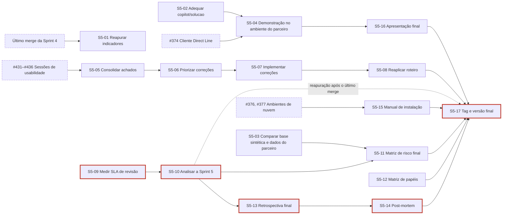

<p align="center">
  
</p>

<table align="center" width="100%" style="table-layout: fixed;">
  <tr>
    <td align="center">
      <a href="https://www.linkedin.com/in/alexsander-dsbarbosa/">
        
      </a>
    </td>
    <td align="center">
      <a href="https://github.com/CaduQuaglia">
        
      </a>
    </td>
    <td align="center">
      <a href="https://www.linkedin.com/in/celsojwnior/">
        
      </a>
    </td>
    <td align="center">
      <a href="https://www.linkedin.com/in/eduardo-casarini/">
        
      </a>
    </td>
    <td align="center">
      <a href="https://www.linkedin.com/in/marianalacerdareis/">
        
      </a>
    </td>
    <td align="center">
      <a href="https://www.linkedin.com/in/mirela-bianchi-608601254/">
        
      </a>
    </td>
  </tr>
</table>

<br>

<p align="center">
  
</p>

<table align="center" width="100%" style="table-layout: fixed;">
  <tr>
    <td align="center">
      <a href="https://www.linkedin.com/in/vanunes/">
        
      </a>
    </td>
    <td align="center">
      <a href="https://www.linkedin.com/in/reginaldo-arakaki-9574222b/">
        
      </a>
    </td>
    <td align="center">
      <a href="https://www.linkedin.com/in/bryan-kano/">
        
      </a>
    </td>
    <td align="center">
      <a href="https://www.linkedin.com/in/fernando-pizzo-208b526a/">
        
      </a>
    </td>
    <td align="center">
      <a href="https://www.linkedin.com/in/lisane-valdo/">
        
      </a>
    </td>
    <td align="center">
      <a href="https://www.linkedin.com/in/bruno-grandchamp-rodilha/">
        
      </a>
    </td>
    <td align="center">
      <a href="https://www.linkedin.com/in/filipe-gon%C3%A7alves-08a55015b/">
        
      </a>
    </td>
  </tr>
</table>

<br>

<p align="center">
  
</p>

# Gestão do Projeto

## Sumário

- [1. Introdução](#1-introdução)
- [2. Organização do projeto](#2-organização-do-projeto)
  - [2.1 Contrato de convivência](#21-contrato-de-convivência)
  - [2.2 Comunicação e rituais](#22-comunicação-e-rituais)
  - [2.3 Resolução de impasses e conflitos](#23-resolução-de-impasses-e-conflitos)
  - [2.4 SLA de entregas](#24-sla-de-entregas)
  - [2.5 Gestão de issues e estimativas](#25-gestão-de-issues-e-estimativas)
  - [2.6 Fluxo e rastreabilidade](#26-fluxo-e-rastreabilidade)
  - [2.7 Política de commits e uso do GitLab](#27-política-de-commits-e-uso-do-gitlab)
  - [2.8 Fechamento da sprint](#28-fechamento-da-sprint)
  - [2.9 Revisão do contrato de convivência](#29-revisão-do-contrato-de-convivência)
- [3. Avaliação das sprints](#3-avaliação-das-sprints)
  - [3.1 Quadro evolutivo de pontos fortes e fracos](#31-quadro-evolutivo-de-pontos-fortes-e-fracos)
  - [3.2 Sprint 1](#32-sprint-1)
    - [3.2.1 Planejamento e matriz de responsabilidades](#321-planejamento-e-matriz-de-responsabilidades)
    - [3.2.2 Retrospectiva da Sprint 1](#322-retrospectiva-da-sprint-1)
    - [3.2.3 Indicadores quantitativos](#323-indicadores-quantitativos)
    - [3.2.4 Análise dos pontos identificados](#324-análise-dos-pontos-identificados)
    - [3.2.5 Melhorias para a Sprint 2](#325-melhorias-para-a-sprint-2)
  - [3.3 Sprint 2](#33-sprint-2)
    - [3.3.1 Planejamento da Sprint 2](#331-planejamento-da-sprint-2)
    - [3.3.2 Alinhamento aos critérios do Escritório de Projetos](#332-alinhamento-aos-critérios-do-escritório-de-projetos)
    - [3.3.3 Matriz de papéis e responsabilidades da Sprint 2](#333-matriz-de-papéis-e-responsabilidades-da-sprint-2)
    - [3.3.4 Fechamento e análise da Sprint 2](#334-fechamento-e-análise-da-sprint-2)
  - [3.4 Sprint 3](#34-sprint-3)
    - [3.4.1 Planejamento e matriz de responsabilidades](#341-planejamento-e-matriz-de-responsabilidades)
      - [Matriz de papéis e responsabilidades da Sprint 3](#matriz-de-papéis-e-responsabilidades-da-sprint-3)
      - [Rotação de papéis em relação à Sprint 2](#rotação-de-papéis-em-relação-à-sprint-2)
    - [3.4.2 Retrospectiva da Sprint 3](#342-retrospectiva-da-sprint-3)
    - [3.4.3 Indicadores quantitativos da Sprint 3](#343-indicadores-quantitativos-da-sprint-3)
    - [3.4.4 Análise dos pontos identificados na Sprint 3](#344-análise-dos-pontos-identificados-na-sprint-3)
    - [3.4.5 Melhorias para a Sprint 4](#345-melhorias-para-a-sprint-4)
  - [3.5 Sprint 4](#35-sprint-4)
    - [3.5.1 Planejamento e matriz de responsabilidades](#351-planejamento-e-matriz-de-responsabilidades)
      - [Matriz de papéis e responsabilidades da Sprint 4](#matriz-de-papéis-e-responsabilidades-da-sprint-4)
      - [Rotação de papéis em relação às Sprints 2 e 3](#rotação-de-papéis-em-relação-às-sprints-2-e-3)
      - [Distribuição de carga](#distribuição-de-carga)
    - [3.5.2 Retrospectiva da Sprint 4](#352-retrospectiva-da-sprint-4)
    - [3.5.3 Indicadores quantitativos da Sprint 4](#353-indicadores-quantitativos-da-sprint-4)
    - [3.5.4 Reconciliação com o fechamento da Sprint 3](#354-reconciliação-com-o-fechamento-da-sprint-3)
    - [3.5.5 Análise dos pontos identificados na Sprint 4](#355-análise-dos-pontos-identificados-na-sprint-4)
    - [3.5.6 Melhorias para a Sprint 5](#356-melhorias-para-a-sprint-5)
  - [3.6 Sprint 5](#36-sprint-5)
    - [3.6.1 Planejamento da Sprint 5](#361-planejamento-da-sprint-5)
    - [3.6.2 Retrospectiva da Sprint 5](#362-retrospectiva-da-sprint-5)
- [4. Gestão de riscos e oportunidades](#4-gestão-de-riscos-e-oportunidades)
  - [4.1 Metodologia de avaliação](#41-metodologia-de-avaliação)
  - [4.2 Matriz de risco consolidada — revisão da Sprint 4](#42-matriz-de-risco-consolidada--revisão-da-sprint-4)
    - [4.2.1 Itens acrescentados na Sprint 4](#421-itens-acrescentados-na-sprint-4)
  - [4.3 Histórico de acompanhamento](#43-histórico-de-acompanhamento)
  - [4.4 Riscos materializados e efetividade das respostas](#44-riscos-materializados-e-efetividade-das-respostas)
  - [4.5 Plano de resposta — ameaças](#45-plano-de-resposta--ameaças)
  - [4.6 Estratégia de aproveitamento — oportunidades](#46-estratégia-de-aproveitamento--oportunidades)
  - [4.7 Matriz probabilidade × impacto — Sprint 4](#47-matriz-probabilidade--impacto--sprint-4)
  - [4.8 Análise dos três itens mais críticos](#48-análise-dos-três-itens-mais-críticos)
- [5. Melhorias de processo](#5-melhorias-de-processo)
  - [5.1 Ações de melhoria](#51-ações-de-melhoria)
  - [5.2 Indicadores de processo](#52-indicadores-de-processo)
- [6. Análise post-mortem](#6-análise-post-mortem)
  - [6.1 Sucessos do projeto](#61-sucessos-do-projeto)
  - [6.2 Oportunidades de melhoria](#62-oportunidades-de-melhoria)
  - [6.3 Lições aprendidas](#63-lições-aprendidas)
- [7. Análise de viabilidade financeira](#7-análise-de-viabilidade-financeira)
  - [7.1 Escopo orçado e premissas](#71-escopo-orçado-e-premissas)
  - [7.2 Horas estimadas por função e por integrante](#72-horas-estimadas-por-função-e-por-integrante)
  - [7.3 Custo de pessoal](#73-custo-de-pessoal)
  - [7.4 Insumos, licenças e plataformas da construção](#74-insumos-licenças-e-plataformas-da-construção)
  - [7.5 Custo de operação da solução em produção](#75-custo-de-operação-da-solução-em-produção)
  - [7.6 Despesas operacionais](#76-despesas-operacionais)
  - [7.7 Carga tributária](#77-carga-tributária)
  - [7.8 Margem de lucro](#78-margem-de-lucro)
  - [7.9 Preço final do projeto](#79-preço-final-do-projeto)
  - [7.10 Fluxo de caixa do fornecedor](#710-fluxo-de-caixa-do-fornecedor)
  - [7.11 Custo total de propriedade e sustentação opcional](#711-custo-total-de-propriedade-e-sustentação-opcional)
  - [7.12 Viabilidade para o Metrô](#712-viabilidade-para-o-metrô)
  - [7.13 Sensibilidade e riscos financeiros](#713-sensibilidade-e-riscos-financeiros)
  - [7.14 Resumo e conformidade](#714-resumo-e-conformidade)
  - [7.15 Referências](#715-referências)

## 1. Introdução

Este documento registra o contrato de convivência, o acordo de nível de serviço (SLA) interno e os rituais adotados pelo grupo durante o desenvolvimento do projeto. Seu objetivo é tornar explícitas as regras de colaboração, comunicação, resolução de impasses e acompanhamento do trabalho.

## 2. Organização do projeto

### 2.1 Contrato de convivência

#### 2.1.1 Regra de ouro

A regra de ouro do grupo é comunicar dúvidas, dificuldades e erros sem receio de exposição ou responsabilização individual. O primeiro movimento da equipe deve ser compreender o problema e oferecer apoio; críticas devem se concentrar no artefato, na decisão ou no processo, nunca na pessoa. Essa regra sustenta a segurança psicológica necessária para que impedimentos sejam comunicados antes de se transformarem em atrasos.

O board e o repositório constituem as fontes oficiais de acompanhamento do projeto. Uma atividade somente é considerada concluída quando seu card está atualizado e, quando aplicável, existe um commit ou merge request rastreável. Decisões tomadas em conversas ou reuniões devem ser registradas nos canais do projeto.

#### 2.1.2 Responsabilidade e colaboração

- Cada integrante deve manter seus cards atualizados e comunicar impedimentos assim que forem identificados.
- Alterações devem respeitar o escopo do card e ser submetidas à revisão por pares.
- A comunicação deve ser respeitosa, objetiva e direcionada à resolução do problema.
- Integrantes devem colaborar na revisão de merge requests e no esclarecimento de dúvidas que bloqueiem o trabalho da equipe.
- Revisões de merge requests devem ser realizadas em até 24 horas úteis, conforme SLA estabelecido.
- Quando possível, as revisões devem ser distribuídas entre os integrantes para evitar concentração em uma única pessoa.
- O repositório não deve ser mantido dentro de pasta sincronizada com serviço de nuvem, conforme a revisão registrada na seção 2.9.2. Quem não puder mover o repositório deve pausar a sincronização enquanto trabalha com Git.

### 2.2 Comunicação e rituais

#### 2.2.1 Comunicação oficial

A equipe utiliza o **WhatsApp para comunicações informais**, como avisos rápidos, dúvidas pontuais e alinhamentos cotidianos. O **Slack é o canal formal de comunicação**, utilizado para registrar informações, decisões e comunicados relacionados ao projeto. Decisões que afetem escopo, prazos ou responsabilidades também devem ser refletidas no board ou no repositório para preservar a rastreabilidade.

#### 2.2.2 Dailies

As dailies acontecem **presencialmente, às 14h, em todos os dias nos quais a equipe possui instrução**, com duração máxima de **15 minutos**. Quando a equipe não estiver reunida presencialmente, o acompanhamento poderá ocorrer de forma assíncrona no Slack. Cada integrante apresenta de forma objetiva as atividades concluídas, as próximas atividades e os impedimentos identificados. Quando um integrante não puder participar, sua atualização deve ser enviada pelo canal formal antes do encontro.

**Condução.** A daily é conduzida pelo Scrum Master da sprint, a quem cabe abrir o encontro no horário, manter a ordem de fala, encerrá-lo dentro dos 15 minutos e realizar as três verificações descritas adiante. Quando o Scrum Master não puder conduzir, a condução passa a outro integrante indicado na véspera, de modo que o ritual não dependa da presença de uma única pessoa.

**Roteiro.** Cada integrante responde a três perguntas, nesta ordem: o que concluiu desde a daily anterior, o que pretende concluir até a próxima e o que o impede de avançar. A resposta deve referenciar o card correspondente, e não apenas descrever a atividade, para que o acompanhamento seja verificável no quadro por quem não participou do encontro.

Durante a daily, as tarefas práticas são organizadas para um horizonte máximo de dois a três dias. A distribuição considera as dependências entre as atividades, de modo que a entrega de uma pessoa não bloqueie desnecessariamente o avanço das demais. No fechamento diário, o grupo verifica se as tarefas previstas foram concluídas. Quando uma atividade não é finalizada no mesmo dia, ela continua no dia seguinte, e a equipe avalia se a pessoa responsável necessita de apoio, redistribuição ou esclarecimento para prosseguir.

O Kanban do GitLab apoia esse acompanhamento ao tornar visíveis o estado das tarefas, os responsáveis, as dependências e os impedimentos. Os cards devem refletir a situação discutida nas dailies, permitindo que o grupo acompanhe o progresso entre os encontros e identifique antecipadamente riscos de bloqueio ou atraso.

**Acompanhamento de carga e dependências (revisão da Sprint 2).** Para tornar verificável a regra registrada na seção [2.9.1](#291-revisão-sprint-2), a daily passa a incluir três verificações objetivas, conduzidas pelo Scrum Master da sprint:

1. **Carga.** Comparação da quantidade e do *size* das issues em `Doing` por integrante. Diferença superior a 2:1 entre a maior e a menor carga atribuída deve ser discutida na própria daily e resolvida por redistribuição ou por registro da justificativa no card.
2. **Dependências.** Verificação das issues que bloqueiam outras atividades. Toda issue impeditiva deve receber a label `BLOCKED`, indicar o que a bloqueia e ter um próximo passo definido com responsável.
3. **Fila de revisão.** Verificação das issues em `Waiting Review` e `Review`. Itens que ultrapassem o SLA de 24 horas úteis devem receber um revisor nomeado ainda na daily, priorizando os merge requests que bloqueiam outras entregas.

O resultado dessas três verificações orienta a redistribuição de tarefas do dia e é a base do acompanhamento consolidado na retrospectiva.

**Assuntos que extrapolam a daily.** Discussão técnica, decisão de escopo ou alinhamento que exija mais do que um enunciado não é resolvido no encontro. O assunto é anotado, e a própria daily define quem participa e quando ocorre a conversa à parte. A regra protege os 15 minutos previstos: a daily é um ponto de sincronização, e não o espaço em que o grupo trabalha.

**Registro.** A daily não produz ata. O que precisa sobreviver ao encontro é registrado onde a equipe já consulta: impedimento vira comentário no card, acompanhado da label `BLOCKED`; redistribuição vira troca de responsável no quadro; e revisor definido vira atribuição no merge request. Uma daily que não produz nenhum desses registros não deixou rastro verificável, e o acompanhamento do dia seguinte parte da memória de quem esteve presente.

#### 2.2.3 Revisões de merge request

Ao abrir um merge request, a pessoa autora deve solicitar a revisão do grupo. A pessoa revisora deve verificar o atendimento ao card e registrar ajustes necessários antes da aprovação. As políticas técnicas de branch, commit e merge request estão documentadas em [GestaoConfiguracao.md](GestaoConfiguracao.md).

O SLA interno estabelece que todo merge request deve receber uma primeira revisão em até **24 horas úteis** após a solicitação. Quando esse prazo não puder ser cumprido, o impedimento deve ser comunicado no Slack e registrado no card. MRs que bloqueiem outras entregas têm prioridade de revisão e devem ser sinalizados na daily.

### 2.3 Resolução de impasses e conflitos

1. Divergências devem ser discutidas inicialmente entre as pessoas envolvidas, com base nos requisitos e artefatos do projeto.
2. Se não houver consenso, o tema deve ser apresentado ao grupo em uma daily ou reunião específica.
3. Persistindo o impasse, o Scrum Master da sprint organiza a decisão necessária para evitar bloqueio do trabalho.
4. Questões que não possam ser resolvidas internamente devem ser encaminhadas à professora orientadora.

Conflitos interpessoais devem ser tratados de forma reservada e respeitosa, com mediação de outro integrante quando necessário. Em casos de atraso recorrente ou falta de engajamento, aplica-se a seguinte progressão: primeiro, feedback direto e oferta de apoio na daily; segundo, alinhamento formal com o Scrum Master e registro do plano de recuperação; terceiro, registro na retrospectiva; e, caso o problema persista, encaminhamento à professora orientadora e ao CDL.

### 2.4 SLA de entregas

- Cards, merge requests e artefatos de documentação devem ser disponibilizados para revisão interna até **quinta-feira às 23h59**, independentemente do prazo formal da sprint.
- A pessoa responsável deve comunicar antecipadamente quando identificar risco de não cumprimento do prazo.
- Cards não concluídos devem permanecer atualizados no board, com o impedimento e o próximo passo registrados.
- A conclusão de uma entrega depende do atendimento ao DoD do card e da aprovação do merge request, quando aplicável.

### 2.5 Gestão de issues e estimativas

#### 2.5.1 Estrutura das issues

Toda atividade relevante deve possuir uma issue no GitLab. O título deve começar com um verbo no infinitivo, representar uma entrega específica e evitar descrições genéricas. Exemplos: `Modelar fluxo AS-IS da gestão de portfólio`, `Identificar requisitos não funcionais` e `Elaborar matriz de risco`.

Cada issue deve conter:

- descrição do que deve ser realizado e de seu contexto;
- DoR (*Definition of Ready*), indicando os pré-requisitos para início;
- DoD (*Definition of Done*), com condições objetivas de conclusão;
- milestone correspondente à sprint;
- label de natureza da atividade;
- estimativa de tamanho;
- pessoa responsável, quando a divisão do trabalho estiver definida.

As atividades devem ser granulares e produzir entregas verificáveis. Cards amplos, como “Fazer documentação da Sprint”, devem ser divididos em tarefas menores que permitam acompanhar o progresso e distribuir o trabalho entre os integrantes.

Defeito identificado em teste manual ou durante revisão abre issue própria antes da correção, com a label `BUG` acompanhando a label de entrega correspondente. Corrigir um defeito dentro de uma issue de outro escopo rompe a ligação entre o problema e a sua solução, e foi a situação que originou esta regra na revisão registrada na seção 2.9.2.

#### 2.5.2 T-shirt sizing

As estimativas representam referências de esforço relativo, não compromissos de duração exata.

| Size | Referência |
|---|---|
| `SIZE_PP` | até 15 minutos |
| `SIZE_P` | até 30 minutos |
| `SIZE_M` | de 30 a 60 minutos |
| `SIZE_G` | de 60 a 120 minutos |

Quando uma atividade exceder a referência de `SIZE_G`, a equipe deve avaliar sua divisão em issues menores e verificáveis.

#### 2.5.3 Labels padronizadas

A partir da Sprint 4, o board adota a taxonomia oficial definida pelo Escritório de Projetos. Cada issue recebe uma label de cada categoria obrigatória, e as labels devem ser escritas exatamente como listadas, uma vez que espaço e hífen são significativos para a avaliação.

**Entrega.** Obrigatória, uma por issue. Indica a natureza do que é produzido.

| Label | Uso |
|---|---|
| `BUSINESS` | Entendimento de negócio, viabilidade financeira, orçamento e proposta de valor |
| `DESIGN` | UML, BPMN, C4, jornadas, protótipos e demais modelagens visuais |
| `ARCHITECTURE` | Decisões e documentação técnica da solução, contratos de API e modelagem de dados |
| `CODE` | Implementação e configuração técnica |
| `TEST` | Planejamento, implementação e execução de testes |
| `DEPLOY` | Ambientes, automação, integração contínua e implantação |
| `PROCESS` | Gestão de projeto, de equipe e de configuração |
| `CHORE` | Tarefas de apoio ao repositório, dependências e organização de arquivos |

**Forma.** Aplicada quando a entrega é documentação em markdown. Nunca utilizada isoladamente, sempre acompanhando uma label de entrega.

| Label | Uso |
|---|---|
| `DOCS` | Documentação produzida em markdown |

**Natureza.** Aplicada quando a entrega corrige um defeito. Nunca utilizada isoladamente.

| Label | Uso |
|---|---|
| `BUG` | Correção de defeito identificado |

**Esforço.** Obrigatória, uma por issue, conforme as referências da seção 2.5.2: `SIZE_PP`, `SIZE_P`, `SIZE_M` e `SIZE_G`.

**Prioridade.** Obrigatória, uma por issue: `P_ALTA`, `P_MEDIA` e `P_BAIXA`.

**Fora do GitLab.** Aplicada quando a evidência da atividade não é um commit.

| Label | Uso |
|---|---|
| `MEET` | Reuniões e alinhamentos |
| `OFFSITE` | Atividades realizadas fora do repositório, como sessões com usuários externos |

**Situação.** Posição da atividade no quadro, acrescida da marcação de impedimento.

| Label | Uso |
|---|---|
| `open` | Candidata ainda não comprometida para a sprint |
| `backlog` | Comprometida para a sprint corrente |
| `doing` | Em execução |
| `waiting review` | Aguardando revisor |
| `review` | Em revisão |
| `closed` | Integrada, com DoD atendido |
| `BLOCK` | Atividade impedida de avançar |

Toda issue da sprint corrente deve possuir a milestone no formato `Sprint 0X`. Sem ela, o cartão não é contabilizado.

**Conferência da Sprint 4 (24/09/2026).** As labels acima foram conferidas contra o projeto no GitLab e contra as 99 issues da milestone `Sprint 04` (58 abertas):

| Categoria | Situação no projeto | Uso na milestone `Sprint 04` |
|---|---|---|
| Entrega | Existem `CODE`, `DESIGN`, `TEST` e `DEPLOY`. **Não existem** `BUSINESS`, `ARCHITECTURE`, `PROCESS` e `CHORE` | `CODE` 39, `TEST` 23, `DEPLOY` 12; nenhuma com `DESIGN` |
| Forma | `DOCS` existe | 25 issues; em 23 delas `DOCS` aparece sem label de entrega, porque as de gestão e arquitetura não existem no projeto |
| Natureza | `BUG` existe | 3 issues |
| Esforço | `SIZE_PP`, `SIZE_P`, `SIZE_M` e `SIZE_G` existem | Todas as 99 issues têm uma |
| Prioridade | `P_ALTA`, `P_MEDIA` e `P_BAIXA` existem | Todas as 99 issues têm uma |
| Fora do GitLab | `MEET` e `OFFSITE` existem | `OFFSITE` em 6 issues |
| Situação | As colunas do quadro são as labels `Backlog`, `Doing`, `Waiting Review` e `Review`, com inicial maiúscula. `open` e `closed` são os estados da issue no GitLab, e não labels. A label de impedimento existente é `BLOCKED`, da nomenclatura anterior; `BLOCK` não existe | Todas as issues abertas estão em uma coluna |

Enquanto as labels ausentes não forem criadas no projeto, vale a prática registrada na tabela: documentação de gestão, processo e arquitetura recebe `DOCS` com a prioridade e o esforço, e impedimento é marcado com `BLOCKED`. Criar as quatro labels de entrega e `BLOCK` alinha o quadro à taxonomia oficial e é decisão da equipe.

**Correspondência com a nomenclatura anterior**

Os cards criados até a Sprint 3 permanecem com as labels originais. O histórico não é reescrito, pela mesma razão que preservou o nome das branches anteriores à troca de prefixo descrita em [GestaoConfiguracao.md](GestaoConfiguracao.md). A tabela abaixo registra a correspondência para leitura do quadro anterior.

| Label anterior | Equivalente oficial |
|---|---|
| `REQUIREMENTS` | `ARCHITECTURE` com `DOCS` |
| `DOCUMENTATION` | `DOCS`, acompanhada da label de entrega correspondente |
| `RESEARCH` | `BUSINESS` ou `ARCHITECTURE`, conforme o objeto da pesquisa |
| `FRONTEND` | `CODE` |
| `BACKEND` | `CODE` |
| `DEVOPS` | `DEPLOY` |
| `CODE_REVIEW` | Sem equivalente. A revisão passou a ser etapa do fluxo, marcada por `review`, e não atividade com label própria |
| `BLOCKED` | `BLOCK` |
| `DOR_INCOMPLETE` e `DOD_INCOMPLETE` | Sem equivalente. A incompletude passa a ser tratada como impedimento, com `BLOCKED` |

> **Revisão da Sprint 3.** A tabela desta seção foi substituída pela taxonomia oficial do Escritório de Projetos. A revisão da Sprint 2 havia ajustado o documento à nomenclatura do quadro, trocando `DOCS` por `DOCUMENTATION`, o que eliminou a divergência entre documento e prática mas preservou a divergência entre a prática e a regra pela qual o grupo é avaliado. A adequação vale para os cards criados a partir da Sprint 4.

### 2.6 Fluxo e rastreabilidade

O fluxo esperado é:

```text
Issue → Branch → Desenvolvimento/Documentação → Commit → Push → MR → Review → Merge → Fechamento da Issue
```

- Uma issue somente deve ser iniciada quando seu DoR estiver atendido.
- Uma issue somente deve ser encerrada quando todos os critérios de seu DoD estiverem atendidos.
- Quando uma dependência impedir o avanço, a issue deve receber a label `BLOCKED` e registrar o impedimento.
- Branches, commits e merge requests devem ser relacionados à issue correspondente.
- A abertura do merge request não caracteriza a conclusão da atividade; revisão, atendimento aos comentários e merge fazem parte da entrega.
- A pessoa revisora deve verificar o DoD, os arquivos alterados, a coerência com outros artefatos, os conflitos e os testes aplicáveis.

Ao final, o GitLab deve permitir identificar o que precisava ser feito, quem realizou a atividade, quando ela foi executada, qual merge request entregou o resultado, se houve revisão e se o DoD foi cumprido.

As dependências entre artefatos devem ser respeitadas. Um exemplo de sequência é: stakeholders → personas → jornadas → User Stories → diagramas. A ordem específica de cada sprint deve seguir o planejamento aprovado pela equipe.

### 2.7 Política de commits e uso do GitLab

**Commits.** Os commits devem seguir o padrão *Conventional Commits*, no formato `<tipo>(<escopo opcional>): <verbo no infinitivo> <complemento> (#<card>)` ou `<tipo>(<escopo opcional>): <verbo no infinitivo> <complemento> #<card>`. As duas formas da referência, com e sem parênteses, são aceitas a partir da Sprint 5; o que é obrigatório é a referência ao card, separada da descrição por um espaço. A aferição da Sprint 4, na seção [3.5.3](#353-indicadores-quantitativos-da-sprint-4), seguiu a regra então vigente, que exigia parênteses, e não é recalculada. Cada commit deve representar uma unidade lógica de alteração, iniciar por verbo no infinitivo em letra minúscula, descrever objetivamente o que mudou e referenciar a issue correspondente. Mensagens vagas e commits que misturem atividades sem relação devem ser evitados. O envio direto de alterações para `main` ou `develop` não faz parte do fluxo do grupo: toda alteração chega à `develop` por merge request. Os tipos aceitos, os exemplos válidos e inválidos, o padrão de título e descrição de merge request e as demais regras técnicas estão detalhados no [GestaoConfiguracao.md](GestaoConfiguracao.md).

Exemplos do ciclo da Sprint 4, retirados do histórico da `develop`:

| Commit | Data | Mensagem | Situação |
|---|---|---|---|
| `9fdc817` | 22/09 | `feat: implementar produtor AMQP com confirmacao de publicacao #393` | Válida, referência sem parênteses |
| `3843f32` | 23/09 | `test: corrigir fixture dos testes de auditoria (#442)` | Válida, referência entre parênteses |
| `b462191` | 24/09 | `feat: guardar os segredos no key vault e proteger o banco (#378, #379)` | Válida, mais de um card |
| `159aa1e` | 23/09 | `feat: adiciona evidencias executaveis (#446)` | Inválida: verbo na terceira pessoa (`adicionar`) |
| `6eae97c` | 23/09 | `docs: registra resultado da implementação dos testes do RNF01(#441)` | Inválida: terceira pessoa e referência colada à descrição, sem espaço |
| `400b986` | 23/09 | `feat: atualiza secao de testes de integracao (#446)` | Inválida: terceira pessoa e tipo errado; alteração de documentação usa `docs` |

**Integração contínua e merge request.** Na Sprint 4 o repositório não possui pipeline de integração contínua (não há `.gitlab-ci.yml` na `develop`), e nada bloqueia o merge automaticamente. O que barra um merge request é a revisão: ele só é integrado depois da aprovação de outro integrante, e quem o abre deve executar antes as suítes da parte alterada (`python -m pytest` no middleware e `npm run test` na interface) e registrar o resultado em *Como testar* ou no DoD. A partir do primeiro merge request aberto depois que um `.gitlab-ci.yml` for integrado à `develop`, a regra passa a ser não integrar merge request com pipeline falhando.

**Movimentação do quadro.** O quadro é a fonte oficial do estado das atividades. Movimentar o card é responsabilidade da pessoa designada nele, e não do revisor ou do Scrum Master. A correspondência entre coluna e etapa do fluxo é a seguinte.

| Coluna | Quando o card entra |
|---|---|
| Issue aberta, sem coluna | Card criado, ainda não comprometido para a sprint |
| `Backlog` | Card comprometido para a sprint corrente, com milestone, labels e estimativa |
| `Doing` | Trabalho iniciado, com o DoR atendido |
| `Waiting Review` | Merge request aberto, ainda sem revisor designado |
| `Review` | Revisor designado e revisão em andamento |
| Issue fechada | Merge realizado e DoD integralmente atendido |

Regras de uso:

- O card muda de coluna no momento em que o fato ocorre, e não no fechamento do dia. Quadro atualizado em lote deixa de informar durante a daily e inviabiliza as três verificações da seção [2.2.2](#222-dailies).
- Card impedido permanece na coluna em que está, recebe a label `BLOCKED` e registra em comentário o que o bloqueia e qual é o próximo passo.
- Cada integrante deve manter no máximo duas atividades em `doing` simultaneamente. Acima disso, a verificação de carga perde precisão e o trabalho em curso deixa de refletir o que está efetivamente sendo feito.
- O fechamento da issue é feito pela pessoa responsável logo após o merge na `develop`, depois de conferir o DoD. `Closes #<issue>` na descrição do merge request registra o vínculo, mas o GitLab só fecha a issue automaticamente no merge para a branch padrão, que é a `main`: em 24/09/2026, #389 (!160), #391 (!156), #395 (!159) e #399 (!158) continuaram abertas depois de integradas na `develop`. Issue encerrada sem merge request associado deve registrar em comentário a razão do encerramento.
- Atividade sem evidência no repositório, como reunião ou sessão com usuário externo, recebe a label `MEET` ou `OFFSITE` e é encerrada com registro em comentário descrevendo o resultado.

> **Revisão da Sprint 4 (24/09/2026).** As políticas das seções 2.2 a 2.7 foram revisadas contra a prática do ciclo. Regras alteradas:
>
> | Regra | Antes | Agora | Motivo |
> |---|---|---|---|
> | Referência ao card no commit e no título de MR | Só `(#N)` | `(#N)` ou `#N`, a partir da Sprint 5 | 34 dos 58 commits integrados da Sprint 4 usaram `#N`; as duas formas geram o mesmo vínculo no GitLab |
> | Label de impedimento | `BLOCK` | `BLOCKED` | `BLOCK` não existe no projeto; `BLOCKED` é a label disponível no quadro |
> | Colunas do quadro | Nomes em minúsculas | `Backlog`, `Doing`, `Waiting Review` e `Review` | Nomes reais das labels do quadro |
> | Fechamento da issue | Automático por `Closes #N` | Manual, logo após o merge na `develop`, com o DoD conferido | O GitLab só fecha automaticamente no merge para a `main` |
> | Integração contínua | Não registrada | Sem pipeline: o merge é barrado pela revisão, e o autor executa as suítes antes | Não há `.gitlab-ci.yml` na `develop` |
>
> Regras revisadas e mantidas: a daily presencial de 15 minutos conduzida pelo Scrum Master, com as três verificações de carga, dependências e fila de revisão, porque são elas que alimentam o acompanhamento da retrospectiva, onde o funcionamento no ciclo é avaliado; o SLA de 24 horas úteis para a primeira revisão, porque 23 dos 24 merge requests do período tiveram revisor nomeado; a estrutura das issues com DoR, DoD, milestone, prioridade e tamanho, porque todas as 99 issues da milestone `Sprint 04` têm prioridade e tamanho; e o fluxo da seção 2.6, que continua sendo o praticado. A coerência com o contrato de convivência será conferida na revisão da Sprint 4 da seção 2.9 (#402).

### 2.8 Fechamento da sprint

Ao final de cada sprint, a equipe deve:

- revisar as entregas realizadas;
- consolidar o `Projeto.md` e os documentos de gestão;
- verificar a coerência entre NEG, REQ e PROJ;
- conferir o atendimento ao DoD das issues;
- conferir que nenhuma issue do ciclo foi fechada sem responsável atribuído;
- verificar merge requests pendentes;
- extrair as métricas do ciclo declarando corte, fonte, commit-base e regra de atribuição, conforme a nota metodológica da seção [3.3.4](#334-fechamento-e-análise-da-sprint-2);
- registrar a retrospectiva;
- identificar e documentar pendências;
- planejar e criar as issues da sprint seguinte, incluindo estimativas, labels, milestone e dependências;
- revisar e atualizar o contrato de convivência, quando necessário;
- avaliar a efetividade das políticas de trabalho e realizar ajustes conforme as necessidades identificadas.

### 2.9 Revisão do contrato de convivência

O contrato de convivência firmado na Sprint 1 deve ser revisado ao final de cada sprint. Havendo necessidade de ajuste, as regras devem ser alteradas com o devido registro da mudança, mantendo:

- a data da revisão;
- a justificativa para a alteração;
- a nova regra aprovada pelo grupo;
- o impacto esperado na dinâmica da equipe.

As revisões são registradas nesta seção para garantir transparência e rastreabilidade das decisões de processo ao longo do projeto.

#### 2.9.1 Revisão Sprint 2

**Data:** 2026-08-26

**Justificativa:** Identificou-se a necessidade de reforçar políticas sobre revisão de merge requests e distribuição de carga de trabalho, baseado em evidências de revisões concentradas e atualizações mantidas até o fechamento da sprint.

**Alterações aprovadas:**
- Inclusão de diretrizes explícitas sobre distribuição de revisões de merge requests entre os integrantes.
- Reforço do SLA de 24 horas para revisão de MRs com priorização de MRs que bloqueiem outras entregas.
- Adição de critérios para acompanhamento de carga e dependências nas dailies.

**Impacto esperado:** Melhor distribuição do trabalho de revisão, redução de concentração de revisões em uma única pessoa e identificação antecipada de bloqueios.

#### 2.9.2 Revisão Sprint 3

**Data:** 2026-09-11

**Regras revisadas e mantidas**

A revisão percorreu o contrato inteiro, e não apenas os pontos que mudaram. As regras abaixo foram examinadas e mantidas, com a razão registrada.

| Regra | Seção | Razão da manutenção |
|---|---|---|
| Regra de ouro | 2.1.1 | Não houve conflito ou episódio de exposição individual na sprint que justificasse revisão. A regra continua descrevendo a prática do grupo |
| Board e repositório como fontes oficiais | 2.1.1 | A rastreabilidade entre card, commit e merge request se manteve ao longo da sprint |
| Comunicação oficial em dois canais | 2.2.1 | A separação entre WhatsApp informal e Slack formal funcionou sem ambiguidade registrada |
| Dailies presenciais às 14h, com 15 minutos | 2.2.2 | Formato e duração se mostraram adequados ao ritmo da sprint |
| Três verificações da daily | 2.2.2 | Mantidas com avaliação positiva. Criadas na revisão anterior para responder ao apontamento sobre concentração de revisões, elas fizeram diferença na condução da Sprint 3: a verificação de carga tornou visível o desequilíbrio no mesmo dia em que ele surgia, a de dependências antecipou bloqueios que antes só apareciam quando já travavam alguém, e a de fila de revisão reduziu o tempo de espera dos merge requests. A equipe avalia que a regra saiu do papel e passou a orientar a redistribuição diária |
| SLA de 24 horas úteis para revisão de merge request | 2.2.3 | Mantido. Foi cumprido na maioria das solicitações da sprint, e os descumprimentos foram pontuais. O prazo permanece adequado; o que exige atenção é a regularidade, tratada como ação de melhoria |
| Resolução de impasses e conflitos | 2.3 | A progressão prevista não precisou ser acionada nesta sprint |
| SLA de entrega até quinta às 23h59 | 2.4 | Mantido, e não cumprido. As entregas da Sprint 3 se estenderam até a tarde de sexta-feira. A regra é preservada porque cumpre função de organização, antecipando o planejamento da semana e concentrando o esforço antes do prazo formal. A distância entre a meta e o resultado é tratada como ação de melhoria, e não como flexibilização do prazo |

**Justificativa das alterações**

As alterações desta revisão respondem a situações concretas ocorridas durante a Sprint 3, e não a aprimoramentos genéricos de processo. Uma nasceu de perda efetiva de tempo de trabalho, uma responde a prejuízo de rastreabilidade, duas corrigem divergência entre o que o grupo pratica e o que estava registrado, uma detalha um ritual cuja regra existia apenas em linhas gerais, e a última resolve um caso que a regra anterior não previa.

**Alterações aprovadas**

- **Ambiente de trabalho local.** Fica estabelecido que o repositório não deve ser mantido dentro de pasta sincronizada com serviço de nuvem. A sincronização automática interfere no funcionamento do Git, e a Sprint 3 registrou quatro ocorrências: um arquivo de trava do índice que impediu qualquer operação, um arquivo de configuração que o sistema não conseguiu ler, um arquivo de controle de merge vazio que fez o Git reportar um merge inexistente, e arquivos removidos pela troca de branch sendo restaurados pela sincronização sobre a `develop`. Quem não puder mover o repositório deve pausar a sincronização durante o trabalho com Git.

- **Defeito identificado fora de card.** Todo defeito encontrado em teste manual ou durante revisão passa a abrir issue própria antes da correção. Na Sprint 3, um defeito de interface encontrado em teste manual foi corrigido dentro de uma issue de outro escopo, o que prejudicou a rastreabilidade entre o problema e a sua solução.

- **Taxonomia de labels.** As labels do board passam a seguir a lista oficial do Escritório de Projetos a partir da Sprint 4, com uma label de entrega entre `BUSINESS`, `DESIGN`, `ARCHITECTURE`, `CODE`, `TEST`, `DEPLOY`, `PROCESS` e `CHORE`, acrescida de `DOCS` como forma, nunca utilizada isoladamente. Os cards criados até a Sprint 3 permanecem com as labels originais, pela mesma razão que preservou o nome das branches anteriores à troca de prefixo. A seção 2.5.3 registra a correspondência entre as duas nomenclaturas.

- **Convenção de merge request.** O título do merge request passa a seguir o mesmo formato da mensagem de commit, e a descrição passa a conter as seções O que foi feito, Por que foi feito, DOR, DOD e Como testar. Até a Sprint 2, o `GestaoConfiguracao.md` previa o formato `TIPO | descrição` e um checklist genérico de conferência, que o grupo deixou de utilizar ao longo da Sprint 3 sem atualizar o documento. As seções de DOR e DOD substituem o checklist porque exigem a evidência de atendimento de cada critério, e não apenas a marcação de uma caixa.

- **Condução e registro da daily.** A daily passa a ter condução nomeada, exercida pelo Scrum Master da sprint, com substituto indicado na véspera quando ele não puder conduzir. Fica estabelecido que assunto cuja discussão exceda o enunciado sai do encontro para conversa à parte, com participantes e horário definidos na própria daily, e que o resultado do encontro é registrado no quadro, e não em ata. A Sprint 3 mostrou que as três verificações criadas na revisão anterior funcionam, mas que dependem de o encontro terminar no tempo previsto e de o que foi decidido ficar onde a equipe consulta.

- **Branch derivada de outra branch.** A regra de que toda branch nasce da `develop` passa a admitir exceção quando o trabalho documenta ou corrige código ainda não integrado. Nesse caso, a branch pode derivar daquela que contém o código, e o merge request deve declarar a branch-base e o motivo. A exceção surgiu na documentação da interface, que descrevia código presente apenas na branch de origem.

**Fechamento de ação da sprint anterior**

A ação AM13, que previa repriorizar o quadro no penúltimo dia da sprint, dependia de uma distinção de prioridade que o board não oferecia. As labels `P_ALTA`, `P_MEDIA` e `P_BAIXA` passaram a ser aplicadas aos cards durante a Sprint 3, o que torna a ação executável e encerra o apontamento recebido na avaliação anterior.

**Impacto esperado**

Espera-se redução do tempo perdido com incidentes de ambiente local, que na Sprint 3 consumiram horas de trabalho sem produzir entrega. A abertura de issue para defeito encontrado deve tornar visível no board um tipo de trabalho que antes ficava embutido em outras entregas. A adequação da taxonomia de labels alinha o board aos critérios pelos quais o grupo é avaliado. A condução nomeada e o registro no quadro devem sustentar as três verificações da daily sem alongar o encontro. A convenção unificada de merge request elimina a divergência entre documento e prática e permite ler o título do card, o commit e o merge request como uma sequência única. A exceção da branch-base elimina a escolha entre cumprir a regra e documentar código existente, situação que a regra anterior não previa.

## 3. Avaliação das sprints

Esta seção será atualizada ao encerramento de cada sprint, registrando evidências, pontos fortes, pontos fracos e ações de melhoria. Os espaços das sprints futuras são mantidos como estrutura de acompanhamento e não representam avaliações antecipadas.

### 3.1 Quadro evolutivo de pontos fortes e fracos

O quadro evolutivo será consolidado progressivamente para evidenciar temas recorrentes e acompanhar a efetividade das ações de melhoria entre as sprints.

| Sprint | Pontos fortes | Pontos de atenção | Ações para o ciclo seguinte |
|---|---|---|---|
| Sprint 1 | Entrega integral do escopo no fechamento; rastreabilidade por issues, commits e MRs; equilíbrio global entre criação e revisão de MRs | Distribuição desigual entre frentes; revisões concentradas; atualizações mantidas até a noite de encerramento | Definir corte único das métricas; distribuir revisões desde o início; acompanhar carga e dependências nas dailies |
| Sprint 2 | Conclusão integral da milestone (81/81 issues) mesmo com redefinição de escopo; granularidade do planejamento em tasks pequenas e verificáveis; participação dos seis integrantes no fluxo de integração; identidades de autoria reconciliadas pelo `.mailmap`; comunicação consistente nas dailies | Desorganização na primeira semana por mudança de escopo; fechamento concentrado no encerramento (51% nos dois últimos dias); 24,7% do escopo fechado sem responsável atribuído; desequilíbrio de carga (2,83:1 em issues e 2,92:1 em horas) e integração concentrada; ausência de Tech Lead designado | Nomear revisor na abertura do MR e medir o SLA; redistribuição obrigatória acima de 2:1; designar Tech Lead; issue de propagação a cada mudança de escopo; responsável obrigatório antes de `Doing`; checkpoint de repriorização no penúltimo dia útil |
| Sprint 3 | Organização proativa com adiantamento de trabalho de sprints futuras; divisão clara de tarefas desde o início; integração ágil entre componentes (voz, NLP, mensageria) | Perda de dia de desenvolvimento por feriado; queda de produtividade por integrantes resfriados | Criar plano B para casos de ausência e redução de capacidade; considerar feriados no cálculo de capacity |
| Sprint 4 | Onda 1 fora do esqueleto (`NotImplementedError` de 45 para 23); revisor nomeado em 23 de 24 merge requests; board íntegro sem regularização (97 de 97 cards com responsável, *size* e prioridade); métricas da Sprint 3 refeitas no fechamento | Operação a 141% da capacidade declarada, pela antecipação do escopo da Sprint 5; razão de carga de 2,25:1; conclusão atrasada em relação ao tempo decorrido; 82% dos merges em duas pessoas | Planejar dentro da capacidade; redistribuir carga no planejamento; teto de 40% dos merges por pessoa; medir o SLA de revisão; refazer as métricas depois do último merge; checkpoint de quarta com data prevista por card |

### 3.2 Sprint 1

#### 3.2.1 Planejamento e matriz de responsabilidades

A matriz foi construída em alto nível por artefato e entregável, conforme orientação do Escritório de Projetos. A alocação prática de tarefas segue um horizonte de dois a três dias e é revisada nas dailies. A indicação de uma pessoa responsável principal não implica execução isolada: os artefatos permanecem sujeitos à colaboração e à revisão do grupo.

##### Integrantes e papéis

| Integrante | Papel principal | Frente de atuação | Principais entregas sob responsabilidade |
|---|---|---|---|
| **Mirela Bianchi** | Tech Lead e apresentação | NEG — Fluxo de negócio; REQ — Business Drivers, RNFs e stack | BPMN AS-IS e TO-BE, Business Drivers, Requisitos Não Funcionais, stack tecnológico e slides da Sprint 1 |
| **Mariana Reis** | Scrum Master e REQ | NEG — Personas e jornadas; REQ — RFs, User Stories e diagrama de classes | Personas, jornadas do usuário, Requisitos Funcionais, User Stories, diagrama de classes e README |
| **Celso Rocha** | Gestão de Configuração e REQ | NEG — Contexto e objetivos; REQ — Diagrama UML; PROJ — GitFlow, commits e contrato | Contexto da indústria, objetivos do produto, diagrama UML de componentes, GitFlow, padrão de commits e contrato de convivência |
| **Carlos Eduardo Serrano** | Arquiteto e riscos | NEG — Matriz de risco; REQ — Visão técnica e integrações | Identificação e avaliação de riscos, matriz de risco completa, visão preliminar da arquitetura e mapeamento de integrações Microsoft |
| **Alexsander Barbosa** | Negócio e BPMN | NEG — Problema, visão do produto e fluxo de negócio | Descrição do problema, visão do produto, cadeia de valor e processos em BPMN |
| **Eduardo Casarini** | Features, Canvas e modelagem | NEG — Brainstorming, priorização e Canvas MVP; REQ — Diagramas de sequência | Brainstorming de features, priorização, Canvas do MVP e diagramas de sequência |

##### Distribuição por artefato

**NEG — Entendimento do Negócio**

| Seção | Responsável principal |
|---|---|
| Problema | Alexsander Barbosa |
| Contexto da indústria | Celso Rocha |
| Visão do produto | Alexsander Barbosa |
| Objetivos do produto | Celso Rocha |
| Personas | Mariana Reis |
| Jornada do usuário | Mariana Reis |
| Fluxo de negócio — AS-IS (BPMN) | Mirela Bianchi |
| Fluxo de negócio — TO-BE (BPMN) | Mirela Bianchi |
| Cadeia de valor e processos | Alexsander Barbosa |
| Brainstorming de features | Eduardo Casarini |
| Priorização de features | Eduardo Casarini |
| Canvas do MVP | Eduardo Casarini |
| Matriz de risco | Carlos Eduardo Serrano |
| Visual de probabilidade e impacto | Carlos Eduardo Serrano |
| Descrição curta e escopo macro | Mariana Reis |

**REQ — Especificação de Requisitos**

| Seção | Responsável principal |
|---|---|
| Business Drivers | Mirela Bianchi |
| Fluxos de negócio com PLN | Alexsander Barbosa |
| Requisitos Funcionais | Mariana Reis |
| User Stories | Mariana Reis |
| Diagrama de classes | Mariana Reis |
| Diagramas de sequência | Eduardo Casarini |
| Requisitos Não Funcionais | Mirela Bianchi |
| Visão da solução técnica (blocos) | Carlos Eduardo Serrano |
| Integrações com o ecossistema Microsoft | Carlos Eduardo Serrano |
| Diagrama UML de componentes | Celso Rocha |
| Stack tecnológico | Mirela Bianchi |

**PROJ — Gestão do Projeto**

| Documento | Seção | Responsável principal |
|---|---|---|
| `docs/GestaoProjeto.md` | Matriz de papéis e responsabilidades | Mariana Reis |
| `docs/GestaoProjeto.md` | Contrato de convivência, SLA e rituais | Celso Rocha |
| `docs/GestaoProjeto.md` | Análise da Sprint 1 | Mariana Reis |
| `docs/GestaoProjeto.md` | Planejamento da Sprint 2 | Mariana Reis |
| `docs/GestaoConfiguracao.md` | GitFlow e política de branches | Celso Rocha |
| `docs/GestaoConfiguracao.md` | Padrão de commits | Celso Rocha |
| Apresentação da Sprint 1 | Slides | Mirela Bianchi |
| `README.md` | Visão geral do projeto | Mariana Reis |

A distribuição foi verificada considerando a quantidade e a complexidade dos artefatos, bem como a atuação de cada integrante em frentes complementares de negócio, requisitos, modelagem, arquitetura e gestão. As responsabilidades principais estão distribuídas entre os seis integrantes, enquanto as revisões coletivas e os ajustes definidos nas dailies reduzem o risco de centralização das entregas.

##### Acordos de processo

- **Horizonte de alocação:** tarefas práticas definidas com antecedência de dois a três dias e revisadas nas dailies.
- **Comunicação de bloqueios:** dificuldades devem ser reportadas antecipadamente na daily, sem aguardar o prazo da entrega.
- **Desvios do plano:** alterações relevantes devem ser documentadas no `GestaoProjeto.md` como memória do projeto.
- **Kanban:** o board deve ser atualizado no início e no fim de cada dia de trabalho.
- **Prazo interno:** as entregas devem ser disponibilizadas até quinta-feira, com a sexta-feira reservada apenas para revisões finais.

#### 3.2.2 Retrospectiva da Sprint 1

A Sprint 1 teve como foco compreender o problema do parceiro, estruturar os artefatos de negócio e requisitos e estabelecer os acordos de gestão e configuração do grupo. Ao final do ciclo, foram consolidados o contexto e a visão do produto, personas, jornadas, fluxos de negócio, matriz de riscos, requisitos funcionais e não funcionais, User Stories e modelos UML iniciais. Em paralelo, a equipe definiu GitFlow, padrão de commits, contrato de convivência, políticas operacionais e matriz de papéis. A análise das entregas considera a [matriz de papéis e responsabilidades da Sprint 1](#321-planejamento-e-matriz-de-responsabilidades), utilizada como referência para comparar as frentes planejadas com o que foi concluído.

O fechamento geral confirmado pela equipe registrou 65 commits integrados à `develop`, 48 issues concluídas, 55 horas entregues e 33 Merge Requests criados e revisados. Os dados consideram as atividades concluídas até a noite de encerramento da sprint, ainda que algumas atualizações no GitLab tenham ocorrido depois das primeiras extrações utilizadas durante a análise. Esse resultado indica que o escopo previsto foi concluído e que a revisão acompanhou o volume de produção.

A retrospectiva também mostrou que quantidade de commits ou issues não mede, isoladamente, qualidade ou esforço. Os artefatos possuem granularidades distintas, e uma entrega documental extensa pode gerar menos commits do que uma sequência de pequenos ajustes. Por isso, os números foram utilizados como evidências de rastreabilidade e distribuição, acompanhados de uma leitura qualitativa do processo.

#### 3.2.3 Indicadores quantitativos

> **Nota metodológica:** as métricas automatizadas foram coletadas por meio de um script de consulta ao GitLab às **13h do dia 14/08/2026**. Como a equipe continuou concluindo, revisando e atualizando atividades após esse horário, podem existir pequenas diferenças entre o recorte individual produzido pelo script e os totais consolidados no fechamento da Sprint 1. O horário de corte foi preservado para garantir transparência e permitir a reprodução da análise.

**Resumo geral consolidado no fechamento**

| Métrica | Resultado |
|---|---:|
| Commits integrados à `develop` | 65 |
| Issues concluídas | 48/48 |
| Taxa de conclusão das issues | **100%** |
| Horas entregues | 55 h |
| MRs criados | 33 |
| MRs revisados | 33 |

**Distribuição por integrante**

| Integrante | Commits integrados | Participação nos commits atribuíveis | Issues fechadas | Conclusão | Horas fechadas | MRs criados | MRs revisados |
|---|---:|---:|---:|---:|---:|---:|---:|
| Mirela Bianchi | 22 | 34,4% | 10/10 | 100% | 12,5 h | 7 | 10 |
| Mariana Reis | 14 | 21,9% | 12/12 | 100% | 10,0 h | 9 | 7 |
| Carlos Eduardo Serrano | 9 | 14,1% | 7/7 | 100% | 8,5 h | 4 | 6 |
| Eduardo Casarini | 8 | 12,5% | 6/6 | 100% | 9,0 h | 3 | 1 |
| Celso Rocha | 6 | 9,4% | 7/7 | 100% | 7,0 h | 4 | 4 |
| Alexsander Barbosa | 5 | 7,8% | 6/6 | 100% | 7,0 h | 4 | 3 |
| **Total individualizado** | **64** | **100%** | **48/48** | **100%** | **54,0 h** | **31** | **31** |

Dos 65 commits integrados à `develop`, 64 foram associados aos seis integrantes por nome e e-mail de autoria. Um commit adicional foi registrado tecnicamente como `Administrator` e, por isso, foi mantido no total geral sem ser atribuído individualmente. Para horas e MRs, foram preservados tanto o total geral confirmado no fechamento quanto os valores do recorte individual fornecido pela equipe; a diferença entre eles deverá ser considerada na definição do próximo procedimento de extração. A razão entre o maior e o menor volume autoral foi de 4,4:1. Nas issues atribuídas, a razão entre a maior e a menor carga foi de 2:1.

O recorte individual registrou equilíbrio numérico entre produção e revisão, com 31 MRs criados e 31 revisados, enquanto o fechamento geral chegou a 33 em ambas as métricas. Entretanto, a distribuição das revisões variou entre as pessoas, indicando que o equilíbrio global não significa, necessariamente, uma distribuição uniforme da atividade de revisão.

**Relação entre planejamento e entregas**

| Frente prevista na matriz | Entregas concluídas na Sprint 1 | Resultado observado |
|---|---|---|
| NEG — Entendimento do Negócio | Problema, contexto, visão e objetivos do produto, personas, jornadas, fluxos AS-IS e TO-BE, cadeia de valor, ideação, priorização, Canvas e matriz de riscos | Frente concluída conforme a distribuição prevista na matriz de responsabilidades |
| REQ — Especificação de Requisitos | Business Drivers, RFs, RNFs, User Stories, modelos de classes, componentes e sequência, visão técnica, integrações e stack | Artefatos necessários para orientar o detalhamento técnico da Sprint 2 consolidados |
| PROJ — Gestão do Projeto | Contrato de convivência, SLA, rituais, matriz de papéis, políticas de processo, GitFlow, commits e README | Estrutura de colaboração e rastreabilidade estabelecida para os ciclos seguintes |

A comparação com a seção 3.2.1 indica que todas as frentes e todos os seis integrantes previstos na matriz participaram do conjunto final de entregas. A matriz descreve a responsabilidade principal, mas a conclusão dos artefatos também envolveu colaboração e revisão cruzada.

#### 3.2.4 Análise dos pontos identificados

**Pontos fortes**

| Ponto forte | Evidência observada na Sprint 1 | Impacto no processo |
|---|---|---|
| Conclusão do escopo planejado | 48 issues concluídas no fechamento, correspondendo a 100% do conjunto consolidado | Permitiu encerrar a sprint com os artefatos de negócio, requisitos e gestão disponíveis para orientar a etapa técnica seguinte |
| Rastreabilidade das entregas | 65 commits integrados à `develop`, issues associadas às entregas e MRs utilizados no fluxo de revisão | Tornou possível relacionar planejamento, autoria, revisão e integração no repositório |
| Equilíbrio global entre produção e revisão | O fechamento consolidado registrou a mesma quantidade de MRs criados e revisados | Evitou que a produção avançasse sem uma atividade correspondente de revisão |
| Definição precoce dos acordos de trabalho | GitFlow, commits, dailies, SLA, Kanban e matriz de responsabilidades foram documentados na primeira sprint | Criou uma referência comum para execução e acompanhamento das sprints seguintes |
| Cobertura das frentes da Sprint 1 | Todos os seis integrantes participaram de entregas em NEG, REQ ou PROJ | Reduziu a dependência de uma única pessoa para a construção do conjunto de artefatos |

Os resultados mostram que a equipe conseguiu transformar uma sprint predominantemente documental em entregas verificáveis no GitLab. O uso combinado de issues, branches, commits e MRs permitiu acompanhar não apenas o resultado final, mas também o caminho percorrido até a integração.

**Pontos de atenção**

| Ponto de atenção | Evidência observada na Sprint 1 | Consequência para o processo |
|---|---|---|
| Distribuição desigual do volume de commits | Razão de 4,4:1 entre o maior e o menor volume autoral | Pode indicar diferença de granularidade ou concentração de alterações e deve ser acompanhada junto à complexidade das tarefas |
| Revisões concentradas | O número individual de revisões variou de 1 a 10 no recorte rastreável | A equipe pode criar dependência dos revisores mais ativos e ampliar o tempo de espera nos próximos ciclos |
| Atualizações concentradas no encerramento | Algumas atividades continuaram sendo concluídas e atualizadas no GitLab até a noite de fechamento | Extrações realizadas antes do encerramento apresentaram números provisórios e dificultaram uma leitura estável das métricas |
| Diferença entre totais gerais e individualizados | O fechamento geral registrou 33 MRs e 55 h, enquanto o recorte individualizado somou 31 MRs e 54 h | Registros sem atribuição individual estável precisam ser identificados para evitar interpretações aparentemente contraditórias |
| Métricas de volume não representam esforço isoladamente | Artefatos e tarefas apresentaram tamanhos e granularidades diferentes | Comparações apenas por commits ou issues podem produzir interpretações injustas sobre contribuição |

Os pontos de atenção foram tratados como características do processo, e não como avaliação individual. A retrospectiva não utiliza nomes para associar menor participação a desempenho insuficiente, pois volume, complexidade, dependências e função exercida precisam ser analisados em conjunto.

#### 3.2.5 Melhorias para a Sprint 2

| Problema endereçado | Ação de melhoria | Responsável | Prazo de aplicação | Critério de sucesso |
|---|---|---|---|---|
| Divergência entre recortes de métricas | Definir data, horário, branch-base e regra de atribuição antes de gerar o relatório da sprint | Scrum Master | Início e fechamento da Sprint 2 | Um único relatório reproduzível, com totais gerais e individuais reconciliados |
| Revisões concentradas | Distribuir MRs entre revisores ao longo da sprint e acompanhar o SLA nas dailies | Equipe | Ao longo da Sprint 2 | Todo MR com reviewer definido e nenhuma revisão excedendo o SLA acordado sem impedimento registrado |
| Distribuição desigual do trabalho | Revisar carga, complexidade e dependências durante as dailies, redistribuindo tarefas quando necessário | Scrum Master e Tech Lead | Ao longo da Sprint 2 | Diferença máxima de 2:1 na carga atribuída, considerando horas e complexidade |
| Fechamento concentrado no fim do ciclo | Adotar checkpoints intermediários para validar DoD, pendências e itens em revisão | Equipe | Metade e penúltimo dia da Sprint 2 | Nenhuma issue permanece sem atualização de status nos checkpoints |
| Leitura isolada de métricas de volume | Analisar commits e issues em conjunto com horas, tamanho, artefato e papel exercido | Scrum Master | Retrospectiva da Sprint 2 | Retrospectiva apresenta indicadores quantitativos acompanhados de contexto qualitativo |

Para a Sprint 2, a equipe deverá manter as práticas que funcionaram no primeiro ciclo, especialmente a rastreabilidade entre issue, branch, commit, MR e revisão. As melhorias propostas concentram-se em tornar a coleta mais consistente, distribuir revisões e usar os indicadores como apoio à gestão, sem convertê-los em um ranking individual de produtividade.

### 3.3 Sprint 2

#### 3.3.1 Planejamento da Sprint 2

O planejamento operacional da Sprint 2 está registrado no [Kanban do GitLab](https://git.inteli.edu.br/graduacao/2026-2a/t17/g02/-/boards) e na milestone correspondente. Foram criadas **27 issues**, de `#71` a `#97`, cada uma com objetivo, contexto, dependências, tipo, estimativa, DoR e DoD. O planejamento organiza o trabalho em três frentes complementares:

| Frente | Escopo planejado | Resultado esperado |
|---|---|---|
| Design compreensivo e projeto visual | Entendimento do usuário, jornadas, experiência, acessibilidade, wireframes e protótipo | Proposta visual fundamentada nas necessidades dos usuários |
| Estratégia técnica da solução | APIs de voz, pipeline de PLN, stack, dados, UML, deploy e estratégia das Sprints 3 a 5 | Decisões técnicas documentadas, demonstráveis e reproduzíveis |
| Gestão evolutiva | Retrospectiva, riscos, papéis, convivência, backlog, processo e GitFlow | Aprendizados incorporados e Sprint 3 preparada com antecedência |

**Capacidade planejada**

| Size | Quantidade | Referência de duração |
|---|---:|---|
| `SIZE_PP` | 0 | até 15 minutos |
| `SIZE_P` | 8 | até 30 minutos |
| `SIZE_M` | 17 | de 30 a 60 minutos |
| `SIZE_G` | 2 | de 60 a 120 minutos |
| **Total** | **27** | — |

> **Nota de reconciliação.** Este é o plano **de abertura** do ciclo, mantido como registro do que foi previsto. Ele não descreve o escopo executado: a redefinição de arquitetura da primeira semana substituiu integralmente esse conjunto por um planejamento mais granular, e a milestone `Sprint 02` fechou com **81 issues**, das quais nenhuma pertence à faixa `#71`–`#97`. A diferença entre o previsto e o realizado é analisada na seção [3.3.4](#334-fechamento-e-análise-da-sprint-2), e a exigência de registrar a propagação de cada mudança de escopo passou a ser a ação `AM09`.

A prioridade foi definida pela redução de incerteza e pelo efeito de desbloqueio. Primeiro são executadas as atividades que fundamentam decisões posteriores; em seguida, são produzidos os artefatos técnicos e visuais; por fim, são consolidados governança e planejamento do próximo ciclo. As duas tasks `SIZE_G`, relacionadas à proposta de UX e ao deploy, devem receber acompanhamento mais frequente nas dailies por concentrarem maior abrangência e incerteza.

O sequenciamento principal é:

```text
Usuário e necessidades
        ↓
Jornada, UX e interfaces
        ↓
Arquitetura, APIs, dados e implantação
        ↓
Estratégia de evolução e retrospectiva da Sprint 2
        ↓
Planejamento operacional da Sprint 3
```

As dependências registradas nas issues devem orientar a entrada em `Doing`. Entre os caminhos relevantes estão `T001 → T002 → T003 → T004 → T005` para o entendimento e a experiência do usuário; `T010 → T011 → T015` para PLN e implantação; `T014 → T016 → T017 → T023 → T024` para arquitetura e planejamento evolutivo; e `T026 → T027` para atualização e exemplificação do GitFlow. Atividades sem dependência explícita podem avançar em paralelo quando seu DoR estiver atendido.

A distribuição inicial divide as 27 tasks em seis blocos, com quatro ou cinco atividades por integrante. Essa divisão é uma referência de responsabilidade, não uma barreira à colaboração. Revisões cruzadas permanecem obrigatórias quando previstas no DoD, especialmente em jornadas, diagramas e reprodução do guia de deploy.

#### 3.3.2 Alinhamento aos critérios do Escritório de Projetos

| Critério | Evidência no projeto |
|---|---|
| Análise crítica da Sprint 2 | Seção [3.3.4](#334-fechamento-e-análise-da-sprint-2), com os indicadores de fechamento, pontos fortes, pontos de atenção, efetividade das ações anteriores e ações verificáveis para a Sprint 3 |
| Revisão e acompanhamento dos riscos | Seção 4, com a matriz de risco completa, histórico por sprint, itens materializados, efetividade das respostas, matriz probabilidade × impacto e análise dos três itens mais críticos |
| Papéis e responsabilidades | Seção 3.3.3, com todos os integrantes, frentes, entregas e rotação evidenciada em relação à Sprint 1 |
| Contrato, SLA e rituais | Seções 2.1 a 2.4 e registro da revisão na seção 2.9.1, incluindo segurança psicológica, comunicação, dailies, conflitos e revisão em até 24 horas úteis |
| Planejamento da Sprint 2 | Seção 3.3.1 e Kanban, com issues estimadas, priorizadas, sequenciadas e detalhadas com DoR e DoD |
| Planejamento da Sprint 3 | Kanban do GitLab, com as tasks estimadas pela métrica t-shirt, priorizadas e detalhadas com tipo, DoR e DoD |
| Gestão do processo | Seções 2.2 a 2.8 e seção 5, cobrindo dailies com verificação de carga, dependências e fila de revisão, issues, Kanban, rastreabilidade, commits, fechamento e indicadores |
| Gestão de configuração | `GestaoConfiguracao.md`, com GitFlow, nomenclatura de branches, identidade de autoria, commits, MRs e exemplos práticos do projeto |

#### 3.3.3 Matriz de papéis e responsabilidades da Sprint 2

A matriz da Sprint 2 registra o papel principal assumido por cada integrante, a frente sob sua responsabilidade e as entregas correspondentes. Os dados foram extraídos das issues da milestone `Sprint 02` no Kanban do GitLab, considerando a pessoa designada como responsável em cada card.

##### Integrantes, papéis e entregas

| Integrante | Papel principal na Sprint 2 | Frente de atuação | Principais entregas sob responsabilidade |
|---|---|---|---|
| **Carlos Eduardo Serrano Quaglia** | Scrum Master e responsável pela camada de PLN | TEC — Orquestração e aprendizado de máquina; PROJ — Gestão evolutiva | Orquestrador da pipeline de PLN, geração da base sintética de prompts, seleção e justificativa do algoritmo, experimento com *embeddings*, treinamento e avaliação do classificador, estrutura de pastas da camada de PLN, condução da retrospectiva e artefato de gestão do projeto |
| **Eduardo Casarini** | Responsável pelo canal de voz | TEC — Serviços de fala e contratos de API | Levantamento comparativo e seleção dos serviços de *Speech to Text* e *Text to Speech*, provisionamento do Azure AI Speech, topologia do canal de voz, contrato OpenAPI da API de voz, glossário de domínio, corpus de áudio de referência e camada de provedor de fala |
| **Mirela Bianchi** | Responsável por prototipação e modelagem UML | DES — Prototipação exploratória; TEC — Modelagem estática e dinâmica | Formulação das alternativas divergentes, justificativa dos formatos de prototipação, construção do Protótipo A, diagramas UML de classes, de componentes e de sequência dos casos críticos, modelo do artefato de UX e estratégia de entrega das Sprints 3 a 5 |
| **Mariana Reis** | Responsável por projeto visual e implantação | DES — Interface e protótipo; TEC — Ambiente de nuvem | Mockups da página principal e da página de rotinas, definição da questão de projeto e construção do Protótipo B, roteiro e materiais do protótipo, preparação do ambiente de nuvem e das credenciais de deploy, deploy do algoritmo de PLN em nuvem e apresentação da Sprint Review |
| **Alexsander Barbosa** | Responsável por pilha tecnológica e dados | TEC — Tecnologias e modelagem de dados | Definição e atualização da pilha de tecnologias, análise de confiabilidade e escalabilidade, modelagem conceitual, modelagem lógica e modelagem física dos dados |
| **Celso Rocha** | Responsável pelo pré-processamento textual e pelo catálogo de intenções | TEC — Pipeline de PLN; DOC — Consistência documental | Definição do catálogo de intenções do agente, implementação do pipeline de pré-processamento textual, implementação da vetorização com TF-IDF, identificação de pontos desatualizados e atualização da documentação |

O papel de **Tech Lead não foi atribuído na Sprint 2**. As decisões técnicas foram tomadas de forma distribuída entre os responsáveis por cada frente e validadas coletivamente nas dailies. O registro é mantido de forma explícita porque a ausência do papel tem efeito sobre a análise da sprint: parte do retrabalho descrito na seção [3.3.4](#334-fechamento-e-análise-da-sprint-2) decorreu da falta de uma instância única de arbitragem técnica durante a redefinição da arquitetura.

##### Evidência da rotação de papéis

A rotação é obrigatória e deve ser verificável entre sprints. A tabela abaixo compara o papel exercido por cada integrante na Sprint 1 com o da Sprint 2.

| Integrante | Papel na Sprint 1 | Papel na Sprint 2 | Rotação |
|---|---|---|---|
| Carlos Eduardo Serrano Quaglia | Arquiteto e riscos | Scrum Master e camada de PLN | Assumiu a condução do processo e a implementação de PLN |
| Eduardo Casarini | Features, Canvas e diagramas de sequência | Canal de voz e contratos de API | Migrou da ideação para especificação e integração técnica |
| Mirela Bianchi | Tech Lead e apresentação | Prototipação exploratória e modelagem UML | Deixou a liderança técnica e assumiu prototipação e modelagem |
| Mariana Reis | Scrum Master e requisitos | Projeto visual e implantação em nuvem | Deixou a condução do processo e assumiu design e deploy |
| Alexsander Barbosa | Negócio e BPMN | Pilha de tecnologias e modelagem de dados | Migrou de negócio para decisões técnicas e de dados |
| Celso Rocha | Gestão de Configuração e commits | Pré-processamento textual e catálogo de intenções | Migrou de configuração para implementação de PLN |

Todos os seis integrantes exerceram na Sprint 2 responsabilidades distintas das da Sprint 1, e nenhuma frente permaneceu com a mesma pessoa nos dois ciclos. A rotação também produziu o efeito pretendido de desenvolvimento multidisciplinar: integrantes que atuaram apenas em artefatos de negócio e documentação na Sprint 1 assumiram tarefas de implementação, modelagem de dados e integração técnica na Sprint 2.

#### 3.3.4 Fechamento e análise da Sprint 2

> **Nota metodológica.** Os dados desta seção correspondem ao **fechamento da Sprint 2**, cobrindo o período de **17/08/2026 a 28/08/2026**, e substituem o recorte parcial de 26/08 usado na redação anterior. São duas fontes, declaradas em separado porque medem coisas diferentes:
>
> 1. **Export de *work items* do GitLab de 28/08/2026**, restrito às milestones `Sprint 01` e `Sprint 02`. Dele vêm issues, responsáveis, *sizes* e datas de fechamento. A conversão de esforço é a mesma dos ciclos anteriores — `SIZE_PP` = 0,25 h, `SIZE_P` = 0,5 h, `SIZE_M` = 1 h e `SIZE_G` = 2 h —, e issues sem *size* não somam horas.
> 2. **Histórico da branch `develop`**, até o commit `74c48d0`, de **28/08/2026, 19:08 UTC**. Dele vêm commits, merges e merge requests integrados. A autoria é reconciliada pelo arquivo `.mailmap` do repositório, conforme a ação `AM10`.
>
> **Limites declarados.** A contagem de MRs *criados* e *revisados* pela interface do GitLab não foi reextraída no corte de fechamento; em seu lugar é usado o número de merge requests **efetivamente integrados na `develop`**, verificável no próprio repositório. O tempo até a primeira revisão permanece **sem instrumentação**: o SLA de 24 horas úteis da seção [2.4](#24-sla-de-entregas) não pôde ser verificado neste ciclo e segue como pendência da ação `AM06`.

##### Situação do board no fechamento

| Situação | Issues | Observação |
|---|---:|---|
| Concluídas | 81 | Todo o escopo remanescente na milestone foi fechado |
| `Waiting Review` e `Review` | 0 | Fila zerada; ver a ressalva no perfil de fechamento |
| `Doing` | 0 | — |
| `Backlog` | 0 | O backlog candidato da Sprint 3 deixou de compor a milestone do ciclo, conforme `AM11` |
| **Total na milestone `Sprint 02`** | **81** | **100% de conclusão** |

A milestone tinha **85 issues** no corte de 26/08 e fechou com **81**. A diferença resulta de seis itens que saíram da milestone e dois que entraram. A saída não está justificada em card: a correspondência abaixo foi levantada na revisão de fechamento, verificando o conteúdo efetivamente entregue nos documentos — exatamente o tipo de rastro que a ação `AM09` passa a exigir.

| Issue que deixou a milestone | Destino do conteúdo |
|---|---|
| `#147` [TEC-19] Modelagem lógica e física dos dados | Substituída pelas issues `#175` e `#176`, ambas concluídas |
| `#150` [TEC-22] Guia reprodutível de deploy com capturas de tela | Não realizada. Acompanha a redefinição da `#149`, que passou de "Deploy do algoritmo de NLP em nuvem comercial" para "Documentar futuro deploy", com o *size* reduzido de `G` para `M` |
| `#154` [TEC-26] Revisão de coerência com a especificação técnica da Sprint 1 | Coberta pelas issues `#179` e `#180`, de identificação e atualização dos pontos desatualizados da documentação |
| `#156` [TEC-28] Consolidação da seção de Estratégia Técnica no `Projeto.md` | Conteúdo entregue na seção 5 do [Projeto.md](Projeto.md), sem issue própria |
| `#158` [GP-02] Definição das ações de melhoria verificáveis para a Sprint 3 | Conteúdo entregue nesta seção, na tabela `AM06` a `AM13`, sob a issue `#157` |
| `#161` [GP-05] Inclusão dos novos riscos e oportunidades surgidos na Sprint 2 | Conteúdo entregue na seção [4.2](#42-matriz-de-risco-consolidada--revisão-da-sprint-2), com os itens `R11` a `R17` e `O04` |

As duas entradas foram a `#190`, que duplica a preparação da Sprint Review já registrada na `#109`, e a `#271`, de harmonização dos artefatos UML com a arquitetura consolidada — esta última criada durante o próprio ciclo, como consequência da redefinição de escopo.

##### Composição do escopo entregue

| *Size* | Issues | Horas convertidas |
|---|---:|---:|
| `SIZE_P` | 15 | 7,5 h |
| `SIZE_M` | 47 | 47,0 h |
| `SIZE_G` | 18 | 36,0 h |
| Sem *size* | 1 | — |
| **Total** | **81** | **90,5 h** |

| Tipo predominante | Issues |
|---|---:|
| Documentação (`DOCUMENTATION`, `DOCS`) | 41 |
| Design (`DESIGN`) | 17 |
| Desenvolvimento (`CODE`, `BACKEND`, `DEVOPS`) | 12 |
| Requisitos (`REQUIREMENTS`) | 6 |
| Reuniões (`MEET`) | 3 |
| Pesquisa e testes (`RESEARCH`, `TEST`) | 2 |

A predominância de itens documentais é coerente com os três artefatos da sprint, mas convém registrar que ela também reflete a decisão de especificar antes de implementar: o canal de voz, o deploy e a modelagem de dados foram entregues como contrato, esquema e esqueleto de código — o endpoint de token do Speech, por exemplo, está declarado em `app/api/routes/voz.py` e ainda levanta `NotImplementedError` —, e não como funcionalidade em execução. A consequência para a Sprint 3 é que boa parte do que consta como concluído aqui volta como implementação, e isso precisa estar refletido na capacidade planejada do próximo ciclo.

##### Indicadores consolidados no fechamento

| Métrica | Resultado |
|---|---:|
| Issues concluídas na milestone `Sprint 02` | 81/81 |
| Taxa de conclusão | **100%** |
| Horas convertidas (total) | 90,5 h |
| Horas convertidas com responsável atribuído | 73,5 h |
| Issues fechadas sem responsável | 20 (24,7%) |
| Commits na `develop` no período | 129 |
| Commits autorais (sem merges) | 91 |
| Merge requests integrados na `develop` | 35 |
| Itens em fila de revisão no fechamento | 0 |

##### Distribuição por integrante

| Integrante | Issues fechadas | Horas convertidas | Commits autorais | MRs produzidos | Merges executados |
|---|---:|---:|---:|---:|---:|
| Carlos Eduardo Serrano | 17 | 19,0 h | 12 | 6 | 12 |
| Eduardo Casarini | 13 | 16,5 h | 19 | 7 | 3 |
| Mirela Bianchi | 9 | 13,5 h | 28 | 8 | 6 |
| Mariana Reis | 8 | 10,0 h | 20 | 7 | 7 |
| Alexsander Barbosa | 8 | 6,5 h | 6 | 4 | 1 |
| Celso Rocha | 6 | 8,0 h | 6 | 3 | 6 |
| *Sem responsável atribuído* | 20 | 17,0 h | — | — | — |
| **Total** | **81** | **90,5 h** | **91** | **35** | **35** |

As colunas medem coisas distintas e não devem ser somadas entre si. *Commits autorais* é a produção registrada na `develop`; *MRs produzidos* atribui cada merge request ao autor predominante da branch de origem; *merges executados* indica quem concluiu a integração, isto é, quem aprovou e mesclou o trabalho. Três merges de sincronização da `develop` para branches de trabalho foram excluídos da contagem de MRs, por não representarem entrega.

O fechamento confirma o desequilíbrio levantado no recorte parcial, ainda que em grau menor. Entre os integrantes com responsabilidade atribuída, a razão entre a maior e a menor carga foi de **2,83:1** em issues e de **2,92:1** em horas, ambas acima do limite de 2:1 fixado em `AM03`. Em commits autorais a razão foi de **4,67:1**. Houve, porém, melhora verificável em relação ao corte de 26/08: naquele momento dois integrantes não registravam nenhum commit nem nenhuma revisão, e no fechamento **todos os seis registram commits, MRs produzidos e merges executados**. A integração permanece concentrada — um integrante executou 12 dos 35 merges, ou 34% —, o que mantém o ponto de atenção sobre revisão.

##### Perfil de fechamento

| Data | Issues fechadas | Das quais, sem responsável | Acumulado |
|---|---:|---:|---:|
| 17 a 20/08 | 5 | 0 | 5 |
| 24/08 | 3 | 2 | 8 |
| 25/08 | 7 | 0 | 15 |
| 26/08 | 25 | 18 | 40 |
| 27/08 | 9 | 0 | 49 |
| 28/08 | 32 | 0 | 81 |

O perfil mostra dois movimentos que a taxa de 100% esconde. O primeiro é a **concentração no encerramento**: 41 issues, ou 51% do escopo, foram fechadas nos dois últimos dias, sendo 32 no último. O segundo é a **regularização em bloco de 26/08**: 18 issues sem responsável foram fechadas em um intervalo de três minutos, entre 20h15 e 20h18 UTC. São issues de trabalho coletivo ou administrativo — cerimônias da sprint, sessões de teste dos protótipos, planejamento da Sprint 3, revisão do contrato de convivência e atualização do GitFlow —, cujo conteúdo foi de fato entregue e permanece verificável nos documentos. O que não ocorreu foi o uso dessas issues como instrumento de acompanhamento durante o ciclo: elas foram acertadas no fim, e não movidas conforme o trabalho avançava.

É por isso que a fila de revisão zerada no fechamento não deve ser lida como resolução do acúmulo apontado em 26/08. A fila foi absorvida pelo fechamento concentrado, e não por um fluxo contínuo de revisão ao longo da sprint.

##### Reconciliação com a Sprint 1

O mesmo export registra **51 issues fechadas** na milestone `Sprint 01`, contra as **48** consolidadas na seção [3.2.3](#323-indicadores-quantitativos). A divergência se explica pelo corte: doze issues da Sprint 1 foram fechadas depois das 13h de 14/08, horário da extração usada naquela seção, e uma delas — a `#37`, da própria retrospectiva — só foi fechada em 17/08, já dentro da Sprint 2. Os números da seção 3.2.3 são preservados como registro do que foi observado naquele corte. Para comparação entre ciclos vale a régua declarada nesta seção, e é essa a razão de a ação `AM01` fixar corte, fonte e regra de atribuição antes da extração.

##### Pontos fortes

| Ponto forte | Evidência observada | Impacto no processo |
|---|---|---|
| Conclusão integral do escopo da milestone | 81 de 81 issues fechadas, com as três frentes planejadas — design compreensivo, estratégia técnica e gestão evolutiva — entregues e registradas | Manteve o compromisso de escopo mesmo após a redefinição de arquitetura ocorrida na primeira semana |
| Granularidade do planejamento | Escopo decomposto em 81 issues com *size*, DoR e DoD por card, sendo 62 de tamanho `P` ou `M` | Tornou o progresso visível entre as dailies e permitiu redistribuir trabalho sem renegociar o artefato inteiro |
| Participação de todos os integrantes no fluxo de integração | No fechamento, os seis registram commits autorais, MRs produzidos e merges executados, contra dois integrantes sem registro algum no corte parcial | Reduz a dependência de poucos revisores e distribui o conhecimento sobre o que entra na `develop` |
| Reconciliação das identidades de autoria | O `.mailmap` normalizou quatro variações de identidade e nenhum commit do período ficou atribuído à conta técnica `Administrator` | Tornou a atribuição individual das métricas confiável já neste fechamento, antecipando a ação `AM10` |
| Comunicação da equipe nas dailies | Uso consistente do ritual diário para alinhamento, levantamento de impedimentos e organização das tarefas do dia | Reduziu o tempo entre o surgimento de um bloqueio e sua discussão pelo grupo |

##### Pontos de atenção

| Ponto de atenção | Evidência observada | Consequência para o processo |
|---|---|---|
| Desorganização na primeira semana | Mudança significativa de escopo no início do ciclo, com retrabalho para reorganizar o `Projeto.md` e bloqueio das tarefas de desenvolvimento enquanto a nova arquitetura era definida | Consumiu capacidade em reorganização e adiou o início efetivo das tarefas técnicas dependentes |
| Fechamento concentrado no encerramento | 41 issues (51%) fechadas nos dois últimos dias, sendo 32 no dia 28/08 | O board não representou o estado real da execução durante o ciclo, e a revisão perdeu função de controle de qualidade ao se acumular no fim |
| Escopo fechado sem responsável | 20 issues (24,7%) e 17,0 h fechadas sem responsável atribuído, 18 delas em um intervalo de três minutos em 26/08 | Impede a atribuição individual exigida por `AM01` e `AM07` e retira do board a capacidade de sinalizar sobrecarga durante a sprint |
| Desequilíbrio de carga e de contribuição registrada | Razão de 2,83:1 em issues e de 2,92:1 em horas entre a maior e a menor carga atribuída, acima do limite de 2:1 de `AM03`; 4,67:1 em commits autorais | Indica concentração de execução e risco de dependência de poucas pessoas nas entregas críticas |
| Concentração da integração | Um integrante executou 12 dos 35 merges do ciclo, ou 34% | Reproduz, no fluxo de integração, o padrão de revisões concentradas já observado na Sprint 1 |
| Ausência de Tech Lead designado | O papel não foi atribuído na Sprint 2 | Deixou a arbitragem técnica difusa justamente no ciclo em que a arquitetura foi redefinida |

Os pontos de atenção são características do processo e não avaliação individual. Volume, complexidade, dependências, papel exercido e natureza do artefato precisam ser lidos em conjunto: frentes com forte componente de especificação e pesquisa produzem menos commits do que frentes de implementação, sem que isso signifique menor contribuição.

##### Efetividade das ações da Sprint 1

| ID | Ação definida para a Sprint 2 | Situação no fechamento | Avaliação |
|---|---|---|---|
| AM01 | Definir data, horário, branch-base e regra de atribuição antes da extração | Este relatório declara período, corte, fontes, commit-base e regra de conversão, e explica a divergência com o corte da Sprint 1 | **Efetiva, com ressalva** — a reconciliação entre totais gerais e individuais permanece incompleta enquanto 24,7% das issues fecharem sem responsável |
| AM02 | Distribuir revisões de MRs e acompanhar o SLA de 24 horas úteis | Todos os seis integrantes executaram merges, contra dois sem registro no corte parcial, mas a integração seguiu concentrada em 34% num único integrante e o SLA não pôde ser medido | **Parcialmente efetiva** |
| AM03 | Revisar carga, complexidade e dependências nas dailies | O acompanhamento ocorreu e a amplitude diminuiu em relação ao corte parcial, mas o critério objetivo de 2:1 não foi atingido em nenhuma das medidas | **Ineficaz** |
| AM04 | Realizar checkpoints de DoD, pendências e itens em revisão | Os checkpoints foram realizados, porém não evitaram o fechamento de 51% do escopo nos dois últimos dias nem a regularização em bloco de 26/08 | **Parcialmente efetiva** |
| AM05 | Interpretar volume junto a horas, *size*, artefato e papel | Aplicado nesta seção, com as métricas apresentadas por natureza distinta e acompanhadas de leitura qualitativa | **Efetiva** |
| AM10 | Padronizar a identidade Git e manter o `.mailmap` | Antecipada para a Sprint 2: quatro variações reconciliadas e nenhum commit atribuído à conta `Administrator` no período | **Efetiva** |

##### Ações de melhoria para a Sprint 3

| ID | Problema endereçado | Ação de melhoria | Responsável | Prazo | Critério de sucesso (verificável) |
|---|---|---|---|---|---|
| AM06 | Acúmulo de itens em revisão e SLA não medido | Nomear revisor no momento da abertura do MR, verificar a fila de `Waiting Review` em toda daily e registrar no card a data de abertura e a de primeira revisão, conforme a seção [2.2.2](#222-dailies) | Scrum Master da Sprint 3 | Diária, ao longo da Sprint 3 | Nenhum MR permanece mais de 24 horas úteis sem revisor nomeado; máximo de 5 itens em `Waiting Review` ao final de qualquer dia; SLA verificável no relatório de fechamento |
| AM07 | Desequilíbrio de carga e de contribuição | Aplicar a verificação de carga da daily com redistribuição obrigatória quando a razão exceder 2:1, registrando no card a justificativa quando a diferença for mantida | Scrum Master da Sprint 3 | Diária, ao longo da Sprint 3 | Razão máxima de 2:1 nas horas atribuídas no fechamento, ou justificativa registrada em card para cada exceção |
| AM08 | Ausência de arbitragem técnica na redefinição da arquitetura | Designar Tech Lead da sprint na abertura do ciclo, com responsabilidade explícita por decisões técnicas e por validar mudanças de arquitetura antes de sua propagação nos artefatos | Equipe | Primeiro dia da Sprint 3 | Papel registrado na matriz de papéis da Sprint 3 e decisões técnicas relevantes registradas em issue ou no `Projeto.md` |
| AM09 | Retrabalho documental após mudança de escopo e issues que deixam a milestone sem justificativa | Ao alterar escopo ou arquitetura, abrir issue específica de propagação identificando todos os artefatos afetados; toda issue removida da milestone registra em comentário o destino do seu conteúdo | Tech Lead da Sprint 3 | A cada mudança de escopo | Toda mudança de arquitetura possui issue de propagação com a lista de artefatos e seu status; nenhuma issue sai da milestone sem destino registrado |
| AM10 | Atribuição individual das métricas comprometida | Padronizar a identidade Git de cada integrante e manter o arquivo `.mailmap` do repositório, conforme a seção 3.1 do `GestaoConfiguracao.md` | Responsável pela gestão de configuração | Início da Sprint 3 | Relatório de contribuições sem identidades duplicadas e sem commits atribuídos a `Administrator` |
| AM11 | Escopo pendente sem visibilidade | Manter na milestone da sprint apenas o escopo do ciclo corrente, movendo o backlog candidato para a milestone seguinte assim que for detalhado | Scrum Master da Sprint 3 | Ao longo da Sprint 3 | Milestone da sprint contém apenas issues do ciclo; nenhuma issue em `Backlog` na milestone corrente no fechamento |
| AM12 | Escopo fechado sem responsável | Exigir responsável atribuído antes de a issue entrar em `Doing`, inclusive nas issues de trabalho coletivo, nas quais o responsável responde pela condução e não pela execução isolada | Scrum Master da Sprint 3 | Ao longo da Sprint 3 | Nenhuma issue fechada sem responsável no relatório de fechamento da Sprint 3 |
| AM13 | Fechamento concentrado no encerramento | Estabelecer checkpoint no penúltimo dia útil da sprint, com revisão card a card das issues ainda abertas e repriorização explícita do que não couber no ciclo | Scrum Master da Sprint 3 | Penúltimo dia útil da Sprint 3 | No máximo 25% das issues do ciclo fechadas no último dia; itens não concluídos repriorizados em card antes do encerramento |

### 3.4 Sprint 3

#### 3.4.1 Planejamento e matriz de responsabilidades

O planejamento operacional da Sprint 3 está registrado no [Kanban do GitLab](https://git.inteli.edu.br/graduacao/2026-2a/t17/g02/-/boards), com as tasks estimadas pela métrica t-shirt, priorizadas, sequenciadas e detalhadas com descrição, tipo, DoR e DoD. A estratégia de entrega que orienta o ciclo está em [Projeto.md](Projeto.md) (seção 9.1): **Onda 1 — Fundação** e início da **Onda 2 — Guardas** na Sprint 3.

| Frente planejada (9.1) | Escopo de referência | Observação a partir do repositório neste ciclo |
|---|---|---|
| Onda 1 — Fundação | Auth BFF (Entra ID), persistência SQLAlchemy/Alembic, `/chat` com executor dublado, esqueleto React | Rotas e módulos de `auth/`, `persistence/` e `chat` existem, porém vários pontos ainda levantam `NotImplementedError` com marcação explícita de onda 1 |
| Onda 2 — Guardas | Injeção, abuso, saída e Content Safety | Esqueletos em `pipeline/guardas/` permanecem; a guarda de saída ainda aponta implementação pendente na onda 2 |
| Voz (9.1.3) | Token, upload, transcrição e reentrada no `/chat` | Frente com maior volume de commits e MRs do ciclo (`#192`–`#197`, `#203`–`#206`) |
| Mensageria (9.1.2.6, S5) | Contrato AMQP/RabbitMQ | Adiantada neste ciclo: desenho e contrato de eventos integrados via `#198` |
| Qualidade e PLN | Testes de RF/RNF, vetorização, escolha do classificador | Documentação de testes `#246`–`#253`, usabilidade `#257`, NLP `#201`–`#202` e vetorização `#284` |

A decisão explícita da equipe foi **adiantar parte do trabalho das sprints seguintes** — em especial a mensageria (S5) e a integração de voz com o pipeline de PLN — para abrir margem de inovação e reduzir risco de integração tardia, mantendo divisões de tarefa claras desde a abertura do ciclo.

##### Pontos e responsáveis da Sprint 3

A tabela abaixo organiza os pontos previstos para a Sprint 3 e indica o espaço para registrar a pessoa responsável por cada entrega. A responsabilidade principal não impede colaboração, revisão ou execução conjunta pelos demais integrantes.

| Ponto ou entrega | Sprint | Escopo principal | Responsável |
|---|:---:|---|---|
| API para receber áudios (S3) | S3 | Implementar upload de áudio pelo usuário, aceitar os formatos especificados, tratar erros e documentar endpoints, parâmetros, formatos, exemplos de requisições, headers, payloads, códigos de resposta e estrutura das respostas | Mirela Bianchi |
| Implementação do algoritmo de NLP (S3, iniciar) | S3 | Integrar Speech-to-Text ao algoritmo de NLP, à API de entrada e ao banco de dados; documentar escolha do algoritmo, bibliotecas, frameworks, integração, exemplos de entrada e saída e testes de sucesso e falha | Mariana Reis |
| Webhooks | S4 | Configurar e implementar dois webhooks, com rotas backend, métodos HTTP, payloads, processamento, armazenamento e resposta adequada ao provedor | Alexsander Barbosa |
| Sistema de troca de mensagens | S5 | Implementar mensageria assíncrona, com tecnologia escolhida, produtores, consumidores, integração com webhooks, configuração de filas, tópicos ou canais e testes | Mirela Bianchi |
| Frontend básico | S3 | Criar interface para entrada de texto ou áudio, envio e exibição de resultados, integração com as APIs, validações, feedback ao usuário e documentação de uso e testes | Eduardo Casarini |
| Desenvolvimento completo do frontend | S5 | Evoluir a interface com framework ou biblioteca escolhida, design responsivo, acessibilidade, testes unitários por componente e automação de testes; documentar fluxos, construção e cobertura |Início na sprint 4|
| Integração frontend-backend | S5 | Integrar todas as funcionalidades às APIs, com testes de integração e tratamento de erros e falhas de comunicação | Mariana Reis |
| Implementação e integração com o banco de dados | S4 | Criar e popular o banco, atualizar modelos e estrutura de dados, garantir leitura e escrita seguras, otimizar consultas e documentar tabelas, índices, tipos e scripts | Carlos Eduardo Serrano Quaglia e Celso Rocha |
| Deploy da solução | S4 | Configurar ambientes de desenvolvimento e produção, implementar e documentar deploy em nuvem, monitoramento, manutenção, scripts de implantação e manual de uso da PoC | Mariana Reis |
| Testes de funcionalidade | — | Testar os requisitos funcionais em cenários positivos e negativos, explicando o propósito, a execução, os resultados esperados e a abrangência | Celso Rocha |
| Testes de requisitos não funcionais | — | Testar os RNFs, incluindo obrigatoriamente desempenho, com cenários positivos e negativos, instruções detalhadas, propósito e justificativa de abrangência | Celso Rocha |
| Testes de integração | — | Validar a comunicação entre componentes internos e serviços externos, incluindo cenários positivos e negativos, tratamento de erros, ferramentas, execução e uso obrigatório do módulo VHS para cache temporário de respostas externas | Carlos Eduardo Serrano Quaglia |
| Testes de usabilidade | — | Elaborar roteiro com pelo menos cinco usuários externos à turma, perfis diversos, cenários de uso e aplicação do SUS ou outro método aprovado | Alexsander Barbosa |
| Análise da Sprint 3 | S3 | Registrar pontos fortes e fracos, fatores de impacto, ações objetivas e verificáveis para a Sprint 4, revisão dos riscos, histórico de acompanhamento e alinhamento aos critérios do Escritório de Projetos | Mirela Bianchi |
| Matriz de papéis e responsabilidades da Sprint 3 | S3 | Registrar integrante, papel principal, artefato ou task, responsabilidades, entregas, rotação de papéis e distribuição equilibrada | Mirela Bianchi |
| Contrato de convivência, SLA e rituais | S3 | Revisar o contrato vigente e registrar eventuais alterações nas regras de convivência, SLA e rituais | Eduardo Casarini |
| Planejamento da Sprint 4 no Kanban | S4 | Registrar tasks estimadas por t-shirt sizing, priorização, sequenciamento, descrição, tipo, DoR e DoD | Eduardo Casarini |
| Gestão do processo de desenvolvimento | S3 | Atualizar políticas de dailies, uso do GitLab, commits e demais processos de trabalho, mantendo coerência com o contrato de convivência | Eduardo Casarini |
| Gestão de configuração | S3 | Atualizar o GitFlow, branches `main`, `develop`, `feature`, `release` e `hotfix`, procedimentos de criação, merge e exclusão e convenções de nomenclatura | Eduardo Casarini |
| Criação dos slides da Sprint Review | S3 | Consolidar os resultados, entregas, indicadores, demonstrações e próximos passos da sprint em apresentação | Alexsander Barbosa e Mariana Reis |
| Apresentação da Sprint Review | S3 | Organizar e realizar a apresentação da sprint, distribuindo a fala e demonstrando os principais resultados da entrega | Alexsander Barbosa |

##### Matriz de papéis e responsabilidades da Sprint 3

| Integrante | Papel principal na Sprint 3 | Artefato ou task sob responsabilidade | Principais responsabilidades e entregas |
|---|---|---|---|
| Alexsander Barbosa | Qualidade, usabilidade e apresentação | Testes de usabilidade, webhooks e Sprint Review | Elaborar o roteiro de usabilidade com usuários externos, apoiar a especificação dos webhooks, criar os slides e participar da apresentação da Sprint Review |
| Carlos Eduardo Serrano Quaglia | Dados, integração e infraestrutura técnica | Testes de integração, VHS, banco de dados e vetorização | Elaborar testes entre componentes e serviços externos, implementar ou documentar o cache VHS, atualizar modelos e estrutura de dados e conduzir a camada de vetorização |
| Celso Rocha | Qualidade e testes de requisitos | Testes funcionais e testes de requisitos não funcionais | Documentar cenários positivos e negativos dos RFs, testar RNFs e desempenho e registrar a abrangência dos testes |
| Eduardo Casarini | Frontend e gestão do processo | Frontend básico, GitLab, dailies, commits e GitFlow | Estruturar a interface inicial, registrar navegação e componentes, atualizar políticas de dailies e commits e revisar o fluxo de branches |
| Mariana Reis | NLP e integração do canal de voz | Escolha do algoritmo, Speech-to-Text, integração com NLP e banco | Comparar e justificar algoritmos, documentar bibliotecas e frameworks, integrar transcrição ao NLP e preparar a persistência dos resultados |
| Mirela Bianchi | API de áudio, mensageria e gestão dos processos do grupo (Scrum Master) | Upload, validação, processamento de áudio, documentação e contrato de mensagens | Implementar a API de upload, validação de formatos, tratamento de erros, testes e documentação da API e iniciar o contrato da mensageria |

As responsabilidades principais foram distribuídas entre os seis integrantes e organizadas por frentes complementares. A execução permanece colaborativa: cada responsável deve receber revisão de outro integrante e as entregas podem conter commits de mais de uma pessoa. A tabela de indicadores deve ser usada para rastreabilidade, e não como ranking de produtividade.

##### Rotação de papéis em relação à Sprint 2

| Integrante | Papel principal na Sprint 2 | Papel principal na Sprint 3 | Evidência da rotação |
|---|---|---|---|
| Alexsander Barbosa | Pilha de tecnologias e modelagem de dados | Qualidade, usabilidade e apresentação | Migrou de decisões técnicas e dados para testes com usuários e comunicação da entrega |
| Carlos Eduardo Serrano Quaglia | Scrum Master e camada de PLN | Dados, integração e infraestrutura técnica | Migrou da condução do processo e PLN para integração, banco, VHS e vetorização |
| Celso Rocha | Pré-processamento textual e catálogo de intenções | Qualidade e testes de requisitos | Migrou da implementação de PLN para validação funcional e não funcional |
| Eduardo Casarini | Canal de voz e contratos de API | Frontend e gestão do processo | Migrou da especificação do canal de voz para interface e políticas de desenvolvimento |
| Mariana Reis | Projeto visual e implantação em nuvem | NLP e integração do canal de voz | Migrou de design e deploy para classificação, Speech-to-Text e integração do pipeline |
| Mirela Bianchi | Prototipação exploratória e modelagem UML | API de áudio e mensageria | Migrou de prototipação e modelagem para implementação de serviços e contrato de eventos |

Todos os integrantes assumiram uma frente diferente daquela registrada na Sprint 2. A rotação favorece a formação multidisciplinar, enquanto a divisão por frentes e a revisão cruzada reduzem a centralização de conhecimento.

##### Alinhamento aos critérios do Escritório de Projetos

| Critério | Evidência no projeto |
|---|---|
| Análise crítica da Sprint 3 | Seções [3.4.2](#342-retrospectiva-da-sprint-3) a [3.4.5](#345-melhorias-para-a-sprint-4), com indicadores verificáveis no repositório, pontos fortes, pontos de atenção, leitura dos riscos e ações para a Sprint 4 |
| Revisão e acompanhamento dos riscos | Seção 4, com matriz consolidada na revisão da Sprint 3, histórico desde a Sprint 1, itens materializados, efetividade das respostas, matriz probabilidade × impacto e análise dos três itens mais críticos |
| Papéis e responsabilidades | Matriz da Sprint 3, rotação explícita em relação à Sprint 2 e divisão observável por frentes no relatório de contribuições (voz, PLN, testes de RF/RNF, mensageria, frontend e usabilidade) |
| Contrato, SLA e rituais | Seções 2.1 a 2.4 e revisão 2.9.1; a ação `AM14` reforça plano B para ausência e redução de capacity |
| Planejamento da Sprint 3 | Kanban do GitLab e estratégia 9.1 do `Projeto.md` (ondas, voz e mensageria) |
| Planejamento da Sprint 4 | Continuação da Onda 2 e Onda 3 (intenções) conforme 9.1.2; backlog operacional no Kanban |
| Gestão do processo | Seções 2.2 a 2.8 e seção 5, incluindo acompanhamento das ações `AM06` a `AM13` e novas ações `AM14` e `AM15` |
| Gestão de configuração | `GestaoConfiguracao.md`, com GitFlow, commits e identidade de autoria (`AM10`) |

#### 3.4.2 Retrospectiva da Sprint 3

A Sprint 3 teve como foco iniciar a implementação da Onda 1 — Fundação, avançar nas guardas da Onda 2 e 3, e integrar as frentes de voz, PLN, mensageria, testes e usabilidade. A equipe também adiantou parte do trabalho previsto para ciclos seguintes, especialmente o contrato de mensageria e a vetorização, mantendo as tarefas organizadas por frentes e rastreáveis no repositório.

O ciclo foi afetado pela redução de um dia útil devido ao feriado de 07/09 e por relatos de indisposição de integrantes. Esses fatores devem ser considerados no planejamento de capacidade, sem substituir a análise dos artefatos, das issues e das integrações efetivamente entregues.

#### 3.4.3 Indicadores quantitativos da Sprint 3

> **Nota metodológica.** Os dados desta atualização correspondem ao relatório de contribuições com corte em **09/09/2026 às 14:20:53 (UTC-03:00)**, no período de **31/08/2026 a 09/09/2026**. A leitura separa autoria Git, integração na `develop`, commits mantidos somente em branches, commits contidos em MRs, merges, issues e revisões. A autoria e os MRs são evidências de rastreabilidade; não medem isoladamente qualidade ou esforço. Para conversão de esforço, `SIZE_PP` = 0,25 h, `SIZE_P` = 0,5 h, `SIZE_M` = 1 h e `SIZE_G` = 2 h; issues sem *size* não somam horas.

> **Leitura para a entrega da S3.** Os totais desta subseção são um corte parcial, não o fechamento da sprint. Na base `28333ff`, persistência e Auth BFF já possuem implementação; permanecem a validação do ambiente e a integração ponta a ponta. Os números históricos não foram substituídos por estimativas de fechamento.

##### Indicadores verificáveis no repositório

| Métrica | Resultado |
|---|---:|
| Commits autorais únicos | 50 |
| Commits autorais integrados na `develop` | 35 |
| Commits autorais somente em branches | 15 |
| Commits autorais contidos em MRs integrados | 7 |
| Merge requests criados | 20 |
| Merge requests revisados | 16 |
| MRs integrados na `develop` | 16 (`!75` a `!93` no intervalo observado) |
| Merges realizados na `develop` | 15 |
| Issues criadas | 55 |
| Issues atribuídas | 55 |
| Horas atribuídas | 47,50 h |
| Issues fechadas | 23 |
| Horas fechadas | 19,50 h |
| Issues sem *size* | 0 |
| Dias com commit no período | 31/08, 01–04/09, 08–09/09 |
| Dias úteis sem commit no recorte | **07/09/2026** (feriado nacional) — nenhum commit com essa data; intervalo sem commits também em 05–06/09 (fim de semana) |

##### Distribuição por integrante

| Integrante | Commits autorais únicos | Integrados na `develop` | Somente em branches | Issues atribuídas | Horas atribuídas | Issues fechadas | Horas fechadas | MRs criados | MRs revisados |
|---|---:|---:|---:|---:|---:|---:|---:|---:|---:|
| Alexsander Barbosa | 1 | 1 | 0 | 4 | 6,00 h | 1 | 1,00 h | 1 | 0 |
| Carlos Eduardo Serrano Quaglia | 9 | 4 | 5 | 10 | 10,00 h | 4 | 3,50 h | 8 | 1 |
| Celso Rocha | 7 | 7 | 0 | 8 | 3,75 h | 7 | 1,75 h | 1 | 3 |
| Eduardo Casarini | 8 | 0 | 8 | 14 | 7,00 h | 0 | 0,00 h | 0 | 0 |
| Mariana Reis | 12 | 10 | 2 | 8 | 8,50 h | 3 | 3,50 h | 6 | 7 |
| Mirela Bianchi | 13 | 13 | 0 | 11 | 12,25 h | 8 | 9,75 h | 4 | 5 |
| **Total** | **50** | **35** | **15** | **55** | **47,50 h** | **23** | **19,50 h** | **20** | **16** |

Os dados mostram que os 50 commits autorais únicos se distribuem entre a `develop` e branches de trabalho. A `develop` recebeu 35 commits autorais, enquanto 15 permaneceram somente em branches no corte; por isso, autoria, integração e entrega por MR devem ser lidas separadamente. A maior concentração autoral foi de **13 commits**, e a menor foi de **1**, entre os integrantes com registro. Os 15 merges foram executados por quatro integrantes: Mariana Reis (6), Mirela Bianchi (6), Celso Rocha (2) e Carlos Eduardo Serrano Quaglia (1).

##### Distribuição do escopo por frente

| Frente | Evidências rastreadas | Resultado no corte |
|---|---|---|
| API e pipeline de áudio/voz | Issues `#192`–`#197`, `#203`–`#206`; MRs `!80`, `!82`, `!83`, `!87`, `!89`, `!92` | Upload, validação de formatos, tratamento de erros, transcrição e integração áudio→NLP avançados; testes e documentação incorporados |
| NLP e vetorização | Issues `#201`, `#202`, `#284`; MR `!85` | Algoritmos comparados, classificador documentado e camada de vetorização integrada |
| Mensageria | Issue `#198`; MR `!90` | Contrato inicial e desenho de eventos adiantados para a frente S5 |
| Testes funcionais e RNF | Issues `#246`–`#253`; MR `!84` | RF01–RF12, RNF01–RNF07, desempenho e abrangência documentados |
| Testes de integração e VHS | Issues `#254`–`#256`; MR `!91` em aberto no corte | Módulo de cache VHS e documentação preparados; integração externa ainda requer validação de fechamento |
| Frontend e processo | Issues `#211`, `#219`, `#220`, `#233`–`#242`, `#280`–`#282` | Estrutura inicial, navegação, política de processo, acessibilidade e testes planejados em branches |
| Usabilidade | Issue `#257`; MR `!79` | Roteiro de teste preparado e entregue |

##### Principais entregas rastreadas por issue

| Frente | Issues (referência em commit) | Evidência no repositório |
|---|---|---|
| API e pipeline de áudio/voz | `#192`–`#197`, `#203`–`#206` | Upload, validação, transcrição, Azure Speech, testes e integração voz→NLP |
| Mensageria (adiantamento S5) | `#198` | Desenho inicial e contrato de eventos |
| Testes de RF e RNF | `#246`–`#253` | Cenários funcionais RF01–RF12, RNF01–RNF07 e plano de integração |
| PLN / vetorização | `#201`, `#202`, `#284` | Comparação e formalização do classificador; camada de vetorização |
| Usabilidade | `#257` | Planejamento de testes de usabilidade |
| Higiene do repositório | `#275`, `#276` | Nomenclatura `docs/` e `.gitignore` |

#### 3.4.4 Análise dos pontos identificados na Sprint 3

##### Pontos fortes

| Ponto forte | Evidência observada | Impacto no processo |
|---|---|---|
| Organização proativa com adiantamento de escopo futuro | Contrato e desenho da mensageria (`#198`), prevista na seção 9.1.2.6 para a Sprint 5; vetorização (`#284`) e documentação do classificador (`#201`–`#202`) antecipam a Onda 3 | Abre margem de inovação e reduz risco de integração tardia entre voz, NLP e mensageria |
| Divisão de tarefas clara desde o início | Frentes distintas e rastreáveis nos commits (voz, testes RF/RNF, PLN, mensageria, usabilidade) com issues associadas | Reduz ambiguidade de escopo individual e facilita paralelismo |
| Integração contínua entre componentes | 16 MRs integrados; branches de upload, Speech-to-Text, integração áudio–NLP e mensageria mescladas na `develop` | Mantém a `develop` como linha demonstrável ao longo do ciclo, e não só no encerramento |
| Qualidade embutida em paralelo à implementação | Testes unitários/de integração de áudio (`#197`) e suíte documental de RF/RNF (`#246`–`#252`) no mesmo ciclo da feature | Atende o princípio de qualidade embutida da seção 9.1.1 sem postergar a especificação de aceite |
| Amplitude de rastreabilidade | 55 issues atribuídas, 50 commits autorais únicos, 20 MRs criados e 16 MRs revisados no relatório parcial | Permite relacionar planejamento, autoria, revisão e estado das entregas por integrante e por frente |
| Cobertura multidisciplinar | O relatório registra frentes de áudio, NLP, mensageria, testes, frontend, processo e usabilidade | Favorece a rotação de papéis e reduz a dependência de uma única especialidade |

##### Pontos de atenção

| Ponto de atenção | Evidência observada | Consequência para o processo |
|---|---|---|
| Perda de dia útil por feriado | 07/09/2026 sem commits; capacity do ciclo reduzida em um dia de desenvolvimento | Compressão do restante da sprint; reforça a necessidade de incluir feriados no cálculo de capacity (`AM15`) |
| Entregas mantidas em branches | 15 dos 50 commits autorais únicos não estavam integrados na `develop` no corte; o MR `!91` permanecia aberto | Parte do trabalho concluído em branch ainda não compunha a linha demonstrável do produto e exigia fechamento ou replanejamento |
| Integração externa ainda incompleta | Os testes de integração e o módulo VHS estavam preparados, mas o MR `!91` permanecia aberto no corte | A comunicação com serviços externos e a validação do cache precisam de evidência de execução e fechamento na Sprint 4 |
| Capacidade planejada sem fechamento homogêneo | 55 issues foram atribuídas, mas apenas 23 estavam fechadas no corte | O acompanhamento deve distinguir trabalho iniciado, entregue em branch e integrado na `develop` |
| Prazo interno de entrega não cumprido | O SLA da seção 2.4 estabelece quinta-feira às 23h59 para disponibilização à revisão interna; as entregas do ciclo se estenderam até a tarde de sexta-feira | A revisão interna perde a margem que o prazo pretendia criar, e a verificação de coerência entre artefatos passa a competir com o fechamento |
| Incidentes de ambiente local com o Git | Quatro ocorrências em máquina de integrante cujo repositório reside em pasta sincronizada com nuvem: trava do índice, arquivo de configuração ilegível, arquivo de controle de merge vazio e arquivos restaurados pela sincronização sobre a `develop` | Horas de trabalho consumidas sem produzir entrega, e risco de arquivo ressuscitado entrar em commit sem percepção. Originou regra de ambiente na revisão do contrato (seção 2.9.2) |

##### Riscos do planejamento e acompanhamento no módulo

A leitura abaixo cruza a matriz da seção 4 com o que o ciclo tornou observável:

| Item | Situação na Sprint 3 | Leitura |
|---|---|---|
| R01 / R06 | Sem evidência de validação com o parceiro no repositório | Permanecem críticos; a mitigação por dados sintéticos e premissas documentadas segue válida |
| R02 / O04 | Contingência de desacoplamento continua em uso; mensageria e interface própria avançam a autonomia do MVP | R02 permanece materializado; O04 ganha tração com o adiantamento da mensageria |
| R03 / R14 / R17 | Pipeline de voz implementado e testado; token streaming ainda pendente; consumo F0 sob monitoramento | Mitigações de voz em execução; acurácia no jargão do Metrô ainda não mensurada |
| R05 | Feriado e mal-estar reduziram capacity; adiantamento de S4/S5 criou colchão | Pressão de cronograma parcialmente absorvida, mas Onda 1 incompleta reacende o risco para a Sprint 4 |
| R07 / **R18** | Redução de capacidade por doença/feriado | R18 materializado neste ciclo; plano B passa a ser ação explícita (`AM14`) |
| R08 | Sem nova ruptura de escopo rastreável nos commits do período | Residual em monitoramento após a materialização da Sprint 2 |

##### Efetividade das ações da Sprint 2

| ID | Situação observável neste corte | Avaliação |
|---|---|---|
| AM06 | 16 MRs integrados por quatro autores; SLA de primeira revisão permanece sem instrumentação no repositório | **Parcialmente verificável** — integração distribuída entre mais de um revisor, mas o SLA ainda não é mensurável |
| AM07 | Razão 13:1 em commits autorais entre os integrantes com registro | **Ineficaz no indicador de volume** — a distribuição permaneceu ampla |
| AM08 | Papel de Tech Lead não documentado nesta seção (board não reextraído) | **Sem evidência no corte** |
| AM09 | Não há registro, neste arquivo, de issue de propagação por mudança de arquitetura no ciclo | **Sem evidência no corte** |
| AM10 | Autores do período reconciliados em cinco identidades institucionais; nenhum commit `Administrator` | **Efetiva** |
| AM11–AM12 | Dependem do estado da milestone no GitLab, não reextraído | **Sem evidência no corte** |
| AM13 | As labels `P_ALTA`, `P_MEDIA` e `P_BAIXA` passaram a existir e a ser aplicadas aos cards durante a Sprint 3, removendo o impedimento apontado na avaliação anterior, segundo o qual o quadro não distinguia o que era mais importante | **Impedimento removido.** A execução da repriorização no penúltimo dia da sprint não é verificável neste corte, e permanece sob acompanhamento |

#### 3.4.5 Melhorias para a Sprint 4

| ID | Problema endereçado | Ação de melhoria | Responsável | Prazo | Critério de sucesso (verificável) |
|---|---|---|---|---|---|
| AM14 | Ausência, mal-estar ou feriado sem cobertura | Definir **plano B** na abertura de cada frente crítica (substituto nomeado ou pareamento) e acioná-lo na daily no mesmo dia do impedimento | Scrum Master da Sprint 4 | Abertura da Sprint 4 e dailies | Toda frente crítica com substituto registrado no card; nenhum dia útil sem responsável ativo em issue `Doing` de caminho crítico |
| AM15 | Feriados fora do cálculo de capacity | Incluir feriados e recessos no planejamento da sprint (capacity em dias úteis) e refletir a redução nas estimativas da milestone | Scrum Master da Sprint 4 | Planejamento da Sprint 4 | Capacity da milestone declara dias úteis efetivos; feriados listados na issue de planejamento |
| AM16 | Integração da Onda 1 ainda parcial | Priorizar, na primeira metade da Sprint 4, a validação das migrações, do Auth BFF e do `/chat` ponta a ponta antes de novas antecipações de S5; persistência e sessão/auth já possuem implementação | Tech Lead da Sprint 4 | Primeira semana da Sprint 4 | Issues remanescentes fechadas com evidência de execução ou explicitamente repriorizadas com destino na milestone |
| AM17 | Desequilíbrio de carga e cobertura de ausências | Manter a verificação diária de carga (`AM07`) combinada ao plano B (`AM14`), registrando no card a redistribuição quando a razão exceder 2:1 ou houver ausência | Scrum Master da Sprint 4 | Diária | Razão máxima de 2:1 nas horas atribuídas no fechamento, ou justificativa + plano B registrados em card |
| AM18 | Prazo interno de quinta-feira não cumprido, com entregas se estendendo até sexta à tarde | Manter a meta da seção 2.4 e torná-la alcançável: a daily de quarta-feira passa a projetar o que restará para quinta, e o que estiver fora de alcance deve ser redistribuído ou declarado como não entregável ainda na quarta, e não na sexta | Scrum Master da Sprint 4 | Daily de quarta-feira de cada semana | Projeção registrada na daily de quarta; nenhum item declarado não entregável depois de quinta às 23h59 |
| AM19 | Incidentes de ambiente local com o Git consumindo horas sem produzir entrega | Aplicar a regra de ambiente estabelecida na seção 2.9.2: repositório fora de pasta sincronizada com nuvem, ou sincronização pausada durante o trabalho com Git. Verificar a adequação de cada máquina na abertura da Sprint 4 | Cada integrante, verificado pelo Scrum Master | Abertura da Sprint 4 | Nenhuma ocorrência de incidente de sincronização registrada na sprint; confirmação de cada integrante na issue de abertura |

### 3.5 Sprint 4

#### 3.5.1 Planejamento e matriz de responsabilidades

O planejamento operacional da Sprint 4 está no [Kanban do GitLab](https://git.inteli.edu.br/graduacao/2026-2a/t17/g02/-/boards), milestone `Sprint 04`: 97 cards, todos com responsável, *size* e prioridade desde a abertura. A matriz abaixo foi derivada desse board — o papel principal de cada integrante é a frente que concentra os seus cards, e não uma atribuição declarada à parte —, o que permite conferir cada linha contra o próprio Kanban.

##### Matriz de papéis e responsabilidades da Sprint 4

| Integrante | Papel principal na Sprint 4 | Artefatos e tasks sob responsabilidade | Principais responsabilidades e entregas |
|---|---|---|---|
| Alexsander Barbosa | Viabilidade financeira e comunicação da entrega | #356–#360 (custos de pessoal e de tecnologia, orçamento, viabilidade financeira, horas por papel); #361–#363 (README, tags SemVer, correção documental); #364 (slides da Sprint Review); #431 | Levantar os custos da solução e compor o orçamento e a análise de viabilidade; manter o README e as tags de versão coerentes com o estado do projeto; preparar a apresentação da Sprint Review |
| Carlos Eduardo Serrano Quaglia | Implantação em nuvem e integração contínua | #375–#385 (Container Registry, Container Apps de desenvolvimento e produção, PostgreSQL gerenciado, Key Vault, migrações, pipelines de CI e CD, monitoramento, capítulo 11 do `Projeto.md`); #350–#353 (executor próprio, guardas com Content Safety, heads do Alembic, validação ponta a ponta); #374, #437, #432 | Colocar a solução em ambientes de nuvem reproduzíveis, com segredos fora do código e implantação automatizada; ligar o executor próprio e as guardas ao `/chat`; integrar o cliente Direct Line |
| Celso Rocha | Painel de análise de intenções e gestão evolutiva | #365–#369 (consultas agregadas, métricas de latência, oito rotas, componentes de gráfico e página de Intenções); #370–#373 (análise da Sprint 4, matriz de risco, matriz de papéis, planejamento da Sprint 5); #433 | Implementar o painel do RF10 de ponta a ponta, do SQL à interface, incluindo a medição de latência por etapa do pipeline; conduzir a análise do ciclo e o planejamento do seguinte |
| Eduardo Casarini | Integrações assíncronas e canal de voz real | #386–#395 (contratos e implementação dos webhooks, RabbitMQ, produtor e consumidor AMQP, documentação da mensageria); #396–#400 (token efêmero do Speech, transcrição real, troca dos dublês pelas rotas reais, tratamento de falhas na interface); #401–#403 (dailies, contrato de convivência, GitFlow); #434 | Conectar os eventos externos ao middleware por webhook e fila; substituir a voz simulada pela real; ligar a interface às rotas do backend; atualizar as políticas de processo |
| Mariana Reis | Rotinas agendadas e testes funcionais e de requisitos não funcionais | #404–#410 e #438 (validação, agendador, execução, rotas, worker e página de Rotinas); #411–#412 (calibração do Content Safety e documentação das guardas); #413–#416, #440, #443, #445 (testes de webhooks, testes funcionais, carga, cobertura, RNF04 e RNF06); #435 | Entregar o RF11 de ponta a ponta; conduzir a verificação funcional e a de desempenho, com as evidências registradas |
| Mirela Bianchi | Dados, histórico de conversas e testes de integração e desempenho | #296–#298, #303, #417–#420 (população, scripts, índices e documentação do banco); #421–#425 (rotas de conversas, página de Histórico, contexto multi-turno); #426–#430, #441, #442, #446 (desempenho, fitas VHS, Direct Line com VHS, roteiro no Maze, consolidação dos testes, RNF01, RNF02 e RNF07, fluxos ponta a ponta); #436 | Consolidar a camada de dados e o RF12; conduzir os testes de integração, desempenho e usabilidade, e consolidar a cobertura |

**Condução do ciclo.** Eduardo Casarini foi o Scrum Master da Sprint 4, e Carlos Eduardo Serrano Quaglia, o Tech Lead. É a primeira sprint do módulo com Tech Lead designado desde a Sprint 1, o que atende, com um ciclo de atraso, a `AM08`. Os dois papéis também rodaram: o Scrum Master foi Carlos Eduardo na Sprint 2 e Mirela Bianchi na Sprint 3.

Cada integrante conduziu uma sessão de usabilidade com participante externo (#431–#436), e por isso esses cards não entram na definição do papel principal: são trabalho coletivo distribuído por igual.

##### Rotação de papéis em relação às Sprints 2 e 3

| Integrante | Papel principal na Sprint 2 | Papel principal na Sprint 3 | Papel principal na Sprint 4 | Evidência da rotação |
|---|---|---|---|---|
| Alexsander Barbosa | Pilha de tecnologias e modelagem de dados | Qualidade, usabilidade e apresentação | Viabilidade financeira e comunicação da entrega | Migrou de testes com usuários para análise econômica. A preparação da Sprint Review (#364) se repete como tarefa secundária |
| Carlos Eduardo Serrano Quaglia | Scrum Master e camada de PLN | Dados, integração e infraestrutura técnica | Implantação em nuvem e integração contínua | Migrou de dados e testes de integração para implantação, pipelines e ambientes gerenciados |
| Celso Rocha | Pré-processamento textual e catálogo de intenções | Qualidade e testes de requisitos | Painel de análise de intenções e gestão evolutiva | Migrou da verificação de requisitos para implementação de ponta a ponta e condução da análise do ciclo |
| Eduardo Casarini | Canal de voz e contratos de API | Frontend e gestão do processo | Integrações assíncronas e canal de voz real | Papel principal novo: webhooks e mensageria. Duas repetições secundárias: as políticas de processo (#401–#403) seguem com ele desde a Sprint 3, e o canal de voz, especificado por ele na Sprint 2, volta como implementação (#396–#397) |
| Mariana Reis | Projeto visual e implantação em nuvem | PLN e integração do canal de voz | Rotinas agendadas e testes funcionais e de requisitos não funcionais | Migrou de PLN e voz para agendamento e verificação de requisitos |
| Mirela Bianchi | Prototipação exploratória e modelagem UML | API de áudio, mensageria e Scrum Master | Dados, histórico de conversas e testes de integração e desempenho | Migrou de serviços de áudio e condução do processo para dados e testes |

Os seis integrantes assumiram na Sprint 4 um papel principal diferente dos dois anteriores, e nenhuma frente principal permaneceu com a mesma pessoa em ciclos consecutivos. As duas repetições estão em tarefas secundárias e estão registradas acima em vez de omitidas. A rotação também ampliou o repertório: cinco integrantes implementaram backend e interface no ciclo, e a frente de implantação em nuvem, que na Sprint 2 era especificação, virou execução com um responsável diferente.

##### Distribuição de carga

| Integrante | Cards | Horas atribuídas | Participação | Em relação à capacidade de 16 h |
|---|---:|---:|---:|---:|
| Mirela Bianchi | 22 | 29,75 h | 22,0% | 186% |
| Mariana Reis | 18 | 27,00 h | 19,9% | 169% |
| Carlos Eduardo Serrano Quaglia | 18 | 25,00 h | 18,5% | 156% |
| Eduardo Casarini | 19 | 24,50 h | 18,1% | 153% |
| Celso Rocha | 10 | 16,00 h | 11,8% | 100% |
| Alexsander Barbosa | 10 | 13,25 h | 9,8% | 83% |
| **Total** | **97** | **135,50 h** | **100%** | **141%** |

A razão entre a maior e a menor carga atribuída é de **2,25:1** (29,75 h contra 13,25 h), acima do teto de 2:1 que a `AM17` fixou para esta sprint. É uma melhora sobre os **2,50:1** do fechamento da Sprint 3 — e não sobre os 13:1 que a seção 3.4.3 registrou, que mediam commits num corte parcial (ver [3.5.4](#354-reconciliação-com-o-fechamento-da-sprint-3)). O desequilíbrio desta sprint tem uma causa identificável: a antecipação do escopo da Sprint 5 caiu principalmente sobre as frentes de implementação e de testes, e as frentes de viabilidade e de análise ficaram perto da capacidade declarada. A resposta está em `AM21`, que leva a redistribuição para o planejamento.

A contribuição medida no repositório — commits integrados e em branch, merge requests e merges — está na seção [3.5.3](#353-indicadores-quantitativos-da-sprint-4), ao lado desta tabela. Ler as duas juntas evita a impressão que um corte isolado produz: no corte de 22/09, por exemplo, um integrante com 34 commits no ciclo aparece com zero na `develop`, porque o trabalho está em merge request aguardando revisão. A matriz responde por quem responde pelo quê; a produção, pela seção de indicadores; nenhuma das duas é ranking.

##### Alinhamento aos critérios do Escritório de Projetos

| Critério | Evidência no projeto |
|---|---|
| Análise crítica da Sprint 4 | Seções [3.5.2](#352-retrospectiva-da-sprint-4) a [3.5.6](#356-melhorias-para-a-sprint-5): indicadores com corte, fonte e commit-base declarados, operação acima da capacidade registrada, reconciliação com o fechamento da Sprint 3 e ações `AM20` a `AM26` |
| Revisão e acompanhamento dos riscos | Seção 4: status revisado, reversão de `R02` e `R06` com data e evidência, itens novos da compressão de escopo (`R21`, `R22`) e da restrição do parceiro (`R23`), matriz probabilidade × impacto e três itens mais críticos |
| Papéis e responsabilidades | Esta seção: matriz derivada do board, rotação em relação às Sprints 2 e 3 e carga com razão calculada |
| Contrato, SLA e rituais | Seção 2.9 |
| Planejamento da Sprint 5 | Seção [3.6](#36-sprint-5): tasks estimadas, priorizadas, sequenciadas e detalhadas, com destino explícito para o que não fechar na Sprint 4 |
| Gestão do processo e de configuração | Seções 2.2 a 2.8 e 5, e `GestaoConfiguracao.md` |

#### 3.5.2 Retrospectiva da Sprint 4

A Sprint 4 foi o ciclo em que a solução deixou de ser contrato e esqueleto e passou a código integrado e testado: autenticação pelo Entra ID, persistência, executor próprio com recuperação aumentada por geração, webhooks, rotinas agendadas e painel de intenções chegaram à `develop` ou a merge requests em revisão. O ciclo teve uma condição que o distingue dos anteriores: o escopo previsto para a Sprint 5 foi antecipado para a Sprint 4, e a equipe operou acima da capacidade declarada de dezesseis horas por integrante. A seção [3.5.3](#353-indicadores-quantitativos-da-sprint-4) quantifica essa diferença, e ela é a chave de leitura dos demais indicadores: volume alto de trabalho iniciado, conclusão que se acumula para o fim da semana e carga desigual entre as frentes.

A retrospectiva também corrige o método da anterior. Os indicadores da Sprint 3 haviam sido tirados de um corte parcial, e uma conclusão foi sustentada sobre ele. A seção [3.5.4](#354-reconciliação-com-o-fechamento-da-sprint-3) refaz aquela conta depois do último merge do ciclo, com o board extraído pela API do GitLab, e reavalia as ações que tinham ficado sem evidência.

#### 3.5.3 Indicadores quantitativos da Sprint 4

> **Nota metodológica.** Corte de **22/09/2026 às 19h24 (UTC−03:00)**, a três dias úteis do encerramento. As fontes são as mesmas dos ciclos anteriores, agora extraídas diretamente da API do GitLab em vez do export manual:
>
> 1. **Board**, milestone `Sprint 04`: issues, responsáveis, *sizes*, prioridades, colunas e datas de fechamento. A conversão de esforço é a de sempre — `SIZE_PP` = 0,25 h, `SIZE_P` = 0,5 h, `SIZE_M` = 1 h e `SIZE_G` = 2 h.
> 2. **Branch `develop`**, de 7255196 (último merge da Sprint 3, 11/09 às 22h12) até 61a67b8 (22/09 às 16h37), com autoria reconciliada pelo `.mailmap`, conforme `AM10`.
>
> **Corte e reapuração.** O corte é intermediário e declarado como tal. Carga atribuída, capacidade e composição do escopo não dependem do fechamento: são o plano da sprint, e valem como estão. Taxa de conclusão, perfil de fechamento e a efetividade de `AM18` dependem, e são refeitas depois do último merge do ciclo, com a mesma extração — é a ação `AM24`.

##### Situação do board no corte

| Situação | Issues | Horas convertidas |
|---|---:|---:|
| Concluídas | 28 | 38,25 h |
| `Waiting Review` | 7 | — |
| `Doing` | 2 | — |
| `Backlog` | 60 | — |
| **Total na milestone `Sprint 04`** | **97** | **135,50 h** |

Nenhuma das 97 issues está sem responsável, sem *size* ou sem prioridade. É a primeira milestone do projeto com os três campos preenchidos em todos os cards desde a abertura, e não por regularização no fechamento.

##### Capacidade declarada e carga atribuída

| Medida | Valor |
|---|---:|
| Capacidade declarada | 6 integrantes × 16 h = **96,00 h** |
| Carga atribuída na milestone | **135,50 h** |
| Carga atribuída sobre a capacidade | **141%** |
| Integrantes com carga acima de 16 h | 4 de 6 |

A diferença de 39,5 h não é erro de estimativa. É a antecipação do escopo da Sprint 5 convertida em horas: as mesmas 97 issues, com os mesmos critérios de *size*, somam 41% a mais do que a capacidade que a equipe declarou ter. O registro explícito importa porque, sem ele, o burndown desta sprint contradiria o texto — mostraria uma equipe que planejou mal, e não uma equipe que absorveu um ciclo e meio de escopo.

##### Composição do escopo

| *Size* | Issues | Horas convertidas |
|---|---:|---:|
| `SIZE_G` | 42 | 84,00 h |
| `SIZE_M` | 49 | 49,00 h |
| `SIZE_P` | 4 | 2,00 h |
| `SIZE_PP` | 2 | 0,50 h |
| **Total** | **97** | **135,50 h** |

| Label de entrega | Issues | | Prioridade | Issues |
|---|---:|---|---|---:|
| `CODE` | 37 (38%) | | `P_ALTA` | 69 (71%) |
| `TEST` | 23 (24%) | | `P_MEDIA` | 25 (26%) |
| `DEPLOY` | 12 (12%) | | `P_BAIXA` | 3 (3%) |
| Sem label de entrega | 25 (26%) | | | |
| **Total** | **97** | | **Total** | **97** |

A contagem por entrega soma as 97 issues porque a seção 2.5.3 admite uma única label de entrega por issue. As labels de forma, natureza e atividade fora do GitLab acompanham a de entrega e são contadas à parte, sem somar ao total: `DOCS` em 25 issues, `OFFSITE` em 6 e `BUG` em 3. Somá-las às de entrega, como numa lista única de tipos, dá 106 rótulos para 97 issues.

As 25 issues sem label de entrega descumprem a seção 2.5.3: 23 levam só `DOCS`, que é label de forma e nunca vem isolada, e 2 não levam label de tipo nenhuma. São cards de documentação, de viabilidade financeira e de processo, que pela taxonomia recebem `ARCHITECTURE`, `BUSINESS` ou `PROCESS`. A correção é feita no próprio board, antes do fechamento, para que a composição do escopo no fechamento já saia sem essa lacuna.

Pela primeira vez no módulo o código supera a documentação na composição do escopo, o que é coerente com a Onda 1 saindo do papel. A concentração em `P_ALTA` — sete em cada dez cards — é o outro sinal da compressão: com dois ciclos de escopo em um, quase tudo passou a ser prioritário, e a priorização perdeu parte da sua função de ordenar.

##### Indicadores verificáveis no repositório

| Métrica | Resultado |
|---|---:|
| Commits autorais integrados na `develop` | 58 |
| Commits autorais em todas as branches, incluindo MRs em revisão | 123 |
| Merges na `develop` | 17 |
| Merge requests para a `develop` abertos no período | 24 — 17 integrados, 6 em revisão, 1 fechado sem merge |
| Merge requests com revisor nomeado | 23 de 24 |
| Ocorrências de `NotImplementedError` em `src/middleware/app` | **45 → 23** |
| Dias com commit no período | 7 — incluindo sábado e domingo, 19 e 20/09; nenhum em 14/09 e 18/09 |
| Commits integrados aderentes à política de commits | **0 de 58 (0%)** |

A aderência à política de commits confere, em cada um dos 58 commits autorais integrados, as quatro regras verificáveis da seção 3 do `GestaoConfiguracao.md`: tipo do Conventional Commits no início, verbo no infinitivo, referência ao card entre parênteses no fim e título de até 72 caracteres. Nenhum commit integrado até o corte atende às quatro ao mesmo tempo. As falhas se sobrepõem, e por isso não se somam:

| Regra descumprida | Commits |
|---|---:|
| Verbo fora do infinitivo, como `implementa` e `adiciona` | 44 |
| Card referenciado sem parênteses, como #408 no fim do título | 34 |
| Tipo fora do padrão, como `FIX \|` e `FEAT \|`, ou comando colado no lugar da mensagem | 5 |
| Título acima de 72 caracteres | 2 |

Todos os 58 commits referenciam um card, então a rastreabilidade entre commit e issue se mantém. O que falha é o formato, e de modo sistemático, com um padrão próprio em cada integrante. É o sinal de que a regra existe no documento mas não é conferida em nenhum ponto do fluxo. A resposta está na `AM26`.

##### Distribuição por integrante

| Integrante | Issues | Horas atribuídas | Concluídas | Horas concluídas | Commits na `develop` | Commits em todas as branches | MRs abertos | Revisões nomeadas | Merges executados |
|---|---:|---:|---:|---:|---:|---:|---:|---:|---:|
| Mirela Bianchi | 22 | 29,75 h | 13 | 15,75 h | 20 | 26 | 4 | 10 | 8 |
| Mariana Reis | 18 | 27,00 h | 7 | 11,00 h | 24 | 34 | 9 | 8 | 6 |
| Carlos Eduardo Serrano Quaglia | 18 | 25,00 h | 4 | 5,50 h | 4 | 14 | 5 | 3 | 0 |
| Eduardo Casarini | 19 | 24,50 h | 1 | 1,00 h | 10 | 15 | 3 | 1 | 2 |
| Celso Rocha | 10 | 16,00 h | 3 | 5,00 h | 0 | 34 | 3 | 1 | 1 |
| Alexsander Barbosa | 10 | 13,25 h | 0 | 0,00 h | 0 | 0 | 0 | 0 | 0 |
| **Total** | **97** | **135,50 h** | **28** | **38,25 h** | **58** | **123** | **24** | **23** | **17** |

As colunas medem coisas distintas e não se somam entre si. A leitura que a Sprint 3 ensinou está na diferença entre as duas colunas de commits: *commits na `develop`* é o trabalho já integrado; *commits em todas as branches* inclui o que está em merge request aguardando revisão. No corte, 34 commits de Celso Rocha estão nas MRs !127 e !128, do painel de intenções, e por isso ele aparece com zero na `develop`. Ler só a primeira coluna repetiria o erro apontado na avaliação anterior, em que um integrante com o segundo maior volume do ciclo aparecia sem nenhum commit integrado. Alexsander Barbosa responde por cards `OFFSITE` — sessões de usabilidade e a apresentação da Sprint Review —, trabalho que acontece fora do repositório e não deixa commit.

A razão entre a maior e a menor carga atribuída é de **2,25:1** (29,75 h contra 13,25 h). A integração segue concentrada: 14 dos 17 merges, ou 82%, foram executados por duas integrantes.

#### 3.5.4 Reconciliação com o fechamento da Sprint 3

A seção [3.4.3](#343-indicadores-quantitativos-da-sprint-3) foi escrita sobre o corte de 09/09, às 14h20, e declarou que era parcial. Mesmo assim, uma conclusão foi tirada dele: `AM07` foi dada como ineficaz pela razão de 13:1 em commits autorais. A tabela abaixo refaz a conta no fechamento real do ciclo — o merge 7255196, de 11/09 às 22h12 — e completa, com o board extraído pela API, os indicadores que tinham ficado sem evidência.

| Métrica | Corte de 09/09 (seção 3.4.3) | Fechamento em 7255196 |
|---|---|---|
| Issues concluídas na milestone `Sprint 03` | 23 fechadas de 55 atribuídas | **51 de 51** |
| Commits autorais integrados na `develop` | 35 | **98** |
| Distribuição dos commits na `develop` | 13, 10, 7, 4, 1 e 0 | **24, 23, 19, 18, 12 e 2** |
| Razão de carga em horas atribuídas | não medida | **2,50:1** (12,5 h contra 5,0 h) |
| Issues concluídas sem responsável | não reextraído | **0** |
| Issues em `Backlog` no fechamento | não reextraído | **0** |
| Concluídas no último dia do ciclo | não reextraído | **23 de 51 (45%)**, em 11/09 |

O corte e o fechamento contam histórias diferentes. No corte, Eduardo Casarini aparecia sem nenhum commit na `develop`; no fechamento, tem 23, o segundo maior volume do ciclo. O trabalho existia e estava em branch — exatamente o efeito que a coluna *commits em todas as branches* da seção 3.5.3 passa a tornar visível. Os números da seção 3.4.3 são preservados como registro do que foi observado naquele corte; para comparar ciclos, vale a régua do fechamento.

Com os dados completos, as ações da Sprint 2 que estavam sem evidência recebem avaliação:

| ID | Critério | Resultado no fechamento da Sprint 3 | Avaliação |
|---|---|---|---|
| AM07 | Razão máxima de 2:1 nas horas atribuídas | 2,50:1 | **Ineficaz**, pela régua que a própria ação define — e não pelos 13:1 em commits do corte, que mediam outra coisa |
| AM08 | Tech Lead registrado na matriz da Sprint 3 | A matriz da seção 3.4.1 não nomeia Tech Lead | **Não executada** na Sprint 3; atendida na Sprint 4, com Carlos Eduardo Serrano Quaglia como Tech Lead |
| AM09 | Issue de propagação a cada mudança de escopo ou arquitetura | Nenhuma issue de propagação na milestone | **Não executada** |
| AM11 | Nenhuma issue em `Backlog` na milestone no fechamento | 0 | **Efetiva** |
| AM12 | Nenhuma issue concluída sem responsável | 0 de 51 | **Efetiva** — contra 24,7% na Sprint 2 |
| AM13 | No máximo 25% das issues concluídas no último dia | 45% em 11/09 | **Ineficaz** |

#### 3.5.5 Análise dos pontos identificados na Sprint 4

##### Pontos fortes

| Ponto forte | Evidência observada | Impacto no processo |
|---|---|---|
| A Onda 1 saiu do esqueleto | `NotImplementedError` em `src/middleware/app` caiu de 45 para 23. Dos 23 restantes, 19 estão no painel de intenções, cuja implementação já está na MR !127; integrada, restam 4, em voz, no cliente do Copilot e no worker | Os critérios de aceite que a `AM16` pedia para priorizar viraram código, e as funcionalidades deixam de ser demonstráveis só como contrato |
| Revisor nomeado desde a abertura do MR | 23 dos 24 merge requests do período têm revisor nomeado | A fila de revisão tem dono desde o primeiro minuto, que é a condição para medir o SLA de `AM06` |
| Board íntegro sem regularização | 97 de 97 issues com responsável, *size* e prioridade; nenhuma concluída sem responsável | Os indicadores individuais desta seção são confiáveis sem ajuste, e a regularização em bloco da Sprint 2 não se repetiu |
| Integração ao longo do ciclo | Commits em sete dias do período e 17 merges na `develop` antes do corte | A `develop` acompanhou o trabalho em vez de recebê-lo de uma vez no encerramento |
| Métrica refeita depois do último merge | Seção [3.5.4](#354-reconciliação-com-o-fechamento-da-sprint-3), com a Sprint 3 reapurada no fechamento e cinco ações reavaliadas com evidência | Fecha a lacuna apontada na avaliação anterior e deixa a comparação entre ciclos sobre a mesma régua |

##### Pontos de atenção

| Ponto de atenção | Evidência observada | Consequência para o processo |
|---|---|---|
| Operação acima da capacidade declarada | 135,50 h atribuídas contra 96,00 h declaradas (141%); quatro de seis integrantes acima de 16 h; commits no sábado e no domingo, 19 e 20/09 | O ciclo depende de esforço acima do contratado, o que não se sustenta como padrão e empurra a conclusão para o fim da semana |
| Razão de carga acima do limite | 2,25:1 em horas atribuídas, acima do teto de 2:1 de `AM17`, sem justificativa registrada em card | A melhora em relação aos 2,50:1 da Sprint 3 é real, mas o critério da ação não foi cumprido |
| Conclusão atrasada em relação ao tempo decorrido | No corte, a três dias úteis do fim, 28 de 97 issues (29%) e 38,25 de 135,50 h (28%) concluídas | Repete o padrão que levou 45% das issues da Sprint 3 ao último dia (`AM13`) |
| Integração concentrada | 14 dos 17 merges (82%) executados por duas integrantes; um integrante com revisões nomeadas não executou nenhum merge | Quem integra concentra o conhecimento do que entra na `develop` e vira gargalo nos dias de maior volume |
| Política de commits sem conferência | 0 dos 58 commits integrados atendem às quatro regras verificáveis da seção 3 do `GestaoConfiguracao.md`; 44 com verbo fora do infinitivo e 34 com o card sem parênteses | A rastreabilidade se mantém, mas o histórico deixa de seguir um padrão único e a regra perde força a cada ciclo em que não é cobrada |
| Trabalho pronto aguardando integração | 6 merge requests em revisão no corte; 65 dos 123 commits autorais do período ainda estão fora da `develop` | Até a revisão, esse trabalho não é demonstrável na linha principal e não aparece nas métricas integradas |

Os pontos de atenção descrevem o processo, e não o desempenho individual. A compressão de escopo explica boa parte deles: com um ciclo e meio de trabalho em uma semana, é esperado que a conclusão se acumule e que a revisão vire gargalo. O que o registro permite é separar o que decorre da compressão do que decorre do processo — e é esse o critério das ações da seção [3.5.6](#356-melhorias-para-a-sprint-5).

##### Efetividade das ações da Sprint 3

| ID | Ação | Situação no corte | Avaliação |
|---|---|---|---|
| AM14 | Plano B para ausência, mal-estar ou feriado | Nenhuma frente crítica teve substituto ou pareamento combinado. Não houve ausência no ciclo que exigisse cobertura | **Não executada** — e sem efeito observável, porque não foi posta à prova. Permanece em vigor na Sprint 5 |
| AM15 | Feriados e recessos no cálculo de capacity | Capacidade declarada de 16 h por integrante; o período de 14/09 a 25/09 não tem feriado. A declaração não está registrada na milestone, cuja descrição segue vazia | **Parcialmente efetiva** — a capacity foi declarada e usada, mas não no lugar que a ação definia |
| AM16 | Priorizar os critérios de aceite remanescentes da Onda 1 | `NotImplementedError` caiu de 45 para 23; os 19 do painel estão na MR !127 | **Efetiva em execução** — a verificação final é a contagem depois do último merge |
| AM17 | Razão máxima de 2:1, ou justificativa e plano B em card | 2,25:1, sem justificativa registrada | **Ineficaz**, com melhora sobre os 2,50:1 do fechamento da Sprint 3 |
| AM18 | Projeção na daily de quarta; nada declarado não entregável depois de quinta às 23h59 | O prazo de quinta, 24/09, ainda não chegou no corte | **Em execução** — avaliada no fechamento |
| AM19 | Repositório fora de pasta sincronizada com nuvem | Nenhum incidente de ambiente local com o Git no ciclo, contra quatro na Sprint 3 | **Efetiva** |

#### 3.5.6 Melhorias para a Sprint 5

| ID | Problema endereçado | Ação de melhoria | Responsável | Prazo | Critério de sucesso (verificável) |
|---|---|---|---|---|---|
| AM20 | Sprint planejada acima da capacidade | Planejar a Sprint 5 dentro de 16 h por integrante. O que exceder entra como decisão explícita no card de planejamento, com a indicação do item de menor prioridade que sai caso o excedente não caiba | Scrum Master da Sprint 5 | Planejamento da Sprint 5 | Carga atribuída na milestone de até 96 h, ou excedente justificado item a item no card de planejamento |
| AM21 | Razão de carga acima de 2:1 por dois ciclos seguidos | Levar a verificação de carga da daily para o planejamento: redistribuir antes de o ciclo começar, e não durante | Scrum Master da Sprint 5 | Planejamento da Sprint 5 | Razão de até 2:1 nas horas atribuídas na abertura e no fechamento |
| AM22 | Integração concentrada em duas pessoas | Quem revisa não é sempre quem mescla: nenhum integrante executa mais de 40% dos merges do ciclo | Tech Lead da Sprint 5 | Ao longo da Sprint 5 | Maior participação individual nos merges de até 40% no fechamento |
| AM23 | SLA de primeira revisão sem medição desde a Sprint 2 | Medir, pela API do GitLab, o tempo entre a abertura de cada MR e o primeiro comentário ou aprovação do revisor, e publicar a mediana no fechamento | Responsável pela gestão de configuração | Fechamento da Sprint 5 | Mediana e maior espera publicadas no relatório; nenhum MR acima de 24 h úteis sem justificativa |
| AM24 | Conclusões tiradas de corte parcial | Refazer as métricas da retrospectiva depois do último merge do ciclo, com a mesma extração, e declarar o commit de fechamento na nota metodológica | Responsável pela retrospectiva da sprint | Fechamento de cada sprint | Nota metodológica cita o commit do último merge; nenhuma avaliação de ação sustentada só em corte intermediário |
| AM25 | Conclusão acumulada no fim da semana, pelo segundo ciclo | Retomar `AM13` com checkpoint na daily de quarta: cada card em `Backlog` recebe data de conclusão prevista dentro da própria sprint | Scrum Master da Sprint 5 | Daily de quarta da Sprint 5 | No máximo 25% das issues concluídas no último dia do ciclo |
| AM26 | Nenhum commit integrado aderente à política de commits | Conferir as mensagens de commit na revisão de cada merge request, com as quatro regras da seção 3 do `GestaoConfiguracao.md`, e pedir a correção antes do merge quando alguma falhar | Revisor de cada merge request | Ao longo da Sprint 5 | Pelo menos 90% dos commits autorais integrados na Sprint 5 aderentes às quatro regras, medidos com a mesma extração |

`AM14`, não executada na Sprint 4, permanece em vigor na Sprint 5 com o mesmo critério. A última sprint do módulo não tem ciclo seguinte para absorver uma ausência sem cobertura.

### 3.6 Sprint 5

#### 3.6.1 Planejamento da Sprint 5

Com o escopo previsto para a Sprint 5 antecipado para a Sprint 4, a última sprint do módulo não repete o formato das anteriores. Ela concentra duas coisas: as correções apontadas nos testes de usabilidade e o fechamento do projeto — post-mortem, demonstração final no ambiente do parceiro e versão final. Planejar um ciclo com escopo novo seria planejar um ciclo fictício. O que segue é o que de fato resta.

As tasks abaixo compõem o planejamento e são registradas como cards na milestone `Sprint 05` do [Kanban do GitLab](https://git.inteli.edu.br/graduacao/2026-2a/t17/g02/-/boards); no registro, os identificadores provisórios `S5-01` a `S5-17` dão lugar aos números das issues.

##### Capacidade

| Medida | Valor |
|---|---:|
| Capacidade declarada | 6 integrantes × 16 h = **96,00 h** |
| Tasks planejadas | **20,75 h** (17 tasks) |
| Folga em relação à capacidade | **75,25 h** |
| Destino da folga | Resíduo da Sprint 4 e correções de usabilidade |

A Sprint 5 é planejada dentro da capacidade, como pede a `AM20`, e a folga é deliberada. Ela tem dois destinos, nesta ordem: o resíduo da Sprint 4 e as correções de usabilidade, cujo tamanho só é conhecido depois da consolidação das sessões (S5-05). A última sprint do módulo não tem ciclo seguinte para absorver estouro.

##### Reserva para o resíduo da Sprint 4

Os cards da Sprint 4 que não fecharem até o último merge do ciclo continuam na milestone `Sprint 04`, como registra o item seguinte, mas as horas para concluí-los saem da capacidade da Sprint 5. Por isso a folga de 75,25 h é, antes de tudo, reserva para esse resíduo.

| Medida | Valor |
|---|---:|
| Cards abertos na milestone `Sprint 04` em 23/09 às 14h24 | 59, com 82,25 h convertidas |
| Resíduo usado no planejamento | O medido no fechamento da Sprint 4, na reapuração de S5-01 |
| Reserva disponível | 75,25 h |

Em 23/09, a dois dias úteis do fim, o que está aberto já passa da reserva. O número que vale é o do fechamento, porque boa parte desses cards está em revisão e fecha com o merge. Se o resíduo medido em S5-01 passar de 75,25 h, a regra da `AM20` é aplicada no primeiro dia da Sprint 5: saem primeiro as tasks `P_MEDIA` da Sprint 5, de baixo para cima na tabela abaixo, num total de até 6 h, e o que ainda exceder é registrado item a item no card de planejamento, com o que deixa de ser feito.

##### Cards da Sprint 4

Os cards da milestone `Sprint 04` permanecem nela até a conclusão: a Sprint 5 não herda cards da Sprint 4. É esse o destino explícito de todos eles, inclusive dos dois de prioridade baixa ainda abertos no corte de 22/09 — #383, do pipeline de entrega contínua, e #362, das tags SemVer das Sprints 3 e 4 —, que seguem na Sprint 4 com a mesma prioridade.

##### Lista de tasks, estimativa e prioridade

| ID | Task | Tipo | *Size* | Horas | Prioridade | Depende de |
|---|---|---|---|---:|---|---|
| S5-01 | Reapurar os indicadores da Sprint 4 depois do último merge | `PROCESS` `DOCS` | P | 0,50 | `P_ALTA` | Último merge da Sprint 4 |
| S5-02 | Adequar `copilot/solucao/` à restrição de não exportar agentes | `ARCHITECTURE` `DOCS` | P | 0,50 | `P_ALTA` | — |
| S5-03 | Comparar a base sintética aos dados de exemplo do SharePoint de teste | `TEST` `DOCS` | G | 2,00 | `P_MEDIA` | — |
| S5-04 | Preparar a demonstração final no ambiente do parceiro | `DEPLOY` | G | 2,00 | `P_ALTA` | S5-02, #374 |
| S5-05 | Consolidar os achados das sessões de usabilidade | `TEST` `DOCS` | M | 1,00 | `P_ALTA` | #431–#436 |
| S5-06 | Priorizar as correções de usabilidade por severidade | `DESIGN` | P | 0,50 | `P_ALTA` | S5-05 |
| S5-07 | Implementar as correções de usabilidade de severidade alta | `CODE` | G | 2,00 | `P_ALTA` | S5-06 |
| S5-08 | Reaplicar o roteiro de usabilidade nas telas corrigidas | `TEST` | M | 1,00 | `P_MEDIA` | S5-07 |
| S5-09 | Medir o SLA de primeira revisão dos merge requests | `PROCESS` `DOCS` | M | 1,00 | `P_MEDIA` | — |
| S5-10 | Analisar a Sprint 5 com pontos fortes, fracos e ações de melhoria | `PROCESS` `DOCS` | G | 2,00 | `P_ALTA` | S5-09, corte de 06/10 |
| S5-11 | Atualizar a matriz de risco no fechamento do módulo | `PROCESS` `DOCS` | M | 1,00 | `P_ALTA` | S5-10, S5-03 |
| S5-12 | Atualizar a matriz de papéis e responsabilidades da Sprint 5 | `PROCESS` `DOCS` | M | 1,00 | `P_MEDIA` | Board da Sprint 5 estabilizado |
| S5-13 | Conduzir a retrospectiva final do módulo com a equipe | `PROCESS` `MEET` | M | 1,00 | `P_ALTA` | S5-10 |
| S5-14 | Escrever a análise post-mortem do projeto | `PROCESS` `DOCS` | G | 2,00 | `P_ALTA` | S5-13 |
| S5-15 | Preencher o manual de instalação | `DEPLOY` `DOCS` | M | 1,00 | `P_MEDIA` | #376, #377 |
| S5-16 | Criar os slides e conduzir a apresentação final | `BUSINESS` `OFFSITE` | G | 2,00 | `P_ALTA` | S5-04 |
| S5-17 | Criar a tag SemVer da Sprint 5 e publicar a versão final | `DEPLOY` | PP | 0,25 | `P_ALTA` | Todos os merges da Sprint 5 |
| | **Total** | | | **20,75** | | |

Toda task tem uma label de entrega, como pede a seção 2.5.3; `DOCS`, `MEET` e `OFFSITE` aparecem só ao lado dela. Doze das dezessete tasks são `P_ALTA`, proporção parecida com a da Sprint 4, mas por uma razão própria da última sprint: quase tudo o que sobra é condição para fechar o módulo. As cinco `P_MEDIA` são as que podem ser cortadas primeiro se a folga não bastar para as correções de usabilidade — e a ordem de corte é a da tabela, de baixo para cima dentro de cada prioridade.

##### Sequenciamento

As tasks sem dependência entre si começam em paralelo desde o primeiro dia, e todas as cadeias convergem na tag final:

**Figura — Dependências entre as tasks da Sprint 5**



*Legenda:* cada nó `S5-xx` é uma task da Sprint 5; os nós tracejados são marcos ou cards de fora dela, dos quais uma task depende. Seta contínua indica que a task de destino só começa com a de origem concluída. A seta pontilhada indica a reapuração de S5-10 sobre o último merge, que precisa estar pronta antes da tag. As bordas em destaque marcam o caminho crítico.

| Ordem | Momento | Tasks | Por quê |
|:---:|---|---|---|
| 1 | Primeiro dia, 28/09 | S5-01, S5-02, S5-05, S5-09, S5-03 | Destravam o resto: a reapuração fecha a leitura da Sprint 4 e dimensiona o resíduo; a medição do SLA abre o caminho crítico; a adequação do `copilot/solucao/` tem de vir antes de qualquer export; a consolidação da usabilidade abre a única cadeia de código; a comparação da base alimenta a matriz de risco final |
| 2 | De 29/09 a 05/10 | S5-06, S5-07, S5-04, S5-15, S5-12 | A correção de usabilidade é a cadeia de maior incerteza, porque o tamanho de S5-07 só se conhece em S5-06; a demonstração depende do Direct Line e é o que a apresentação mostra |
| 3 | Véspera do fechamento, 06/10 | S5-08, S5-16, S5-10, S5-11 | Fecha o que a revisão interna precisa ler antes do último dia |
| 4 | Último dia, 07/10 | S5-13, S5-14, reapuração de S5-10, S5-17 | A retrospectiva e o post-mortem precisam do ciclo encerrado; a análise redigida na véspera é refeita sobre o último merge (`AM24`); a tag vem por último, sobre a `develop` integrada |

O caminho crítico é a cadeia de fechamento — S5-09 → S5-10 → S5-13 → S5-14 → S5-17, 6,25 h em série —, a mais longa do grafo e a única presa ao calendário: S5-10 depende do corte de 06/10, e S5-13 e S5-14 só começam com o ciclo encerrado. Qualquer atraso nela atrasa a tag e a versão final. As cadeias de usabilidade (S5-05 → S5-06 → S5-07 → S5-08 → S5-17) e de demonstração (S5-02 → S5-04 → S5-16 → S5-17) somam 4,75 h cada e têm 1,5 h de folga em relação a ela. A de usabilidade é a de maior incerteza: se as correções de severidade alta passarem de 3,5 h, ela passa a ser o caminho crítico, e a decisão de corte da seção anterior é antecipada para 30/09.

##### Detalhamento das tasks

**S5-01 — Reapurar os indicadores da Sprint 4 depois do último merge.** *Tipo:* `PROCESS`, `DOCS`. *Descrição:* refazer, com a mesma extração, os indicadores da seção 3.5.3 sobre o commit de fechamento da Sprint 4, e atualizar as conclusões que dependem do fechamento — taxa de conclusão, perfil de fechamento e efetividade de `AM18`. *DoR:* último merge da Sprint 4 integrado na `develop`; board da Sprint 4 sem movimentação pendente. *DoD:* nota metodológica cita o commit de fechamento; seções 3.5.3 a 3.5.5 sem valor de corte intermediário nas conclusões; `AM24` avaliada.

**S5-02 — Adequar `copilot/solucao/` à restrição de não exportar agentes.** *Tipo:* `ARCHITECTURE`, `DOCS`. *Descrição:* reescrever `copilot/solucao/README.md`, que hoje prevê versionar o export da *solution* do Copilot Studio, para proibir esse versionamento, conforme a restrição do parceiro de 04/09 (`R23`). *DoR:* texto da restrição do parceiro disponível. *DoD:* README reescrito; nenhum `.zip` de *solution* nem link do ambiente no repositório; `R23` passa a Mitigado na matriz.

**S5-03 — Comparar a base sintética aos dados de exemplo do SharePoint de teste.** *Tipo:* `TEST`, `DOCS`. *Descrição:* confrontar vocabulário, estrutura e campos da base sintética com os dados de exemplo do ambiente do parceiro, registrando as divergências e o efeito esperado nas métricas de 5.4.11 (`R01`, `O06`). *DoR:* acesso ao SharePoint de teste. *DoD:* divergências registradas no `Projeto.md`, sem reproduzir dados nem endereços do ambiente; `R01` reavaliado com base na comparação.

**S5-04 — Preparar a demonstração final no ambiente do parceiro.** *Tipo:* `DEPLOY`. *Descrição:* montar o roteiro e o ambiente da demonstração de RF04 a RF08 pelo Copilot Studio do parceiro, com o executor próprio como alternativa (`O06`). *DoR:* S5-02 concluída; cliente Direct Line (#374) integrado. *DoD:* roteiro executado de ponta a ponta ao menos uma vez antes da apresentação; nenhum agente exportado.

**S5-05 — Consolidar os achados das sessões de usabilidade.** *Tipo:* `TEST`, `DOCS`. *Descrição:* reunir os resultados das seis sessões com participantes externos, com as pontuações SUS e os problemas observados por tela. *DoR:* sessões #431 a #436 realizadas e registradas nos cards. *DoD:* achados consolidados no `Projeto.md`, com SUS por participante e médio, e cada problema com tela, frequência e severidade.

**S5-06 — Priorizar as correções de usabilidade por severidade.** *Tipo:* `DESIGN`. *Descrição:* classificar os problemas de S5-05 e decidir quais entram na sprint. *DoR:* S5-05 concluída. *DoD:* lista priorizada com o critério de corte registrado; correções de severidade alta com card próprio ou dentro de S5-07.

**S5-07 — Implementar as correções de usabilidade de severidade alta.** *Tipo:* `CODE`. *Descrição:* corrigir na interface os problemas de severidade alta priorizados em S5-06. *DoR:* S5-06 concluída. *DoD:* correções integradas na `develop`; `npm run test` e `npm run typecheck` passando; cada correção referenciada ao problema que resolve.

**S5-08 — Reaplicar o roteiro de usabilidade nas telas corrigidas.** *Tipo:* `TEST`. *Descrição:* repetir as tarefas do roteiro que falharam, nas telas corrigidas, para verificar se a correção resolveu. *DoR:* S5-07 integrada. *DoD:* resultado da reaplicação registrado ao lado do da primeira rodada.

**S5-09 — Medir o SLA de primeira revisão dos merge requests.** *Tipo:* `PROCESS`, `DOCS`. *Descrição:* medir, pela API do GitLab, o tempo entre a abertura de cada merge request e a primeira manifestação do revisor, desde a Sprint 3 (`AM23`). *DoR:* acesso de leitura à API. *DoD:* mediana e maior espera publicadas por sprint na seção 5.2; merge requests acima de 24 h úteis identificados.

**S5-10 — Analisar a Sprint 5 com pontos fortes, fracos e ações de melhoria.** *Tipo:* `PROCESS`, `DOCS`. *Descrição:* retrospectiva da Sprint 5 no formato da seção 3.5, redigida sobre o corte de 06/10, véspera do fechamento, para a revisão interna, e refeita depois do último merge (`AM24`). *DoR:* S5-09 concluída; corte de 06/10 extraído. *DoD:* indicadores com corte, fonte e commit de fechamento declarados; efetividade de `AM20` a `AM26` avaliada item a item.

**S5-11 — Atualizar a matriz de risco no fechamento do módulo.** *Tipo:* `PROCESS`, `DOCS`. *Descrição:* revisão final da seção 4, com o status de encerramento de cada item e o `R01` reavaliado a partir da comparação de S5-03. *DoR:* S5-10 e S5-03 concluídas. *DoD:* todos os itens com status final e justificativa; histórico da seção 4.3 completo da Sprint 1 à Sprint 5.

**S5-12 — Atualizar a matriz de papéis e responsabilidades da Sprint 5.** *Tipo:* `PROCESS`, `DOCS`. *Descrição:* matriz e rotação da Sprint 5 no formato da seção 3.5.1. *DoR:* board da Sprint 5 com todos os cards atribuídos. *DoD:* seis integrantes com papel, tasks e entregas; rotação comparada às Sprints 3 e 4; razão de carga calculada.

**S5-13 — Conduzir a retrospectiva final do módulo com a equipe.** *Tipo:* `PROCESS`, `MEET`. *Descrição:* sessão com os seis integrantes sobre o módulo inteiro, para levantar sucessos, oportunidades de melhoria e lições aprendidas. *DoR:* S5-10 concluída; a análise das cinco sprints disponível. *DoD:* registro da sessão com os pontos levantados por integrante.

**S5-14 — Escrever a análise post-mortem do projeto.** *Tipo:* `PROCESS`, `DOCS`. *Descrição:* preencher a seção 6 a partir da retrospectiva final e dos indicadores das cinco sprints. *DoR:* S5-13 concluída. *DoD:* seções 6.1 a 6.3 sem marcadores pendentes, cada ponto com evidência de uma das sprints.

**S5-15 — Preencher o manual de instalação.** *Tipo:* `DEPLOY`, `DOCS`. *Descrição:* substituir o template de `Manual-instalacao.md` pelo processo real de instalação local e nos ambientes de nuvem. *DoR:* ambientes de desenvolvimento e produção provisionados (#376, #377). *DoD:* manual executado do zero por um integrante que não o escreveu, sem passo faltante.

**S5-16 — Criar os slides e conduzir a apresentação final.** *Tipo:* `BUSINESS`, `OFFSITE`. *Descrição:* apresentação final do módulo, apoiada na demonstração de S5-04. *DoR:* S5-04 concluída. *DoD:* slides revisados pela equipe; demonstração ensaiada ao menos uma vez.

**S5-17 — Criar a tag SemVer da Sprint 5 e publicar a versão final.** *Tipo:* `DEPLOY`. *Descrição:* tag anotada da versão final sobre a `main`, conforme a seção 2.5 do `GestaoConfiguracao.md`. *DoR:* todos os merges da Sprint 5 integrados. *DoD:* tag da Sprint 5 publicada; tabela de versionamento do `README.md` atualizada.

#### 3.6.2 Retrospectiva da Sprint 5

Seção redigida em duas etapas, pelas tasks S5-10 e S5-13. A Sprint 5 vai de 28/09 a 07/10. A primeira versão sai do corte de 06/10, véspera do fechamento, e serve à revisão interna. A versão final é refeita depois do último merge da Sprint 5, em 07/10, conforme a `AM24`, e acrescenta o que a retrospectiva final com a equipe levantar.

## 4. Gestão de riscos e oportunidades

Os dois documentos tratam do mesmo conjunto de riscos, em instantes distintos. A **seção 2.6 de [Projeto.md](Projeto.md)** preserva a identificação feita na Sprint 1 — metodologia, itens originais, planos de resposta e análise dos mais críticos daquele momento — como registro histórico, sem atualização a cada ciclo. **Esta seção** é a matriz vigente: os itens acrescentados depois, as notas reavaliadas sprint a sprint com a justificativa de cada movimento, os itens materializados e a efetividade das respostas efetivamente acionadas.

A divisão preserva as duas coisas que uma matriz de risco precisa mostrar: o que se sabia no começo e como a exposição evoluiu. Os identificadores são compartilhados, de modo que `R01` lá e `R01` aqui são o mesmo item, em dois instantes. Para saber onde o projeto está hoje, vale a seção 4.2.

### 4.1 Metodologia de avaliação

**Escala de probabilidade (P)**

| Nota | Classificação | Critério |
|:---:|---|---|
| 1 | Muito baixa | Ocorrência remota no horizonte do projeto (< 10%) |
| 2 | Baixa | Pouco provável (10–30%) |
| 3 | Média | Pode ocorrer (30–50%) |
| 4 | Alta | Provável (50–70%) |
| 5 | Muito alta | Ocorrência quase certa (> 70%) |

**Escala de impacto (I)**

| Nota | Classificação | Critério (efeito sobre o projeto) |
|:---:|---|---|
| 1 | Muito baixo | Efeito marginal, absorvido na rotina da sprint |
| 2 | Baixo | Pequenos ajustes de tarefas, sem afetar marcos |
| 3 | Moderado | Compromete parte de uma sprint; exige replanejamento pontual |
| 4 | Alto | Compromete entregáveis-chave do MVP ou um marco de sprint |
| 5 | Muito alto | Inviabiliza o MVP ou viola restrição de compliance/confidencialidade do TAPI |

**Severidade e faixas de criticidade**

**Severidade = Probabilidade × Impacto** (resultado de 1 a 25).

| Faixa | Criticidade | Diretriz de tratamento |
|:---:|---|---|
| 1–4 | 🟢 Baixa | Aceitar e observar; revisão a cada sprint review |
| 5–9 | 🟡 Moderada | Monitorar; mitigação acionada conforme gatilhos definidos |
| 10–16 | 🟠 Alta | Dono ativo, mitigação em execução e reavaliação semanal |
| 17–25 | 🔴 Crítica | Ação imediata, escalada à orientadora e ao parceiro |

Para **oportunidades** aplica-se a mesma regra: a severidade expressa a **prioridade de captura**.

**Status possíveis**

| Status | Definição |
|---|---|
| Aberto | Item identificado; resposta planejada, mas ainda não iniciada |
| Em Monitoramento | Resposta em execução e acompanhamento ativo do item |
| Mitigado | Ações preventivas concluídas; exposição residual aceita |
| Materializado | O evento ocorreu; plano de contingência acionado |
| Encerrado | Item deixou de ser relevante ou teve seu ciclo concluído |

### 4.2 Matriz de risco consolidada — revisão da Sprint 4

A matriz mantém o histórico de avaliação desde a identificação de cada item. As pontuações só mudam mediante evidência observada no ciclo; itens sem evidência nova preservam a avaliação anterior. Os itens `R19` e `R20`, registrados na abertura da Sprint 4, passam a compor a tabela consolidada.

| ID | Categoria | Tipo | Descrição (causa → efeito) | P·I (S1) | Sev. S1 | P·I (S2) | Sev. S2 | P·I (S3) | Sev. S3 | P·I (S4) | Sev. S4 | Criticidade | Responsável | Status na Sprint 4 |
|---|---|---|---|:-:|:-:|:-:|:-:|:-:|:-:|:-:|:-:|---|---|---|
| R01 | Dados (parceiro) | Ameaça | Dados sintéticos pouco representativos do portfólio real → métricas do pipeline de PLN enganosas e baixa aderência no uso real | 4·4 | 16 | 5·4 | 20 | 5·4 | 20 | 4·4 | **16** | 🟠 Alta | Resp. dados | Em Monitoramento |
| R02 | Fornecedor / Tecnologia | Ameaça | Restrições do ecossistema Microsoft e ausência de acesso ao ambiente do parceiro (licenças, Direct Line, conectores e permissões) → o executor das ações sobre o portfólio fica indisponível e RF04 a RF08 não podem ser demonstrados | 3·4 | 12 | 5·4 | 20 | 5·4 | 20 | 2·4 | **8** | 🟡 Moderada | Resp. integração Microsoft | **Em Monitoramento** (deixa Materializado) |
| R03 | Técnico (voz) | Ameaça | Reconhecimento de fala com baixa acurácia para o jargão do Metrô → intenções mal classificadas no canal de áudio | 3·3 | 9 | 3·3 | 9 | 3·3 | 9 | 3·3 | **9** | 🟡 Moderada | Resp. PLN | Em Monitoramento |
| R04 | Técnico (arquitetura) | Ameaça | Classificador de intenções não atinge acurácia aceitável → perda de confiança na demonstração e invalidação da métrica exigida | 2·4 | 8 | 1·4 | 4 | 1·4 | 4 | 1·4 | **4** | 🟢 Baixa | Resp. PLN | Mitigado |
| R05 | Cronograma | Ameaça | Janela curta somada à curva de aprendizado em PLN → atraso em marcos de sprint e MVP incompleto | 3·3 | 9 | 4·3 | 12 | 4·3 | 12 | 4·3 | **12** | 🟠 Alta | Scrum Master | Em Monitoramento |
| R06 | Stakeholders | Ameaça | Baixa disponibilidade do PMO/TI do Metrô para validações e insumos → decisões travadas, esperas e retrabalho | 2·4 | 8 | 4·4 | 16 | 5·4 | 20 | 3·4 | **12** | 🟠 Alta | Product Owner | **Em Monitoramento** (deixa Materializado) |
| R07 | Equipe | Ameaça | Desnivelamento técnico e concentração de trabalho entre integrantes → gargalos em componentes críticos do pipeline | 3·3 | 9 | 4·3 | 12 | 4·3 | 12 | 4·3 | **12** | 🟠 Alta | Scrum Master | Em Monitoramento |
| R08 | Comunicação | Ameaça | Desalinhamento de expectativas entre equipe, orientadora e parceiro sobre o alcance do MVP → mudanças tardias de escopo e retrabalho | 3·3 | 9 | 5·3 | 15 | 3·3 | 9 | 3·3 | **9** | 🟡 Moderada | Product Owner | Em Monitoramento |
| R09 | Escopo / Compliance | Ameaça | Processamento acidental de dado sensível em serviço não homologado → violação das restrições de confidencialidade | 2·5 | 10 | 2·5 | 10 | 2·5 | 10 | 2·5 | **10** | 🟠 Alta | Product Owner | Em Monitoramento |
| R10 | Custo / Orçamento | Ameaça | Consumo de créditos de nuvem e serviços de IA excede o disponibilizado → interrupção do ambiente e do desenvolvimento | 2·2 | 4 | 3·3 | 9 | 3·3 | 9 | 3·3 | **9** | 🟡 Moderada | Product Owner | Em Monitoramento |
| R11 | Infraestrutura / Acesso | Ameaça | Ausência de credenciais corporativas para o ambiente de nuvem → provisionamento sustentado pela conta pessoal de um integrante, vinculando a infraestrutura do projeto a uma pessoa física | — | — | 5·3 | 15 | 5·3 | 15 | 5·3 | **15** | 🟠 Alta | Resp. infraestrutura | Materializado |
| R12 | Escopo / Compliance | Ameaça | Content Safety e Speech provisionados no tenant da equipe, e não no do parceiro: prompt e áudio deixam o perímetro homologado por desenho → objeção de compliance no handover, com reprovisionamento dos dois serviços exigido antes de qualquer uso com dado real | — | — | 4·3 | 12 | 4·3 | 12 | 4·3 | **12** | 🟠 Alta | Product Owner | Em Monitoramento |
| R13 | Segurança (dados) | Ameaça | Remoção da camada de mascaramento de PII na revisão de escopo → a tabela de interações passa a reter o prompt em claro, inclusive o das tentativas de ataque, criando um repositório de conteúdo de usuário que antes não existia | — | — | 3·4 | 12 | 3·4 | 12 | 3·4 | **12** | 🟠 Alta | Resp. infraestrutura | Aberto |
| R14 | Desempenho / Voz | Ameaça | Latência acumulada no Direct Line e serviços de IA na interação por voz → degradação da experiência do usuário no mobile/voz | — | — | 3·3 | 9 | 3·3 | 9 | 3·3 | **9** | 🟡 Moderada | Resp. PLN | Em Monitoramento |
| R15 | Arquitetura / Integração | Ameaça | Substituição da plataforma de portfólio corporativo (SharePoint → Dynamics/Outro) durante a sustentação → quebra de conectores e ações pré-configuradas | — | — | 2·4 | 8 | 2·4 | 8 | 2·4 | **8** | 🟡 Moderada | Resp. integração Microsoft | Aberto |
| R16 | Escalabilidade / Banco | Ameaça | Crescimento acelerado da tabela `interacao` com prompts em claro e execuções de rotinas → degradação nas agregações do dashboard de intenções | — | — | 3·3 | 9 | 3·3 | 9 | 2·3 | **6** | 🟡 Moderada | Resp. infraestrutura | Em Monitoramento |
| R17 | Custo / Voz | Ameaça | Consumo do canal de voz excede o nível gratuito F0 do Azure Speech (5 h de reconhecimento e 500 mil caracteres de síntese por mês) → interrupção da transcrição durante demonstração ou campanha de medição | — | — | 2·2 | 4 | 3·2 | 6 | 3·2 | **6** | 🟡 Moderada | Resp. infraestrutura | Em Monitoramento |
| R18 | Equipe / Capacity | Ameaça | Feriados, mal-estar ou ausência sem plano B de cobertura → perda de dias úteis e concentração de carga nas frentes críticas | — | — | — | — | 4·3 | 12 | 4·3 | **12** | 🟠 Alta | Scrum Master | Em Monitoramento |
| R19 | Escopo / Compliance | Ameaça | Executor próprio envia a pergunta do usuário e os trechos recuperados ao Gemini, provedor externo fora dos dois tenants, a cada consulta → conteúdo consultado exposto a terceiro não homologado; objeção de compliance no handover e impedimento de uso com dado real enquanto a geração não migrar para serviço homologado | — | — | — | — | — | — | 4·3 | **12** | 🟠 Alta | Product Owner | Em Monitoramento |
| R20 | Escopo / Compliance | Ameaça | Índice vetorial do executor próprio no Pinecone, em `us-east-1` → vetores dos trechos e da pergunta, com identificadores e campos de filtro, ficam num provedor externo fora do Brasil; vetor não é anonimização, dada a literatura de inversão de embeddings | — | — | — | — | — | — | 4·2 | **8** | 🟡 Moderada | Resp. infraestrutura | Em Monitoramento |
| **R21** | **Cronograma / Capacidade** | **Ameaça** | **Antecipação do escopo da Sprint 5 para a Sprint 4 → carga atribuída acima da capacidade declarada, conclusão acumulada no fim do ciclo e itens que não cabem na semana** | — | — | — | — | — | — | **5·4** | **20** | 🔴 Crítica | Scrum Master | **Materializado** |
| **R22** | **Qualidade** | **Ameaça** | **Volume de merge requests sob prazo comprimido, com integração concentrada em poucas pessoas → revisão superficial, defeito integrado na `develop` e retrabalho no ciclo seguinte** | — | — | — | — | — | — | **4·3** | **12** | 🟠 Alta | Tech Lead | **Em Monitoramento** |
| **R23** | **Escopo / Compliance** | **Ameaça** | **Procedimento de `copilot/solucao/README.md` manda versionar no repositório o export da *solution* do Copilot Studio, contrariando a restrição expressa do parceiro de 04/09 → links e conexões do ambiente restrito expostos no repositório** | — | — | — | — | — | — | **3·5** | **15** | 🟠 Alta | Resp. integração Microsoft | **Aberto** |
| O01 | Stakeholders / Negócio | Oportunidade | MVP com valor demonstrado → internalização e evolução da solução pelo parceiro | 3·4 | 12 | 3·4 | 12 | 3·4 | 12 | 3·4 | **12** | 🟠 Alta | Product Owner | Em Monitoramento |
| O02 | Técnica / Reuso | Oportunidade | Reuso dos artefatos do Módulo 8/2025 → decisões de engenharia aceleradas e maior maturidade da solução | 4·3 | 12 | 4·3 | 12 | 4·3 | 12 | 4·3 | **12** | 🟠 Alta | Resp. PLN | Em Monitoramento |
| O03 | Equipe / Capacitação | Oportunidade | Domínio de tecnologias de alta demanda → equipe mais qualificada e portfólio fortalecido | 4·2 | 8 | 5·2 | 10 | 5·2 | 10 | 5·2 | **10** | 🟠 Alta | Scrum Master | Em Monitoramento |
| O04 | Técnica / Arquitetura | Oportunidade | Desacoplamento forçado pela indisponibilidade do ambiente do parceiro → MVP demonstrável de forma autônoma, pela interface web própria, e handover documentado independente do ecossistema corporativo | — | — | 4·3 | 12 | 5·3 | 15 | 4·3 | **12** | 🟠 Alta | Resp. integração Microsoft | Em Monitoramento |
| O05 | Cronograma / Inovação | Oportunidade | Adiantamento deliberado de entregas previstas para S4/S5 (mensageria #198, vetorização #284, integração voz–NLP) → margem de inovação e menor risco de integração tardia | — | — | — | — | 4·3 | 12 | 4·3 | **12** | 🟠 Alta | Tech Lead | **Encerrado** |
| **O06** | **Stakeholders / Técnica** | **Oportunidade** | **Ambiente do parceiro disponível desde 04/09 — SharePoint de teste com dados de exemplo e Copilot Studio habilitado → demonstração de RF04 a RF08 no ambiente real e validação da base sintética contra os dados de exemplo do parceiro** | — | — | — | — | — | — | **4·4** | **16** | 🟠 Alta | Resp. integração Microsoft | **Aberto** |

#### 4.2.1 Itens acrescentados na Sprint 4

`R19` e `R20` decorrem do executor próprio ([plano-executor-proprio.md](plano-executor-proprio.md), seção 4.5): com o índice vetorial provisionado e a geração integrada à recuperação, as duas exposições de perímetro deixaram de ser hipótese de desenho e passaram a existir no código. Os dois têm probabilidade 4 porque a exposição é estrutural — acontece em toda consulta sob o executor próprio, e não por acidente. O impacto fica abaixo do de `R09` pela mesma razão que contém `R12`: o conteúdo é exclusivamente sintético. O de `R20` é menor que o de `R19` porque o texto dos trechos não vai para o índice, só vetor, identificador e os campos usados no filtro.

`R21` registra o efeito da antecipação do escopo da Sprint 5. Entra com probabilidade 5 e já materializado porque não é hipótese: a carga atribuída na milestone é de 135,50 h contra 96,00 h de capacidade declarada, 141%, conforme a seção [3.5.3](#353-indicadores-quantitativos-da-sprint-4). O impacto é 4 porque compromete o marco da sprint: os cards precisam ser concluídos dentro da própria Sprint 4, que não transfere escopo para a seguinte.

`R22` é a face de qualidade da mesma compressão. Com seis merge requests em revisão no corte e 82% dos merges executados por duas integrantes, a pressão de prazo recai sobre poucos revisores, e o risco é a revisão virar carimbo. Probabilidade 4, pelo volume em fila; impacto 3, porque um defeito integrado é corrigível dentro do módulo.

`R23` nasce da liberação do ambiente do parceiro. Na mensagem de 04/09, o parceiro determinou que os agentes criados **não sejam exportados nem publicados em repositórios**, porque os arquivos exportados contêm links para o SharePoint e conexões com outros serviços do ambiente restrito. O `copilot/solucao/README.md` do repositório prevê o oposto: versionar ali o `.zip` exportado da *solution*. A pasta está vazia — nenhum export foi versionado, e nenhuma branch contém link do ambiente —, por isso o item entra como **Aberto**, e não materializado. A probabilidade é 3 porque o procedimento está escrito e a integração com o Copilot Studio está na fila. O impacto é 5 porque a materialização viola uma restrição de confidencialidade expressa pelo parceiro, o mesmo nível de `R09`.

`O06` é o lado positivo da mesma liberação: pela primeira vez no módulo, RF04 a RF08 podem ser demonstrados no ambiente real, e a base sintética pode ser comparada aos dados de exemplo do parceiro. Entra como **Aberto** porque ainda não foi capturada — o cliente Direct Line (#374) segue em `Backlog`.

**Movimentos relevantes na Sprint 4:** `R02` desce de 20 para 8 e deixa o status Materializado — o acesso ao ambiente do parceiro foi liberado em 04/09; a exposição residual é a das restrições de licença e conectores, ainda não exercitadas. `R06` desce de 20 para 12 e também deixa o status Materializado: o parceiro respondeu, pela via de escalada prevista na contingência. `R01` desce de 20 para 16 porque o SharePoint de teste traz dados de exemplo produzidos pelo parceiro, mais próximos da estrutura real do que a base só da equipe. `R16` desce de 9 para 6 com os índices da tabela `interacao` integrados (#417) e as agregações do painel limitadas por janela. `O04` desce de 15 para 12: o desacoplamento deixou de ser forçado e passou a ser opção. `O05` é encerrada — o adiantamento se realizou e virou a antecipação de escopo registrada em `R21`.

> **Registro de correção.** A liberação do ambiente ocorreu em **04/09/2026**, durante a Sprint 3. A revisão daquela sprint, escrita depois dessa data, manteve `R02` e `R06` como materializados. As notas da Sprint 3 são preservadas como estavam, porque foram as registradas naquele momento; a reversão entra nesta revisão, com a data real do evento e a evidência abaixo.

**Evidência da reversão de `R02` e `R06`:** mensagem da orientadora Vanessa Nunes no canal da turma no Slack, em 04/09/2026, repassando o comunicado do parceiro com o link do SharePoint de teste com dados de exemplo, o acesso ao Copilot Studio e a distribuição das credenciais aos alunos responsáveis. Os endereços e as credenciais não são reproduzidos neste documento, pela restrição de confidencialidade que acompanha a mesma mensagem (ver `R23`).

### 4.3 Histórico de acompanhamento

O histórico registra, por item, a evolução desde a identificação, de modo que seja possível verificar o que mudou em cada ciclo e por quê. As justificativas da Sprint 3 são reproduzidas com a redação do fechamento daquele ciclo, sem alteração, ao lado das da Sprint 4. Onde a Sprint 4 corrigiu uma leitura da Sprint 3, a correção está na coluna da Sprint 4.

| Item | Sprint 1 | Sprint 2 | Sprint 3 | Sprint 4 | Justificativa da reavaliação (S3) | Justificativa da reavaliação (S4) |
|---|---|---|---|---|---|---|
| R01 | 16 — Em Monitoramento | 20 — Em Monitoramento | 20 — Em Monitoramento | **16 — Em Monitoramento** | Sem evidência de validação com o parceiro no ciclo; notas preservadas | Dados de exemplo do parceiro disponíveis no SharePoint de teste desde 04/09; probabilidade cai de 5 para 4. A validação da base contra eles ainda não foi feita |
| R02 | 12 — Aberto | 20 — **Materializado** | 20 — **Materializado** | **8 — Em Monitoramento** | Acesso ao ambiente do parceiro permanece indisponível; contingência de desacoplamento segue em uso (voz e mensageria na stack própria) | Acesso liberado em 04/09. A causa do item deixou de existir; restam as restrições de licença, Direct Line e conectores, ainda não exercitadas (#374 em `Backlog`). Probabilidade cai de 5 para 2 |
| R03 | 9 — Aberto | 9 — Em Monitoramento | 9 — Em Monitoramento | **9 — Em Monitoramento** | Pipeline de upload/transcrição implementado e testado (#192–#206); acurácia no jargão do Metrô ainda sem medição formal — notas mantidas | A transcrição real (#397) segue em `Backlog`; sem campanha de medição, notas mantidas |
| R04 | 8 — Aberto | 4 — **Mitigado** | 4 — **Mitigado** | **4 — Mitigado** | Sem nova bancada que altere as métricas de 5.4.11; status preservado, com a ressalva de dependência do R01 | Sem nova bancada; status preservado |
| R05 | 9 — Em Monitoramento | 12 — Em Monitoramento | 12 — Em Monitoramento | **12 — Em Monitoramento** | Feriado e mal-estar reduziram capacity (R18), mas o adiantamento de S4/S5 (O05) evitou nova elevação de notas; Onda 1 ainda incompleta no código | A Onda 1 saiu do esqueleto (`NotImplementedError` de 45 para 23); o efeito da compressão de escopo é registrado à parte em `R21`, para não pesar duas vezes |
| R06 | 8 — Em Monitoramento | 16 — Em Monitoramento | 20 — **Materializado** | **12 — Em Monitoramento** | Segundo ciclo consecutivo sem retorno do parceiro para premissas em aberto; probabilidade sobe de 4 para 5 | O parceiro respondeu em 04/09 pela via de escalada. Probabilidade cai de 5 para 3, e não mais: a validação das premissas documentadas ainda depende de nova interação |
| R07 | 9 — Aberto | 12 — Em Monitoramento | 12 — Em Monitoramento | **12 — Em Monitoramento** | Razão 13:1 em commits autorais entre os integrantes com registro; concentração persiste sem mudança de nota | A razão de 13:1 da Sprint 3 media commits num corte parcial; reapurada em horas atribuídas no fechamento, foi de 2,50:1 (seção 3.5.4). Na Sprint 4, 2,25:1 em horas atribuídas e 82% dos merges em duas pessoas; a concentração persiste |
| R08 | 9 — Aberto | 15 — **Materializado** | 9 — Em Monitoramento | **9 — Em Monitoramento** | Sem nova ruptura de escopo rastreável nos commits do período; probabilidade cai de 5 para 3 e o status deixa Materializado | A antecipação do escopo da Sprint 5 foi decisão de calendário comunicada, e não ruptura de expectativa; nota mantida |
| R09 | 10 — Aberto | 10 — Em Monitoramento | 10 — Em Monitoramento | **10 — Em Monitoramento** | Nenhum incidente; uso de dados sintéticos mantido | Nenhum incidente; a restrição de 04/09 reforça o controle e originou `R23` |
| R10 | 4 — Aberto | 9 — Em Monitoramento | 9 — Em Monitoramento | **9 — Em Monitoramento** | Sem evidência nova de estouro; permanece acoplado a R11 e R17 | Sem evidência de estouro; nota mantida |
| R11 | — | 15 — **Materializado** | 15 — **Materializado** | **15 — Materializado** | Credenciais institucionais não restabelecidas no repositório/documentação do ciclo | As credenciais recebidas em 04/09 são do ambiente do parceiro, e não da nuvem da equipe; o item não muda |
| R12 | — | 12 — Em Monitoramento | 12 — Em Monitoramento | **12 — Em Monitoramento** | Speech em uso no tenant da equipe (#203–#206) confirma a exposição estrutural já descrita | Content Safety e Speech seguem no tenant da equipe; nota mantida |
| R13 | — | 12 — Aberto | 12 — Aberto | **12 — Aberto** | RNF07 (retenção/cifra) permanece sem implementação verificável neste corte | O painel de intenções passou a exibir os prompts a quem tem `ver_intencoes`, com a permissão verificada no servidor; a retenção de RNF07 segue sem teste (#442 em `Backlog`) |
| R14 | — | 9 — Em Monitoramento | 9 — Em Monitoramento | **9 — Em Monitoramento** | Canal de voz integrado ao NLP (#206); latência ainda sem campanha de medição P95 registrada | A latência passou a ser medida por etapa do pipeline e exposta no painel (MR !127); a mitigação de medição está implementada, falta a campanha em voz |
| R15 | — | 8 — Aberto | 8 — Aberto | **8 — Aberto** | Sem evidência de mudança de plataforma no parceiro | O ambiente liberado é SharePoint; sem sinal de troca de plataforma |
| R16 | — | 9 — Em Monitoramento | 9 — Em Monitoramento | **6 — Em Monitoramento** | Persistência da Onda 1 ainda incompleta; risco permanece prospectivo | Índices da tabela `interacao` integrados (#417) e agregações do painel limitadas por janela; probabilidade cai de 3 para 2 |
| R17 | — | 4 — Aberto | 6 — Em Monitoramento | **6 — Em Monitoramento** | Consumo real de Azure Speech iniciado no ciclo; probabilidade sobe de 2 para 3 | A transcrição real (#397) ainda não entrou; consumo sem mudança |
| R18 | — | — | 12 — **Materializado** | **12 — Em Monitoramento** | **Item novo.** Feriado de 07/09 sem desenvolvimento e redução de capacidade por indisposição, sem plano B prévio | Sem feriado nem ausência que exigisse cobertura no período; o plano B formal de `AM14` não foi combinado, e o item segue em monitoramento, e não mitigado |
| R19 | — | — | — | **12 — Em Monitoramento** | — | Item novo, registrado na abertura da sprint |
| R20 | — | — | — | **8 — Em Monitoramento** | — | Item novo, registrado na abertura da sprint |
| **R21** | — | — | — | **20 — Materializado** | — | **Item novo.** Antecipação do escopo da Sprint 5; 141% da capacidade declarada |
| **R22** | — | — | — | **12 — Em Monitoramento** | — | **Item novo.** Seis MRs em revisão no corte; 82% dos merges em duas pessoas |
| **R23** | — | — | — | **15 — Aberto** | — | **Item novo.** Procedimento de versionar o export do Copilot Studio contraria a restrição do parceiro de 04/09 |
| O01 | 12 — Aberto | 12 — Em Monitoramento | 12 — Em Monitoramento | **12 — Em Monitoramento** | Sem evidência para reavaliar | Sem evidência para reavaliar; `O06` torna a captura mais viável |
| O02 | 12 — Em Monitoramento | 12 — Em Monitoramento | 12 — Em Monitoramento | **12 — Em Monitoramento** | Reuso permanece relevante | Reuso permanece relevante |
| O03 | 8 — Aberto | 10 — Em Monitoramento | 10 — Em Monitoramento | **10 — Em Monitoramento** | Frentes técnicas distintas no ciclo (voz, RF/RNF, PLN, mensageria) mantêm a captura | Novas frentes no ciclo: implantação em nuvem, webhooks e mensageria, testes de carga |
| O04 | — | 12 — Em Monitoramento | 15 — Em Monitoramento | **12 — Em Monitoramento** | Mensageria (#198) e pipeline de voz autônomo reforçam o MVP desacoplado; prioridade de captura sobe | Com o ambiente liberado, o desacoplamento deixa de ser forçado; o valor da demonstração autônoma permanece |
| O05 | — | — | 12 — Em Monitoramento | **12 — Encerrado** | **Item novo.** Adiantamento deliberado de mensageria (S5), vetorização e integração voz–NLP | Capturada: vetorização, RAG e voz–NLP integrados. O adiantamento virou a antecipação de escopo de `R21`; o produtor da mensageria (#393) segue em `Backlog` |
| **O06** | — | — | — | **16 — Aberto** | — | **Item novo.** Ambiente do parceiro disponível para demonstração de RF04 a RF08 |

### 4.4 Riscos materializados e efetividade das respostas

| Item | O que ocorreu | Contingência acionada | Efetividade observada | Encaminhamento |
|---|---|---|---|---|
| **R02** — Restrições do ecossistema Microsoft | Acesso indisponível da Sprint 2 até 04/09, quando o parceiro liberou o SharePoint de teste e o Copilot Studio | Demonstração pela stack própria com executor dublado, depois pelo executor próprio; guia de implantação do Copilot | **Efetiva e encerrada.** Sustentou três ciclos de desenvolvimento sem o ambiente do parceiro; com a liberação, deixa de ser necessária como condição | Integrar o cliente Direct Line (#374) e capturar `O06`; manter o executor próprio como caminho alternativo |
| **R06** — Disponibilidade do parceiro | Premissas sem retorno ao longo das Sprints 2 e 3 | Escalada via orientadora; premissas documentadas e decisões reversíveis | **Efetiva.** A liberação de 04/09 chegou pela via de escalada prevista, a mensagem da orientadora repassando o comunicado do parceiro | Validar as premissas documentadas no ambiente liberado; manter a lista única de dúvidas |
| **R11** — Credenciais de nuvem | Infraestrutura ainda vinculada a conta pessoal | Provisionamento pessoal com documentação reproduzível | **Efetiva quanto à continuidade; exposição residual mantida** | Retomar a solicitação institucional; o provisionamento no Azure (#375–#384) é a oportunidade de fazê-lo sob credencial do projeto |
| **R18** — Perda de capacity sem plano B | Nenhum feriado no período e nenhuma ausência registrada que exigisse cobertura | Plano B formal previsto em `AM14` | **Não testada** — não houve ausência que exigisse cobertura, e o plano B formal não chegou a ser combinado (`AM14`) | Manter `AM14` na Sprint 5, última do módulo, sem folga para absorver ausência |
| **R21** — Compressão de escopo | Escopo da Sprint 5 antecipado para a Sprint 4; 141% da capacidade declarada | Priorização por label, com `P_ALTA` em 71% dos cards; redistribuição ao longo da semana | **Parcialmente efetiva.** O código da Onda 1 avançou, mas a conclusão estava em 29% a três dias úteis do fim | Concluir os cards na própria Sprint 4, priorizando `P_ALTA`; `AM20` e `AM25` no ciclo seguinte |

As ações de mitigação em curso são classificadas como `Não iniciada`, `Em execução`, `Efetiva`, `Ineficaz` ou `Encerrada`:

| Ação acompanhada | Evidência na Sprint 4 | Estado | Próxima verificação |
|---|---|---|---|
| Uso exclusivo de dados sintéticos ou anonimizados | Nenhum incidente; os dados do parceiro também são de exemplo | Efetiva | Manter na demonstração no ambiente do parceiro |
| Contingência de desacoplamento (`R02` / `O04`) | Sustentou o desenvolvimento até a liberação de 04/09 | **Encerrada** como condição; mantida como alternativa | Não se aplica |
| Acompanhamento do cronograma | 141% da capacidade; 29% de conclusão no corte de 22/09 | Em execução | Reapuração no fechamento (`AM24`) |
| Validação com o parceiro | Ambiente e dados de exemplo liberados em 04/09 | **Efetiva** quanto ao acesso; validação das premissas pendente | Sprint 5, no ambiente liberado |
| Plano B para ausências (`R18`) | Não foi combinado; não houve ausência que exigisse cobertura | Não iniciada | `AM14` na Sprint 5 |
| Monitoramento do consumo Speech (`R17`) | Transcrição real ainda não integrada | Em execução | Ao integrar #397 |
| Verificação de carga (`AM07` / `AM17`) | 2,25:1 em horas atribuídas | Ineficaz, com melhora sobre 2,50:1 | `AM21`, no planejamento |
| Medição de latência (`R14`) | Latência por etapa gravada e exposta no painel (MR !127) | **Efetiva** como instrumentação | Campanha em voz na Sprint 5 |
| Índices e agregação por janela (`R16`) | Índices integrados (#417); consultas do painel limitadas por janela | **Efetiva** | Volume de demonstração |
| Proibição de exportar agentes para o repositório (`R23`) | Pasta `copilot/solucao/` vazia; procedimento ainda contradiz a restrição | Não iniciada | Card de adequação na Sprint 5 |

### 4.5 Plano de resposta — ameaças

| ID | Mitigação (preventiva) | Contingência (se materializar) |
|---|---|---|
| R01 | Ampliar a base sintética com vocabulário, estrutura e ruído típicos dos documentos do PMO; incluir casos de falha; comparar a base com os dados de exemplo do SharePoint de teste do parceiro | Recalibração emergencial do dataset com o feedback disponível, reexecução da avaliação de desempenho e registro explícito dos desvios e das limitações de validação |
| R02 | Manter a arquitetura desacoplada e a API própria como caminho alternativo; exercitar cedo o Direct Line e os conectores no ambiente liberado | **Acionada da Sprint 2 a 04/09 e encerrada.** Demonstração sustentada pela interface web própria e pelo middleware, com o executor dublado e depois o executor próprio |
| R03 | Tratar voz como incremento, com fallback em texto; consolidar glossário de domínio e corpus de áudio de referência; testar com diferentes falantes e ambientes | Priorizar o canal de texto no MVP, documentar as limitações medidas do áudio e propor plano de evolução |
| R04 | Definir métrica e limiar de aceite; ampliar a base com ruído e erros de digitação; analisar a matriz de confusão por intenção | Implementar fallback explícito para intenção não reconhecida |
| R05 | Estudo dirigido em paralelo às entregas; margem de segurança nas sprints finais; acompanhamento de dependências na daily | Renegociar o escopo com a orientadora e o parceiro, preservando o essencial e cortando itens `could` e `should` |
| R06 | Lista única de dúvidas priorizadas por sprint; registro de decisões compartilhado; premissas assumidas e documentadas quando não houver retorno | **Acionada e efetiva.** Escalada via professora orientadora; premissas documentadas revalidadas no encontro seguinte |
| R07 | Verificação de carga, dependências e fila de revisão em toda daily, com redistribuição obrigatória acima de 2:1; pair programming e documentação contínua | Redistribuir tarefas, acionar monitoria e professores e simplificar componentes não essenciais ao MVP |
| R08 | Usar o TAPI como contrato de escopo; registrar decisões em canal formal; abrir issue de propagação a cada mudança de escopo ou arquitetura | **Acionada.** Reunião de realinhamento com registro formal do escopo acordado e do impacto da mudança |
| R09 | Uso exclusivo de dados sintéticos ou anonimizados; revisão por pares antes do uso de qualquer serviço externo; proteções no catálogo de intenções | Comunicação imediata à orientadora e ao parceiro; remoção dos dados expostos; registro do incidente e reforço dos controles |
| R10 | Acompanhar o consumo a cada sprint review; concentrar testes pesados em execução local; dimensionar recursos para o mínimo necessário | Suspender recursos não essenciais e sustentar a demonstração do MVP em ambiente local, registrando a limitação nos entregáveis |
| R11 | Manter a infraestrutura descrita de forma reproduzível; documentar todos os recursos e suas dependências; retomar a solicitação de credenciais institucionais | Recriar o ambiente sob credencial institucional ou de outro integrante a partir da documentação, sem depender do acesso original |
| R12 | Declarar a alocação de tenant no RNF01 do `Projeto.md` em vez de omiti-la; restringir o MVP a dados sintéticos, de modo que o conteúdo que sai do perímetro não seja informação real; isolar Content Safety e Speech atrás de módulos próprios (`pipeline/guardas/` e `voz/`), para que a troca de tenant seja mudança de configuração e não de código | Solicitar à TI do Metrô o provisionamento dos dois recursos no tenant homologado; enquanto não ocorrer, registrar a exposição como condição declarada de uso e não promover a solução a dado real |
| R13 | Política de retenção declarada, com expurgo automático ao término do prazo; cifra em repouso no PostgreSQL; leitura restrita pela permissão `VER_INTENCOES`, verificada no servidor; segredos fora do código | Rotacionar credenciais, expurgar o histórico afetado, comunicar o incidente ao parceiro e reavaliar o prazo de retenção |
| **R14** | Adoção de transcrição streaming no client via token efêmero; inferência local sub-100ms do classificador de intenções; medição constante da latência P95 em `interacao.latencia_ms`. | Otimizar chamadas ao Direct Line, reduzir o tamanho de contexto enviado e prover feedback sonoro imediato na interface. |
| **R15** | Manter isolamento estrito da comunicação em `copilot/client.py`; versionar contrato intenção-ação em `copilot/topicos.md`; garantir que o orquestrador do middleware opere desacoplado do executor. | Reimplementar apenas o cliente `copilot/client.py` para a nova API REST/Dataverse do novo ERP/Dynamics, preservando intacto todo o pipeline de PLN, guardas e interface. |
| **R16** | Criação de índices parciais e compostos no PostgreSQL; consultas agregadas somente-leitura em `analytics/`; implementação da rotina periódica de expurgo no agendador conforme RNF07. | Implementação de views materializadas com atualização assíncrona para o dashboard de telemetria. |
| **R17** | Configurar alerta de orçamento antes do limite, conforme 6.5.5 do `Projeto.md`; concentrar a campanha de medição do corpus em uma janela única, em vez de diluí-la ao longo do mês; manter a síntese de voz (F80) fora do MVP, que é o lado da franquia com maior consumo por uso. | Suspender o canal de voz até a virada do ciclo de cobrança e sustentar a demonstração pelo canal de texto, registrando a limitação; ou migrar para o nível S0, cujo custo por hora de áudio está dimensionado em 5.7.2.7. |
| **R18** | Na abertura da sprint, nomear substituto ou pareamento para cada frente crítica; incluir feriados no cálculo de capacity; verificar cobertura na daily | **Acionada parcialmente na Sprint 3** (redistribuição reativa). Formalizar na Sprint 4 via `AM14`/`AM15`: redistribuir issues do integrante indisponível no mesmo dia; reduzir escopo não crítico; registrar o plano B no card |
| **R19** | Somente dado sintético no corpus e nas perguntas de teste; embeddings calculados localmente, de modo que o corpus não sai para ser indexado e só os trechos recuperados chegam ao modelo, e só no momento da consulta; no máximo `RAG_TOP_K` trechos por consulta, e nenhuma chamada ao modelo quando nada visível ao perfil é recuperado; modelo atrás da porta `rag/linguagem/`, para que a troca por um serviço homologado seja adaptador e configuração, não reescrita | Voltar ao caminho oficial ou suspender o executor próprio até a geração migrar para serviço homologado; havendo indício de dado real enviado ao provedor, tratar como incidente de `R09` |
| **R20** | Texto dos trechos fora do metadado do índice (só vetor, identificador e campos de filtro); namespaces separados por ambiente; somente dado sintético; banco vetorial atrás da porta `rag/vetorial/`, com o adaptador pgvector como reserva | Acionar o pgvector sobre o PostgreSQL da equipe — o que exige trocar a imagem do banco por uma com a extensão `vector` — e apagar os namespaces do Pinecone |
| **R21** | Planejar dentro da capacidade declarada, com excedente justificado item a item (`AM20`); checkpoint de quarta com data prevista por card (`AM25`) | **Acionada.** Priorizar a conclusão dos cards `P_ALTA` na própria Sprint 4, com redistribuição entre integrantes, sem transferir cards para a Sprint 5 |
| **R22** | Teto de 40% dos merges por integrante (`AM22`); revisor nomeado na abertura; SLA de revisão medido (`AM23`) | Congelar novas integrações na véspera da entrega e revisar em par os merge requests pendentes; defeito encontrado vira card com prioridade alta na Sprint 5 |
| **R23** | Reescrever `copilot/solucao/README.md` para proibir o versionamento de exports; guardar a configuração do agente só como descrição (`copilot/topicos.md`, `copilot/conectores.md`), sem links nem conexões do ambiente; revisão de MR recusa qualquer `.zip` de *solution* | Remover o arquivo, reescrever o histórico da branch afetada antes do merge, comunicar à orientadora e ao parceiro e pedir a rotação dos links e credenciais expostos |

### 4.6 Estratégia de aproveitamento — oportunidades

| ID | Estratégia de aproveitamento |
|---|---|
| O01 | Caprichar nos entregáveis de implantação e manutenção; preparar demonstração executiva orientada a valor; construir seguindo padrões que facilitem o handover à equipe interna |
| O02 | Converter os artefatos herdados em implementações verificáveis; registrar o que foi reaproveitado, adaptado ou descartado |
| O03 | Manter a rotação de papéis entre sprints, com sessões de compartilhamento por trilha e registro dos aprendizados como guias reutilizáveis |
| O04 | Consolidar a interface web própria e o middleware como o produto estável do MVP; documentar o guia de implantação de modo que a solução possa ser executada tanto de forma autônoma quanto integrada ao ecossistema do parceiro |
| O05 | **Encerrada.** O adiantamento foi capturado e seu custo está registrado em `R21` |
| **O06** | Integrar o cliente Direct Line (#374) e exercitar RF04 a RF08 no ambiente liberado; comparar a base sintética aos dados de exemplo do SharePoint de teste; conduzir a demonstração final no ambiente do parceiro, sem exportar agentes nem versionar dados do ambiente (`R23`) |

### 4.7 Matriz probabilidade × impacto — Sprint 4

| P \ I | 1 | 2 | 3 | 4 | 5 |
|:---:|:---:|:---:|:---:|:---:|:---:|
| **5** | | O03 | R11 | **R21** | |
| **4** | | R20 | R05, R07, R12, R18, R19, R22, O02, O04 | R01, **O06** | |
| **3** | | R17 | R03, R08, R10, R14 | R06, R13, O01 | **R23** |
| **2** | | | R16 | R02, R15 | R09 |
| **1** | | | | R04 | |

`O05`, encerrada, deixa a matriz.

Em relação à Sprint 3, a faixa crítica troca de composição. Saem `R01`, `R02` e `R06`, que caem com a liberação do ambiente do parceiro, e entra `R21`, na célula (P5, I4), pela compressão de escopo. `R02` desce da linha P5 para (P2, I4), e `R06` para (P3, I4). `R23` inaugura a célula (P3, I5), ao lado de `R09` na coluna de impacto máximo. `O06` entra em (P4, I4), junto a `R01`: a mesma liberação que reduz o risco dos dados é a oportunidade de validá-los.

A figura da matriz produzida no artefato de entendimento de negócio permanece como registro da avaliação inicial:


*Figura — Matriz probabilidade × impacto da Sprint 1, mantida como referência histórica.*

### 4.8 Análise dos três itens mais críticos

**1º — R21 · Compressão de escopo (Sev. 20, 🔴 crítica, materializado).** É o único item na faixa crítica. A antecipação do escopo da Sprint 5 levou a carga atribuída a 141% da capacidade declarada, e o efeito é visível no ritmo: a três dias úteis do fim, 29% das issues estavam concluídas. O risco está no fechamento: a Sprint 5 fica reservada às correções de usabilidade e ao encerramento do módulo, então os cards da Sprint 4 precisam fechar dentro da própria sprint. A resposta combina a priorização dos cards `P_ALTA` até o encerramento, a redistribuição entre integrantes e, para o ciclo seguinte, o planejamento dentro da capacidade (`AM20`) com checkpoint na daily de quarta (`AM25`).

**2º — R01 · Representatividade dos dados sintéticos (Sev. 16, 🟠 alta).** Sai da faixa crítica pela primeira vez desde a Sprint 2, mas continua o item de maior severidade entre os que não se materializaram. O SharePoint de teste traz dados de exemplo produzidos pelo parceiro, e é por isso que a probabilidade cai. A queda, porém, é de potencial, e não de fato: enquanto a base sintética não for comparada a esses dados, as métricas de 5.4.11 continuam sem prova de aderência ao portfólio real. A captura de `O06` é a mitigação de `R01`.

**3º — R23 · Export do Copilot Studio no repositório (Sev. 15, 🟠 alta, aberto).** Empata em severidade com `R11` e fica à frente pelo impacto: 5 contra 3. `R11` compromete a continuidade da infraestrutura; `R23`, se materializar, viola uma restrição de confidencialidade expressa pelo parceiro, e o dano não se desfaz removendo o arquivo — o link e as conexões já estariam no histórico. É também o item de mitigação mais barata da matriz: basta reescrever um README antes do primeiro export, e o momento de fazer isso é antes de o cliente Direct Line (#374) sair do `Backlog`.

> **Nota de processo (fora do pódio de severidade).** `R02` e `R06`, que ocupavam o pódio desde a Sprint 2, deixam a faixa crítica juntos, e pela mesma razão. A resposta que os tirou de lá — escalar via orientadora e seguir com premissas documentadas — foi a contingência prevista desde a Sprint 1. O aprendizado registrável é que a contingência funcionou, mas a revisão da Sprint 3 não percebeu a mudança: a correção acima existe para isso.

## 5. Melhorias de processo

### 5.1 Ações de melhoria

As ações originadas nas retrospectivas são consolidadas abaixo para manter o vínculo entre problema, resposta, responsável e resultado observado. Uma ação só é marcada como concluída quando seu indicador possui evidência no GitLab ou na documentação.

**Ações da Sprint 1 para a Sprint 2**

| ID | Ação | Responsável | Indicador de sucesso | Status |
|---|---|---|---|---|
| AM01 | Definir data, horário, branch-base e regra de atribuição antes da extração das métricas | Scrum Master | Relatório reproduzível e totais reconciliados | **Efetiva, com ressalva** — corte, fontes e commit-base declarados no fechamento; a reconciliação individual segue incompleta por causa das issues sem responsável |
| AM02 | Distribuir revisões de MRs ao longo da sprint e acompanhar o SLA de 24 horas úteis | Equipe | Todo MR com reviewer e impedimentos de SLA registrados | **Parcialmente efetiva** — os seis integrantes executaram merges, mas 34% da integração ficou com um único integrante e o SLA não foi medido |
| AM03 | Revisar carga, complexidade e dependências nas dailies | Scrum Master e Tech Lead | Diferença máxima de 2:1 na carga | **Ineficaz** — amplitude reduzida em relação ao corte parcial, mas 2,83:1 em issues e 2,92:1 em horas no fechamento |
| AM04 | Realizar checkpoints de DoD, pendências e itens em revisão | Equipe | Nenhuma issue sem atualização nos checkpoints | **Parcialmente efetiva** — checkpoints realizados, porém 51% do escopo foi fechado nos dois últimos dias |
| AM05 | Interpretar volume junto a horas, *size*, artefato e papel | Scrum Master | Retrospectiva com análise quantitativa e qualitativa | **Efetiva** — aplicado na seção [3.3.4](#334-fechamento-e-análise-da-sprint-2), com as métricas separadas por natureza |

**Ações da Sprint 2 para a Sprint 3**

| ID | Ação | Responsável | Indicador de sucesso | Status |
|---|---|---|---|---|
| AM06 | Nomear revisor na abertura do MR, verificar a fila em toda daily e registrar as datas de abertura e de primeira revisão | Scrum Master da Sprint 3 | Nenhum MR sem revisor por mais de 24 h úteis; máximo de 5 itens em `Waiting Review` ao fim do dia; SLA verificável no fechamento | **Parcialmente verificável** — 16 MRs integrados por quatro autores; SLA ainda sem instrumentação |
| AM07 | Redistribuição obrigatória quando a razão de carga exceder 2:1 | Scrum Master da Sprint 3 | Razão máxima de 2:1 nas horas atribuídas, ou justificativa registrada em card | **Ineficaz** — 2,50:1 em horas atribuídas no fechamento da Sprint 3 (seção [3.5.4](#354-reconciliação-com-o-fechamento-da-sprint-3)); os 13:1 do corte de 09/09 mediam commits |
| AM08 | Designar Tech Lead na abertura do ciclo | Equipe | Papel registrado na matriz de papéis da Sprint 3 | **Não executada** na Sprint 3 — a matriz não nomeia Tech Lead; atendida na Sprint 4, com Carlos Eduardo Serrano Quaglia |
| AM09 | Abrir issue de propagação a cada mudança de escopo ou arquitetura e registrar o destino de toda issue removida da milestone | Tech Lead da Sprint 3 | Toda mudança com issue listando artefatos afetados e status; nenhuma issue sai da milestone sem destino registrado | **Não executada** — nenhuma issue de propagação na milestone da Sprint 3 |
| AM10 | Padronizar identidade Git e manter o `.mailmap` | Responsável pela gestão de configuração | Relatório sem identidades duplicadas nem commits de `Administrator` | **Efetiva** — cinco identidades institucionais no período; nenhum `Administrator` |
| AM11 | Manter na milestone apenas o escopo do ciclo corrente | Scrum Master da Sprint 3 | Nenhuma issue em `Backlog` na milestone corrente no fechamento | **Efetiva** — nenhuma issue em `Backlog` na milestone no fechamento |
| AM12 | Exigir responsável atribuído antes de a issue entrar em `Doing`, inclusive nas de trabalho coletivo | Scrum Master da Sprint 3 | Nenhuma issue fechada sem responsável no relatório de fechamento | **Efetiva** — 0 de 51 issues concluídas sem responsável, contra 24,7% na Sprint 2 |
| AM13 | Checkpoint de repriorização no penúltimo dia útil da sprint | Scrum Master da Sprint 3 | No máximo 25% das issues do ciclo fechadas no último dia | **Ineficaz** — 45% das issues concluídas em 11/09, último dia do ciclo |

**Ações da Sprint 3 para a Sprint 4**

| ID | Ação | Responsável | Indicador de sucesso | Status |
|---|---|---|---|---|
| AM14 | Plano B para ausência, mal-estar ou feriado (substituto/pareamento por frente crítica) | Scrum Master da Sprint 4 | Toda frente crítica com substituto no card; nenhum dia útil sem responsável ativo em issue `Doing` de caminho crítico | **Não executada** — nenhum substituto ou pareamento combinado; mantida para a Sprint 5 |
| AM15 | Incluir feriados/recessos no cálculo de capacity da milestone | Scrum Master da Sprint 4 | Capacity declara dias úteis efetivos; feriados listados na issue de planejamento | **Parcialmente efetiva** — capacity de 16 h por integrante declarada e usada; período sem feriado; a declaração não está na milestone |
| AM16 | Priorizar critérios de aceite remanescentes da Onda 1 antes de novas antecipações de S5 | Tech Lead da Sprint 4 | Issues da Onda 1 em `NotImplementedError` fechadas ou repriorizadas com destino na milestone | **Efetiva em execução** — `NotImplementedError` de 45 para 23; os 19 do painel de intenções na MR !127 |
| AM17 | Combinar verificação de carga (`AM07`) com plano B (`AM14`) | Scrum Master da Sprint 4 | Razão máxima de 2:1 nas horas atribuídas, ou justificativa + plano B em card | **Ineficaz**, com melhora — 2,25:1, sem justificativa em card, contra 2,50:1 na Sprint 3 |
| AM18 | Projetar na daily de quarta o que resta para quinta e declarar ainda na quarta o que não for entregável | Scrum Master da Sprint 4 | Projeção registrada na daily de quarta; nenhum item declarado não entregável depois de quinta às 23h59 | **Em execução** — avaliada no fechamento |
| AM19 | Repositório fora de pasta sincronizada com nuvem, ou sincronização pausada durante o trabalho com Git | Cada integrante | Nenhum incidente de sincronização registrado na sprint | **Efetiva** — nenhum incidente, contra quatro na Sprint 3 |

**Ações da Sprint 4 para a Sprint 5**

| ID | Ação | Responsável | Indicador de sucesso | Status |
|---|---|---|---|---|
| AM20 | Planejar a Sprint 5 dentro de 16 h por integrante, com excedente justificado item a item | Scrum Master da Sprint 5 | Carga atribuída de até 96 h, ou excedente justificado no card de planejamento | Planejada — o planejamento da seção 3.6 soma 20,75 h |
| AM21 | Redistribuir carga no planejamento, e não durante a sprint | Scrum Master da Sprint 5 | Razão de até 2:1 nas horas atribuídas na abertura e no fechamento | Planejada |
| AM22 | Limitar a 40% a participação de cada integrante nos merges do ciclo | Tech Lead da Sprint 5 | Maior participação individual nos merges de até 40% | Planejada |
| AM23 | Medir pela API o tempo até a primeira revisão de cada merge request | Responsável pela gestão de configuração | Mediana e maior espera publicadas no fechamento | Planejada |
| AM24 | Refazer as métricas da retrospectiva depois do último merge | Responsável pela retrospectiva | Nota metodológica com o commit do último merge | Planejada |
| AM25 | Checkpoint na daily de quarta, com data prevista para cada card em `Backlog` | Scrum Master da Sprint 5 | No máximo 25% das issues concluídas no último dia | Planejada |
| AM26 | Conferir a mensagem de cada commit na revisão do merge request | Revisor de cada merge request | Pelo menos 90% dos commits integrados aderentes à política | Planejada |

### 5.2 Indicadores de processo

| Indicador | Sprint 1 (fechamento) | Sprint 2 (fechamento, 28/08) | Sprint 3 (fechamento, 11/09, 7255196) | Sprint 4 (corte 22/09, 61a67b8) | Uso no acompanhamento |
|---|---:|---:|---:|---:|---|
| Issues concluídas | 48/48 — 100% | 81/81 — 100% | 51/51 — 100% | 28/97 — 29% no corte | Verificar previsibilidade; separar issues atribuídas, fechadas e ainda em andamento |
| Horas convertidas | 55 h | 90,5 h, das quais 73,5 h com responsável | 55,5 h, todas concluídas | 135,5 h atribuídas; 38,25 h concluídas no corte | Comparar carga planejada e concluída |
| Capacidade declarada | não medida | não medida | não medida | 96 h — carga a 141% | Verificar se o plano cabe na equipe (`AM20`) |
| Commits na `develop` | 65 | 129, sendo 91 autorais | 98 autorais | 58 autorais integrados; 123 em todas as branches | Evidenciar integração e rastreabilidade |
| Merge requests | 33 criados / 33 revisados | 35 integrados na `develop` | 33 integrados na `develop` | 17 integrados de 24 abertos; 23 com revisor nomeado | Acompanhar equilíbrio entre produção e integração |
| Itens em fila de revisão | não medido | 11 no corte de 26/08; 0 no fechamento | 0 no fechamento | 7 em `Waiting Review` no corte | Detectar acúmulo (`AM06`) |
| SLA de primeira revisão | até 24 h úteis | não instrumentado | não instrumentado | não instrumentado | Identificar espera no fluxo de integração (`AM23`) |
| Distribuição de carga | razão de 2:1 nas issues | 2,83:1 em issues e 2,92:1 em horas | 2,50:1 em horas | 2,25:1 em horas | Apoiar redistribuição (`AM17` / `AM21`) |
| Aderência à política de commits | não medido | não medido | não medido | 0 de 58 commits integrados | Verificar se a regra da seção 2.7 é cumprida (`AM26`) |
| Escopo fechado sem responsável | não medido | 20 issues — 24,7% | 0 | 0 | Confiabilidade da atribuição (`AM12`) |
| Concentração do fechamento | não medido | 51% nos dois últimos dias | 45% no último dia | refeita no fechamento (`AM24`) | Fluxo contínuo vs. encerramento (`AM13` / `AM25`) |
| Dias úteis sem commit | não medido | não medido | 07/09 (feriado) | 14/09 e 18/09; commits no fim de semana de 19 e 20/09 | Capacity e plano B (`AM14` / `AM15` / R18) |
| Atualização do Kanban | início e fim de cada dia | mantida, com regularização em bloco em 26/08 | todas as issues com responsável no fechamento | 97 de 97 cards com responsável, *size* e prioridade | Verificar se o board representa a execução |

A coluna da Sprint 3 passa a trazer os valores do fechamento, reapurados na seção [3.5.4](#354-reconciliação-com-o-fechamento-da-sprint-3); os do corte de 09/09 ficam registrados na seção 3.4.3. A da Sprint 4 é o corte intermediário de 22/09 e é substituída pelos valores de fechamento depois do último merge do ciclo, conforme `AM24`.

Os dados são extraídos com data, horário, branch-base e regra de atribuição registrados. A análise não converte contagens em ranking individual: qualidade, complexidade, dependências, papel exercido e revisão cruzada permanecem parte da interpretação.

## 6. Análise post-mortem

Esta seção será preenchida após a conclusão do projeto.

### 6.1 Sucessos do projeto

[Preencher ao final do projeto.]

### 6.2 Oportunidades de melhoria

[Preencher ao final do projeto.]

### 6.3 Lições aprendidas

[Preencher ao final do projeto, contemplando lições técnicas, organizacionais e comportamentais.]

## 7. Análise de viabilidade financeira

Esta seção responde à pergunta do artefato: quanto o grupo cobraria para entregar o Prata Agent se a solução fosse vendida ao Metrô de São Paulo como contrato real. O orçamento parte do escopo efetivamente construído, converte as horas registradas no Kanban em custo por função, acrescenta insumos, despesas operacionais, imposto e margem, e chega a um preço final verificável. Em seguida, mostra o que o Metrô paga para operar a solução no primeiro ano e em que condições o investimento se paga.

Três convenções valem para toda a seção:

* **Data-base:** 25/09/2026. Preços públicos, câmbio e dados do board foram consultados nessa data; as fontes estão na seção [7.15](#715-referências).
* **Arredondamento:** cada valor é calculado com a precisão da fonte e arredondado a duas casas decimais só no resultado. Quando uma distribuição por mês ou por parcela gera diferença de R$ 0,01, ela é absorvida na última linha e sinalizada.
* **Separação de pagadores:** o preço do contrato (seções 7.1 a 7.9) é faturado pelo fornecedor. A infraestrutura de produção (seção 7.5) fica no tenant do Metrô e é paga por ele diretamente à Microsoft, sem margem nem imposto do fornecedor.

### 7.1 Escopo orçado e premissas

#### 7.1.1 Descrição do projeto

O Prata Agent é um agente de IA para a gestão do portfólio de projetos do Metrô. O usuário conversa por texto ou voz em uma interface web própria; um middleware em Python autentica o usuário no Microsoft Entra ID, aplica as guardas de entrada, classifica a intenção com um classificador próprio de PLN, repassa ao Copilot Studio do Metrô, pelo canal Direct Line, apenas as solicitações dentro do catálogo, avalia a resposta antes de entregá-la e registra cada interação. A solução inclui rotinas agendadas, histórico de conversas e um painel de análise de intenções para administradores.

#### 7.1.2 Escopo incluído no preço

| Bloco | O que é entregue | Requisitos |
|---|---|---|
| Descoberta e especificação | Entendimento do negócio, requisitos, arquitetura, modelagem e prototipação (Sprints 1 e 2) | Base de todos os RFs |
| Acesso e interação | Autenticação corporativa, perfis, chat por texto e voz com transcrição | RF01, RF02 |
| Núcleo de PLN e segurança | Classificador de intenções, catálogo de intenções, guardas de entrada e de saída | RF03, RF09 |
| Execução no ecossistema Microsoft | Integração Direct Line com o Copilot Studio para consulta, atualização e alertas do portfólio | RF04, RF05, RF06 |
| Recursos próprios da aplicação | Registro e painel de intenções, rotinas agendadas, histórico e retomada de conversas | RF10, RF11, RF12 |
| Integrações assíncronas e dados | Webhooks, mensageria RabbitMQ, banco PostgreSQL com migrações | Suporte a RF06, RF10 e RF11 |
| Qualidade e implantação | Testes funcionais, de integração, de desempenho e de usabilidade, pipeline de CI, ambientes em Azure Container Apps e manual de instalação | RNF01 a RNF07 |
| Transferência | Treinamento da equipe do Metrô e operação assistida no primeiro mês | Autonomia prevista no TAPI |

**Fora do escopo:** os requisitos desejáveis RF07 (análise comparativa do portfólio) e RF08 (relatórios gerenciais), classificados como desejáveis na seção 2.7.5 do [Projeto.md](Projeto.md); expansão para outros processos do Metrô; sustentação contínua por equipe externa, oferecida à parte como Nível 3 opcional (seção [7.11](#711-custo-total-de-propriedade-e-sustentação-opcional)); e o executor próprio com Gemini e Pinecone, que existe no código como alternativa técnica, mas não compõe o cenário comercial porque envia conteúdo a provedores fora do perímetro homologado (riscos `R19` e `R20` da seção 4.2).

#### 7.1.3 Premissas

| Premissa | Valor adotado | Justificativa |
|---|---|---|
| Calendário do contrato | Construção de 05/08 a 07/10/2026 (cinco sprints); implantação, treinamento e operação assistida até 31/10/2026 | Cronograma do TAPI, seção 2.8.9 do `Projeto.md` |
| Equipe | Seis profissionais contratados como pessoa jurídica | Modelo usual de consultoria de software de pequeno porte |
| Custo-hora | R$ 81,25/h, único para todas as funções | Seção 7.3 |
| Base de horas | Horas estimadas dos cards, convertidas pela régua de *size* da seção 2.5.2 | Mesma régua dos indicadores da seção 5.2 |
| Executor em produção | Copilot Studio no tenant do Metrô | Preferência do parceiro registrada no TAPI |
| Infraestrutura de produção | Tenant do Metrô, região `brazilsouth` | Seção 6.5 do `Projeto.md` e `infra/azure/provisionar.sh` |
| Regime tributário do fornecedor | Simples Nacional, Anexo V, primeira faixa | Seção 7.7 |
| Câmbio para serviços cotados em dólar | PTAX de venda de 25/09/2026, R$ 5,1991, acrescida de IOF de 3,5% | Serviços de software pagos com cartão internacional |

### 7.2 Horas estimadas por função e por integrante

#### 7.2.1 Origem das horas

As horas são as estimadas nos cards do Kanban, convertidas pela régua da seção 2.5.2 (`SIZE_PP` = 0,25 h, `SIZE_P` = 0,5 h, `SIZE_M` = 1 h, `SIZE_G` = 2 h). Elas medem o esforço planejado por card, e não o ponto eletrônico de cada pessoa. A fonte de cada sprint é esta:

| Sprint | Horas | Fonte |
|---|---:|---|
| Sprint 1 | 55,00 h | Fechamento registrado na seção 3.2.3: 54,00 h individualizadas e 1,00 h sem responsável |
| Sprint 2 | 90,50 h | Fechamento registrado na seção 3.3.4: 73,50 h com responsável e 17,00 h de cards coletivos sem responsável |
| Sprint 3 | 55,50 h | Milestone `Sprint 03` extraída pela API do GitLab em 25/09/2026; o total e a razão de 2,50:1 conferem com a seção 3.5.4 |
| Sprint 4 | 143,75 h | Milestone `Sprint 04` extraída pela API do GitLab em 25/09/2026, às 20h: 107,00 h em cards fechados e 36,75 h em cards abertos |
| Sprint 5 | 20,75 h | Tasks S5-01 a S5-17 planejadas na seção 3.6.1 |
| **Construção do MVP** | **365,50 h** | |
| Treinamento e operação assistida | 16,00 h | Premissa de orçamento: 8 h de treinamento e 8 h de operação assistida |
| **Total orçado** | **381,50 h** | |

Duas diferenças em relação a outras seções ficam registradas para que os números possam ser conferidos. A Sprint 4 aparece com 135,50 h na seção 5.2 porque aquele é o corte de 22/09; entre 22 e 25/09 entraram cards que somam 8,25 h, e o orçamento usa o valor mais recente. Nas Sprints 1 e 2, o board hoje soma 60,75 h e 93,50 h porque recebeu cards depois do fechamento; o orçamento mantém os valores de fechamento das seções 3.2.3 e 3.3.4, que são os usados em toda a análise das sprints. As 36,75 h ainda abertas na Sprint 4 não são somadas de novo na Sprint 5: pela regra da seção 3.6.1, elas consomem a folga de capacidade da Sprint 5 e continuam contadas uma única vez, na Sprint 4.

#### 7.2.2 Regra de atribuição de função

Cada integrante assume uma função por sprint, derivada do papel principal na matriz de papéis daquela sprint (seções 3.2.1, 3.3.3, 3.4.1 e 3.5.1). Quando o papel junta a condução do processo, como Scrum Master, a uma frente técnica ou de negócio, prevalece a frente que concentra as entregas listadas na própria matriz, o mesmo critério que a seção 3.5.1 usa para definir o papel principal: é o caso de Mariana Reis na Sprint 1, de Carlos Eduardo na Sprint 2 e de Mirela Bianchi na Sprint 3. Na Sprint 4, os papéis de Mariana Reis e de Mirela Bianchi declaram duas frentes técnicas, e as horas foram separadas pelo label de entrega dos cards, com os cards `TEST` em Qualidade e os demais na primeira frente do papel. As horas de cards coletivos sem responsável, como cerimônias, planejamento e revisão do contrato, vão para Gestão de projeto e processos. Na Sprint 5, ainda sem responsável atribuído, cada task foi associada à função pela natureza da entrega.

As seis funções usadas no orçamento são:

| Código | Função | Papéis do módulo que a compõem |
|---|---|---|
| F1 | Gestão de projeto e processos | Scrum Master, gestão de configuração, gestão evolutiva |
| F2 | Negócio, requisitos e viabilidade | Negócio e BPMN, requisitos, features e Canvas, viabilidade financeira, apresentação |
| F3 | Arquitetura, dados e nuvem | Arquitetura e riscos, pilha de tecnologias e dados, implantação em nuvem e integração contínua |
| F4 | Desenvolvimento de software e PLN | Camada de PLN, canal de voz, integrações assíncronas, rotinas, painel e APIs |
| F5 | UX/UI e frontend | Prototipação, projeto visual e interface web |
| F6 | Qualidade e testes | Testes funcionais, de requisitos não funcionais, de integração, de desempenho e de usabilidade |

#### 7.2.3 Horas por integrante

| Integrante | Sprint 1 | Sprint 2 | Sprint 3 | Sprint 4 | Total |
|---|---:|---:|---:|---:|---:|
| Mirela Bianchi | 12,50 h (F2) | 13,50 h (F5) | 11,75 h (F4) | 30,00 h (15,00 F3 + 15,00 F6) | 67,75 h |
| Eduardo Casarini | 9,00 h (F2) | 16,50 h (F4) | 12,50 h (F5) | 27,50 h (F4) | 65,50 h |
| Carlos Eduardo Serrano Quaglia | 8,50 h (F3) | 19,00 h (F4) | 8,50 h (F3) | 27,00 h (F3) | 63,00 h |
| Mariana Reis | 10,00 h (F2) | 10,00 h (F5) | 10,50 h (F4) | 31,00 h (15,00 F4 + 16,00 F6) | 61,50 h |
| Celso Rocha | 7,00 h (F1) | 8,00 h (F4) | 7,25 h (F6) | 17,00 h (F4) | 39,25 h |
| Alexsander Barbosa | 7,00 h (F2) | 6,50 h (F3) | 5,00 h (F6) | 11,25 h (F2) | 29,75 h |
| Cards coletivos sem responsável | 1,00 h (F1) | 17,00 h (F1) | 0,00 h | 0,00 h | 18,00 h |
| **Total** | **55,00 h** | **90,50 h** | **55,50 h** | **143,75 h** | **344,75 h** |

Somadas as 20,75 h da Sprint 5, ainda por atribuir, chega-se às 365,50 h de construção. A tabela mostra a rotação que a seção 3 documenta. Há duas permanências na mesma função em sprints consecutivas, ambas com papéis diferentes dentro dela: Carlos Eduardo fica em F3 nas Sprints 3 e 4, passando de dados e testes de integração para implantação em nuvem, e Mariana tem parte das horas em F4 nas duas sprints, passando de PLN e voz para rotinas agendadas. A diferença de carga entre integrantes, de 2,28:1 entre o maior e o menor total, é a mesma que as seções 3.3.4, 3.5.3 e 3.5.4 registram sprint a sprint.

#### 7.2.4 Horas por função e por sprint

| Função | Sprint 1 | Sprint 2 | Sprint 3 | Sprint 4 | Sprint 5 | Total |
|---|---:|---:|---:|---:|---:|---:|
| F1 Gestão de projeto e processos | 8,00 | 17,00 | 0,00 | 0,00 | 8,50 | 33,50 |
| F2 Negócio, requisitos e viabilidade | 38,50 | 0,00 | 0,00 | 11,25 | 2,00 | 51,75 |
| F3 Arquitetura, dados e nuvem | 8,50 | 6,50 | 8,50 | 42,00 | 3,75 | 69,25 |
| F4 Desenvolvimento de software e PLN | 0,00 | 43,50 | 22,25 | 59,50 | 0,00 | 125,25 |
| F5 UX/UI e frontend | 0,00 | 23,50 | 12,50 | 0,00 | 2,50 | 38,50 |
| F6 Qualidade e testes | 0,00 | 0,00 | 12,25 | 31,00 | 4,00 | 47,25 |
| **Total** | **55,00** | **90,50** | **55,50** | **143,75** | **20,75** | **365,50** |

Valores em horas. Na Sprint 5, F1 reúne as tasks de apuração, análise, matriz de risco, matriz de papéis, retrospectiva e post-mortem (S5-01 e S5-09 a S5-14); F2, a apresentação final (S5-16); F3, a adequação do `copilot/solucao/`, a demonstração no ambiente do parceiro, o manual de instalação e a tag final (S5-02, S5-04, S5-15 e S5-17); F5, a priorização e a correção de usabilidade (S5-06 e S5-07); e F6, a comparação da base sintética, a consolidação e a reaplicação dos testes de usabilidade (S5-03, S5-05 e S5-08).

A distribuição acompanha a evolução do projeto: F2 concentra a Sprint 1, de negócio e requisitos; F4 e F5 dominam as Sprints 2 e 3, de especificação e construção; F3 e F6 crescem na Sprint 4, de implantação e testes; e F1 volta a pesar na Sprint 5, de fechamento.

### 7.3 Custo de pessoal

#### 7.3.1 Custo-hora

O custo-hora parte do salário mensal de referência de R$ 13.000,00 para Desenvolvedor Pleno contratado como PJ em São Paulo, consultado no Glassdoor, dividido por 160 horas mensais:

**Custo-hora = R$ 13.000,00 / 160 h = R$ 81,25/h**

Uma taxa única para as seis funções é coerente com a forma como a equipe trabalhou: a rotação obrigatória fez cada integrante atuar em três ou quatro funções ao longo do módulo, e o nível de senioridade é o mesmo em todas. Diferenciar a taxa por função exigiria atribuir senioridades que a equipe não tem. Como o valor é contratação PJ, ele já inclui os encargos do próprio prestador; não há encargos trabalhistas adicionais sobre o fornecedor.

#### 7.3.2 Custo por função

| Função | Horas | Custo-hora | Custo |
|---|---:|---:|---:|
| F1 Gestão de projeto e processos | 33,50 h | R$ 81,25 | R$ 2.721,88 |
| F2 Negócio, requisitos e viabilidade | 51,75 h | R$ 81,25 | R$ 4.204,69 |
| F3 Arquitetura, dados e nuvem | 69,25 h | R$ 81,25 | R$ 5.626,56 |
| F4 Desenvolvimento de software e PLN | 125,25 h | R$ 81,25 | R$ 10.176,56 |
| F5 UX/UI e frontend | 38,50 h | R$ 81,25 | R$ 3.128,13 |
| F6 Qualidade e testes | 47,25 h | R$ 81,25 | R$ 3.839,06 |
| **Construção do MVP** | **365,50 h** | | **R$ 29.696,88** |
| Treinamento da equipe do Metrô | 8,00 h | R$ 81,25 | R$ 650,00 |
| Operação assistida e repasse de conhecimento | 8,00 h | R$ 81,25 | R$ 650,00 |
| **Total de pessoal** | **381,50 h** | | **R$ 30.996,88** |

**Custo de pessoal = 381,50 h × R$ 81,25 = R$ 30.996,88**

### 7.4 Insumos, licenças e plataformas da construção

Entram aqui as ferramentas e os recursos de nuvem usados diretamente para construir e validar a solução. Durante o módulo, parte deles foi obtida sem custo, em planos acadêmicos, contas gratuitas ou no ambiente do Inteli. Num contrato real essa gratuidade não existe, e o orçamento precifica o equivalente comercial. Os itens que continuam sem custo mesmo num contrato real aparecem na tabela com valor zero e a razão, para mostrar que foram considerados.

| Insumo | Uso no projeto | Premissa de quantidade | Cálculo | Custo |
|---|---|---|---|---:|
| GitLab Premium | Repositório, Kanban, merge requests e CI | 6 usuários por 3 meses; o plano gratuito do GitLab.com limita grupos privados a 5 usuários | 6 × US$ 29 × 3 = US$ 522,00 × 5,1991 × 1,035 | R$ 2.808,92 |
| Figma Professional | Protótipos, mockups e correções de interface | 2 assentos completos por 3 meses | 2 × US$ 16 × 3 = US$ 96,00 × 5,1991 × 1,035 | R$ 516,58 |
| Maze Starter | Sessões de usabilidade com gravação | 1 mês, período das sessões da Sprint 4 | US$ 99,00 × 5,1991 × 1,035 | R$ 532,73 |
| Azure, ambiente de desenvolvimento e homologação | PostgreSQL, registro de imagens e cofre de segredos | 2 meses, setembro e outubro | 2 × R$ 194,64 (ver abaixo) | R$ 389,28 |
| Azure Container Apps de desenvolvimento | API, web e worker de teste | Escala a zero fora do uso, dentro da franquia mensal gratuita | Seção 7.5.3 | R$ 0,00 |
| Content Safety e Speech de desenvolvimento | Guardas e transcrição nos testes | Nível gratuito F0, usado no módulo | Franquia do fornecedor | R$ 0,00 |
| Copilot Studio de teste | Demonstração de RF04 a RF06 | Ambiente de teste cedido pelo Metrô | Sem cobrança ao fornecedor | R$ 0,00 |
| Linguagens, bibliotecas, Docker e IDE | Desenvolvimento e testes | Software livre ou gratuito | Sem licença paga | R$ 0,00 |
| **Total de insumos** | | | | **R$ 4.247,51** |

O ambiente de desenvolvimento repete o dimensionamento do `infra/azure/provisionar.sh`, com preços da tabela oficial da Microsoft em reais para `brazilsouth`:

| Recurso | Preço unitário | Cálculo mensal | Custo mensal |
|---|---:|---|---:|
| PostgreSQL Flexible Server B1ms, computação | R$ 0,181/h | 730 h × R$ 0,181 | R$ 132,13 |
| PostgreSQL, armazenamento de 32 GB | R$ 1,1297/GB-mês | 32 × R$ 1,1297 | R$ 36,15 |
| Container Registry Basic | R$ 0,8613/dia | 365 × R$ 0,8613 / 12 | R$ 26,20 |
| Key Vault Standard, 10.000 operações | R$ 0,1551 por 10.000 operações | 1 × R$ 0,1551 | R$ 0,16 |
| **Total mensal** | | | **R$ 194,64** |

**Custo total da construção (C) = pessoal + insumos = R$ 30.996,88 + R$ 4.247,51 = R$ 35.244,39**

Os três serviços cotados em dólar são convertidos pela PTAX de venda de 25/09/2026, R$ 5,1991, com IOF de 3,5% sobre compras internacionais com cartão. O GitLab Premium é vendido em assinatura anual; o orçamento aloca ao contrato apenas os três meses de uso, e os outros nove ficam com a empresa para os contratos seguintes.

### 7.5 Custo de operação da solução em produção

Esta seção dimensiona o que o Metrô paga por mês para manter a solução no ar, no seu próprio tenant. O valor não entra no preço do contrato, mas é decisivo para a viabilidade (seção 7.12) e responde à promessa da seção 2.8.9 do `Projeto.md`, que separa o custo de construção, fixo, do custo de operação, majoritariamente variável.

#### 7.5.1 Volume de uso

Todo o custo variável e todo o benefício da seção 7.12 derivam do mesmo volume, para que custo e retorno não sejam calculados sobre bases diferentes.

| Variável | Valor | Origem |
|---|---:|---|
| Frentes do portfólio com responsável | 86 | Anexo 2 do TAPI: 31 programas e projetos, dos quais 7 programas agrupam 55 projetos; 24 + 55 + 7 = 86 |
| Integrantes do PMO corporativo (GPM) usuários do agente | 4 | Premissa a validar com o parceiro |
| **Usuários ativos** | **90** | 86 + 4 |
| Interações por usuário por dia útil | 6 | Premissa: consultas de status, riscos, marcos e pendências |
| Dias úteis por mês | 21 | Calendário médio |
| **Interações de usuários por mês** | **11.340** | 90 × 6 × 21 |
| Rotinas agendadas por mês | 390 | Uma rotina semanal por usuário: 90 × 52 / 12 |
| **Interações totais por mês** | **11.730** | 11.340 + 390 |
| Parcela encaminhada ao Copilot Studio | 90% | As demais são recusadas pelo middleware antes da execução, fora do catálogo ou barradas pelas guardas |
| Interações por voz | 20% das interações de usuários | O canal de voz é diferencial desejável no TAPI, não canal principal |
| Duração média de um enunciado por voz | 12 s | Seção 5.7.2.7 do `Projeto.md` |

#### 7.5.2 Microsoft Copilot Studio

Cada solicitação encaminhada ao Copilot Studio aciona uma ação do agente sobre o SharePoint ou o Power BI e produz uma resposta generativa. Pela tabela de cobrança da Microsoft, uma ação do agente consome 5 créditos e uma resposta generativa, 2.

**Créditos por mês = 11.730 × 90% × (5 + 2) = 73.899 créditos**

| Modalidade | Preço | Cálculo | Custo mensal |
|---|---:|---|---:|
| Pacote de 25.000 créditos | R$ 1.145,10 por pacote por mês | 3 pacotes × R$ 1.145,10 | **R$ 3.435,30** |
| Pagamento conforme o uso | R$ 0,0517 por crédito | 73.899 × R$ 0,0517 | R$ 3.820,58 |

Os pacotes são R$ 385,28 por mês mais baratos que o pagamento conforme o uso, mesmo com 1.101 créditos ociosos, e são a modalidade adotada.

#### 7.5.3 Azure Container Apps

O dimensionamento é o do `infra/azure/provisionar.sh`: `middleware` e `worker` com 2 vCPU e 4 GiB cada, porque o classificador carrega o modelo de *embeddings* em memória, e `web` com 0,25 vCPU e 0,5 GiB. Em produção os três ficam com uma réplica mínima: o `worker` porque precisa estar de pé para disparar as rotinas (seção 6.5.5 do `Projeto.md`), a API porque o classificador leva minutos para aquecer, o que torna inaceitável a partida a frio no expediente, e a web para não somar outra partida a frio ao primeiro acesso do dia.

A Microsoft cobra à taxa ativa o tempo em que a réplica processa requisições e à taxa ociosa o restante. O orçamento considera a API e a web ativas no expediente, 21 dias × 11 h = 231 h por mês, e o `worker` ativo 21 h por mês, uma hora por dia útil.

| Medida mensal | Cálculo | Quantidade |
|---|---|---:|
| vCPU-segundos ativos | (2 + 0,25) × 831.600 s + 2 × 75.600 s | 2.022.300 |
| vCPU-segundos ociosos | (2 + 0,25) × 1.796.400 s + 2 × 2.552.400 s | 9.146.700 |
| GiB-segundos | (4 + 0,5 + 4) × 2.628.000 s | 22.338.000 |

Descontada a franquia mensal gratuita de 180.000 vCPU-segundos e 360.000 GiB-segundos:

**Custo = (1.842.300 × US$ 0,000024 + 9.146.700 × US$ 0,000003 + 21.978.000 × US$ 0,000003) × 5,1701 = US$ 137,59 × 5,1701 = R$ 711,35 por mês**

A taxa de R$ 5,1701 por dólar é a que a própria Microsoft aplica na sua tabela em reais, conferida nos preços do PostgreSQL, do Speech e do Content Safety; o Container Apps é cotado por segundo e só tem precisão suficiente na tabela em dólar. As requisições ficam abaixo da franquia de 2 milhões por mês.

#### 7.5.4 Demais serviços

| Serviço | Premissa | Cálculo | Custo mensal |
|---|---|---|---:|
| PostgreSQL Flexible Server B1ms | Uma instância contínua, 32 GB, backup de 7 dias dentro da franquia igual ao armazenamento provisionado | R$ 132,13 + R$ 36,15 | R$ 168,28 |
| Azure AI Content Safety | 3 avaliações por interação: duas de entrada e uma de saída | 35.190 registros / 1.000 × R$ 1,9388 | R$ 68,23 |
| Azure AI Speech | 11.340 × 20% × 12 s = 7,56 h de áudio | 7,56 h × R$ 5,1701 | R$ 39,09 |
| Container Registry Basic | Imagens da `web` e do `middleware` | 365 × R$ 0,8613 / 12 | R$ 26,20 |
| Key Vault Standard | 10.000 operações | 1 × R$ 0,1551 | R$ 0,16 |
| Log Analytics | Até 5 GB de ingestão e 30 dias de retenção | Franquia gratuita | R$ 0,00 |
| Entra ID, Cost Management, certificado TLS e domínio | Já contratados pelo Metrô ou gratuitos na plataforma | Sem custo incremental | R$ 0,00 |

Content Safety e Speech são cotados no nível pago S0: o nível gratuito F0, usado no desenvolvimento, admite um único recurso por assinatura e tem limites incompatíveis com a produção. Eles precisam ser reprovisionados no tenant do Metrô antes de qualquer uso com dado real, como exige o risco `R12`.

#### 7.5.5 Consolidação

| Componente | Custo mensal | Custo anual |
|---|---:|---:|
| Microsoft Copilot Studio | R$ 3.435,30 | R$ 41.223,60 |
| Azure Container Apps | R$ 711,35 | R$ 8.536,20 |
| Azure Database for PostgreSQL | R$ 168,28 | R$ 2.019,36 |
| Azure AI Content Safety | R$ 68,23 | R$ 818,76 |
| Azure AI Speech | R$ 39,09 | R$ 469,08 |
| Azure Container Registry | R$ 26,20 | R$ 314,40 |
| Azure Key Vault | R$ 0,16 | R$ 1,92 |
| Log Analytics | R$ 0,00 | R$ 0,00 |
| **Operação em produção** | **R$ 4.448,61** | **R$ 53.383,32** |

O Copilot Studio responde por 77% do custo de operação e é o único item que cresce em degraus de R$ 1.145,10 a cada 25.000 créditos. O classificador de intenções, a operação mais frequente, roda no próprio middleware e não tem custo por requisição, como antecipava a seção 2.8.9 do `Projeto.md`. Depois da implantação, o Azure Cost Management deve comparar o consumo real com esta estimativa, mês a mês.

### 7.6 Despesas operacionais

As despesas mantêm a empresa funcionando durante o contrato, sem estar ligadas a uma entrega específica. O período considerado são os três meses de competência do contrato, agosto, setembro e outubro de 2026. Todos os valores são estimativas, com a fonte indicada.

| Categoria do artefato | Item | Premissa | Cálculo | Valor |
|---|---|---|---|---:|
| Infraestrutura: ferramentas administrativas | Contabilidade: escrituração, apuração do DAS, emissão de NFS-e e certificado digital | Plano Padrão da Contabilizei para prestador de serviços no Simples | 3 × R$ 195,00 | R$ 585,00 |
| Infraestrutura: ferramentas administrativas | E-mail corporativo, agenda e documentos | Google Workspace Business Starter, preço padrão | 6 × R$ 40,90 × 3 | R$ 736,20 |
| Infraestrutura: domínio | Domínio `.com.br` da empresa | Registro anual no Registro.br | 1 × R$ 40,00 | R$ 40,00 |
| Marketing e divulgação | Elaboração da proposta técnica e comercial e da apresentação ao Metrô | 8 h de pré-venda, fora das horas de construção | 8 h × R$ 81,25 | R$ 650,00 |
| Logística | Deslocamentos para reuniões presenciais no Metrô | 6 encontros (abertura, quatro revisões e entrega final), 6 pessoas, ida e volta de metrô | 6 × 6 × 2 × R$ 5,40 | R$ 388,80 |
| Atendimento | Canal de atendimento ao cliente | Coberto pelo e-mail corporativo e pelas 8 h de operação assistida já orçadas | Sem custo adicional | R$ 0,00 |
| Infraestrutura: espaço físico | Escritório ou coworking | Equipe em regime remoto, com encontros nas dependências do cliente | Sem aluguel | R$ 0,00 |
| **Total de despesas (D)** | | | | **R$ 2.400,00** |

Os servidores de desenvolvimento, também citados no item de infraestrutura do artefato, já estão em insumos (seção 7.4), porque existem só para construir esta solução; contá-los de novo aqui duplicaria o custo. Os servidores de produção não são despesa do fornecedor: ficam no tenant do Metrô (seção 7.5).

### 7.7 Carga tributária

O fornecedor é simulado como microempresa optante pelo **Simples Nacional, Anexo V**, que abrange serviços de tecnologia da informação e desenvolvimento de software (Lei Complementar nº 123/2006, com a redação da Lei Complementar nº 155/2016). Na primeira faixa, para receita bruta dos últimos 12 meses de até R$ 180.000,00, a alíquota nominal é de 15,5% e não há parcela a deduzir; a alíquota efetiva é, portanto, a mesma: **a = 15,5%**. O valor do contrato cabe nessa faixa.

O método é o de alíquota única sobre a receita bruta, recolhida em um único documento, o DAS, que já inclui IRPJ, CSLL, PIS, Cofins, CPP e ISS. Como o imposto incide sobre o próprio preço, ele é calculado por dentro: sai do preço faturado, e não é somado sobre ele.

O enquadramento no Anexo V, e não no Anexo III, decorre do Fator R. Atividades de TI vão para o Anexo III, com alíquota inicial de 6%, quando a folha de salários dos últimos 12 meses atinge 28% da receita. Com a equipe contratada como PJ, a folha da empresa se resume ao pró-labore dos sócios, e o Fator R fica abaixo de 28%. A seção 7.13 mostra o efeito no preço se a empresa atingisse o Fator R. A reforma tributária do consumo (Lei Complementar nº 214/2025) não altera o cálculo deste contrato, cuja receita é recebida em 2026, mas deve ser revista na proposta de renovação.

### 7.8 Margem de lucro

#### 7.8.1 Estratégia

A margem desejada é de **m = 15%**, aplicada, como pede o artefato, sobre a soma de custos, despesas e impostos. Três fatores sustentam o valor:

* **Cliente e forma de contratação.** O Metrô é sociedade de economia mista e contrata sob a Lei nº 13.303/2016. Mesmo em contratação direta, o preço precisa ser justificável diante de cotações de mercado, o que desfavorece margens altas.
* **Contrato de entrada.** É o primeiro contrato com o cliente e a primeira solução de IA do fornecedor em transporte público. O retorno esperado não está só neste contrato, mas no caso de referência e na sustentação opcional (seção 7.11), que usa a mesma margem.
* **Risco tratado fora da margem.** A incerteza de escopo é tratada pela reserva de contingência da seção 7.9.3, apresentada à parte. Assim, a margem remunera o negócio e não precisa ser inflada para absorver risco.

A seção 7.13 mostra o preço com margens de 10%, 20% e 25%.

#### 7.8.2 Fórmula

Com o imposto por dentro e a margem sobre custos, despesas e impostos, o preço P satisfaz duas condições ao mesmo tempo:

* **P = (C + D + I) × (1 + m)**, a margem sobre a soma dos três componentes;
* **I = a × P**, o imposto como fração do preço faturado.

Substituindo a segunda na primeira e isolando P:

**P = (C + D) × (1 + m) / [1 − a × (1 + m)]**

Onde C é o custo total da construção, D são as despesas operacionais, m é a margem e a é a alíquota do Simples Nacional.

### 7.9 Preço final do projeto

#### 7.9.1 Cálculo

| Etapa | Cálculo | Valor |
|---|---|---:|
| Custo total da construção (C) | Pessoal R$ 30.996,88 + insumos R$ 4.247,51 | R$ 35.244,39 |
| Despesas operacionais (D) | Seção 7.6 | R$ 2.400,00 |
| Base (C + D) | R$ 35.244,39 + R$ 2.400,00 | R$ 37.644,39 |
| Fator de preço | 1,15 / (1 − 0,155 × 1,15) = 1,15 / 0,82175 | 1,399452 |
| **Preço final (P)** | R$ 37.644,39 × 1,15 / 0,82175 | **R$ 52.681,53** |
| Imposto (I) | 15,5% × R$ 52.681,53 | R$ 8.165,64 |
| Lucro (L) | P − C − D − I | R$ 6.871,50 |
| Prova da margem | 15% × (C + D + I) = 15% × R$ 45.810,03 | R$ 6.871,50 |

A prova confirma que o lucro é exatamente 15% da soma de custos, despesas e impostos, como pede o artefato.

#### 7.9.2 Composição do preço

| Componente | Valor | Participação no preço |
|---|---:|---:|
| Pessoal: 381,50 h de construção, treinamento e repasse | R$ 30.996,88 | 58,84% |
| Insumos, licenças e plataformas da construção | R$ 4.247,51 | 8,06% |
| Despesas operacionais | R$ 2.400,00 | 4,56% |
| Imposto, Simples Nacional Anexo V | R$ 8.165,64 | 15,50% |
| Lucro | R$ 6.871,50 | 13,04% |
| **Preço final ao Metrô** | **R$ 52.681,53** | **100,00%** |

A margem de 15% sobre custos, despesas e impostos equivale a 13,04% do preço (0,15 / 1,15). O preço corresponde a R$ 138,09 por hora orçada, 1,70 vez o custo-hora de R$ 81,25.

A demonstração de resultado do contrato, por competência, fecha no mesmo lucro:

| Demonstração do resultado | Valor |
|---|---:|
| Receita bruta de serviços | R$ 52.681,53 |
| (−) Simples Nacional | R$ 8.165,64 |
| **Receita líquida** | **R$ 44.515,89** |
| (−) Custo dos serviços: pessoal e insumos | R$ 35.244,39 |
| **Lucro bruto** | **R$ 9.271,50** |
| (−) Despesas operacionais | R$ 2.400,00 |
| **Lucro do contrato** | **R$ 6.871,50** |

#### 7.9.3 Reserva de contingência opcional

A seção 3.5.3 registra que a Sprint 4 operou com carga de 141% da capacidade (`R21`) e que parte da Sprint 5 depende do tamanho das correções de usabilidade. Para cobrir esse tipo de desvio sem mexer na margem, oferece-se ao Metrô uma reserva de 10% do custo de pessoal, contratada à parte e consumida só com aprovação formal de mudança de escopo:

| Item | Cálculo | Valor |
|---|---|---:|
| Reserva de contingência | 10% × R$ 30.996,88 | R$ 3.099,69 |
| Preço com reserva | (R$ 37.644,39 + R$ 3.099,69) × 1,399452 | R$ 57.019,40 |
| Acréscimo ao preço | R$ 57.019,40 − R$ 52.681,53 | R$ 4.337,87 |

A reserva não é lucro: se não for usada, não é faturada.

#### 7.9.4 Condições comerciais propostas

| Condição | Proposta |
|---|---|
| Preço fixo | R$ 52.681,53, com NFS-e por marco |
| Marcos de faturamento | 30% no aceite da Sprint 2 (especificação e protótipos), 30% no aceite da Sprint 4 (MVP funcional implantado) e 40% no aceite final, após treinamento e operação assistida |
| Prazo de pagamento | 30 dias após o aceite de cada marco |
| Validade da proposta | 30 dias, pelo risco de câmbio sobre as licenças cotadas em dólar |
| Não incluído | Infraestrutura de produção (seção 7.5), paga pelo Metrô à Microsoft, e sustentação Nível 3 (seção 7.11) |

### 7.10 Fluxo de caixa do fornecedor

O fluxo de caixa mostra quando o dinheiro entra e sai, o que o preço não mostra. As premissas são as dos marcos da seção 7.9.4:

* **Entradas:** 30% em 27/09, 30 dias após o aceite da Sprint 2 (28/08); 30% em 25/10, após o aceite da Sprint 4 (25/09); 40% em 30/11, após o aceite final (31/10).
* **Pessoal:** pago no mês em que as horas são executadas. Agosto recebe as Sprints 1 e 2 (145,50 h); setembro, a Sprint 3 e os cards já fechados da Sprint 4 (55,50 h + 107,00 h = 162,50 h); outubro, os cards abertos da Sprint 4, a Sprint 5 e o treinamento (36,75 h + 20,75 h + 16,00 h = 73,50 h). O centavo de arredondamento da distribuição foi absorvido em outubro.
* **Insumos:** GitLab e Figma em três parcelas mensais, Maze em setembro, Azure de desenvolvimento em setembro e outubro.
* **Despesas:** contabilidade, Workspace e deslocamentos todos os meses; domínio e proposta comercial em agosto.
* **DAS:** o fornecedor opta pelo regime de caixa do Simples, e o imposto de cada recebimento vence no dia 20 do mês seguinte.

| Mês | Saldo inicial | Entradas | Saídas: custos | Saídas: despesas | Saídas: DAS | Saldo final | Situação |
|---|---:|---:|---:|---:|---:|---:|---|
| Agosto | R$ 0,00 | R$ 0,00 | R$ 12.930,38 | R$ 1.260,00 | R$ 0,00 | **−R$ 14.190,38** | Estrangulamento: construção sem recebimento |
| Setembro | −R$ 14.190,38 | R$ 15.804,46 | R$ 15.039,00 | R$ 570,00 | R$ 0,00 | **−R$ 13.994,92** | Primeiro marco cobre só o mês |
| Outubro | −R$ 13.994,92 | R$ 15.804,46 | R$ 7.275,01 | R$ 570,00 | R$ 2.449,69 | **−R$ 8.485,16** | Saldo ainda negativo |
| Novembro | −R$ 8.485,16 | R$ 21.072,61 | R$ 0,00 | R$ 0,00 | R$ 2.449,69 | **R$ 10.137,76** | Recuperação com o marco final |
| Dezembro | R$ 10.137,76 | R$ 0,00 | R$ 0,00 | R$ 0,00 | R$ 3.266,26 | **R$ 6.871,50** | DAS do marco final quitado |
| **Total** | | **R$ 52.681,53** | **R$ 35.244,39** | **R$ 2.400,00** | **R$ 8.165,64** | **R$ 6.871,50** | |

Composição das saídas de custo: agosto, pessoal R$ 11.821,88, GitLab R$ 936,31 e Figma R$ 172,19; setembro, pessoal R$ 13.203,13, GitLab R$ 936,31, Figma R$ 172,19, Maze R$ 532,73 e Azure R$ 194,64; outubro, pessoal R$ 5.971,87, GitLab R$ 936,30, Figma R$ 172,20 e Azure R$ 194,64.

O saldo final de R$ 6.871,50 é o lucro da seção 7.9, o que confirma que o fluxo contém todas as entradas e saídas do orçamento: o regime de caixa muda o momento de cada valor, não o resultado. O **ponto de estrangulamento** é o fim de agosto, com necessidade de capital de giro de **R$ 14.190,38**, e o caixa só volta ao positivo em novembro. Em três dos cinco meses o fornecedor financia o cliente.

Duas medidas reduzem o problema. A primeira é faturar por sprint, com 20% no aceite de cada uma: o saldo passa a −R$ 14.190,38 em agosto, −R$ 8.726,77 em setembro e R$ 1.234,58 em outubro, e o período negativo cai de três para dois meses. A segunda é pagar os prestadores PJ no quinto dia útil do mês seguinte, prática comum de mercado, o que desloca a saída de agosto para setembro, quando o primeiro recebimento já ocorreu. Como o pico de agosto não desaparece só com os marcos, o fornecedor precisa ter os R$ 14.190,38 em caixa antes de assinar o contrato.

### 7.11 Custo total de propriedade e sustentação opcional

O custo total de propriedade soma o que o Metrô paga ao fornecedor e o que paga à Microsoft para manter a solução no ar.

| Componente | Primeiro ano | Três anos |
|---|---:|---:|
| Contrato de construção e implantação | R$ 52.681,53 | R$ 52.681,53 |
| Operação em produção (seção 7.5) | R$ 53.383,32 | R$ 160.149,96 |
| **Custo total de propriedade** | **R$ 106.064,85** | **R$ 212.831,49** |
| Sustentação Nível 3 opcional | R$ 20.466,99 | R$ 61.400,97 |
| **Custo total com sustentação** | **R$ 126.531,84** | **R$ 274.232,46** |

A projeção de três anos mantém volume e preços constantes. A operação responde por metade do custo do primeiro ano e por três quartos do custo em três anos: a decisão de adotar a solução é, sobretudo, a decisão de pagar a operação.

**Sustentação Nível 3.** O TAPI prevê que a solução seja operada, mantida e evoluída pela equipe do Metrô, e por isso a sustentação não integra o preço. Se o Metrô quiser respaldo técnico após a operação assistida, oferece-se uma franquia de 15 h mensais, 180 h por ano, para correções e ajustes que a equipe interna não resolva. A franquia usa o mesmo custo-hora, a mesma alíquota e a mesma margem, sem despesa incremental, porque a estrutura administrativa da empresa já está coberta:

**Preço N3 = 180 h × R$ 81,25 × 1,15 / [1 − 0,155 × 1,15] = R$ 14.625,00 × 1,399452 = R$ 20.466,99 por ano, ou R$ 1.705,58 por mês**

### 7.12 Viabilidade para o Metrô

#### 7.12.1 Benefício considerado

O benefício monetizado é o tempo que os usuários deixam de gastar procurando e consolidando informação do portfólio no SharePoint e no Power BI. Ele é calculado sobre as mesmas 11.340 interações de usuários por mês da seção 7.5.1; as 390 rotinas agendadas não entram no benefício, embora entrem no custo, o que torna a conta conservadora.

O valor da hora é o salário de referência de R$ 8.000,00 mensais para profissional de PMO em São Paulo, consultado no Glassdoor, dividido por 160 horas: **R$ 50,00/h**. O cálculo não acrescenta encargos, que numa empresa de economia mista elevariam o custo real da hora; também aqui a escolha é conservadora.

Não há medição do tempo que cada consulta leva hoje, e por isso o benefício é apresentado em três cenários, variando só o tempo poupado por interação. A coluna de minutos por usuário por dia ajuda a julgar se cada cenário é plausível.

| Indicador | Pessimista | Base | Otimista |
|---|---:|---:|---:|
| Tempo poupado por interação | 1 min | 3 min | 5 min |
| Tempo poupado por usuário por dia útil | 6 min | 18 min | 30 min |
| Horas liberadas por mês | 189 h | 567 h | 945 h |
| Benefício bruto mensal | R$ 9.450,00 | R$ 28.350,00 | R$ 47.250,00 |
| (−) Operação em produção | R$ 4.448,61 | R$ 4.448,61 | R$ 4.448,61 |
| **Benefício líquido mensal** | **R$ 5.001,39** | **R$ 23.901,39** | **R$ 42.801,39** |
| **Payback do contrato** | **10,5 meses** | **2,2 meses** | **1,2 mês** |
| Resultado em 12 meses | R$ 7.335,15 | R$ 234.135,15 | R$ 460.935,15 |
| ROI em 12 meses | 6,9% | 220,8% | 434,6% |
| Resultado em 36 meses | R$ 127.368,51 | R$ 807.768,51 | R$ 1.488.168,51 |
| ROI em 36 meses | 59,8% | 379,5% | 699,2% |

Fórmulas: benefício bruto = 11.340 × minutos / 60 × R$ 50,00; payback = R$ 52.681,53 / benefício líquido mensal; resultado em n meses = n × benefício bruto − (R$ 52.681,53 + n × R$ 4.448,61); ROI = resultado / (R$ 52.681,53 + n × R$ 4.448,61).

#### 7.12.2 Ponto de equilíbrio

Mais útil que os três cenários é saber quanto tempo cada interação precisa poupar para a solução se pagar:

| Objetivo | Tempo mínimo poupado por interação | Cálculo |
|---|---:|---|
| Cobrir a operação mensal | 28 s | R$ 4.448,61 / (11.340 × R$ 50,00 / 60) = 0,47 min |
| Recuperar o contrato em 12 meses | 56 s | (R$ 52.681,53 / 12 + R$ 4.448,61) / (11.340 × R$ 50,00 / 60) = 0,94 min |

Se cada consulta ao agente evitar menos de um minuto de busca manual, a solução se paga no primeiro ano. É esse número, e não o ROI do cenário otimista, que deve orientar a decisão.

#### 7.12.3 Leitura crítica

As horas liberadas são ganho de capacidade, e não economia de caixa: o Metrô não reduz folha porque cada gestor ganha 18 minutos por dia. O ganho real aparece se esse tempo for usado em análise, acompanhamento de riscos e decisões, que é o benefício de eficiência declarado no TAPI. Outros benefícios do TAPI, como rastreabilidade, confidencialidade, padronização e relatórios automatizados, não foram monetizados e não entram na conta.

A lacuna principal é a ausência de medição do tempo atual. Antes da implantação, recomenda-se cronometrar uma amostra de 20 consultas típicas feitas pelo caminho manual e repeti-las pelo agente durante a operação assistida. O registro de interações do RF10 já fornece o volume real; com o tempo medido, os cenários desta seção passam a ser um único número.

### 7.13 Sensibilidade e riscos financeiros

#### 7.13.1 Sensibilidade do preço

| Variação | Preço final | Diferença para o preço-base | Lucro sobre o preço |
|---|---:|---:|---:|
| Margem de 10% | R$ 49.920,23 | −R$ 2.761,30 | 9,09% |
| **Base: margem de 15%, Anexo V** | **R$ 52.681,53** | **R$ 0,00** | **13,04%** |
| Margem de 20% | R$ 55.495,42 | R$ 2.813,89 | 16,67% |
| Margem de 25% | R$ 58.363,40 | R$ 5.681,87 | 20,00% |
| Fator R atingido, Anexo III com 6% | R$ 46.499,52 | −R$ 6.182,01 | 13,04% |
| Com reserva de contingência | R$ 57.019,40 | R$ 4.337,87 | 13,04% |
| Horas pela capacidade declarada: 6 × 16 h × 5 sprints + 16 h = 496 h | R$ 65.700,80 | R$ 13.019,27 | 13,04% |

A última linha testa a premissa mais sensível do orçamento. As horas dos cards medem o tamanho das tarefas pela régua da seção 2.5.2, e não a dedicação total da equipe; a própria Sprint 4 mostra carga atribuída acima da capacidade. Um fornecedor que precificasse a dedicação reservada, e não as tarefas, cobraria R$ 65.700,80. O orçamento mantém a base dos cards por ser a única rastreável card a card no Kanban.

#### 7.13.2 Sensibilidade da operação e do payback

Cenário-base de 3 minutos poupados por interação, variando uma premissa por vez:

| Variação | Pacotes de créditos | Operação mensal | Payback |
|---|---:|---:|---:|
| **Base** | **3** | **R$ 4.448,61** | **2,2 meses** |
| Metade do volume | 2 | R$ 3.249,84 | 4,8 meses |
| Dobro do volume | 6 | R$ 7.991,21 | 1,1 mês |
| 2 créditos por interação, só resposta generativa | 1 | R$ 2.158,41 | 2,0 meses |
| Créditos por pagamento conforme o uso | Não se aplica | R$ 4.833,89 | 2,2 meses |
| Usuários com licença Microsoft 365 Copilot | 0 | R$ 1.013,31 | 1,9 mês |

A tabela de cobrança da Microsoft não cobra créditos do Copilot Studio quando o usuário tem licença do Microsoft 365 Copilot. Se o Metrô já tiver essas licenças para os gestores do portfólio, a operação cai para R$ 1.013,31 por mês; a aplicação dessa regra ao canal Direct Line deve ser confirmada com o licenciamento da Microsoft antes de ser usada como premissa.

#### 7.13.3 Riscos financeiros

| Risco | Efeito no orçamento | Resposta |
|---|---|---|
| Câmbio sobre GitLab, Figma e Maze | Cada 10% de alta do dólar soma R$ 385,82 aos insumos | Validade de 30 dias da proposta |
| Consumo de nuvem acima do previsto (`R10`) | O Copilot Studio sobe em degraus de R$ 1.145,10 | Orçamento no Azure Cost Management com alertas em 80% e 100% do valor mensal |
| Escopo acima da capacidade (`R21`) | Horas além das 381,50 h orçadas | Reserva de contingência da seção 7.9.3 |
| Serviços de IA no tenant da equipe (`R12`) | Reprovisionamento do Content Safety e do Speech no tenant do Metrô | Troca de configuração, e não de código (seção 6.3 do `Projeto.md`), feita na operação assistida |
| Executor próprio fora do perímetro (`R19`, `R20`) | Nenhum no preço, porque não compõe o cenário comercial | Qualquer uso em produção exige nova proposta |
| Atraso de pagamento do cliente | Estende o período de caixa negativo da seção 7.10 | Capital de giro de R$ 14.190,38 reservado antes da assinatura |

#### 7.13.4 Lacunas declaradas

| Lacuna | Impacto | Como será resolvida |
|---|---|---|
| Tempo atual de cada consulta | Define o benefício da seção 7.12 | Cronometragem de 20 consultas antes e depois, na operação assistida |
| Número real de usuários e de interações | Define a operação e o benefício | Registro de interações do RF10 no primeiro mês de uso |
| Créditos consumidos por interação | Define 77% da operação | Relatório de consumo do Copilot Studio no primeiro mês |
| Integrantes do GPM que usarão o agente | Parte da base de 90 usuários | Validação com o PMO na abertura do contrato |

### 7.14 Resumo e conformidade

| Indicador | Valor |
|---|---:|
| Horas orçadas | 381,50 h |
| Custo de pessoal | R$ 30.996,88 |
| Insumos, licenças e plataformas | R$ 4.247,51 |
| **Custo total da construção (C)** | **R$ 35.244,39** |
| **Despesas operacionais (D)** | **R$ 2.400,00** |
| **Imposto (I), 15,5%** | **R$ 8.165,64** |
| **Lucro (L), 15% sobre C + D + I** | **R$ 6.871,50** |
| **Preço final ao Metrô (P)** | **R$ 52.681,53** |
| Preço com reserva de contingência | R$ 57.019,40 |
| Operação em produção, paga pelo Metrô | R$ 4.448,61 por mês; R$ 53.383,32 por ano |
| Custo total de propriedade no primeiro ano | R$ 106.064,85 |
| Payback do contrato no cenário-base | 2,2 meses |
| Tempo mínimo poupado para payback em 12 meses | 56 s por interação |
| Capital de giro necessário ao fornecedor | R$ 14.190,38 |

O Metrô pagaria **R$ 52.681,53** pela construção, implantação e transferência do Prata Agent e cerca de **R$ 4.450,00 por mês** para mantê-lo em operação. O investimento se paga em menos de um ano desde que cada consulta poupe ao menos 56 segundos de busca manual.

| Item do artefato | Onde está atendido |
|---|---|
| 5.1 Descrição breve e escopo do orçamento | Seção 7.1 |
| 5.2 Horas por função e por membro, custos com insumos, licenças, ferramentas e plataformas | Seções 7.2, 7.3 e 7.4 |
| 5.3 Despesas operacionais estimadas | Seção 7.6 |
| 5.4 Carga tributária com percentual único e justificativa do método | Seção 7.7 |
| 5.5 Margem sobre custos, despesas e impostos, justificada pela estratégia | Seções 7.8 e 7.9.1 |
| 5.6 Preço final em tabela | Seção 7.9 |
| Coerência entre orçamento, escopo e papéis | Seções 7.1.2 e 7.2 |
| Operação, viabilidade, fluxo de caixa e sensibilidade | Seções 7.5, 7.10 a 7.13 |

### 7.15 Referências

Todas as páginas foram consultadas em 25/09/2026.

- BANCO CENTRAL DO BRASIL. *Cotações e boletins: PTAX*. Disponível em: https://www.bcb.gov.br/estabilidadefinanceira/historicocotacoes
- BRASIL. *Lei Complementar nº 123, de 14 de dezembro de 2006* (Simples Nacional), com a redação da Lei Complementar nº 155/2016. Disponível em: https://www.planalto.gov.br/ccivil_03/leis/lcp/lcp123.htm
- BRASIL. *Lei nº 13.303, de 30 de junho de 2016* (estatuto jurídico das empresas públicas e sociedades de economia mista). Disponível em: https://www.planalto.gov.br/ccivil_03/_ato2015-2018/2016/lei/l13303.htm
- BRASIL. *Lei Complementar nº 214, de 16 de janeiro de 2025* (IBS e CBS). Disponível em: https://www.planalto.gov.br/ccivil_03/leis/lcp/lcp214.htm
- CONTABILIZEI. *Preços de contabilidade*. Disponível em: https://www.contabilizei.com.br/contabilidade-online/servicos-de-contabilidade-precos/
- CRCSP. *IOF em viagens internacionais: veja o que mudou e como o imposto é cobrado*. Disponível em: https://online.crcsp.org.br/portal/noticias/noticia.asp?c=9414
- FIGMA. *Plans and pricing*. Disponível em: https://www.figma.com/pricing/
- GITLAB. *Pricing*. Disponível em: https://about.gitlab.com/pricing/
- GLASSDOOR. *Salários de Desenvolvedor Pleno PJ em São Paulo*. Disponível em: https://www.glassdoor.com.br/Sal%C3%A1rios/sao-paulo-sao-paulo-desenvolvedor-pleno-pj-sal%C3%A1rio-SRCH_IL.0%2C19_IC2479061_KO20%2C42.htm
- GLASSDOOR. *Salários de PMO em São Paulo*. Consulta do grupo em setembro de 2026. Disponível em: https://www.glassdoor.com.br/Sal%C3%A1rios/index.htm
- GOOGLE. *Google Workspace: planos e preços*. Disponível em: https://workspace.google.com/intl/pt-BR/pricing.html
- MAZE. *Pricing and packages*. Disponível em: https://maze.co/pricing/
- METRÔ. *Tarifas do Metrô*. Disponível em: https://www.metro.sp.gov.br/sua-viagem/bilhetes-cartoes/tarifas-do-metro/
- MICROSOFT. *Azure Retail Prices API*, consultada para `brazilsouth` em reais e em dólares. Disponível em: https://learn.microsoft.com/pt-br/rest/api/cost-management/retail-prices/azure-retail-prices
- MICROSOFT. *Preços do Azure Container Apps*. Disponível em: https://azure.microsoft.com/pt-br/pricing/details/container-apps/
- MICROSOFT. *Preços do Banco de Dados do Azure para PostgreSQL, servidor flexível*. Disponível em: https://azure.microsoft.com/pt-br/pricing/details/postgresql/flexible-server/
- MICROSOFT. *Preços do Azure AI Content Safety*. Disponível em: https://azure.microsoft.com/pt-br/pricing/details/cognitive-services/content-safety/
- MICROSOFT. *Preços do Azure AI Speech*. Disponível em: https://azure.microsoft.com/pt-br/pricing/details/cognitive-services/speech-services/
- MICROSOFT. *Preços do Azure Container Registry*. Disponível em: https://azure.microsoft.com/pt-br/pricing/details/container-registry/
- MICROSOFT. *Preços do Azure Key Vault*. Disponível em: https://azure.microsoft.com/pt-br/pricing/details/key-vault/
- MICROSOFT. *Preços do Azure Monitor*. Disponível em: https://azure.microsoft.com/pt-br/pricing/details/monitor/
- MICROSOFT. *Preços do Microsoft Copilot Studio*. Disponível em: https://www.microsoft.com/pt-br/microsoft-365-copilot/pricing/copilot-studio
- MICROSOFT. *Faturamento e gerenciamento de créditos do Copilot Studio*. Disponível em: https://learn.microsoft.com/pt-br/microsoft-copilot-studio/requirements-messages-management
- REGISTRO.BR. *Valores e pagamentos*. Disponível em: https://registro.br/ajuda/valores-e-pagamentos/
