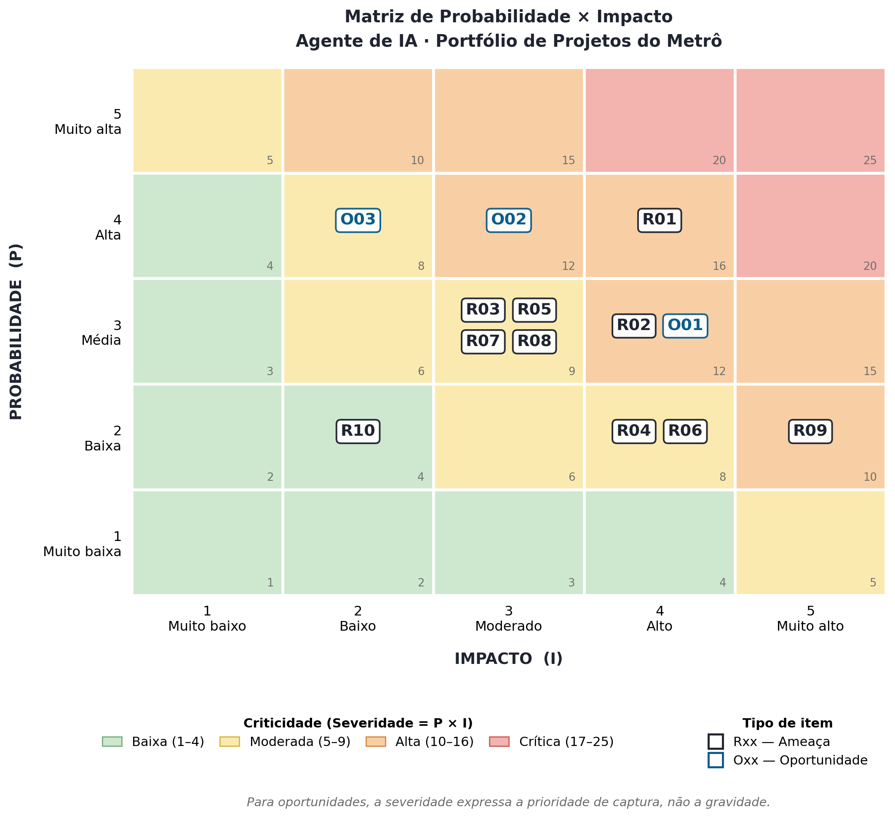

<p align="center">
  
</p>

<table align="center" width="100%" style="table-layout: fixed;">
  <tr>
    <td align="center">
      <a href="https://www.linkedin.com/in/alexsander-dsbarbosa/">
        
      </a>
    </td>
    <td align="center">
      <a href="https://github.com/CaduQuaglia">
        
      </a>
    </td>
    <td align="center">
      <a href="https://www.linkedin.com/in/celsojwnior/">
        
      </a>
    </td>
    <td align="center">
      <a href="https://www.linkedin.com/in/eduardo-casarini/">
        
      </a>
    </td>
    <td align="center">
      <a href="https://www.linkedin.com/in/marianalacerdareis/">
        
      </a>
    </td>
    <td align="center">
      <a href="https://www.linkedin.com/in/mirela-bianchi-608601254/">
        
      </a>
    </td>
  </tr>
</table>

<br>

<p align="center">
  
</p>

<table align="center" width="100%" style="table-layout: fixed;">
  <tr>
    <td align="center">
      <a href="https://www.linkedin.com/in/vanunes/">
        
      </a>
    </td>
    <td align="center">
      <a href="https://www.linkedin.com/in/reginaldo-arakaki-9574222b/">
        
      </a>
    </td>
    <td align="center">
      <a href="https://www.linkedin.com/in/bryan-kano/">
        
      </a>
    </td>
    <td align="center">
      <a href="https://www.linkedin.com/in/fernando-pizzo-208b526a/">
        
      </a>
    </td>
    <td align="center">
      <a href="https://www.linkedin.com/in/lisane-valdo/">
        
      </a>
    </td>
    <td align="center">
      <a href="https://www.linkedin.com/in/bruno-grandchamp-rodilha/">
        
      </a>
    </td>
    <td align="center">
      <a href="https://www.linkedin.com/in/filipe-gon%C3%A7alves-08a55015b/">
        
      </a>
    </td>
  </tr>
</table>

<br>

<p align="center">
  
</p>

# Gestão do Projeto

## Sumário

- [1. Introdução](#1-introdução)
- [2. Organização do projeto](#2-organização-do-projeto)
  - [2.1 Contrato de convivência](#21-contrato-de-convivência)
  - [2.2 Comunicação e rituais](#22-comunicação-e-rituais)
  - [2.3 Resolução de impasses e conflitos](#23-resolução-de-impasses-e-conflitos)
  - [2.4 SLA de entregas](#24-sla-de-entregas)
  - [2.5 Gestão de issues e estimativas](#25-gestão-de-issues-e-estimativas)
  - [2.6 Fluxo e rastreabilidade](#26-fluxo-e-rastreabilidade)
  - [2.7 Política de commits e uso do GitLab](#27-política-de-commits-e-uso-do-gitlab)
  - [2.8 Fechamento da sprint](#28-fechamento-da-sprint)
  - [2.9 Revisão do contrato de convivência](#29-revisão-do-contrato-de-convivência)
- [3. Avaliação das sprints](#3-avaliação-das-sprints)
  - [3.1 Quadro evolutivo de pontos fortes e fracos](#31-quadro-evolutivo-de-pontos-fortes-e-fracos)
  - [3.2 Sprint 1](#32-sprint-1)
    - [3.2.1 Planejamento e matriz de responsabilidades](#321-planejamento-e-matriz-de-responsabilidades)
    - [3.2.2 Retrospectiva da Sprint 1](#322-retrospectiva-da-sprint-1)
    - [3.2.3 Indicadores quantitativos](#323-indicadores-quantitativos)
    - [3.2.4 Análise dos pontos identificados](#324-análise-dos-pontos-identificados)
    - [3.2.5 Melhorias para a Sprint 2](#325-melhorias-para-a-sprint-2)
  - [3.3 Sprint 2](#33-sprint-2)
    - [3.3.1 Planejamento da Sprint 2](#331-planejamento-da-sprint-2)
    - [3.3.2 Alinhamento aos critérios do Escritório de Projetos](#332-alinhamento-aos-critérios-do-escritório-de-projetos)
    - [3.3.3 Matriz de papéis e responsabilidades da Sprint 2](#333-matriz-de-papéis-e-responsabilidades-da-sprint-2)
    - [3.3.4 Fechamento e análise da Sprint 2](#334-fechamento-e-análise-da-sprint-2)
  - [3.4 Sprint 3](#34-sprint-3)
    - [3.4.1 Planejamento e matriz de responsabilidades](#341-planejamento-e-matriz-de-responsabilidades)
      - [Matriz de papéis e responsabilidades da Sprint 3](#matriz-de-papéis-e-responsabilidades-da-sprint-3)
      - [Rotação de papéis em relação à Sprint 2](#rotação-de-papéis-em-relação-à-sprint-2)
    - [3.4.2 Retrospectiva da Sprint 3](#342-retrospectiva-da-sprint-3)
    - [3.4.3 Indicadores quantitativos da Sprint 3](#343-indicadores-quantitativos-da-sprint-3)
    - [3.4.4 Análise dos pontos identificados na Sprint 3](#344-análise-dos-pontos-identificados-na-sprint-3)
    - [3.4.5 Melhorias para a Sprint 4](#345-melhorias-para-a-sprint-4)
  - [3.5 Sprint 4](#35-sprint-4)
  - [3.6 Sprint 5](#36-sprint-5)
- [4. Gestão de riscos e oportunidades](#4-gestão-de-riscos-e-oportunidades)
  - [4.1 Metodologia de avaliação](#41-metodologia-de-avaliação)
  - [4.2 Matriz de risco consolidada — revisão da Sprint 3](#42-matriz-de-risco-consolidada--revisão-da-sprint-3)
  - [4.3 Histórico de acompanhamento](#43-histórico-de-acompanhamento)
  - [4.4 Riscos materializados e efetividade das respostas](#44-riscos-materializados-e-efetividade-das-respostas)
  - [4.5 Plano de resposta — ameaças](#45-plano-de-resposta--ameaças)
  - [4.6 Estratégia de aproveitamento — oportunidades](#46-estratégia-de-aproveitamento--oportunidades)
  - [4.7 Matriz probabilidade × impacto — Sprint 3](#47-matriz-probabilidade--impacto--sprint-3)
  - [4.8 Análise dos três itens mais críticos](#48-análise-dos-três-itens-mais-críticos)
- [5. Melhorias de processo](#5-melhorias-de-processo)
  - [5.1 Ações de melhoria](#51-ações-de-melhoria)
  - [5.2 Indicadores de processo](#52-indicadores-de-processo)
- [6. Análise post-mortem](#6-análise-post-mortem)
  - [6.1 Sucessos do projeto](#61-sucessos-do-projeto)
  - [6.2 Oportunidades de melhoria](#62-oportunidades-de-melhoria)
  - [6.3 Lições aprendidas](#63-lições-aprendidas)

## 1. Introdução

Este documento registra o contrato de convivência, o acordo de nível de serviço (SLA) interno e os rituais adotados pelo grupo durante o desenvolvimento do projeto. Seu objetivo é tornar explícitas as regras de colaboração, comunicação, resolução de impasses e acompanhamento do trabalho.

## 2. Organização do projeto

### 2.1 Contrato de convivência

#### 2.1.1 Regra de ouro

A regra de ouro do grupo é comunicar dúvidas, dificuldades e erros sem receio de exposição ou responsabilização individual. O primeiro movimento da equipe deve ser compreender o problema e oferecer apoio; críticas devem se concentrar no artefato, na decisão ou no processo, nunca na pessoa. Essa regra sustenta a segurança psicológica necessária para que impedimentos sejam comunicados antes de se transformarem em atrasos.

O board e o repositório constituem as fontes oficiais de acompanhamento do projeto. Uma atividade somente é considerada concluída quando seu card está atualizado e, quando aplicável, existe um commit ou merge request rastreável. Decisões tomadas em conversas ou reuniões devem ser registradas nos canais do projeto.

#### 2.1.2 Responsabilidade e colaboração

- Cada integrante deve manter seus cards atualizados e comunicar impedimentos assim que forem identificados.
- Alterações devem respeitar o escopo do card e ser submetidas à revisão por pares.
- A comunicação deve ser respeitosa, objetiva e direcionada à resolução do problema.
- Integrantes devem colaborar na revisão de merge requests e no esclarecimento de dúvidas que bloqueiem o trabalho da equipe.
- Revisões de merge requests devem ser realizadas em até 24 horas úteis, conforme SLA estabelecido.
- Quando possível, as revisões devem ser distribuídas entre os integrantes para evitar concentração em uma única pessoa.
- O repositório não deve ser mantido dentro de pasta sincronizada com serviço de nuvem, conforme a revisão registrada na seção 2.9.2. Quem não puder mover o repositório deve pausar a sincronização enquanto trabalha com Git.

### 2.2 Comunicação e rituais

#### 2.2.1 Comunicação oficial

A equipe utiliza o **WhatsApp para comunicações informais**, como avisos rápidos, dúvidas pontuais e alinhamentos cotidianos. O **Slack é o canal formal de comunicação**, utilizado para registrar informações, decisões e comunicados relacionados ao projeto. Decisões que afetem escopo, prazos ou responsabilidades também devem ser refletidas no board ou no repositório para preservar a rastreabilidade.

#### 2.2.2 Dailies

As dailies acontecem **presencialmente, às 14h, em todos os dias nos quais a equipe possui instrução**, com duração máxima de **15 minutos**. Quando a equipe não estiver reunida presencialmente, o acompanhamento poderá ocorrer de forma assíncrona no Slack. Cada integrante apresenta de forma objetiva as atividades concluídas, as próximas atividades e os impedimentos identificados. Quando um integrante não puder participar, sua atualização deve ser enviada pelo canal formal antes do encontro.

Durante a daily, as tarefas práticas são organizadas para um horizonte máximo de dois a três dias. A distribuição considera as dependências entre as atividades, de modo que a entrega de uma pessoa não bloqueie desnecessariamente o avanço das demais. No fechamento diário, o grupo verifica se as tarefas previstas foram concluídas. Quando uma atividade não é finalizada no mesmo dia, ela continua no dia seguinte, e a equipe avalia se a pessoa responsável necessita de apoio, redistribuição ou esclarecimento para prosseguir.

O Kanban do GitLab apoia esse acompanhamento ao tornar visíveis o estado das tarefas, os responsáveis, as dependências e os impedimentos. Os cards devem refletir a situação discutida nas dailies, permitindo que o grupo acompanhe o progresso entre os encontros e identifique antecipadamente riscos de bloqueio ou atraso.

**Acompanhamento de carga e dependências (revisão da Sprint 2).** Para tornar verificável a regra registrada na seção [2.9.1](#291-revisão-sprint-2), a daily passa a incluir três verificações objetivas, conduzidas pelo Scrum Master da sprint:

1. **Carga.** Comparação da quantidade e do *size* das issues em `Doing` por integrante. Diferença superior a 2:1 entre a maior e a menor carga atribuída deve ser discutida na própria daily e resolvida por redistribuição ou por registro da justificativa no card.
2. **Dependências.** Verificação das issues que bloqueiam outras atividades. Toda issue impeditiva deve receber a label `BLOCK`, indicar o que a bloqueia e ter um próximo passo definido com responsável.
3. **Fila de revisão.** Verificação das issues em `Waiting Review` e `Review`. Itens que ultrapassem o SLA de 24 horas úteis devem receber um revisor nomeado ainda na daily, priorizando os merge requests que bloqueiam outras entregas.

O resultado dessas três verificações orienta a redistribuição de tarefas do dia e é a base do acompanhamento consolidado na retrospectiva.

#### 2.2.3 Revisões de merge request

Ao abrir um merge request, a pessoa autora deve solicitar a revisão do grupo. A pessoa revisora deve verificar o atendimento ao card e registrar ajustes necessários antes da aprovação. As políticas técnicas de branch, commit e merge request estão documentadas em [GestaoConfiguracao.md](GestaoConfiguracao.md).

O SLA interno estabelece que todo merge request deve receber uma primeira revisão em até **24 horas úteis** após a solicitação. Quando esse prazo não puder ser cumprido, o impedimento deve ser comunicado no Slack e registrado no card. MRs que bloqueiem outras entregas têm prioridade de revisão e devem ser sinalizados na daily.

### 2.3 Resolução de impasses e conflitos

1. Divergências devem ser discutidas inicialmente entre as pessoas envolvidas, com base nos requisitos e artefatos do projeto.
2. Se não houver consenso, o tema deve ser apresentado ao grupo em uma daily ou reunião específica.
3. Persistindo o impasse, o Scrum Master da sprint organiza a decisão necessária para evitar bloqueio do trabalho.
4. Questões que não possam ser resolvidas internamente devem ser encaminhadas à professora orientadora.

Conflitos interpessoais devem ser tratados de forma reservada e respeitosa, com mediação de outro integrante quando necessário. Em casos de atraso recorrente ou falta de engajamento, aplica-se a seguinte progressão: primeiro, feedback direto e oferta de apoio na daily; segundo, alinhamento formal com o Scrum Master e registro do plano de recuperação; terceiro, registro na retrospectiva; e, caso o problema persista, encaminhamento à professora orientadora e ao CDL.

### 2.4 SLA de entregas

- Cards, merge requests e artefatos de documentação devem ser disponibilizados para revisão interna até **quinta-feira às 23h59**, independentemente do prazo formal da sprint.
- A pessoa responsável deve comunicar antecipadamente quando identificar risco de não cumprimento do prazo.
- Cards não concluídos devem permanecer atualizados no board, com o impedimento e o próximo passo registrados.
- A conclusão de uma entrega depende do atendimento ao DoD do card e da aprovação do merge request, quando aplicável.

### 2.5 Gestão de issues e estimativas

#### 2.5.1 Estrutura das issues

Toda atividade relevante deve possuir uma issue no GitLab. O título deve começar com um verbo no infinitivo, representar uma entrega específica e evitar descrições genéricas. Exemplos: `Modelar fluxo AS-IS da gestão de portfólio`, `Identificar requisitos não funcionais` e `Elaborar matriz de risco`.

Cada issue deve conter:

- descrição do que deve ser realizado e de seu contexto;
- DoR (*Definition of Ready*), indicando os pré-requisitos para início;
- DoD (*Definition of Done*), com condições objetivas de conclusão;
- milestone correspondente à sprint;
- label de natureza da atividade;
- estimativa de tamanho;
- pessoa responsável, quando a divisão do trabalho estiver definida.

As atividades devem ser granulares e produzir entregas verificáveis. Cards amplos, como “Fazer documentação da Sprint”, devem ser divididos em tarefas menores que permitam acompanhar o progresso e distribuir o trabalho entre os integrantes.

Defeito identificado em teste manual ou durante revisão abre issue própria antes da correção, com a label `BUG` acompanhando a label de entrega correspondente. Corrigir um defeito dentro de uma issue de outro escopo rompe a ligação entre o problema e a sua solução, e foi a situação que originou esta regra na revisão registrada na seção 2.9.2.

#### 2.5.2 T-shirt sizing

As estimativas representam referências de esforço relativo, não compromissos de duração exata.

| Size | Referência |
|---|---|
| `SIZE_PP` | até 15 minutos |
| `SIZE_P` | até 30 minutos |
| `SIZE_M` | de 30 a 60 minutos |
| `SIZE_G` | de 60 a 120 minutos |

Quando uma atividade exceder a referência de `SIZE_G`, a equipe deve avaliar sua divisão em issues menores e verificáveis.

#### 2.5.3 Labels padronizadas

A partir da Sprint 4, o board adota a taxonomia oficial definida pelo Escritório de Projetos. Cada issue recebe uma label de cada categoria obrigatória, e as labels devem ser escritas exatamente como listadas, uma vez que espaço e hífen são significativos para a avaliação.

**Entrega.** Obrigatória, uma por issue. Indica a natureza do que é produzido.

| Label | Uso |
|---|---|
| `BUSINESS` | Entendimento de negócio, viabilidade financeira, orçamento e proposta de valor |
| `DESIGN` | UML, BPMN, C4, jornadas, protótipos e demais modelagens visuais |
| `ARCHITECTURE` | Decisões e documentação técnica da solução, contratos de API e modelagem de dados |
| `CODE` | Implementação e configuração técnica |
| `TEST` | Planejamento, implementação e execução de testes |
| `DEPLOY` | Ambientes, automação, integração contínua e implantação |
| `PROCESS` | Gestão de projeto, de equipe e de configuração |
| `CHORE` | Tarefas de apoio ao repositório, dependências e organização de arquivos |

**Forma.** Aplicada quando a entrega é documentação em markdown. Nunca utilizada isoladamente, sempre acompanhando uma label de entrega.

| Label | Uso |
|---|---|
| `DOCS` | Documentação produzida em markdown |

**Natureza.** Aplicada quando a entrega corrige um defeito. Nunca utilizada isoladamente.

| Label | Uso |
|---|---|
| `BUG` | Correção de defeito identificado |

**Esforço.** Obrigatória, uma por issue, conforme as referências da seção 2.5.2: `SIZE_PP`, `SIZE_P`, `SIZE_M` e `SIZE_G`.

**Prioridade.** Obrigatória, uma por issue: `P_ALTA`, `P_MEDIA` e `P_BAIXA`.

**Fora do GitLab.** Aplicada quando a evidência da atividade não é um commit.

| Label | Uso |
|---|---|
| `MEET` | Reuniões e alinhamentos |
| `OFFSITE` | Atividades realizadas fora do repositório, como sessões com usuários externos |

**Situação.** Posição da atividade no quadro, acrescida da marcação de impedimento.

| Label | Uso |
|---|---|
| `open` | Candidata ainda não comprometida para a sprint |
| `backlog` | Comprometida para a sprint corrente |
| `doing` | Em execução |
| `waiting review` | Aguardando revisor |
| `review` | Em revisão |
| `closed` | Integrada, com DoD atendido |
| `BLOCK` | Atividade impedida de avançar |

Toda issue da sprint corrente deve possuir a milestone no formato `Sprint 0X`. Sem ela, o cartão não é contabilizado.

**Correspondência com a nomenclatura anterior**

Os cards criados até a Sprint 3 permanecem com as labels originais. O histórico não é reescrito, pela mesma razão que preservou o nome das branches anteriores à troca de prefixo descrita em [GestaoConfiguracao.md](GestaoConfiguracao.md). A tabela abaixo registra a correspondência para leitura do quadro anterior.

| Label anterior | Equivalente oficial |
|---|---|
| `REQUIREMENTS` | `ARCHITECTURE` com `DOCS` |
| `DOCUMENTATION` | `DOCS`, acompanhada da label de entrega correspondente |
| `RESEARCH` | `BUSINESS` ou `ARCHITECTURE`, conforme o objeto da pesquisa |
| `FRONTEND` | `CODE` |
| `BACKEND` | `CODE` |
| `DEVOPS` | `DEPLOY` |
| `CODE_REVIEW` | Sem equivalente. A revisão passou a ser etapa do fluxo, marcada por `review`, e não atividade com label própria |
| `BLOCKED` | `BLOCK` |
| `DOR_INCOMPLETE` e `DOD_INCOMPLETE` | Sem equivalente. A incompletude passa a ser tratada como impedimento, com `BLOCK` |

> **Revisão da Sprint 3.** A tabela desta seção foi substituída pela taxonomia oficial do Escritório de Projetos. A revisão da Sprint 2 havia ajustado o documento à nomenclatura do quadro, trocando `DOCS` por `DOCUMENTATION`, o que eliminou a divergência entre documento e prática mas preservou a divergência entre a prática e a regra pela qual o grupo é avaliado. A adequação vale para os cards criados a partir da Sprint 4.

### 2.6 Fluxo e rastreabilidade

O fluxo esperado é:

```text
Issue → Branch → Desenvolvimento/Documentação → Commit → Push → MR → Review → Merge → Fechamento da Issue
```

- Uma issue somente deve ser iniciada quando seu DoR estiver atendido.
- Uma issue somente deve ser encerrada quando todos os critérios de seu DoD estiverem atendidos.
- Quando uma dependência impedir o avanço, a issue deve receber a label `BLOCK` e registrar o impedimento.
- Branches, commits e merge requests devem ser relacionados à issue correspondente.
- A abertura do merge request não caracteriza a conclusão da atividade; revisão, atendimento aos comentários e merge fazem parte da entrega.
- A pessoa revisora deve verificar o DoD, os arquivos alterados, a coerência com outros artefatos, os conflitos e os testes aplicáveis.

Ao final, o GitLab deve permitir identificar o que precisava ser feito, quem realizou a atividade, quando ela foi executada, qual merge request entregou o resultado, se houve revisão e se o DoD foi cumprido.

As dependências entre artefatos devem ser respeitadas. Um exemplo de sequência é: stakeholders → personas → jornadas → User Stories → diagramas. A ordem específica de cada sprint deve seguir o planejamento aprovado pela equipe.

### 2.7 Política de commits e uso do GitLab

**Commits.** Os commits devem seguir o padrão *Conventional Commits*, no formato `<tipo>(<escopo opcional>): <verbo no infinitivo> <complemento> (#<card>)`. Cada commit deve representar uma unidade lógica de alteração, iniciar por verbo no infinitivo em letra minúscula, descrever objetivamente o que mudou e referenciar a issue correspondente. Mensagens vagas e commits que misturem atividades sem relação devem ser evitados. O envio direto de alterações para `main` ou `develop` não faz parte do fluxo do grupo: toda alteração chega à `develop` por merge request. Os tipos aceitos, os exemplos válidos e inválidos, o padrão de título e descrição de merge request e as demais regras técnicas estão detalhados no [GestaoConfiguracao.md](GestaoConfiguracao.md).

**Movimentação do quadro.** O quadro é a fonte oficial do estado das atividades. Movimentar o card é responsabilidade da pessoa designada nele, e não do revisor ou do Scrum Master. A correspondência entre coluna e etapa do fluxo é a seguinte.

| Coluna | Quando o card entra |
|---|---|
| `open` | Card criado, ainda não comprometido para a sprint |
| `backlog` | Card comprometido para a sprint corrente, com milestone, labels e estimativa |
| `doing` | Trabalho iniciado, com o DoR atendido |
| `waiting review` | Merge request aberto, ainda sem revisor designado |
| `review` | Revisor designado e revisão em andamento |
| `closed` | Merge realizado e DoD integralmente atendido |

Regras de uso:

- O card muda de coluna no momento em que o fato ocorre, e não no fechamento do dia. Quadro atualizado em lote deixa de informar durante a daily e inviabiliza as três verificações da seção [2.2.2](#222-dailies).
- Card impedido permanece na coluna em que está, recebe a label `BLOCK` e registra em comentário o que o bloqueia e qual é o próximo passo.
- Cada integrante deve manter no máximo duas atividades em `doing` simultaneamente. Acima disso, a verificação de carga perde precisão e o trabalho em curso deixa de refletir o que está efetivamente sendo feito.
- O fechamento da issue ocorre pelo merge, por meio de `Closes #<issue>` na descrição do merge request. Issue encerrada sem merge request associado deve registrar em comentário a razão do encerramento.
- Atividade sem evidência no repositório, como reunião ou sessão com usuário externo, recebe a label `MEET` ou `OFFSITE` e é encerrada com registro em comentário descrevendo o resultado.

### 2.8 Fechamento da sprint

Ao final de cada sprint, a equipe deve:

- revisar as entregas realizadas;
- consolidar o `Projeto.md` e os documentos de gestão;
- verificar a coerência entre NEG, REQ e PROJ;
- conferir o atendimento ao DoD das issues;
- conferir que nenhuma issue do ciclo foi fechada sem responsável atribuído;
- verificar merge requests pendentes;
- extrair as métricas do ciclo declarando corte, fonte, commit-base e regra de atribuição, conforme a nota metodológica da seção [3.3.4](#334-fechamento-e-análise-da-sprint-2);
- registrar a retrospectiva;
- identificar e documentar pendências;
- planejar e criar as issues da sprint seguinte, incluindo estimativas, labels, milestone e dependências;
- revisar e atualizar o contrato de convivência, quando necessário;
- avaliar a efetividade das políticas de trabalho e realizar ajustes conforme as necessidades identificadas.

### 2.9 Revisão do contrato de convivência

O contrato de convivência firmado na Sprint 1 deve ser revisado ao final de cada sprint. Havendo necessidade de ajuste, as regras devem ser alteradas com o devido registro da mudança, mantendo:

- a data da revisão;
- a justificativa para a alteração;
- a nova regra aprovada pelo grupo;
- o impacto esperado na dinâmica da equipe.

As revisões são registradas nesta seção para garantir transparência e rastreabilidade das decisões de processo ao longo do projeto.

#### 2.9.1 Revisão Sprint 2

**Data:** 2026-08-26

**Justificativa:** Identificou-se a necessidade de reforçar políticas sobre revisão de merge requests e distribuição de carga de trabalho, baseado em evidências de revisões concentradas e atualizações mantidas até o fechamento da sprint.

**Alterações aprovadas:**
- Inclusão de diretrizes explícitas sobre distribuição de revisões de merge requests entre os integrantes.
- Reforço do SLA de 24 horas para revisão de MRs com priorização de MRs que bloqueiem outras entregas.
- Adição de critérios para acompanhamento de carga e dependências nas dailies.

**Impacto esperado:** Melhor distribuição do trabalho de revisão, redução de concentração de revisões em uma única pessoa e identificação antecipada de bloqueios.

#### 2.9.2 Revisão Sprint 3

**Data:** 2026-09-11

**Regras revisadas e mantidas**

A revisão percorreu o contrato inteiro, e não apenas os pontos que mudaram. As regras abaixo foram examinadas e mantidas, com a razão registrada.

| Regra | Seção | Razão da manutenção |
|---|---|---|
| Regra de ouro | 2.1.1 | Não houve conflito ou episódio de exposição individual na sprint que justificasse revisão. A regra continua descrevendo a prática do grupo |
| Board e repositório como fontes oficiais | 2.1.1 | A rastreabilidade entre card, commit e merge request se manteve ao longo da sprint |
| Comunicação oficial em dois canais | 2.2.1 | A separação entre WhatsApp informal e Slack formal funcionou sem ambiguidade registrada |
| Dailies presenciais às 14h, com 15 minutos | 2.2.2 | Formato e duração se mostraram adequados ao ritmo da sprint |
| Três verificações da daily | 2.2.2 | Mantidas com avaliação positiva. Criadas na revisão anterior para responder ao apontamento sobre concentração de revisões, elas fizeram diferença na condução da Sprint 3: a verificação de carga tornou visível o desequilíbrio no mesmo dia em que ele surgia, a de dependências antecipou bloqueios que antes só apareciam quando já travavam alguém, e a de fila de revisão reduziu o tempo de espera dos merge requests. A equipe avalia que a regra saiu do papel e passou a orientar a redistribuição diária |
| SLA de 24 horas úteis para revisão de merge request | 2.2.3 | Mantido. Foi cumprido na maioria das solicitações da sprint, e os descumprimentos foram pontuais. O prazo permanece adequado; o que exige atenção é a regularidade, tratada como ação de melhoria |
| Resolução de impasses e conflitos | 2.3 | A progressão prevista não precisou ser acionada nesta sprint |
| SLA de entrega até quinta às 23h59 | 2.4 | Mantido, e não cumprido. As entregas da Sprint 3 se estenderam até a tarde de sexta-feira. A regra é preservada porque cumpre função de organização, antecipando o planejamento da semana e concentrando o esforço antes do prazo formal. A distância entre a meta e o resultado é tratada como ação de melhoria, e não como flexibilização do prazo |

**Justificativa das alterações**

As alterações desta revisão respondem a situações concretas ocorridas durante a Sprint 3, e não a aprimoramentos genéricos de processo. Uma nasceu de perda efetiva de tempo de trabalho, uma responde a prejuízo de rastreabilidade, duas corrigem divergência entre o que o grupo pratica e o que estava registrado, e a última resolve um caso que a regra anterior não previa.

**Alterações aprovadas**

- **Ambiente de trabalho local.** Fica estabelecido que o repositório não deve ser mantido dentro de pasta sincronizada com serviço de nuvem. A sincronização automática interfere no funcionamento do Git, e a Sprint 3 registrou quatro ocorrências: um arquivo de trava do índice que impediu qualquer operação, um arquivo de configuração que o sistema não conseguiu ler, um arquivo de controle de merge vazio que fez o Git reportar um merge inexistente, e arquivos removidos pela troca de branch sendo restaurados pela sincronização sobre a `develop`. Quem não puder mover o repositório deve pausar a sincronização durante o trabalho com Git.

- **Defeito identificado fora de card.** Todo defeito encontrado em teste manual ou durante revisão passa a abrir issue própria antes da correção. Na Sprint 3, um defeito de interface encontrado em teste manual foi corrigido dentro de uma issue de outro escopo, o que prejudicou a rastreabilidade entre o problema e a sua solução.

- **Taxonomia de labels.** As labels do board passam a seguir a lista oficial do Escritório de Projetos a partir da Sprint 4, com uma label de entrega entre `BUSINESS`, `DESIGN`, `ARCHITECTURE`, `CODE`, `TEST`, `DEPLOY`, `PROCESS` e `CHORE`, acrescida de `DOCS` como forma, nunca utilizada isoladamente. Os cards criados até a Sprint 3 permanecem com as labels originais, pela mesma razão que preservou o nome das branches anteriores à troca de prefixo. A seção 2.5.3 registra a correspondência entre as duas nomenclaturas.

- **Convenção de merge request.** O título do merge request passa a seguir o mesmo formato da mensagem de commit, e a descrição passa a conter as seções O que foi feito, Por que foi feito, DOR, DOD e Como testar. Até a Sprint 2, o `GestaoConfiguracao.md` previa o formato `TIPO | descrição` e um checklist genérico de conferência, que o grupo deixou de utilizar ao longo da Sprint 3 sem atualizar o documento. As seções de DOR e DOD substituem o checklist porque exigem a evidência de atendimento de cada critério, e não apenas a marcação de uma caixa.

- **Branch derivada de outra branch.** A regra de que toda branch nasce da `develop` passa a admitir exceção quando o trabalho documenta ou corrige código ainda não integrado. Nesse caso, a branch pode derivar daquela que contém o código, e o merge request deve declarar a branch-base e o motivo. A exceção surgiu na documentação da interface, que descrevia código presente apenas na branch de origem.

**Fechamento de ação da sprint anterior**

A ação AM13, que previa repriorizar o quadro no penúltimo dia da sprint, dependia de uma distinção de prioridade que o board não oferecia. As labels `P_ALTA`, `P_MEDIA` e `P_BAIXA` passaram a ser aplicadas aos cards durante a Sprint 3, o que torna a ação executável e encerra o apontamento recebido na avaliação anterior.

**Impacto esperado**

Espera-se redução do tempo perdido com incidentes de ambiente local, que na Sprint 3 consumiram horas de trabalho sem produzir entrega. A abertura de issue para defeito encontrado deve tornar visível no board um tipo de trabalho que antes ficava embutido em outras entregas. A adequação da taxonomia de labels alinha o board aos critérios pelos quais o grupo é avaliado. A convenção unificada de merge request elimina a divergência entre documento e prática e permite ler o título do card, o commit e o merge request como uma sequência única. A exceção da branch-base elimina a escolha entre cumprir a regra e documentar código existente, situação que a regra anterior não previa.

## 3. Avaliação das sprints

Esta seção será atualizada ao encerramento de cada sprint, registrando evidências, pontos fortes, pontos fracos e ações de melhoria. Os espaços das sprints futuras são mantidos como estrutura de acompanhamento e não representam avaliações antecipadas.

### 3.1 Quadro evolutivo de pontos fortes e fracos

O quadro evolutivo será consolidado progressivamente para evidenciar temas recorrentes e acompanhar a efetividade das ações de melhoria entre as sprints.

| Sprint | Pontos fortes | Pontos de atenção | Ações para o ciclo seguinte |
|---|---|---|---|
| Sprint 1 | Entrega integral do escopo no fechamento; rastreabilidade por issues, commits e MRs; equilíbrio global entre criação e revisão de MRs | Distribuição desigual entre frentes; revisões concentradas; atualizações mantidas até a noite de encerramento | Definir corte único das métricas; distribuir revisões desde o início; acompanhar carga e dependências nas dailies |
| Sprint 2 | Conclusão integral da milestone (81/81 issues) mesmo com redefinição de escopo; granularidade do planejamento em tasks pequenas e verificáveis; participação dos seis integrantes no fluxo de integração; identidades de autoria reconciliadas pelo `.mailmap`; comunicação consistente nas dailies | Desorganização na primeira semana por mudança de escopo; fechamento concentrado no encerramento (51% nos dois últimos dias); 24,7% do escopo fechado sem responsável atribuído; desequilíbrio de carga (2,83:1 em issues e 2,92:1 em horas) e integração concentrada; ausência de Tech Lead designado | Nomear revisor na abertura do MR e medir o SLA; redistribuição obrigatória acima de 2:1; designar Tech Lead; issue de propagação a cada mudança de escopo; responsável obrigatório antes de `Doing`; checkpoint de repriorização no penúltimo dia útil |
| Sprint 3 | Organização proativa com adiantamento de trabalho de sprints futuras; divisão clara de tarefas desde o início; integração ágil entre componentes (voz, NLP, mensageria) | Perda de dia de desenvolvimento por feriado; queda de produtividade por integrantes resfriados | Criar plano B para casos de ausência e redução de capacidade; considerar feriados no cálculo de capacity |

### 3.2 Sprint 1

#### 3.2.1 Planejamento e matriz de responsabilidades

A matriz foi construída em alto nível por artefato e entregável, conforme orientação do Escritório de Projetos. A alocação prática de tarefas segue um horizonte de dois a três dias e é revisada nas dailies. A indicação de uma pessoa responsável principal não implica execução isolada: os artefatos permanecem sujeitos à colaboração e à revisão do grupo.

##### Integrantes e papéis

| Integrante | Papel principal | Frente de atuação | Principais entregas sob responsabilidade |
|---|---|---|---|
| **Mirela Bianchi** | Tech Lead e apresentação | NEG — Fluxo de negócio; REQ — Business Drivers, RNFs e stack | BPMN AS-IS e TO-BE, Business Drivers, Requisitos Não Funcionais, stack tecnológico e slides da Sprint 1 |
| **Mariana Reis** | Scrum Master e REQ | NEG — Personas e jornadas; REQ — RFs, User Stories e diagrama de classes | Personas, jornadas do usuário, Requisitos Funcionais, User Stories, diagrama de classes e README |
| **Celso Rocha** | Gestão de Configuração e REQ | NEG — Contexto e objetivos; REQ — Diagrama UML; PROJ — GitFlow, commits e contrato | Contexto da indústria, objetivos do produto, diagrama UML de componentes, GitFlow, padrão de commits e contrato de convivência |
| **Carlos Eduardo Serrano** | Arquiteto e riscos | NEG — Matriz de risco; REQ — Visão técnica e integrações | Identificação e avaliação de riscos, matriz de risco completa, visão preliminar da arquitetura e mapeamento de integrações Microsoft |
| **Alexsander Barbosa** | Negócio e BPMN | NEG — Problema, visão do produto e fluxo de negócio | Descrição do problema, visão do produto, cadeia de valor e processos em BPMN |
| **Eduardo Casarini** | Features, Canvas e modelagem | NEG — Brainstorming, priorização e Canvas MVP; REQ — Diagramas de sequência | Brainstorming de features, priorização, Canvas do MVP e diagramas de sequência |

##### Distribuição por artefato

**NEG — Entendimento do Negócio**

| Seção | Responsável principal |
|---|---|
| Problema | Alexsander Barbosa |
| Contexto da indústria | Celso Rocha |
| Visão do produto | Alexsander Barbosa |
| Objetivos do produto | Celso Rocha |
| Personas | Mariana Reis |
| Jornada do usuário | Mariana Reis |
| Fluxo de negócio — AS-IS (BPMN) | Mirela Bianchi |
| Fluxo de negócio — TO-BE (BPMN) | Mirela Bianchi |
| Cadeia de valor e processos | Alexsander Barbosa |
| Brainstorming de features | Eduardo Casarini |
| Priorização de features | Eduardo Casarini |
| Canvas do MVP | Eduardo Casarini |
| Matriz de risco | Carlos Eduardo Serrano |
| Visual de probabilidade e impacto | Carlos Eduardo Serrano |
| Descrição curta e escopo macro | Mariana Reis |

**REQ — Especificação de Requisitos**

| Seção | Responsável principal |
|---|---|
| Business Drivers | Mirela Bianchi |
| Fluxos de negócio com PLN | Alexsander Barbosa |
| Requisitos Funcionais | Mariana Reis |
| User Stories | Mariana Reis |
| Diagrama de classes | Mariana Reis |
| Diagramas de sequência | Eduardo Casarini |
| Requisitos Não Funcionais | Mirela Bianchi |
| Visão da solução técnica (blocos) | Carlos Eduardo Serrano |
| Integrações com o ecossistema Microsoft | Carlos Eduardo Serrano |
| Diagrama UML de componentes | Celso Rocha |
| Stack tecnológico | Mirela Bianchi |

**PROJ — Gestão do Projeto**

| Documento | Seção | Responsável principal |
|---|---|---|
| `docs/GestaoProjeto.md` | Matriz de papéis e responsabilidades | Mariana Reis |
| `docs/GestaoProjeto.md` | Contrato de convivência, SLA e rituais | Celso Rocha |
| `docs/GestaoProjeto.md` | Análise da Sprint 1 | Mariana Reis |
| `docs/GestaoProjeto.md` | Planejamento da Sprint 2 | Mariana Reis |
| `docs/GestaoConfiguracao.md` | GitFlow e política de branches | Celso Rocha |
| `docs/GestaoConfiguracao.md` | Padrão de commits | Celso Rocha |
| Apresentação da Sprint 1 | Slides | Mirela Bianchi |
| `README.md` | Visão geral do projeto | Mariana Reis |

A distribuição foi verificada considerando a quantidade e a complexidade dos artefatos, bem como a atuação de cada integrante em frentes complementares de negócio, requisitos, modelagem, arquitetura e gestão. As responsabilidades principais estão distribuídas entre os seis integrantes, enquanto as revisões coletivas e os ajustes definidos nas dailies reduzem o risco de centralização das entregas.

##### Acordos de processo

- **Horizonte de alocação:** tarefas práticas definidas com antecedência de dois a três dias e revisadas nas dailies.
- **Comunicação de bloqueios:** dificuldades devem ser reportadas antecipadamente na daily, sem aguardar o prazo da entrega.
- **Desvios do plano:** alterações relevantes devem ser documentadas no `GestaoProjeto.md` como memória do projeto.
- **Kanban:** o board deve ser atualizado no início e no fim de cada dia de trabalho.
- **Prazo interno:** as entregas devem ser disponibilizadas até quinta-feira, com a sexta-feira reservada apenas para revisões finais.

#### 3.2.2 Retrospectiva da Sprint 1

A Sprint 1 teve como foco compreender o problema do parceiro, estruturar os artefatos de negócio e requisitos e estabelecer os acordos de gestão e configuração do grupo. Ao final do ciclo, foram consolidados o contexto e a visão do produto, personas, jornadas, fluxos de negócio, matriz de riscos, requisitos funcionais e não funcionais, User Stories e modelos UML iniciais. Em paralelo, a equipe definiu GitFlow, padrão de commits, contrato de convivência, políticas operacionais e matriz de papéis. A análise das entregas considera a [matriz de papéis e responsabilidades da Sprint 1](#321-planejamento-e-matriz-de-responsabilidades), utilizada como referência para comparar as frentes planejadas com o que foi concluído.

O fechamento geral confirmado pela equipe registrou 65 commits integrados à `develop`, 48 issues concluídas, 55 horas entregues e 33 Merge Requests criados e revisados. Os dados consideram as atividades concluídas até a noite de encerramento da sprint, ainda que algumas atualizações no GitLab tenham ocorrido depois das primeiras extrações utilizadas durante a análise. Esse resultado indica que o escopo previsto foi concluído e que a revisão acompanhou o volume de produção.

A retrospectiva também mostrou que quantidade de commits ou issues não mede, isoladamente, qualidade ou esforço. Os artefatos possuem granularidades distintas, e uma entrega documental extensa pode gerar menos commits do que uma sequência de pequenos ajustes. Por isso, os números foram utilizados como evidências de rastreabilidade e distribuição, acompanhados de uma leitura qualitativa do processo.

#### 3.2.3 Indicadores quantitativos

> **Nota metodológica:** as métricas automatizadas foram coletadas por meio de um script de consulta ao GitLab às **13h do dia 14/08/2026**. Como a equipe continuou concluindo, revisando e atualizando atividades após esse horário, podem existir pequenas diferenças entre o recorte individual produzido pelo script e os totais consolidados no fechamento da Sprint 1. O horário de corte foi preservado para garantir transparência e permitir a reprodução da análise.

**Resumo geral consolidado no fechamento**

| Métrica | Resultado |
|---|---:|
| Commits integrados à `develop` | 65 |
| Issues concluídas | 48/48 |
| Taxa de conclusão das issues | **100%** |
| Horas entregues | 55 h |
| MRs criados | 33 |
| MRs revisados | 33 |

**Distribuição por integrante**

| Integrante | Commits integrados | Participação nos commits atribuíveis | Issues fechadas | Conclusão | Horas fechadas | MRs criados | MRs revisados |
|---|---:|---:|---:|---:|---:|---:|---:|
| Mirela Bianchi | 22 | 34,4% | 10/10 | 100% | 12,5 h | 7 | 10 |
| Mariana Reis | 14 | 21,9% | 12/12 | 100% | 10,0 h | 9 | 7 |
| Carlos Eduardo Serrano | 9 | 14,1% | 7/7 | 100% | 8,5 h | 4 | 6 |
| Eduardo Casarini | 8 | 12,5% | 6/6 | 100% | 9,0 h | 3 | 1 |
| Celso Rocha | 6 | 9,4% | 7/7 | 100% | 7,0 h | 4 | 4 |
| Alexsander Barbosa | 5 | 7,8% | 6/6 | 100% | 7,0 h | 4 | 3 |
| **Total individualizado** | **64** | **100%** | **48/48** | **100%** | **54,0 h** | **31** | **31** |

Dos 65 commits integrados à `develop`, 64 foram associados aos seis integrantes por nome e e-mail de autoria. Um commit adicional foi registrado tecnicamente como `Administrator` e, por isso, foi mantido no total geral sem ser atribuído individualmente. Para horas e MRs, foram preservados tanto o total geral confirmado no fechamento quanto os valores do recorte individual fornecido pela equipe; a diferença entre eles deverá ser considerada na definição do próximo procedimento de extração. A razão entre o maior e o menor volume autoral foi de 4,4:1. Nas issues atribuídas, a razão entre a maior e a menor carga foi de 2:1.

O recorte individual registrou equilíbrio numérico entre produção e revisão, com 31 MRs criados e 31 revisados, enquanto o fechamento geral chegou a 33 em ambas as métricas. Entretanto, a distribuição das revisões variou entre as pessoas, indicando que o equilíbrio global não significa, necessariamente, uma distribuição uniforme da atividade de revisão.

**Relação entre planejamento e entregas**

| Frente prevista na matriz | Entregas concluídas na Sprint 1 | Resultado observado |
|---|---|---|
| NEG — Entendimento do Negócio | Problema, contexto, visão e objetivos do produto, personas, jornadas, fluxos AS-IS e TO-BE, cadeia de valor, ideação, priorização, Canvas e matriz de riscos | Frente concluída conforme a distribuição prevista na matriz de responsabilidades |
| REQ — Especificação de Requisitos | Business Drivers, RFs, RNFs, User Stories, modelos de classes, componentes e sequência, visão técnica, integrações e stack | Artefatos necessários para orientar o detalhamento técnico da Sprint 2 consolidados |
| PROJ — Gestão do Projeto | Contrato de convivência, SLA, rituais, matriz de papéis, políticas de processo, GitFlow, commits e README | Estrutura de colaboração e rastreabilidade estabelecida para os ciclos seguintes |

A comparação com a seção 3.2.1 indica que todas as frentes e todos os seis integrantes previstos na matriz participaram do conjunto final de entregas. A matriz descreve a responsabilidade principal, mas a conclusão dos artefatos também envolveu colaboração e revisão cruzada.

#### 3.2.4 Análise dos pontos identificados

**Pontos fortes**

| Ponto forte | Evidência observada na Sprint 1 | Impacto no processo |
|---|---|---|
| Conclusão do escopo planejado | 48 issues concluídas no fechamento, correspondendo a 100% do conjunto consolidado | Permitiu encerrar a sprint com os artefatos de negócio, requisitos e gestão disponíveis para orientar a etapa técnica seguinte |
| Rastreabilidade das entregas | 65 commits integrados à `develop`, issues associadas às entregas e MRs utilizados no fluxo de revisão | Tornou possível relacionar planejamento, autoria, revisão e integração no repositório |
| Equilíbrio global entre produção e revisão | O fechamento consolidado registrou a mesma quantidade de MRs criados e revisados | Evitou que a produção avançasse sem uma atividade correspondente de revisão |
| Definição precoce dos acordos de trabalho | GitFlow, commits, dailies, SLA, Kanban e matriz de responsabilidades foram documentados na primeira sprint | Criou uma referência comum para execução e acompanhamento das sprints seguintes |
| Cobertura das frentes da Sprint 1 | Todos os seis integrantes participaram de entregas em NEG, REQ ou PROJ | Reduziu a dependência de uma única pessoa para a construção do conjunto de artefatos |

Os resultados mostram que a equipe conseguiu transformar uma sprint predominantemente documental em entregas verificáveis no GitLab. O uso combinado de issues, branches, commits e MRs permitiu acompanhar não apenas o resultado final, mas também o caminho percorrido até a integração.

**Pontos de atenção**

| Ponto de atenção | Evidência observada na Sprint 1 | Consequência para o processo |
|---|---|---|
| Distribuição desigual do volume de commits | Razão de 4,4:1 entre o maior e o menor volume autoral | Pode indicar diferença de granularidade ou concentração de alterações e deve ser acompanhada junto à complexidade das tarefas |
| Revisões concentradas | O número individual de revisões variou de 1 a 10 no recorte rastreável | A equipe pode criar dependência dos revisores mais ativos e ampliar o tempo de espera nos próximos ciclos |
| Atualizações concentradas no encerramento | Algumas atividades continuaram sendo concluídas e atualizadas no GitLab até a noite de fechamento | Extrações realizadas antes do encerramento apresentaram números provisórios e dificultaram uma leitura estável das métricas |
| Diferença entre totais gerais e individualizados | O fechamento geral registrou 33 MRs e 55 h, enquanto o recorte individualizado somou 31 MRs e 54 h | Registros sem atribuição individual estável precisam ser identificados para evitar interpretações aparentemente contraditórias |
| Métricas de volume não representam esforço isoladamente | Artefatos e tarefas apresentaram tamanhos e granularidades diferentes | Comparações apenas por commits ou issues podem produzir interpretações injustas sobre contribuição |

Os pontos de atenção foram tratados como características do processo, e não como avaliação individual. A retrospectiva não utiliza nomes para associar menor participação a desempenho insuficiente, pois volume, complexidade, dependências e função exercida precisam ser analisados em conjunto.

#### 3.2.5 Melhorias para a Sprint 2

| Problema endereçado | Ação de melhoria | Responsável | Prazo de aplicação | Critério de sucesso |
|---|---|---|---|---|
| Divergência entre recortes de métricas | Definir data, horário, branch-base e regra de atribuição antes de gerar o relatório da sprint | Scrum Master | Início e fechamento da Sprint 2 | Um único relatório reproduzível, com totais gerais e individuais reconciliados |
| Revisões concentradas | Distribuir MRs entre revisores ao longo da sprint e acompanhar o SLA nas dailies | Equipe | Ao longo da Sprint 2 | Todo MR com reviewer definido e nenhuma revisão excedendo o SLA acordado sem impedimento registrado |
| Distribuição desigual do trabalho | Revisar carga, complexidade e dependências durante as dailies, redistribuindo tarefas quando necessário | Scrum Master e Tech Lead | Ao longo da Sprint 2 | Diferença máxima de 2:1 na carga atribuída, considerando horas e complexidade |
| Fechamento concentrado no fim do ciclo | Adotar checkpoints intermediários para validar DoD, pendências e itens em revisão | Equipe | Metade e penúltimo dia da Sprint 2 | Nenhuma issue permanece sem atualização de status nos checkpoints |
| Leitura isolada de métricas de volume | Analisar commits e issues em conjunto com horas, tamanho, artefato e papel exercido | Scrum Master | Retrospectiva da Sprint 2 | Retrospectiva apresenta indicadores quantitativos acompanhados de contexto qualitativo |

Para a Sprint 2, a equipe deverá manter as práticas que funcionaram no primeiro ciclo, especialmente a rastreabilidade entre issue, branch, commit, MR e revisão. As melhorias propostas concentram-se em tornar a coleta mais consistente, distribuir revisões e usar os indicadores como apoio à gestão, sem convertê-los em um ranking individual de produtividade.

### 3.3 Sprint 2

#### 3.3.1 Planejamento da Sprint 2

O planejamento operacional da Sprint 2 está registrado no [Kanban do GitLab](https://git.inteli.edu.br/graduacao/2026-2a/t17/g02/-/boards) e na milestone correspondente. Foram criadas **27 issues**, de `#71` a `#97`, cada uma com objetivo, contexto, dependências, tipo, estimativa, DoR e DoD. O planejamento organiza o trabalho em três frentes complementares:

| Frente | Escopo planejado | Resultado esperado |
|---|---|---|
| Design compreensivo e projeto visual | Entendimento do usuário, jornadas, experiência, acessibilidade, wireframes e protótipo | Proposta visual fundamentada nas necessidades dos usuários |
| Estratégia técnica da solução | APIs de voz, pipeline de PLN, stack, dados, UML, deploy e estratégia das Sprints 3 a 5 | Decisões técnicas documentadas, demonstráveis e reproduzíveis |
| Gestão evolutiva | Retrospectiva, riscos, papéis, convivência, backlog, processo e GitFlow | Aprendizados incorporados e Sprint 3 preparada com antecedência |

**Capacidade planejada**

| Size | Quantidade | Referência de duração |
|---|---:|---|
| `SIZE_PP` | 0 | até 15 minutos |
| `SIZE_P` | 8 | até 30 minutos |
| `SIZE_M` | 17 | de 30 a 60 minutos |
| `SIZE_G` | 2 | de 60 a 120 minutos |
| **Total** | **27** | — |

> **Nota de reconciliação.** Este é o plano **de abertura** do ciclo, mantido como registro do que foi previsto. Ele não descreve o escopo executado: a redefinição de arquitetura da primeira semana substituiu integralmente esse conjunto por um planejamento mais granular, e a milestone `Sprint 02` fechou com **81 issues**, das quais nenhuma pertence à faixa `#71`–`#97`. A diferença entre o previsto e o realizado é analisada na seção [3.3.4](#334-fechamento-e-análise-da-sprint-2), e a exigência de registrar a propagação de cada mudança de escopo passou a ser a ação `AM09`.

A prioridade foi definida pela redução de incerteza e pelo efeito de desbloqueio. Primeiro são executadas as atividades que fundamentam decisões posteriores; em seguida, são produzidos os artefatos técnicos e visuais; por fim, são consolidados governança e planejamento do próximo ciclo. As duas tasks `SIZE_G`, relacionadas à proposta de UX e ao deploy, devem receber acompanhamento mais frequente nas dailies por concentrarem maior abrangência e incerteza.

O sequenciamento principal é:

```text
Usuário e necessidades
        ↓
Jornada, UX e interfaces
        ↓
Arquitetura, APIs, dados e implantação
        ↓
Estratégia de evolução e retrospectiva da Sprint 2
        ↓
Planejamento operacional da Sprint 3
```

As dependências registradas nas issues devem orientar a entrada em `Doing`. Entre os caminhos relevantes estão `T001 → T002 → T003 → T004 → T005` para o entendimento e a experiência do usuário; `T010 → T011 → T015` para PLN e implantação; `T014 → T016 → T017 → T023 → T024` para arquitetura e planejamento evolutivo; e `T026 → T027` para atualização e exemplificação do GitFlow. Atividades sem dependência explícita podem avançar em paralelo quando seu DoR estiver atendido.

A distribuição inicial divide as 27 tasks em seis blocos, com quatro ou cinco atividades por integrante. Essa divisão é uma referência de responsabilidade, não uma barreira à colaboração. Revisões cruzadas permanecem obrigatórias quando previstas no DoD, especialmente em jornadas, diagramas e reprodução do guia de deploy.

#### 3.3.2 Alinhamento aos critérios do Escritório de Projetos

| Critério | Evidência no projeto |
|---|---|
| Análise crítica da Sprint 2 | Seção [3.3.4](#334-fechamento-e-análise-da-sprint-2), com os indicadores de fechamento, pontos fortes, pontos de atenção, efetividade das ações anteriores e ações verificáveis para a Sprint 3 |
| Revisão e acompanhamento dos riscos | Seção 4, com a matriz de risco completa, histórico por sprint, itens materializados, efetividade das respostas, matriz probabilidade × impacto e análise dos três itens mais críticos |
| Papéis e responsabilidades | Seção 3.3.3, com todos os integrantes, frentes, entregas e rotação evidenciada em relação à Sprint 1 |
| Contrato, SLA e rituais | Seções 2.1 a 2.4 e registro da revisão na seção 2.9.1, incluindo segurança psicológica, comunicação, dailies, conflitos e revisão em até 24 horas úteis |
| Planejamento da Sprint 2 | Seção 3.3.1 e Kanban, com issues estimadas, priorizadas, sequenciadas e detalhadas com DoR e DoD |
| Planejamento da Sprint 3 | Kanban do GitLab, com as tasks estimadas pela métrica t-shirt, priorizadas e detalhadas com tipo, DoR e DoD |
| Gestão do processo | Seções 2.2 a 2.8 e seção 5, cobrindo dailies com verificação de carga, dependências e fila de revisão, issues, Kanban, rastreabilidade, commits, fechamento e indicadores |
| Gestão de configuração | `GestaoConfiguracao.md`, com GitFlow, nomenclatura de branches, identidade de autoria, commits, MRs e exemplos práticos do projeto |

#### 3.3.3 Matriz de papéis e responsabilidades da Sprint 2

A matriz da Sprint 2 registra o papel principal assumido por cada integrante, a frente sob sua responsabilidade e as entregas correspondentes. Os dados foram extraídos das issues da milestone `Sprint 02` no Kanban do GitLab, considerando a pessoa designada como responsável em cada card.

##### Integrantes, papéis e entregas

| Integrante | Papel principal na Sprint 2 | Frente de atuação | Principais entregas sob responsabilidade |
|---|---|---|---|
| **Carlos Eduardo Serrano Quaglia** | Scrum Master e responsável pela camada de PLN | TEC — Orquestração e aprendizado de máquina; PROJ — Gestão evolutiva | Orquestrador da pipeline de PLN, geração da base sintética de prompts, seleção e justificativa do algoritmo, experimento com *embeddings*, treinamento e avaliação do classificador, estrutura de pastas da camada de PLN, condução da retrospectiva e artefato de gestão do projeto |
| **Eduardo Casarini** | Responsável pelo canal de voz | TEC — Serviços de fala e contratos de API | Levantamento comparativo e seleção dos serviços de *Speech to Text* e *Text to Speech*, provisionamento do Azure AI Speech, topologia do canal de voz, contrato OpenAPI da API de voz, glossário de domínio, corpus de áudio de referência e camada de provedor de fala |
| **Mirela Bianchi** | Responsável por prototipação e modelagem UML | DES — Prototipação exploratória; TEC — Modelagem estática e dinâmica | Formulação das alternativas divergentes, justificativa dos formatos de prototipação, construção do Protótipo A, diagramas UML de classes, de componentes e de sequência dos casos críticos, modelo do artefato de UX e estratégia de entrega das Sprints 3 a 5 |
| **Mariana Reis** | Responsável por projeto visual e implantação | DES — Interface e protótipo; TEC — Ambiente de nuvem | Mockups da página principal e da página de rotinas, definição da questão de projeto e construção do Protótipo B, roteiro e materiais do protótipo, preparação do ambiente de nuvem e das credenciais de deploy, deploy do algoritmo de PLN em nuvem e apresentação da Sprint Review |
| **Alexsander Barbosa** | Responsável por pilha tecnológica e dados | TEC — Tecnologias e modelagem de dados | Definição e atualização da pilha de tecnologias, análise de confiabilidade e escalabilidade, modelagem conceitual, modelagem lógica e modelagem física dos dados |
| **Celso Rocha** | Responsável pelo pré-processamento textual e pelo catálogo de intenções | TEC — Pipeline de PLN; DOC — Consistência documental | Definição do catálogo de intenções do agente, implementação do pipeline de pré-processamento textual, implementação da vetorização com TF-IDF, identificação de pontos desatualizados e atualização da documentação |

O papel de **Tech Lead não foi atribuído na Sprint 2**. As decisões técnicas foram tomadas de forma distribuída entre os responsáveis por cada frente e validadas coletivamente nas dailies. O registro é mantido de forma explícita porque a ausência do papel tem efeito sobre a análise da sprint: parte do retrabalho descrito na seção [3.3.4](#334-fechamento-e-análise-da-sprint-2) decorreu da falta de uma instância única de arbitragem técnica durante a redefinição da arquitetura.

##### Evidência da rotação de papéis

A rotação é obrigatória e deve ser verificável entre sprints. A tabela abaixo compara o papel exercido por cada integrante na Sprint 1 com o da Sprint 2.

| Integrante | Papel na Sprint 1 | Papel na Sprint 2 | Rotação |
|---|---|---|---|
| Carlos Eduardo Serrano Quaglia | Arquiteto e riscos | Scrum Master e camada de PLN | Assumiu a condução do processo e a implementação de PLN |
| Eduardo Casarini | Features, Canvas e diagramas de sequência | Canal de voz e contratos de API | Migrou da ideação para especificação e integração técnica |
| Mirela Bianchi | Tech Lead e apresentação | Prototipação exploratória e modelagem UML | Deixou a liderança técnica e assumiu prototipação e modelagem |
| Mariana Reis | Scrum Master e requisitos | Projeto visual e implantação em nuvem | Deixou a condução do processo e assumiu design e deploy |
| Alexsander Barbosa | Negócio e BPMN | Pilha de tecnologias e modelagem de dados | Migrou de negócio para decisões técnicas e de dados |
| Celso Rocha | Gestão de Configuração e commits | Pré-processamento textual e catálogo de intenções | Migrou de configuração para implementação de PLN |

Todos os seis integrantes exerceram na Sprint 2 responsabilidades distintas das da Sprint 1, e nenhuma frente permaneceu com a mesma pessoa nos dois ciclos. A rotação também produziu o efeito pretendido de desenvolvimento multidisciplinar: integrantes que atuaram apenas em artefatos de negócio e documentação na Sprint 1 assumiram tarefas de implementação, modelagem de dados e integração técnica na Sprint 2.

#### 3.3.4 Fechamento e análise da Sprint 2

> **Nota metodológica.** Os dados desta seção correspondem ao **fechamento da Sprint 2**, cobrindo o período de **17/08/2026 a 28/08/2026**, e substituem o recorte parcial de 26/08 usado na redação anterior. São duas fontes, declaradas em separado porque medem coisas diferentes:
>
> 1. **Export de *work items* do GitLab de 28/08/2026**, restrito às milestones `Sprint 01` e `Sprint 02`. Dele vêm issues, responsáveis, *sizes* e datas de fechamento. A conversão de esforço é a mesma dos ciclos anteriores — `SIZE_PP` = 0,25 h, `SIZE_P` = 0,5 h, `SIZE_M` = 1 h e `SIZE_G` = 2 h —, e issues sem *size* não somam horas.
> 2. **Histórico da branch `develop`**, até o commit `74c48d0`, de **28/08/2026, 19:08 UTC**. Dele vêm commits, merges e merge requests integrados. A autoria é reconciliada pelo arquivo `.mailmap` do repositório, conforme a ação `AM10`.
>
> **Limites declarados.** A contagem de MRs *criados* e *revisados* pela interface do GitLab não foi reextraída no corte de fechamento; em seu lugar é usado o número de merge requests **efetivamente integrados na `develop`**, verificável no próprio repositório. O tempo até a primeira revisão permanece **sem instrumentação**: o SLA de 24 horas úteis da seção [2.4](#24-sla-de-entregas) não pôde ser verificado neste ciclo e segue como pendência da ação `AM06`.

##### Situação do board no fechamento

| Situação | Issues | Observação |
|---|---:|---|
| Concluídas | 81 | Todo o escopo remanescente na milestone foi fechado |
| `Waiting Review` e `Review` | 0 | Fila zerada; ver a ressalva no perfil de fechamento |
| `Doing` | 0 | — |
| `Backlog` | 0 | O backlog candidato da Sprint 3 deixou de compor a milestone do ciclo, conforme `AM11` |
| **Total na milestone `Sprint 02`** | **81** | **100% de conclusão** |

A milestone tinha **85 issues** no corte de 26/08 e fechou com **81**. A diferença resulta de seis itens que saíram da milestone e dois que entraram. A saída não está justificada em card: a correspondência abaixo foi levantada na revisão de fechamento, verificando o conteúdo efetivamente entregue nos documentos — exatamente o tipo de rastro que a ação `AM09` passa a exigir.

| Issue que deixou a milestone | Destino do conteúdo |
|---|---|
| `#147` [TEC-19] Modelagem lógica e física dos dados | Substituída pelas issues `#175` e `#176`, ambas concluídas |
| `#150` [TEC-22] Guia reprodutível de deploy com capturas de tela | Não realizada. Acompanha a redefinição da `#149`, que passou de "Deploy do algoritmo de NLP em nuvem comercial" para "Documentar futuro deploy", com o *size* reduzido de `G` para `M` |
| `#154` [TEC-26] Revisão de coerência com a especificação técnica da Sprint 1 | Coberta pelas issues `#179` e `#180`, de identificação e atualização dos pontos desatualizados da documentação |
| `#156` [TEC-28] Consolidação da seção de Estratégia Técnica no `Projeto.md` | Conteúdo entregue na seção 5 do [Projeto.md](Projeto.md), sem issue própria |
| `#158` [GP-02] Definição das ações de melhoria verificáveis para a Sprint 3 | Conteúdo entregue nesta seção, na tabela `AM06` a `AM13`, sob a issue `#157` |
| `#161` [GP-05] Inclusão dos novos riscos e oportunidades surgidos na Sprint 2 | Conteúdo entregue na seção [4.2](#42-matriz-de-risco-consolidada--revisão-da-sprint-2), com os itens `R11` a `R17` e `O04` |

As duas entradas foram a `#190`, que duplica a preparação da Sprint Review já registrada na `#109`, e a `#271`, de harmonização dos artefatos UML com a arquitetura consolidada — esta última criada durante o próprio ciclo, como consequência da redefinição de escopo.

##### Composição do escopo entregue

| *Size* | Issues | Horas convertidas |
|---|---:|---:|
| `SIZE_P` | 15 | 7,5 h |
| `SIZE_M` | 47 | 47,0 h |
| `SIZE_G` | 18 | 36,0 h |
| Sem *size* | 1 | — |
| **Total** | **81** | **90,5 h** |

| Tipo predominante | Issues |
|---|---:|
| Documentação (`DOCUMENTATION`, `DOCS`) | 41 |
| Design (`DESIGN`) | 17 |
| Desenvolvimento (`CODE`, `BACKEND`, `DEVOPS`) | 12 |
| Requisitos (`REQUIREMENTS`) | 6 |
| Reuniões (`MEET`) | 3 |
| Pesquisa e testes (`RESEARCH`, `TEST`) | 2 |

A predominância de itens documentais é coerente com os três artefatos da sprint, mas convém registrar que ela também reflete a decisão de especificar antes de implementar: o canal de voz, o deploy e a modelagem de dados foram entregues como contrato, esquema e esqueleto de código — o endpoint de token do Speech, por exemplo, está declarado em `app/api/routes/voz.py` e ainda levanta `NotImplementedError` —, e não como funcionalidade em execução. A consequência para a Sprint 3 é que boa parte do que consta como concluído aqui volta como implementação, e isso precisa estar refletido na capacidade planejada do próximo ciclo.

##### Indicadores consolidados no fechamento

| Métrica | Resultado |
|---|---:|
| Issues concluídas na milestone `Sprint 02` | 81/81 |
| Taxa de conclusão | **100%** |
| Horas convertidas (total) | 90,5 h |
| Horas convertidas com responsável atribuído | 73,5 h |
| Issues fechadas sem responsável | 20 (24,7%) |
| Commits na `develop` no período | 129 |
| Commits autorais (sem merges) | 91 |
| Merge requests integrados na `develop` | 35 |
| Itens em fila de revisão no fechamento | 0 |

##### Distribuição por integrante

| Integrante | Issues fechadas | Horas convertidas | Commits autorais | MRs produzidos | Merges executados |
|---|---:|---:|---:|---:|---:|
| Carlos Eduardo Serrano | 17 | 19,0 h | 12 | 6 | 12 |
| Eduardo Casarini | 13 | 16,5 h | 19 | 7 | 3 |
| Mirela Bianchi | 9 | 13,5 h | 28 | 8 | 6 |
| Mariana Reis | 8 | 10,0 h | 20 | 7 | 7 |
| Alexsander Barbosa | 8 | 6,5 h | 6 | 4 | 1 |
| Celso Rocha | 6 | 8,0 h | 6 | 3 | 6 |
| *Sem responsável atribuído* | 20 | 17,0 h | — | — | — |
| **Total** | **81** | **90,5 h** | **91** | **35** | **35** |

As colunas medem coisas distintas e não devem ser somadas entre si. *Commits autorais* é a produção registrada na `develop`; *MRs produzidos* atribui cada merge request ao autor predominante da branch de origem; *merges executados* indica quem concluiu a integração, isto é, quem aprovou e mesclou o trabalho. Três merges de sincronização da `develop` para branches de trabalho foram excluídos da contagem de MRs, por não representarem entrega.

O fechamento confirma o desequilíbrio levantado no recorte parcial, ainda que em grau menor. Entre os integrantes com responsabilidade atribuída, a razão entre a maior e a menor carga foi de **2,83:1** em issues e de **2,92:1** em horas, ambas acima do limite de 2:1 fixado em `AM03`. Em commits autorais a razão foi de **4,67:1**. Houve, porém, melhora verificável em relação ao corte de 26/08: naquele momento dois integrantes não registravam nenhum commit nem nenhuma revisão, e no fechamento **todos os seis registram commits, MRs produzidos e merges executados**. A integração permanece concentrada — um integrante executou 12 dos 35 merges, ou 34% —, o que mantém o ponto de atenção sobre revisão.

##### Perfil de fechamento

| Data | Issues fechadas | Das quais, sem responsável | Acumulado |
|---|---:|---:|---:|
| 17 a 20/08 | 5 | 0 | 5 |
| 24/08 | 3 | 2 | 8 |
| 25/08 | 7 | 0 | 15 |
| 26/08 | 25 | 18 | 40 |
| 27/08 | 9 | 0 | 49 |
| 28/08 | 32 | 0 | 81 |

O perfil mostra dois movimentos que a taxa de 100% esconde. O primeiro é a **concentração no encerramento**: 41 issues, ou 51% do escopo, foram fechadas nos dois últimos dias, sendo 32 no último. O segundo é a **regularização em bloco de 26/08**: 18 issues sem responsável foram fechadas em um intervalo de três minutos, entre 20h15 e 20h18 UTC. São issues de trabalho coletivo ou administrativo — cerimônias da sprint, sessões de teste dos protótipos, planejamento da Sprint 3, revisão do contrato de convivência e atualização do GitFlow —, cujo conteúdo foi de fato entregue e permanece verificável nos documentos. O que não ocorreu foi o uso dessas issues como instrumento de acompanhamento durante o ciclo: elas foram acertadas no fim, e não movidas conforme o trabalho avançava.

É por isso que a fila de revisão zerada no fechamento não deve ser lida como resolução do acúmulo apontado em 26/08. A fila foi absorvida pelo fechamento concentrado, e não por um fluxo contínuo de revisão ao longo da sprint.

##### Reconciliação com a Sprint 1

O mesmo export registra **51 issues fechadas** na milestone `Sprint 01`, contra as **48** consolidadas na seção [3.2.3](#323-indicadores-quantitativos). A divergência se explica pelo corte: doze issues da Sprint 1 foram fechadas depois das 13h de 14/08, horário da extração usada naquela seção, e uma delas — a `#37`, da própria retrospectiva — só foi fechada em 17/08, já dentro da Sprint 2. Os números da seção 3.2.3 são preservados como registro do que foi observado naquele corte. Para comparação entre ciclos vale a régua declarada nesta seção, e é essa a razão de a ação `AM01` fixar corte, fonte e regra de atribuição antes da extração.

##### Pontos fortes

| Ponto forte | Evidência observada | Impacto no processo |
|---|---|---|
| Conclusão integral do escopo da milestone | 81 de 81 issues fechadas, com as três frentes planejadas — design compreensivo, estratégia técnica e gestão evolutiva — entregues e registradas | Manteve o compromisso de escopo mesmo após a redefinição de arquitetura ocorrida na primeira semana |
| Granularidade do planejamento | Escopo decomposto em 81 issues com *size*, DoR e DoD por card, sendo 62 de tamanho `P` ou `M` | Tornou o progresso visível entre as dailies e permitiu redistribuir trabalho sem renegociar o artefato inteiro |
| Participação de todos os integrantes no fluxo de integração | No fechamento, os seis registram commits autorais, MRs produzidos e merges executados, contra dois integrantes sem registro algum no corte parcial | Reduz a dependência de poucos revisores e distribui o conhecimento sobre o que entra na `develop` |
| Reconciliação das identidades de autoria | O `.mailmap` normalizou quatro variações de identidade e nenhum commit do período ficou atribuído à conta técnica `Administrator` | Tornou a atribuição individual das métricas confiável já neste fechamento, antecipando a ação `AM10` |
| Comunicação da equipe nas dailies | Uso consistente do ritual diário para alinhamento, levantamento de impedimentos e organização das tarefas do dia | Reduziu o tempo entre o surgimento de um bloqueio e sua discussão pelo grupo |

##### Pontos de atenção

| Ponto de atenção | Evidência observada | Consequência para o processo |
|---|---|---|
| Desorganização na primeira semana | Mudança significativa de escopo no início do ciclo, com retrabalho para reorganizar o `Projeto.md` e bloqueio das tarefas de desenvolvimento enquanto a nova arquitetura era definida | Consumiu capacidade em reorganização e adiou o início efetivo das tarefas técnicas dependentes |
| Fechamento concentrado no encerramento | 41 issues (51%) fechadas nos dois últimos dias, sendo 32 no dia 28/08 | O board não representou o estado real da execução durante o ciclo, e a revisão perdeu função de controle de qualidade ao se acumular no fim |
| Escopo fechado sem responsável | 20 issues (24,7%) e 17,0 h fechadas sem responsável atribuído, 18 delas em um intervalo de três minutos em 26/08 | Impede a atribuição individual exigida por `AM01` e `AM07` e retira do board a capacidade de sinalizar sobrecarga durante a sprint |
| Desequilíbrio de carga e de contribuição registrada | Razão de 2,83:1 em issues e de 2,92:1 em horas entre a maior e a menor carga atribuída, acima do limite de 2:1 de `AM03`; 4,67:1 em commits autorais | Indica concentração de execução e risco de dependência de poucas pessoas nas entregas críticas |
| Concentração da integração | Um integrante executou 12 dos 35 merges do ciclo, ou 34% | Reproduz, no fluxo de integração, o padrão de revisões concentradas já observado na Sprint 1 |
| Ausência de Tech Lead designado | O papel não foi atribuído na Sprint 2 | Deixou a arbitragem técnica difusa justamente no ciclo em que a arquitetura foi redefinida |

Os pontos de atenção são características do processo e não avaliação individual. Volume, complexidade, dependências, papel exercido e natureza do artefato precisam ser lidos em conjunto: frentes com forte componente de especificação e pesquisa produzem menos commits do que frentes de implementação, sem que isso signifique menor contribuição.

##### Efetividade das ações da Sprint 1

| ID | Ação definida para a Sprint 2 | Situação no fechamento | Avaliação |
|---|---|---|---|
| AM01 | Definir data, horário, branch-base e regra de atribuição antes da extração | Este relatório declara período, corte, fontes, commit-base e regra de conversão, e explica a divergência com o corte da Sprint 1 | **Efetiva, com ressalva** — a reconciliação entre totais gerais e individuais permanece incompleta enquanto 24,7% das issues fecharem sem responsável |
| AM02 | Distribuir revisões de MRs e acompanhar o SLA de 24 horas úteis | Todos os seis integrantes executaram merges, contra dois sem registro no corte parcial, mas a integração seguiu concentrada em 34% num único integrante e o SLA não pôde ser medido | **Parcialmente efetiva** |
| AM03 | Revisar carga, complexidade e dependências nas dailies | O acompanhamento ocorreu e a amplitude diminuiu em relação ao corte parcial, mas o critério objetivo de 2:1 não foi atingido em nenhuma das medidas | **Ineficaz** |
| AM04 | Realizar checkpoints de DoD, pendências e itens em revisão | Os checkpoints foram realizados, porém não evitaram o fechamento de 51% do escopo nos dois últimos dias nem a regularização em bloco de 26/08 | **Parcialmente efetiva** |
| AM05 | Interpretar volume junto a horas, *size*, artefato e papel | Aplicado nesta seção, com as métricas apresentadas por natureza distinta e acompanhadas de leitura qualitativa | **Efetiva** |
| AM10 | Padronizar a identidade Git e manter o `.mailmap` | Antecipada para a Sprint 2: quatro variações reconciliadas e nenhum commit atribuído à conta `Administrator` no período | **Efetiva** |

##### Ações de melhoria para a Sprint 3

| ID | Problema endereçado | Ação de melhoria | Responsável | Prazo | Critério de sucesso (verificável) |
|---|---|---|---|---|---|
| AM06 | Acúmulo de itens em revisão e SLA não medido | Nomear revisor no momento da abertura do MR, verificar a fila de `Waiting Review` em toda daily e registrar no card a data de abertura e a de primeira revisão, conforme a seção [2.2.2](#222-dailies) | Scrum Master da Sprint 3 | Diária, ao longo da Sprint 3 | Nenhum MR permanece mais de 24 horas úteis sem revisor nomeado; máximo de 5 itens em `Waiting Review` ao final de qualquer dia; SLA verificável no relatório de fechamento |
| AM07 | Desequilíbrio de carga e de contribuição | Aplicar a verificação de carga da daily com redistribuição obrigatória quando a razão exceder 2:1, registrando no card a justificativa quando a diferença for mantida | Scrum Master da Sprint 3 | Diária, ao longo da Sprint 3 | Razão máxima de 2:1 nas horas atribuídas no fechamento, ou justificativa registrada em card para cada exceção |
| AM08 | Ausência de arbitragem técnica na redefinição da arquitetura | Designar Tech Lead da sprint na abertura do ciclo, com responsabilidade explícita por decisões técnicas e por validar mudanças de arquitetura antes de sua propagação nos artefatos | Equipe | Primeiro dia da Sprint 3 | Papel registrado na matriz de papéis da Sprint 3 e decisões técnicas relevantes registradas em issue ou no `Projeto.md` |
| AM09 | Retrabalho documental após mudança de escopo e issues que deixam a milestone sem justificativa | Ao alterar escopo ou arquitetura, abrir issue específica de propagação identificando todos os artefatos afetados; toda issue removida da milestone registra em comentário o destino do seu conteúdo | Tech Lead da Sprint 3 | A cada mudança de escopo | Toda mudança de arquitetura possui issue de propagação com a lista de artefatos e seu status; nenhuma issue sai da milestone sem destino registrado |
| AM10 | Atribuição individual das métricas comprometida | Padronizar a identidade Git de cada integrante e manter o arquivo `.mailmap` do repositório, conforme a seção 3.1 do `GestaoConfiguracao.md` | Responsável pela gestão de configuração | Início da Sprint 3 | Relatório de contribuições sem identidades duplicadas e sem commits atribuídos a `Administrator` |
| AM11 | Escopo pendente sem visibilidade | Manter na milestone da sprint apenas o escopo do ciclo corrente, movendo o backlog candidato para a milestone seguinte assim que for detalhado | Scrum Master da Sprint 3 | Ao longo da Sprint 3 | Milestone da sprint contém apenas issues do ciclo; nenhuma issue em `Backlog` na milestone corrente no fechamento |
| AM12 | Escopo fechado sem responsável | Exigir responsável atribuído antes de a issue entrar em `Doing`, inclusive nas issues de trabalho coletivo, nas quais o responsável responde pela condução e não pela execução isolada | Scrum Master da Sprint 3 | Ao longo da Sprint 3 | Nenhuma issue fechada sem responsável no relatório de fechamento da Sprint 3 |
| AM13 | Fechamento concentrado no encerramento | Estabelecer checkpoint no penúltimo dia útil da sprint, com revisão card a card das issues ainda abertas e repriorização explícita do que não couber no ciclo | Scrum Master da Sprint 3 | Penúltimo dia útil da Sprint 3 | No máximo 25% das issues do ciclo fechadas no último dia; itens não concluídos repriorizados em card antes do encerramento |

### 3.4 Sprint 3

#### 3.4.1 Planejamento e matriz de responsabilidades

O planejamento operacional da Sprint 3 está registrado no [Kanban do GitLab](https://git.inteli.edu.br/graduacao/2026-2a/t17/g02/-/boards), com as tasks estimadas pela métrica t-shirt, priorizadas, sequenciadas e detalhadas com descrição, tipo, DoR e DoD. A estratégia de entrega que orienta o ciclo está em [Projeto.md](Projeto.md) (seção 9.1): **Onda 1 — Fundação** e início da **Onda 2 — Guardas** na Sprint 3.

| Frente planejada (9.1) | Escopo de referência | Observação a partir do repositório neste ciclo |
|---|---|---|
| Onda 1 — Fundação | Auth BFF (Entra ID), persistência SQLAlchemy/Alembic, `/chat` com executor dublado, esqueleto React | Rotas e módulos de `auth/`, `persistence/` e `chat` existem, porém vários pontos ainda levantam `NotImplementedError` com marcação explícita de onda 1 |
| Onda 2 — Guardas | Injeção, abuso, saída e Content Safety | Esqueletos em `pipeline/guardas/` permanecem; a guarda de saída ainda aponta implementação pendente na onda 2 |
| Voz (9.1.3) | Token, upload, transcrição e reentrada no `/chat` | Frente com maior volume de commits e MRs do ciclo (`#192`–`#197`, `#203`–`#206`) |
| Mensageria (9.1.2.6, S5) | Contrato AMQP/RabbitMQ | Adiantada neste ciclo: desenho e contrato de eventos integrados via `#198` |
| Qualidade e PLN | Testes de RF/RNF, vetorização, escolha do classificador | Documentação de testes `#246`–`#253`, usabilidade `#257`, NLP `#201`–`#202` e vetorização `#284` |

A decisão explícita da equipe foi **adiantar parte do trabalho das sprints seguintes** — em especial a mensageria (S5) e a integração de voz com o pipeline de PLN — para abrir margem de inovação e reduzir risco de integração tardia, mantendo divisões de tarefa claras desde a abertura do ciclo.

##### Pontos e responsáveis da Sprint 3

A tabela abaixo organiza os pontos previstos para a Sprint 3 e indica o espaço para registrar a pessoa responsável por cada entrega. A responsabilidade principal não impede colaboração, revisão ou execução conjunta pelos demais integrantes.

| Ponto ou entrega | Sprint | Escopo principal | Responsável |
|---|:---:|---|---|
| API para receber áudios (S3) | S3 | Implementar upload de áudio pelo usuário, aceitar os formatos especificados, tratar erros e documentar endpoints, parâmetros, formatos, exemplos de requisições, headers, payloads, códigos de resposta e estrutura das respostas | Mirela Bianchi |
| Implementação do algoritmo de NLP (S3, iniciar) | S3 | Integrar Speech-to-Text ao algoritmo de NLP, à API de entrada e ao banco de dados; documentar escolha do algoritmo, bibliotecas, frameworks, integração, exemplos de entrada e saída e testes de sucesso e falha | Mariana Reis |
| Webhooks | S4 | Configurar e implementar dois webhooks, com rotas backend, métodos HTTP, payloads, processamento, armazenamento e resposta adequada ao provedor | Alexsander Barbosa |
| Sistema de troca de mensagens | S5 | Implementar mensageria assíncrona, com tecnologia escolhida, produtores, consumidores, integração com webhooks, configuração de filas, tópicos ou canais e testes | Mirela Bianchi |
| Frontend básico | S3 | Criar interface para entrada de texto ou áudio, envio e exibição de resultados, integração com as APIs, validações, feedback ao usuário e documentação de uso e testes | Eduardo Casarini |
| Desenvolvimento completo do frontend | S5 | Evoluir a interface com framework ou biblioteca escolhida, design responsivo, acessibilidade, testes unitários por componente e automação de testes; documentar fluxos, construção e cobertura |Início na sprint 4|
| Integração frontend-backend | S5 | Integrar todas as funcionalidades às APIs, com testes de integração e tratamento de erros e falhas de comunicação | Mariana Reis |
| Implementação e integração com o banco de dados | S4 | Criar e popular o banco, atualizar modelos e estrutura de dados, garantir leitura e escrita seguras, otimizar consultas e documentar tabelas, índices, tipos e scripts | Carlos Eduardo Serrano Quaglia e Celso Rocha |
| Deploy da solução | S4 | Configurar ambientes de desenvolvimento e produção, implementar e documentar deploy em nuvem, monitoramento, manutenção, scripts de implantação e manual de uso da PoC | Mariana Reis |
| Testes de funcionalidade | — | Testar os requisitos funcionais em cenários positivos e negativos, explicando o propósito, a execução, os resultados esperados e a abrangência | Celso Rocha |
| Testes de requisitos não funcionais | — | Testar os RNFs, incluindo obrigatoriamente desempenho, com cenários positivos e negativos, instruções detalhadas, propósito e justificativa de abrangência | Celso Rocha |
| Testes de integração | — | Validar a comunicação entre componentes internos e serviços externos, incluindo cenários positivos e negativos, tratamento de erros, ferramentas, execução e uso obrigatório do módulo VHS para cache temporário de respostas externas | Carlos Eduardo Serrano Quaglia |
| Testes de usabilidade | — | Elaborar roteiro com pelo menos cinco usuários externos à turma, perfis diversos, cenários de uso e aplicação do SUS ou outro método aprovado | Alexsander Barbosa |
| Análise da Sprint 3 | S3 | Registrar pontos fortes e fracos, fatores de impacto, ações objetivas e verificáveis para a Sprint 4, revisão dos riscos, histórico de acompanhamento e alinhamento aos critérios do Escritório de Projetos | Mirela Bianchi |
| Matriz de papéis e responsabilidades da Sprint 3 | S3 | Registrar integrante, papel principal, artefato ou task, responsabilidades, entregas, rotação de papéis e distribuição equilibrada | Mirela Bianchi |
| Contrato de convivência, SLA e rituais | S3 | Revisar o contrato vigente e registrar eventuais alterações nas regras de convivência, SLA e rituais | Eduardo Casarini |
| Planejamento da Sprint 4 no Kanban | S4 | Registrar tasks estimadas por t-shirt sizing, priorização, sequenciamento, descrição, tipo, DoR e DoD | Eduardo Casarini |
| Gestão do processo de desenvolvimento | S3 | Atualizar políticas de dailies, uso do GitLab, commits e demais processos de trabalho, mantendo coerência com o contrato de convivência | Eduardo Casarini |
| Gestão de configuração | S3 | Atualizar o GitFlow, branches `main`, `develop`, `feature`, `release` e `hotfix`, procedimentos de criação, merge e exclusão e convenções de nomenclatura | Eduardo Casarini |
| Criação dos slides da Sprint Review | S3 | Consolidar os resultados, entregas, indicadores, demonstrações e próximos passos da sprint em apresentação | Alexsander Barbosa e Mariana Reis |
| Apresentação da Sprint Review | S3 | Organizar e realizar a apresentação da sprint, distribuindo a fala e demonstrando os principais resultados da entrega | Alexsander Barbosa |

##### Matriz de papéis e responsabilidades da Sprint 3

| Integrante | Papel principal na Sprint 3 | Artefato ou task sob responsabilidade | Principais responsabilidades e entregas |
|---|---|---|---|
| Alexsander Barbosa | Qualidade, usabilidade e apresentação | Testes de usabilidade, webhooks e Sprint Review | Elaborar o roteiro de usabilidade com usuários externos, apoiar a especificação dos webhooks, criar os slides e participar da apresentação da Sprint Review |
| Carlos Eduardo Serrano Quaglia | Dados, integração e infraestrutura técnica | Testes de integração, VHS, banco de dados e vetorização | Elaborar testes entre componentes e serviços externos, implementar ou documentar o cache VHS, atualizar modelos e estrutura de dados e conduzir a camada de vetorização |
| Celso Rocha | Qualidade e testes de requisitos | Testes funcionais e testes de requisitos não funcionais | Documentar cenários positivos e negativos dos RFs, testar RNFs e desempenho e registrar a abrangência dos testes |
| Eduardo Casarini | Frontend e gestão do processo | Frontend básico, GitLab, dailies, commits e GitFlow | Estruturar a interface inicial, registrar navegação e componentes, atualizar políticas de dailies e commits e revisar o fluxo de branches |
| Mariana Reis | NLP e integração do canal de voz | Escolha do algoritmo, Speech-to-Text, integração com NLP e banco | Comparar e justificar algoritmos, documentar bibliotecas e frameworks, integrar transcrição ao NLP e preparar a persistência dos resultados |
| Mirela Bianchi | API de áudio, mensageria e gestão dos processos do grupo (Scrum Master) | Upload, validação, processamento de áudio, documentação e contrato de mensagens | Implementar a API de upload, validação de formatos, tratamento de erros, testes e documentação da API e iniciar o contrato da mensageria |

As responsabilidades principais foram distribuídas entre os seis integrantes e organizadas por frentes complementares. A execução permanece colaborativa: cada responsável deve receber revisão de outro integrante e as entregas podem conter commits de mais de uma pessoa. A tabela de indicadores deve ser usada para rastreabilidade, e não como ranking de produtividade.

##### Rotação de papéis em relação à Sprint 2

| Integrante | Papel principal na Sprint 2 | Papel principal na Sprint 3 | Evidência da rotação |
|---|---|---|---|
| Alexsander Barbosa | Pilha de tecnologias e modelagem de dados | Qualidade, usabilidade e apresentação | Migrou de decisões técnicas e dados para testes com usuários e comunicação da entrega |
| Carlos Eduardo Serrano Quaglia | Scrum Master e camada de PLN | Dados, integração e infraestrutura técnica | Migrou da condução do processo e PLN para integração, banco, VHS e vetorização |
| Celso Rocha | Pré-processamento textual e catálogo de intenções | Qualidade e testes de requisitos | Migrou da implementação de PLN para validação funcional e não funcional |
| Eduardo Casarini | Canal de voz e contratos de API | Frontend e gestão do processo | Migrou da especificação do canal de voz para interface e políticas de desenvolvimento |
| Mariana Reis | Projeto visual e implantação em nuvem | NLP e integração do canal de voz | Migrou de design e deploy para classificação, Speech-to-Text e integração do pipeline |
| Mirela Bianchi | Prototipação exploratória e modelagem UML | API de áudio e mensageria | Migrou de prototipação e modelagem para implementação de serviços e contrato de eventos |

Todos os integrantes assumiram uma frente diferente daquela registrada na Sprint 2. A rotação favorece a formação multidisciplinar, enquanto a divisão por frentes e a revisão cruzada reduzem a centralização de conhecimento.

##### Alinhamento aos critérios do Escritório de Projetos

| Critério | Evidência no projeto |
|---|---|
| Análise crítica da Sprint 3 | Seções [3.4.2](#342-retrospectiva-da-sprint-3) a [3.4.5](#345-melhorias-para-a-sprint-4), com indicadores verificáveis no repositório, pontos fortes, pontos de atenção, leitura dos riscos e ações para a Sprint 4 |
| Revisão e acompanhamento dos riscos | Seção 4, com matriz consolidada na revisão da Sprint 3, histórico desde a Sprint 1, itens materializados, efetividade das respostas, matriz probabilidade × impacto e análise dos três itens mais críticos |
| Papéis e responsabilidades | Matriz da Sprint 3, rotação explícita em relação à Sprint 2 e divisão observável por frentes no relatório de contribuições (voz, PLN, testes de RF/RNF, mensageria, frontend e usabilidade) |
| Contrato, SLA e rituais | Seções 2.1 a 2.4 e revisão 2.9.1; a ação `AM14` reforça plano B para ausência e redução de capacity |
| Planejamento da Sprint 3 | Kanban do GitLab e estratégia 9.1 do `Projeto.md` (ondas, voz e mensageria) |
| Planejamento da Sprint 4 | Continuação da Onda 2 e Onda 3 (intenções) conforme 9.1.2; backlog operacional no Kanban |
| Gestão do processo | Seções 2.2 a 2.8 e seção 5, incluindo acompanhamento das ações `AM06` a `AM13` e novas ações `AM14` e `AM15` |
| Gestão de configuração | `GestaoConfiguracao.md`, com GitFlow, commits e identidade de autoria (`AM10`) |

#### 3.4.2 Retrospectiva da Sprint 3

A Sprint 3 teve como foco iniciar a implementação da Onda 1 — Fundação, avançar nas guardas da Onda 2 e 3, e integrar as frentes de voz, PLN, mensageria, testes e usabilidade. A equipe também adiantou parte do trabalho previsto para ciclos seguintes, especialmente o contrato de mensageria e a vetorização, mantendo as tarefas organizadas por frentes e rastreáveis no repositório.

O ciclo foi afetado pela redução de um dia útil devido ao feriado de 07/09 e por relatos de indisposição de integrantes. Esses fatores devem ser considerados no planejamento de capacidade, sem substituir a análise dos artefatos, das issues e das integrações efetivamente entregues.

#### 3.4.3 Indicadores quantitativos da Sprint 3

> **Nota metodológica.** Os dados desta atualização correspondem ao relatório de contribuições com corte em **09/09/2026 às 14:20:53 (UTC-03:00)**, no período de **31/08/2026 a 09/09/2026**. A leitura separa autoria Git, integração na `develop`, commits mantidos somente em branches, commits contidos em MRs, merges, issues e revisões. A autoria e os MRs são evidências de rastreabilidade; não medem isoladamente qualidade ou esforço. Para conversão de esforço, `SIZE_PP` = 0,25 h, `SIZE_P` = 0,5 h, `SIZE_M` = 1 h e `SIZE_G` = 2 h; issues sem *size* não somam horas.

##### Indicadores verificáveis no repositório

| Métrica | Resultado |
|---|---:|
| Commits autorais únicos | 50 |
| Commits autorais integrados na `develop` | 35 |
| Commits autorais somente em branches | 15 |
| Commits autorais contidos em MRs integrados | 7 |
| Merge requests criados | 20 |
| Merge requests revisados | 16 |
| MRs integrados na `develop` | 16 (`!75` a `!93` no intervalo observado) |
| Merges realizados na `develop` | 15 |
| Issues criadas | 55 |
| Issues atribuídas | 55 |
| Horas atribuídas | 47,50 h |
| Issues fechadas | 23 |
| Horas fechadas | 19,50 h |
| Issues sem *size* | 0 |
| Dias com commit no período | 31/08, 01–04/09, 08–09/09 |
| Dias úteis sem commit no recorte | **07/09/2026** (feriado nacional) — nenhum commit com essa data; intervalo sem commits também em 05–06/09 (fim de semana) |

##### Distribuição por integrante

| Integrante | Commits autorais únicos | Integrados na `develop` | Somente em branches | Issues atribuídas | Horas atribuídas | Issues fechadas | Horas fechadas | MRs criados | MRs revisados |
|---|---:|---:|---:|---:|---:|---:|---:|---:|---:|
| Alexsander Barbosa | 1 | 1 | 0 | 4 | 6,00 h | 1 | 1,00 h | 1 | 0 |
| Carlos Eduardo Serrano Quaglia | 9 | 4 | 5 | 10 | 10,00 h | 4 | 3,50 h | 8 | 1 |
| Celso Rocha | 7 | 7 | 0 | 8 | 3,75 h | 7 | 1,75 h | 1 | 3 |
| Eduardo Casarini | 8 | 0 | 8 | 14 | 7,00 h | 0 | 0,00 h | 0 | 0 |
| Mariana Reis | 12 | 10 | 2 | 8 | 8,50 h | 3 | 3,50 h | 6 | 7 |
| Mirela Bianchi | 13 | 13 | 0 | 11 | 12,25 h | 8 | 9,75 h | 4 | 5 |
| **Total** | **50** | **35** | **15** | **55** | **47,50 h** | **23** | **19,50 h** | **20** | **16** |

Os dados mostram que os 50 commits autorais únicos se distribuem entre a `develop` e branches de trabalho. A `develop` recebeu 35 commits autorais, enquanto 15 permaneceram somente em branches no corte; por isso, autoria, integração e entrega por MR devem ser lidas separadamente. A maior concentração autoral foi de **13 commits**, e a menor foi de **1**, entre os integrantes com registro. Os 15 merges foram executados por quatro integrantes: Mariana Reis (6), Mirela Bianchi (6), Celso Rocha (2) e Carlos Eduardo Serrano Quaglia (1).

##### Distribuição do escopo por frente

| Frente | Evidências rastreadas | Resultado no corte |
|---|---|---|
| API e pipeline de áudio/voz | Issues `#192`–`#197`, `#203`–`#206`; MRs `!80`, `!82`, `!83`, `!87`, `!89`, `!92` | Upload, validação de formatos, tratamento de erros, transcrição e integração áudio→NLP avançados; testes e documentação incorporados |
| NLP e vetorização | Issues `#201`, `#202`, `#284`; MR `!85` | Algoritmos comparados, classificador documentado e camada de vetorização integrada |
| Mensageria | Issue `#198`; MR `!90` | Contrato inicial e desenho de eventos adiantados para a frente S5 |
| Testes funcionais e RNF | Issues `#246`–`#253`; MR `!84` | RF01–RF12, RNF01–RNF07, desempenho e abrangência documentados |
| Testes de integração e VHS | Issues `#254`–`#256`; MR `!91` em aberto no corte | Módulo de cache VHS e documentação preparados; integração externa ainda requer validação de fechamento |
| Frontend e processo | Issues `#211`, `#219`, `#220`, `#233`–`#242`, `#280`–`#282` | Estrutura inicial, navegação, política de processo, acessibilidade e testes planejados em branches |
| Usabilidade | Issue `#257`; MR `!79` | Roteiro de teste preparado e entregue |

##### Principais entregas rastreadas por issue

| Frente | Issues (referência em commit) | Evidência no repositório |
|---|---|---|
| API e pipeline de áudio/voz | `#192`–`#197`, `#203`–`#206` | Upload, validação, transcrição, Azure Speech, testes e integração voz→NLP |
| Mensageria (adiantamento S5) | `#198` | Desenho inicial e contrato de eventos |
| Testes de RF e RNF | `#246`–`#253` | Cenários funcionais RF01–RF12, RNF01–RNF07 e plano de integração |
| PLN / vetorização | `#201`, `#202`, `#284` | Comparação e formalização do classificador; camada de vetorização |
| Usabilidade | `#257` | Planejamento de testes de usabilidade |
| Higiene do repositório | `#275`, `#276` | Nomenclatura `docs/` e `.gitignore` |

#### 3.4.4 Análise dos pontos identificados na Sprint 3

##### Pontos fortes

| Ponto forte | Evidência observada | Impacto no processo |
|---|---|---|
| Organização proativa com adiantamento de escopo futuro | Contrato e desenho da mensageria (`#198`), prevista na seção 9.1.2.6 para a Sprint 5; vetorização (`#284`) e documentação do classificador (`#201`–`#202`) antecipam a Onda 3 | Abre margem de inovação e reduz risco de integração tardia entre voz, NLP e mensageria |
| Divisão de tarefas clara desde o início | Frentes distintas e rastreáveis nos commits (voz, testes RF/RNF, PLN, mensageria, usabilidade) com issues associadas | Reduz ambiguidade de escopo individual e facilita paralelismo |
| Integração contínua entre componentes | 16 MRs integrados; branches de upload, Speech-to-Text, integração áudio–NLP e mensageria mescladas na `develop` | Mantém a `develop` como linha demonstrável ao longo do ciclo, e não só no encerramento |
| Qualidade embutida em paralelo à implementação | Testes unitários/de integração de áudio (`#197`) e suíte documental de RF/RNF (`#246`–`#252`) no mesmo ciclo da feature | Atende o princípio de qualidade embutida da seção 9.1.1 sem postergar a especificação de aceite |
| Amplitude de rastreabilidade | 55 issues atribuídas, 50 commits autorais únicos, 20 MRs criados e 16 MRs revisados no relatório parcial | Permite relacionar planejamento, autoria, revisão e estado das entregas por integrante e por frente |
| Cobertura multidisciplinar | O relatório registra frentes de áudio, NLP, mensageria, testes, frontend, processo e usabilidade | Favorece a rotação de papéis e reduz a dependência de uma única especialidade |

##### Pontos de atenção

| Ponto de atenção | Evidência observada | Consequência para o processo |
|---|---|---|
| Perda de dia útil por feriado | 07/09/2026 sem commits; capacity do ciclo reduzida em um dia de desenvolvimento | Compressão do restante da sprint; reforça a necessidade de incluir feriados no cálculo de capacity (`AM15`) |
| Entregas mantidas em branches | 15 dos 50 commits autorais únicos não estavam integrados na `develop` no corte; o MR `!91` permanecia aberto | Parte do trabalho concluído em branch ainda não compunha a linha demonstrável do produto e exigia fechamento ou replanejamento |
| Integração externa ainda incompleta | Os testes de integração e o módulo VHS estavam preparados, mas o MR `!91` permanecia aberto no corte | A comunicação com serviços externos e a validação do cache precisam de evidência de execução e fechamento na Sprint 4 |
| Capacidade planejada sem fechamento homogêneo | 55 issues foram atribuídas, mas apenas 23 estavam fechadas no corte | O acompanhamento deve distinguir trabalho iniciado, entregue em branch e integrado na `develop` |
| Prazo interno de entrega não cumprido | O SLA da seção 2.4 estabelece quinta-feira às 23h59 para disponibilização à revisão interna; as entregas do ciclo se estenderam até a tarde de sexta-feira | A revisão interna perde a margem que o prazo pretendia criar, e a verificação de coerência entre artefatos passa a competir com o fechamento |
| Incidentes de ambiente local com o Git | Quatro ocorrências em máquina de integrante cujo repositório reside em pasta sincronizada com nuvem: trava do índice, arquivo de configuração ilegível, arquivo de controle de merge vazio e arquivos restaurados pela sincronização sobre a `develop` | Horas de trabalho consumidas sem produzir entrega, e risco de arquivo ressuscitado entrar em commit sem percepção. Originou regra de ambiente na revisão do contrato (seção 2.9.2) |

##### Riscos do planejamento e acompanhamento no módulo

A leitura abaixo cruza a matriz da seção 4 com o que o ciclo tornou observável:

| Item | Situação na Sprint 3 | Leitura |
|---|---|---|
| R01 / R06 | Sem evidência de validação com o parceiro no repositório | Permanecem críticos; a mitigação por dados sintéticos e premissas documentadas segue válida |
| R02 / O04 | Contingência de desacoplamento continua em uso; mensageria e interface própria avançam a autonomia do MVP | R02 permanece materializado; O04 ganha tração com o adiantamento da mensageria |
| R03 / R14 / R17 | Pipeline de voz implementado e testado; token streaming ainda pendente; consumo F0 sob monitoramento | Mitigações de voz em execução; acurácia no jargão do Metrô ainda não mensurada |
| R05 | Feriado e mal-estar reduziram capacity; adiantamento de S4/S5 criou colchão | Pressão de cronograma parcialmente absorvida, mas Onda 1 incompleta reacende o risco para a Sprint 4 |
| R07 / **R18** | Redução de capacidade por doença/feriado | R18 materializado neste ciclo; plano B passa a ser ação explícita (`AM14`) |
| R08 | Sem nova ruptura de escopo rastreável nos commits do período | Residual em monitoramento após a materialização da Sprint 2 |

##### Efetividade das ações da Sprint 2

| ID | Situação observável neste corte | Avaliação |
|---|---|---|
| AM06 | 16 MRs integrados por quatro autores; SLA de primeira revisão permanece sem instrumentação no repositório | **Parcialmente verificável** — integração distribuída entre mais de um revisor, mas o SLA ainda não é mensurável |
| AM07 | Razão 13:1 em commits autorais entre os integrantes com registro | **Ineficaz no indicador de volume** — a distribuição permaneceu ampla |
| AM08 | Papel de Tech Lead não documentado nesta seção (board não reextraído) | **Sem evidência no corte** |
| AM09 | Não há registro, neste arquivo, de issue de propagação por mudança de arquitetura no ciclo | **Sem evidência no corte** |
| AM10 | Autores do período reconciliados em cinco identidades institucionais; nenhum commit `Administrator` | **Efetiva** |
| AM11–AM12 | Dependem do estado da milestone no GitLab, não reextraído | **Sem evidência no corte** |
| AM13 | As labels `P_ALTA`, `P_MEDIA` e `P_BAIXA` passaram a existir e a ser aplicadas aos cards durante a Sprint 3, removendo o impedimento apontado na avaliação anterior, segundo o qual o quadro não distinguia o que era mais importante | **Impedimento removido.** A execução da repriorização no penúltimo dia da sprint não é verificável neste corte, e permanece sob acompanhamento |

#### 3.4.5 Melhorias para a Sprint 4

| ID | Problema endereçado | Ação de melhoria | Responsável | Prazo | Critério de sucesso (verificável) |
|---|---|---|---|---|---|
| AM14 | Ausência, mal-estar ou feriado sem cobertura | Definir **plano B** na abertura de cada frente crítica (substituto nomeado ou pareamento) e acioná-lo na daily no mesmo dia do impedimento | Scrum Master da Sprint 4 | Abertura da Sprint 4 e dailies | Toda frente crítica com substituto registrado no card; nenhum dia útil sem responsável ativo em issue `Doing` de caminho crítico |
| AM15 | Feriados fora do cálculo de capacity | Incluir feriados e recessos no planejamento da sprint (capacity em dias úteis) e refletir a redução nas estimativas da milestone | Scrum Master da Sprint 4 | Planejamento da Sprint 4 | Capacity da milestone declara dias úteis efetivos; feriados listados na issue de planejamento |
| AM16 | Onda 1 incompleta sob adiantamento de frentes futuras | Priorizar, na primeira metade da Sprint 4, os critérios de aceite da Onda 1 ainda em `NotImplementedError` (persistência, sessão/auth e `/chat` ponta a ponta) antes de novas antecipações de S5 | Tech Lead da Sprint 4 | Primeira semana da Sprint 4 | Issues da Onda 1 remanescentes fechadas ou explicitamente repriorizadas com destino na milestone |
| AM17 | Desequilíbrio de carga e cobertura de ausências | Manter a verificação diária de carga (`AM07`) combinada ao plano B (`AM14`), registrando no card a redistribuição quando a razão exceder 2:1 ou houver ausência | Scrum Master da Sprint 4 | Diária | Razão máxima de 2:1 nas horas atribuídas no fechamento, ou justificativa + plano B registrados em card |
| AM18 | Prazo interno de quinta-feira não cumprido, com entregas se estendendo até sexta à tarde | Manter a meta da seção 2.4 e torná-la alcançável: a daily de quarta-feira passa a projetar o que restará para quinta, e o que estiver fora de alcance deve ser redistribuído ou declarado como não entregável ainda na quarta, e não na sexta | Scrum Master da Sprint 4 | Daily de quarta-feira de cada semana | Projeção registrada na daily de quarta; nenhum item declarado não entregável depois de quinta às 23h59 |
| AM19 | Incidentes de ambiente local com o Git consumindo horas sem produzir entrega | Aplicar a regra de ambiente estabelecida na seção 2.9.2: repositório fora de pasta sincronizada com nuvem, ou sincronização pausada durante o trabalho com Git. Verificar a adequação de cada máquina na abertura da Sprint 4 | Cada integrante, verificado pelo Scrum Master | Abertura da Sprint 4 | Nenhuma ocorrência de incidente de sincronização registrada na sprint; confirmação de cada integrante na issue de abertura |

### 3.5 Sprint 4

[Preencher após a retrospectiva da Sprint 4.]

### 3.6 Sprint 5

[Preencher após a retrospectiva da Sprint 5.]

## 4. Gestão de riscos e oportunidades

Os dois documentos tratam do mesmo conjunto de riscos, com recortes distintos e complementares. A **seção 2.6 de [Projeto.md](Projeto.md)** registra a identificação: metodologia, descrição de cada item, avaliação vigente, planos de resposta e análise dos mais críticos. **Esta seção** registra o acompanhamento ao longo do tempo: a evolução das notas entre sprints e a justificativa de cada reavaliação, os itens materializados e a efetividade das respostas efetivamente acionadas.

A divisão evita a duplicação que importa. O que raramente muda — o que é cada risco e como se responde a ele — fica no `Projeto.md`; o que muda a cada ciclo — quanto vale hoje, o que aconteceu e o que a resposta produziu — fica aqui. Os identificadores são compartilhados, e a avaliação vigente da seção 4.2 é a mesma apresentada em 2.6.2: quando uma reavaliação alterar uma nota, os dois pontos devem ser atualizados na mesma passada.

### 4.1 Metodologia de avaliação

**Escala de probabilidade (P)**

| Nota | Classificação | Critério |
|:---:|---|---|
| 1 | Muito baixa | Ocorrência remota no horizonte do projeto (< 10%) |
| 2 | Baixa | Pouco provável (10–30%) |
| 3 | Média | Pode ocorrer (30–50%) |
| 4 | Alta | Provável (50–70%) |
| 5 | Muito alta | Ocorrência quase certa (> 70%) |

**Escala de impacto (I)**

| Nota | Classificação | Critério (efeito sobre o projeto) |
|:---:|---|---|
| 1 | Muito baixo | Efeito marginal, absorvido na rotina da sprint |
| 2 | Baixo | Pequenos ajustes de tarefas, sem afetar marcos |
| 3 | Moderado | Compromete parte de uma sprint; exige replanejamento pontual |
| 4 | Alto | Compromete entregáveis-chave do MVP ou um marco de sprint |
| 5 | Muito alto | Inviabiliza o MVP ou viola restrição de compliance/confidencialidade do TAPI |

**Severidade e faixas de criticidade**

**Severidade = Probabilidade × Impacto** (resultado de 1 a 25).

| Faixa | Criticidade | Diretriz de tratamento |
|:---:|---|---|
| 1–4 | 🟢 Baixa | Aceitar e observar; revisão a cada sprint review |
| 5–9 | 🟡 Moderada | Monitorar; mitigação acionada conforme gatilhos definidos |
| 10–16 | 🟠 Alta | Dono ativo, mitigação em execução e reavaliação semanal |
| 17–25 | 🔴 Crítica | Ação imediata, escalada à orientadora e ao parceiro |

Para **oportunidades** aplica-se a mesma regra: a severidade expressa a **prioridade de captura**.

**Status possíveis**

| Status | Definição |
|---|---|
| Aberto | Item identificado; resposta planejada, mas ainda não iniciada |
| Em Monitoramento | Resposta em execução e acompanhamento ativo do item |
| Mitigado | Ações preventivas concluídas; exposição residual aceita |
| Materializado | O evento ocorreu; plano de contingência acionado |
| Encerrado | Item deixou de ser relevante ou teve seu ciclo concluído |

### 4.2 Matriz de risco consolidada — revisão da Sprint 3

A matriz abaixo mantém o histórico de avaliação desde a identificação inicial (Sprint 1), passando pela revisão da Sprint 2, até a reavaliação da Sprint 3. As pontuações só são alteradas mediante evidência observada no ciclo; itens sem evidência nova preservam a avaliação anterior.

| ID | Categoria | Tipo | Descrição (causa → efeito) | P·I (S1) | Sev. S1 | P·I (S2) | Sev. S2 | P·I (S3) | Sev. S3 | Criticidade | Responsável | Status na Sprint 3 |
|---|---|---|---|:-:|:-:|:-:|:-:|:-:|:-:|---|---|---|
| R01 | Dados (parceiro) | Ameaça | Dados sintéticos pouco representativos do portfólio real → métricas do pipeline de PLN enganosas e baixa aderência no uso real | 4·4 | 16 | 5·4 | **20** | 5·4 | **20** | 🔴 Crítica | Resp. dados | Em Monitoramento |
| R02 | Fornecedor / Tecnologia | Ameaça | Restrições do ecossistema Microsoft e ausência de acesso ao ambiente do parceiro (licenças, Direct Line, conectores e permissões) → o executor das ações sobre o portfólio fica indisponível e RF04 a RF08 não podem ser demonstrados | 3·4 | 12 | 5·4 | **20** | 5·4 | **20** | 🔴 Crítica | Resp. integração Microsoft | **Materializado** |
| R03 | Técnico (voz) | Ameaça | Reconhecimento de fala com baixa acurácia para o jargão do Metrô → intenções mal classificadas no canal de áudio | 3·3 | 9 | 3·3 | **9** | 3·3 | **9** | 🟡 Moderada | Resp. PLN | Em Monitoramento |
| R04 | Técnico (arquitetura) | Ameaça | Classificador de intenções não atinge acurácia aceitável → perda de confiança na demonstração e invalidação da métrica exigida | 2·4 | 8 | 1·4 | **4** | 1·4 | **4** | 🟢 Baixa | Resp. PLN | **Mitigado** |
| R05 | Cronograma | Ameaça | Janela curta somada à curva de aprendizado em PLN → atraso em marcos de sprint e MVP incompleto | 3·3 | 9 | 4·3 | **12** | 4·3 | **12** | 🟠 Alta | Scrum Master | Em Monitoramento |
| R06 | Stakeholders | Ameaça | Baixa disponibilidade do PMO/TI do Metrô para validações e insumos → decisões travadas, esperas e retrabalho | 2·4 | 8 | 4·4 | **16** | 5·4 | **20** | 🔴 Crítica | Product Owner | **Materializado** |
| R07 | Equipe | Ameaça | Desnivelamento técnico e concentração de trabalho entre integrantes → gargalos em componentes críticos do pipeline | 3·3 | 9 | 4·3 | **12** | 4·3 | **12** | 🟠 Alta | Scrum Master | Em Monitoramento |
| R08 | Comunicação | Ameaça | Desalinhamento de expectativas entre equipe, orientadora e parceiro sobre o alcance do MVP → mudanças tardias de escopo e retrabalho | 3·3 | 9 | 5·3 | **15** | 3·3 | **9** | 🟡 Moderada | Product Owner | Em Monitoramento |
| R09 | Escopo / Compliance | Ameaça | Processamento acidental de dado sensível em serviço não homologado → violação das restrições de confidencialidade | 2·5 | 10 | 2·5 | **10** | 2·5 | **10** | 🟠 Alta | Product Owner | Em Monitoramento |
| R10 | Custo / Orçamento | Ameaça | Consumo de créditos de nuvem e serviços de IA excede o disponibilizado → interrupção do ambiente e do desenvolvimento | 2·2 | 4 | 3·3 | **9** | 3·3 | **9** | 🟡 Moderada | Product Owner | Em Monitoramento |
| R11 | Infraestrutura / Acesso | Ameaça | Ausência de credenciais corporativas para o ambiente de nuvem → provisionamento sustentado pela conta pessoal de um integrante, vinculando a infraestrutura do projeto a uma pessoa física | — | — | 5·3 | **15** | 5·3 | **15** | 🟠 Alta | Resp. infraestrutura | **Materializado** |
| R12 | Escopo / Compliance | Ameaça | Content Safety e Speech provisionados no tenant da equipe, e não no do parceiro: prompt e áudio deixam o perímetro homologado por desenho → objeção de compliance no handover, com reprovisionamento dos dois serviços exigido antes de qualquer uso com dado real | — | — | 4·3 | **12** | 4·3 | **12** | 🟠 Alta | Product Owner | Em Monitoramento |
| R13 | Segurança (dados) | Ameaça | Remoção da camada de mascaramento de PII na revisão de escopo → a tabela de interações passa a reter o prompt em claro, inclusive o das tentativas de ataque, criando um repositório de conteúdo de usuário que antes não existia | — | — | 3·4 | **12** | 3·4 | **12** | 🟠 Alta | Resp. infraestrutura | Aberto |
| R14 | Desempenho / Voz | Ameaça | Latência acumulada no Direct Line e serviços de IA na interação por voz → degradação da experiência do usuário no mobile/voz | — | — | 3·3 | **9** | 3·3 | **9** | 🟡 Moderada | Resp. PLN | Em Monitoramento |
| R15 | Arquitetura / Integração | Ameaça | Substituição da plataforma de portfólio corporativo (SharePoint → Dynamics/Outro) durante a sustentação → quebra de conectores e ações pré-configuradas | — | — | 2·4 | **8** | 2·4 | **8** | 🟡 Moderada | Resp. integração Microsoft | Aberto |
| R16 | Escalabilidade / Banco | Ameaça | Crescimento acelerado da tabela `interacao` com prompts em claro e execuções de rotinas → degradação nas agregações do dashboard de intenções | — | — | 3·3 | **9** | 3·3 | **9** | 🟡 Moderada | Resp. infraestrutura | Em Monitoramento |
| R17 | Custo / Voz | Ameaça | Consumo do canal de voz excede o nível gratuito F0 do Azure Speech (5 h de reconhecimento e 500 mil caracteres de síntese por mês) → interrupção da transcrição durante demonstração ou campanha de medição | — | — | 2·2 | **4** | 3·2 | **6** | 🟡 Moderada | Resp. infraestrutura | Em Monitoramento |
| **R18** | **Equipe / Capacity** | **Ameaça** | **Feriados, mal-estar ou ausência sem plano B de cobertura → perda de dias úteis e concentração de carga nas frentes críticas** | — | — | — | — | **4·3** | **12** | 🟠 Alta | Scrum Master | **Materializado** |
| O01 | Stakeholders / Negócio | Oportunidade | MVP com valor demonstrado → internalização e evolução da solução pelo parceiro | 3·4 | 12 | 3·4 | **12** | 3·4 | **12** | 🟠 Alta | Product Owner | Em Monitoramento |
| O02 | Técnica / Reuso | Oportunidade | Reuso dos artefatos do Módulo 8/2025 → decisões de engenharia aceleradas e maior maturidade da solução | 4·3 | 12 | 4·3 | **12** | 4·3 | **12** | 🟠 Alta | Resp. PLN | Em Monitoramento |
| O03 | Equipe / Capacitação | Oportunidade | Domínio de tecnologias de alta demanda → equipe mais qualificada e portfólio fortalecido | 4·2 | 8 | 5·2 | **10** | 5·2 | **10** | 🟠 Alta | Scrum Master | Em Monitoramento |
| O04 | Técnica / Arquitetura | Oportunidade | Desacoplamento forçado pela indisponibilidade do ambiente do parceiro → MVP demonstrável de forma autônoma, pela interface web própria, e handover documentado independente do ecossistema corporativo | — | — | 4·3 | **12** | 5·3 | **15** | 🟠 Alta | Resp. integração Microsoft | Em Monitoramento |
| **O05** | **Cronograma / Inovação** | **Oportunidade** | **Adiantamento deliberado de entregas previstas para S4/S5 (mensageria `#198`, vetorização `#284`, integração voz–NLP) → margem de inovação e menor risco de integração tardia** | — | — | — | — | **4·3** | **12** | 🟠 Alta | Tech Lead | Em Monitoramento |

**Itens novos nesta sprint:** `R18`, decorrente da perda de capacity por feriado (07/09) e por mal-estar de integrantes sem cobertura prévia; `O05`, decorrente da decisão de adiantar mensageria (9.1.2.6) e partes de PLN/voz além do mínimo da Onda 1.

**Movimentos relevantes na Sprint 3:** `R06` sobe de 16 para 20 e passa a **Materializado** — a ausência prolongada de retorno do parceiro deixou de ser hipótese e passou a condição observada ao longo de dois ciclos consecutivos. `R08` desce de 15 para 9 e deixa o status Materializado: não houve nova ruptura de escopo rastreável nos commits do período. `R17` sobe de 4 para 6 e entra em monitoramento porque o canal de voz passou a consumir Azure Speech de fato (`#203`–`#206`). `O04` sobe de 12 para 15 com o reforço da autonomia (mensageria e pipeline de voz na própria stack).

### 4.3 Histórico de acompanhamento

O histórico registra, por item, a evolução desde a identificação inicial, de modo que seja possível verificar o que mudou em cada ciclo e por quê.

| Item | Sprint 1 | Sprint 2 | Sprint 3 | Justificativa da reavaliação (S3) |
|---|---|---|---|---|
| R01 | Sev. 16 — Em Monitoramento | Sev. 20 — Em Monitoramento | Sev. 20 — Em Monitoramento | Sem evidência de validação com o parceiro no ciclo; notas preservadas |
| R02 | Sev. 12 — Aberto | Sev. 20 — **Materializado** | Sev. 20 — **Materializado** | Acesso ao ambiente do parceiro permanece indisponível; contingência de desacoplamento segue em uso (voz e mensageria na stack própria) |
| R03 | Sev. 9 — Aberto | Sev. 9 — Em Monitoramento | Sev. 9 — Em Monitoramento | Pipeline de upload/transcrição implementado e testado (`#192`–`#206`); acurácia no jargão do Metrô ainda sem medição formal — notas mantidas |
| R04 | Sev. 8 — Aberto | Sev. 4 — **Mitigado** | Sev. 4 — **Mitigado** | Sem nova bancada que altere as métricas de 5.4.11; status preservado, com a ressalva de dependência do R01 |
| R05 | Sev. 9 — Em Monitoramento | Sev. 12 — Em Monitoramento | Sev. 12 — Em Monitoramento | Feriado e mal-estar reduziram capacity (R18), mas o adiantamento de S4/S5 (O05) evitou nova elevação de notas; Onda 1 ainda incompleta no código |
| R06 | Sev. 8 — Em Monitoramento | Sev. 16 — Em Monitoramento | Sev. 20 — **Materializado** | Segundo ciclo consecutivo sem retorno do parceiro para premissas em aberto; probabilidade sobe de 4 para 5 |
| R07 | Sev. 9 — Aberto | Sev. 12 — Em Monitoramento | Sev. 12 — Em Monitoramento | Razão 13:1 em commits autorais entre os integrantes com registro; concentração persiste sem mudança de nota |
| R08 | Sev. 9 — Aberto | Sev. 15 — **Materializado** | Sev. 9 — Em Monitoramento | Sem nova ruptura de escopo rastreável nos commits do período; probabilidade cai de 5 para 3 e o status deixa Materializado |
| R09 | Sev. 10 — Aberto | Sev. 10 — Em Monitoramento | Sev. 10 — Em Monitoramento | Nenhum incidente; uso de dados sintéticos mantido |
| R10 | Sev. 4 — Aberto | Sev. 9 — Em Monitoramento | Sev. 9 — Em Monitoramento | Sem evidência nova de estouro; permanece acoplado a R11 e R17 |
| R11 | — | Sev. 15 — **Materializado** | Sev. 15 — **Materializado** | Credenciais institucionais não restabelecidas no repositório/documentação do ciclo |
| R12 | — | Sev. 12 — Em Monitoramento | Sev. 12 — Em Monitoramento | Speech em uso no tenant da equipe (`#203`–`#206`) confirma a exposição estrutural já descrita |
| R13 | — | Sev. 12 — Aberto | Sev. 12 — Aberto | RNF07 (retenção/cifra) permanece sem implementação verificável neste corte |
| R14 | — | Sev. 9 — Em Monitoramento | Sev. 9 — Em Monitoramento | Canal de voz integrado ao NLP (`#206`); latência ainda sem campanha de medição P95 registrada |
| R15 | — | Sev. 8 — Aberto | Sev. 8 — Aberto | Sem evidência de mudança de plataforma no parceiro |
| R16 | — | Sev. 9 — Em Monitoramento | Sev. 9 — Em Monitoramento | Persistência da Onda 1 ainda incompleta; risco permanece prospectivo |
| R17 | — | Sev. 4 — Aberto | Sev. 6 — Em Monitoramento | Consumo real de Azure Speech iniciado no ciclo; probabilidade sobe de 2 para 3 |
| **R18** | — | — | **Sev. 12 — Materializado** | **Item novo.** Feriado de 07/09 sem desenvolvimento e redução de capacidade por indisposição, sem plano B prévio |
| O01 | Sev. 12 — Aberto | Sev. 12 — Em Monitoramento | Sev. 12 — Em Monitoramento | Sem evidência para reavaliar |
| O02 | Sev. 12 — Em Monitoramento | Sev. 12 — Em Monitoramento | Sev. 12 — Em Monitoramento | Reuso permanece relevante |
| O03 | Sev. 8 — Aberto | Sev. 10 — Em Monitoramento | Sev. 10 — Em Monitoramento | Frentes técnicas distintas no ciclo (voz, RF/RNF, PLN, mensageria) mantêm a captura |
| O04 | — | Sev. 12 — Em Monitoramento | Sev. 15 — Em Monitoramento | Mensageria (`#198`) e pipeline de voz autônomo reforçam o MVP desacoplado; prioridade de captura sobe |
| **O05** | — | — | **Sev. 12 — Em Monitoramento** | **Item novo.** Adiantamento deliberado de mensageria (S5), vetorização e integração voz–NLP |

### 4.4 Riscos materializados e efetividade das respostas

| Item | O que ocorreu | Contingência acionada | Efetividade observada | Encaminhamento |
|---|---|---|---|---|
| **R02** — Restrições do ecossistema Microsoft | Acesso ao ambiente do parceiro indisponível desde a Sprint 2; permanece assim na Sprint 3 | Demonstração pela stack própria (middleware, interface, voz, mensageria) com executor dublado; guia de implantação do Copilot | **Efetiva e sustentada.** O ciclo avançou voz (`#192`–`#206`) e contrato de mensageria (`#198`) sem depender do tenant do parceiro | Manter O04/O05; não reintroduzir dependência dura de Direct Line no caminho crítico da Sprint 4 |
| **R06** — Disponibilidade do parceiro | Premissas e validações seguem sem retorno ao longo de S2 e S3 | Premissas documentadas; decisões reversíveis; redução de dependência externa | **Parcialmente efetiva.** O trabalho técnico avançou, mas R01 permanece sem validação externa e RF04–RF08 seguem não demonstráveis de ponta a ponta no ambiente real | Escalar via orientadora; lista única de dúvidas; registrar premissas assumidas na Sprint 4 |
| **R08** — Desalinhamento de expectativas | Materializado na Sprint 2 (redefinição de escopo) | Realinhamento e reorganização do `Projeto.md`; `AM09` | **Efetiva residual na Sprint 3.** Não houve nova ruptura rastreável nos commits do período; severidade reduzida para 9 | Manter issue de propagação (`AM09`) se houver mudança de arquitetura |
| **R11** — Credenciais de nuvem | Infraestrutura ainda vinculada a conta pessoal (sem evidência de credencial institucional no ciclo) | Provisionamento pessoal + documentação reproduzível | **Efetiva quanto à continuidade; exposição residual mantida** | Retomar solicitação institucional; scripts de reprovisionamento |
| **R18** — Perda de capacity sem plano B | Feriado de 07/09 sem desenvolvimento; redução de capacidade por indisposição | Redistribuição informal e adiantamento de outras frentes | **Parcialmente efetiva.** O ciclo registrou 50 commits autorais, 35 integrados na `develop` e 16 MRs integrados; a concentração entre volumes autorais permanece um ponto de acompanhamento | Formalizar plano B (`AM14`) e capacity com feriados (`AM15`) na Sprint 4 |

As ações de mitigação em curso são classificadas como `Não iniciada`, `Em execução`, `Efetiva`, `Ineficaz` ou `Encerrada`:

| Ação acompanhada | Evidência na Sprint 3 | Estado | Próxima verificação |
|---|---|---|---|
| Uso exclusivo de dados sintéticos ou anonimizados | Nenhum incidente registrado; canal de voz operando sobre áudios de teste | Efetiva | Revisar datasets e serviços externos na Sprint 4 |
| Contingência de desacoplamento (R02 / O04) | Mensageria e voz avançaram na stack própria | Efetiva | Critérios de aceite da Onda 1 + integração do classificador (Onda 3) |
| Acompanhamento do cronograma | 50 commits autorais, 35 integrados na `develop` e 16 MRs integrados; Onda 1 ainda com `NotImplementedError`; feriado e indisposição consumiram capacity | Em execução | `AM15` e `AM16` na Sprint 4 |
| Validação com o parceiro | Sem retorno rastreável; R06 materializado | **Ineficaz por impedimento externo** | Escala via orientadora; premissas documentadas |
| Plano B para ausências (R18) | Não havia plano formal; resposta foi redistribuição reativa | **Ineficaz / não iniciada formalmente** | `AM14` na abertura da Sprint 4 |
| Monitoramento do consumo Speech (R17) | Azure Speech em uso (`#203`–`#206`); token streaming ainda pendente | Em execução | Alerta de orçamento e medição de minutos na Sprint 4 |
| Verificação de carga (`AM07`) | Razão 13:1 em commits autorais | Ineficaz no indicador de volume | Combinar com `AM14`/`AM17` |

### 4.5 Plano de resposta — ameaças

| ID | Mitigação (preventiva) | Contingência (se materializar) |
|---|---|---|
| R01 | Ampliar a base sintética com vocabulário, estrutura e ruído típicos dos documentos do PMO; incluir casos de falha; validar amostras com o parceiro assim que o acesso for restabelecido | Recalibração emergencial do dataset com o feedback disponível, reexecução da avaliação de desempenho e registro explícito dos desvios e das limitações de validação |
| R02 | Manter a arquitetura desacoplada e a API própria como caminho principal; documentar os pré-requisitos de licenciamento e acesso | **Acionada.** Demonstração sustentada pela interface web própria e pelo middleware, com o Copilot substituído por um duplo de teste; RF04 a RF08 documentados como dependentes de ambiente |
| R03 | Tratar voz como incremento, com fallback em texto; consolidar glossário de domínio e corpus de áudio de referência; testar com diferentes falantes e ambientes | Priorizar o canal de texto no MVP, documentar as limitações medidas do áudio e propor plano de evolução |
| R04 | Definir métrica e limiar de aceite; ampliar a base com ruído e erros de digitação; analisar a matriz de confusão por intenção | Implementar fallback explícito para intenção não reconhecida |
| R05 | Estudo dirigido em paralelo às entregas; margem de segurança nas sprints finais; acompanhamento de dependências na daily | Renegociar o escopo com a orientadora e o parceiro, preservando o essencial e cortando itens `could` e `should` |
| R06 | Lista única de dúvidas priorizadas por sprint; registro de decisões compartilhado; premissas assumidas e documentadas quando não houver retorno | Escalar via professora orientadora; seguir com premissas documentadas e revalidá-las no encontro seguinte |
| R07 | Verificação de carga, dependências e fila de revisão em toda daily, com redistribuição obrigatória acima de 2:1; pair programming e documentação contínua | Redistribuir tarefas, acionar monitoria e professores e simplificar componentes não essenciais ao MVP |
| R08 | Usar o TAPI como contrato de escopo; registrar decisões em canal formal; abrir issue de propagação a cada mudança de escopo ou arquitetura | **Acionada.** Reunião de realinhamento com registro formal do escopo acordado e do impacto da mudança |
| R09 | Uso exclusivo de dados sintéticos ou anonimizados; revisão por pares antes do uso de qualquer serviço externo; proteções no catálogo de intenções | Comunicação imediata à orientadora e ao parceiro; remoção dos dados expostos; registro do incidente e reforço dos controles |
| R10 | Acompanhar o consumo a cada sprint review; concentrar testes pesados em execução local; dimensionar recursos para o mínimo necessário | Suspender recursos não essenciais e sustentar a demonstração do MVP em ambiente local, registrando a limitação nos entregáveis |
| R11 | Manter a infraestrutura descrita de forma reproduzível; documentar todos os recursos e suas dependências; retomar a solicitação de credenciais institucionais | Recriar o ambiente sob credencial institucional ou de outro integrante a partir da documentação, sem depender do acesso original |
| R12 | Declarar a alocação de tenant no RNF01 do `Projeto.md` em vez de omiti-la; restringir o MVP a dados sintéticos, de modo que o conteúdo que sai do perímetro não seja informação real; isolar Content Safety e Speech atrás de módulos próprios (`pipeline/guardas/` e `voz/`), para que a troca de tenant seja mudança de configuração e não de código | Solicitar à TI do Metrô o provisionamento dos dois recursos no tenant homologado; enquanto não ocorrer, registrar a exposição como condição declarada de uso e não promover a solução a dado real |
| R13 | Política de retenção declarada, com expurgo automático ao término do prazo; cifra em repouso no PostgreSQL; leitura restrita pela permissão `VER_INTENCOES`, verificada no servidor; segredos fora do código | Rotacionar credenciais, expurgar o histórico afetado, comunicar o incidente ao parceiro e reavaliar o prazo de retenção |
| **R14** | Adoção de transcrição streaming no client via token efêmero; inferência local sub-100ms do classificador de intenções; medição constante da latência P95 em `interacao.latencia_ms`. | Otimizar chamadas ao Direct Line, reduzir o tamanho de contexto enviado e prover feedback sonoro imediato na interface. |
| **R15** | Manter isolamento estrito da comunicação em `copilot/client.py`; versionar contrato intenção-ação em `copilot/topicos.md`; garantir que o orquestrador do middleware opere desacoplado do executor. | Reimplementar apenas o cliente `copilot/client.py` para a nova API REST/Dataverse do novo ERP/Dynamics, preservando intacto todo o pipeline de PLN, guardas e interface. |
| **R16** | Criação de índices parciais e compostos no PostgreSQL; consultas agregadas somente-leitura em `analytics/`; implementação da rotina periódica de expurgo no agendador conforme RNF07. | Implementação de views materializadas com atualização assíncrona para o dashboard de telemetria. |
| **R17** | Configurar alerta de orçamento antes do limite, conforme 6.5.5 do `Projeto.md`; concentrar a campanha de medição do corpus em uma janela única, em vez de diluí-la ao longo do mês; manter a síntese de voz (F80) fora do MVP, que é o lado da franquia com maior consumo por uso. | Suspender o canal de voz até a virada do ciclo de cobrança e sustentar a demonstração pelo canal de texto, registrando a limitação; ou migrar para o nível S0, cujo custo por hora de áudio está dimensionado em 5.7.2.7. |
| **R18** | Na abertura da sprint, nomear substituto ou pareamento para cada frente crítica; incluir feriados no cálculo de capacity; verificar cobertura na daily | **Acionada parcialmente na Sprint 3** (redistribuição reativa). Formalizar na Sprint 4 via `AM14`/`AM15`: redistribuir issues do integrante indisponível no mesmo dia; reduzir escopo não crítico; registrar o plano B no card |

### 4.6 Estratégia de aproveitamento — oportunidades

| ID | Estratégia de aproveitamento |
|---|---|
| O01 | Caprichar nos entregáveis de implantação e manutenção; preparar demonstração executiva orientada a valor; construir seguindo padrões que facilitem o handover à equipe interna |
| O02 | Converter os artefatos herdados em implementações verificáveis; registrar o que foi reaproveitado, adaptado ou descartado |
| O03 | Manter a rotação de papéis entre sprints, com sessões de compartilhamento por trilha e registro dos aprendizados como guias reutilizáveis |
| O04 | Consolidar a interface web própria e o middleware como o produto estável do MVP; documentar o guia de implantação de modo que a solução possa ser executada tanto de forma autônoma quanto integrada ao ecossistema do parceiro |
| **O05** | Converter o adiantamento (mensageria `#198`, vetorização `#284`, voz–NLP `#206`) em integração demonstrável na Sprint 4, sem abandonar os critérios de aceite remanescentes da Onda 1; usar a folga para experimentação controlada, não para inflar escopo sem DoD |

### 4.7 Matriz probabilidade × impacto — Sprint 3

| P \ I | 1 | 2 | 3 | 4 | 5 |
|:---:|:---:|:---:|:---:|:---:|:---:|
| **5** | | O03 | R11, O04 | R01, R02, R06 | |
| **4** | | | R05, R07, R12, R18, O02, O05 | | |
| **3** | | R17 | R03, R08, R10, R14, R16 | R13, O01 | |
| **2** | | | | R15 | R09 |
| **1** | | | | R04 | |

Em relação à Sprint 2, a faixa crítica passa a ter **três** ameaças (R01, R02 e R06). R06 entra na célula (P5, I4) pela materialização da ausência prolongada do parceiro. R08 deixa a linha P5 e volta a (P3, I3). R18 e O05 ocupam a linha P4 junto às ameaças de cronograma e equipe. R17 sobe de (P2, I2) para (P3, I2) com o consumo real de Speech.

A figura da matriz produzida no artefato de entendimento de negócio permanece como registro da avaliação inicial:



*Figura — Matriz probabilidade × impacto da Sprint 1, mantida como referência histórica.*

### 4.8 Análise dos três itens mais críticos

**1º — R01 · Representatividade dos dados sintéticos (Sev. 20, 🔴 crítica).** Permanece no topo. A Sprint 3 avançou o pipeline de voz e a documentação de testes de RF/RNF, mas nenhuma dessas entregas substitui a validação externa da base sintética. Enquanto R06 estiver materializado, a mitigação original de R01 (amostras com o PMO) continua bloqueada. A resposta para a Sprint 4 é enriquecer a base com o material já disponível, declarar o limite de validação nos entregáveis e não tratar as métricas de 5.4.11 como prova de aderência ao portfólio real.

**2º — R02 · Restrições do ecossistema Microsoft e acesso ao ambiente (Sev. 20, 🔴 crítica, materializado).** Continua materializado. A contingência (stack própria + executor dublado) mostrou-se efetiva de novo: o ciclo integrou voz (`#192`–`#206`) e o contrato de mensageria (`#198`) sem Direct Line. O efeito residual segue no handover e em RF04–RF08. A oportunidade O04 sobe para severidade 15 justamente porque essa autonomia deixou de ser remendo e passou a ser trilha principal de demonstração.

**3º — R06 · Disponibilidade do parceiro (Sev. 20, 🔴 crítica, materializado).** Era 16 na Sprint 2 e sobe para 20: dois ciclos consecutivos sem retorno transformam a espera em condição do módulo. É a causa-raiz compartilhada de R01 e R02. A postura iniciada na Sprint 3 — premissas documentadas e decisões reversíveis — deve ser explicitada na Sprint 4, com escala via orientadora e sem recolocar o ambiente do parceiro no caminho crítico das ondas sob controle da equipe.

> **Nota de processo (fora do pódio de severidade).** `R18` (Sev. 12, materializado) não integra os três mais críticos por nota, mas é o principal aprendizado interno do ciclo: feriado e mal-estar sem plano B. Suas respostas são `AM14` e `AM15`.

## 5. Melhorias de processo

### 5.1 Ações de melhoria

As ações originadas nas retrospectivas são consolidadas abaixo para manter o vínculo entre problema, resposta, responsável e resultado observado. Uma ação só é marcada como concluída quando seu indicador possui evidência no GitLab ou na documentação.

**Ações da Sprint 1 para a Sprint 2**

| ID | Ação | Responsável | Indicador de sucesso | Status |
|---|---|---|---|---|
| AM01 | Definir data, horário, branch-base e regra de atribuição antes da extração das métricas | Scrum Master | Relatório reproduzível e totais reconciliados | **Efetiva, com ressalva** — corte, fontes e commit-base declarados no fechamento; a reconciliação individual segue incompleta por causa das issues sem responsável |
| AM02 | Distribuir revisões de MRs ao longo da sprint e acompanhar o SLA de 24 horas úteis | Equipe | Todo MR com reviewer e impedimentos de SLA registrados | **Parcialmente efetiva** — os seis integrantes executaram merges, mas 34% da integração ficou com um único integrante e o SLA não foi medido |
| AM03 | Revisar carga, complexidade e dependências nas dailies | Scrum Master e Tech Lead | Diferença máxima de 2:1 na carga | **Ineficaz** — amplitude reduzida em relação ao corte parcial, mas 2,83:1 em issues e 2,92:1 em horas no fechamento |
| AM04 | Realizar checkpoints de DoD, pendências e itens em revisão | Equipe | Nenhuma issue sem atualização nos checkpoints | **Parcialmente efetiva** — checkpoints realizados, porém 51% do escopo foi fechado nos dois últimos dias |
| AM05 | Interpretar volume junto a horas, *size*, artefato e papel | Scrum Master | Retrospectiva com análise quantitativa e qualitativa | **Efetiva** — aplicado na seção [3.3.4](#334-fechamento-e-análise-da-sprint-2), com as métricas separadas por natureza |

**Ações da Sprint 2 para a Sprint 3**

| ID | Ação | Responsável | Indicador de sucesso | Status |
|---|---|---|---|---|
| AM06 | Nomear revisor na abertura do MR, verificar a fila em toda daily e registrar as datas de abertura e de primeira revisão | Scrum Master da Sprint 3 | Nenhum MR sem revisor por mais de 24 h úteis; máximo de 5 itens em `Waiting Review` ao fim do dia; SLA verificável no fechamento | **Parcialmente verificável** — 16 MRs integrados por quatro autores; SLA ainda sem instrumentação |
| AM07 | Redistribuição obrigatória quando a razão de carga exceder 2:1 | Scrum Master da Sprint 3 | Razão máxima de 2:1 nas horas atribuídas, ou justificativa registrada em card | **Ineficaz no indicador de volume** — razão 13:1 em commits autorais no corte de 09/09 |
| AM08 | Designar Tech Lead na abertura do ciclo | Equipe | Papel registrado na matriz de papéis da Sprint 3 | **Sem evidência no corte** (board não reextraído) |
| AM09 | Abrir issue de propagação a cada mudança de escopo ou arquitetura e registrar o destino de toda issue removida da milestone | Tech Lead da Sprint 3 | Toda mudança com issue listando artefatos afetados e status; nenhuma issue sai da milestone sem destino registrado | **Sem evidência no corte** |
| AM10 | Padronizar identidade Git e manter o `.mailmap` | Responsável pela gestão de configuração | Relatório sem identidades duplicadas nem commits de `Administrator` | **Efetiva** — cinco identidades institucionais no período; nenhum `Administrator` |
| AM11 | Manter na milestone apenas o escopo do ciclo corrente | Scrum Master da Sprint 3 | Nenhuma issue em `Backlog` na milestone corrente no fechamento | **Sem evidência no corte** (depende do export da milestone) |
| AM12 | Exigir responsável atribuído antes de a issue entrar em `Doing`, inclusive nas de trabalho coletivo | Scrum Master da Sprint 3 | Nenhuma issue fechada sem responsável no relatório de fechamento | **Sem evidência no corte** |
| AM13 | Checkpoint de repriorização no penúltimo dia útil da sprint | Scrum Master da Sprint 3 | No máximo 25% das issues do ciclo fechadas no último dia | **Sem evidência no corte** |

**Ações da Sprint 3 para a Sprint 4**

| ID | Ação | Responsável | Indicador de sucesso | Status |
|---|---|---|---|---|
| AM14 | Plano B para ausência, mal-estar ou feriado (substituto/pareamento por frente crítica) | Scrum Master da Sprint 4 | Toda frente crítica com substituto no card; nenhum dia útil sem responsável ativo em issue `Doing` de caminho crítico | Planejada |
| AM15 | Incluir feriados/recessos no cálculo de capacity da milestone | Scrum Master da Sprint 4 | Capacity declara dias úteis efetivos; feriados listados na issue de planejamento | Planejada |
| AM16 | Priorizar critérios de aceite remanescentes da Onda 1 antes de novas antecipações de S5 | Tech Lead da Sprint 4 | Issues da Onda 1 em `NotImplementedError` fechadas ou repriorizadas com destino na milestone | Planejada |
| AM17 | Combinar verificação de carga (`AM07`) com plano B (`AM14`) | Scrum Master da Sprint 4 | Razão máxima de 2:1 nas horas atribuídas, ou justificativa + plano B em card | Planejada |

### 5.2 Indicadores de processo

| Indicador | Sprint 1 (fechamento) | Sprint 2 (fechamento, 28/08) | Sprint 3 (corte 09/09, `c00d712`) | Uso no acompanhamento |
|---|---:|---:|---:|---|
| Issues concluídas | 48/48 — 100% | 81/81 — 100% | 23 fechadas de 55 atribuídas | Verificar previsibilidade; separar issues atribuídas, fechadas e ainda em andamento |
| Horas convertidas | 55 h | 90,5 h, das quais 73,5 h com responsável | 47,50 h atribuídas; 19,50 h fechadas | Comparar carga planejada e concluída |
| Commits na `develop` | 65 | 129, sendo 91 autorais | 35 autorais integrados; 50 autorais únicos no total | Evidenciar integração e rastreabilidade |
| Merge requests | 33 criados / 33 revisados | 35 integrados na `develop` | 16 integrados (`!75`–`!93`) | Acompanhar equilíbrio entre produção e integração |
| Itens em fila de revisão | não medido | 11 no corte de 26/08; 0 no fechamento | não reextraído (board) | Detectar acúmulo (`AM06`) |
| SLA de primeira revisão | até 24 h úteis | não instrumentado | não instrumentado | Identificar espera no fluxo de integração |
| Distribuição de carga | razão de 2:1 nas issues | 2,83:1 em issues e 2,92:1 em horas | 13:1 em commits autorais (entre quem registrou) | Apoiar redistribuição (`AM07` / `AM17`) |
| Escopo fechado sem responsável | não medido | 20 issues — 24,7% | não reextraído (board) | Confiabilidade da atribuição (`AM12`) |
| Concentração do fechamento | não medido | 51% nos dois últimos dias | não reextraído (board) | Fluxo contínuo vs. encerramento (`AM13`) |
| Dias úteis sem commit | não medido | não medido | 07/09 (feriado) | Capacity e plano B (`AM14` / `AM15` / R18) |
| Atualização do Kanban | início e fim de cada dia | mantida, com regularização em bloco em 26/08 | não auditado neste corte | Verificar se o board representa a execução |

As colunas não são diretamente comparáveis em valor absoluto entre sprints: a Sprint 3, neste corte, usa apenas métricas verificáveis no repositório. O que se compara entre ciclos são razões, padrões e a presença/ausência de instrumentação — não os totais de issues sem export do GitLab.

Os dados são extraídos com data, horário, branch-base e regra de atribuição registrados. A análise não converte contagens em ranking individual: qualidade, complexidade, dependências, papel exercido e revisão cruzada permanecem parte da interpretação.

## 6. Análise post-mortem

Esta seção será preenchida após a conclusão do projeto.

### 6.1 Sucessos do projeto

[Preencher ao final do projeto.]

### 6.2 Oportunidades de melhoria

[Preencher ao final do projeto.]

### 6.3 Lições aprendidas

[Preencher ao final do projeto, contemplando lições técnicas, organizacionais e comportamentais.]

