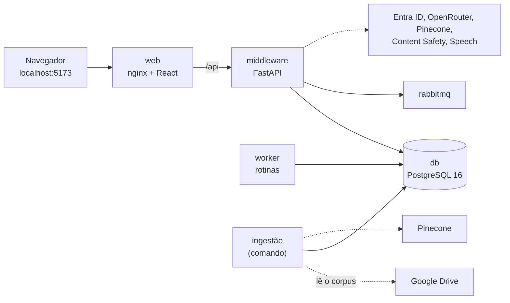

<p align="center">
  
</p>

<table align="center" width="100%" style="table-layout: fixed;">
  <tr>
    <td align="center">
      <a href="https://www.linkedin.com/in/alexsander-dsbarbosa/">
        
      </a>
    </td>
    <td align="center">
      <a href="https://www.linkedin.com/in/carlos-quaglia-309088357/">
        
      </a>
    </td>
    <td align="center">
      <a href="https://www.linkedin.com/in/celsojwnior/">
        
      </a>
    </td>
    <td align="center">
      <a href="https://www.linkedin.com/in/eduardo-casarini/">
        
      </a>
    </td>
    <td align="center">
      <a href="https://www.linkedin.com/in/marianalacerdareis/">
        
      </a>
    </td>
    <td align="center">
      <a href="https://www.linkedin.com/in/mirela-bianchi-608601254/">
        
      </a>
    </td>
  </tr>
</table>

<br>

<p align="center">
  
</p>

<table align="center" width="100%" style="table-layout: fixed;">
  <tr>
    <td align="center">
      <a href="https://www.linkedin.com/in/vanunes/">
        
      </a>
    </td>
    <td align="center">
      <a href="https://www.linkedin.com/in/reginaldo-arakaki-9574222b/">
        
      </a>
    </td>
    <td align="center">
      <a href="https://www.linkedin.com/in/bryan-kano/">
        
      </a>
    </td>
    <td align="center">
      <a href="https://www.linkedin.com/in/fernando-pizzo-208b526a/">
        
      </a>
    </td>
    <td align="center">
      <a href="https://www.linkedin.com/in/lisane-valdo/">
        
      </a>
    </td>
    <td align="center">
      <a href="https://www.linkedin.com/in/bruno-grandchamp-rodilha/">
        
      </a>
    </td>
    <td align="center">
      <a href="https://www.linkedin.com/in/filipe-gon%C3%A7alves-08a55015b/">
        
      </a>
    </td>
  </tr>
</table>

<br>

<p align="center">
  
</p>

# Manual de Implantação e Uso da Prova de Conceito

## Sumário

- [1. Introdução](#1-introdução)
  - [1.1 Objetivo e público](#11-objetivo-e-público)
  - [1.2 O que é instalado](#12-o-que-é-instalado)
  - [1.3 Serviços externos](#13-serviços-externos)
  - [1.4 Documentos relacionados](#14-documentos-relacionados)
  - [1.5 Convenções](#15-convenções)
- [2. Contas e serviços externos](#2-contas-e-serviços-externos)
  - [2.1 Microsoft Entra ID](#21-microsoft-entra-id)
  - [2.2 OpenRouter](#22-openrouter)
  - [2.3 Pinecone](#23-pinecone)
  - [2.4 Google Drive e o corpus sintético](#24-google-drive-e-o-corpus-sintético)
  - [2.5 Content Safety e Speech](#25-content-safety-e-speech)
- [3. Instalação local](#3-instalação-local)
  - [3.1 Pré-requisitos](#31-pré-requisitos)
  - [3.2 Código e variáveis de ambiente](#32-código-e-variáveis-de-ambiente)
  - [3.3 Construção e subida](#33-construção-e-subida)
  - [3.4 Carga dos dados](#34-carga-dos-dados)
  - [3.5 Primeiro acesso e vínculo aos projetos](#35-primeiro-acesso-e-vínculo-aos-projetos)
  - [3.6 Conferência final](#36-conferência-final)
  - [3.7 Parada, retomada e limpeza](#37-parada-retomada-e-limpeza)
  - [3.8 Problemas comuns](#38-problemas-comuns)
- [4. Implantação na nuvem](#4-implantação-na-nuvem)
  - [4.1 Visão geral](#41-visão-geral)
  - [4.2 Pré-requisitos](#42-pré-requisitos)
  - [4.3 Adaptação à sua assinatura](#43-adaptação-à-sua-assinatura)
  - [4.4 Provisionamento do estágio dev](#44-provisionamento-do-estágio-dev)
  - [4.5 Provisionamento do estágio prd](#45-provisionamento-do-estágio-prd)
  - [4.6 Entrega contínua pelo GitLab](#46-entrega-contínua-pelo-gitlab)
  - [4.7 Verificação e vínculo dos usuários](#47-verificação-e-vínculo-dos-usuários)
  - [4.8 Operação do dia a dia](#48-operação-do-dia-a-dia)
  - [4.9 Problemas comuns](#49-problemas-comuns)
- [5. Uso da prova de conceito](#5-uso-da-prova-de-conceito)
  - [5.1 Acesso](#51-acesso)
  - [5.2 A tela de conversa](#52-a-tela-de-conversa)
  - [5.3 Como ler as respostas](#53-como-ler-as-respostas)
  - [5.4 Diretoria](#54-diretoria)
  - [5.5 Líder de projeto](#55-líder-de-projeto)
  - [5.6 Membro de equipe](#56-membro-de-equipe)
  - [5.7 Painel de intenções](#57-painel-de-intenções)
  - [5.8 Rotinas](#58-rotinas)
  - [5.9 O que a prova de conceito ainda não faz](#59-o-que-a-prova-de-conceito-ainda-não-faz)
- [6. Registro de execução](#6-registro-de-execução)
- [Apêndice A: Variáveis de ambiente do middleware](#apêndice-a-variáveis-de-ambiente-do-middleware)

## 1. Introdução

### 1.1 Objetivo e público

Este manual leva a prova de conceito do Prata Agent do repositório até o uso,
em três partes: a instalação na própria máquina com Docker Compose (seção 3), a
implantação na Azure com os scripts de `infra/azure` (seção 4) e o uso da
aplicação por perfil de usuário (seção 5).

Ele foi escrito para quem parte do zero e não tem acesso a nenhuma conta da
equipe: cada serviço externo é criado numa conta própria (seção 2). Quem já
recebeu da equipe as credenciais de algum serviço pula a criação dele e vai
direto às variáveis que ele preenche.

O manual descreve **como** executar. O **porquê** das escolhas de implantação,
as evidências e os custos ficam no [capítulo 11 do Projeto.md](Projeto.md#11-procedimentos-de-implantação).

### 1.2 O que é instalado

A instalação local sobe cinco serviços, todos definidos em
[`infra/docker-compose.yml`](../infra/docker-compose.yml):

| Serviço | O que é | Porta na máquina |
|---|---|---|
| `web` | Interface React servida pelo nginx, que também encaminha `/api` ao middleware | 5173 |
| `middleware` | API FastAPI: login, guardas, classificador de intenção, RAG e registro | nenhuma (só pela `web`) |
| `worker` | Agendador das rotinas, com a mesma imagem do middleware | nenhuma |
| `db` | PostgreSQL 16 com todos os esquemas da aplicação | 5432 |
| `rabbitmq` | Mensageria dos webhooks | 5672 e 15672 (painel), só em `127.0.0.1` |



*Figura 1: Serviços da instalação local e as dependências externas.*

Na nuvem, o `web` e o `middleware` viram Container Apps, o banco vira um
PostgreSQL gerenciado e os segredos vão para o Key Vault. O worker e o RabbitMQ
ficam de fora por custo (seção 4.1).

### 1.3 Serviços externos

| Serviço | Para quê | Local | Nuvem |
|---|---|---|---|
| Microsoft Entra ID | Login corporativo, perfil e permissões pelos grupos | **Obrigatório**: não há login de desenvolvimento | **Obrigatório** |
| OpenRouter | Modelo que redige a resposta a partir dos trechos recuperados | **Obrigatório** para o chat responder | **Obrigatório** (a fase `conferir` exige a chave) |
| Pinecone | Índice vetorial dos trechos do corpus | **Obrigatório** para o chat responder | **Obrigatório** |
| Google Drive (conta de serviço) | Leitura do corpus sintético na ingestão | **Obrigatório** uma vez, para ingerir | Não usado: a nuvem recebe os dados já ingeridos |
| Azure AI Content Safety | Guardas de injeção, de abuso e de saída | Opcional: sem ele valem só as regras locais | **Obrigatório** (criado pelos scripts) |
| Azure Speech | Entrada por voz | Opcional: sem ele o microfone avisa que está indisponível | **Obrigatório** (criado pelos scripts) |
| Assinatura Azure | Recursos da nuvem | Só para obter Content Safety e Speech | **Obrigatório**, com papel *Owner* |

O Gemini pela API do Google é aceito no lugar do OpenRouter
(`LLM_BACKEND=gemini`), mas a fase `conferir` da nuvem exige a chave do
OpenRouter. O Copilot Studio (`EXECUTOR=copilot`) é o caminho previsto para o
ambiente do parceiro e ainda não está implementado. Por isso a prova de
conceito roda com o executor próprio (`EXECUTOR=proprio`).

### 1.4 Documentos relacionados

| Documento | O que traz |
|---|---|
| [Projeto.md, capítulo 11](Projeto.md#11-procedimentos-de-implantação) | Decisões, evidências, custos e o retorno a uma versão anterior |
| [infra/azure/README.md](../infra/azure/README.md) | Referência rápida das fases dos scripts |
| [GestaoConfiguracao.md, seção 8](GestaoConfiguracao.md#8-registro-de-variáveis-de-ambiente) | Registro das variáveis e dos segredos da nuvem |
| [src/middleware/README.md](../src/middleware/README.md) | Desenvolvimento do middleware fora do contêiner, testes e bancadas |
| [Arquitetura.md](Arquitetura.md) | Componentes e fluxo de uma mensagem |

### 1.5 Convenções

- Os comandos rodam **na raiz do repositório**. Os de Docker funcionam igual no
  Git Bash, no PowerShell e nos terminais do Linux e do macOS. Os scripts da
  nuvem exigem bash: no Windows, o Git Bash.
- Texto entre `<` e `>` é para trocar pelo seu valor, sem os sinais.
- Nenhum comando deste manual imprime segredo. Não cole chave, senha ou token em
  issue, merge request, captura ou log.

## 2. Contas e serviços externos

Esta seção cria as contas e anota os valores que vão para o
`src/middleware/.env` (seção 3.2). O Apêndice A traz a lista completa das
variáveis.

### 2.1 Microsoft Entra ID

Você precisa de um tenant do Entra ID onde possa criar registros de aplicativo,
grupos e usuários e dar consentimento de administrador. Uma conta gratuita da
Azure cria um tenant próprio ("Diretório Padrão"), e o administrador dele pode
tudo isso.

Os nomes de menu abaixo são os do [centro de administração do Entra](https://entra.microsoft.com)
em inglês. Em português, os termos equivalentes aparecem entre parênteses.

**1. Registro de aplicativo.** Em *Identity → Applications → App registrations →
New registration* (Registros de aplicativo → Novo registro):

| Campo | Valor |
|---|---|
| Name | `Prata Agent` (ou outro) |
| Supported account types | *Accounts in this organizational directory only* (locatário único) |
| Redirect URI | Plataforma **Web**, `http://localhost:5173/api/auth/callback` |

Na página do registro, anote o *Directory (tenant) ID* e o *Application
(client) ID*.

**2. Segredo do cliente.** Em *Certificates & secrets → Client secrets → New
client secret*, crie um segredo e copie a coluna **Value** na hora (ela não
aparece de novo). O *Secret ID* não serve.

**3. Grupos no token.** Em *Token configuration → Add groups claim*, marque
**Security groups** e salve. Sem isso o token chega sem grupos, e todo usuário
entra como membro de equipe sem projetos.

**4. Permissão do Graph para as rotinas.** Em *API permissions → Add a
permission → Microsoft Graph → Application permissions*, adicione
`User.Read.All` e clique em **Grant admin consent** (Conceder consentimento do
administrador). A rotina usa essa permissão para reler, no momento do disparo,
os grupos de quem a criou. Sem ela, "Executar agora" falha. A permissão
delegada `User.Read`, que já vem no registro, continua lá.

**5. Grupos de perfil e de permissão.** Em *Identity → Groups → New group*,
crie cinco grupos do tipo **Security** e anote o *Object ID* de cada um:

| Grupo sugerido | Variável | O que concede |
|---|---|---|
| `Prata - Diretoria` | `ENTRA_GRUPO_DIRETORIA` | Perfil diretoria: todo o portfólio, inclusive documentos restritos |
| `Prata - Líder de projeto` | `ENTRA_GRUPO_LIDER_PROJETO` | Perfil líder: projetos vinculados, documentos internos e corporativos |
| `Prata - Membro de equipe` | `ENTRA_GRUPO_MEMBRO_EQUIPE` | Perfil membro: projetos vinculados, só documentos internos |
| `Prata - Ver intenções` | `ENTRA_GRUPO_VER_INTENCOES` | Tela Intenções (painel de uso e de segurança) |
| `Prata - Gerir rotinas` | `ENTRA_GRUPO_GERIR_ROTINAS` | Tela Rotinas |

Perfil e permissão são independentes. Quem está em mais de um grupo de perfil
recebe o mais amplo.

**6. Usuários de teste.** Em *Identity → Users → New user*, crie um usuário por
perfil e coloque cada um nos grupos:

| Usuário sugerido | Grupos |
|---|---|
| `diretoria@<seu-domínio>.onmicrosoft.com` | Diretoria, Ver intenções, Gerir rotinas |
| `lider@<seu-domínio>.onmicrosoft.com` | Líder de projeto, Gerir rotinas |
| `membro@<seu-domínio>.onmicrosoft.com` | Membro de equipe |

Guarde as senhas iniciais fora do repositório. No primeiro login, o Entra pede
para trocá-las.

**O que vai para o `.env`:** `ENTRA_TENANT_ID`, `ENTRA_CLIENT_ID`,
`ENTRA_CLIENT_SECRET` e os cinco `ENTRA_GRUPO_*`. Na nuvem, a fase `entra`
acrescenta sozinha a URI de retorno do estágio ao mesmo registro (seção 4.4).

### 2.2 OpenRouter

1. Crie uma conta em [openrouter.ai](https://openrouter.ai) e adicione crédito.
   Cada pergunta respondida envia cerca de cinco trechos ao modelo; poucos
   dólares bastam para a avaliação da prova de conceito.
2. Em *Keys*, crie uma chave e anote-a em `OPENROUTER_API_KEY`.
3. Confira a chave e o saldo sem gastar crédito:

   ```bash
   curl -s https://openrouter.ai/api/v1/key -H "Authorization: Bearer <sua-chave>"
   ```

O modelo padrão é `google/gemini-3.5-flash` (`OPENROUTER_MODELO`).

### 2.3 Pinecone

1. Crie uma conta em [pinecone.io](https://www.pinecone.io). O plano gratuito
   comporta o corpus.
2. Em *API Keys*, crie uma chave e anote-a em `PINECONE_API_KEY`.
3. Escolha o nome do índice, por exemplo `portfolio-metro`, e anote-o em
   `PINECONE_INDEX`. O índice em si é criado pelo próprio middleware, com a
   dimensão e a métrica certas, na seção 3.4.

### 2.4 Google Drive e o corpus sintético

O corpus da prova de conceito são os 84 arquivos sintéticos fornecidos pelo
parceiro: termos de abertura, relatórios de status, planilhas financeiras,
normas internas e um `LEIA-ME`. Eles estão na pasta
[`1qYlK_jXmJZp3bM-Hvbn9izlX0s8UVHHO`](https://drive.google.com/drive/folders/1qYlK_jXmJZp3bM-Hvbn9izlX0s8UVHHO),
compartilhada por link. A ingestão lê os arquivos de uma pasta do Google Drive
com uma conta de serviço, em modo somente leitura.

1. **Pasta.** Crie no seu Drive uma pasta e copie para ela os arquivos do
   corpus: baixe a pasta do parceiro (*Download* gera um `.zip`), descompacte
   e envie os arquivos, mantendo os nomes. De preferência, deixe-os no formato
   original (`.docx`, `.xlsx`, `.pptx`); documentos convertidos para o formato
   do Google também são lidos, porque a ingestão os exporta de volta. Anote o
   ID da sua pasta (o trecho da URL depois de `/folders/`) em
   `DRIVE_PASTA_ID`. Se quem administra a pasta do parceiro compartilhá-la com
   a sua conta de serviço (passo 5), use o ID dela e pule a cópia.
2. **Projeto e API.** No [console do Google Cloud](https://console.cloud.google.com),
   crie um projeto e ative a **Google Drive API** (*APIs & Services → Library*).
3. **Conta de serviço.** Em *IAM & Admin → Service Accounts*, crie uma conta de
   serviço sem papéis. Em *Keys → Add key → Create new key → JSON*, baixe a
   chave.
4. **Chave no repositório.** Salve o arquivo como
   `src/middleware/credenciais/conta-de-servico.json`. A pasta `credenciais/`
   está no `.gitignore` e no `.dockerignore`: não vai para o Git nem para a
   imagem. No `.env`, use
   `DRIVE_SERVICE_ACCOUNT_JSON=credenciais/conta-de-servico.json`.
5. **Compartilhamento.** Compartilhe a pasta com o e-mail da conta de serviço
   (termina em `iam.gserviceaccount.com`) como **Leitor**.

Cada documento declara no cabeçalho a sua classificação (Interno, Corporativo
ou Restrito) e os perfis autorizados. A ingestão grava essa permissão junto de
cada trecho, e é ela que recorta o que cada perfil lê (seção 5).

### 2.5 Content Safety e Speech

No local, os dois são opcionais. Para usá-los, crie na sua assinatura Azure, no
portal, um recurso **Content Safety** e um **Speech**, ambos no nível gratuito
(F0), e anote:

| Recurso | Variáveis |
|---|---|
| Content Safety | `CONTENT_SAFETY_ENDPOINT` (o *Endpoint* da página *Keys and Endpoint*) e `CONTENT_SAFETY_KEY` |
| Speech | `SPEECH_KEY` e `SPEECH_REGION` (por exemplo, `brazilsouth`) |

Quem vai implantar na nuvem pode pular este passo: a fase `cognitivos` cria os
dois recursos, e a fase `local` grava as quatro variáveis no `.env` (seção 4.4).
Uma assinatura admite um único recurso F0 de cada tipo.

## 3. Instalação local

### 3.1 Pré-requisitos

| Item | Detalhe |
|---|---|
| Docker | Docker Desktop (Windows e macOS) ou Docker Engine com o Compose v2 (`docker compose version`) |
| Memória | Pelo menos 8 GB disponíveis para o Docker. O middleware carrega o classificador e o modelo de *embeddings* (cerca de 2 GB) na subida, e a ingestão carrega outra cópia |
| Disco | Cerca de 15 GB livres. A imagem do middleware tem 6,6 GB, e a construção ocupa mais espaço em cache |
| Rede | Acesso a PyPI, `download.pytorch.org`, Hugging Face e npm durante a construção |
| Portas livres | 5173, 5432, 5672 e 15672 |
| Git | Para clonar o repositório |
| Contas | As da seção 2 |

Python e Node não são necessários para rodar a aplicação em contêiner. Eles só
entram no desenvolvimento fora do Docker, descrito em
[`src/middleware/README.md`](../src/middleware/README.md) e na seção 9.2.11 do
Projeto.md, e no `.venv` mínimo que os scripts da nuvem pedem (seção 4.2).

### 3.2 Código e variáveis de ambiente

```bash
git clone <url-do-repositório> prata-agent
cd prata-agent
cp src/middleware/.env.example src/middleware/.env
```

Abra `src/middleware/.env` num editor e preencha os valores abaixo. O
`.env.example` traz todos os nomes; os que não aparecem aqui podem ficar com o
valor do exemplo.

| Grupo | Variável | Valor |
|---|---|---|
| Executor | `EXECUTOR` | `proprio` |
| | `LLM_BACKEND` | `openrouter` |
| | `OPENROUTER_API_KEY` | A chave da seção 2.2 |
| Vetorial | `VETORIAL_BACKEND` | `pinecone` |
| | `PINECONE_API_KEY` | A chave da seção 2.3 |
| | `PINECONE_INDEX` | O nome escolhido na seção 2.3 |
| | `PINECONE_NAMESPACE` | `dev` (ou outro nome; o mesmo na ingestão e no uso) |
| Ingestão | `DRIVE_SERVICE_ACCOUNT_JSON` | `credenciais/conta-de-servico.json` |
| | `DRIVE_PASTA_ID` | O ID da pasta da seção 2.4 |
| Login | `ENTRA_TENANT_ID`, `ENTRA_CLIENT_ID`, `ENTRA_CLIENT_SECRET` | Os valores da seção 2.1 |
| | `ENTRA_GRUPO_DIRETORIA`, `ENTRA_GRUPO_LIDER_PROJETO`, `ENTRA_GRUPO_MEMBRO_EQUIPE`, `ENTRA_GRUPO_VER_INTENCOES`, `ENTRA_GRUPO_GERIR_ROTINAS` | Os *Object IDs* dos grupos |
| Sessão | `SESSION_SECRET` | Um valor aleatório longo (comando abaixo) |
| Guardas (opcional) | `CONTENT_SAFETY_ENDPOINT`, `CONTENT_SAFETY_KEY` | Seção 2.5 |
| Voz (opcional) | `SPEECH_KEY`, `SPEECH_REGION` | Seção 2.5 |

Para gerar o `SESSION_SECRET`:

```bash
python -c "import secrets; print(secrets.token_urlsafe(48))"
```

Sem Python, `openssl rand -base64 48` (que vem com o Git Bash) dá o mesmo
resultado.

Três cuidados:

- **Não defina `DATABASE_URL` nem `RABBITMQ_URL` apontando para `localhost`.**
  O Compose injeta os endereços internos (`db` e `rabbitmq`), e um `localhost`
  no `.env` faria o middleware procurar o banco dentro do próprio contêiner.
- **`ENTRA_REDIRECT_URI` fica no padrão** (`http://localhost:5173/api/auth/callback`),
  igual ao registrado na seção 2.1.
- **`SESSION_COOKIE_SECURE` fica `true`.** O navegador aceita cookie seguro em
  HTTP no `localhost`, e só nele.

### 3.3 Construção e subida

O `--env-file` faz o Compose ler o mesmo `.env` para as variáveis que ele
interpola (modo de desempenho e credenciais do RabbitMQ). Sem ele, valem os
padrões do arquivo do Compose. Para não repetir o comando inteiro, crie um
atalho na sessão do terminal:

```bash
# Git Bash, Linux e macOS
alias prata='MSYS_NO_PATHCONV=1 docker compose --env-file src/middleware/.env -f infra/docker-compose.yml'
```

O `MSYS_NO_PATHCONV=1` impede o Git Bash de converter os caminhos do contêiner
(como `/app/credenciais`) em caminhos do Windows. Fora do Git Bash, ele não tem
efeito.

```powershell
# PowerShell
function prata { docker compose --env-file src/middleware/.env -f infra/docker-compose.yml @args }
```

Construa e suba:

```bash
prata up --build -d
```

A primeira construção baixa o PyTorch, as dependências e o modelo de
*embeddings*, cerca de 3 GB, e por isso depende sobretudo da rede: na
validação (seção 6), sem cache e numa conexão rápida, levou 4,5 minutos. As
seguintes reaproveitam as camadas e levam segundos. Na subida, o middleware
aplica as migrações do banco e aquece o classificador antes de aceitar
mensagens.

Acompanhe até ficar pronto:

```bash
prata ps                                   # db e rabbitmq "healthy"; os demais "running"
curl -s http://localhost:5173/api/health   # {"status":"ok"}: a API respondeu
curl -s http://localhost:5173/api/health/pronto
```

O `/api/health/pronto` responde `{"status":"aquecendo"}` (HTTP 503) até o
classificador carregar e `{"status":"pronto"}` depois. Na validação, o
`pronto` chegou 25 segundos depois do `up`; em máquinas mais modestas, a
equipe já mediu de 1,5 a 2,7 minutos. No PowerShell, troque `curl -s` por
`curl.exe -s`.

### 3.4 Carga dos dados

O banco sobe com o esquema, mas vazio. Quatro passos o preenchem, com o
ambiente no ar. A pasta de scripts de apoio e a chave do Google não fazem parte
da imagem, e por isso são copiadas para dentro do contêiner do middleware
antes de rodar.

**1. Índice no Pinecone.** Cria o índice com dimensão 1024 e métrica cosseno,
se ele ainda não existir:

```bash
prata exec middleware python -m app.rag.vetorial.provisionar --criar
```

Sem `--criar`, o comando só confere o índice, sem escrever.

**2. Ingestão do corpus.** Copie a chave e rode primeiro a simulação, que lê a
pasta e mostra o que vai entrar sem gravar nada:

```bash
prata cp src/middleware/credenciais/. middleware:/app/credenciais
prata exec middleware python -m app.rag.ingestao --simular
```

O relatório lista os documentos vigentes, os substituídos por versão mais nova
e os descartados, com o motivo. Com o corpus completo, ele mostra 84 arquivos:
76 a indexar, 7 substituídos por versão mais nova e 1 ignorado (o `LEIA-ME`,
em texto simples), com 1.883 trechos. Se ele estiver de acordo, grave:

```bash
prata exec middleware python -m app.rag.ingestao
```

A ingestão vetoriza cada trecho na CPU, grava o texto no banco e os vetores no
Pinecone. Na validação, a simulação levou 2 minutos e a ingestão, 19,5
minutos. Rodar de novo só processa o que mudou na pasta; para refazer tudo,
use `--reindexar`.

**3. Projetos do corpus no portfólio.** Os documentos são de projetos com
códigos como `PRJ-2024-018`. Para que um líder ou membro possa ser vinculado a
eles, cada código precisa existir na tabela de projetos. Este comando cria um
registro por código encontrado no corpus:

```bash
prata exec db psql -U middleware -d middleware -c "INSERT INTO portfolio.projeto (codigo, nome, status, prioridade, avanco_percentual, criado_em, atualizado_em) SELECT DISTINCT projeto, projeto, 'em_andamento', 'media', 0, now(), now() FROM rag.trecho WHERE projeto LIKE 'PRJ-%' ON CONFLICT (codigo) DO NOTHING;"
```

A resposta `INSERT 0 18` indica os 18 projetos do corpus criados. O nome fica
igual ao código: a prova de conceito lê nome, prazo e situação nos próprios
documentos, e não nesta tabela.

**4. Carga de demonstração (opcional).** Cria três personas de
desenvolvimento, cinco projetos fictícios (`demo-PRJ-2024-001` a `005`),
conversas com todos os desfechos, rotinas e execuções. Ela serve para o painel
de intenções e o histórico terem o que mostrar logo no primeiro acesso. As
personas não fazem login: não existem no Entra.

```bash
prata cp src/middleware/scripts/. middleware:/app/scripts
prata exec middleware python -m scripts.popular_banco
```

O script recusa rodar contra um banco que não seja local.

### 3.5 Primeiro acesso e vínculo aos projetos

1. Abra **`http://localhost:5173`**, e não `127.0.0.1`: o Entra devolve o login
   para o endereço registrado, e o cookie do fluxo fica preso ao outro.
2. Clique em **Entrar com a Microsoft** e entre com o usuário de
   diretoria. No primeiro acesso, o Entra pede a troca da senha.
3. Abra `http://localhost:5173/api/auth/eu`. A resposta traz o `id` (o
   identificador do usuário no Entra), o perfil e as permissões. Confira se o
   perfil e as permissões batem com os grupos.
4. Repita os passos 2 e 3 com o líder e o membro, numa janela anônima por
   usuário (o login da Microsoft fica guardado no navegador), e anote o `id` de
   cada um.

Líder e membro só leem documentos de projetos aos quais estão vinculados, além
das normas, que valem para todos. Vincule cada um a pelo menos um projeto:

```bash
prata exec db psql -U middleware -d middleware -c "INSERT INTO portfolio.usuario_projeto (usuario_id, projeto_codigo, papel, criado_em) VALUES ('<id-do-líder>', 'PRJ-2024-018', 'lider', now()), ('<id-do-líder>', 'PRJ-2025-042', 'lider', now()), ('<id-do-membro>', 'PRJ-2024-018', 'membro', now()), ('<id-do-membro>', 'PRJ-2024-031', 'membro', now());"
```

O papel aceita `lider`, `membro` ou `observador`. O vínculo entra na sessão no
login: depois de vincular, **saia e entre de novo** com o líder e o membro. A
diretoria não precisa de vínculo, porque vê o portfólio inteiro.

Os vínculos acima são os que a seção 3.6 usa. O `PRJ-2024-031` é um projeto de
classificação Corporativa, que o membro não lê mesmo vinculado: ele demonstra o
recorte por classificação.

### 3.6 Conferência final

Com os três usuários vinculados, as perguntas abaixo, tiradas da bancada de
avaliação do RAG (`src/middleware/dados/bancada-rag.csv`), confirmam que cada
peça está no lugar:

| Quem pergunta | Pergunta | Esperado |
|---|---|---|
| Qualquer perfil | Qual a diferença entre risco e problema? | Resposta com fontes de uma norma |
| Diretoria | Qual o orçamento aprovado do projeto Expansão Leste? | Resposta com fontes (o projeto é Restrito) |
| Líder | Qual o farol geral do Sistema de Sinalização no relatório de status de agosto de 2026? | "Vermelho", com fontes |
| Líder | Qual o orçamento aprovado do projeto Expansão Leste? | "Não encontrei…": o líder não lê informação restrita |
| Membro | O que ficou fora do escopo da Modernização do Trecho Sul? | Menciona o material rodante, com fontes |
| Membro | Qual o avanço físico realizado do Monotrilho Ouro no relatório de agosto de 2026? | "Não encontrei…": o documento é Corporativo |
| Qualquer perfil | Qual a previsão do tempo para amanhã? | Rótulo "Fora do escopo" |

A primeira mensagem depois da subida pode levar mais tempo, enquanto o modelo
de geração responde à primeira chamada. Se as três primeiras linhas falharem,
veja a seção 3.8 antes de seguir.

### 3.7 Parada, retomada e limpeza

```bash
prata stop        # para os contêineres e guarda tudo
prata start       # retoma de onde parou
prata down        # remove os contêineres; banco e fila continuam nos volumes
prata down -v     # remove também os volumes: banco, vínculos e histórico se perdem
```

Depois de `down` ou de uma nova construção, as cópias da chave e dos scripts
feitas com `prata cp` somem com o contêiner antigo. Copie de novo antes de
rodar a ingestão ou a carga. Depois de `down -v`, repita a seção 3.4 inteira:
os vetores continuam no Pinecone, mas o texto dos trechos e o registro da
ingestão estavam no banco. Sem o registro, a ingestão refaz todos os
documentos e regrava os mesmos vetores, sem duplicá-los.

### 3.8 Problemas comuns

| Sintoma | Causa provável | O que fazer |
|---|---|---|
| "Autenticação não configurada" (503) ao entrar | `ENTRA_TENANT_ID`, `ENTRA_CLIENT_ID`, `ENTRA_CLIENT_SECRET` ou `SESSION_SECRET` vazios | Preencher e rodar `prata up -d` para recriar o middleware |
| Erro AADSTS50011 na tela da Microsoft | URI de retorno diferente da registrada | Registrar `http://localhost:5173/api/auth/callback` na plataforma **Web** do registro |
| "Não foi possível concluir o login" depois da tela da Microsoft | Página aberta por `127.0.0.1` ou por IP | Usar `http://localhost:5173` |
| Entra, mas sem as telas Intenções e Rotinas | Usuário fora dos grupos de permissão, ou grupos fora do token | Conferir os grupos e o passo 3 da seção 2.1; sair e entrar de novo |
| Toda mensagem volta "Indisponível" | `EXECUTOR` ficou no padrão `copilot`, que ainda não está implementado | `EXECUTOR=proprio` no `.env` e `prata up -d` |
| Toda pergunta de projeto volta "Não encontrei…" | Ingestão não feita, ou namespace diferente entre a ingestão e o uso | Conferir `PINECONE_NAMESPACE` e rodar a seção 3.4 |
| Líder ou membro só obtêm respostas sobre normas | Usuário sem vínculo a projeto, ou vínculo feito depois do login | Seção 3.5; sair e entrar de novo |
| `/api/health/pronto` fica em `aquecendo` | Classificador carregando, ou memória insuficiente para o Docker | Esperar alguns minutos; conferir `prata logs middleware` e a memória do Docker |
| `prata up` falha com "port is already allocated" | Outro processo ou contêiner usa 5173, 5432 ou 5672 | `docker ps` mostra qual contêiner ocupa a porta; encerrá-lo antes de subir |
| Middleware reinicia com erro de RabbitMQ | `RABBITMQ_URL` com `localhost` no `.env` | Apagar a linha; o Compose informa o endereço certo |
| "A resposta demorou demais" | Primeira mensagem com o modelo frio, ou OpenRouter lento | Esperar e conferir a conversa; se a resposta aparecer, não reenviar |
| Microfone avisa indisponibilidade | `SPEECH_KEY` ou `SPEECH_REGION` vazios | Seção 2.5 |
| `InconsistentVersionWarning` do scikit-learn no log do middleware | O classificador foi salvo na versão 1.9.0 e a imagem tem a 1.9.1 | Nada: é aviso, e o classificador carrega |
| Docker Desktop fecha na partida com "remove …\dockerInference" ou "…\engine.sock: The file cannot be accessed by the system" (Windows) | Socket deixado por uma partida anterior que não terminou | Fechar o Docker Desktop, renomear a pasta que contém o arquivo citado (`%LOCALAPPDATA%\Docker\run` ou `%LOCALAPPDATA%\docker-secrets-engine`) e abrir de novo |
| Na primeira subida, em volume novo, o `worker` falha ao iniciar | O `worker` espera o `middleware` iniciar (`service_started`), não terminar a migração, o que abre uma corrida. É um risco conhecido que não ocorreu na validação | Esperar o `middleware` responder `pronto` e reiniciar com `prata restart worker` |

Para ver o que o middleware registrou: `prata logs -f middleware`.

## 4. Implantação na nuvem

### 4.1 Visão geral

Os scripts de [`infra/azure`](../infra/azure/) criam na Azure dois estágios,
`dev` e `prd`, no Azure Container Apps da região `brazilsouth`. O diagrama de
recursos está na Figura 48 do
[capítulo 11 do Projeto.md](Projeto.md#11-procedimentos-de-implantação).

| Script | Papel |
|---|---|
| `variaveis.sh` | Nomes dos recursos de cada estágio |
| `provisionar.sh <estágio> <fase>...` | Cria o que falta, fase por fase. Rodar de novo não duplica nada |
| `implantar.sh <estágio>` | Publica uma versão: migração, troca das imagens e verificação de saúde |

Os scripts foram escritos para uma assinatura gratuita (*Free Trial*), com teto
de gasto de R$ 300 por ano para os dois estágios. Por isso os apps escalam a
zero quando ociosos, o banco é desligado entre usos e o worker de rotinas e o
RabbitMQ ficam fora da nuvem. Sem o worker, as rotinas não disparam no horário
na nuvem; "Executar agora" funciona, porque roda na própria API.

A nuvem **não ingere o corpus**: a fase `dados` copia do banco local os trechos
e os projetos já carregados na seção 3.4. Faça a instalação local antes.

### 4.2 Pré-requisitos

| Item | Detalhe |
|---|---|
| Assinatura Azure | Papel **Owner** na assinatura. O script atribui papéis às identidades e cria o orçamento |
| Azure CLI | Versão 2.90 ou superior (`az version`). Não instale a extensão `containerapp`: os comandos usados estão no núcleo da CLI |
| Shell | Bash. No Windows, o Git Bash; os scripts exportam `MSYS_NO_PATHCONV=1` sozinhos |
| Ferramentas | `docker` (ligado), `jq`, `openssl`, `curl` e `git`. O `jq` não vem com o Git Bash: baixe o executável em [jqlang.org](https://jqlang.org) e coloque-o no `PATH` |
| `.env` | O mesmo `src/middleware/.env` da seção 3.2, já validado no local. As fases `segredos`, `apps` e `entra` leem dele |
| Python | Um ambiente virtual em `src/middleware/.venv` com o pacote `pydantic-settings`, pelo qual os scripts leem o `.env` (comando abaixo) |
| Banco local | A instalação local no ar, com a seção 3.4 concluída |
| Entra | O registro da seção 2.1 no **mesmo tenant** da conta do `az login`, e permissão para editá-lo |

O ambiente virtual mínimo, criado uma vez:

```bash
cd src/middleware
python -m venv .venv
.venv/Scripts/pip install pydantic-settings    # Windows; no Linux e no macOS, .venv/bin/pip
cd ../..
```

Quem já desenvolve o middleware fora do Docker pode usar a `.venv` completa
(`pip install -e ".[dev]"`).

A nuvem herda do `.env` o executor e o provedor do modelo. Antes da primeira
implantação, confira `EXECUTOR=proprio` e `LLM_BACKEND=openrouter` (seção
3.2): com os padrões do código (`copilot` e `gemini`), o chat responde
"Indisponível" e a fase `conferir` acusa a falta da chave do OpenRouter.

### 4.3 Adaptação à sua assinatura

Registro de imagens, Key Vault, PostgreSQL, Content Safety e Speech têm nomes
únicos na Azure inteira. Todos derivam do sufixo `SUF`, definido em
[`infra/azure/variaveis.sh`](../infra/azure/variaveis.sh). Em outra assinatura,
edite essa linha antes de tudo:

```bash
SUF=g02t17     # troque por um sufixo seu
```

O sufixo precisa ter só letras minúsculas e números, porque o nome do registro
de imagens não aceita hífen, e no máximo 11 caracteres, porque o Key Vault
`kv-prata-dev-<SUF>` aceita até 24.

O `SUF` só muda pela edição desse arquivo: nenhuma variável de ambiente o substitui.

Revise também, no mesmo arquivo:

| Variável | Quando mudar |
|---|---|
| `GITLAB_EMISSOR` e `GITLAB_PROJETO` | Se o repositório estiver em outra instância do GitLab ou em outro caminho. A entrega contínua confia nos tokens desse emissor e desse projeto |
| `ACR_SKU` (por variável de ambiente) | `Basic` fora da cota gratuita de 12 meses, que cobre o `Standard` |
| `ORCAMENTO` (por variável de ambiente) | Teto anual do orçamento, na moeda da assinatura. O padrão é 300 |

Os demais nomes (grupo `rg-prata-agent`, apps, identidades e bancos) são
únicos só dentro da assinatura e podem ficar como estão.

### 4.4 Provisionamento do estágio dev

Da raiz do repositório, no Git Bash, com o Docker e a instalação local no ar:

```bash
az login
az account set --subscription "<id-ou-nome-da-assinatura>"
bash infra/azure/provisionar.sh dev conta
```

A fase `conta` só lê: mostra a assinatura em uso, a oferta e o limite de gasto.
Confira se é a assinatura certa, porque os scripts usam a assinatura padrão da
CLI. Depois, crie o estágio inteiro:

```bash
ORIGEM_PORTA=5432 bash infra/azure/provisionar.sh dev tudo
```

O `ORIGEM_PORTA=5432` aponta a fase `dados` para o PostgreSQL do Compose. O
padrão do script, 5434, é a porta da máquina em que o projeto foi
desenvolvido. A cópia roda num contêiner descartável, que alcança o banco
local por `host.docker.internal`, nome que o Docker Desktop resolve. No Docker
Engine do Linux, acrescente `ORIGEM_HOST=172.17.0.1`, o endereço da máquina na
rede padrão do Docker.

O `tudo` executa as fases abaixo, nesta ordem. Cada uma também roda sozinha,
por exemplo `bash infra/azure/provisionar.sh dev apps`:

| Fase | O que faz |
|---|---|
| `fundacao` | Registra os provedores, cria o grupo, o Log Analytics e o registro de imagens |
| `imagens` | Constrói as duas imagens na sua máquina e as publica com a tag do commit |
| `cofre` | Identidade gerenciada do estágio, Key Vault e os papéis de leitura |
| `banco` | Servidor PostgreSQL (na primeira vez), banco e usuário do estágio, com uma regra de firewall temporária para o seu IP |
| `cognitivos` | Content Safety e Speech no nível gratuito |
| `segredos` | Grava no cofre as chaves do `.env` e as dos recursos cognitivos, sem exibi-las |
| `ambiente` | Container Apps Environment com os logs no Log Analytics |
| `migracao` | Job que aplica as migrações do banco com a imagem nova |
| `dados` | Copia do banco local os esquemas `rag` e `portfolio`, menos os vínculos de usuário |
| `apps` | Middleware (interno) e web (público) |
| `entra` | Acrescenta `https://<web>/api/auth/callback` às URIs de retorno do registro |
| `alertas` | Alertas de indisponibilidade e de reinício e o orçamento, com e-mail para a conta do `az login` |
| `pipeline` | Identidade da entrega contínua (seção 4.6) |
| `fechar` | Remove a regra temporária do firewall do banco |
| `conferir` | Só leitura: segredos por referência ao cofre, TLS e rede do banco |

A primeira execução leva dezenas de minutos: a maior parte vai na construção e
no envio das imagens e na criação do servidor PostgreSQL. Se uma fase falhar,
corrija a causa e rode `tudo` de novo: o que já existe é pulado. A seção 4.9
lista as falhas conhecidas.

Para que o Content Safety e o Speech também sirvam ao ambiente local, grave as
chaves deles no `.env`:

```bash
bash infra/azure/provisionar.sh dev local
```

Os apps nascem escalados a zero: o primeiro acesso depois de um tempo ocioso
espera o middleware aquecer. Antes de uma demonstração, deixe uma réplica
pronta com `bash infra/azure/provisionar.sh dev ligar`, e devolva a zero com
`desligar` depois.

O endereço do estágio sai de:

```bash
az containerapp show -g rg-prata-agent -n ca-web-dev --query properties.configuration.ingress.fqdn -o tsv
```

### 4.5 Provisionamento do estágio prd

O `prd` é criado depois do `dev`, porque a senha de administrador do servidor
PostgreSQL, compartilhado pelos dois, fica no cofre do `dev`:

```bash
ORIGEM_PORTA=5432 bash infra/azure/provisionar.sh prd tudo
```

Os dois estágios dividem o grupo, o registro de imagens, o Log Analytics, o
servidor PostgreSQL, o Content Safety, o Speech e o Container Apps Environment
`cae-prata-dev`: a assinatura gratuita admite um único ambiente por região.
Cada estágio tem identidade, cofre, banco, usuário de banco e apps próprios.

Os dois leem o mesmo namespace do Pinecone, o do `.env`. Isso é seguro porque a
nuvem só lê o índice. Quem quiser isolar o `prd` muda `PINECONE_NAMESPACE` no
`.env`, roda a ingestão local nesse namespace e só então a fase `apps` com
`RECONFIGURAR=1` no `prd`.

### 4.6 Entrega contínua pelo GitLab

O [`.gitlab-ci.yml`](../.gitlab-ci.yml) publica sozinho cada merge na `develop`
no estágio `dev` e prepara as imagens de cada merge na `main` para o `prd`, que
só é implantado com um clique no job `implantar:prd`. A pipeline entra na Azure
por OIDC, sem senha guardada no GitLab.

1. **Identidade da pipeline**, uma por estágio (a fase já roda dentro do `tudo`;
   rodá-la de novo só imprime o *client id*):

   ```bash
   bash infra/azure/provisionar.sh dev pipeline
   bash infra/azure/provisionar.sh prd pipeline
   ```

2. **Variáveis do GitLab**, em *Settings → CI/CD → Variables* (Configurações →
   CI/CD → Variáveis). Nenhuma é sigilosa. Deixe **Protect variable**
   desmarcado, porque a `develop` não é um ramo protegido:

   | Variável | Escopo de ambiente | Valor |
   |---|---|---|
   | `AZURE_TENANT_ID` | Todos (`*`) | `az account show --query tenantId -o tsv` |
   | `AZURE_SUBSCRIPTION_ID` | Todos (`*`) | `az account show --query id -o tsv` |
   | `AZURE_CLIENT_ID` | `dev` | O *client id* impresso pela fase `pipeline` do `dev` |
   | `AZURE_CLIENT_ID` | `prd` | O *client id* impresso pela fase `pipeline` do `prd` |

3. **Endereços dos ambientes.** Troque, nos jobs `entrega:dev` e
   `implantar:prd` do `.gitlab-ci.yml`, a URL de `environment:url` pelo
   endereço dos seus estágios (seção 4.4).
4. **Runner.** Os jobs de imagem usam o serviço `docker:dind`, que exige um
   runner com modo privilegiado. Os runners compartilhados do GitLab.com já
   permitem; num runner próprio, ligue `privileged = true`.

Sem pipeline, a implantação manual usa os mesmos scripts:

```bash
bash infra/azure/provisionar.sh dev imagens   # imagens com a tag do commit atual
bash infra/azure/implantar.sh dev             # migração, troca das imagens e saúde
```

O `implantar.sh` sai com código 3, sem mexer em nada, quando o banco está
parado. Para publicar uma versão já enviada ao registro, use
`TAG=<tag> bash infra/azure/implantar.sh dev`.

### 4.7 Verificação e vínculo dos usuários

O `implantar.sh` termina pela fase `saude`, que espera a revisão nova receber
todo o tráfego e exige `{"status": "pronto"}` em `https://<web>/api/health/pronto`.
Depois dela, confira à mão:

1. **Login** com os três usuários de teste, cada um numa janela anônima, e o
   perfil em `https://<web>/api/auth/eu`. Anote o `id` do líder e do membro.
2. **Conversa:** a pergunta normativa da seção 3.6, que qualquer perfil
   responde.
3. **Vínculo.** Na nuvem não há acesso direto ao banco, e o vínculo é feito pela
   API, com a sessão da diretoria. Entre como diretoria, abra o console do
   navegador (F12 → *Console*) na página do estágio e rode, uma vez por vínculo:

   ```js
   await fetch('/api/portfolio/projetos/PRJ-2024-018/usuarios/<id-do-líder>?papel=lider', { method: 'POST' }).then(r => r.status)
   ```

   A resposta `201` confirma o vínculo. Faça os quatro vínculos da seção 3.5,
   trocando o código, o `id` e o papel. Depois, o líder e o membro saem e
   entram de novo, e as perguntas da seção 3.6 valem também na nuvem.
4. **Revisões:** `az containerapp revision list -g rg-prata-agent -n ca-middleware-dev -o table`
   mostra a revisão ativa. A nova fica alguns minutos em `Activating` enquanto o
   classificador aquece.

### 4.8 Operação do dia a dia

| Quando | Comando |
|---|---|
| Depois do uso | `bash infra/azure/provisionar.sh dev parar`: apps a zero e banco desligado (cerca de 4 min). Como o servidor é um só, desliga o banco dos dois estágios |
| Antes do próximo uso | `bash infra/azure/provisionar.sh dev retomar`: liga o banco, deixa uma réplica de cada app e confere a saúde (de 10 a 20 min). A réplica fica ligada até um `desligar` ou `parar` |
| Antes e depois de uma demonstração, com o banco ligado | `ligar` e `desligar` |
| Toda semana | `JANELA=7d bash infra/azure/provisionar.sh dev metricas` (disponibilidade, erro e latência) e `conferir` nos dois estágios |
| Quando uma chave muda | `segredos` e depois `RECONFIGURAR=1 ... apps` em cada estágio. O `RECONFIGURAR` devolve os apps a zero réplica: rode `ligar` em seguida se o estágio estava ligado |
| Para voltar a uma versão anterior | `TAG=<tag anterior> bash infra/azure/implantar.sh <estágio>`. Se a versão abandonada trouxe migração, siga a seção 11.4 do Projeto.md |

A Azure religa sozinha um servidor PostgreSQL parado há 7 dias. Se isso
acontecer, rode `parar` de novo. O orçamento avisa por e-mail em 50%, 80% e
100% do teto, mas não bloqueia gasto.

### 4.9 Problemas comuns

| Sintoma | Causa | O que fazer |
|---|---|---|
| `MaxNumberOfRegionalEnvironmentsInSubExceeded` na fase `ambiente` | A assinatura gratuita já tem um Container Apps Environment na região | Usar o ambiente existente: o `CAE` em `variaveis.sh` já é fixo e compartilhado |
| A fase `cognitivos` falha | A assinatura já tem um recurso F0 do mesmo tipo | Apagar o recurso antigo ou reaproveitá-lo, ajustando `CS` e `SPEECH` em `variaveis.sh` |
| Nome de Key Vault indisponível | Um cofre apagado com o mesmo nome continua reservado por 7 dias | Expurgar o cofre apagado (`az keyvault purge -n <nome>`) ou trocar o `SUF` |
| Tempo esgotado nas fases `banco` e `dados` no primeiro minuto | A regra de firewall recém-criada ainda não vale | Repetir a fase |
| `use of closed network connection` no envio das imagens | Queda da conexão com o registro | Repetir a fase `imagens` |
| `conferir` acusa `openrouter-api-key` ausente | `.env` sem `OPENROUTER_API_KEY` na hora da fase `segredos` | Preencher, rodar `segredos` e `RECONFIGURAR=1 ... apps` |
| Login devolve AADSTS50011 na nuvem | A fase `entra` não rodou, ou o registro está em outro tenant | Rodar `entra`, ou acrescentar a URI no portal |
| Toda pergunta de projeto se abstém | Fase `dados` rodou sem corpus no banco local | Concluir a seção 3.4 e rodar `ORIGEM_PORTA=5432 bash infra/azure/provisionar.sh <estágio> banco dados fechar` |
| Pipeline mostra aviso em `entrega:dev` | Banco parado (código 3) | Rodar `retomar` e repetir o job |
| `retomar` ou `implantar` passa de 15 minutos sem tráfego na revisão nova | Middleware sem aquecer (memória, imagem quebrada) | Ver o *Log stream* do `ca-middleware-<estágio>` no portal, ou os erros com `JANELA=1h bash infra/azure/provisionar.sh <estágio> metricas` |
| `apps` do pipeline falha quando o worker foi criado com `COM_WORKER=1` | A identidade do CI recebe *Contributor* na API, no web e no job de migração, mas não no `ca-worker-<estágio>`. É uma dedução a partir de `provisionar.sh`, ainda não executada | Atribuir *Contributor* à identidade do CI no `ca-worker-<estágio>`, ou implantar sem o worker |

## 5. Uso da prova de conceito

### 5.1 Acesso

| Ambiente | Endereço |
|---|---|
| Local | `http://localhost:5173` |
| Nuvem | `https://<fqdn do ca-web-<estágio>>` (seção 4.4) |

A tela inicial tem um único botão, **Entrar com a Microsoft**. O perfil e
as permissões vêm dos grupos do Entra ID, lidos no login. A sessão dura 8 horas.
**Sair**, no menu da conta, encerra a sessão do Prata Agent, mas não a da
Microsoft: para trocar de usuário no mesmo navegador, use uma janela anônima.

O perfil **não muda as telas**, só o que as respostas podem citar. As telas
Intenções e Rotinas aparecem para quem tem as permissões correspondentes, em
qualquer perfil.

### 5.2 A tela de conversa

| Elemento | Como funciona |
|---|---|
| Campo de mensagem | **Enter** envia; **Shift+Enter** quebra a linha. Até 4.000 caracteres |
| Sugestões | Na conversa vazia, quatro perguntas que o corpus responde. O clique só preenche o campo, para você revisar antes de enviar |
| Microfone | Pede permissão ao navegador e transcreve a fala no campo, para revisão. Exige o Speech configurado |
| Resposta | Texto simples, com o bloco **Fontes** listando documento e local de cada trecho usado. O botão de cópia copia a resposta |
| Nova conversa | Começa sem contexto. Dentro de uma conversa, o agente considera as três últimas trocas |
| Barra lateral | Página principal, Histórico, as conversas recentes e, com permissão, Intenções e Rotinas |
| Histórico | Busca pelo título, agrupa por data e arquiva conversas. Arquivar não apaga: o registro continua guardado |
| Menu da conta | Tema claro, escuro ou do sistema, e Sair |

O aviso de marco atrasado no topo da conversa nova é ilustrativo: o conteúdo
dele é fixo e não vem do portfólio.

### 5.3 Como ler as respostas

Toda mensagem passa pelas guardas, pelo classificador de intenção e, quando é
uma consulta, pela busca nos documentos que o seu perfil pode ler. O desfecho
aparece como um rótulo na bolha da resposta:

| Rótulo | O que aconteceu | O que fazer |
|---|---|---|
| (sem rótulo, com Fontes) | Resposta montada a partir dos documentos citados | Conferir as fontes antes de decidir |
| (sem rótulo) "Não encontrei, nos documentos disponíveis para o seu perfil…" | Nenhum documento que você pode ler responde à pergunta | Reformular, ou perguntar sobre um projeto ao qual você está vinculado |
| Fora do escopo | O pedido não é de gestão do portfólio | Nada a fazer |
| Precisa de mais detalhes | O classificador não teve confiança suficiente | Reformular com mais contexto: projeto, documento, período |
| Não atendida | Tentativa de manipular as instruções do agente | Nada a fazer |
| Fora das regras de uso | Conteúdo ofensivo ou abusivo | Nada a fazer |
| Resposta não entregue | A resposta gerada trazia algo que a guarda de saída barrou | Tentar de novo com outra formulação |
| Indisponível | Um serviço do caminho não respondeu (guarda, executor ou modelo) | Tentar de novo em instantes |

Duas situações aparecem fora da bolha: "Serviço temporariamente ocupado", com o
botão **Tentar novamente**, quando a API está saturada, e "A resposta demorou
demais", depois de 60 segundos. No segundo caso, se a resposta aparecer na
conversa, não é preciso reenviar.

Pedidos de alteração, como "atualize o avanço do projeto para 40%", ainda não
mudam dados (seção 5.9): o agente responde com o que encontrar nos documentos
ou avisa que alterações ainda não são feitas por este canal.

### 5.4 Diretoria

**O que lê:** todos os projetos do portfólio e todos os níveis de
classificação, inclusive o que é Restrito, como a Expansão Leste
(`PRJ-2026-012`), que aparece só nas linhas do consolidado do portfólio. Não
precisa de vínculo a projeto.

**Perguntas de exemplo:**

- Qual o orçamento aprovado do projeto Expansão Leste?
- Por que o projeto Subestação Vila Sônia foi cancelado?
- Qual foi o desvio de custo da Reforma da Estação Central no encerramento?
- Quando termina o projeto Estação Morumbi?

**Uso típico:** visão do portfólio inteiro, acompanhamento pelo painel de
intenções (seção 5.7) e rotinas de relatório periódico (seção 5.8). O usuário
de teste da diretoria tem as duas permissões.

### 5.5 Líder de projeto

**O que lê:** os documentos dos projetos aos quais está vinculado, nos níveis
Interno e Corporativo, e as normas, que valem para todos. Não lê documento
Restrito, nem de projeto ao qual não está vinculado.

**Perguntas de exemplo** (com o vínculo da seção 3.5):

- Qual o farol geral do Sistema de Sinalização no relatório de status de agosto
  de 2026?
- Quais decisões estão pendentes no relatório de status de agosto do Sistema de
  Sinalização?
- Qual é o custo total estimado no termo de abertura da Modernização do Trecho
  Sul?
- Qual o prazo para emitir o termo de encerramento de um projeto?

A pergunta sobre o orçamento da Expansão Leste volta "Não encontrei…": a
informação existe, mas é Restrita.

### 5.6 Membro de equipe

**O que lê:** os documentos de nível Interno dos projetos aos quais está
vinculado, e as normas. Um usuário sem nenhum grupo de perfil também entra como
membro, sem projetos.

**Perguntas de exemplo** (com o vínculo da seção 3.5):

- O que ficou fora do escopo da Modernização do Trecho Sul?
- Até quando o gerente de projeto deve emitir o relatório de status mensal?
- Que faixa de exposição classifica um risco como de nível Alto?
- Quem aprova uma mudança com impacto de 15% no orçamento do projeto?

A pergunta sobre o avanço físico do Monotrilho Ouro volta "Não encontrei…"
mesmo com o vínculo: o relatório é Corporativo.

### 5.7 Painel de intenções

Disponível para quem está no grupo **Ver intenções**, pelo item **Intenções**
da barra lateral. O painel agrega as interações de todos os usuários no período
escolhido (7, 30 ou 90 dias), com filtro por perfil:

- resumo de segurança e série de bloqueios por guarda;
- distribuição dos desfechos;
- volume por intenção do catálogo;
- pedidos fora do escopo e pedidos com baixa confiança, que indicam onde o
  catálogo precisa crescer;
- latência das respostas.

Os blocos de pedidos fora do escopo e com baixa confiança listam o texto desses
pedidos, para a revisão do catálogo. As respostas e os demais pedidos aparecem
só como contagem.

### 5.8 Rotinas

Disponível para quem está no grupo **Gerir rotinas**, pelo item **Rotinas** da
barra lateral. Uma rotina é uma pergunta em linguagem natural que o agente
executa sozinho, num horário fixo, e cujo resultado chega como uma conversa
marcada "por rotina".

1. **Nova rotina:** nome, a ação em linguagem natural (por exemplo, "Quais
   decisões estão pendentes no relatório de agosto do Sistema de
   Sinalização?"), a repetição (todos os dias, de segunda a sexta,
   semanalmente, mensalmente ou em dias escolhidos), o horário e o fuso
   (Brasília ou UTC).
2. O interruptor de cada linha **ativa ou pausa** a rotina.
3. O menu **⋯** da linha abre **Resultados**, com o histórico de execuções e o
   botão **Executar agora**, além de **Editar** e **Excluir**. Uma rotina que já
   rodou não pode ser excluída, só pausada, para não perder o histórico.

A rotina roda com as permissões atuais de quem a criou, relidas no Entra a
cada execução: quem perde o grupo **Gerir rotinas** ou o vínculo a um projeto
deixa de receber aquele conteúdo.

O disparo no horário depende do serviço `worker`, que roda no local e não roda
na nuvem (seção 4.1). Na nuvem, use **Executar agora**.

### 5.9 O que a prova de conceito ainda não faz

| Limite | Situação |
|---|---|
| Alterar dados do portfólio (avanço, status, riscos) com confirmação | Não implementado (RF05). O agente só consulta. A tela de conversa vazia convida a registrar uma atualização, mas a prova de conceito não escreve no portfólio |
| Gerar relatórios formatados | O pedido é tratado como consulta aos documentos |
| Responder pelo Copilot Studio | O executor Copilot ainda não está implementado; a prova de conceito usa o executor próprio |
| Ler a resposta em voz | Não implementado; a voz é só de entrada |
| Enviar arquivo de áudio pela tela | A API aceita, mas a interface não oferece |
| Aviso de marco atrasado | Ilustrativo, com conteúdo fixo |
| Avisar sobre pendências do portfólio sem pergunta | Não implementado; as rotinas cobrem parte do caso |
| Dados reais do Metrô | A prova de conceito usa só o corpus sintético |
| Cadastrar projetos e vincular usuários pela interface | Não há tela nem script. O cadastro dos projetos do corpus e o vínculo seguem o SQL das seções 3.4.3 e 3.5, ou a rota da seção 4.7 |

A situação completa por requisito está na seção 9.6 do Projeto.md.

## 6. Registro de execução

Executada em 07/10/2026, a partir do commit `05419c1` da `develop`, num Windows
11 com Docker Desktop 4.53 (engine 29.0.1, com 8 GB de memória e 20 CPUs para
o WSL), pela autoria.

| Passo | Resultado | Tempo |
|---|---|---|
| 3.3 Construção sem cache | As três imagens construídas | 271 s |
| 3.3 Subida até o `pronto` | `{"status":"pronto"}`; classificador aquecido em 10,8 s | 25 s |
| 3.4.1 Índice | Já existia: "nada a fazer" | 1 s |
| 3.4.2 Simulação | 84 arquivos: 76 a indexar, 7 substituídos, 1 ignorado; 1.883 trechos | 107 s |
| 3.4.2 Ingestão | 76 documentos e 1.883 trechos gravados | 1.168 s |
| 3.4.3 Projetos do corpus | `INSERT 0 18` | Não se aplica |
| 3.4.4 Carga de demonstração | 6 conversas, 21 interações, 2 rotinas, 5 projetos | 1 s |
| 3.5 Vínculo por SQL | Linha criada em `portfolio.usuario_projeto` | Não se aplica |
| 4.7 Vínculo pela API, com sessão de diretoria | HTTP 201 | Não se aplica |
| Login | `/api/auth/login` leva ao Entra com a URI de retorno local, sem erro AADSTS; a tela de entrada aparece | Não se aplica |
| Chat, fora do escopo | "Qual a previsão do tempo para amanhã?" → `recusada_fora_escopo` | Não se aplica |
| Chat, injeção | Pedido para revelar as instruções → `bloqueada_injecao_modelo` | Não se aplica |
| Chat, resposta real | "Qual a diferença entre risco e problema?", como diretoria → resposta com a fonte `NOR-07-041`, numa única chamada ao OpenRouter | 14 s |
| Recorte por perfil, na busca sem geração (`scripts.buscar_trechos`) | A diretoria recupera a linha restrita da Expansão Leste; o líder não; o membro vinculado ao `PRJ-2024-031` não recupera nenhum trecho do Monotrilho Ouro | Não se aplica |
| Painel de intenções | As rotas de volume, desfechos e resumo de segurança respondem 200 | Não se aplica |
| 4.4 Nuvem, só leitura | `conta` e `conferir` do `dev` sem desvio | 3 s e 36 s |

O que a validação **não** exercitou como um leitor faria:

- As contas externas da seção 2 já existiam, e o `.env` foi o da equipe. A
  criação delas do zero não foi refeita.
- Um arquivo de override, só da validação, fixou as variáveis do executor e
  usou o namespace `manual-480`, apagado no fim, para não tocar no `dev`. Ele
  também publicou o banco na porta 5435, porque a 5432 estava ocupada por outro
  projeto.
- O login interativo não foi feito. A sessão foi aberta pelo script
  `scripts.sessoes_integracao` para a persona `demo-roberto`, e as respostas de
  líder e membro foram conferidas só pela busca, sem chamar o modelo.
- A implantação na nuvem do zero não foi executada, porque cria recursos e
  consome crédito. Só as fases de leitura rodaram.

A validação corrigiu três pontos do manual: a cópia para o contêiner com `/.`,
que pode ser repetida sem aninhar pastas; o `MSYS_NO_PATHCONV=1` no atalho do
Git Bash; e o caso de porta ocupada por outro contêiner.

## Apêndice A: Variáveis de ambiente do middleware

Todas as variáveis são lidas por [`src/middleware/app/config.py`](../src/middleware/app/config.py),
sem distinção entre maiúsculas e minúsculas. A coluna **Nuvem** diz como a
variável chega aos Container Apps: **cofre** (segredo no Key Vault, por
referência), **app** (lida do `.env` de quem provisiona e gravada no app pela
fase `apps`), **script** (definida pelo próprio script) ou **padrão** (não é
enviada, e vale o padrão do código).

#### Executor e geração

| Variável | Padrão | Local | Nuvem | Para quê |
|---|---|---|---|---|
| `EXECUTOR` | `copilot` | `proprio` | app | Caminho que responde às consultas. `copilot` ainda não está implementado |
| `PERFORMANCE_MODE` | `false` | `false` | padrão | Troca o executor por uma resposta sintética, para testes de carga |
| `PERFORMANCE_EXECUTOR_DELAY_MS`, `PERFORMANCE_EXECUTOR_TIMEOUT_MS` | `50`, `8000` | não se aplica | padrão | Atraso e teto do executor sintético |
| `LLM_BACKEND` | `gemini` | `openrouter` | app | Provedor do modelo de geração |
| `OPENROUTER_API_KEY` | vazio | obrigatória | cofre | Chave do OpenRouter |
| `OPENROUTER_MODELO`, `OPENROUTER_TIMEOUT_SECONDS` | `google/gemini-3.5-flash`, `30` | não se aplica | padrão | Modelo e tempo limite |
| `GEMINI_API_KEY` | vazio | se `LLM_BACKEND=gemini` | cofre | Chave da API do Gemini |
| `GEMINI_MODELO`, `GEMINI_TIMEOUT_SECONDS` | `gemini-3.5-flash`, `30` | não se aplica | padrão | Modelo e tempo limite |
| `DIRECTLINE_ENDPOINT`, `DIRECTLINE_SECRET`, `COPILOT_TIMEOUT_SECONDS` | Direct Line público, vazio, `30` | não se aplica | cofre (segredo) | Canal do Copilot Studio, ainda sem uso |
| `HISTORICO_MAX_TURNOS` | `3` | não se aplica | padrão | Trocas anteriores enviadas à geração |
| `RAG_TOP_K`, `RAG_SCORE_MINIMO` | `5`, `0.75` | não se aplica | padrão | Trechos por consulta e corte de similaridade |

#### Banco vetorial e ingestão

| Variável | Padrão | Local | Nuvem | Para quê |
|---|---|---|---|---|
| `VETORIAL_BACKEND` | `pinecone` | `pinecone` | app | O `pgvector` ainda não tem a tabela migrada e não roda no Compose |
| `PINECONE_API_KEY` | vazio | obrigatória | cofre | Chave do Pinecone |
| `PINECONE_INDEX` | vazio | obrigatória | app | Nome do índice |
| `PINECONE_NAMESPACE` | `dev` | o mesmo da ingestão | app | Partição do índice |
| `DRIVE_SERVICE_ACCOUNT_JSON` | vazio | `credenciais/conta-de-servico.json` | não se aplica | Chave da conta de serviço, relativa a `/app` no contêiner |
| `DRIVE_PASTA_ID` | vazio | obrigatória para ingerir | não se aplica | Pasta do corpus |
| `CHUNK_TOKENS`, `CHUNK_OVERLAP` | `350`, `40` | não se aplica | não se aplica | Tamanho e sobreposição dos trechos |
| `DRIVE_WEBHOOK_URL`, `DRIVE_WEBHOOK_FONTE`, `DRIVE_WEBHOOK_VALIDADE_HORAS`, `WEBHOOK_MANUTENCAO_SEGUNDOS` | vazio, `corpus_metro_sintetico`, `24`, `60` | não se aplica | não se aplica | Aviso de mudança na pasta do Drive (WH-01), opcional |
| `WEBHOOK_PORTFOLIO_CHAVES_ARQUIVO` | vazio | não se aplica | não se aplica | Chaves HMAC do emissor do portfólio (WH-02), opcional; ver `src/emissor-portfolio/README.md` |

#### Identidade e sessão

| Variável | Padrão | Local | Nuvem | Para quê |
|---|---|---|---|---|
| `ENTRA_TENANT_ID`, `ENTRA_CLIENT_ID` | vazio | obrigatórias | app | Tenant e registro de aplicativo |
| `ENTRA_CLIENT_SECRET` | vazio | obrigatória | cofre | Segredo do registro |
| `ENTRA_REDIRECT_URI` | `http://localhost:5173/api/auth/callback` | padrão | script | URI de retorno do login |
| `ENTRA_GRUPO_DIRETORIA`, `ENTRA_GRUPO_LIDER_PROJETO`, `ENTRA_GRUPO_MEMBRO_EQUIPE` | vazio | obrigatórias | app | Grupos de perfil |
| `ENTRA_GRUPO_VER_INTENCOES`, `ENTRA_GRUPO_GERIR_ROTINAS` | vazio | obrigatórias | app | Grupos de permissão |
| `SESSION_SECRET` | vazio | obrigatória | cofre (gerado pelo script) | Assinatura do cookie de sessão |
| `SESSION_MAX_AGE_SECONDS` | `28800` | não se aplica | padrão | Duração da sessão (8 h) |
| `SESSION_COOKIE_SECURE` | `true` | `true` | padrão | Cookie só por HTTPS, ou HTTP no `localhost` |

#### Guardas e voz

| Variável | Padrão | Local | Nuvem | Para quê |
|---|---|---|---|---|
| `CONTENT_SAFETY_ENDPOINT` | vazio | opcional | script | Endpoint do Content Safety |
| `CONTENT_SAFETY_KEY` | vazio | opcional | cofre | Chave do Content Safety |
| `CONTENT_SAFETY_REQUISICOES_POR_SEGUNDO` | `4.0` | não se aplica | script (`CS_RPS`) | Cota do recurso usada pelo processo |
| `CONTENT_SAFETY_LIMIAR_SEVERIDADE` | `2` | não se aplica | padrão | Severidade a partir da qual as guardas bloqueiam |
| `CONTENT_SAFETY_MAX_CONCORRENCIA`, `CONTENT_SAFETY_FILA_TIMEOUT_SECONDS` | `3`, `5.0` | não se aplica | padrão | Avaliações simultâneas e espera máxima na fila |
| `CONTENT_SAFETY_TIMEOUT_SECONDS`, `CONTENT_SAFETY_MAX_TENTATIVAS`, `CONTENT_SAFETY_ESPERA_BASE_SECONDS` | `3.0`, `3`, `0.25` | não se aplica | padrão | Tempo limite de cada chamada, número de tentativas (de 1 a 5) e espera base entre elas |
| `SAIDA_DOMINIOS_PERMITIDOS` | 4 domínios | não se aplica | padrão | Domínios que a resposta pode citar em link, em formato JSON |
| `SPEECH_KEY` | vazio | opcional | cofre | Chave do Speech |
| `SPEECH_REGION`, `SPEECH_ENDPOINT` | `brazilsouth`, vazio | opcional | app | Região ou endpoint do Speech |
| `SPEECH_IDIOMA`, `SPEECH_API_VERSION`, `SPEECH_TIMEOUT_SECONDS` | `pt-BR`, `2025-10-15`, `30` | não se aplica | padrão | Transcrição |
| `FFPROBE_PATH`, `FFPROBE_TIMEOUT_SECONDS` | `ffprobe`, `10` | não se aplica | padrão | Conferência do áudio antes da transcrição; o `ffprobe` já está na imagem |

#### Banco, mensageria e execução

| Variável | Padrão | Local | Nuvem | Para quê |
|---|---|---|---|---|
| `DATABASE_URL` | PostgreSQL em `localhost:5432` | definida pelo Compose | cofre (gerada pelo script) | Conexão com o banco |
| `DATABASE_POOL_SIZE`, `DATABASE_MAX_OVERFLOW`, `DATABASE_POOL_TIMEOUT_SECONDS` | `5`, `10`, `5` | não se aplica | padrão | Pool de conexões; esgotado, a API responde 503 |
| `RABBITMQ_HOST`, `RABBITMQ_PORT`, `RABBITMQ_VHOST`, `RABBITMQ_USER`, `RABBITMQ_PASSWORD`, `RABBITMQ_URL` | `localhost`, `5672`, `prata`, `prata`, `prata-local`, vazio | definidas pelo Compose | não se aplica | Conexão com a mensageria |
| `RABBITMQ_EXCHANGE`, `RABBITMQ_DEAD_LETTER_EXCHANGE`, `RABBITMQ_PREFETCH_COUNT`, `RABBITMQ_MAX_RETRIES` | `prata.events`, `prata.dead-letter`, `10`, `2` | não se aplica | não se aplica | Topologia e novas tentativas |
| `ROTINAS_RECONCILIACAO_SEGUNDOS` | `30` | não se aplica | não se aplica | Intervalo em que o worker relê as rotinas |
| `AQUECER_MODELOS` | `false` (`true` na imagem) | não se aplica | padrão da imagem | Carrega os modelos na subida, e não na primeira mensagem |

O frontend não tem variável de ambiente própria em produção: a imagem `web`
recebe só `API_UPSTREAM`, o endereço do middleware para o nginx, definido pelo
Compose e pelo script da nuvem.
