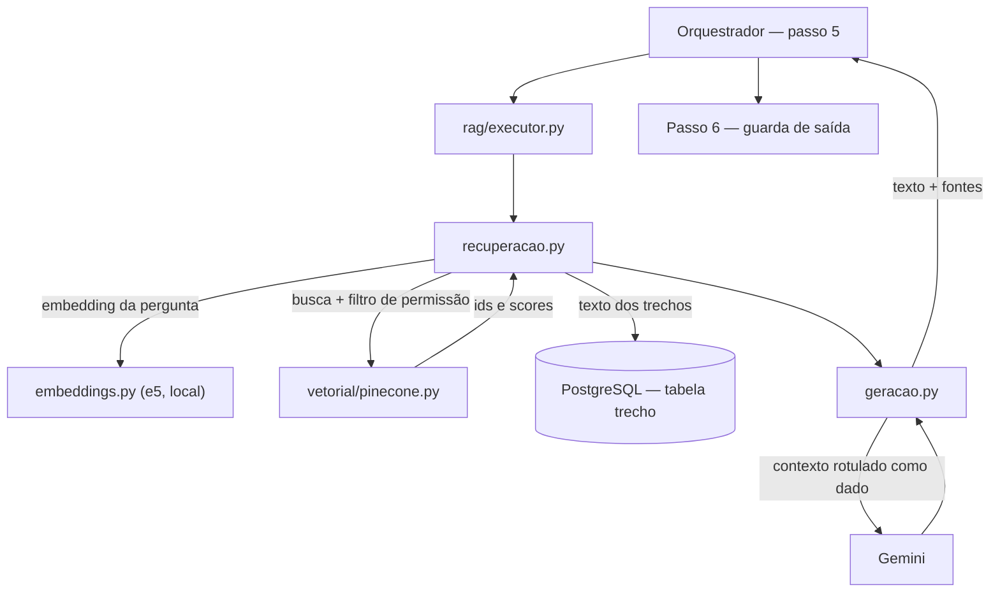
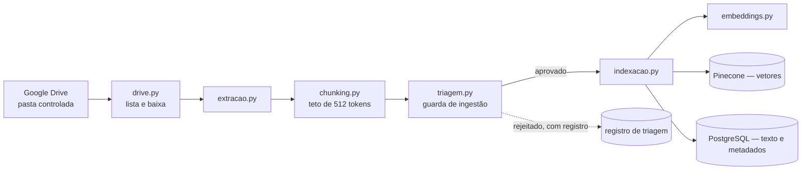
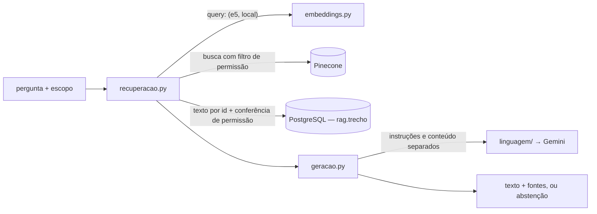

# Caminho alternativo: executor próprio

Este documento é o plano de construção de um **segundo executor** para o agente
de portfólio, capaz de cumprir o papel que hoje cabe ao Copilot Studio sobre o
SharePoint, sem depender do ambiente do parceiro.

Ele **não substitui** a arquitetura descrita em [Arquitetura.md](Arquitetura.md).
Os dois executores coexistem atrás da mesma porta e são selecionados por
configuração. A arquitetura oficial permanece a arquitetura oficial; o que este
documento acrescenta é a garantia de que ela pode ser demonstrada ponta a ponta
mesmo que o provisionamento externo não chegue a tempo.

A visão arquitetural resumida está na seção 13 de
[Arquitetura.md](Arquitetura.md). Aqui ficam as decisões com suas alternativas
descartadas, o desenho dos módulos, a bancada de avaliação, a sequência de ondas
e os riscos do próprio plano.

## 1. Motivação e enquadramento

### 1.1 O problema

A seção 12.2 de [Arquitetura.md](Arquitetura.md) registra quatro dependências
externas em caminho crítico. Duas seguem pendentes no tenant do parceiro:

| Recurso | Necessário para |
|---|---|
| Entra ID — registro de aplicação | Autenticação, perfis e permissões (onda 1) |
| Copilot Studio com Direct Line habilitado | Execução das ações (onda 1 em diante) |

As duas estão na **onda 1**, e as ondas 2 a 5 dependem dela. Enquanto o
provisionamento não ocorre, nenhuma onda fecha com algo demonstrável ponta a
ponta — que é o critério declarado de conclusão de cada uma delas.

O ponto não é atribuir responsabilidade pelo atraso. É reconhecer que a data de
entrega ao Inteli é fixa e não é compartilhada com quem controla o
provisionamento, e que uma dependência nessas condições precisa de um plano de
resposta, não de acompanhamento.

### 1.2 A resposta

Um segundo executor, construído sobre serviços que a equipe provisiona sozinha:
documentos sintéticos no Google Drive, vetorizados e indexados em banco
vetorial, recuperados por similaridade e sintetizados por um modelo de
linguagem — o padrão RAG —, mais uma base estruturada sintética que dá destino
às intenções de transação e às agregações.

A troca é barata porque a arquitetura já a previu. O docstring de
`app/copilot/client.py` declara: *"Se o executor mudar no futuro (outro agente,
outra plataforma), apenas este módulo é substituído."* O acoplamento real são
três pontos — a fábrica `obter_copilot()` em `app/api/deps.py`, o parâmetro do
construtor e a única chamada no orquestrador.

Construir o segundo adaptador transforma essa afirmação em fato verificado, o
que tem valor independente do atraso que a motivou: é a evidência de que a
separação defendida na seção 1.3 de [Arquitetura.md](Arquitetura.md) é real.

### 1.3 O que não muda

Nada do que constitui o produto da equipe é tocado:

- a **ordem invariante** do pipeline (sessão → injeção → abuso → intenção →
  execução → saída → registro);
- as **duas guardas de entrada** e a **guarda de saída**;
- o **catálogo de intenções**, que continua sendo fonte única, com os mesmos
  limiares calibrados e o mesmo classificador medido (acurácia 0,856, macro-F1
  0,851);
- o **registro da interação** e todo o dashboard de análise;
- as **rotinas agendadas**, que continuam entrando pelo mesmo orquestrador;
- o **modelo de dados** e a **interface**.

O executor é o passo 5 dos sete da seção 3 de
[Arquitetura.md](Arquitetura.md) — o passo 4 na numeração do docstring do
orquestrador, que não conta a sessão. Trocá-lo não autoriza mexer nos outros seis, e
qualquer alteração neles durante esta construção deve ser tratada como escopo
separado.

## 2. Decisões

| # | Decisão | Alternativa descartada |
|---|---|---|
| D1 | RAG documental **mais** base estruturada sintética | Só o caminho documental |
| D2 | Entra ID no tenant da própria equipe | Google OAuth; usuários locais seedados |
| D3 | Gemini como modelo de geração | Azure OpenAI no tenant da equipe; Claude API |
| D4 | Pinecone atrás de uma porta `RepositorioVetorial` | Pinecone direto; pgvector |
| D5 | Embeddings locais, reusando o `multilingual-e5-large` | Modelo de embeddings por API |
| D6 | Estado de conversa resolvido no middleware | Manter estado no executor |

### 2.1 D1 — RAG mais base estruturada

Das 26 intenções do catálogo, 10 são da categoria transação e 5 pedem agregação
sobre o portfólio. RAG sobre documento não escreve dado nem calcula indicador.
Um caminho alternativo apenas documental deixaria `Intencao.exige_confirmacao`
como propriedade que nunca dispara e RF05 e RNF02 sem componente que os execute
— exatamente o tipo de lacuna que a seção 11 de [Arquitetura.md](Arquitetura.md)
registra como resolvida no caso do RNF01.

Com tabelas sintéticas no PostgreSQL que já está no `docker-compose.yml`, as
transações escrevem de verdade, a confirmação em dois turnos passa a ser
demonstrável e as agregações que caberiam ao Power BI viram consultas SQL
alimentando o Recharts já previsto na seção 7.

**Custo assumido:** é a maior parte do trabalho deste plano, e cria a obrigação
de coerência descrita em 7.3 — se o cronograma da tabela contradiz o cronograma
do termo de abertura indexado, a demonstração se desfaz na primeira pergunta
cruzada.

### 2.2 D2 — Entra ID no tenant da equipe

A equipe já opera Azure AI Content Safety e Azure Speech em tenant próprio (ver
risco R12). Registrar ali a aplicação e criar os cinco grupos de segurança
remove a dependência do parceiro **sem escrever uma linha de código**:
`app/auth/entra.py`, `app/auth/sessao.py` e `app/auth/permissoes.py` continuam
idênticos, e mudam apenas os identificadores no `.env` — que `app/config.py` já
trata como configuração, e não como constante, precisamente para este caso.

**Alternativas descartadas.** Google OAuth seria coerente com o Drive entrando
na stack, mas obrigaria a reescrever o fluxo de autenticação e a traduzir grupos
por tabela local, já que o Google Workspace não entrega *claims* de grupo
equivalentes — divergência real em relação à arquitetura oficial, e por ganho
nenhum. Usuários locais seedados seriam mais rápidos e perderiam o argumento de
OAuth real, que é parte do que se apresenta.

**Consequência:** sob este caminho, a linha "Entra ID — registro de aplicação"
da seção 12.2 de [Arquitetura.md](Arquitetura.md) deixa de estar pendente. A
linha do Copilot Studio permanece, e é o que este executor contorna.

### 2.3 D3 — Gemini

Provisionamento imediato e camada gratuita suficiente para o volume de um MVP
sobre dado sintético. É o caminho mais curto entre a decisão e algo executando.

**Custo assumido, e é o mais sério deste plano:** adiciona um fornecedor ao
perímetro. A pergunta do usuário e os trechos recuperados passam a sair para o
Google. Isso não se resolve invocando o dado sintético — é registro de risco
obrigatório, tratado em 4.5.

**Alternativa descartada.** Azure OpenAI no tenant da equipe manteria a
narrativa de perímetro intacta, com nenhum fornecedor novo além dos dois que já
estão declarados no R12. Foi preterida pelo prazo de liberação do recurso. Se o
acesso for concedido antes da onda B, a troca é de adaptador em
`app/rag/linguagem/` e de variável de ambiente — a porta existe para isso.

### 2.4 D4 — Pinecone atrás de uma porta

O banco vetorial fica atrás de uma interface `RepositorioVetorial` com dois
adaptadores: Pinecone, que é o padrão, e pgvector sobre o PostgreSQL existente,
que é a reserva.

A abstração custa pouco agora e cobre os três modos de falha comuns num MVP:
esgotar a camada gratuita, latência inaceitável na demonstração, ou a decisão
tardia de não enviar vetores para fora. Nos três casos, trocar passa a ser
mudança de `.env`, e não refatoração no meio de uma onda.

**Custo assumido:** duas implementações para manter, e o adaptador pgvector
precisa ser exercitado pelos testes desde o início, senão é reserva no papel.

### 2.5 D5 — Embeddings locais

`app/pipeline/intencao/modelo.py` já carrega `intfloat/multilingual-e5-large`
para o ramo de embeddings do classificador de intenção, e o comentário logo
abaixo mostra que os prefixos de assimetria da família e5 (`query:` e
`passage:`) já foram tratados — que é justamente onde erra quem usa e5 para RAG
pela primeira vez. A classe `EmbeddingsSentenca`, com encoder em cache, serve o
RAG sem dependência nova.

Ganhos: custo zero, nenhuma chamada externa na indexação e — o que mais importa
para o argumento de perímetro — **o corpus inteiro nunca sai da máquina no
momento de indexar**. Só os trechos efetivamente recuperados alcançam o Gemini,
e só no momento da consulta.

**Custos assumidos.** O limite de 512 tokens do e5 vira restrição dura do
*chunking*: um trecho maior é truncado em silêncio, sem erro, e o sintoma
aparece só como qualidade ruim de recuperação. E a dimensão do índice fica
fixada em 1024 no primeiro `upsert` — trocar de modelo de embeddings depois
obriga a reindexar o corpus inteiro.

### 2.6 D6 — Estado de conversa no middleware

O Copilot Studio mantinha o estado do diálogo do seu lado; é o que o campo
`conversa_externa_id` representa. O executor próprio não tem esse lado, e
`criar_projeto` é explicitamente preenchimento em múltiplos turnos.

A fonte de estado passa a ser a tabela `Interacao`, que já grava todos os turnos
da conversa. O executor lê os últimos turnos da `Conversa` corrente para compor
o contexto. Não é difícil, mas é trabalho que nenhum diagrama mostra, e é a
razão de a porta tratar o identificador externo como opcional (ver 3.1).

## 3. Desenho

### 3.1 A porta `Executor`

```python
@dataclass
class Fonte:
    """Uma referência verificável usada para compor a resposta."""
    documento: str        # nome do arquivo no Drive
    link: str             # URL do documento
    trecho: str           # o texto efetivamente recuperado
    score: float


@dataclass
class RespostaExecutor:
    texto: str
    sessao_externa_id: str | None = None   # None quando o executor não tem sessão própria
    fontes: tuple[Fonte, ...] = ()
    dados: dict | None = None


class Executor(Protocol):
    async def enviar(
        self,
        texto: str,
        intencao_id: str,
        exige_confirmacao: bool,
        sessao_externa_id: str | None = None,
    ) -> RespostaExecutor: ...
```

Três ajustes de contrato, todos pequenos e todos necessários:

1. `conversa_externa_id` vira `sessao_externa_id` e passa a ser **opcional no
   retorno**. Hoje `RespostaCopilot` sempre traz um; o executor próprio não tem
   o que trazer. A consequência no orquestrador é que a chamada a
   `self._conversas.vincular_externa(...)` passa a ser condicional.
2. `fontes` é campo novo. É o que o Copilot como caixa-preta não devolvia e o
   RAG devolve: citação verificável, que a interface renderiza junto da
   resposta.
3. `RespostaCopilot` passa a ser alias de `RespostaExecutor`, e `CopilotClient`
   declara a porta. Nenhuma mudança de comportamento.

A seleção vive em `app/api/deps.py`, que troca `obter_copilot()` por
`obter_executor()`, lendo `settings.executor`. Os testes atuais já dublam o
executor por injeção de dependência, então `tests/unit/test_orquestrador.py`
continua passando sem edição — e é ele que confirma que a troca não afetou
nenhuma invariante de ordem ou de registro.

### 3.2 Estrutura de pastas

```text
src/middleware/app/
├── executor/
│   └── base.py                 # porta Executor, RespostaExecutor, Fonte
├── copilot/
│   └── client.py               # adaptador A — inalterado, passa a declarar a porta
├── rag/                        # adaptador B — caminho documental
│   ├── executor.py             # implementa a porta; roteia por categoria (3.5)
│   ├── ingestao/               # implementada na onda A (3.9)
│   │   ├── fonte.py            # porta FonteDocumentos
│   │   ├── drive.py            # listagem e download da pasta controlada
│   │   ├── extracao.py         # DOCX, XLSX e PPTX -> unidades + metadados declarados
│   │   ├── identificacao.py    # identidade pelo conteúdo e vigência
│   │   ├── permissoes.py       # perfis do parceiro -> perfis do middleware
│   │   ├── chunking.py         # divisão respeitando o teto de 512 tokens
│   │   ├── triagem.py          # guarda de ingestão (4.2)
│   │   ├── registro.py         # rag.arquivo e rag.trecho no PostgreSQL
│   │   └── indexacao.py        # embeddings + upsert + registro dos trechos
│   ├── tabelas.py              # schema rag: registro da ingestão e texto dos trechos
│   ├── vetorial/
│   │   ├── base.py             # porta RepositorioVetorial
│   │   ├── pinecone.py         # adaptador padrão
│   │   ├── pgvector.py         # adaptador de reserva
│   │   └── provisionar.py      # cria e valida o índice (3.8)
│   ├── linguagem/
│   │   ├── base.py             # porta ModeloLinguagem (D3)
│   │   ├── gemini.py           # adaptador padrão
│   │   └── fabrica.py          # seleção por llm_backend
│   ├── embeddings.py           # fachada sobre EmbeddingsSentenca (D5)
│   ├── recuperacao.py          # busca com filtro de permissão na query (4.3)
│   ├── geracao.py              # montagem do prompt, abstenção e citações
│   ├── fluxo.py                # recuperação + geração, com rastreabilidade
│   └── bancada.py              # bancada de avaliação do RAG (5)
└── portfolio/                  # base estruturada sintética
    ├── models.py               # Projeto, Marco, Risco, Problema, RegistroAvanco, ...
    ├── consultas.py            # leitura e agregações
    └── transacoes.py           # escritas, com confirmação em dois turnos
```

`app/portfolio/` fica fora de `app/rag/` de propósito: não é recuperação, é o
sistema de registro sintético. Misturar os dois faria a pasta `rag/` responder a
duas perguntas diferentes, que é o critério de separação usado em toda a seção
8.1 de [Arquitetura.md](Arquitetura.md).

### 3.3 Trajeto de uma consulta documental



O detalhe que não é cosmético: **o Pinecone guarda vetores e identificadores, e
o texto dos trechos fica no PostgreSQL**. A justificativa está em 4.5.

### 3.4 Trajeto da ingestão



A ingestão roda no contêiner `worker`, que já existe e já hospeda o APScheduler.
Não há serviço novo no `docker-compose.yml` — vantagem concreta sobre desenhar
um pipeline de ingestão separado.

Detecção de mudança por `modifiedTime` mais *hash* do conteúdo: reindexar o
corpus inteiro a cada execução desperdiça tempo e, num modelo de embeddings por
API, desperdiçaria dinheiro. Remoção também precisa ser tratada — um documento
apagado do Drive que continua no índice produz resposta com citação para arquivo
que não existe mais.

### 3.5 Roteamento por categoria de intenção

Este é o equivalente, para o executor próprio, do que
[copilot/topicos.md](../copilot/topicos.md) é para o Copilot Studio. As duas
tabelas devem evoluir juntas, e o catálogo continua sendo a fonte única de
ambas.

| Categoria / família | Fonte da resposta | Intenções |
|---|---|---|
| Consulta pontual — registros | Estruturado | `consultar_avanco`, `consultar_cronograma`, `consultar_marcos`, `consultar_riscos`, `consultar_problemas` |
| Consulta pontual — documental | RAG | `consultar_documento_projeto`, `consultar_conceito_gestao` |
| Consulta pontual — híbrida | Estruturado **e** RAG | `consultar_status_projeto`, `consultar_aderencia_normativa` |
| Análise comparativa | Estruturado (agregação SQL) | `comparar_projetos`, `consultar_indicadores_portfolio` |
| Geração de material | Estruturado **e** RAG | `gerar_relatorio_status`, `gerar_previa_diretoria`, `gerar_relatorio_encerramento` |
| Transação | Estruturado (escrita) | as 10 intenções da categoria |
| Alerta | Estruturado (varredura) | `consultar_pendencias` |
| Classe negativa | Nenhuma | `fora_de_escopo`, `tentativa_injecao` — não alcançam o executor |

A regra que resolve a sobreposição: **para registros que existem como tabela, o
estruturado é a fonte de verdade; o RAG responde por prosa, normativos e
justificativas.** Riscos aparecem nos dois lugares — na matriz de riscos do
documento e na tabela —, e sem essa regra o agente responderia coisas diferentes
para a mesma pergunta conforme o caminho que tomasse.

Nas intenções híbridas, os números vêm do estruturado e o texto recuperado entra
apenas como contexto explicativo. O inverso — deixar o modelo extrair número de
documento quando existe tabela — é a receita conhecida de resposta confiante e
errada.

### 3.6 A base estruturada

Entidades mínimas: `Projeto`, `Marco`, `Risco`, `Problema`, `RegistroAvanco`,
`Normativo` e `Pendencia`. Entram por migração Alembic, como qualquer outra
mudança de esquema, em um *schema* separado (`portfolio`) para que fique visível
que são dados sintéticos de demonstração, e não o registro operacional do
middleware.

As transações reusam o que a arquitetura já exige: confirmação prévia sinalizada
por `Intencao.exige_confirmacao`, e registro de origem, autoria e momento
(RF05, RNF02), modelado em DS03.

### 3.7 Configuração nova

Variáveis a acrescentar em `app/config.py` e `.env.example`, no mesmo estilo
comentado do arquivo atual:

| Variável | Papel |
|---|---|
| `executor` | `copilot` ou `proprio` — a única chave que troca o caminho |
| `drive_service_account_json` | Credencial da conta de serviço |
| `drive_pasta_id` | Pasta controlada de onde a ingestão lê |
| `vetorial_backend` | `pinecone` ou `pgvector` |
| `pinecone_api_key`, `pinecone_index`, `pinecone_namespace` | Índice e isolamento |
| `llm_backend` | Adaptador de geração; `gemini` é o único hoje |
| `gemini_api_key`, `gemini_modelo`, `gemini_timeout_seconds` | Geração |
| `rag_top_k`, `rag_score_minimo` | Recuperação; calibrados pela bancada, não arbitrados |
| `chunk_tokens`, `chunk_overlap` | Divisão, limitados pelo teto do e5 |

`rag_top_k` e `rag_score_minimo` seguem a mesma disciplina do limiar de
confiança do catálogo: valor provisório até a bancada existir, derivado por
medição depois.

### 3.8 O índice vetorial provisionado

As quatro variáveis do banco vetorial saíram do papel na issue #285. O índice
existe, e estes são os parâmetros com que foi criado:

| Parâmetro | Valor | Por quê |
|---|---|---|
| Nome | `portfolio-metro` | Um índice por corpus; os ambientes se separam por namespace, não por índice |
| Dimensão | **1024** | `intfloat/multilingual-e5-large` (D5). Constante `DIMENSAO` em `rag/vetorial/base.py` |
| Métrica | **cosine** | `Acerto.score` é definido como cosseno de 0,0 a 1,0, e o e5 entrega vetores normalizados |
| Tipo | `dense` | Sem busca híbrida no MVP |
| Infraestrutura | Serverless, `aws` / `us-east-1` | Única combinação oferecida pelo plano gratuito |
| SDK validado | `pinecone` 10.0.0 | Extra `rag` do `pyproject.toml` |

**Dimensão e métrica são fixadas na criação e não podem ser alteradas.** Trocar
qualquer uma obriga a apagar o índice e reindexar o corpus inteiro — daí o
provisionamento ser um script versionado, `app/rag/vetorial/provisionar.py`, e
não um passo a passo no console:

```powershell
python -m app.rag.vetorial.provisionar            # verifica, não escreve
python -m app.rag.vetorial.provisionar --criar    # idempotente
python -m app.rag.vetorial.provisionar --validar  # upsert, busca e remoção reais
```

Namespaces, dentro do mesmo índice:

| Namespace | Uso |
|---|---|
| `dev` | Desenvolvimento local. É o padrão de `pinecone_namespace` |
| `bancada` | Medições reproduzíveis da onda 2 |
| `adversarial` | Corpus com instrução embutida da seção 4.1. **Nunca** compartilha namespace com a demonstração |
| `demo` | Apresentação ao parceiro |
| `_validacao` | Descartável: o `--validar` escreve, confere e apaga |

O plano gratuito (Starter) comporta 2 GB (~300 mil registros), 2 M *write units*
e 1 M *read units* por mês, 5 índices e 100 namespaces por índice. O corpus
previsto é de dezenas de documentos e milhares de trechos — duas ordens de
grandeza de folga, e o limite que apertaria primeiro seria o de leitura, não o
de armazenamento.

**Uma consequência de perímetro que deixa de ser hipotética.** O Starter só
provisiona em `us-east-1`, fora do Brasil, enquanto Speech e Content Safety
rodam em `brazilsouth`. A seção 4.5 já sustenta o desenho — o índice guarda
vetor, identificador e os três campos de filtro, e o texto fica no PostgreSQL —,
mas a condição declarada em 13.4 de [Arquitetura.md](Arquitetura.md) continua
valendo sem atenuação: **dado exclusivamente sintético** enquanto o índice
estiver nessa região.

### 3.9 A ingestão implementada

A onda A saiu do papel sobre o corpus que o parceiro entregou (seção 7): 84
arquivos soltos numa pasta do Drive, com um LEIA-ME avisando que a
desorganização e as inconsistências são deliberadas. Quatro decisões do código
respondem a isso, e nenhuma estava no desenho original:

| Decisão | Por quê |
|---|---|
| **Identidade pelo conteúdo, nome como conferência** | Cinco arquivos estão fora da convenção `CÓDIGO_TIPO_vN_AAAAMMDD`, e quatro deles são a única cópia do seu conteúdo: o relatório de julho da Sinalização, o cronograma do Monotrilho Ouro, os riscos da Acessibilidade L4 e o balanço de agosto. Tipo e código vêm do título e da tabela de cabeçalho (.docx), da capa (.pptx) e das abas mais a coluna `ID_PROJETO` (.xlsx). Código divergente entre nome e conteúdo põe o arquivo em quarentena, porque é o código que decide quem lê |
| **Só o vigente no índice** | Chave lógica `código_tipo` para o que se substitui (termos, normativos, planilhas, consolidado) e `código_tipo_AAAA-MM` para o que se acumula (relatório de status, balanço). Vence a maior versão, depois a data. Os substituídos ficam registrados, fora do índice |
| **Permissão declarada pelo parceiro** | Cada .docx e .pptx traz `Perfis autorizados` e `Classificação`. Diretoria → `diretoria`, Gerente de Projeto → `lider_projeto`, Equipe → `membro_equipe`; GPM, Auditoria e Consulta Geral não têm equivalente e são ignorados. A planilha de projeto herda a classificação do projeto no consolidado; no consolidado, cada linha leva a da própria linha — é o que mantém o PRJ-2026-012, Restrito, só para a diretoria. Toda dúvida resolve para menos gente |
| **Planilhas linha a linha** | Cada linha vira `COLUNA: valor`, indivisível, com o documento e a aba na linha de contexto do trecho. A regra de 3.5 continua valendo: quando a base estruturada existir, números e agregações saem dela |

**Registro.** O schema `rag` (migração `5b3f0c9a7e21`) guarda uma linha por
arquivo visto, com o destino que ele teve — `indexado`, `substituido`,
`quarentena`, `nao_identificado`, `ignorado` ou `removido` — e o motivo, e o
texto de cada trecho indexado. Um índice único parcial impede duas versões do
mesmo documento indexadas ao mesmo tempo.

**Reindexação por assinatura.** md5 do arquivo, versão do pipeline, permissão
efetiva, nome do projeto, orçamento de trecho e namespace. Uma execução sem
mudança não baixa nem vetoriza nada; uma classificação revista no consolidado
reindexa as planilhas do projeto sem que elas tenham mudado.

**Simulação sobre a pasta real** (`--simular`, 10/09/2026): 84 arquivos → 76
indexados, 7 substituídos (TAP v1 e a cópia da v2 do PRJ-2024-018; o
consolidado de março a julho) e 1 ignorado (o LEIA-ME); 1.883 trechos, o maior
com 350 tokens; 5 observações de nome fora da convenção; nenhum documento em
quarentena.

**Ponta a ponta, com PostgreSQL real** (mesma data, com um índice em memória no
lugar do Pinecone): a primeira execução gravou os 1.883 trechos no banco e no
índice; a segunda não baixou nem vetorizou nada; tirar da pasta o arquivo de
riscos da Acessibilidade L4 tirou os 22 trechos dele dos dois lugares e marcou o
arquivo como `removido`. O e5 large vetorizou 1,2 trecho por segundo na CPU, o
que põe a primeira ingestão completa em cerca de meia hora.

```powershell
python -m app.rag.ingestao --simular     # lê, identifica, divide e tria; não grava nada
python -m app.rag.ingestao               # indexa o que mudou desde a última execução
python -m scripts.buscar_trechos "orçamento do Trecho Sul" --perfil lider_projeto --projetos PRJ-2024-018
```

Fica para depois: o job periódico no `worker` (hoje `NotImplementedError`), o
Prompt Shields na triagem (depende do classificador da onda 2) e a tabela do
pgvector (a imagem `postgres:16-alpine` não tem a extensão).

### 3.10 A resposta implementada

O primeiro fluxo de RAG ponta a ponta liga a recuperação sobre o índice de 3.8
ao modelo de geração da decisão D3. É o trajeto de 3.3 sem o orquestrador na
frente: recebe a pergunta e o escopo de quem pergunta e devolve a resposta com
fontes, ou a abstenção.



| | |
|---|---|
| **Entrada** | Pergunta em linguagem natural e `Escopo` — perfil e projetos de quem pergunta, resolvidos na autenticação, nunca deduzidos pelo fluxo |
| **Saída** | `RespostaRag`: texto, situação (`respondida`, `sem_contexto`, `sem_evidencia`, `nao_fundamentada`), fontes (arquivo, link, localizador, trecho e score) e modelo que respondeu |
| **Dependências** | Índice provisionado (3.8); `rag.trecho` populada pela ingestão (3.9); e5 local; chave do Gemini; extra `rag` do `pyproject.toml` |
| **Módulos** | `rag/recuperacao.py`, `rag/geracao.py`, `rag/linguagem/`, composição em `rag/fluxo.py` |

Decisões do código:

| Decisão | Por quê |
|---|---|
| **Modelo atrás de uma porta própria** (`rag/linguagem/`, `ModeloLinguagem`) | A alternativa descartada na D3 — Azure OpenAI no tenant da equipe — continua possível. Trocar de modelo é um adaptador novo e `LLM_BACKEND` no `.env`; recuperação e montagem do prompt não mudam, e a recuperação não conhece o modelo |
| **Instruções e conteúdo por canais distintos** | As regras vão como instrução de sistema; a pergunta e os trechos, como mensagem, cada trecho delimitado e numerado. Marcas de delimitação que apareçam no texto de um trecho ou na pergunta são neutralizadas antes da montagem, para que um documento não consiga "sair" do bloco de dados (4.4) |
| **Permissão conferida duas vezes** | O filtro na consulta ao índice é o que protege (4.3). A recuperação confere de novo o texto lido do PostgreSQL contra a permissão gravada junto dele: se índice e banco divergirem, o trecho é descartado e a divergência vai para o log |
| **Citação obrigatória e verificada** | Toda afirmação cita o número do documento recebido. Resposta sem citação, ou citando documento que o modelo não recebeu, é descartada. As citações são renumeradas pela ordem de aparição, e `[1]` é sempre a primeira fonte da lista |
| **Novas tentativas só para o transitório** | Cota (429), indisponibilidade (5xx) e tempo esgotado são repetidos com espera crescente; erro de pedido, não. É o risco "limite de taxa do Gemini" da seção 8 |
| **Rastreabilidade por identificadores** | Cada consulta deixa uma linha de log com a situação, o modelo, o perfil, os trechos recuperados com seus scores e os citados. Nunca o texto dos trechos nem a pergunta: o log não vira mais um lugar onde o corpus vive |

**Comportamento sem evidência.** O agente não responde com informação externa
aos documentos recuperados, nem para perguntas gerais, e há três caminhos para a
abstenção:

1. **`sem_contexto`** — nenhum trecho visível ao perfil passou do corte de
   similaridade. O modelo nem é chamado: sem trecho, ele só poderia responder de
   memória;
2. **`sem_evidencia`** — os trechos existem, mas o modelo declarou, pelo
   marcador combinado nas instruções, que eles não sustentam a resposta;
3. **`nao_fundamentada`** — o modelo respondeu sem citação válida, e a resposta
   é descartada.

Nos três casos o usuário recebe a mesma mensagem: *"Não encontrei, nos
documentos disponíveis para o seu perfil, informação suficiente para responder
a essa pergunta."* A igualdade é deliberada — "não existe" e "existe, mas você
não pode ver" precisam ser indistinguíveis, ou a recusa vira oráculo do que há
no corpus. A distinção fica na situação, que vai para o log e para a bancada.
Falha do provedor (`ErroGeracao`) **não** é abstenção: propaga, e quem chama a
trata como falha do executor.

**Parâmetros provisórios.** `RAG_TOP_K=5`, `RAG_SCORE_MINIMO=0.75` e
`GEMINI_MODELO=gemini-3.5-flash`. O corte é baixo de propósito — barra só a
pergunta sem nada parecido no corpus, e a decisão fina de "não há evidência" é
da geração, que lê o texto. Os três valem até a bancada medi-los (seção 5).

```powershell
python -m scripts.perguntar_rag "Qual o custo total estimado do Trecho Sul?" --perfil lider_projeto --projetos PRJ-2024-018
python -m scripts.perguntar_rag "Quem aprova mudança de 15% no orçamento?" --perfil membro_equipe --trechos
python -m app.rag.bancada --saida bancada.md
```

Fica para depois: `rag/executor.py` implementando a porta `Executor` de 3.1 e a
seleção por `settings.executor` no orquestrador; a guarda de saída, que hoje
levanta `NotImplementedError` e é pré-requisito para entregar texto gerado pelo
pipeline; a lista de projetos do usuário, que `UsuarioAutenticado` ainda não
carrega e sem a qual o escopo de líder e membro de equipe só alcança documentos
transversais; e a primeira medição da bancada no namespace `bancada`, que
substitui os valores provisórios acima e as metas de 5.1.

## 4. Segurança

### 4.1 A guarda de saída deixa de ser teórica

A seção 2.1 de [Arquitetura.md](Arquitetura.md) justifica a guarda de saída pelo
ataque que chega dentro de um documento do SharePoint. Como o SharePoint do
parceiro não existe para a equipe, a barreira é hoje um argumento sem
demonstração.

Com o Drive sob controle da equipe, o vetor pode ser **encenado**: um documento
sintético com instrução embutida, depositado na pasta de teste, recuperado pelo
RAG e barrado antes da entrega. É o teste adversarial que a onda 2 pede, com
evidência em vez de raciocínio.

### 4.2 Guarda de ingestão

O caminho alternativo cria um vetor que o oficial não tem: **envenenamento do
índice**. Quem controla o que entra na pasta controla parte do que o modelo lê.

Cria também, pela mesma razão, a possibilidade de uma barreira que o caminho
oficial não pode ter — no oficial, quem indexa é o Copilot, e não há onde
inspecionar. Aqui há: `rag/ingestao/triagem.py` passa o texto extraído pelas
regras determinísticas de injeção e pelo Content Safety **antes** de o trecho
existir no índice.

Duas regras de projeto:

- **rejeição é registrada, nunca silenciosa.** Um trecho descartado sem registro
  transforma a ingestão em caixa-preta, e a diferença entre "o documento não
  fala disso" e "o trecho foi barrado" desaparece justamente na hora de
  investigar;
- **a triagem não substitui a guarda de saída.** São barreiras em profundidade,
  posicionadas em momentos diferentes: uma vê o documento, a outra vê a
  resposta. O que passar pela primeira ainda encontra a segunda.

### 4.3 Permissão entra na query

Os metadados de projeto e de perfil vão no `upsert`, e o filtro é aplicado pelo
repositório vetorial **na busca**, não depois de recuperar.

Filtrar depois é falha de segurança, não ineficiência: os `k` trechos
recuperados já conteriam o que o usuário não pode ver, e bastaria um erro de
montagem de prompt para que vazassem. O controle de acesso do middleware está em
`api/deps.py` e não enxerga o interior do executor — se o executor recuperar
demais, ninguém barra.

Isso reafirma a regra da seção 6 de [Arquitetura.md](Arquitetura.md) num
contexto novo: quem barra é o servidor, e agora também o índice.

### 4.4 Contexto recuperado é dado, nunca instrução

A decisão 4 da seção 10 de [Arquitetura.md](Arquitetura.md) — "entrada como
dado, nunca como instrução" — passa a valer para uma segunda coisa: os trechos
recuperados entram no prompt do Gemini delimitados e rotulados como conteúdo não
confiável, jamais concatenados às instruções do sistema.

A diferença em relação ao caminho oficial é que ali o rótulo viajava em
metadados de uma *activity* do Direct Line, e aqui a fronteira é montada pela
própria equipe em `geracao.py`. Ganha-se controle e ganha-se responsabilidade: a
fronteira que antes o protocolo impunha agora depende de código próprio, e por
isso precisa de teste próprio.

### 4.5 Perímetro e riscos novos

O caminho alternativo acrescenta dois destinos de dado ao perímetro declarado em
3.3.1.1 de [Projeto.md](Projeto.md):

| Serviço | O que sai | Quando |
|---|---|---|
| Gemini (Google) | Pergunta do usuário e trechos recuperados | A cada consulta |
| Pinecone | Vetores e metadados de identificação | Na indexação e na busca |

Duas mitigações de desenho, não de discurso:

- **os embeddings são calculados localmente** (D5), de modo que o corpus não sai
  para ser indexado;
- **o texto dos trechos não é gravado no metadado do Pinecone.** O índice guarda
  vetor, identificador do trecho e os campos usados no filtro; o texto vive numa
  tabela do PostgreSQL e é lido de lá depois da busca. Além de reduzir a
  exposição, é o que torna o adaptador pgvector uma troca de fato e não uma
  reescrita.

Vetor não é texto, mas também não é anonimização — a literatura de inversão de
embeddings é suficiente para que a afirmação contrária não se sustente numa
arguição. A condição declarada continua sendo **dado exclusivamente sintético**,
como já vale para o caminho oficial enquanto Content Safety e Speech não forem
reprovisionados.

Dois riscos a registrar, com numeração a confirmar contra a matriz vigente:

- exposição de conteúdo consultado ao provedor de geração;
- exposição de representações vetoriais e metadados ao provedor do índice.

Ambos entram **nos dois lugares** onde a matriz de risco vive: seção 2.6 de
[Projeto.md](Projeto.md), com identificação, avaliação e plano de resposta, e
seção 4 de [GestaoProjeto.md](GestaoProjeto.md), com a evolução entre sprints.
Atualizar apenas um dos dois é o erro recorrente.

## 5. Bancada de avaliação

### 5.1 Duas métricas, não uma

"O RAG está funcionando" não é afirmação verificável. Recuperação ruim e geração
ruim produzem o mesmo sintoma — resposta errada — e pedem correções opostas:
mexer no *chunking*, no `k` e no modelo de embeddings, ou mexer no prompt e no
modelo de geração. Uma métrica única esconde qual dos dois está quebrado.

| Indicador | O que mede | Meta provisória |
|---|---|---|
| Recall@k | O trecho correto está entre os `k` recuperados | ≥ 0,90 em k = 5 |
| Fidelidade | Nenhuma afirmação da resposta sem apoio no trecho citado | ≥ 0,95 |
| Abstenção correta | O agente recusa quando a resposta não está no corpus | ≥ 0,80 |

O terceiro indicador existe porque, num agente corporativo, inventar é pior que
não responder. Ele é o equivalente, na camada de geração, do que
`RECUSADA_BAIXA_CONFIANCA` já é na camada de classificação.

As metas são provisórias no mesmo sentido de `LIMIAR_CONFIANCA_PROVISORIO`:
valem até a primeira medição, e depois são substituídas pelo que a bancada
mostrar ser alcançável.

### 5.2 O conjunto de referência

Perguntas com documento-fonte esperado, escritas **antes** de o RAG existir.

O princípio é o mesmo que a seção 2.2 de
[glossario-dominio.md](glossario-dominio.md) já estabelece para o indicador de
termos de domínio: o conjunto define o que conta como acerto antes de haver o
que medir, e não depois, o que preserva a validade do indicador contra ajuste
retroativo. Escrever as perguntas depois de ver o que o sistema acerta produz
número bonito e sem informação.

Cobertura mínima: todas as intenções documentais e híbridas; perguntas cuja
resposta está distribuída em mais de um documento; perguntas cuja resposta não
está no corpus, para medir abstenção; e perguntas cuja resposta correta depende
da permissão de quem pergunta.

O conjunto está em `src/middleware/dados/bancada-rag.csv`: 26 perguntas sobre o
corpus de 3.9, cada uma com o perfil e os projetos de quem pergunta, os
documentos esperados, os termos que a resposta deve conter e os que não pode
conter. Cobre as cinco situações acima — documento de projeto, normativo,
resposta distribuída, pergunta fora do corpus e pergunta cuja resposta depende
do perfil — e inclui casos que só se acertam pela vigência (o custo do TAP v3
do PRJ-2024-018, e não o da v2 substituída) e pelo período (o relatório de
julho, e não o de agosto). `python -m app.rag.bancada` mede recall@k,
abstenção correta, acerto de conteúdo e vazamento de permissão, e reporta a
distribuição de scores que calibra `rag_score_minimo`. A fidelidade é revisão
humana sobre o detalhe que `--saida` escreve, com cada resposta ao lado dos
trechos citados: um juiz automático seria o mesmo tipo de modelo julgando a si
mesmo.

### 5.3 Relação com a bancada existente

A bancada do classificador de intenção (F21, F22) mede outra coisa e continua
valendo sem alteração. A bancada do RAG é irmã dela e deve seguir o mesmo
padrão: comando próprio, conjunto que nunca participou de ajuste, resultado
reportado com número no documento.

## 6. Ondas de construção

A sequência é de dependência, não de importância. Cada onda fecha com algo
verificável.

| Onda | Escopo | Critério de pronto |
|---|---|---|
| 0. Porta | Interface `Executor`, `obter_executor()` por configuração, Entra ID no tenant da equipe, **corpus sintético** | Login sem o parceiro; executor selecionável por `.env`; suíte atual verde sem edição |
| A. Índice | Conta de serviço, extração, *chunking*, triagem, embeddings, `upsert`, tabela de trechos, job no `worker` | `python -m app.rag.ingestao` reporta documentos e trechos indexados; busca por linha de comando devolve o trecho esperado |
| B. Resposta | `rag/executor.py` atendendo as intenções documentais pelo orquestrador, com fontes; guarda de saída sobre o texto gerado; bancada | Consulta documental ponta a ponta na interface, com citação clicável e os três indicadores medidos |
| C. Portfólio | Tabelas, seed coerente com o Drive, consultas, agregações, transações com confirmação | As quatro categorias do catálogo demonstráveis; dashboard com dado real do caminho alternativo |
| D. Documentação | Seção 13 de Arquitetura.md, coluna em `topicos.md`, riscos, matriz de correlação por caminho, **comparação medida entre os executores** | O caminho alternativo documentado no mesmo padrão do oficial |

Duas observações.

A **onda 0 tem o corpus dentro dela**, e não como preparação informal. Sem
corpus não há o que indexar, e a onda A trava esperando um insumo que ninguém
assumiu.

A **onda D não é acabamento.** A comparação medida entre os dois executores —
latência, custo por consulta, verificabilidade da resposta, superfície de
controle — é o que transforma um plano de contingência em contribuição de
engenharia, e é o material mais forte que este caminho produz para a
apresentação.

## 7. Corpus sintético

> **Atualização da onda A.** O corpus não precisou ser escrito pela equipe: o
> parceiro entregou 84 arquivos sintéticos — 33 .docx, 6 .pptx, 44 .xlsx e um
> LEIA-ME —, cobrindo os 18 projetos do consolidado e 8 normativos, gerados por
> script e com inconsistências plantadas de propósito, cujo gabarito não está na
> pasta. As subseções abaixo registram o plano original; o que valeu na ingestão
> está em 3.9. O conjunto de referência da bancada (5.2) continua sendo trabalho
> da equipe, e continua devendo ser escrito antes de haver o que medir.

### 7.1 É o caminho crítico

Escrever de sessenta a oitenta documentos plausíveis de gestão de portfólio é
mais trabalho que qualquer módulo deste plano, e é sistematicamente subestimado
porque não parece engenharia. Se atrasar, as ondas A e B atrasam junto, e a
bancada de avaliação não pode nem começar.

### 7.2 Composição

Oito a doze projetos fictícios. Por projeto:

| Documento | Serve a |
|---|---|
| Termo de abertura | `consultar_documento_projeto`, `atualizar_termo_abertura` |
| Cronograma com marcos | `consultar_cronograma`, `consultar_marcos` |
| Matriz de riscos | `consultar_riscos` |
| Ata de reunião | Perguntas cuja resposta está distribuída |
| Relatório de status mensal | `gerar_relatorio_status`, `consultar_status_projeto` |

Mais os transversais: três a cinco normativos e um manual de metodologia, que
sustentam `consultar_aderencia_normativa` e `consultar_conceito_gestao`.

Os códigos seguem o vocabulário já fixado em
[glossario-dominio.md](glossario-dominio.md) — `PRJ-2024-018`, `NOR-00-223` —,
o que dá coerência ao corpus e, de quebra, exercita o canal de voz com o mesmo
material.

### 7.3 Como gerar sem contaminar a bancada

**O seed estruturado é a fonte; os documentos são derivados dele.** Gerar os dois
lados de forma independente produz contradição garantida entre a tabela e o
texto, e a contradição só aparece na demonstração, diante de quem avalia.

A geração por modelo de linguagem a partir do glossário é legítima e é o único
jeito de produzir esse volume no prazo. A revisão humana de coerência numérica é
obrigatória: datas, percentuais e severidades gerados sem revisão contaminam a
bancada inteira, porque passam a ser a resposta "correta" contra a qual o
sistema é medido.

Os documentos com instrução embutida do teste adversarial (4.1) ficam em pasta
**separada** da pasta controlada de ingestão, e entram no índice apenas quando o
teste é executado. Um documento envenenado esquecido na pasta de produção é
autossabotagem.

## 8. Riscos do plano

| Risco | Sintoma | Resposta |
|---|---|---|
| Corpus subestimado | Onda A parada esperando documentos | Corpus é entregável da onda 0, com dono e prazo |
| Truncamento silencioso no e5 | Recuperação ruim sem nenhum erro | Teto de 512 tokens verificado no *chunking*, com teste |
| Dimensão do índice fixada | Trocar de embeddings exige reindexar tudo | Decidir o modelo antes do primeiro `upsert` |
| Limite de taxa do Gemini | Bancada falha pela metade e parece defeito do RAG | *Backoff* desde a primeira versão da bancada |
| Divergência entre os dois caminhos | Documentação apodrece em duas sprints | Catálogo é fonte única; `topicos.md` ganha coluna, nunca arquivo irmão |
| pgvector como reserva de papel | Falha justamente quando é acionado | Adaptador exercitado pelos testes desde a onda A |
| Escopo invadindo o pipeline | Guardas ou classificador alterados "de passagem" | Só o passo do executor muda; qualquer outra alteração é escopo separado |

## 9. Impacto na documentação

| Arquivo | O que muda |
|---|---|
| [Arquitetura.md](Arquitetura.md) | Seção 13, com a porta, os adaptadores e o que muda nas barreiras |
| [copilot/topicos.md](../copilot/topicos.md) | Coluna com a fonte de resposta no executor próprio, conforme 3.5 |
| [Projeto.md](Projeto.md) | Riscos novos em 2.6; perímetro em 3.3.1.1; matriz de correlação de 3.4 passa a distinguir os dois caminhos |
| [GestaoProjeto.md](GestaoProjeto.md) | Seção 4, evolução dos riscos novos entre sprints |
| [Manual-instalacao.md](Manual-instalacao.md) | Variáveis de ambiente novas e o comando de ingestão |
| `.env.example` | As chaves de 3.7, comentadas no estilo do arquivo |
| README.md | Apenas o apontamento; nenhum detalhe técnico |

## 10. O que este caminho não resolve

Registrar os limites é parte de entregá-lo com honestidade.

- **Não valida a integração com o Copilot Studio.** O adaptador Direct Line
  continua com `NotImplementedError`, e o contrato de `topicos.md` segue sem
  verificação contra o ambiente real.
- **Não exercita a governança de conectores.** `copilot/conectores.md` descreve
  uma defesa em profundidade que só existe do lado do parceiro.
- **Não mede desempenho em volume real.** Um corpus sintético de dezenas de
  documentos não antecipa o comportamento sobre uma biblioteca corporativa.
- **Não substitui o Power BI.** As agregações sobre a base sintética demonstram
  a capacidade; não reproduzem os indicadores oficiais do portfólio.
- **Não dispensa o reprovisionamento no tenant do parceiro** para qualquer uso
  com dado real. A condição declarada de dado sintético continua valendo, e
  passa a valer também para os dois serviços acrescentados em 4.5.
