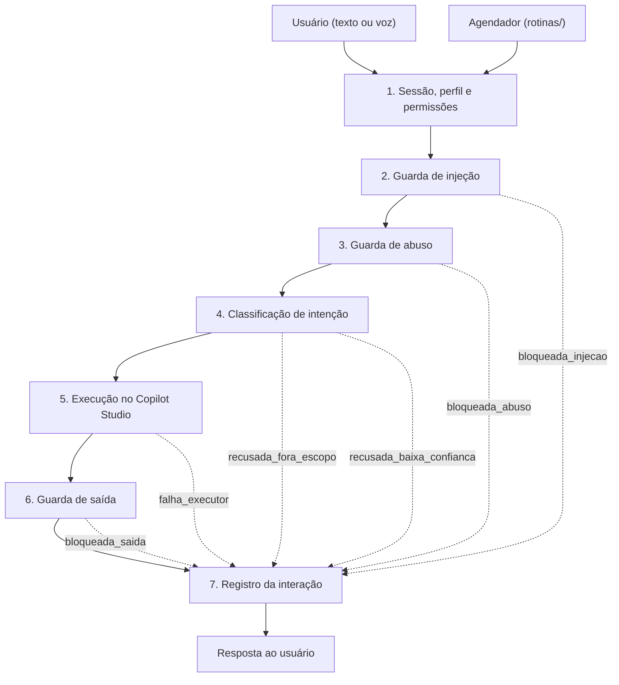
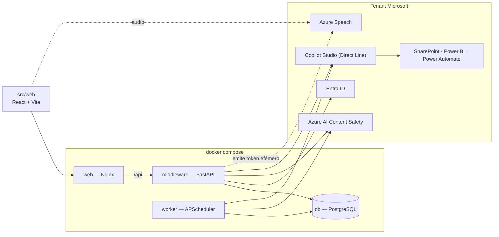

# Arquitetura da Solução — Agente de Portfólio do Metrô

Este documento descreve a arquitetura da solução e a estrutura de pastas que a
implementa. A proposta posiciona um **middleware próprio** entre o usuário e o
**Copilot Studio**, que atua como executor de ações no ecossistema Microsoft do
Metrô (SharePoint, Power BI, Power Automate).

O escopo foi revisado: o middleware deixa de ser uma camada de passagem
invisível e passa a ser o produto, com interface web própria, dados que são
consultados e não apenas escritos, e um processo que executa sem ninguém na
frente da tela.

## 1. Visão geral

O usuário nunca fala diretamente com o Copilot. Toda entrada — digitada,
ditada ou disparada por uma rotina agendada — passa pelo middleware, que cumpre
cinco papéis:

1. **Proteger contra prompt injection** — barra tentativas de manipular o
   agente, combinando filtros por padrões conhecidos, um classificador por
   modelo e o envio da entrada do usuário sempre como dado rotulado, nunca
   concatenada a instruções.
2. **Proteger contra prompts maliciosos** — barra o uso indevido do agente
   corporativo por um usuário legítimo e autenticado, o que é um problema
   distinto de injeção e recebe tratamento distinto.
3. **Registrar intenções** — mapeia cada mensagem para o catálogo oficial de
   intenções e persiste a interação, qualquer que tenha sido o desfecho.
4. **Analisar os dados de intenções** — transforma esse registro em recortes
   que orientam a evolução do catálogo e a operação de segurança, disponíveis
   apenas a quem tem permissão para vê-los.
5. **Executar rotinas** — prompts pré-programados que disparam em datas
   planejadas, como um relatório para a diretoria todo dia 5.

O Copilot Studio, configurado no tenant Microsoft do parceiro, recebe o prompt
já validado com a intenção resolvida e executa a ação correspondente (buscar e
escrever documentos, consultar dados, disparar fluxos) por meio de conectores
com permissões mínimas.

### 1.1 Trajeto de uma mensagem

A ordem das etapas é invariante de segurança e vive no orquestrador. Toda
saída, inclusive as bloqueadas, grava exatamente um registro — é esse registro
que sustenta o terceiro e o quarto papéis acima.



### 1.2 Componentes e serviços



O `worker` não chama a API por HTTP: ele importa o mesmo orquestrador em
processo. É o mesmo código, acionado por um gatilho diferente — ver
[seção 4](#4-rotinas-agendadas).

### 1.3 Por que essa separação

| Ganho | Custo assumido |
|---|---|
| Controle e auditoria totais sobre o que entra e sai do Copilot | Latência extra (dois saltos de rede + inferência) |
| Catálogo de intenções como ativo próprio, independente do executor | Classificação de intenção duplicada com o *topic matching* do Copilot |
| Controle de acesso por perfil aplicado antes de qualquer ação | Dois ambientes para operar e versionar |
| Registro completo das interações, base para a análise de intenções | Banco próprio para manter, migrar e proteger |
| Interface própria: rotinas, histórico e dashboard que o Copilot não oferece | Experiência nativa do Copilot (ex.: canal Teams) deixa de ser aproveitada |

Sobre a duplicação de classificação: a decisão é que **o middleware é a fonte de
verdade** — ele classifica e envia a intenção já resolvida; os tópicos do
Copilot funcionam apenas como mapeamento de ação (ver
[copilot/topicos.md](../copilot/topicos.md)).

## 2. As barreiras de segurança

*Prompt injection* e prompt malicioso são features separadas porque são ataques
diferentes, com alvos diferentes. Tratá-los no mesmo módulo produziria uma
política única para dois problemas que pedem respostas opostas.

| | Guarda de injeção | Guarda de abuso |
|---|---|---|
| **Alvo do ataque** | O sistema | A organização ou pessoas |
| **Exemplos** | Sequestrar o papel do assistente, extrair o prompt de sistema, fazer o agente ignorar regras, exfiltrar dado por caminho não autorizado | Pedir conteúdo abusivo, tentar engenharia social sobre um colega, usar o agente corporativo para fim alheio ao trabalho |
| **Resposta ao usuário** | Bloqueio seco, sem revelar o motivo | Recusa orientativa |
| **Tratamento interno** | Alerta de segurança | Registro nominal — o usuário é autenticado e conhecido |
| **Módulo** | `pipeline/guardas/injecao/` | `pipeline/guardas/abuso/` |

Há uma terceira classe que não deve ser confundida com nenhuma das duas:
`fora_de_escopo` é um pedido **legítimo** que o agente não atende ("qual a
previsão do tempo?"). Não é ataque nem abuso — é lacuna de produto, é uma
classe treinada do catálogo, e alimenta o backlog de novas intenções
(ver [seção 5](#5-registro-e-análise-de-intenções)).

### 2.1 A guarda de saída

Com o Copilot Studio lendo documentos do SharePoint, o ataque mais plausível
não chega pelo campo de texto: chega **dentro de um documento**. Alguém deposita
na biblioteca um arquivo com instruções embutidas, o Copilot o recupera para
compor a resposta, e a instrução volta ao usuário como se fosse conteúdo
legítimo. É a chamada injeção indireta.

Verificar apenas a entrada não cobre esse vetor, porque a entrada é inocente.
Por isso `pipeline/guardas/saida.py` avalia a resposta do Copilot antes de
entregá-la. É a única barreira posicionada para enxergar o problema.

## 3. Ordem das etapas

A ordem abaixo está codificada no orquestrador e não deve ser reordenada:

1. **sessão** — resolve identidade, perfil e permissões antes de qualquer
   processamento;
2. **guarda de injeção** — regras determinísticas primeiro, baratas e
   versionadas no repositório; depois o classificador por modelo. As duas
   camadas são complementares e nenhuma substitui a outra;
3. **guarda de abuso** — categorias de conteúdo mais as políticas de uso
   corporativo definidas pela equipe;
4. **classificação de intenção** — contra o catálogo, com limiar de confiança
   **por intenção**, porque errar uma transação custa mais que errar uma
   consulta;
5. **execução** — o prompt validado segue ao Copilot como dado rotulado, com a
   intenção em metadados;
6. **guarda de saída** — avalia a resposta antes da entrega;
7. **registro** — persiste a interação completa.

As duas guardas de entrada vêm antes da classificação porque uma mensagem
barrada não precisa ser classificada, e porque o classificador pode ser uma
chamada externa: barrar antes evita enviar conteúdo hostil a mais um serviço.

## 4. Rotinas agendadas

Uma rotina é um prompt gravado que executa sem ninguém na frente da tela. Isso
cria dois riscos que não existem no chat, e duas decisões de projeto existem
para fechá-los.

**A rotina não pode ser desvio das guardas.** Se o agendador chamasse o Copilot
diretamente, bastaria cadastrar uma rotina com um prompt de injeção para
contornar toda a proteção — e ela rodaria periodicamente, sem testemunha. Por
isso `rotinas/execucao.py` entra pelo **mesmo orquestrador**, apenas com
`canal=rotina`. O agendador é uma porta de entrada a mais, no mesmo corredor,
não um atalho ao lado dele.

**A rotina não pode ser escalada de privilégio.** Ela executa sob a identidade
e as permissões do dono, resolvidas **na execução** e não no cadastro. Se o dono
perder acesso a um projeto, a rotina perde junto no disparo seguinte.

A validação do prompt acontece em dois momentos. No cadastro, com o usuário
presente, ele passa pelas guardas e pelo classificador: se não resolver numa
intenção do catálogo, o cadastro é recusado ali, com explicação — falhar cedo,
enquanto há alguém para corrigir. Na execução, tudo é reavaliado, porque o
catálogo e as permissões podem ter mudado desde então.

O resultado é entregue no próprio app: cada disparo produz uma `ExecucaoRotina`
ligada à `Interacao` correspondente, e a tela de rotinas exibe o histórico com
status. Não depende de e-mail, Teams ou integração externa para funcionar.

Dois detalhes operacionais que o agendador precisa tratar explicitamente:

- **fuso** — "todo dia 5 às 8h" significa 8h em `America/Sao_Paulo`. Um *cron*
  em UTC dispara na hora errada. O fuso é campo da rotina, não constante do
  sistema;
- **disparo perdido** — se o worker estiver fora do ar no horário, o padrão do
  APScheduler é descartar o disparo ou reexecutar em rajada ao voltar.
  `coalesce` e `misfire_grace_time` são o que impede o relatório de sair três
  vezes seguidas.

## 5. Registro e análise de intenções

Registro e análise são duas features, mas formam um circuito só: o que o
dashboard revela deve voltar como mudança no catálogo. Sem esse retorno, a
análise vira relatório e o catálogo envelhece.

| Recorte | Decisão que habilita |
|---|---|
| Volume por intenção, por período | Mostra o que o agente realmente faz — e quais das 27 classes nunca são acionadas |
| Distribuição de desfechos | Saúde geral: quanto é atendido, quanto é bloqueado, quanto falha |
| Série de bloqueios por guarda | Indicador de segurança; um pico em injeção é incidente, não estatística |
| Agrupamento de `fora_de_escopo` | **Backlog de novas intenções** — o que os usuários pedem e o agente não faz |
| Agrupamento de `baixa_confianca` | Onde o classificador precisa de mais exemplos de treino |
| Confiança média por intenção | Aponta classes confundidas entre si; casa com a matriz de confusão exigida pelo RNF03 |
| Recorte por perfil e por canal | Como cada perfil usa o agente de forma diferente, e quanto vem por voz |
| Latência p50 / p95 | O custo do pedágio, mensurável; sustenta o argumento de desempenho |

Para o volume esperado de um MVP, agregação em SQL sobre a tabela de interações
é suficiente, com índices em `(criada_em)`, `(intencao_id, criada_em)` e
`(desfecho, criada_em)`. Vista materializada apenas se o dashboard começar a
pesar — não antecipar.

## 6. Perfis e permissões

Duas dimensões independentes, resolvidas em `auth/permissoes.py` a partir de
*claims* de grupo do Entra ID. Nenhuma lista de usuários vive no código.

| Dimensão | Valores | Governa |
|---|---|---|
| Perfil | `DIRETORIA`, `LIDER_PROJETO`, `MEMBRO_EQUIPE` | Escopo de dados e profundidade da resposta |
| Permissão | `VER_INTENCOES`, `GERIR_ROTINAS` | Acesso ao dashboard e à gestão de rotinas |

A separação é deliberada: um líder de projeto pode ou não ver o dashboard de
intenções, e isso não muda como o agente responde às perguntas dele sobre o
portfólio. Amarrar as duas coisas num único enum obrigaria a criar perfis
artificiais para cada combinação.

Regra que vale sem exceção: **o frontend esconde rotas por conveniência; quem
barra é o backend.** Uma rota escondida no React é decoração de interface, não
controle de acesso.

## 7. Tecnologias

| Camada | Escolha | Por quê |
|---|---|---|
| Interface | React 18 + TypeScript + Vite (SPA estática) | Nenhum runtime JS em produção; o Python segue sendo o único servidor de aplicação da equipe |
| Estilo e componentes | Tailwind CSS + primitivos acessíveis | Responsivo por breakpoint, exigência de mobile e desktop |
| Estado de servidor | TanStack Query | Cache e revalidação do histórico e das execuções de rotina |
| Gráficos | Recharts | Dashboard de intenções |
| API | FastAPI (Python 3.12) + Pydantic v2 | Base já existente do middleware |
| Autenticação | Entra ID, Authorization Code + PKCE no FastAPI | Token fora do navegador sem o custo de um segundo runtime |
| Persistência | SQLAlchemy 2 (async) + asyncpg + Alembic | O esquema passa a mudar em várias frentes; versionar é o que permite reverter |
| Banco | PostgreSQL 16 | Registro de interações e agregações do dashboard |
| Agendador | APScheduler 3, jobstore SQLAlchemy | Agenda persistida no banco que já existe; sem Redis, sem broker |
| Guardas (modelo) | Azure AI Content Safety | Prompt Shields cobre injeção direta e indireta; as categorias de conteúdo cobrem abuso. Uma API para as duas features, dentro do tenant homologado |
| Classificação de intenção | Embeddings + classificador supervisionado | Devolve probabilidade *calibrada*, requisito do limiar por intenção já previsto no catálogo |
| Voz | Azure Speech, token efêmero emitido pelo backend | Transcrição parcial em tempo real, chave nunca exposta, áudio dentro do perímetro do parceiro |
| Executor | Copilot Studio via Direct Line | Inalterado em relação ao escopo anterior |
| Testes | pytest, pytest-asyncio, Vitest, Testing Library | Espelham a separação backend/frontend |

Duas escolhas merecem justificativa mais longa, porque a alternativa óbvia foi
descartada.

**FastAPI como BFF, em vez de um runtime Node.** O argumento clássico para
adotar Next.js é que numa SPA o token OAuth fica no navegador. Mas o fluxo
Authorization Code pode ser executado pelo próprio FastAPI, que grava a sessão
num cookie `httpOnly` + `SameSite=Strict`; o React nunca vê um `access_token`.
Obtém-se a mesma propriedade de segurança sem adicionar um segundo servidor de
aplicação — e com o efeito colateral de manter `api/deps.py` como ponto único
de resolução de identidade e permissão.

**Azure Speech, em vez da Web Speech API do navegador.** A API nativa seria
gratuita e sem infraestrutura, mas envia o áudio a servidores de terceiros fora
do tenant do parceiro. O microfone seria o primeiro furo no argumento de
confidencialidade da solução (ver [seção 11](#11-consequências-em-aberto)).

## 8. Estrutura de pastas

```text
g02/
├── src/
│   ├── middleware/                   # Backend (Python + FastAPI)
│   │   ├── app/
│   │   │   ├── main.py               # Entrypoint da API
│   │   │   ├── worker.py             # Entrypoint do agendador
│   │   │   ├── config.py             # Configurações via variáveis de ambiente
│   │   │   ├── api/                  # Porta de entrada HTTP
│   │   │   │   ├── deps.py           # Sessão, perfil e permissões
│   │   │   │   └── routes/           # auth, chat, conversas, intencoes, rotinas, voz, health
│   │   │   ├── auth/                 # Fluxo OAuth do Entra ID e sessão
│   │   │   │   ├── entra.py          # Authorization Code + PKCE
│   │   │   │   ├── sessao.py         # Cookie httpOnly, SameSite=Strict
│   │   │   │   └── permissoes.py     # Claims de grupo -> Perfil + Permissao
│   │   │   ├── pipeline/             # Coração da solução
│   │   │   │   ├── orquestrador.py   # Encadeia as etapas e decide o destino
│   │   │   │   ├── desfechos.py      # Vocabulário fechado das decisões
│   │   │   │   ├── respostas.py      # Textos das recusas
│   │   │   │   ├── guardas/
│   │   │   │   │   ├── injecao/      # Ataque AO agente: regras + classificador
│   │   │   │   │   ├── abuso/        # Uso indevido DO agente: políticas + classificador
│   │   │   │   │   └── saida.py      # Injeção indireta vinda da resposta
│   │   │   │   └── intencao/         # Catálogo e classificador de intenções
│   │   │   ├── rotinas/              # Prompts agendados
│   │   │   │   ├── agendador.py      # APScheduler com jobstore no banco
│   │   │   │   ├── execucao.py       # Executa a rotina PELO orquestrador
│   │   │   │   └── validacao.py      # Valida o prompt no momento do cadastro
│   │   │   ├── analytics/            # Análise dos dados de intenções
│   │   │   │   ├── consultas.py      # Agregações SQL
│   │   │   │   └── metricas.py       # Séries e recortes do dashboard
│   │   │   ├── voz/                  # Emissão do token efêmero do Azure Speech
│   │   │   ├── copilot/              # Cliente Direct Line (único ponto que conhece o Copilot)
│   │   │   ├── persistence/          # Modelos, sessão do banco e repositórios
│   │   │   └── schemas/              # Contratos Pydantic de request/response
│   │   ├── migrations/               # Migrações Alembic
│   │   ├── tests/
│   │   │   ├── unit/                 # Uma suíte por guarda, catálogo e agendador
│   │   │   └── integration/          # Fluxo completo com os serviços externos dublados
│   │   ├── pyproject.toml
│   │   ├── Dockerfile
│   │   └── .env.example
│   │
│   └── web/                          # Frontend (React + TypeScript + Vite)
│       ├── src/
│       │   ├── rotas.tsx
│       │   ├── paginas/              # Chat, Historico, Intencoes, Rotinas
│       │   ├── componentes/          # chat/, graficos/, ui/
│       │   ├── hooks/                # useConversa (SSE), useMicrofone (Speech SDK)
│       │   ├── servicos/             # Cliente HTTP tipado da API
│       │   └── tipos/
│       ├── vite.config.ts
│       ├── package.json
│       ├── Dockerfile
│       └── nginx.conf                # Estáticos + proxy /api -> middleware
│
├── copilot/                          # Lado Copilot Studio (configuração versionada)
│   ├── solucao/                      # Exports da solution do Copilot Studio
│   ├── topicos.md                    # Contrato intenção -> tópico/ação
│   └── conectores.md                 # Conectores habilitados e permissões (governança)
│
├── infra/
│   └── docker-compose.yml            # web + middleware + worker + db
│
└── documentos/                       # Documentação do projeto (este arquivo incluído)
```

`src/middleware/` mantém o nome: ele continua literalmente mediando entre a
interface e o Copilot. O que mudou é que deixou de ser a única frente de
código.

### 8.1 `src/middleware/` — o backend

Cada pasta responde a uma pergunta distinta:

- **`api/`** — *quem pode falar comigo?* As rotas conectam HTTP ao pipeline sem
  conter lógica de PLN. `deps.py` resolve sessão, perfil e permissões **antes**
  de qualquer processamento.
- **`auth/`** — *como sei quem é essa pessoa?* Concentra o fluxo OAuth contra o
  Entra ID, a sessão em cookie e a tradução de *claims* de grupo em perfil e
  permissões. Fica separado de `api/` porque é lógica de identidade, não de
  transporte.
- **`pipeline/`** — *essa mensagem é segura e o que ela quer?* As três etapas de
  entrada (`guardas/injecao/`, `guardas/abuso/`, `intencao/`) mais a guarda de
  saída são módulos independentes, encadeados pelo `orquestrador.py` em ordem
  fixa. A separação permite testar cada etapa isolada e trocar implementações
  sem tocar no resto.
- **`rotinas/`** — *o que roda sozinho?* Agendamento, validação e execução dos
  prompts pré-programados. Note que `execucao.py` depende de `pipeline/`, e
  nunca de `copilot/` diretamente: essa direção de dependência é o que garante
  que uma rotina não contorne as guardas.
- **`analytics/`** — *o que os registros dizem?* Só leitura, só agregação.
  Separado de `persistence/` porque as perguntas do dashboard mudam com muito
  mais frequência que o esquema.
- **`voz/`** — *como transcrevo áudio?* Emite o token de curta duração que o
  navegador usa para falar com o Azure Speech. A chave do recurso não sai
  daqui.
- **`copilot/`** — *como executo a ação?* O `client.py` é o único ponto do
  middleware que conhece o Copilot (via API Direct Line). Trocar o executor no
  futuro significa substituir apenas este módulo.
- **`persistence/`** — *o que registro disso?* Guarda cada interação com o
  prompt, a resposta, a intenção classificada, o perfil, o canal e o desfecho.
  É a mesma tabela que serve ao histórico do usuário e ao dashboard.
- **`schemas/`** — *qual o contrato da API?* Modelos Pydantic validam entrada e
  saída automaticamente e documentam a interface para o frontend.
- **`tests/`** — espelha o backend: `unit/` testa cada etapa isolada;
  `integration/` exercita o fluxo completo com Copilot e Content Safety
  dublados, sem depender do ambiente Microsoft.

### 8.2 `src/web/` — a interface

Quatro telas, correspondentes às capacidades acordadas: **Chat** (conversa e
microfone), **Histórico** (lista e retomada de conversas), **Intenções**
(dashboard, rota protegida por `VER_INTENCOES`) e **Rotinas** (cadastro, agenda
e execuções, protegida por `GERIR_ROTINAS`).

O build gera arquivos estáticos servidos por Nginx, que também faz proxy de
`/api` para o middleware. Como o navegador e a API ficam na mesma origem, o
cookie de sessão viaja sem CORS e sem exceção de `SameSite`.

### 8.3 `copilot/` — configuração versionada do executor

O Copilot Studio é configurado por interface no tenant do parceiro e não gera
código-fonte; o que se versiona são os artefatos de rastreabilidade:

- **`solucao/`** — exports da *solution* (backup/migração da configuração);
- **`topicos.md`** — o contrato entre os dois mundos: qual intenção do catálogo
  dispara qual tópico/ação. Deve evoluir junto com
  `src/middleware/app/pipeline/intencao/catalogo.py`;
- **`conectores.md`** — registro de governança dos conectores e permissões,
  seguindo menor privilégio. É também parte da defesa em profundidade: mesmo
  que uma injeção alcance o Copilot, o raio de dano fica limitado às ações ali
  autorizadas.

A pasta fica fora de `src/` por ser configuração de um sistema externo, não
código da equipe.

### 8.4 `infra/` — ambiente de desenvolvimento

O `docker-compose.yml` sobe os quatro serviços com um comando, permitindo que
qualquer integrante rode a solução localmente apenas com Docker instalado. O
`worker` é contêiner separado da `api` por duas razões: mantém a API sem estado
e evita disparo duplicado de rotinas quando ela reinicia ou escala.

## 9. Modelo de dados

| Entidade | Papel |
|---|---|
| `Conversa` | Sessão de conversa na identidade do middleware. Guarda `titulo` (gerado do primeiro turno, para a lista de histórico), `arquivada_em` e o `conversa_externa_id` do Direct Line |
| `Interacao` | Uma mensagem e seu desfecho: `prompt`, `resposta`, `intencao_id`, `confianca`, `desfecho`, `perfil`, `canal` (`chat` · `voz` · `rotina`), `rotina_id`, `latencia_ms` |
| `Rotina` | Prompt agendado: `nome`, `prompt`, `agenda_cron`, `timezone`, `dono_id`, `intencao_prevista`, `ativa` |
| `ExecucaoRotina` | Um disparo: `rotina_id`, `iniciada_em`, `concluida_em`, `status`, `interacao_id`, `erro` |

O campo `canal` parece pequeno e não é: é ele que permite ao dashboard separar
voz de texto de rotina, e é ele que torna cada disparo agendado rastreável até
a mensagem que gerou. Sem ele, uma execução de rotina fica indistinguível de
alguém digitando.

Uma linha de `Interacao` é gravada em **todos** os desfechos, inclusive nos
bloqueios. As tentativas de ataque são justamente o dado mais valioso do
recorte de segurança do dashboard.

## 10. Decisões de segurança embutidas na estrutura

1. **Ordem fixa do pipeline** (sessão → injeção → abuso → intenção → execução →
   saída → registro): invariante documentada no `orquestrador.py`.
2. **Duas guardas distintas para dois ataques distintos**: injeção e abuso têm
   módulos, políticas e desfechos próprios, porque a resposta correta a cada um
   é diferente.
3. **Guarda na volta, não só na ida**: a resposta do Copilot é verificada antes
   da entrega, cobrindo injeção indireta vinda de documentos do SharePoint.
4. **Entrada como dado, nunca como instrução**: o cliente Direct Line envia a
   mensagem do usuário rotulada, com a intenção já resolvida em metadados.
5. **O agendador não é atalho**: rotinas entram pelo mesmo orquestrador, sob a
   identidade do dono, com permissões resolvidas na execução.
6. **Token OAuth fora do navegador**: o fluxo acontece no backend e a sessão
   vive em cookie `httpOnly`; `api/deps.py` é o ponto único de controle de
   acesso.
7. **Autorização no servidor**: o frontend esconde rotas por conveniência, mas
   todo endpoint verifica perfil e permissão por conta própria.
8. **Menor privilégio nos conectores**: limita o impacto de qualquer ataque que
   ultrapasse as barreiras do middleware.
9. **Segredos fora do código**: toda configuração sensível vem de variáveis de
   ambiente (`.env` não versionado; `.env.example` documenta as chaves).
10. **Recusas que não ensinam**: nenhuma mensagem de erro revela qual barreira
    barrou nem repete a instrução recebida.

## 11. Consequências em aberto

A revisão de escopo removeu a camada de mascaramento reversível de PII e a
cifra dos valores em repouso. Isso deixa dois pontos que precisam de decisão
registrada fora deste documento:

- **RNF01 sem implementação correspondente.** O requisito de confidencialidade
  — hoje o mais crítico do projeto, com meta de 100% e "zero ocorrência de dado
  sensível real em serviço externo não homologado" — era atendido exatamente
  pelo mascaramento. Precisa ser reescrito na seção 3.3 de
  [Projeto.md](Projeto.md) apoiado em **perímetro**: Entra ID, Content Safety,
  Speech e Copilot Studio, todos no tenant homologado do parceiro, e nenhum
  serviço externo a ele no caminho da mensagem.
- **Prompt em claro no banco.** Sem mascaramento, e agora gravando também as
  tentativas de ataque, a tabela de interações passa a conter o que o usuário
  digitou. Pede política de retenção declarada e cifra em repouso no nível do
  PostgreSQL. O acesso de leitura já é restrito por `VER_INTENCOES`.

Há ainda uma mudança de responsabilidade a refletir na rastreabilidade: **RF04
a RF08** (consultar portfólio, atualizar projeto, alertar pendência, comparar e
gerar relatório) passam a ser executados pelo Copilot Studio. A equipe entrega
as guardas, o registro, a análise e as rotinas. A matriz de rastreabilidade de
[Projeto.md](Projeto.md) precisa refletir isso.

## 12. Estado atual e próximos passos

O **orquestrador está implementado e coberto por testes**, na forma anterior do
pipeline. Os testes usam dublês para todas as etapas e verificam, além de um
caso por desfecho, invariantes de ordem e de registro. Ele é o ponto de partida
da adaptação: ganha as etapas de abuso e de saída, e perde a de mascaramento.

O **catálogo de intenções** está completo, com 26 intenções mais a classe
negativa `fora_de_escopo`, derivado da seção 5.4.4 de [Projeto.md](Projeto.md)
e de [testes-catalogo-intencoes.csv](testes-catalogo-intencoes.csv). O limiar de
confiança segue indefinido: depende da bancada de avaliação, que agora ganha um
insumo a mais — os agrupamentos de `baixa_confianca` do próprio dashboard.

`Desfecho.preserva_prompt` deve ser removida. Ela existe para não gravar o
prompt de tentativas de injeção, porque a mensagem era barrada antes do
mascaramento e não havia versão segura dela. Sem a camada de PII a
justificativa cai, e a propriedade passa a atrapalhar a análise de segurança.

O restante da estrutura contém **esqueletos documentados**: interfaces,
contratos e regras de decisão estão definidos, com implementações marcadas por
`NotImplementedError` e `TODO`.

### 12.1 Ordem de construção

A sequência abaixo é de dependência, não de importância. Cada onda termina com
algo demonstrável ponta a ponta.

| Onda | Escopo | Estado ao fim |
|---|---|---|
| 1. Fundação | Auth BFF, persistência real (SQLAlchemy + Alembic), `/chat` ponta a ponta com o Copilot dublado, esqueleto do app React | Dá para logar, conversar e ver a interação gravada |
| 2. Guardas | Regras determinísticas, Content Safety nas duas guardas de entrada, guarda de saída, desfechos novos, testes adversariais | Proteção contra injeção e contra prompts maliciosos, mensurável |
| 3. Intenções | Classificador, bancada de avaliação sobre o CSV de testes, limiar por intenção, registro completo | Registro de intenções fechado e RNF03 com número |
| 4. Análise | Endpoints de agregação, dashboard responsivo, `VER_INTENCOES` aplicada nos dois lados | Análise dos dados de intenções disponível |
| 5. Rotinas | CRUD, validação no cadastro, worker com APScheduler, execuções e aba de resultados | Rotinas em operação |

A **voz** não entra nessa cadeia: não depende de nenhuma onda e nenhuma depende
dela. Encaixa onde houver folga, com preferência pela onda 1, já que a
transcrição alimenta o mesmo `/chat`.

### 12.2 Dependências externas em caminho crítico

Quatro recursos precisam ser provisionados no tenant do parceiro, e o pedido
deveria anteceder o código:

| Recurso | Necessário para |
|---|---|
| Entra ID — registro de aplicação | Autenticação, perfis e permissões (onda 1) |
| Azure AI Content Safety | Guardas de injeção, abuso e saída (onda 2) |
| Copilot Studio com Direct Line habilitado | Execução das ações (onda 1 em diante) |
| Azure Speech | Entrada por voz |
