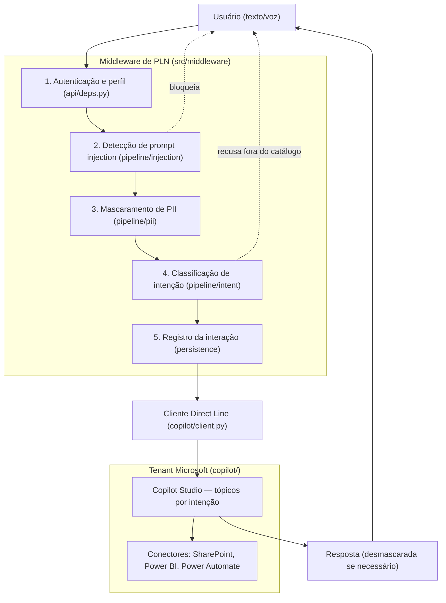

# Arquitetura da Solução — Middleware de PLN + Copilot Studio

Este documento descreve a arquitetura da solução e a estrutura de pastas que a
implementa. A proposta posiciona uma **camada própria de PLN (middleware)** entre
o usuário e o **Copilot Studio**, que atua como executor de ações no ecossistema
Microsoft do Metrô (SharePoint, Power BI, Power Automate).

## 1. Visão geral

O usuário nunca fala diretamente com o Copilot. Toda entrada passa pelo
middleware, que cumpre três papéis:

1. **Classificar e registrar intenções** — mapeia cada mensagem para o catálogo
   oficial de intenções do projeto e persiste a interação para auditoria e
   analytics, atendendo ao requisito de identificação e controle de intenções.
2. **Proteger dados sensíveis (LGPD)** — detecta PII (CPF, matrícula, e-mail,
   valores contratuais) e a substitui por placeholders reversíveis antes de a
   mensagem sair do perímetro controlado.
3. **Defender contra prompt injection** — combina filtros por padrões
   conhecidos, um classificador por modelo e o envio da entrada do usuário
   sempre como dado rotulado, nunca concatenada a instruções.

O Copilot Studio, configurado no tenant Microsoft do parceiro, recebe o prompt
já sanitizado com a intenção resolvida e executa a ação correspondente (buscar
e escrever documentos, consultar dados, disparar fluxos) por meio de conectores
com permissões mínimas.



### Por que essa separação

| Ganho | Custo assumido |
|---|---|
| Controle e auditoria totais sobre o que entra e sai do Copilot | Latência extra (dois saltos de rede + inferência) |
| Conformidade LGPD demonstrável: PII nunca sai do perímetro | Dois ambientes para operar e versionar |
| Catálogo de intenções como ativo próprio, independente do executor | Experiência nativa do Copilot (ex.: canal Teams) precisa ser intermediada |
| Controle de acesso por perfil aplicado antes de qualquer ação | Classificação de intenção duplicada com o *topic matching* do Copilot |

Sobre a duplicação de classificação: a decisão é que **o middleware é a fonte de
verdade** — ele classifica e envia a intenção já resolvida; os tópicos do
Copilot funcionam apenas como mapeamento de ação (ver
[copilot/topicos.md](../copilot/topicos.md)).

## 2. Estrutura de pastas

```text
g02/
├── src/
│   └── middleware/                   # Camada de PLN (Python + FastAPI)
│       ├── app/
│       │   ├── main.py               # Entrypoint da API
│       │   ├── config.py             # Configurações via variáveis de ambiente
│       │   ├── api/                  # Porta de entrada HTTP
│       │   │   ├── deps.py           # Autenticação e resolução de perfil
│       │   │   └── routes/           # /chat (fluxo principal) e /health
│       │   ├── pipeline/             # Coração da solução
│       │   │   ├── orchestrator.py   # Encadeia as etapas e decide o destino
│       │   │   ├── injection/        # Regras + classificador de prompt injection
│       │   │   ├── pii/              # Detector, mascarador e reconhecedores custom
│       │   │   └── intent/           # Catálogo e classificador de intenções
│       │   ├── copilot/              # Cliente Direct Line (único ponto que conhece o Copilot)
│       │   ├── persistence/          # Modelos e repositório de auditoria/analytics
│       │   └── schemas/              # Contratos Pydantic de request/response
│       ├── tests/
│       │   ├── unit/                 # Uma suíte por etapa do pipeline
│       │   └── integration/          # Fluxo completo com Copilot mockado
│       ├── pyproject.toml            # Dependências e configuração do projeto
│       ├── Dockerfile                # Empacotamento do serviço
│       └── .env.example              # Variáveis de ambiente documentadas (sem valores)
│
├── copilot/                          # Lado Copilot Studio (configuração versionada)
│   ├── solucao/                      # Exports da solution do Copilot Studio
│   ├── topicos.md                    # Contrato intenção → tópico/ação
│   └── conectores.md                 # Conectores habilitados e permissões (governança)
│
├── infra/
│   └── docker-compose.yml            # Middleware + PostgreSQL para desenvolvimento local
│
└── documentos/                       # Documentação do projeto (este arquivo incluído)
```

### 2.1 `src/middleware/` — o código da equipe

É o único componente com código-fonte próprio. Cada pasta responde a uma
pergunta distinta:

- **`api/`** — *quem pode falar comigo?* As rotas conectam HTTP ao pipeline sem
  conter lógica de PLN. `deps.py` autentica e resolve o perfil do usuário
  **antes** de qualquer processamento — é onde o requisito de controle de
  acesso por perfil é aplicado.
- **`pipeline/`** — *essa mensagem é segura e o que ela quer?* As três etapas
  (`injection/`, `pii/`, `intent/`) são módulos independentes, com interfaces
  próprias, encadeados pelo `orchestrator.py` em ordem fixa de segurança.
  A separação permite testar cada etapa isolada e trocar implementações (ex.:
  sair de regras para um modelo) sem tocar no resto.
- **`copilot/`** — *como executo a ação?* O `client.py` é o único ponto do
  middleware que conhece o Copilot (via API Direct Line). Trocar o executor no
  futuro significa substituir apenas este módulo.
- **`persistence/`** — *o que registro disso?* Guarda cada interação com o
  prompt **já mascarado**, a intenção classificada, o perfil e o desfecho
  (encaminhada ou bloqueada, e por quê). O mapeamento reversível de PII fica em
  armazenamento separado, cifrado — vazar a auditoria não vaza dados pessoais.
- **`schemas/`** — *qual o contrato da API?* Modelos Pydantic validam entrada e
  saída automaticamente e documentam a interface para o front-end/canal de voz.
- **`tests/`** — espelha o pipeline: `unit/` testa cada etapa isolada;
  `integration/` exercita o fluxo completo com o Copilot mockado, sem depender
  do ambiente Microsoft.

### 2.2 `copilot/` — configuração versionada do executor

O Copilot Studio é configurado por interface no tenant do parceiro e não gera
código-fonte; o que se versiona são os artefatos de rastreabilidade:

- **`solucao/`** — exports da *solution* (backup/migração da configuração);
- **`topicos.md`** — o contrato entre os dois mundos: qual intenção do catálogo
  dispara qual tópico/ação. Deve evoluir junto com
  `src/middleware/app/pipeline/intent/catalog.py`;
- **`conectores.md`** — registro de governança dos conectores e permissões,
  seguindo menor privilégio. É também parte da defesa em profundidade: mesmo
  que uma injeção alcance o Copilot, o raio de dano fica limitado às ações ali
  autorizadas.

A pasta fica fora de `src/` por ser configuração de um sistema externo, não
código da equipe.

### 2.3 `infra/` — ambiente de desenvolvimento

O `docker-compose.yml` sobe middleware + PostgreSQL com um comando, permitindo
que qualquer integrante rode a solução localmente apenas com Docker instalado.

## 3. Decisões de segurança embutidas na estrutura

1. **Ordem fixa do pipeline** (injection → PII → intenção): invariante de
   segurança documentada no `orchestrator.py`; o mascaramento acontece antes de
   qualquer chamada externa.
2. **Pseudonimização reversível**: o dado original nunca sai do middleware; a
   resposta do Copilot é desmascarada na volta quando necessário.
3. **Separação auditoria × PII**: registros de interação e mapeamentos de PII
   vivem em armazenamentos distintos, com controles distintos.
4. **Entrada como dado, nunca como instrução**: o cliente Direct Line envia a
   mensagem do usuário rotulada, com a intenção já resolvida em metadados.
5. **Menor privilégio nos conectores**: limita o impacto de qualquer ataque que
   ultrapasse as barreiras do middleware.
6. **Segredos fora do código**: toda configuração sensível vem de variáveis de
   ambiente (`.env` não versionado; `.env.example` documenta as chaves).

## 4. Estado atual e próximos passos

A estrutura contém **esqueletos documentados**: interfaces, contratos e regras
de decisão estão definidos; as implementações marcadas com `NotImplementedError`
e `TODO` dependem das decisões de stack previstas para a Sprint 2 (modelo de
classificação de intenções, ferramenta de detecção de PII, provedor de
identidade e provisionamento do ambiente Copilot Studio).
